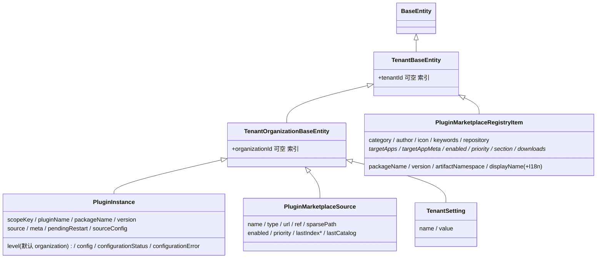

**本文引用的文件**
- [packages/server/src/core/entities/tenant-base.entity.ts](file://packages/server/src/core/entities/tenant-base.entity.ts)
- [packages/server/src/core/entities/tenant-organization-base.entity.ts](file://packages/server/src/core/entities/tenant-organization-base.entity.ts)
- [packages/server/src/plugin/plugin-instance.entity.ts](file://packages/server/src/plugin/plugin-instance.entity.ts)
- [packages/server/src/plugin/marketplace/plugin-marketplace-source.entity.ts](file://packages/server/src/plugin/marketplace/plugin-marketplace-source.entity.ts)
- [packages/server/src/plugin/marketplace/plugin-marketplace-registry-item.entity.ts](file://packages/server/src/plugin/marketplace/plugin-marketplace-registry-item.entity.ts)
- [packages/server/src/plugin/marketplace/plugin-marketplace.types.ts](file://packages/server/src/plugin/marketplace/plugin-marketplace.types.ts)
- [packages/server/src/tenant/tenant-setting/tenant-setting.entity.ts](file://packages/server/src/tenant/tenant-setting/tenant-setting.entity.ts)
- [packages/server/src/plugin/setup/setup-plugins.store.ts](file://packages/server/src/plugin/setup/setup-plugins.store.ts)
- [packages/server/src/plugin/setup/setup-plugins.schema.ts](file://packages/server/src/plugin/setup/setup-plugins.schema.ts)
- [packages/server/src/plugin/plugin-instance.loader.ts](file://packages/server/src/plugin/plugin-instance.loader.ts)
- [packages/server/src/plugin/plugin-instance.service.ts](file://packages/server/src/plugin/plugin-instance.service.ts)
- [packages/server/src/plugin/plugin-orm-metadata.ts](file://packages/server/src/plugin/plugin-orm-metadata.ts)
- [packages/server/src/plugin/plugin-schema-sync.service.ts](file://packages/server/src/plugin/plugin-schema-sync.service.ts)
- [packages/server/src/plugin/plugin-schema-scope.ts](file://packages/server/src/plugin/plugin-schema-scope.ts)
- [packages/server/src/plugin/source-config.ts](file://packages/server/src/plugin/source-config.ts)
- [packages/server/src/plugin/plugin-scope.ts](file://packages/server/src/plugin/plugin-scope.ts)
- [apps/api/src/bootstrap/index.ts](file://apps/api/src/bootstrap/index.ts)
- [apps/api/src/bootstrap/schema-sync-bootstrap.ts](file://apps/api/src/bootstrap/schema-sync-bootstrap.ts)

## 目录
- [表总览与继承关系](#表总览与继承关系)
- [表 plugin_instance](#表-plugin_instance)
- [表 plugin_marketplace_source](#表-plugin_marketplace_source)
- [表 plugin_marketplace_registry_item](#表-plugin_marketplace_registry_item)
- [复用表 tenant_setting 承载 setup 进度](#复用表-tenant_setting-承载-setup-进度)
- [迁移与 seed 惯例](#迁移与-seed-惯例)
- [校验规则](#校验规则)
- [已知风险](#已知风险)

## 表总览与继承关系
本子域三张自有表 + 一张复用表；两张市场表都是「可选来源」的目录态，只有 `plugin_instance` 是「已安装」的期望态，因此三张表的唯一键设计目标完全不同（安装态防重复，来源/注册表只做查询索引）。

图表来源：[plugin-instance.entity.ts](file://packages/server/src/plugin/plugin-instance.entity.ts)（关键符号：PluginInstance）、[plugin-marketplace-source.entity.ts](file://packages/server/src/plugin/marketplace/plugin-marketplace-source.entity.ts)（关键符号：PluginMarketplaceSource）、[tenant-setting.entity.ts](file://packages/server/src/tenant/tenant-setting/tenant-setting.entity.ts)（关键符号：TenantSetting）

层级：`BaseEntity` → `TenantBaseEntity`（多对一 `tenant` CASCADE、`tenantId` 可空 + 索引）→ `TenantOrganizationBaseEntity`（多对一 `organization` CASCADE、`organizationId` 可空 + 索引）。`plugin_instance`、`plugin_marketplace_source`、`tenant_setting` 止步于 `TenantOrganizationBaseEntity`；`plugin_marketplace_registry_item` 只到 `TenantBaseEntity`，**没有 organization 维度**，这是本子域最容易写错 scope 的一张表。

章节来源：[tenant-organization-base.entity.ts](file://packages/server/src/core/entities/tenant-organization-base.entity.ts)（关键符号：TenantOrganizationBaseEntity）、[plugin-marketplace-registry-item.entity.ts](file://packages/server/src/plugin/marketplace/plugin-marketplace-registry-item.entity.ts)（关键符号：TenantBaseEntity）

## 表 plugin_instance
一行 = 一个 scope 里的一份插件安装登记（`implements IPlugin`）。列与定义：

| 列 | 类型 / 可空 / 默认 | 说明 |
| --- | --- | --- |
| `tenantId` | 继承可空，索引 | system 级行为 `NULL`（安装时按 scope 显式置空） |
| `organizationId` | 继承可空，索引 | 全局组织行为 `NULL`（`getOrganizationValue` 归一） |
| `scopeKey` | `varchar` 可空 | `system:global` / `tenant:<id>:global` / organizationId 三类取值 |
| `pluginName` | `varchar` 非空 | 归一化后的插件名（`normalizePluginName`） |
| `packageName` | `varchar` 非空 | npm 包名；code 源下与 `pluginName` 同为包名 |
| `version` | `varchar` 可空 | 声明版本 |
| `source` | `varchar` 可空 | `code/npm/archive/marketplace/env/...` |
| `meta` | `jsonb` 可空 | `PluginMeta`（含 `sdkCompatibilityWarnings`、`runtimePolicy`、`artifactNamespace`、`level`） |
| `pendingRestart` | `boolean` 默认 `false` | 「已落库但当前进程未加载」 |
| `sourceConfig` | `jsonb` 可空 | 归一后的来源配置；**不含 `packageDir`** |
| `level` | `varchar` 默认 `organization` | `system` / `tenant` / `organization` |
| `config` | `jsonb` 默认 `{}` | 落库前经 `serializePluginConfig` 加密信封 |
| `configurationStatus` | `varchar` 可空 | `valid` / `invalid` |
| `configurationError` | `text` 可空 | 配置校验失败原因 |

唯一约束三条：`@Index(['scopeKey','pluginName'], { unique: true })`、`@Index(['tenantId','organizationId','pluginName'], { unique: true })`、partial unique `IDX_plugin_instance_tenant_level_plugin_name` on `(['pluginName'], { where: "level = 'tenant'" })`。业务约束：`level='system'` 只能落在 `scopeKey='system:global'`（安装期双向校验）；同一包名不允许同时存在 system 与 tenant 级（`PluginProcessLevelConflict`）；tenant 级包在全局范围内只允许一个租户持有（`PluginTenantLevelAlreadyOwned`）。写入路径由 `PluginInstanceService.upsert` 收口：`buildPluginWhere` 同时匹配 `scopeKey` 精确行、`scopeKey IS NULL AND level='system'` 的遗留行、以及按 `buildTenantWhereVariants` 生成的 `scopeKey IS NULL` 遗留行，`existing` 命中即原地更新（含把 `tenantId/organizationId/scopeKey` 改写到解析后的 scope），否则 `create`。

章节来源：[plugin-instance.entity.ts](file://packages/server/src/plugin/plugin-instance.entity.ts)（关键符号：PluginInstance、resolvePluginLevel、isRestartRequiredPluginLevel）、[plugin-instance.service.ts](file://packages/server/src/plugin/plugin-instance.service.ts)（关键符号：PluginInstanceService.upsert、PluginInstanceService.findVisibleInOrganization）

## 表 plugin_marketplace_source
一行 = 一个用户登记（或内置虚拟）市场来源。列：`name` 非空；`type` `varchar` ∈ `url|github|git`（`PLUGIN_MARKETPLACE_SOURCE_TYPES`）；`url` 非空（校验用 `@IsUrl({ require_tld: false, require_protocol: false })`，因此 `owner/repo` 与 `xpert-platform://plugins` 这类值可过）；`ref` 可空；`sparsePath` 可空；`enabled` 默认 `true`；`priority` 默认 `100`；`lastIndexStatus` `varchar` 默认 `idle` ∈ `idle|success|failed`；`lastIndexedAt` `timestamptz` 可空；`lastIndexError` 可空；`lastCatalog` `jsonb` 可空（整份 `NormalizedMarketplaceCatalog` 快照）。索引：普通组合索引 `(tenantId, organizationId, name)`，**无唯一约束**。

关系与业务约束：`tenant` / `organization` 多对一 CASCADE（来自基类）。内置来源（`BUILTIN_SOURCE_ID = 'builtin-default'`）与平台注册表来源（`PLATFORM_REGISTRY_SOURCE_ID = 'platform-registry'`）在读取时由代码合成（`createPlatformRegistrySourceResponse`：`type: 'platform'`、`priority: -10`、`lastIndexStatus: 'success'`、`builtin: true`），`MarketplaceSourceRecord.type` 因此额外允许 `'platform'` 这个不在 `@IsIn` 白名单内的取值——**这是「实体约束 ≠ 领域取值」的一处已知缺口**。`lastCatalog` 是整份目录的宽 jsonb 快照，源越大行越宽。

章节来源：[plugin-marketplace-source.entity.ts](file://packages/server/src/plugin/marketplace/plugin-marketplace-source.entity.ts)（关键符号：PluginMarketplaceSource、PLUGIN_MARKETPLACE_SOURCE_TYPES、PLUGIN_MARKETPLACE_SOURCE_STATUSES）、[plugin-marketplace.types.ts](file://packages/server/src/plugin/marketplace/plugin-marketplace.types.ts)（关键符号：MarketplaceSourceRecord、PLATFORM_REGISTRY_SOURCE_URL、BUILTIN_SOURCE_ID）

## 表 plugin_marketplace_registry_item
一行 = 平台注册表目录条目（`xpert-platform://plugins` 的数据源）。列：`packageName` 非空；`version` 可空；`artifactNamespace` 可空（列注释说明它只用于市场展示与人工审查，**运行期安装仍会重新校验命名空间归属**）；`displayName` 非空 + `displayNameI18n` jsonb 可空；`description` 非空 + `descriptionI18n` jsonb 可空；`category` 非空；`author` 非空；`icon` jsonb 可空；`keywords` jsonb 可空（`string[]`）；`homepage` 可空；`repository` jsonb 可空；`targetApps` jsonb **非空**（`string[]`）；`targetAppMeta` jsonb 可空；`enabled` 默认 `true`；`priority` 默认 `100`；`section` `varchar` 默认 `marketplace` ∈ `marketplace|official|partner|community`；`downloads` jsonb 可空；`downloadsStatus` `varchar` 默认 `idle` ∈ `idle|success|failed`；`downloadsUpdatedAt` `timestamptz` 可空；`downloadsError` 可空。索引：`(tenantId, packageName)`，**无唯一约束**、**无 organization 维度**。业务含义：它描述「市场里有什么可装」，与 `plugin_instance`（「这台机器装了什么」）之间没有外键，安装动作由用户/向导触发。

章节来源：[plugin-marketplace-registry-item.entity.ts](file://packages/server/src/plugin/marketplace/plugin-marketplace-registry-item.entity.ts)（关键符号：PluginMarketplaceRegistryItem、PLUGIN_MARKETPLACE_REGISTRY_SECTIONS、PLUGIN_MARKETPLACE_REGISTRY_DOWNLOAD_STATUSES）

## 复用表 tenant_setting 承载 setup 进度
setup 进度不另建表，而是以「单行」形式复用 `tenant_setting`（`name` 非空、`value` 可空 varchar，继承 `TenantBaseEntity`）：主键 `id = uuidv5('xpert:setup-plugins:<tenantId>', uuid.URL)`，`name = 'setupPluginInstallation'`，`value = JSON.stringify(setupPluginProgress)`。`SetupPluginsStore.read` 会用 `setupPluginProgress.parse` 校验历史值，缺失或不可解析时回退 `{ phase: 'idle', items: [], updatedAt: now }`；`save` 每次刷新 `updatedAt`。`setupPluginProgress`（zod）定义：`phase ∈ idle|installing|restarting|completed|attention`；`items[]` 含 `packageName`、`title`（字符串或 i18n 记录）、`level?`、`version?`、`status ∈ pending|installing|installed|existing|failed`、`error?`、`runtimeRequirements[]`（`scopeKey`、`pluginName`、`version?`、`runtimeRevision?`、`state ∈ loaded|absent`）；`defaultAgentPlugins?` 含 `status ∈ pending|importing|completed|failed` 与导入结果 `items[].status ∈ imported|existing|failed`；外加 `organizationId?`、`updatedAt`、`restartId?`、`generation?`、`error?`。**该行不保存任何插件凭据**（文件头不变量注释）。

章节来源：[tenant-setting.entity.ts](file://packages/server/src/tenant/tenant-setting/tenant-setting.entity.ts)（关键符号：TenantSetting）、[setup-plugins.store.ts](file://packages/server/src/plugin/setup/setup-plugins.store.ts)（关键符号：SetupPluginsStore.read、SetupPluginsStore.save）、[setup-plugins.schema.ts](file://packages/server/src/plugin/setup/setup-plugins.schema.ts)（关键符号：setupPluginProgress）

## 迁移与 seed 惯例
本子域**没有** TypeORM migration 文件或 seed 脚本；schema 由三类机制产生，机制名如下（已核实）：① **宿主表**由连接层 `synchronize` 建表（`preBootstrapApplicationConfig` 里注册实体/订阅者后交给 TypeORM）；② **插件自带实体**由「运行期 metadata 合并 + 插件 schema preflight」负责——合并函数 `registerPluginOrmMetadataInDataSource`（`mergeTargets` 去重后 `dataSource.setOptions`，再 `buildMetadatas()`；**只刷新 metadata，注释明确 DDL 归 preflight**），preflight 是 `PluginSchemaSyncService.synchronize`（在 Redis 锁 `xpert:plugin:schema-sync`、TTL 5 分钟、`runWithLock` 未拿到锁即抛 `Another plugin schema migration is already in progress`；内部 `loadPlugin` + `plugin.register(context)`，其 `resolve()` 直接抛错禁止迁移期解析应用服务；无实体直接返回；有实体则建一次性 `DataSource`（`synchronize: false` 起步、`migrationsRun: false`）并只对插件自有实体打开同步）；③ **作用域收口**是 `scopePluginSchemaSynchronization`（把插件实体及其 closure/junction/owning-relation 表纳入 `owned`，校验 `metadata.tableName` 必须匹配 `plugin_<namespace>_`（未声明 namespace 退化为 `plugin_`），再把其余 metadata 的 `synchronize` 置 false）。删表前缀校验另有一层 `validatePluginEntityTableNames`（用装饰器里的**物理表名**而非类名比对）。另有外部管理模式：`withSchemaSyncProtection` 在 `isSchemaSyncExternallyManaged()` 为真时临时把 `dbConnectionOptions.synchronize` 置 false，避免插件发现阶段就打开会执行 DDL 的连接。历史数据迁移则以「运行期回填 SQL」形式内联在 `plugin-instance.loader.ts` 的 `backfillPluginInstanceScopeKeys`（给 `scopeKey IS NULL` 的行补值、并清理 system 级重复行）。seed 惯例：内置市场来源与平台注册表来源不入库，由代码在访问时合成。

章节来源：[plugin-orm-metadata.ts](file://packages/server/src/plugin/plugin-orm-metadata.ts)（关键符号：registerPluginOrmMetadataInDataSource、validatePluginEntityTableNames）、[plugin-schema-sync.service.ts](file://packages/server/src/plugin/plugin-schema-sync.service.ts)（关键符号：PluginSchemaSyncService.synchronize）、[plugin-schema-scope.ts](file://packages/server/src/plugin/plugin-schema-scope.ts)（关键符号：scopePluginSchemaSynchronization）、[schema-sync-bootstrap.ts](file://apps/api/src/bootstrap/schema-sync-bootstrap.ts)（关键符号：withSchemaSyncProtection）

## 校验规则
- **实体级（class-validator）**：字符串字段普遍 `@IsString()` + 条件性 `@IsOptional()`；枚举字段用 `@IsIn(...)`（`plugin_marketplace_source.type`、`lastIndexStatus`、`plugin_marketplace_registry_item.section`、`downloadsStatus`）；URL 用 `@IsUrl({ require_tld: false, require_protocol: false })`；jsonb 数组用 `@IsArray()`（`keywords`、`targetApps`）。`plugin_instance` 只有少量校验装饰器，因为它的写入唯一入口是 `PluginInstanceService.upsert`（服务层校验），而不是 CRUD DTO。
- **HTTP 级**：setup 接口用 Zod（`setupPluginsCatalogQuery` 的 `pageSize ≤ 48`、`.strict()`；`setupPluginsInput` 的 `plugins[].min(1).max(200)` 且 `max(5000)`、`importDefaultAgentPlugins` 默认 true），失败统一转 400。
- **DB 级**：`plugin_instance` 三条唯一约束是最后防线；两张市场表只有普通索引，各自依赖「先查后写」的服务层逻辑（市场来源/注册表 CRUD 由控制器与服务校验）。
- **服务级业务校验**：`resolvePluginScope` 决定 `tenantId/organizationId/scopeKey` 三元组（system 强制 `organizationId = GLOBAL_ORGANIZATION_SCOPE` 且 `tenantId` 可为 NULL）；`omitTransientPluginSourceConfig` 保证 `packageDir` 不落库；`PluginInstanceService.upsert` 在 `hasExplicitSourceConfig` 为 false 且 `source` 与既有行相同时保留旧 `sourceConfig`（避免配置读写把来源信息抹掉）；`getOrganizationValue` 把全局组织归一为 `NULL`，与 `buildTenantWhereVariants` 的默认租户特例（同时匹配 `tenantId` 与 `tenantId IS NULL`）共同决定可见性查询形状。
- **约束的自我声明**：`plugin-startup-state.ts` 的 `stateSchema`（zod）为快照文件定义了等价于表结构的 schema，`configs` 字段以 `__xpert_plugin_encrypted__` 信封往返；快照损坏时直接抛 `PluginStartupRecoveryRequiredError` 而不尝试修复。

章节来源：[plugin-marketplace-source.entity.ts](file://packages/server/src/plugin/marketplace/plugin-marketplace-source.entity.ts)（关键符号：PluginMarketplaceSource.url）、[setup-plugins.schema.ts](file://packages/server/src/plugin/setup/setup-plugins.schema.ts)（关键符号：setupPluginsInput、setupPluginsCatalogQuery）、[source-config.ts](file://packages/server/src/plugin/source-config.ts)（关键符号：omitTransientPluginSourceConfig、normalizePluginSourceConfig）

## 已知风险
- **`packageDir` 是瞬态字段**：`omitTransientPluginSourceConfig` 在落库前删除它，因此从 `plugin_instance.sourceConfig` 永远读不到已解包目录；排查安装问题不能靠库里的 `sourceConfig` 判断磁盘状态。
- **遗留行与回填是破坏性的**：`backfillPluginInstanceScopeKeys` 对 `scopeKey IS NULL AND level='system'` 的重复行按 `updatedAt/createdAt/id` 排序后**删除**多余行，再统一改写 `scopeKey/tenantId/organizationId`；这段 SQL 在每次启动都会跑（有 `hasPluginInstanceScopeKeyColumn` 守卫），手工插入的异常行会被静默清理。
- **`scopeKey` 可空 + 三种匹配语义并存**：`buildPluginWhere` 会同时匹配精确 scope、system 遗留 `scopeKey IS NULL`、以及按 tenant 变体的 `scopeKey IS NULL` 行，误写 where 很容易产生跨 scope 命中；`(tenantId, organizationId, pluginName)` 唯一键在 `organizationId IS NULL` 时对 NULL 行**不互相冲突**（SQL NULL 语义），因此 organization/system 级的重复只能靠 partial unique 与 `(scopeKey, pluginName)` 兜底。
- **partial unique 只覆盖 `level='tenant'`**：`level='organization'` 与 `level='system'` 无专属唯一约束，完全依赖 `(scopeKey, pluginName)` 与应用层 `findSystemLevelRegistration` / `findTenantLevelOwner` 检查。
- **两张市场表无唯一约束**：`plugin_marketplace_source` 与 `plugin_marketplace_registry_item` 都只有普通索引，重复来源/重复条目不会被数据库拦下，只影响聚合结果（按 packageName 去重发生在 `PluginMarketplaceCatalogs` / `SetupPluginsCatalog` 层）。
- **registry item 无 organization 维度**：它继承 `TenantBaseEntity`，与同样继承该基类但按 organization 收敛的其他查询混用时，容易写出跨组织可见的查询。
- **`@IsIn` 白名单与 `type: 'platform'` 不一致**：实体只允许 `url|github|git`，而 `MarketplaceSourceRecord.type` 与 `createPlatformRegistrySourceResponse` 会产出 `'platform'`；该差异目前靠「平台来源不入库」规避。
- **插件实体的 DDL 只能走 preflight**：任何绕过 `PluginSchemaSyncService.synchronize` 的建表路径（例如直接 `dataSource.synchronize()`）都会在锁外执行 DDL，与「多副本串行迁移」的前提冲突；同时 `scopePluginSchemaSynchronization` 的前缀校验意味着表名不合规的插件会在同步阶段直接抛错而不是降级。

章节来源：[plugin-instance.loader.ts](file://packages/server/src/plugin/plugin-instance.loader.ts)（关键符号：backfillPluginInstanceScopeKeys、buildOrganizationPluginConfigs）、[plugin-instance.service.ts](file://packages/server/src/plugin/plugin-instance.service.ts)（关键符号：PluginInstanceService.buildPluginWhere）、[plugin-marketplace.types.ts](file://packages/server/src/plugin/marketplace/plugin-marketplace.types.ts)（关键符号：MarketplaceSourceRecord.type）
