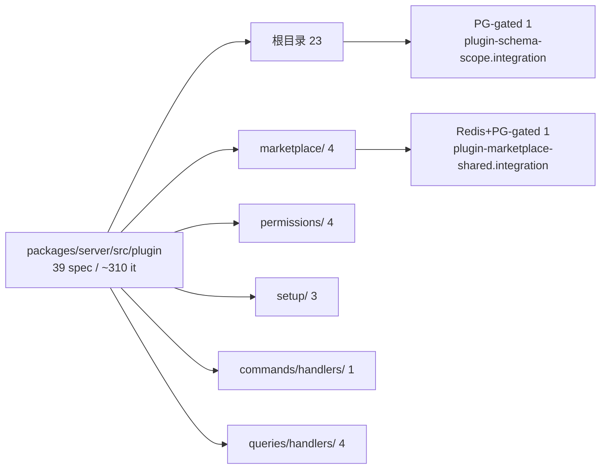

**本文引用的文件**
- [packages/server/jest.config.ts](file://packages/server/jest.config.ts)
- [packages/server/src/plugin/plugin.controller.spec.ts](file://packages/server/src/plugin/plugin.controller.spec.ts)
- [packages/server/src/plugin/plugin.helper.spec.ts](file://packages/server/src/plugin/plugin.helper.spec.ts)
- [packages/server/src/plugin/plugin-management.service.spec.ts](file://packages/server/src/plugin/plugin-management.service.spec.ts)
- [packages/server/src/plugin/plugin-management-code.service.spec.ts](file://packages/server/src/plugin/plugin-management-code.service.spec.ts)
- [packages/server/src/plugin/plugin-management-scopes.service.spec.ts](file://packages/server/src/plugin/plugin-management-scopes.service.spec.ts)
- [packages/server/src/plugin/plugin-management.test-fixture.ts](file://packages/server/src/plugin/plugin-management.test-fixture.ts)
- [packages/server/src/plugin/plugin-instance.service.spec.ts](file://packages/server/src/plugin/plugin-instance.service.spec.ts)
- [packages/server/src/plugin/plugin-instance.loader.spec.ts](file://packages/server/src/plugin/plugin-instance.loader.spec.ts)
- [packages/server/src/plugin/plugin-schema-sync.service.spec.ts](file://packages/server/src/plugin/plugin-schema-sync.service.spec.ts)
- [packages/server/src/plugin/plugin-schema-scope.integration.spec.ts](file://packages/server/src/plugin/plugin-schema-scope.integration.spec.ts)
- [packages/server/src/plugin/plugin-startup-state.spec.ts](file://packages/server/src/plugin/plugin-startup-state.spec.ts)
- [packages/server/src/plugin/plugin-startup-step.spec.ts](file://packages/server/src/plugin/plugin-startup-step.spec.ts)
- [packages/server/src/plugin/plugin-startup-watchdog.spec.ts](file://packages/server/src/plugin/plugin-startup-watchdog.spec.ts)
- [packages/server/src/plugin/plugin-sdk-versioning.spec.ts](file://packages/server/src/plugin/plugin-sdk-versioning.spec.ts)
- [packages/server/src/plugin/plugin-archive.spec.ts](file://packages/server/src/plugin/plugin-archive.spec.ts)
- [packages/server/src/plugin/organization-plugin.store.spec.ts](file://packages/server/src/plugin/organization-plugin.store.spec.ts)
- [packages/server/src/plugin/plugin-http-routes.spec.ts](file://packages/server/src/plugin/plugin-http-routes.spec.ts)
- [packages/server/src/plugin/plugin-management-scopes.service.spec.ts](file://packages/server/src/plugin/plugin-management-scopes.service.spec.ts)
- [packages/server/src/plugin/marketplace/plugin-marketplace.service.spec.ts](file://packages/server/src/plugin/marketplace/plugin-marketplace.service.spec.ts)
- [packages/server/src/plugin/marketplace/plugin-marketplace-cache.spec.ts](file://packages/server/src/plugin/marketplace/plugin-marketplace-cache.spec.ts)
- [packages/server/src/plugin/marketplace/plugin-marketplace-shared.integration.spec.ts](file://packages/server/src/plugin/marketplace/plugin-marketplace-shared.integration.spec.ts)
- [packages/server/src/plugin/marketplace/plugin-marketplace.controller.spec.ts](file://packages/server/src/plugin/marketplace/plugin-marketplace.controller.spec.ts)
- [packages/server/src/plugin/setup/setup-plugins.service.spec.ts](file://packages/server/src/plugin/setup/setup-plugins.service.spec.ts)
- [packages/server/src/plugin/setup/setup-plugins.catalog.spec.ts](file://packages/server/src/plugin/setup/setup-plugins.catalog.spec.ts)
- [packages/server/src/plugin/setup/setup-plugins.controller.spec.ts](file://packages/server/src/plugin/setup/setup-plugins.controller.spec.ts)
- [packages/server/src/plugin/permissions/account-binding-permission.spec.ts](file://packages/server/src/plugin/permissions/account-binding-permission.spec.ts)
- [packages/server/src/plugin/commands/handlers/update-plugin.registry.spec.ts](file://packages/server/src/plugin/commands/handlers/update-plugin.registry.spec.ts)
- [packages/server/src/plugin/queries/handlers/npm-plugin-version.spec.ts](file://packages/server/src/plugin/queries/handlers/npm-plugin-version.spec.ts)
- [packages/server/src/plugin/queries/handlers/npm-plugin-version.bundle.spec.ts](file://packages/server/src/plugin/queries/handlers/npm-plugin-version.bundle.spec.ts)
- [packages/server/src/plugin/queries/handlers/resolve-latest-plugin-version.handler.spec.ts](file://packages/server/src/plugin/queries/handlers/resolve-latest-plugin-version.handler.spec.ts)
- [packages/server/src/plugin/queries/handlers/resolve-plugin-artifact-namespace.handler.spec.ts](file://packages/server/src/plugin/queries/handlers/resolve-plugin-artifact-namespace.handler.spec.ts)

## 目录
- [spec 总览](#spec-总览)
- [根目录 23 个 spec 的覆盖点](#根目录-23-个-spec-的覆盖点)
- [marketplace / permissions / setup 共 11 个 spec 的覆盖点](#marketplace--permissions--setup-共-11-个-spec-的覆盖点)
- [commands / queries handlers 共 5 个 spec 的覆盖点](#commands--queries-handlers-共-5-个-spec-的覆盖点)
- [运行命令、环境开关与实测](#运行命令环境开关与实测)
- [无测试模块与缺口](#无测试模块与缺口)
- [可执行性结论](#可执行性结论)

## spec 总览
`packages/server/src/plugin/` 下共 **39 个 `.spec.ts`**，与源文件同目录同前缀命名；子目录沿用被测模块结构（`marketplace/`、`permissions/`、`setup/`、`commands/handlers/`、`queries/handlers/`）。分布：根目录 **23**、`marketplace/` **4**、`permissions/` **4**、`setup/` **3**、`commands/handlers/` **1**、`queries/handlers/` **4**。用例总量约 **310 个 `it()`**（按顶层 `it(`/`it.each(` 统计），体量最大的三份是 `plugin.controller.spec.ts`（41KB / 36 个 it）、`marketplace/plugin-marketplace.service.spec.ts`（27KB / 15 个 it，含 6 个顶层 `describe`）、`plugin.helper.spec.ts`（17KB / 11 个 it）。命名惯例：真正依赖外部服务的用 `.integration.spec.ts`，HTTP 端到端形态在本子域内由 controller spec 覆盖（`.http.spec.ts` 出现在相邻子专家②的目录）。范围内**无 `it.only` / `describe.only`**；两处条件跳过都用「三元切换 describe/describe.skip」而非硬编码 skip。


图表来源：[packages/server/jest.config.ts](file://packages/server/jest.config.ts)（关键符号：displayName server）、[plugin-schema-scope.integration.spec.ts](file://packages/server/src/plugin/plugin-schema-scope.integration.spec.ts)（关键符号：describePostgres）、[plugin-marketplace-shared.integration.spec.ts](file://packages/server/src/plugin/marketplace/plugin-marketplace-shared.integration.spec.ts)（关键符号：MARKETPLACE_TEST_REDIS_URL）

章节来源：[plugin.controller.spec.ts](file://packages/server/src/plugin/plugin.controller.spec.ts)（关键符号：describe PluginController）、[plugin.helper.spec.ts](file://packages/server/src/plugin/plugin.helper.spec.ts)（关键符号：describe plugin helper registerPluginsAsync）、[plugin-marketplace.service.spec.ts](file://packages/server/src/plugin/marketplace/plugin-marketplace.service.spec.ts)（关键符号：describe PluginMarketplaceService）

## 根目录 23 个 spec 的覆盖点
安装编排三兄弟（共用夹具 `plugin-management.test-fixture.ts`）：`plugin-management.service.spec.ts`（`describe('PluginManagementService')`，10 it，主流程与失败补偿）、`plugin-management-code.service.spec.ts`（6 it，`source: 'code'` 的 staging/刷新语义）、`plugin-management-scopes.service.spec.ts`（17 it，本目录体量第二，scope 与 level 归属判定）。状态与装配：`plugin-instance.service.spec.ts`（11 it，upsert/deactivate/可见性/默认租户）、`plugin-instance.loader.spec.ts`（10 it，显式 mock `typeorm` 与 DB 探测，覆盖 loader 与回填）、`plugin-orm-metadata.spec.ts`（8 it，metadata 合并与表名前缀校验）、`plugin-http-routes.spec.ts`（4 it，动态注册路由并把新层插到 404 处理器之前）、`plugin-strategy-registration` 无同名 spec（由 http-routes/helper 用例间接覆盖）。启动期：`plugin-startup-state.spec.ts`（5 it，`PluginStartupState` 的候选/回滚/提交）、`plugin-startup-step.spec.ts`（2 it，超时与结构化日志）、`plugin-startup-watchdog.spec.ts`（2 it，`describe('startup watchdog in a real process')`，起真实 worker 进程）。SDK 与策略：`plugin-sdk-versioning.spec.ts`（17 it，兼容断言与 workspace 定位）、`plugin-runtime-policy.spec.ts`（3 it，`requiresPluginRestart` 的 policy/level 组合）、`plugin-runtime-state.service.spec.ts`（1 it，上报载荷）。文件与归档：`organization-plugin.store.spec.ts`（18 it，root 分支、manifest、staging 指纹、目录清理）、`plugin-bundle-manifest.spec.ts`（8 it）、`plugin-archive.spec.ts`（2 it，按魔数识别 zip/tgz 与非法包 400）、`plugin-loader.spec.ts`（4 it）。其余：`plugin.controller.spec.ts`（36 it，端点行为主战场）、`plugin.helper.spec.ts`（11 it，`registerPluginsAsync` 的 stageOnly/code 优先/错误登记）、`plugin-webhook-credential.service.spec.ts`（3 it）、`config.spec.ts`（3 it）、`plugin-schema-sync.service.spec.ts`（`describe('plugin schema preflight')`，3 it）、`plugin-schema-scope.integration.spec.ts`（1 it，PG-gated）。

章节来源：[plugin-management.service.spec.ts](file://packages/server/src/plugin/plugin-management.service.spec.ts)（关键符号：describe PluginManagementService）、[organization-plugin.store.spec.ts](file://packages/server/src/plugin/organization-plugin.store.spec.ts)（关键符号：describe organization-plugin.store）、[plugin-schema-sync.service.spec.ts](file://packages/server/src/plugin/plugin-schema-sync.service.spec.ts)（关键符号：describe plugin schema preflight）

## marketplace / permissions / setup 共 11 个 spec 的覆盖点
**marketplace 4**：`plugin-marketplace.service.spec.ts` 用 6 个顶层 describe 分主题覆盖——本地化 registry 元数据、README 详情、试用快捷入口、专用代理、公开市场、npm bundle manifest 富化；`plugin-marketplace-cache.spec.ts`（14 it）覆盖三块：请求隔离、缓存（含负缓存/租约路径）、卡片投影；`plugin-marketplace.controller.spec.ts`（2 it）用装饰器元数据断言公开/私有路由与图标缓存头；`plugin-marketplace-shared.integration.spec.ts`（17 it）是唯一模拟多副本的用例，手写 `jest.mock('@xpert-ai/plugin-sdk')` 与 `jest.mock('./plugin-marketplace-source.entity')`，用两个 Redis client + 两个 DataSource 验证共享缓存与分布式锁。**permissions 4**：`account-binding-permission.spec.ts`（8 it）、`bound-identity-login-permission.spec.ts`（8 it）、`integration-permission.spec.ts`（4 it）、`sso-binding-permission.spec.ts`（4 it），分别覆盖 `@xpert-ai/plugin-sdk` 权限 token 到宿主实现的桥接行为（账号绑定、身份登录、集成、SSO 绑定）。**setup 3**：`setup-plugins.service.spec.ts`（16 it，状态机、顺序安装、失败继续、续跑与重启交接）、`setup-plugins.catalog.spec.ts`（5 it，目录复用/过滤/`unavailableReason`/分页与 `selectableNames`）、`setup-plugins.controller.spec.ts`（`describe('SetupPluginsController HTTP validation')`，6 it，真实 Nest HTTP 实例、端口 0、`overrideGuard(RoleGuard)` 切换放行，断言 202/400 与 service 未被调用）。

章节来源：[plugin-marketplace-cache.spec.ts](file://packages/server/src/plugin/marketplace/plugin-marketplace-cache.spec.ts)（关键符号：describe marketplace request isolation）、[plugin-marketplace-shared.integration.spec.ts](file://packages/server/src/plugin/marketplace/plugin-marketplace-shared.integration.spec.ts)（关键符号：MARKETPLACE_TEST_POSTGRES_URL）、[setup-plugins.controller.spec.ts](file://packages/server/src/plugin/setup/setup-plugins.controller.spec.ts)（关键符号：describe SetupPluginsController HTTP validation）

## commands / queries handlers 共 5 个 spec 的覆盖点
`commands/handlers/update-plugin.registry.spec.ts`（2 it，`describe('plugin updates through the npm registry client')`）覆盖 `UpdatePluginCommand` 经 npm registry 客户端的升级路径与注册表配置读取。`queries/handlers/` 四个：`npm-plugin-version.spec.ts`（15 it，`NpmPluginVersionClient` 的 `.npmrc`/registry 解析与 `dist-tags` 查询）、`npm-plugin-version.bundle.spec.ts`（1 it，**顶层直接写 `it(...)` 而非 `describe(...)`**：用 webpack 真实打包后起本地 HTTP registry 验证「打包产物里仍能解析 npm 配置」，因此它是唯一不依赖 jest 模块 mock 的版本解析用例）、`resolve-latest-plugin-version.handler.spec.ts`（6 it，`ResolveLatestPluginVersionHandler` 的批量与 `hasUpdate` 判定）、`resolve-plugin-artifact-namespace.handler.spec.ts`（2 it，`describe('registered application namespaces')`，命名空间可见性）。

章节来源：[update-plugin.registry.spec.ts](file://packages/server/src/plugin/commands/handlers/update-plugin.registry.spec.ts)（关键符号：describe plugin updates through the npm registry client）、[npm-plugin-version.bundle.spec.ts](file://packages/server/src/plugin/queries/handlers/npm-plugin-version.bundle.spec.ts)（关键符号：resolves npm configuration and queries versions from a Node webpack bundle）、[resolve-plugin-artifact-namespace.handler.spec.ts](file://packages/server/src/plugin/queries/handlers/resolve-plugin-artifact-namespace.handler.spec.ts)（关键符号：describe registered application namespaces）

## 运行命令、环境开关与实测
框架为 Jest + `ts-jest`（`tsconfig: '<rootDir>/tsconfig.spec.json'`、`testEnvironment: 'node'`、preset `../../jest.preset.js`），`moduleNameMapper` 把 `@xpert-ai/contracts` 指到源码，`transformIgnorePatterns` 由 `@xpert-ai/plugin-sdk` 等种子包递归解析依赖生成（因此 ESM 的 SDK 也能被转换）。定向运行单文件：

```bash
node node_modules/jest/bin/jest.js --config packages/server/jest.config.ts \
  --runTestsByPath /root/xpert/packages/server/src/plugin/plugin.controller.spec.ts
```

**说明**：本次为只读检索，未执行 jest；上表命令形态与 `--config packages/server/jest.config.ts` 的用法来自上一级文档的实测记录（单文件秒级）。本节可核实的事实是：39 个 spec 文件均存在、`packages/server/jest.config.ts` 的 `displayName` 为 `server` 且只映射 `@xpert-ai/contracts`，因此**跨包用例必须用对应包自己的 config**。

**PG-gated（1 个）**：`plugin-schema-scope.integration.spec.ts` 用 `const describePostgres = process.env.XPERT_SCHEMA_TEST_DATABASE_URL ? describe : describe.skip` 切换；开启后创建随机 schema（`plugin_scope_test_<uuid 去掉横线>`）、手工建 `HostProject`/`OtherPluginVersion`/`PluginItem`/`PluginScopeManual` 等实体，断言 `scopePluginSchemaSynchronization` 只让目标插件表参与同步、必须拒绝越界表名，并做 `DROP SCHEMA ... CASCADE` 清理。**Redis + PG-gated（1 个）**：`plugin-marketplace-shared.integration.spec.ts` 需要 `MARKETPLACE_TEST_REDIS_URL` 与 `MARKETPLACE_TEST_POSTGRES_URL` **同时**存在才运行（否则整组 `describe.skip`），内部用 `deferred<T>()` 编排并发时序验证「只有持租约者能发布」。**文件系统用例免依赖**：`plugin-archive.spec.ts` 写临时 zip/tgz、`plugin-startup-watchdog.spec.ts` 起真实进程、`plugin-instance.loader.spec.ts` 用显式模块 mock 替代 DB。开启方式即导出上述三个环境变量后，用 `packages/server/jest.config.ts` 定向运行这两个文件。

章节来源：[packages/server/jest.config.ts](file://packages/server/jest.config.ts)（关键符号：moduleNameMapper、transformIgnorePatterns）、[plugin-schema-scope.integration.spec.ts](file://packages/server/src/plugin/plugin-schema-scope.integration.spec.ts)（关键符号：XPERT_SCHEMA_TEST_DATABASE_URL）、[plugin-startup-watchdog.spec.ts](file://packages/server/src/plugin/plugin-startup-watchdog.spec.ts)（关键符号：describe startup watchdog in a real process）

## 无测试模块与缺口
- **无同名 spec 的高风险文件**：`plugin.module.ts`（启动链入口与 `init()`）、`plugin-strategy-registration.ts`（策略/队列处理器注册）、`plugin-instance.entity.ts`（唯一索引与 level 判定函数所在处）、`plugin-update.utils.ts`、`plugin-install-policy.ts`、`plugin-schema-scope.ts`（由 integration spec 覆盖）、`setup-plugins.schema.ts`（Zod 契约）、`plugin-config.crypto.ts`（配置加密信封）、`plugin-webhook.tokens.ts`、`types.ts`、`errors.ts`、`lifecycle.ts`、`plugin-discovery.ts`、`plugin-runtime-policy.ts` 之外的机制文件均已在本目录或相邻 spec 中被间接触达，但**没有直接断言**。
- **`PluginModule.init()` / `onModuleInit` 无直接用例**：`onPluginBootstrap` 的致命超时语义只在 `plugin-startup-step.spec.ts` 层面验证，`PluginModule` 把 `configService.plugins` 展开为 imports、以及「Nest 解析失败必须上抛保持 readiness 关闭」这条注释所描述的行为没有 spec。
- **setup 向导的锁行为无真 PG 用例**：`setup-plugins.service.spec.ts` 依赖 mock 的 `SetupPluginsStore`，`pg_try_advisory_lock` 路径与「锁释放后再读」的乐观并发分支没有集成测试（对比：schema 作用域与市场共享缓存各有 PG/Redis 集成用例）。
- **`PluginScopeGuard` 的 spec 不在本目录**：其用例位于 `packages/server/src/shared/guards/plugin-scope.guard.spec.ts`，但 guard 是插件动态路由的全局鉴权面，改动装配/路由逻辑时应一并回归。
- **marketplace 的 git/github 抓取无用例**：`fetchGitCatalog`（依赖系统 `git` 与临时目录）与 `fetchGithubCatalog`（多 ref × 多候选路径轮询）没有 spec，`plugin-marketplace.service.spec.ts` 覆盖的是元数据归一化、README、代理与 npm 富化。
- **归档安全的负例不完整**：`plugin-archive.spec.ts` 有 2 个 it（识别与非法包错误），未覆盖 `assertSafeArchiveEntries` 对 `../`、绝对路径的逐条拒绝，也未覆盖符号链接类条目的行为。
- **无 `.only` 遗留**：不存在因焦点标记导致其余 38 个文件静默不跑的治理问题。

章节来源：[plugin.module.ts](file://packages/server/src/plugin/plugin.module.ts)（关键符号：PluginModule.init、PluginModule.bootstrapPluginLifecycleMethods）、[plugin-archive.spec.ts](file://packages/server/src/plugin/plugin-archive.spec.ts)（关键符号：describe plugin archive extraction）、[plugin-strategy-registration.ts](file://packages/server/src/plugin/plugin-strategy-registration.ts)（关键符号：registerInstalledPluginStrategies）

## 可执行性结论
本子域 39 个 spec 结构完整、无 `.only` 阻塞，默认全量运行不会因环境缺失而失败：两个依赖真服务的用例会自动整组跳过（`XPERT_SCHEMA_TEST_DATABASE_URL`；`MARKETPLACE_TEST_REDIS_URL` + `MARKETPLACE_TEST_POSTGRES_URL`），其余 37 个文件靠手写 mock、临时目录与真实 Nest HTTP（端口 0）自足，单文件定向运行命令为 `node node_modules/jest/bin/jest.js --config packages/server/jest.config.ts --runTestsByPath <spec>`。**优先级回归集**：改安装/卸载/scope 逻辑时保底回归 `plugin-management-scopes.service.spec.ts`、`plugin-management-code.service.spec.ts`、`plugin-instance.service.spec.ts`；改装配时回归 `plugin.helper.spec.ts`、`plugin-http-routes.spec.ts`、`plugin-orm-metadata.spec.ts`；改启动语义时回归 `plugin-startup-state.spec.ts`、`plugin-startup-step.spec.ts`、`plugin-sdk-versioning.spec.ts`；改市场与 setup 时回归 `plugin-marketplace.service.spec.ts`、`plugin-marketplace-cache.spec.ts`、`setup-plugins.service.spec.ts`、`setup-plugins.controller.spec.ts`。**CI 建议**：把三个环境变量显式注入管线，否则「多副本共享缓存 + 插件表 DDL 作用域」这两块最关键的一致性能力长期处于未验证状态。

章节来源：[plugin-schema-scope.integration.spec.ts](file://packages/server/src/plugin/plugin-schema-scope.integration.spec.ts)（关键符号：describePostgres）、[plugin-management-scopes.service.spec.ts](file://packages/server/src/plugin/plugin-management-scopes.service.spec.ts)（关键符号：describe PluginManagementService）、[plugin-http-routes.spec.ts](file://packages/server/src/plugin/plugin-http-routes.spec.ts)（关键符号：describe plugin http routes helpers）
