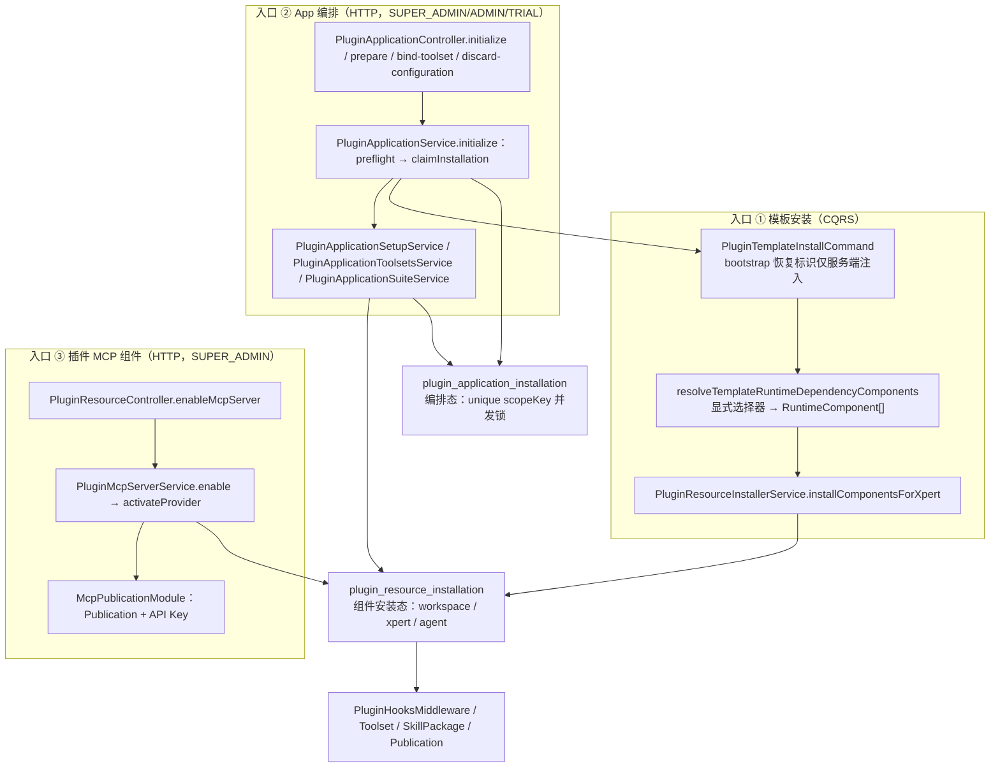

**本文引用的文件**
- [packages/server-ai/src/plugin-resource/plugin-resource.module.ts](file://packages/server-ai/src/plugin-resource/plugin-resource.module.ts)
- [packages/server-ai/src/plugin-resource/index.ts](file://packages/server-ai/src/plugin-resource/index.ts)
- [plugin-resource-installer.service.ts](file://packages/server-ai/src/plugin-resource/plugin-resource-installer.service.ts)
- [plugin-resource-components.ts](file://packages/server-ai/src/plugin-resource/plugin-resource-components.ts)
- [plugin-resource-installation-scope.ts](file://packages/server-ai/src/plugin-resource/plugin-resource-installation-scope.ts)
- [plugin-resource-installation.entity.ts](file://packages/server-ai/src/plugin-resource/plugin-resource-installation.entity.ts)
- [plugin-resource.controller.ts](file://packages/server-ai/src/plugin-resource/plugin-resource.controller.ts)
- [plugin-application.service.ts](file://packages/server-ai/src/plugin-resource/plugin-application.service.ts)
- [plugin-application.controller.ts](file://packages/server-ai/src/plugin-resource/plugin-application.controller.ts)
- [plugin-application-installation.entity.ts](file://packages/server-ai/src/plugin-resource/plugin-application-installation.entity.ts)
- [plugin-application-suite.service.ts](file://packages/server-ai/src/plugin-resource/plugin-application-suite.service.ts)
- [plugin-application-suite.ts](file://packages/server-ai/src/plugin-resource/plugin-application-suite.ts)
- [plugin-application-assets.ts](file://packages/server-ai/src/plugin-resource/plugin-application-assets.ts)
- [plugin-mcp-server.service.ts](file://packages/server-ai/src/plugin-resource/plugin-mcp-server.service.ts)
- [plugin-mcp-server-contract.ts](file://packages/server-ai/src/plugin-resource/plugin-mcp-server-contract.ts)
- [plugin-hooks.middleware.ts](file://packages/server-ai/src/plugin-resource/plugin-hooks.middleware.ts)
- [effective-loaded-plugins.ts](file://packages/server-ai/src/plugin-resource/effective-loaded-plugins.ts)
- [plugin-resource-app-status.ts](file://packages/server-ai/src/plugin-resource/plugin-resource-app-status.ts)
- [commands/install-template.command.ts](file://packages/server-ai/src/plugin-resource/commands/install-template.command.ts)
- [commands/template-runtime-dependencies.ts](file://packages/server-ai/src/plugin-resource/commands/template-runtime-dependencies.ts)
- [commands/sync-template-dependencies.handler.ts](file://packages/server-ai/src/plugin-resource/commands/sync-template-dependencies.handler.ts)
- [application-toolsets/plugin-application-toolsets.service.ts](file://packages/server-ai/src/plugin-resource/application-toolsets/plugin-application-toolsets.service.ts)
- [application-setup/plugin-application-setup.service.ts](file://packages/server-ai/src/plugin-resource/application-setup/plugin-application-setup.service.ts)
- [queries/handlers/list-component-states.handler.ts](file://packages/server-ai/src/plugin-resource/queries/handlers/list-component-states.handler.ts)
- [app.module.ts](file://packages/server-ai/src/app.module.ts)
- [bootstrap.service.ts](file://packages/server-ai/src/initialization/bootstrap.service.ts)
- [bosi-bootstrap.service.ts](file://packages/server-ai/src/assistant-binding/bosi/bosi-bootstrap.service.ts)
- [install-template-recovery.handler.spec.ts](file://packages/server-ai/src/plugin-resource/commands/install-template-recovery.handler.spec.ts)

## 目录
- [子域职责边界](#子域职责边界)
- [子模块清单](#子模块清单)
- [分层结构](#分层结构)
- [依赖关系](#依赖关系)
- [关键不变量](#关键不变量)
- [架构总览](#架构总览)
- [结论](#结论)

章节来源：[plugin-resource.module.ts](file://packages/server-ai/src/plugin-resource/plugin-resource.module.ts)（关键符号：PluginResourceModule）

## 子域职责边界
本子域只做一件事：**把已经加载进进程的插件所导出的组件，安装到 workspace / xpert / organization 这三个落点上，并完成受治理 App 的编排与插件 MCP Server 的启用**。具体职责面：

- 组件解析：`resolveRuntimeComponents` 把「插件 bundle manifest 声明的组件」与「运行期注册表里注册的 Tool Provider 组件」合并去重，再按选择器与目标做合法性过滤。
- 组件落库：每个组件在 `plugin_resource_installation` 落一行运行体记录（`runtimeType` / `runtimeId` / `runtimeNodeKey` / `definitionHash` / `status` / `enabled`）。
- 模板落点：承接 `PluginTemplateInstallCommand`，把模板显式声明的 skills / mcpServers / hooks / apps 装进模板导入出的 Xpert，并改写该 draft 的 middleware 绑定。
- App 编排：`PluginApplicationService` 负责 App 目录、状态、preflight 与 `initialize` / `prepare` / `bindToolset` / `discardConfiguration` 的编排，用 `plugin_application_installation` 的 unique `scopeKey` 做并发认领。
- MCP 组件：`PluginMcpServerService` 把插件导出的 MCP Server 提升为受管 Publication，签发可重复获取的凭据，并在插件卸载/加载变更时收敛。

**不做**：不下载、不校验、不解包、不加载插件代码，也不决定插件是否需要重启（这些属于 `packages/server/src/plugin` 的安装与运行时子专家）；不合并插件 ORM metadata、不执行插件 DDL；不实现 MCP 协议与 Publication 的持久化（由 `../mcp-publication` 承担）；不解析模板 DSL 语义（由 `XpertTemplateService` 承担）；不实现技能文件读写（由 `SkillPackageService` 承担）；不拥有 Agent 会话与知识库检索逻辑。

边界细则：HTTP 只接受身份字段（`pluginName` / `appName` / `operationId` / `toolsetId`）与选择器，**绝不接受 tenantId / organizationId / workspaceId / credentials**；所有作用域一律取自 `RequestContext`；模板恢复标识只允许服务端 bootstrap 注入。

章节来源：[plugin-resource-installer.service.ts](file://packages/server-ai/src/plugin-resource/plugin-resource-installer.service.ts)（关键符号：PluginResourceInstallerService.resolveRuntimeComponents / installRuntimeComponent）、[plugin-application.controller.ts](file://packages/server-ai/src/plugin-resource/plugin-application.controller.ts)（关键符号：PluginApplicationController.initialize）

## 子模块清单
- **installer/**：`plugin-resource-installer.service.ts`（唯一安装编排入口，含三个目标 + 注册表 Provider 专用入口）、`plugin-resource-components.ts`（目标合法性矩阵、加载根解析、组件枚举）、`plugin-resource-installation-scope.ts`（显式 scope 解析）、`plugin-resource-app-status.ts`（App 组件状态推导与 blocked 配置构造）。
- **application/**：`plugin-application.service.ts`（目录/详情/状态/preflight/initialize）、`plugin-application-suite.service.ts`（多角色 Assistant 套件供给与健康检查）、`plugin-application-suite.ts`（套件图的纯函数校验与连接）、`plugin-application-assets.ts`（App 资源引用内联）、`effective-loaded-plugins.ts`（按作用域收敛已加载插件）。
- **mcp-server/**：`plugin-mcp-server.service.ts`（enable / disable / connectionInfo / credential 与生命周期订阅）、`plugin-mcp-server-contract.ts`（transport、approval policy、capability 声明解析与校验）。
- **commands/**：`install-template.command.ts` + `install-template.handler.ts`（模板安装与续跑）、`template-runtime-dependencies.ts`（模板选择器 → 运行组件）、`sync-template-dependencies.command.ts` + `sync-template-dependencies.handler.ts`（补跑同步）。
- **application-toolsets/**：`plugin-application-toolsets.service.ts`（工具集依赖需求、preflight、prepare、ensure、bind、rollback、healthy）、`toolset-requirements.ts`（依赖去重与冲突拒绝）、`application-initialize.schema.ts`（HTTP Zod schema）。
- **application-setup/**：`plugin-application-setup.service.ts`（配置工作区分配 / 绑定 / 丢弃）、`application-setup.schema.ts`。
- **queries/ + 运行时**：`queries/list-component-states.query.ts`、`queries/handlers/list-component-states.handler.ts`（组件状态聚合）、`plugin-hooks.middleware.ts`（Agent 运行期 Hook 执行）、`index.ts`（对外导出面）。

章节来源：[plugin-resource.module.ts](file://packages/server-ai/src/plugin-resource/plugin-resource.module.ts)（关键符号：PluginResourceModule.providers）、[index.ts](file://packages/server-ai/src/plugin-resource/index.ts)（关键符号：export 路径集合）

## 分层结构
- **Controller（2）**：`PluginResourceController`（`GET plugin/:name/resources/state`、`install-workspace`、`install-organization`、`install-xpert`、4 个 `mcp/:componentKey/*` 端点）与 `PluginApplicationController`（`plugin-applications` 的 status / catalog / detail / initialize / prepare / bind-toolset / discard-configuration）。控制器只做入参归一化、`RoleGuard` + `Roles` 标注与转调服务。
- **Service（7）**：`PluginResourceInstallerService`、`PluginApplicationService`、`PluginApplicationSetupService`、`PluginApplicationToolsetsService`、`PluginApplicationSuiteService`、`PluginMcpServerService`；辅助纯函数层见下。
- **CQRS**：`PluginTemplateInstallHandler`、`PluginTemplateSyncDependenciesHandler`（`@CommandHandler`）、`ListPluginResourceComponentStatesHandler`（`@QueryHandler`）；`PluginTemplateInstallCommand` / `PluginTemplateSyncDependenciesCommand` / `ListPluginResourceComponentStatesQuery` 为对外契约。
- **运行时中间件**：`PluginHooksMiddleware`（`PLUGIN_HOOKS_MIDDLEWARE_NAME`），随组件安装被写入 draft 节点后被 Agent 运行期加载。
- **Entity（2）**：`PluginResourceInstallation`（表 `plugin_resource_installation`，继承 `WorkspaceBaseEntity`）、`PluginApplicationInstallation`（表 `plugin_application_installation`，继承 `TenantOrganizationBaseEntity`）。
- **机制函数层**：`isPluginResourceInstallableForTarget`、`isolateReadPluginResourceComponents` 所在文件、`resolveLoadedPluginResourceRoot`、`applyPluginResourceOrganizationScope`、`effectiveLoadedPlugins`、`parsePluginMcpServerConfig`、`applicationToolsetDependencies`、`applicationToolsetRef`、`canDiscardApplicationConfiguration`、`buildBlockedAppConfig`、`resolvePluginAppResourceInstallationStatus`。
- **Gate / Guard**：HTTP 侧 `RoleGuard` + `RolesEnum`（MCP 与组织安装仅 SUPER_ADMIN，App 写接口为 SUPER_ADMIN / ADMIN / TRIAL）；服务侧 `XpertWorkspaceAccessService.assertCanAuthor` / `assertCanManage`、`assertInitializationAccess`、`initializationAccess`、`resolveProviderOwnership` + `runInProviderScope`。

章节来源：[plugin-resource.controller.ts](file://packages/server-ai/src/plugin-resource/plugin-resource.controller.ts)（关键符号：PluginResourceController.installOrganization / enableMcpServer）、[application-setup/plugin-application-setup.service.ts](file://packages/server-ai/src/plugin-resource/application-setup/plugin-application-setup.service.ts)（关键符号：canDiscardApplicationConfiguration）

## 依赖关系
**模块 imports**：`TypeOrmModule.forFeature([PluginResourceInstallation, PluginApplicationInstallation, SkillPackage, XpertToolset, XpertTool, XpertWorkspace, Knowledgebase, Xpert, McpPublication, McpPublicationAccess])`、`TenantModule`、`CqrsModule`、`EnvironmentModule`、`forwardRef(() => XpertModule)`、`XpertTemplateModule`、`forwardRef(() => SkillPackageModule)`、`forwardRef(() => XpertToolsetModule)`、`forwardRef(() => XpertWorkspaceModule)`、`forwardRef(() => KnowledgebaseModule)`、`CopilotModule`、`McpPublicationModule`。`forwardRef` 集中在与 Xpert / SkillPackage / Toolset / Workspace / Knowledgebase 的双向依赖上。

**导出与被引用**：`exports: [PluginResourceInstallerService, PluginMcpServerService, PluginApplicationService]`；`packages/server-ai/src/app.module.ts`（ServerAIModule）import 本模块。`index.ts` 额外导出 Hook 中间件、两张实体与命令/查询定义，供 `initialization/` 等目录复用。

**CQRS 契约（入站）**：`PluginTemplateInstallCommand` 的发送方为 `plugin-application.service.ts`（App 初始化建 Assistant）、`initialization/bootstrap.service.ts`（ClawXpert 默认助手）与 `assistant-binding/bosi/bosi-bootstrap.service.ts`（带 `resumeXpertId` + `onImported` 的恢复式调用）；`PluginTemplateSyncDependenciesCommand` 的发送方为 `xpert/commands/handlers/sync-template.handler.ts`。本模块不发出跨域命令，模板发布走 `XpertPublishCommand`（由 handler 内部执行）。

**下游依赖与契约**：`../mcp-publication`（`McpPublicationService`、`McpApiKeyService`、`McpPublicationAccessService`、`McpCapabilityCatalogService`）、`SkillPackageService.syncPluginSkillBundle`、`XpertToolsetService`、`KnowledgebaseService`、`XpertWorkspaceService`、`CopilotModule` 的模型查询、`@xpert-ai/contracts`（`PLUGIN_COMPONENT_TYPE`、`PLUGIN_RESOURCE_RUNTIME_TYPE`、`PLUGIN_RESOURCE_INSTALLATION_STATUS`、`PLUGIN_RESOURCE_ERROR_CODE`、`PLUGIN_APPLICATION_INSTALLATION_STATUS`）、`@xpert-ai/server-core`（`LOADED_PLUGINS`、`readPluginBundleManifest`、`collectPluginBundleComponents`、`normalizePluginName`）、`@xpert-ai/plugin-sdk`（`RequestContext`、`XpertToolProviderRegistry`、`StrategyBus`、`resolveTenantGlobalScopeKey`、`GLOBAL_ORGANIZATION_SCOPE`、`SYSTEM_GLOBAL_SCOPE`）。

章节来源：[plugin-resource.module.ts](file://packages/server-ai/src/plugin-resource/plugin-resource.module.ts)（关键符号：PluginResourceModule.imports / exports）、[app.module.ts](file://packages/server-ai/src/app.module.ts)（关键符号：PluginResourceModule 引用）

## 关键不变量
1. **组件 → 目标固定矩阵**：`organization` 仅 `TOOLSET`；`workspace` 为 `SKILL` / `MCP_SERVER` / `APP`；`xpert` 为 `HOOK`；`ASSET` 在无目标时也被排除，永不安装。显式选择器若与目标不匹配，直接抛 `BadRequestException`，绝不静默丢弃。
2. **`scopeKey` 是数据库并发锁**：`plugin_application_installation` 的 unique `(tenantId, pluginName, appName, scopeKey)` 就是「同一 App × 同一 scope 只允许一次编排」的闸门；插入冲突被解释为「别的请求已认领」而非错误。
3. **scope 必须显式**：无登录用户的后台同步（模板安装、bootstrap）只从 `RequestContext` 恢复 scope；`applyPluginResourceOrganizationScope` 在 tenant 缺失时抛错，**绝不发出无 scope 的查询**，并在 organizationId 为空时强制 `organizationId IS NULL`，避免 tenant 级行与组织级行互相污染。
4. **恢复标识不接受 HTTP 输入**：`PluginTemplateInstallCommand.bootstrap`（`resumeXpertId` + `onImported`）的注释明写 never accepted from an HTTP body，实际调用方只有 `bosi-bootstrap.service.ts` 这类服务端流程。
5. **模板的 `dependencies.plugins` 只是运行时前置**：portable 资源必须被显式选择，模板不得顺带安装插件导出的全部 Skill / MCP / Hook / App。
6. **组件安装会改写当前 draft**：因此依赖同步必须在执行时才加载导入图（`XpertService.getTeam`），提前缓存会拿到过期 middleware 绑定。
7. **信任边界只有两处**：App 定义只从进程内可信注册表解析（`loadedApplications` / `effectiveLoadedPlugins`）；runtime Provider 的 TOOLSET 只承认 `XpertToolProviderRegistry` 中注册且 provider 名一致的组件，manifest 声明不参与该判定。
8. **凭据不进 App 配置面**：MCP 凭据只在 `PluginMcpServerService.credential` 的一次性响应中返回；App 初始化 HTTP 只接受 option id 与 toolsetId。
9. **只创建自己需要的东西**：`discard` 只在「无 xpert、无 knowledgebase、resourceRefs 仅含 workspace/toolset」时才清理工作区，并且扫描全部带 `workspaceId` 列的实体，一旦发现其他资源即拒绝。

章节来源：[plugin-resource-components.ts](file://packages/server-ai/src/plugin-resource/plugin-resource-components.ts)（关键符号：isPluginResourceInstallableForTarget）、[plugin-resource-installation-scope.ts](file://packages/server-ai/src/plugin-resource/plugin-resource-installation-scope.ts)（关键符号：applyPluginResourceOrganizationScope）、[plugin-application-installation.entity.ts](file://packages/server-ai/src/plugin-resource/plugin-application-installation.entity.ts)（关键符号：表 plugin_application_installation 唯一索引）

## 架构总览

图表来源：[plugin-resource-installer.service.ts](file://packages/server-ai/src/plugin-resource/plugin-resource-installer.service.ts)（关键符号：PluginResourceInstallerService.installComponentsForXpert）、[plugin-application.service.ts](file://packages/server-ai/src/plugin-resource/plugin-application.service.ts)（关键符号：PluginApplicationService.initialize / claimInstallation）、[plugin-mcp-server.service.ts](file://packages/server-ai/src/plugin-resource/plugin-mcp-server.service.ts)（关键符号：PluginMcpServerService.enable）

三条入口只汇聚到两张表：`plugin_resource_installation` 负责「某个组件在某个落点上绑定到了哪个运行体」，`plugin_application_installation` 负责「哪个 App 在哪个 scope 上被谁认领、编排到哪一步」。入口 ② 会在中途反向调用入口 ①（`PluginTemplateInstallCommand`，`publish = true`）来创建 App 的 Assistant，因此 App 初始化是模板安装的上层编排者，而不是并列路径。

章节来源：[plugin-resource-installation.entity.ts](file://packages/server-ai/src/plugin-resource/plugin-resource-installation.entity.ts)（关键符号：表 plugin_resource_installation）、[plugin-application-installation.entity.ts](file://packages/server-ai/src/plugin-resource/plugin-application-installation.entity.ts)（关键符号：表 plugin_application_installation）

## 结论
本子域是「不重启也能生效的落点层」：它把插件域产出的能力按固定矩阵分发到 workspace / xpert / organization，用 `definitionHash` 与 `runtimeNodeKey` 把「定义版本」与「图上的绑定」分开记录，用 `scopeKey` 唯一索引把并发收口到数据库；模板安装与 App 编排共享同一条组件落表路径，因此模板安装既可以通过 CQRS 独立触发，也可以作为 App 初始化的内部步骤。要改动这一层，必须先回答三个问题：这条路径是否拿到了可证明的 scope、这次安装属于哪个目标、以及写 draft 与写表之间是否需要补偿。任一点含糊，都会立刻表现为跨组织可见、重复安装或 draft 绑定漂移。

章节来源：[effective-loaded-plugins.ts](file://packages/server-ai/src/plugin-resource/effective-loaded-plugins.ts)（关键符号：effectiveLoadedPlugins）、[commands/install-template.command.ts](file://packages/server-ai/src/plugin-resource/commands/install-template.command.ts)（关键符号：PluginTemplateInstallCommand.bootstrap）
