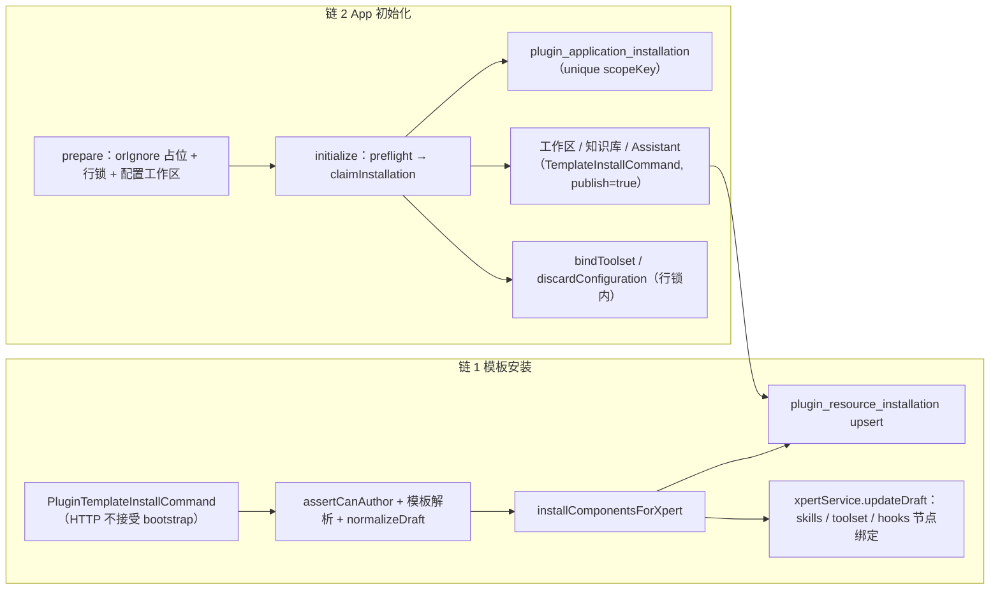
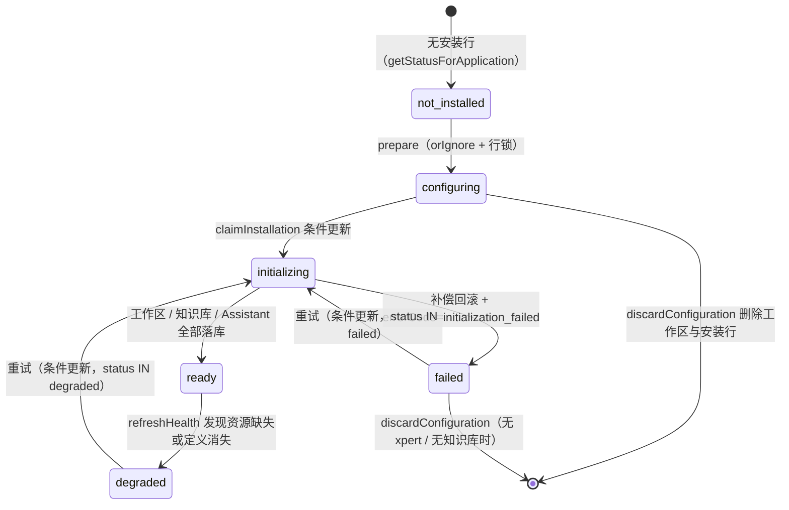

**本文引用的文件**
- [plugin-resource-installer.service.ts](file://packages/server-ai/src/plugin-resource/plugin-resource-installer.service.ts)
- [plugin-resource-installation.entity.ts](file://packages/server-ai/src/plugin-resource/plugin-resource-installation.entity.ts)
- [plugin-application-installation.entity.ts](file://packages/server-ai/src/plugin-resource/plugin-application-installation.entity.ts)
- [plugin-application.service.ts](file://packages/server-ai/src/plugin-resource/plugin-application.service.ts)
- [application-setup/plugin-application-setup.service.ts](file://packages/server-ai/src/plugin-resource/application-setup/plugin-application-setup.service.ts)
- [application-toolsets/plugin-application-toolsets.service.ts](file://packages/server-ai/src/plugin-resource/application-toolsets/plugin-application-toolsets.service.ts)
- [plugin-application-suite.service.ts](file://packages/server-ai/src/plugin-resource/plugin-application-suite.service.ts)
- [plugin-mcp-server.service.ts](file://packages/server-ai/src/plugin-resource/plugin-mcp-server.service.ts)
- [plugin-mcp-server-contract.ts](file://packages/server-ai/src/plugin-resource/plugin-mcp-server-contract.ts)
- [plugin-resource-app-status.ts](file://packages/server-ai/src/plugin-resource/plugin-resource-app-status.ts)
- [plugin-resource-components.ts](file://packages/server-ai/src/plugin-resource/plugin-resource-components.ts)
- [plugin-resource-installation-scope.ts](file://packages/server-ai/src/plugin-resource/plugin-resource-installation-scope.ts)
- [effective-loaded-plugins.ts](file://packages/server-ai/src/plugin-resource/effective-loaded-plugins.ts)
- [commands/install-template.command.ts](file://packages/server-ai/src/plugin-resource/commands/install-template.command.ts)
- [commands/install-template.handler.ts](file://packages/server-ai/src/plugin-resource/commands/install-template.handler.ts)
- [commands/template-runtime-dependencies.ts](file://packages/server-ai/src/plugin-resource/commands/template-runtime-dependencies.ts)
- [commands/sync-template-dependencies.handler.ts](file://packages/server-ai/src/plugin-resource/commands/sync-template-dependencies.handler.ts)
- [queries/handlers/list-component-states.handler.ts](file://packages/server-ai/src/plugin-resource/queries/handlers/list-component-states.handler.ts)
- [xpert/commands/handlers/sync-template.handler.ts](file://packages/server-ai/src/xpert/commands/handlers/sync-template.handler.ts)
- [assistant-binding/bosi/bosi-bootstrap.service.ts](file://packages/server-ai/src/assistant-binding/bosi/bosi-bootstrap.service.ts)

## 目录
- [总览：两条主链与两张表](#总览两条主链与两张表)
- [链 1：模板安装](#链-1模板安装)
- [链 2：App 初始化](#链-2app-初始化)
- [状态机](#状态机)
- [异步流与并发控制](#异步流与并发控制)
- [数据变换关键节点](#数据变换关键节点)
- [已知风险](#已知风险)
- [结论](#结论)

章节来源：[plugin-resource-installation.entity.ts](file://packages/server-ai/src/plugin-resource/plugin-resource-installation.entity.ts)（关键符号：表 plugin_resource_installation）

## 总览：两条主链与两张表
本子域只有两条写入主链，且都收敛到两张表：

- `plugin_resource_installation`（继承 `WorkspaceBaseEntity`）：**组件安装态**。一行 = 一个「插件组件 × 落点（workspace / xpert / agent）」绑定，`runtimeType`/`runtimeId` 指向具体运行体，`runtimeNodeKey` 指向 draft 里的节点，`definitionHash` 固定定义版本。
- `plugin_application_installation`（继承 `TenantOrganizationBaseEntity`）：**App 编排态**。一行 = 一个「App × scope」的认领与控制面记录，unique `(tenantId, pluginName, appName, scopeKey)` 即并发锁，`resourceRefs` / `knowledgebaseIds` / `errorCode` / `errorMessage` 记录进度与失败原因。

章节来源：[plugin-application-installation.entity.ts](file://packages/server-ai/src/plugin-resource/plugin-application-installation.entity.ts)（关键符号：表 plugin_application_installation 唯一索引与状态列）

图表来源：[commands/install-template.handler.ts](file://packages/server-ai/src/plugin-resource/commands/install-template.handler.ts)（关键符号：PluginTemplateInstallHandler.execute）、[plugin-application.service.ts](file://packages/server-ai/src/plugin-resource/plugin-application.service.ts)（关键符号：PluginApplicationService.initialize）

## 链 1：模板安装
**触发**：CQRS `PluginTemplateInstallCommand`。发送方共三处——`plugin-application.service.ts`（App 初始化建 Assistant）、`initialization/bootstrap.service.ts`（默认 ClawXpert）、`assistant-binding/bosi/bosi-bootstrap.service.ts`（唯一带 `bootstrap.resumeXpertId` + `onImported` 的恢复式调用）。命令本身没有任何 HTTP 入口，恢复标识不从请求体来。

**校验**：`assertCanAuthor(workspaceId)` → `getTemplateDetail` → `yaml.parse(export_data)` → `normalizeDraft`（非对象或缺少 `nodes`/`connections` 直接 `BadRequestException`）→ 能力装配与 realtime voice 配置。

**导入与检查点**：非恢复态执行 `XpertImportCommand`；恢复态先 `findOneByIdWithinTenant(resumeXpertId)`，再校验 `xpert.workspaceId === command.workspaceId` 且模板来源一致，不匹配即抛 `TemplateInstallResumeMismatch`；`bootstrap.onImported({ id })` 落检查点；已发布对象只补工作区初始化；恢复对象 draft 为空时用 `targetXpertId` 重放导入。

**组件安装**：`resolveTemplateRuntimeDependencyComponents` 把 `skills` / `mcpServers` / `hooks` / `apps` 四组显式选择器转为 `PluginResourceInstallComponent[]`（不读 `dependencies.plugins`），按 `pluginName` 分组后各自 `resolveRuntimeComponents`；`installComponentsForXpert` 对每个组件：`findInstallation` → upsert `plugin_resource_installation`（`runtimeType` 由类型推导、`runtimeId` 由 `ensureRuntime` 产出、`definitionHash` 取组件定义）→ `attachRuntimeComponent` 改写 draft → `updateDraft` 落盘。

**收尾**：模板 toolset 依赖挂到 Xpert → 可选发布（`XpertPublishCommand`）→ `initializeByTemplateId` → 返回 `{ installations, pendingAuth, xpert }`；失败且非恢复态时 `rollbackTemplateXpert`。

章节来源：[commands/install-template.handler.ts](file://packages/server-ai/src/plugin-resource/commands/install-template.handler.ts)（关键符号：PluginTemplateInstallHandler.execute）、[plugin-resource-installer.service.ts](file://packages/server-ai/src/plugin-resource/plugin-resource-installer.service.ts)（关键符号：PluginResourceInstallerService.installComponentsForXpert）

**补跑路径**：`PluginTemplateSyncDependenciesCommand(xpertId, pluginName, dependencies)`（发送方 `xpert/commands/handlers/sync-template.handler.ts`）→ 解析组件 → **执行时**才 `xpertService.getTeam(xpertId)` 取图 → `installComponentsForXpert`。延迟取图是硬要求：组件安装会改写 Agent 的 middleware 绑定。

章节来源：[commands/sync-template-dependencies.handler.ts](file://packages/server-ai/src/plugin-resource/commands/sync-template-dependencies.handler.ts)（关键符号：PluginTemplateSyncDependenciesHandler.execute）

## 链 2：App 初始化
**HTTP 边界**：`plugin-applications` 的 `initialize` / `prepare` / `bind-toolset` / `discard-configuration` 需 `SUPER_ADMIN | ADMIN | TRIAL`，body 走 Zod（`.strict()` + 显式 transform）。

**stage A（配置期）**：`prepare` 在事务里先 `insert().orIgnore()` 占位（`tenantId`/`organizationId`/`scopeKey = organizationId`/`status = configuring`），再 `pessimistic_write` 取行；若状态是 `initializing` 直接 `ConflictException`；已存在配置工作区则 `assertCanAuthor` 后返回；否则校验 `canDiscardApplicationConfiguration` 并创建工作区（`settings.system.kind = 'plugin-app'`），写 `resourceRefs = { workspace }`。`bindToolset` 在锁内 `assertCanAuthor` 后委派 `PluginApplicationToolsetsService.bind`。

**stage B（激活期）**：`initialize` 顺序为 `resolveApplication` → `operationId` 必填 → `assertInitializationAccess` → 已 `ready` 先 `refreshHealth`（仍健康即返回，不再要求模型）→ `getPreflightForApplication` → 模型解析 → suite 校验 → `applicationToolsets.prepare`（客户端 toolset 选择再校验）→ **`claimInstallation`** → 认领失败即返回现状 → 创建/复用工作区 → `applicationToolsets.ensure` → 逐个知识库创建并逐次落 `knowledgebaseIds` → Assistant（suite 或 `PluginTemplateInstallCommand(publish = true)`）→ 写 `xpertId` / `status = ready` / `resourceRefs` → `toStatus`。

**并发锁语义**：`claimInstallation` 以 `(tenantId, organizationId, pluginName, appName, scopeKey)` 插入 `status = initializing` 的行；插入抛错（唯一索引冲突）则回读该行并把 `claimed = false`。已存在的 `configuring` / `failed` / `degraded` 行用条件 `update`（`where status IN (...)`) 抢占，`initializing` 行仅在 `updatedAt` 早于 5 分钟时用条件 `update` 抢占，`affected === 1` 才算认领成功——即「同时只有一个请求进入资源创建」。

**失败落库**：catch 中若 `suiteProvisioningStarted` 为假，先 `applicationToolsets.rollback` + `compensate` 并把 `workspaceId` / `knowledgebaseIds` / `xpertId` / `resourceRefs` 恢复到 `previousResourceState`；随后统一写 `status = failed`、`errorCode = 'initialization_failed'`、`errorMessage = getErrorMessage(error)`，并重新抛出（HTTP 侧得到真实错误）。

章节来源：[plugin-application.service.ts](file://packages/server-ai/src/plugin-resource/plugin-application.service.ts)（关键符号：PluginApplicationService.claimInstallation / compensate）、[application-setup/plugin-application-setup.service.ts](file://packages/server-ai/src/plugin-resource/application-setup/plugin-application-setup.service.ts)（关键符号：PluginApplicationSetupService.prepare）

## 状态机

图表来源：[plugin-application-installation.entity.ts](file://packages/server-ai/src/plugin-resource/plugin-application-installation.entity.ts)（关键符号：status 默认 initializing）、[application-setup/plugin-application-setup.service.ts](file://packages/server-ai/src/plugin-resource/application-setup/plugin-application-setup.service.ts)（关键符号：canDiscardApplicationConfiguration）

**组件状态机**（`plugin_resource_installation.status` + `enabled`）：`ready` 为默认（非 App 组件一律 ready）；App 组件由 `resolvePluginAppResourceInstallationStatus(config, auth)` 推导——connector id 以 `REPLACE_WITH_` 开头（占位符）→ `blocked` 且 `config` 被 `buildBlockedAppConfig` 包一层 `pluginResource.status`；`auth === 'on_install'` 或配置里 `auth.policy === 'ON_INSTALL'` → `pending_auth`；其余 → `ready`。`enabled` 默认 true：安装/重装时被强制置 true，只有 `PluginMcpServerService.disable` 在组织级插件上会把它置 false。`pending_auth` 的行会被各入口收集进返回值的 `pendingAuth` 数组，但不阻断整批安装。

章节来源：[plugin-resource-app-status.ts](file://packages/server-ai/src/plugin-resource/plugin-resource-app-status.ts)（关键符号：resolvePluginAppResourceInstallationStatus）、[plugin-resource-installer.service.ts](file://packages/server-ai/src/plugin-resource/plugin-resource-installer.service.ts)（关键符号：PluginResourceInstallerService.resolveInstallationStatus）

## 异步流与并发控制
本子域**无 MQ、无 `@Cron` / `@Interval`**（源码内不存在这些装饰器，模块也未引入 `BullModule`）。实际异步与并发机制如下：

- **CQRS 命令**：`PluginTemplateInstallCommand`、`PluginTemplateSyncDependenciesCommand`、`ListPluginResourceComponentStatesQuery`；本模块不发出跨域命令，但 handler 内部会执行 `XpertImportCommand` / `XpertPublishCommand`。
- **微任务级异步收敛**：`PluginMcpServerService.onModuleInit` 订阅 `StrategyBus.events$`，`REMOVE`（`cause !== 'refresh'`）走 `queueMicrotask` 调 `disableInstalledServersForScope`；Provider upsert 走 `queueMicrotask` 调 `synchronizeEnabled`；`onApplicationBootstrap` 再对全部已注册 Provider 补一轮 `synchronizeRegisteredProvider`，避免早于订阅时机注册的 Provider 漏收敛。
- **数据库唯一键**：`plugin_application_installation` 的 unique `scopeKey` 是唯一跨副本、跨浏览器重试的互斥手段。
- **行级悲观锁**：`application-setup` 的 `prepare` / `bind` / `discard` 在事务内 `findOne({ lock: { mode: 'pessimistic_write' } })`；`discard` 还对工作区行加同样的锁，以阻止新的外键引用。
- **条件式 update**：`claimInstallation` 的两处抢占都用 `where` 携带预期状态或时间阈值，靠 `affected === 1` 判定胜负，不用 SELECT ... FOR UPDATE 抢占。
- **去重查询**：组件侧无唯一约束，靠 `findInstallation(workspaceId, xpertId, agentKey, pluginName, componentType, componentKey)` 决定 insert 还是 update。
- **时间与语言上下文**：`RequestContext` 提供 tenant/organization/user/language；MCP 服务用 `runInProviderScope` 合成上下文以提供者所属 scope 执行管理操作。

章节来源：[plugin-mcp-server.service.ts](file://packages/server-ai/src/plugin-resource/plugin-mcp-server.service.ts)（关键符号：PluginMcpServerService.onModuleInit / onApplicationBootstrap）、[plugin-application.service.ts](file://packages/server-ai/src/plugin-resource/plugin-application.service.ts)（关键符号：PluginApplicationService.claimInstallation）

## 数据变换关键节点
- **scope 解析**：`applyPluginResourceOrganizationScope` 从 `RequestContext.getScope()` 取 `tenantId` / `organizationId`；tenant 缺失 → `BadRequestException`（绝不发无 scope 查询）；`organizationId` 有值走等值，无值强制 `IS NULL`，把 tenant 级行与组织级行区分开。
- **可见插件的收敛**：`effectiveLoadedPlugins` 按「当前组织 scopeKey → 租户全局 scopeKey → `SYSTEM_GLOBAL_SCOPE`」过滤，再以 `normalizePluginName(packageName ?? name ?? meta.name)` 为键做 `reverse()` + `seen` 去重，实现同名覆盖且只保留最后一条；`resolveLoadedPluginResourceRoot` 用同一优先级选择 bundle 根，找不到或没有 portable manifest 即抛 `NotFoundException`。
- **`definitionHash`**：来自 `PluginBundleComponentRegistration.definitionHash`，落库后成为「定义是否已变化」的唯一判据；`ListPluginResourceComponentStatesHandler` 用它计算 `staleDefinition`，MCP 服务在 `options.definitionHash` 上也保留一份。
- **`runtimeNodeKey`**：组件在工作区 draft 上生成的 middleware / toolset 节点键（skills middleware 的 `entity.options.skills`、`pluginHooksMiddleware` 的 `entity.options.hooks`、toolset 节点 id）；安装后若与落库值不同或 `enabled` 为假就回写。
- **`sharedSkillId`**：Skill 组件的技能包标识固定为 `plugin:<pluginName>:skill:<componentKey>`（`pluginSkillSharedId` 与 `ensureRuntime` 内联写法一致），技能包再据此在 `skill_package` 中查回 `runtimeId`。
- **`resourceRefs`**：App 编排的引用表，键为 `workspace`、`assistant`、`knowledgebase:<config.key>`，工具集侧另用 `toolset:<sha256(pluginName, provider, instanceName)>`（`applicationToolsetRef`）——`discard` 的判定正是「键只允许是 workspace 或 toolset:*」。
- **MCP 配置归一**：`parsePluginMcpServerConfig` 把 `type`/`command`/`url` 归一为 `stdio` / `http`，把 `capabilities` 归一为内联声明或插件根内相对文件；`mergePluginMcpPolicies` 把 manifest policy 与选择器 `policyOverrides` 合并后写入 toolset `options.policy`。

章节来源：[plugin-resource-installation-scope.ts](file://packages/server-ai/src/plugin-resource/plugin-resource-installation-scope.ts)（关键符号：applyPluginResourceOrganizationScope）、[effective-loaded-plugins.ts](file://packages/server-ai/src/plugin-resource/effective-loaded-plugins.ts)（关键符号：effectiveLoadedPlugins）、[application-toolsets/toolset-requirements.ts](file://packages/server-ai/src/plugin-resource/application-toolsets/toolset-requirements.ts)（关键符号：applicationToolsetRef）

## 已知风险
- **组件表无唯一约束**：`plugin_resource_installation` 只有非唯一组合索引，并发安装或异常重试可能出现同一 `(workspaceId, xpertId, agentKey, pluginName, componentType, componentKey)` 的重复行，`findInstallation` 的 `getOne()` 语义也随之不确定。
- **5 分钟 reclaim 可能误伤长任务**：`initialize` 在含多个知识库或套件时可能超过 5 分钟，第二个请求即可抢占 `initializing` 行并开始第二套资源创建。
- **写库与写 draft 不同事务**：`installComponentsForXpert` 先逐组件 `save(installation)` 再 `updateDraft`，中途失败会留下「已落表、未挂图」的组件；HTTP 直连入口（`install-workspace` / `install-xpert`）没有等价回滚。
- **模板与资源边界靠注释维持**：`dependencies.plugins` 只声明运行时前置，代码通过「解析函数不读它」来保证；一旦有人在 `resolveTemplateRuntimeDependencyComponents` 里补一句读取 `plugins`，模板安装会立刻变成整包组件安装。
- **`prepare` 与 `initialize` 的状态耦合**：`prepare` 期间状态是 `configuring`，而 `prepare` 不接受任何 toolset 选择；若前端跳过 `bind-toolset` 直接 `initialize`，`applicationToolsets.prepare` 会在缺少选择时抛 `invalidSelection`，错误面表现为 400 而非明确的前置缺失。
- **App 组件不挂图**：`attachRuntimeComponent` 对 `app_connector` 返回 null，App 组件的可用性只能靠 `status` 与外部 connector 表达，`runtimeNodeKey` 长期为空。
- **MCP 生命周期收敛是最终一致**：`queueMicrotask` 调度没有重试与持久化，进程在微任务前退出会漏掉一次启停同步，`onApplicationBootstrap` 只能覆盖启动期。
- **依赖 `RequestContext` 的隐式上下文**：`resolveLoadedPluginResourceRoot` 与 `applyPluginResourceOrganizationScope` 都直接读隐式上下文，脱离 HTTP 的调用方（如 bootstrap）必须显式建立 scope 才能不抛错。

章节来源：[queries/handlers/list-component-states.handler.ts](file://packages/server-ai/src/plugin-resource/queries/handlers/list-component-states.handler.ts)（关键符号：ListPluginResourceComponentStatesHandler.execute）、[plugin-resource-components.ts](file://packages/server-ai/src/plugin-resource/plugin-resource-components.ts)（关键符号：resolveLoadedPluginResourceRoot）

## 结论
两条主链的差别只在「谁先占位」：模板安装不需要认领，直接按显式选择器落组件并在失败时回滚 Xpert；App 初始化必须先拿到 unique `scopeKey` 的行，然后按「工作区 → 工具集 → 知识库 → Assistant」的顺序逐段落库，任何失败都落到 `errorCode` / `errorMessage` 并回滚本次尝试。两者共享同一张组件表与同一套 scope 规则，因此**「scope 可证明 + 落点合法 + 失败可补偿」**这三条同时成立时数据流才是闭环的；本子域没有定时任务与消息队列，所有一致性都压在数据库唯一键与行锁上，这也决定了它的风险面主要是并发与补偿边界，而非异步时序。

章节来源：[plugin-application.service.ts](file://packages/server-ai/src/plugin-resource/plugin-application.service.ts)（关键符号：PluginApplicationService.refreshHealth）、[commands/template-runtime-dependencies.ts](file://packages/server-ai/src/plugin-resource/commands/template-runtime-dependencies.ts)（关键符号：resolveTemplateRuntimeDependencyComponents）
