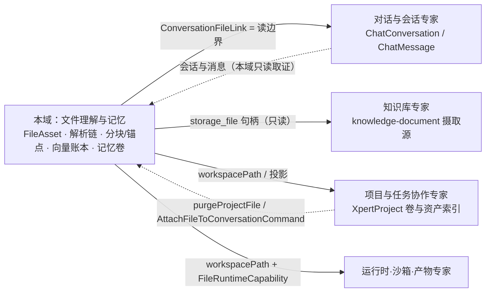

# 文件理解与记忆专家 —— C0 使用总览

> **资产基线**：`2026-10-16 · commit 80f5676fd`（批次 5 第 13 专家）。实测范围：`packages/server-ai/src/file-understanding`（**88 非 spec / 29 spec / 7 张表**）、`packages/server-ai/src/file-memory`（**24 非 spec / 8 spec / 3 张只读表**）、`packages/server/src/storage-file`（**21 非 spec / 1 spec / 1 张表**）＝ **133 非 spec / 38 spec / 10 张表（自建 6 + 跨域只读 3 + storage_file 1）**；HTTP 前缀 `/api/ai`（`file-understanding`，`RouterModule{ path: '/ai' }`）、`/api/xpert/:id/memory`、`/api/storage-file`（全局前缀 `api`）。

**本文引用的文件**（相对仓库根，链接均为 `file://`）

- [packages/server-ai/src/file-understanding/file-understanding.controller.ts](file://packages/server-ai/src/file-understanding/file-understanding.controller.ts)
- [packages/server-ai/src/file-understanding/file-understanding.module.ts](file://packages/server-ai/src/file-understanding/file-understanding.module.ts)
- [packages/server-ai/src/file-understanding/file-asset-access.service.ts](file://packages/server-ai/src/file-understanding/file-asset-access.service.ts)
- [packages/server-ai/src/file-understanding/file-asset-deletion.service.ts](file://packages/server-ai/src/file-understanding/file-asset-deletion.service.ts)
- [packages/server-ai/src/file-understanding/file-understanding-vector.service.ts](file://packages/server-ai/src/file-understanding/file-understanding-vector.service.ts)
- [packages/server-ai/src/file-understanding/file-workspace-projection.service.ts](file://packages/server-ai/src/file-understanding/file-workspace-projection.service.ts)
- [packages/server-ai/src/file-understanding/runtime/file-runtime.service.ts](file://packages/server-ai/src/file-understanding/runtime/file-runtime.service.ts)
- [packages/server-ai/src/file-understanding/parsers/file-parser.registry.ts](file://packages/server-ai/src/file-understanding/parsers/file-parser.registry.ts)
- [packages/server-ai/src/file-understanding/commands/handlers/parse-file-asset.handler.ts](file://packages/server-ai/src/file-understanding/commands/handlers/parse-file-asset.handler.ts)
- [packages/server-ai/src/file-understanding/commands/handlers/enqueue-file-parse.handler.ts](file://packages/server-ai/src/file-understanding/commands/handlers/enqueue-file-parse.handler.ts)
- [packages/server-ai/src/file-understanding/domain/workspace-file.ts](file://packages/server-ai/src/file-understanding/domain/workspace-file.ts)
- [packages/server-ai/src/file-memory/file-memory.controller.ts](file://packages/server-ai/src/file-memory/file-memory.controller.ts)
- [packages/server-ai/src/file-memory/file-memory.middleware.ts](file://packages/server-ai/src/file-memory/file-memory.middleware.ts)
- [packages/server-ai/src/file-memory/file-memory.service.ts](file://packages/server-ai/src/file-memory/file-memory.service.ts)
- [packages/server-ai/src/file-memory/dream.service.ts](file://packages/server-ai/src/file-memory/dream.service.ts)
- [packages/server-ai/src/file-memory/paths.ts](file://packages/server-ai/src/file-memory/paths.ts)
- [packages/server-ai/src/ai/context.controller.ts](file://packages/server-ai/src/ai/context.controller.ts)
- [packages/server/src/storage-file/storage-file.controller.ts](file://packages/server/src/storage-file/storage-file.controller.ts)
- [packages/server/src/storage-file/storage-file.service.ts](file://packages/server/src/storage-file/storage-file.service.ts)
- [packages/server/src/file/file-upload/strategies/storage-target.strategy.ts](file://packages/server/src/file/file-upload/strategies/storage-target.strategy.ts)

## 目录

1. [专家定位](#专家定位)
2. [何时找这个专家](#何时找这个专家)
3. [契约自足声明](#契约自足声明)
4. [能力清单表](#能力清单表)
5. [边界](#边界)
6. [已知问题与常见坑](#已知问题与常见坑)
7. [延伸阅读](#延伸阅读)

## 专家定位

本专家是**文件字节、理解结果与记忆的共同底座**——把「文件字节」变成平台可授权、可解析、可检索、可引用、可投影进工作区的**平台级文件句柄**，并在此之上承载两件事：一次可幂等重放的「解析 → 产物 → 分块 → 向量账本」链路，以及一套以**卷上 markdown** 为介质的长期文件记忆。

它拥有 `FileAsset`（状态/能力/上下文链接/投影元数据）、`FileArtifact`（页/表/幻灯片/清单等解析产物）、`FileChunk`（检索与读取单元）、`FileCitationAnchor`（引用锚点）、`FileEmbedding`（向量账本，指向 RagVStore）、`ConversationFileLink`（会话附件授权边界）、`storage_file`（对象存储索引行），以及卷上的 `.xpert/memory` 记忆库（含 writeback 与离线 Dream 整理）。

**一句话口径**：`FileAsset` 是唯一跨域句柄（字节交给 `storage_file`，解析状态/能力/链接/投影归自己），访存统一收敛到 `FileAssetAccessService.resolve`；记忆子域刻意与理解子域**零代码耦合**（不读 `FileAsset`/`file_chunk`），只共享卷基础设施与三张外部只读表。

章节来源：[file-asset.entity.ts](file://packages/server-ai/src/file-understanding/entities/file-asset.entity.ts)（关键符号：FileAsset）、[file-asset-access.service.ts](file://packages/server-ai/src/file-understanding/file-asset-access.service.ts)（关键符号：FileAssetAccessService.resolve）、[file-memory.module.ts](file://packages/server-ai/src/file-memory/file-memory.module.ts)（关键符号：FileMemoryModule 的 forFeature）

## 何时找这个专家

- 要**改上传与落地**：外部 upload target 解析与白名单、`contexts/<tenantId>/` 租户目录约束、文件名生成、`purpose`/`parseMode` 归属、同步 / 后台解析判定（`shouldRunParseInline`）。
- 要**改解析 / 理解链**：解析器选择顺序、产物替换（先删后写）、分块与锚点重建、状态与 `metadata.understandingErrorCode` 回写、页图渲染与旧 run 清理。
- 要**改读取、搜索与预览**：8 个端点的返回形态、`preview` 字段裁剪（summary 900 / artifact 12 / chunk 8）、`search` 的「向量 + 关键词 RRF」与「纯顺序列举」两分支、`read` 的 `chunkId|orderNo` 语义。
- 要**改软删与回收**：`cleanup` 的固定删除顺序、页图对象与派生目录的清理条件、项目永久删除的专用入口 `purgeProjectFile`、`storage_file` 的 `afterRemove` 物理删。
- 要**改文件记忆**：卷上目录结构（`MEMORY.md` + `user|feedback|project|reference`）、frontmatter 字段、信号类型、writeback 决策与 Dream 运行台账。
- 要**改存储抽象与卷**：`FileStorage.getProvider` 的注册表 / 内置回落、LOCAL provider 的 `rootPath`/`baseUrl`、派生目录与记忆库路径归一化、卷作用域识别（`resolveFileAssetWorkspaceVolumeScope`）。
- 要**改访问授权**：`resolve({locator, authority, operation})` 三维语义、`attach` 前先 `assertCanEdit` 的次序、`ConversationFileLink` 作为读边界、存储侧「鉴权在 service」。
- 要**改事件入边消费**：10 组入边（命令 / 查询）的签名与语义，尤其是工作区运行时与消息组装两条高频消费面。
- 要**排查解析卡住 / 失败 / 预览异常**：`status` 长期 `parsing`、三态错误码、预览返回空而不是 404。
- 要**排查记忆不生成或记忆工具不可用**：gate 未过（`status='skipped'`）、`coalesced:true`、dreamer 配置缺失、sandbox feature 未启用。
- 要**排查回收未清与孤儿文件**：远端 provider 下派生对象只删 DB 行、删除异常被静默吞掉。
- 要**查文件相关接口**给前端 / 插件 / ChatKit 对接：路径、鉴权层、错误码与 `AgentFile` 字段口径。

章节来源：[context.controller.ts](file://packages/server-ai/src/ai/context.controller.ts)（关键符号：ContextsController.create / shouldRunParseInline）、[file-understanding.controller.ts](file://packages/server-ai/src/file-understanding/file-understanding.controller.ts)（关键符号：authorizeFile / getPreview / searchFile）、[file-memory.middleware.ts](file://packages/server-ai/src/file-memory/file-memory.middleware.ts)（关键符号：createMiddleware / memory_write）

## 契约自足声明

本专家的 `C0`（使用总览）+ `C1`（能力契约）构成该子域**完整契约面**：HTTP 入口索引、服务方法签名与参数行为语义、返回与异常、事件入边、代码示例均在本层可查，无需阅读实现层即可完成集成与排障；实现细节（算法、私有方法、表结构逐列）只在需要定位时按 `file://` 链接回源码。**逐端点明细**（完整字段、错误码全集、鉴权矩阵）见 [implementation/05-接口.md](file://.module-experts/后端专题/文件理解与记忆专家/implementation/05-接口.md)，本文不复制。凡未标 `[推测]` 的结论均取自源码或本域实现层文档。

| 项 | 值 |
|---|---|
| 基线时点 / commit | `2026-10-16` · `80f5676fd`（批次 5 第 13 专家） |
| 规模实测 | **133 非 spec**（88 + 24 + 21）、**38 spec**（29 + 8 + 1）、**10 张表**（自建 6 + 跨域只读 3 + `storage_file` 1）（7 + 3 + 1） |
| 子域 | ① 文件理解（`file-understanding`）② 文件记忆与存储（`file-memory` + `storage-file`） |
| 契约入口 | 本文件 + [C1-能力契约.md](file://.module-experts/后端专题/文件理解与记忆专家/C1-能力契约.md) |
| 实现层 | [01-架构](file://.module-experts/后端专题/文件理解与记忆专家/implementation/01-架构.md) · [02-实现](file://.module-experts/后端专题/文件理解与记忆专家/implementation/02-实现.md) · [03-数据流转](file://.module-experts/后端专题/文件理解与记忆专家/implementation/03-数据流转.md) · [04-模型](file://.module-experts/后端专题/文件理解与记忆专家/implementation/04-模型.md) · [05-接口](file://.module-experts/后端专题/文件理解与记忆专家/implementation/05-接口.md) · [06-测试](file://.module-experts/后端专题/文件理解与记忆专家/implementation/06-测试.md) · [07-运维](file://.module-experts/后端专题/文件理解与记忆专家/implementation/07-运维.md) |

章节来源：[file-understanding.module.ts](file://packages/server-ai/src/file-understanding/file-understanding.module.ts)（关键符号：RouterModule.register / TypeOrmModule.forFeature）、[storage-file.module.ts](file://packages/server/src/storage-file/storage-file.module.ts)（关键符号：StorageFileModule）、[file-memory.controller.ts](file://packages/server-ai/src/file-memory/file-memory.controller.ts)（关键符号：FileMemoryController）

## 能力清单表

| 能力 | 入口（HTTP 或服务方法） | 一句话 |
|---|---|---|
| 上传落地（跨域入口） | `POST /api/ai/contexts/file`；`StorageTargetStrategy.upload` | 唯一会「建 FileAsset 并启动解析」的入口；`workspacePath` 被强制忽略，key 不得越出租户目录 |
| 文件句柄与解析状态 | `GET /api/ai/files/:fileId`、`/status`；`GetFileParseStatusQuery` | 句柄含 `status`/`capabilities`/`parseMode`/`metadata`，状态机 `uploaded→parsing→ready|partial|failed` |
| 解析与产物 | `ParseFileAssetHandler`；`FileParserRegistry.getParser`（6 解析器） | 顺序 pdf→spreadsheet→office→image→archive→text，命中即用，全不匹配抛 `UnsupportedFileContentError` |
| 分块·锚点·向量账本 | `IndexFileChunksHandler`；`FileUnderstandingVectorService.indexChunks` | 3600/240 切块 + 锚点重建 + 向量入 RagVStore，`file_embedding` 只存 `vectorId` 账本 |
| 读取·检索·预览 | `POST /files/:id/search`、`/read`、`GET /files/:id/preview` | 有 query 走向量 + 关键词 RRF，无 query 纯顺序；preview 只回安全裁剪字段 |
| 会话附件授权边界 | `ConversationFileLink`（唯一索引）；`GET /api/ai/conversations/:id/files` | link 存在即代表该会话可读/可检索；读工具只列当前会话已 attach 的文件 |
| 工作区投影 | `FileWorkspaceProjectionService.projectFileAsset` | 把对象存储文件投影为工作区路径并回写 `workspacePath`，best-effort |
| 删除与项目回收 | `DELETE /api/ai/files/:fileId`；`FileAssetDeletionService.delete/purgeProjectFile` | 硬删七步链 + 页图对象 + 派生目录；项目回收走专用入口并校验 projectId/tenantId |
| 运行时能力面 | `FileRuntimeCapability`；`FileRuntimeService.resolveFile/createScopedApi` | 把平台文件引用解析为可预览 URL；平台调用用当前 owner，Agent 调用一次性绑定会话 |
| Agent 工具面（理解） | `FileUnderstandingMiddleware` 的 8 个 `parsed_file_*` 工具 | 内置隐藏中间件，检索上限 8 条 / 片段 800 字 / 正文 4000 字 |
| 文件记忆读写 | `FileMemoryService.writeMemory/searchMemory/getMemory` | 记忆是卷上 markdown：`.xpert/memory` + `MEMORY.md` 索引 + 四类目录 |
| 记忆召回与写回 | `XpertFileMemoryMiddleware.wrapModelCall/afterAgent`；`FileMemoryWritebackRunner` | 前置注入 recall 消息（20KB/回合、60KB/会话）；写回按 scope key 串行，决策 upsert/archive |
| 记忆离线整理（Dream） | `POST /api/xpert/:id/memory/dream` 等 6 端点；`FileMemoryDreamService` | gate 默认 30 分钟 / ≥1 条记忆 / ≥1 会话，未过落 `skipped`；经 dreamer 助手异步执行 |
| 对象存储登记与生命周期 | `POST /api/storage-file`、`/url`、`DELETE /:id`；`StorageFileService` | 登记行 + 物理对象；删除为硬删并触发订阅者删 `file`/`thumb` |
| 存储抽象与 provider 解析 | `FileStorage.getProvider(name)` | 先查插件注册表，失败**静默回落内置 LOCAL**；仓库内只有 LOCAL 实现 |
| 记忆文件 CRUD（xpert 域复用） | `/api/xpert/:id/memory/file[s]`（校验与路径语义在本域 facade/paths） | 与 `FileMemoryFacade` 同源，`XpertGuard` 把关 |

章节来源：[file-understanding.controller.ts](file://packages/server-ai/src/file-understanding/file-understanding.controller.ts)（关键符号：8 个端点方法）、[file-parser.registry.ts](file://packages/server-ai/src/file-understanding/parsers/file-parser.registry.ts)（关键符号：FileParsers / getParser）、[file-memory.controller.ts](file://packages/server-ai/src/file-memory/file-memory.controller.ts)（关键符号：triggerMemoryDream / getMemoryDreamRuns）、[storage-file.service.ts](file://packages/server/src/storage-file/storage-file.service.ts)（关键符号：createStorageFile / deleteStorageFile）

## 边界

**做什么**：平台级文件句柄与解析状态、解析产物与分块/锚点、向量账本与检索、会话附件授权边界、工作区投影、全链路硬删与项目回收、对象存储登记与物理对象生命周期、卷上文件记忆与 Dream 整理、以及面向 Agent 的工具与中间件暴露面。

图表来源：[file-asset-access.service.ts](file://packages/server-ai/src/file-understanding/file-asset-access.service.ts)（关键符号：assertCanLinkToConversation / 「The link is the read-permission boundary for file tools」）、[domain/workspace-file.ts](file://packages/server-ai/src/file-understanding/domain/workspace-file.ts)（关键符号：resolveFileAssetWorkspaceVolumeScope）、[document.service.ts](file://packages/server-ai/src/knowledge-document/document.service.ts)（关键符号：GetOwnedStorageFileQuery）

**不做什么（与相邻专家分工）**：

- **会话附件与会话侧归「对话与会话专家」**：本域只持有 `ConversationFileLink` 与 `FileAsset.conversationId/threadId`，会话行的读写与读边界给出方在对方；旧 `ConvFileDeleteCommand` 已由 `DeleteFileAssetCommand` 取代。
- **文档摄取与向量归「知识库专家」**：`knowledge-document` 只把 `storage_file` 当源文件句柄（`GetOwnedStorageFileQuery`），本域不反向依赖其向量库实现。
- **项目卷与项目资产索引归「项目与任务协作专家」**：本域通过 `XpertProjectAccessService` 复用项目准入，并在项目永久删除时被 `ProjectPurgeService` 调用；`project-file.entity.ts` 已标注改走 FileAsset 工作区投影。
- **沙箱与产物登记归「运行时·沙箱·产物专家」**：本域交付 `workspacePath` 与 `FileRuntimeCapability`，不落沙箱产物；记忆读写经 sandbox backend 执行，但 backend 本身不归本域。
- **不做模型推理与 Agent 运行时**：不实现 LLM/中间件运行时，只提供工具与能力提供者。
- **不实现对象存储驱动**：仓库内只有 LOCAL provider，S3/OSS 经 `@FileStorageProvider` 外部插件注册；本域只做 provider 解析与登记。
- **不做沙箱内文件写入**：`FileWorkspaceProjectionService` 只把对象存储文件**投影**为工作区路径。

章节来源：[file-understanding.module.ts](file://packages/server-ai/src/file-understanding/file-understanding.module.ts)（关键符号：imports 中的 XpertProjectAccessModule / forwardRef 依赖）、[file-workspace-projection.service.ts](file://packages/server-ai/src/file-understanding/file-workspace-projection.service.ts)（关键符号：projectFileAsset）、[file-asset-deletion.service.ts](file://packages/server-ai/src/file-understanding/file-asset-deletion.service.ts)（关键符号：purgeProjectFile）

## 已知问题与常见坑

1. **上传入口不在本域**：真正的 multipart 上传与「启动理解」在 `ContextsController`（`POST /api/ai/contexts/file`，不是 `/contexts/file`）；`FileUnderstandingController` 只提供句柄/检索/删除类端点。旧入口 `POST /api/ai/v1/file` 源码逐字标注 `@deprecated`，且**只落 storage 目标、不建 FileAsset、不触发解析**。
   - 契约来源：[context.controller.ts](file://packages/server-ai/src/ai/context.controller.ts)、[ai-v1.controller.ts](file://packages/server-ai/src/ai/ai-v1.controller.ts)。
2. **三套鉴权风格并存**：文件侧是 `@Public()` + `@UseGuards(ApiKeyOrClientSecretAuthGuard)` + `@AllowClientSecretBindings(ENTERPRISE_XPERT)`，文件级边界**隐式**落在 `resolve` 里；记忆侧是 `XpertGuard`（owner 或 workspace 可访问，命中后缓存 5 分钟）；`StorageFileController` 才是**真的没有控制器守卫**（鉴权内联在 service，且任意异常一律 catch 成 403）。
   - 契约来源：[file-understanding.controller.ts](file://packages/server-ai/src/file-understanding/file-understanding.controller.ts)、[xpert.guard.ts](file://packages/server-ai/src/xpert/guards/xpert.guard.ts)、[storage-file.service.ts](file://packages/server/src/storage-file/storage-file.service.ts)。
3. **幂等与去重键是 `storageFileId`，不是 hash**：`FileAsset` 按 `storageFileId + tenantId` 原地复用（`status` 沿用旧值），`ConversationFileLink` 有唯一索引 `(conversationId,fileAssetId)`；`sha256` 列被写入但**无唯一约束、无查重逻辑**，同内容重复上传会产生多条资产与多份向量。
   - 契约来源：[create-file-asset.handler.ts](file://packages/server-ai/src/file-understanding/commands/handlers/create-file-asset.handler.ts)、[conversation-file-link.entity.ts](file://packages/server-ai/src/file-understanding/entities/conversation-file-link.entity.ts)。
4. **软删与回收的连带处理**：`FileAsset` **无 `deletedAt`**，`cleanup` 是硬删七步（向量 → 锚点 → 向量账本 → chunk → artifact → 链接 → 资产行）后再删页图对象与派生目录；`storage_file` 虽有 `deletedAt` 列，删除路径走 `repository.remove`（硬删）——为了正确触发订阅者拿到实体。改删除顺序必须同步这张清单。
   - 契约来源：[file-asset-deletion.service.ts](file://packages/server-ai/src/file-understanding/file-asset-deletion.service.ts)、[storage-file.service.ts](file://packages/server/src/storage-file/storage-file.service.ts)。
5. **记忆的生成触发点与消费时机容易错配**：写入三入口 = `memory_write` 工具 / `afterAgent` writeback / Dream 离线整理；消费二入口 = `wrapModelCall` 前置注入 + `memory_search`/`memory_get` 工具。writeback 在**模型不可用时只记候选、不落盘**；「以为写了其实没触发」多因模型缺失或 scope key 不同（user-isolated 助手按用户分槽）。
   - 契约来源：[file-memory.middleware.ts](file://packages/server-ai/src/file-memory/file-memory.middleware.ts)、[file-memory.writeback-runner.ts](file://packages/server-ai/src/file-memory/file-memory.writeback-runner.ts)。
6. **存储抽象有静默回落分支**：`FileStorage.getProvider` 在注册表查找失败时**静默回落内置 LOCAL 实例**，排障时不要据此判断真实 provider；真正可用的 provider 名来自租户设置 / 环境配置（写行时统一大写）。
   - 契约来源：[file-storage.ts](file://packages/server/src/file/file-storage/file-storage.ts)、[storage-file.service.ts](file://packages/server/src/storage-file/storage-file.service.ts)。
7. **卷路径约束有两条独立的防线**：对象存储 key 必须落在 `contexts/<tenantId>/` 内（越界直接抛错）；记忆侧 `normalizeFileMemoryRelativePath` 拒绝 `..`、绝对路径与空路径，子域根读取需显式 `{ allowRootWorkspace: true }`。派生目录固定 `contexts/<tenantId>/file-understanding/<assetId>/<parseRunId>`。
   - 契约来源：[storage-target.strategy.ts](file://packages/server/src/file/file-upload/strategies/storage-target.strategy.ts)、[paths.ts](file://packages/server-ai/src/file-memory/paths.ts)。
8. **跨租户/跨组织越权的断言位置要分清**：`resolve` 强制带 `tenantId`、按 `isOrganizationVisible` 判组织可见（`organizationId` 为空 = 租户级可见）、`locator` 不一致同样拒；但 `file_chunk`/`file_artifact`/`file_embedding`/`file_citation_anchor` 只按 `fileAssetId` 过滤，**行级租户隔离完全依赖上游 `FileAssetAccessService`**——绕过 service 直查仓储即越权。
   - 契约来源：[file-asset-access.service.ts](file://packages/server-ai/src/file-understanding/file-asset-access.service.ts)、[04-模型.md](file://.module-experts/后端专题/文件理解与记忆专家/implementation/04-模型.md)。
9. **解析器注册与类型支持的报错形态**：`getParser` 顺序 pdf→spreadsheet→office→image→archive→text；全不匹配抛 `UnsupportedFileContentError`，但该异常在解析 handler 里被 catch 成 `status='failed'` + `metadata.understandingErrorCode='file_understanding_parse_failed'`，**HTTP 不抛错**。新增类型必须同时进 `FileParsers` provider 数组，否则运行时不可解析。
   - 契约来源：[file-parser.registry.ts](file://packages/server-ai/src/file-understanding/parsers/file-parser.registry.ts)、[parse-file-asset.handler.ts](file://packages/server-ai/src/file-understanding/commands/handlers/parse-file-asset.handler.ts)。
10. **大文件与体积限制分散在多处**：内联解析 2 MB（`MAX_INLINE_PARSE_BYTES`）、会话 data URL 25 MB（`MAX_DATA_URL_BYTES`）、PDF 页渲染上限 300 页、压缩包清单 500 项 / 文本条目 80 个且 ≤200 KB、chunk 3600 字符 / overlap 240。超限多为「截断成 partial」而非报错，只有 data URL 超限才是 400。
    - 契约来源：[chat-file-assets.ts](file://packages/server-ai/src/xpert/commands/handlers/chat-file-assets.ts)、[pdf.parser.ts](file://packages/server-ai/src/file-understanding/parsers/pdf.parser.ts)、[archive.parser.ts](file://packages/server-ai/src/file-understanding/parsers/archive.parser.ts)。
11. **预览与 `read`/`search` 的返回差异**：`preview` 只 select 轻字段（summary 截断 900 字、artifact ≤12、chunk ≤8，页图转成可预览 file），**资产不存在时返回 `null`（HTTP 200）而不是 404**；`read` 缺 chunk 返回 `null` 且是**终态 not-found**（工具描述明确禁止靠递增 `orderNo` 反枚举探测）。
    - 契约来源：[get-file-preview.handler.ts](file://packages/server-ai/src/file-understanding/queries/handlers/get-file-preview.handler.ts)、[file-understanding.tools.ts](file://packages/server-ai/src/file-understanding/tools/file-understanding.tools.ts)。
12. **事件入边 10 条，全是 CQRS 命令/查询注入（本域发出 0 条）**：`file-understanding` 无 EventBus / `@EventsHandler`，唯一出站是记忆域 Dream 的 `XpertAgentChatCommand`。漏订阅表现为「调用方报 DI 找不到 handler」或功能静默缺失；其中 `EnterpriseChatkitModule` 与 `SuperAdminOrganizationScopeModule` 两组的独立调用点本轮未定位（按索引保留）。
    - 契约来源：[commands/handlers/index.ts](file://packages/server-ai/src/file-understanding/commands/handlers/index.ts)、[queries/handlers/index.ts](file://packages/server-ai/src/file-understanding/queries/handlers/index.ts)。
13. **回收失败后的孤儿文件排查路径**：派生目录清理**仅当 `provider.path()` 返回绝对路径（即本地 provider）**才执行 `fsPromises.rm`，远端对象存储只删 DB 行；页图删除与目录 rm 都 `catch(() => undefined)` 静默，订阅者异常走裸 `console.log`。排查顺序：`file_asset` 行是否已删 → provider 类型 → 对象存储控制台 `contexts/<tenantId>/file-understanding/<assetId>/**`。
    - 契约来源：[file-asset-deletion.service.ts](file://packages/server-ai/src/file-understanding/file-asset-deletion.service.ts)、[storage-file.subscriber.ts](file://packages/server/src/storage-file/storage-file.subscriber.ts)。
14. **`[推测]` 无队列、无 DDL、无分布式锁**：后台解析用 `setImmediate` + 失败仅 `logger.warn`（进程重启丢任务，状态永久停在 `parsing`）；本域三目录无 `migrations/`、无 `.sql`，而本域无 `migrations/`／`.sql`：**默认部署由启动期 schema sync 依据实体元数据对齐 DDL**（`apps/api/src/schema-sync.ts`），仅外部托管模式（`XPERT_SCHEMA_SYNC=external`）才 `synchronize:false`、建表在仓库外；`FileMemoryWritebackRunner` 的内存 `slots` 与记忆头部缓存都只在单进程内有效。
    - 契约来源：[enqueue-file-parse.handler.ts](file://packages/server-ai/src/file-understanding/commands/handlers/enqueue-file-parse.handler.ts)、[application-data-source.ts](file://packages/server/src/database/application-data-source.ts)、[file-memory.writeback-runner.ts](file://packages/server-ai/src/file-memory/file-memory.writeback-runner.ts)。

章节来源：[context.controller.ts](file://packages/server-ai/src/ai/context.controller.ts)（关键符号：create / delete / shouldRunParseInline）、[file-asset-access.service.ts](file://packages/server-ai/src/file-understanding/file-asset-access.service.ts)（关键符号：resolve / accessDenied）、[dream.service.ts](file://packages/server-ai/src/file-memory/dream.service.ts)（关键符号：DEFAULT_DREAM_GATE_CONFIG）

## 延伸阅读

- 域内端点全集、鉴权矩阵与错误语义（含「看似无守卫」的解释）：[implementation/05-接口.md](file://.module-experts/后端专题/文件理解与记忆专家/implementation/05-接口.md)
- 端到端数据流（上传落地、理解解析、重试失败、读取检索、删除回收、记忆、存储去重、事件入边九链）：[implementation/03-数据流转.md](file://.module-experts/后端专题/文件理解与记忆专家/implementation/03-数据流转.md)
- 装配与依赖（模块 imports/exports、跨域交互点、解析器实现细节）：[implementation/01-架构.md](file://.module-experts/后端专题/文件理解与记忆专家/implementation/01-架构.md)
- 表结构与约束（**10 张表**（自建 6 + 跨域只读 3 + `storage_file` 1）、唯一索引仅 1 处、未确认项）：[implementation/04-模型.md](file://.module-experts/后端专题/文件理解与记忆专家/implementation/04-模型.md)
- 运维口径（存储/解析/记忆三线、孤儿对象、日志排障入口）：[implementation/07-运维.md](file://.module-experts/后端专题/文件理解与记忆专家/implementation/07-运维.md)
- 测试与缺口（38 spec 分布、上传→解析→记忆端到端缺失）：[implementation/06-测试.md](file://.module-experts/后端专题/文件理解与记忆专家/implementation/06-测试.md)

章节来源：[file-understanding.module.ts](file://packages/server-ai/src/file-understanding/file-understanding.module.ts)（关键符号：FileUnderstandingModule）、[file-memory.module.ts](file://packages/server-ai/src/file-memory/file-memory.module.ts)（关键符号：FileMemoryModule）、[storage-file.module.ts](file://packages/server/src/storage-file/storage-file.module.ts)（关键符号：StorageFileModule）
