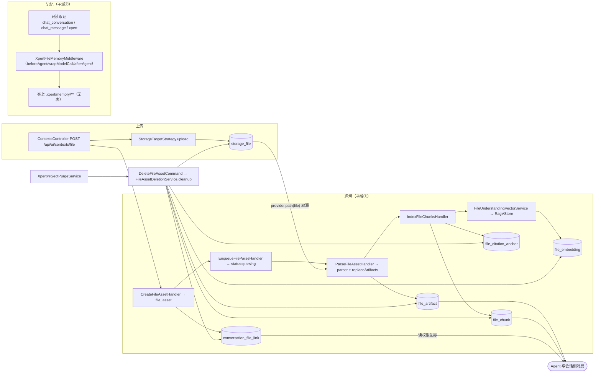

# C4 数据流向与消费（文件理解与记忆专家）

> 只读梳理。**表口径 = 11 张**：子域① 文件理解 **7**（`file_asset`、`file_artifact`、`file_chunk`、`file_citation_anchor`、`file_embedding`、`conversation_file_link` 六张自有 + 只读 `xpert_project`）；子域② 文件记忆与存储 **4**（只读 `chat_conversation`、`chat_message`、`xpert` + 自有 `storage_file`）。
> 「生产方 / 消费方」为模块级概括；跨 3 个以上消费者时归纳为模块族；未能证实处标「未确认」。所有引用为仓库根相对路径。

**本文引用的文件**
- [file-asset.entity.ts](file://packages/server-ai/src/file-understanding/entities/file-asset.entity.ts) · [file-artifact.entity.ts](file://packages/server-ai/src/file-understanding/entities/file-artifact.entity.ts) · [file-chunk.entity.ts](file://packages/server-ai/src/file-understanding/entities/file-chunk.entity.ts) · [file-citation-anchor.entity.ts](file://packages/server-ai/src/file-understanding/entities/file-citation-anchor.entity.ts) · [file-embedding.entity.ts](file://packages/server-ai/src/file-understanding/entities/file-embedding.entity.ts) · [conversation-file-link.entity.ts](file://packages/server-ai/src/file-understanding/entities/conversation-file-link.entity.ts)
- [storage-file.entity.ts](file://packages/server/src/storage-file/storage-file.entity.ts) · [tenant-organization-base.entity.ts](file://packages/server/src/core/entities/tenant-organization-base.entity.ts) · [base.entity.ts](file://packages/server/src/core/entities/base.entity.ts)
- [chat-conversation/conversation.entity.ts](file://packages/server-ai/src/chat-conversation/conversation.entity.ts) · [chat-message/chat-message.entity.ts](file://packages/server-ai/src/chat-message/chat-message.entity.ts) · [xpert/xpert.entity.ts](file://packages/server-ai/src/xpert/xpert.entity.ts) · [xpert-project/entities/project.entity.ts](file://packages/server-ai/src/xpert-project/entities/project.entity.ts)
- [create-file-asset.handler.ts](file://packages/server-ai/src/file-understanding/commands/handlers/create-file-asset.handler.ts) · [parse-file-asset.handler.ts](file://packages/server-ai/src/file-understanding/commands/handlers/parse-file-asset.handler.ts) · [index-file-chunks.handler.ts](file://packages/server-ai/src/file-understanding/commands/handlers/index-file-chunks.handler.ts) · [attach-file-to-conversation.handler.ts](file://packages/server-ai/src/file-understanding/commands/handlers/attach-file-to-conversation.handler.ts)
- [file-understanding-vector.service.ts](file://packages/server-ai/src/file-understanding/file-understanding-vector.service.ts) · [file-asset-access.service.ts](file://packages/server-ai/src/file-understanding/file-asset-access.service.ts) · [file-asset-deletion.service.ts](file://packages/server-ai/src/file-understanding/file-asset-deletion.service.ts) · [file-workspace-projection.service.ts](file://packages/server-ai/src/file-understanding/file-workspace-projection.service.ts)
- [ai/context.controller.ts](file://packages/server-ai/src/ai/context.controller.ts) · [storage-target.strategy.ts](file://packages/server/src/file/file-upload/strategies/storage-target.strategy.ts) · [storage-file.service.ts](file://packages/server/src/storage-file/storage-file.service.ts) · [storage-file.subscriber.ts](file://packages/server/src/storage-file/storage-file.subscriber.ts)
- [file-memory/file-memory.middleware.ts](file://packages/server-ai/src/file-memory/file-memory.middleware.ts) · [file-memory.writeback-runner.ts](file://packages/server-ai/src/file-memory/file-memory.writeback-runner.ts) · [dream.service.ts](file://packages/server-ai/src/file-memory/dream.service.ts) · [paths.ts](file://packages/server-ai/src/file-memory/paths.ts)
- [shared/agent/message.ts](file://packages/server-ai/src/shared/agent/message.ts) · [shared/runtime/workspace-files-runtime-capability.service.ts](file://packages/server-ai/src/shared/runtime/workspace-files-runtime-capability.service.ts) · [knowledge-document/document.service.ts](file://packages/server-ai/src/knowledge-document/document.service.ts) · [project-purge.service.ts](file://packages/server-ai/src/xpert-project/services/project-purge.service.ts)

## 目录
1. [总览：上传 → 理解 → 记忆 → 存储（链与表落点）](#总览上传--理解--记忆--存储链与表落点)
2. [子域① 文件理解：7 张表](#子域-文件理解7-张表)
3. [子域② 文件记忆与存储：4 张表](#子域-文件记忆与存储4-张表)
4. [本域写 vs 跨域写](#本域写-vs-跨域写)
5. [消费链与读边界](#消费链与读边界)
6. [口径与未确认项](#口径与未确认项)

## 总览：上传 → 理解 → 记忆 → 存储（链与表落点）

图表来源：[ai/context.controller.ts](file://packages/server-ai/src/ai/context.controller.ts)（关键符号：ContextsController.create）、[enqueue-file-parse.handler.ts](file://packages/server-ai/src/file-understanding/commands/handlers/enqueue-file-parse.handler.ts)（关键符号：EnqueueFileParseHandler.execute）、[parse-file-asset.handler.ts](file://packages/server-ai/src/file-understanding/commands/handlers/parse-file-asset.handler.ts)（关键符号：ParseFileAssetHandler.execute / replaceArtifacts）、[file-asset-deletion.service.ts](file://packages/server-ai/src/file-understanding/file-asset-deletion.service.ts)（关键符号：FileAssetDeletionService.cleanup）

- 四段落点：**上传**落 `storage_file`（字节 key + url）；**理解**落 `file_asset`（句柄与状态）→ `file_artifact`（自然粒度产物）→ `file_chunk` + `file_citation_anchor`（检索/引用单元）→ `file_embedding`（指向 RagVStore 的账本）；**记忆**不落表（卷上 markdown/JSON）；**存储**贯穿 `storage_file` 与卷。
- 横切表：`conversation_file_link` 是唯一的授权边界表；`xpert_project` 与记忆侧三表均为只读跨域表。
- 无队列：解析由 `setImmediate` 在进程内执行，10 张表（自建 6 + 跨域只读 3 + `storage_file` 1）中**没有任务表/进度表**，进度只能靠 `status` 与派生 `vectorIndexStatus` 观察。
章节来源：[file-understanding.module.ts](file://packages/server-ai/src/file-understanding/file-understanding.module.ts)（关键符号：TypeOrmModule.forFeature / RouterModule.register）、[file-memory/file-memory.module.ts](file://packages/server-ai/src/file-memory/file-memory.module.ts)（关键符号：forFeature([ChatConversation, ChatMessage, Xpert])）

## 子域① 文件理解：7 张表

| 实体 | 表名 | 结构（关键列 + 唯一索引 + 外键） | 生产方 | 主要消费方 | 用途 |
|---|---|---|---|---|---|
| `FileAsset` | `file_asset` | `storageFileId`、`conversationId`、`threadId`、`projectId`、`xpertId`、`userId`、`originalName`、`fileName`、`mimeType`、`size`(bigint+transformer，默认 0)、`sha256`、`purpose`(默认 `chat_attachment`)、`parseMode`(默认 `auto`)、`status`(默认 `uploaded`)、`capabilities`(json)、`workspacePath`、`metadata`(json)、`summary`、`error`、`parsedAt`/`failedAt`；索引 `@Index(['storageFileId'])`、`['conversationId']`、`['tenantId','organizationId','projectId']`、`['threadId']`、`['sha256']`（**5 个全非唯一**）；**无 `@ManyToOne` → 无 DB 级外键**（tenant/organization 来自基类） | `CreateFileAssetHandler`、`CreateWorkspaceFileAssetHandler`、`ParseFileAssetHandler`（状态回写）、`EnqueueFileParseHandler` | `FileAssetAccessService`、8 个 `parsed_file_*` 工具、preview/search/read handler、`XpertProjectPurgeService`、runtime capability | 平台级**文件句柄**：拥有解析状态、能力、上下文链接与工作区投影元数据 |
| `FileArtifact` | `file_artifact` | `fileAssetId`(NOT NULL)、`kind`(11 类 varchar)、`orderNo`(默认 0，= 数组下标)、`mimeType`、`content`(text)、`anchor`(json)、`metadata`(json)；索引 `@Index(['fileAssetId','kind'])`；无唯一、无外键 | `ParseFileAssetHandler.replaceArtifacts`、`CreateFileArtifactsHandler` | `IndexFileChunksHandler`（切块源）、`GetFilePreviewHandler`、删除链（页图 key） | 解析产物：页文本 / 表格 / 幻灯片 / OCR / 页图 / 摘要 / 清单 |
| `FileChunk` | `file_chunk` | `fileAssetId`(NOT NULL)、`artifactId`(可空)、`orderNo`(默认 0)、`content`(text NOT NULL)、`tokenCount`(默认 0)、`anchor`(json，含 `chunk` 序号)、`metadata`(json，含 `artifactKind`)；索引 `@Index(['fileAssetId'])`、`['artifactId']`；无唯一、无外键 | `IndexFileChunksHandler`（3600/240 切块，先删后写） | `SearchFileChunksHandler`、`ReadFileChunkHandler`、`GetFilePreviewHandler`、`FileUnderstandingVectorService`（向量 id = chunk.id） | 检索与读取单元，带稳定锚点供引用 |
| `FileCitationAnchor` | `file_citation_anchor` | `fileAssetId`、`artifactId`(可空)、`chunkId`(可空)、`anchorKey`(NOT NULL)、`label`、`locator`(json=FileAnchor)、`metadata`(json)；索引 `@Index(['fileAssetId'])`、`['anchorKey']`（**非唯一**）；无外键 | `IndexFileChunksHandler.rebuildCitationAnchors`、`CreateFileArtifactsHandler` | **仅删除链**（生产读取点未找到 → 是否死表**未确认**） | 引用锚点目录：`anchorKey` 形如 `page:1:chunk:0` / `sheet:…` / `slide:…` / `path:…` |
| `FileEmbedding` | `file_embedding` | `fileAssetId`、`chunkId`、`provider`、`model`、`vectorId`、`metadata`(json，含 collectionName/fingerprint/dimensions)；**无向量列**；索引 `@Index(['fileAssetId'])`、`['chunkId']`；无唯一、无外键 | `FileUnderstandingVectorService.indexChunks` | `GetFileUnderstandingStatusHandler`（计 `indexedChunkCount`）、`searchChunkIds` 交叉过滤、删除链 | 向量**账本**：记录向量写去了哪个 RagVStore 集合，不存向量本体 |
| `ConversationFileLink` | `conversation_file_link` | `conversationId`(NOT NULL)、`fileAssetId`(NOT NULL)、`storageFileId`(可空)、`threadId`、`metadata`(json)；**唯一** `@Index(['conversationId','fileAssetId'],{unique:true})` + `@Index(['storageFileId'])`；无外键 | `CreateFileAssetHandler`、`AttachFileToConversationHandler`（findOne→save upsert） | `FileAssetAccessService`（读权限边界）、`ListConversationFilesQuery`、删除链 | 会话附件**授权边界**：link 存在即代表该会话可读/可检索此文件 |
| `XpertProject` | `xpert_project` | 列与索引归 `xpert-project` 域（本域未逐列核实）；本域 `TypeOrmModule.forFeature` 只读注册；项目维度列举依赖 `file_asset` 的 `@Index(['tenantId','organizationId','projectId'])` | **跨域**（`XpertProjectService`） | `FileAsset.projectId` 取值源、`purgeProjectFile` 一致性校验、项目维度文件列举 | 项目维表：让文件资产能按项目列举并随项目生命周期回收 |

- 六张自有表**全部** `extends TenantOrganizationBaseEntity`（租户/组织隔离列来自基类，实体文件内不重复声明），且**都没有声明关系列** ⇒ 级联完全由应用层删除顺序模拟。
- 全库唯一索引只有 `conversation_file_link` 这一处；竞态靠唯一索引兜底，upsert 前先 `findOne`（`organizationId` 空值用 `IsNull()` 匹配）。
- `file_asset.metadata` 同时是**兼容层**：`storageFile` 快照（id/file/url/fileUrl/thumb/originalName/size/mimetype/storageProvider）、`parser`、`chunkCount`、`understandingErrorCode`、`pdfPageImages`。
章节来源：[file-asset.entity.ts](file://packages/server-ai/src/file-understanding/entities/file-asset.entity.ts)（关键符号：FileAsset / 5 个 @Index / bigintNumberTransformer）、[conversation-file-link.entity.ts](file://packages/server-ai/src/file-understanding/entities/conversation-file-link.entity.ts)（关键符号：ConversationFileLink / unique @Index）、[file-asset-deletion.service.ts](file://packages/server-ai/src/file-understanding/file-asset-deletion.service.ts)（关键符号：FileAssetDeletionService.cleanup 顺序）

## 子域② 文件记忆与存储：4 张表

| 实体 | 表名 | 结构（关键列 + 唯一索引 + 外键） | 生产方 | 主要消费方 | 用途 |
|---|---|---|---|---|---|
| `ChatConversation` | `chat_conversation` | `threadId`(默认 `gen_random_uuid()`)、`title`、`status`、`purpose`、`revision`、`lastMessageSequence`、`branchSource`(jsonb)、`options`/`sourceAudit`/`operation`(json)、`xpertId`、`projectId`、`taskId`；索引 `@Index(['tenantId','organizationId','id'])`、`IDX_chat_conversation_profile_activity`；外键 `xpert`/`project` **CASCADE**、`task` **SET NULL**；另有已弃用的 `chat_conversation_attachment` M2M 表 | **跨域**（chat-conversation） | `XpertConversationHistoryReader`（`select id/threadId/title/xpertId/tenantId` + 作用域过滤） | 记忆取证的**会话容器**与作用域边界（user scope 需 `createdById` 匹配） |
| `ChatMessage` | `chat_message` | `conversationId`、`createdInThreadId`、`sequence`、`groupPublicationId`、`parentId`(`@JoinColumn`)、`content`、`role`、`executionId`、`inputCheckpoint`/`outputCheckpoint`(jsonb)；`@Tree('closure-table')`；**唯一** `['conversationId','sequence']`、`['conversationId','groupPublicationId']`、`@Index(['conversationId'])`、`['createdInThreadId']`；与 `FileAsset` 有 `fileAssets` 关联 | **跨域**（chat-message） | `XpertConversationHistoryReader`（按 conversationId+tenantId 取最近 N 条，`reverse()` 后单条截断 2000 字） | 记忆取证的**消息流**，也是附件重试重建输入的来源 |
| `Xpert` | `xpert` | `slug`(100)、`name`(100)、`type`(10)、`title`、`workspaceDataScope`(`shared|user`，默认 shared，**`update:false`**)、`active`、`options`/`agentConfig`/`avatar`/`starters`(json)；`WorkspaceBaseEntity` 提供 `workspaceId`/`publishAt`/`deletedAt`；唯一 `['tenantId','organizationId','type','slug','version','latest']` | **跨域**（xpert） | `XpertFileMemoryScopeResolver`（tenantId + `workspaceDataScope`）、dreamer 助手解析 | 记忆**作用域与容量语义**来源（个人级卷 vs 项目共享卷） |
| `StorageFile` | `storage_file` | `file`(NOT NULL，对象存储 key)、`url`、`thumb`、`originalName`、`encoding`、`recordedAt`(timestamptz)、`deletedAt`(timestamptz，**删除路径未使用**)、`size`(默认 0)、`mimetype`、`storageProvider`(varchar，`@Exclude({toPlainOnly:true})`)；**无自定义索引、无唯一约束**（继承基类 `tenantId`/`organizationId` 索引与 FK `onDelete:'CASCADE'`）；非持久字段 `fileUrl`/`thumbUrl` | `StorageFileService.createStorageFile`（唯一入口经 `StorageTargetStrategy.upload`）、`StorageFileCreateHandler`、`UpdateStorageFileHandler` | `FileAssetAccessService`（句柄解析）、`ParseFileAssetHandler`（`provider.path(file)` 取源）、加载类 handler（`GetOwnedStorageFileQuery`）、`StorageFileSubscriber` | 对象存储**索引行**：把字节 key 映射为可访问 url，并作为理解子域的字节来源 |

- 记忆侧三张外部表在本域**零写入**（仅 `forFeature` + Repository 注入）；记忆本体是卷上的 `.xpert/memory/**`（`MEMORY.md` 索引 + `user|feedback|project|reference` 目录 + `.dream`）。
- `storage_file` 生命周期：创建即写行 + `provider.putFile`；删除走 `repository.remove`（硬删）→ `afterRemove` 删 `file`/`thumb` 物理对象；`deletedAt` 列存在但无软删写入点。
- 易踩点：`storage_file.recordedAt` 是 `timestamptz` 列却用 `@IsNumber` 校验（与列类型不一致，**未确认**是有意还是笔误）。
章节来源：[storage-file.entity.ts](file://packages/server/src/storage-file/storage-file.entity.ts)（关键符号：StorageFile / storageProvider / deletedAt）、[chat-message.entity.ts](file://packages/server-ai/src/chat-message/chat-message.entity.ts)（关键符号：ChatMessage / @Tree('closure-table') / 两个唯一索引）、[xpert.entity.ts](file://packages/server-ai/src/xpert/xpert.entity.ts)（关键符号：Xpert.workspaceDataScope）

## 本域写 vs 跨域写

| 列 / 事实 | 写入方 | 读方 | 说明 |
|---|---|---|---|
| `file_asset` 全部列（含 `status`/`capabilities`/`metadata`/`workspacePath`） | **本域**（`CreateFileAssetHandler` / `ParseFileAssetHandler` / `EnqueueFileParseHandler`） | 本域 + 会话/项目/运行时/ChatKit | 幂等键 = `storageFileId` + tenantId，重复上传原地覆盖；`projectId`/`xpertId` 由**请求上下文/会话**给出，但写入动作在本域 |
| `file_artifact` / `file_chunk` / `file_citation_anchor` | **本域**（Parse / Index handler） | 本域工具面与检索 | 重放「先删后写」；`replaceArtifacts` 以数组下标覆盖 `orderNo` |
| `file_embedding` 与 RagVStore 集合 | **本域**（`FileUnderstandingVectorService`） | 本域状态与检索 | 只写账本（`vectorId` + collection 元数据）；向量本体由 rag-vstore 侧持有 |
| `conversation_file_link` | **本域**（`CreateFileAssetHandler` / `AttachFileToConversationHandler`） | `FileAssetAccessService`、工具面 | **触发起因跨域**（对话/项目/知识库侧投递 `AttachFileToConversationCommand`），但写入方与唯一索引都在本域 |
| `storage_file` 行与物理对象 | **本域子域②**（`StorageTargetStrategy.upload` → `createStorageFile`）；删除经 `deleteAuthorizedStorageFile` | 理解子域（取源）、知识库（取句柄） | 对理解子域而言是「跨子域只读句柄」；知识库/对话/项目侧**都不写**这张表 |
| `xpert_project` | **跨域**（`xpert-project` 域） | 本域只读（项目维度列举 + purge 校验） | 本域对它的写操作为 0；`project-file.entity.ts` 已弃用（改走 FileAsset 工作区投影） |
| `chat_conversation` / `chat_message` / `xpert` | **跨域**（chat-conversation / chat-message / xpert） | 记忆子域只读取证与作用域解析 | 记忆的读/写路径都不经这三张表，也不经 DB 事务 |
| 卷：解析派生目录 `contexts/<tenantId>/file-understanding/<assetId>/<parseRunId>` | **本域**（`ParseFileAssetHandler`，经 `FileStorage` provider 或卷客户端） | 页图工具、删除链 | 删除派生目录仅当 `provider.path()` 返回绝对路径（本地 provider） |
| 卷：`.xpert/memory/**`、`.dream/**` | **本域记忆子域**（`XpertSandboxMemoryStore` 经 sandbox backend） | `XpertFileMemoryMiddleware` 召回注入 | 项目卷下按 xpert 隔离为 `.xpert/memory/xperts/<xpertId>`；项目卷根目录删除由跨域 `XpertProjectPurgeService` 发起 |
| 卷：工作区投影 `workspacePath` | **本域**（`FileWorkspaceProjectionService.projectFileAsset`，best-effort write-through） | 沙箱/运行时（`view_image` 等消费 POSIX 相对路径） | 投影失败不影响 attach 结果 |
| 项目卷整体回收 | **跨域发起**（`ProjectPurgeService.purge`）→ **本域执行**（`purgeProjectFile` 逐资产清理） | 项目侧 | 先忙判、再逐资产清理、最后删卷根；双域协作是删除链的唯一跨域写入口 |
章节来源：[file-asset-access.service.ts](file://packages/server-ai/src/file-understanding/file-asset-access.service.ts)（关键符号：FileAssetAccessService.resolve / assertStorageFileOwner）、[create-file-asset.handler.ts](file://packages/server-ai/src/file-understanding/commands/handlers/create-file-asset.handler.ts)（关键符号：CreateFileAssetHandler.execute / buildStorageFileMetadata）、[file-workspace-projection.service.ts](file://packages/server-ai/src/file-understanding/file-workspace-projection.service.ts)（关键符号：FileWorkspaceProjectionService.projectFileAsset）

## 消费链与读边界

- **会话附件预览**：`shared/agent/message.ts` 以 `ResolveAuthorizedFileAssetQuery`（read）打头；需要字节时 `ReadFileAssetSourceQuery`，需要摘要时 `GetFilePreviewQuery`，并保留老客户端 `GetOwnedStorageFileQuery` 兜底。
- **Agent 工具面**：`FileUnderstandingMiddleware`（内置、隐藏）挂 8 个 `parsed_file_*` 工具；可见性由 `listVisibleFiles` 决定——有可信 `projectId` 走 `ListProjectFilesQuery`，否则走 `ListConversationFilesQuery`，`resolveFileIds` 拒绝不可见 id。
- **运行时能力面**：`FileRuntimeService`（`@RuntimeCapabilityProvider(FileRuntimeCapability)`）以 `resolveFile`（当前 owner 授权）与 `createScopedApi({conversationId})`（会话授权）把句柄解析成可预览 URL；`workspace-files-runtime-capability` 走状态/重试/检索/引用校验五条查询。
- **知识库**：仅 `GetOwnedStorageFileQuery` 取源句柄，依赖面窄且单向；**不共享** `file_asset` 解析结果。
- **项目**：`forFeature(FileAsset)` + `AttachFileToConversationCommand` + 永久删除经 `purgeProjectFile`。
- **记忆**：消费面是 `wrapModelCall` 前置注入的 recall 消息 + `memory_search`/`memory_get`/`memory_write` 三个工具；写入面是 `explicit`/`writeback`/Dream 三入口，读的只有对话/助手三张外部表。
- **读边界一句话**：`ConversationFileLink` 是文件工具面的读权限边界（注释逐字「The link is the read-permission boundary for file tools」）；没有 link 就没有会话级可见性。
章节来源：[shared/agent/message.ts](file://packages/server-ai/src/shared/agent/message.ts)（关键符号：ResolveAuthorizedFileAssetQuery / ReadFileAssetSourceQuery / GetFilePreviewQuery）、[tools/file-understanding.tools.ts](file://packages/server-ai/src/file-understanding/tools/file-understanding.tools.ts)（关键符号：listVisibleFiles / resolveFileIds）、[file-runtime.service.ts](file://packages/server-ai/src/file-understanding/runtime/file-runtime.service.ts)（关键符号：FileRuntimeService.resolveFile / createScopedApi）

## 口径与未确认项

1. **DDL 与迁移**：本域三目录（`file-understanding` / `file-memory` / `storage-file`）无 `migrations/`、无 `.sql`，运行时数据源 `synchronize:false` ⇒ 10 张表（自建 6 + 跨域只读 3 + `storage_file` 1）的列级 DDL 来源在仓库外（唯一证据是测试桩里的最小 `CREATE TABLE "file_asset"`），**未确认**。
2. **跨域写边界**：知识库侧是否会对 `storage_file` 行做二次写（如补 `url`/`thumb`）**未确认**；本域内未见该路径。
3. **`file_citation_anchor` 是否有生产读取方**：仅见实体、写入与删除路径，**未确认**是否为死表。
4. **记忆侧的容量与配额**：记忆不落库，未见条目数/总字节/保留期的强制实现，**未确认**是否有外部配额或清理任务。
5. **`chat_message` 与 `file_asset` 的物理联接表**：消息侧 `fileAssets` 关联对应的联接表名与级联行为**未逐列核实**。
章节来源：[application-data-source.ts](file://packages/server/src/database/application-data-source.ts)（关键符号：isSchemaSyncExternallyManaged / synchronize:false）、[file-asset.entity.ts](file://packages/server-ai/src/file-understanding/entities/file-asset.entity.ts)（关键符号：FileAsset @Index）、[file-memory/paths.ts](file://packages/server-ai/src/file-memory/paths.ts)（关键符号：normalizeFileMemoryRelativePath）
