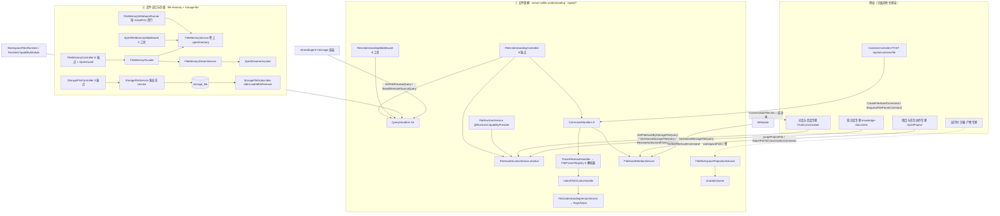

# 文件理解与记忆域 · 架构（01-架构）

**本文引用的文件**
- [packages/server-ai/src/file-understanding/file-understanding.module.ts](file://packages/server-ai/src/file-understanding/file-understanding.module.ts)
- [packages/server-ai/src/file-understanding/file-understanding.controller.ts](file://packages/server-ai/src/file-understanding/file-understanding.controller.ts)
- [packages/server-ai/src/file-understanding/index.ts](file://packages/server-ai/src/file-understanding/index.ts)
- [packages/server-ai/src/file-understanding/file-asset-access.service.ts](file://packages/server-ai/src/file-understanding/file-asset-access.service.ts)
- [packages/server-ai/src/file-understanding/file-asset-deletion.service.ts](file://packages/server-ai/src/file-understanding/file-asset-deletion.service.ts)
- [packages/server-ai/src/file-understanding/file-understanding-vector.service.ts](file://packages/server-ai/src/file-understanding/file-understanding-vector.service.ts)
- [packages/server-ai/src/file-understanding/file-workspace-projection.service.ts](file://packages/server-ai/src/file-understanding/file-workspace-projection.service.ts)
- [packages/server-ai/src/file-understanding/domain/types.ts](file://packages/server-ai/src/file-understanding/domain/types.ts)
- [packages/server-ai/src/file-understanding/domain/workspace-file.ts](file://packages/server-ai/src/file-understanding/domain/workspace-file.ts)
- [packages/server-ai/src/file-understanding/entities/file-asset.entity.ts](file://packages/server-ai/src/file-understanding/entities/file-asset.entity.ts)
- [packages/server-ai/src/file-understanding/entities/conversation-file-link.entity.ts](file://packages/server-ai/src/file-understanding/entities/conversation-file-link.entity.ts)
- [packages/server-ai/src/file-understanding/entities/file-chunk.entity.ts](file://packages/server-ai/src/file-understanding/entities/file-chunk.entity.ts)
- [packages/server-ai/src/file-understanding/entities/file-artifact.entity.ts](file://packages/server-ai/src/file-understanding/entities/file-artifact.entity.ts)
- [packages/server-ai/src/file-understanding/entities/file-embedding.entity.ts](file://packages/server-ai/src/file-understanding/entities/file-embedding.entity.ts)
- [packages/server-ai/src/file-understanding/entities/file-citation-anchor.entity.ts](file://packages/server-ai/src/file-understanding/entities/file-citation-anchor.entity.ts)
- [packages/server-ai/src/file-understanding/parsers/file-parser.registry.ts](file://packages/server-ai/src/file-understanding/parsers/file-parser.registry.ts)
- [packages/server-ai/src/file-understanding/parsers/pdf.parser.ts](file://packages/server-ai/src/file-understanding/parsers/pdf.parser.ts)
- [packages/server-ai/src/file-understanding/commands/handlers/enqueue-file-parse.handler.ts](file://packages/server-ai/src/file-understanding/commands/handlers/enqueue-file-parse.handler.ts)
- [packages/server-ai/src/file-understanding/commands/handlers/parse-file-asset.handler.ts](file://packages/server-ai/src/file-understanding/commands/handlers/parse-file-asset.handler.ts)
- [packages/server-ai/src/file-understanding/commands/handlers/index-file-chunks.handler.ts](file://packages/server-ai/src/file-understanding/commands/handlers/index-file-chunks.handler.ts)
- [packages/server-ai/src/file-understanding/commands/handlers/create-file-asset.handler.ts](file://packages/server-ai/src/file-understanding/commands/handlers/create-file-asset.handler.ts)
- [packages/server-ai/src/file-understanding/commands/handlers/attach-file-to-conversation.handler.ts](file://packages/server-ai/src/file-understanding/commands/handlers/attach-file-to-conversation.handler.ts)
- [packages/server-ai/src/file-understanding/runtime/file-runtime.module.ts](file://packages/server-ai/src/file-understanding/runtime/file-runtime.module.ts)
- [packages/server-ai/src/file-understanding/runtime/file-runtime.service.ts](file://packages/server-ai/src/file-understanding/runtime/file-runtime.service.ts)
- [packages/server-ai/src/file-understanding/middlewares/file-understanding.middleware.ts](file://packages/server-ai/src/file-understanding/middlewares/file-understanding.middleware.ts)
- [packages/server-ai/src/file-understanding/tools/file-understanding.tools.ts](file://packages/server-ai/src/file-understanding/tools/file-understanding.tools.ts)
- [packages/server-ai/src/file-memory/file-memory.module.ts](file://packages/server-ai/src/file-memory/file-memory.module.ts)
- [packages/server-ai/src/file-memory/file-memory.controller.ts](file://packages/server-ai/src/file-memory/file-memory.controller.ts)
- [packages/server-ai/src/file-memory/file-memory.facade.ts](file://packages/server-ai/src/file-memory/file-memory.facade.ts)
- [packages/server-ai/src/file-memory/file-memory.service.ts](file://packages/server-ai/src/file-memory/file-memory.service.ts)
- [packages/server-ai/src/file-memory/file-memory.middleware.ts](file://packages/server-ai/src/file-memory/file-memory.middleware.ts)
- [packages/server-ai/src/file-memory/file-memory.writeback-runner.ts](file://packages/server-ai/src/file-memory/file-memory.writeback-runner.ts)
- [packages/server-ai/src/file-memory/dream.service.ts](file://packages/server-ai/src/file-memory/dream.service.ts)
- [packages/server-ai/src/file-memory/paths.ts](file://packages/server-ai/src/file-memory/paths.ts)
- [packages/server-ai/src/file-memory/ports.ts](file://packages/server-ai/src/file-memory/ports.ts)
- [packages/server-ai/src/file-memory/types.ts](file://packages/server-ai/src/file-memory/types.ts)
- [packages/server/src/storage-file/storage-file.module.ts](file://packages/server/src/storage-file/storage-file.module.ts)
- [packages/server/src/storage-file/storage-file.controller.ts](file://packages/server/src/storage-file/storage-file.controller.ts)
- [packages/server/src/storage-file/storage-file.service.ts](file://packages/server/src/storage-file/storage-file.service.ts)
- [packages/server/src/storage-file/storage-file.entity.ts](file://packages/server/src/storage-file/storage-file.entity.ts)
- [packages/server/src/storage-file/storage-file.subscriber.ts](file://packages/server/src/storage-file/storage-file.subscriber.ts)
- [packages/server-ai/src/ai/context.controller.ts](file://packages/server-ai/src/ai/context.controller.ts)
- [packages/server-ai/src/xpert/commands/handlers/chat-file-assets.ts](file://packages/server-ai/src/xpert/commands/handlers/chat-file-assets.ts)
- [packages/server-ai/src/shared/runtime/workspace-files-runtime-capability.service.ts](file://packages/server-ai/src/shared/runtime/workspace-files-runtime-capability.service.ts)

## 目录
1. [专家域职责边界](#专家域职责边界)
2. [子域划分与交叉引用](#子域划分与交叉引用)
3. [目录结构与分层](#目录结构与分层)
4. [依赖关系](#依赖关系)
5. [关键不变量](#关键不变量)
6. [架构总览](#架构总览)
7. [组件详细分析](#组件详细分析)
8. [结论](#结论)

## 专家域职责边界
**做什么**：把「文件字节」变成平台可授权、可解析、可检索、可引用、可投影进工作区的**平台级文件句柄**——`FileAsset`（状态/能力/上下文链接/投影元数据）、`FileArtifact`（页/表/幻灯片/清单等解析产物）、`FileChunk`（检索与读取单元）、`FileCitationAnchor`（引用锚点）、`FileEmbedding`（向量账本，指向 RagVStore）、`ConversationFileLink`（会话附件授权边界）；解析链（`FileParserRegistry` 6 类解析器 + 编排 handler）；对象存储登记表（`storage_file`）与其物理对象生命周期；以及**卷上的 markdown 记忆库**（`file-memory`，含 writeback 与离线 Dream 整理）与 `XpertFileMemoryMiddleware` 的 recall/write 消费面。

**不做什么**：不实现模型推理与 Agent 运行时；不拥有会话与消息表（只读 `ChatConversation`/`ChatMessage` 做取证与链接）；不做文档 OCR/向量库实现本身（`RagVStore` 是外部依赖，本域只写账本）；不实现对象存储驱动（仓库内只有 LOCAL provider，S3 等经 `@FileStorageProvider` 外部插件注册）；不做沙箱内文件写入（`FileWorkspaceProjectionService` 只把对象存储文件**投影**为工作区路径）。

**与相邻专家的分工**：会话附件与会话侧归**对话与会话专家**（本域只存 `ConversationFileLink` 与 `FileAsset.conversationId/threadId`，读边界由对方给出）；文档摄取与向量归**知识库专家**（`knowledge-document` 只把 `storage_file` 当源文件句柄，本域不反向依赖）；项目卷与项目资产索引归**项目与任务协作专家**（本域通过 `XpertProjectAccessService` 复用项目准入，并在项目永久删除时被 `ProjectPurgeService` 调用）；沙箱与产物归**运行时·沙箱·产物专家**（本域交付 `workspacePath` 与 `FileRuntimeCapability`，不落沙箱产物）。本域的定位因此是**文件字节与理解的共同底座**。

章节来源：[file-asset.entity.ts](file://packages/server-ai/src/file-understanding/entities/file-asset.entity.ts)（关键符号：FileAsset）、[file-runtime.service.ts](file://packages/server-ai/src/file-understanding/runtime/file-runtime.service.ts)（关键符号：FileRuntimeService.resolveFile）、[storage-file.entity.ts](file://packages/server/src/storage-file/storage-file.entity.ts)（关键符号：StorageFile）

## 子域划分与交叉引用
① **文件理解**（`packages/server-ai/src/file-understanding/**`，88 非 spec / 29 spec）：7 张表（`file_asset`、`file_artifact`、`file_chunk`、`file_citation_anchor`、`file_embedding`、`conversation_file_link` + 只读 `xpert_project`），8 个 HTTP 端点（前缀 `/api/ai/*`），9 个 command handler + 16 个 query handler，6 个解析器，8 个 Agent 工具，1 个运行时能力提供者。核心类：`FileAssetAccessService`、`FileAssetDeletionService`、`FileUnderstandingVectorService`、`FileWorkspaceProjectionService`。
② **文件记忆与存储**（`packages/server-ai/src/file-memory/**` + `packages/server/src/storage-file/**`，24+21 非 spec / 8+1 spec）：`file-memory` 无自有表（只读外部 `chat_conversation`/`chat_message`/`xpert`），6 个端点（`xpert/:id/memory`），记忆以**卷上 markdown/JSON** 承载；`storage_file` 1 张表，3 个端点。核心类：`FileMemoryService`、`FileMemoryFacade`、`FileMemoryDreamService`、`XpertFileMemoryMiddleware`、`StorageFileService`、`StorageFileSubscriber`。

交叉引用：两子域共享 `@xpert-ai/server-core` 的 `FileStorage`/`StorageFileService`/`StorageFileModule`（① `forFeature`+imports，② 实现）与 `shared/volume`（① 解析源/派生目录、② 记忆库路径）；② 的 `StorageFileService` 是① `FileAsset.storageFileId` 的落地对象；两者各自实现一个 `@AgentMiddlewareStrategy` 中间件（`FileUnderstandingMiddleware` / `XpertFileMemoryMiddleware`），**代码上互不 import**——记忆域只共享对话/助手表与卷基础设施。

章节来源：[file-understanding.module.ts](file://packages/server-ai/src/file-understanding/file-understanding.module.ts)（关键符号：FileUnderstandingModule 的 forFeature/imports）、[file-memory.module.ts](file://packages/server-ai/src/file-memory/file-memory.module.ts)（关键符号：FileMemoryModule 的 imports）、[storage-file.module.ts](file://packages/server/src/storage-file/storage-file.module.ts)（关键符号：StorageFileModule）

## 目录结构与分层
### 归属范围与规模
`file-understanding/`：根 4 服务 + `module`/`controller`/`index`；`commands/`（9 命令 + `handlers/` 9 handler）；`queries/`（16 查询 + `handlers/` 16 handler）；`entities/`（6 实体 + 只读 `XpertProject`）；`domain/`（`types.ts`、`workspace-file.ts`、`page-image-artifact.ts`）；`parsers/`（6 解析器 + `file-parser.registry.ts` + `file-parser.ts` 契约 + `text-file.ts` 解码 + `unsupported-file-content.error.ts`）；`middlewares/`；`runtime/`（`file-runtime.module.ts`/`file-runtime.service.ts`）；`tools/`（`file-understanding.tools.ts`）。合计 117 文件。

### 分层
- **控制器层**：`FileUnderstandingController`（`@Controller()` 空前缀 + `@Public()` + `@AllowClientSecretBindings(ENTERPRISE_XPERT)` + `ApiKeyOrClientSecretAuthGuard`）；`FileMemoryController`（`@Controller('xpert/:id/memory')` + `XpertGuard`）；`StorageFileController`（`@Controller()`，**无控制器守卫**）。
- **命令/查询层（CQRS）**：写入经命令（create/enqueue/parse/index/attach/delete/retry），读取经查询（preview/status/read/search/list/get），25 个 handler 全在模块内 `providers`。
- **领域服务层**：`FileAssetAccessService`（唯一授权入口）、`FileAssetDeletionService`（全链路清理）、`FileUnderstandingVectorService`（向量索引/检索/删除）、`FileWorkspaceProjectionService`（工作区投影）。
- **解析器层**：`FileParser` 契约 + 6 实现 + 注册表（顺序 pdf→spreadsheet→office→image→archive→text）。
- **运行时/工具层**：`FileRuntimeService`（`@RuntimeCapabilityProvider(FileRuntimeCapability)`，实现 `AgentMiddlewareFileApi`）；`createFileUnderstandingTools` 8 个 `parsed_file_*` 工具；`XpertFileMemoryMiddleware` 3 个记忆工具。
- **存储抽象层**：`StorageFileService`（`TenantOrganizationAwareCrudService<StorageFile>`）+ `StorageFileSubscriber`（加载补 `fileUrl`、删除删物理对象）+ `@FileUploadTargetStrategy('storage')` 写入点。
- **记忆层**：`FileMemoryService`（卷上读写/索引）+ `FileMemoryFacade`（端点/工具入口）+ `recall-planner`/`writeback`/`signals`/`scoring`/`usage`/`taxonomy`/`frontmatter`/`index-validator` + `dream.service` + `adapters/`。

章节来源：[file-understanding/index.ts](file://packages/server-ai/src/file-understanding/index.ts)（关键符号：FileUnderstandingModule 导出）、[file-understanding.controller.ts](file://packages/server-ai/src/file-understanding/file-understanding.controller.ts)（关键符号：FileUnderstandingController）、[storage-file.service.ts](file://packages/server/src/storage-file/storage-file.service.ts)（关键符号：StorageFileService）

## 依赖关系
**出向（本域依赖，逐条）**：模块 imports = `FileRuntimeModule`（子模块）、`TenantModule`、`UserModule`、`StorageFileModule`、`forwardRef(() => ChatConversationModule)`、`XpertProjectAccessModule`、`forwardRef(() => XpertModule)`、`RagVStoreModule`、`VolumeModule`；域内另依赖 `shared/volume`（`VOLUME_CLIENT`、`VolumeSubtreeClient`、`createVolumeFileSnapshot`、`resolveXpertDataVolumeScope`）、`shared/file-upload-targets/utils`（`normalizeRelativePath`）、`@xpert-ai/plugin-sdk`（`AgentMiddlewareFileApi`/`FileRuntimeCapability`/`@RuntimeCapabilityProvider`/`@AgentMiddlewareStrategy`）、`@xpert-ai/contracts`；`file-memory` 出向仅 `XpertModule` + `XpertWorkspaceModule`（+ `VOLUME_CLIENT`）；`storage-file` 出向 `TenantModule`/`UserModule`/`CqrsModule`/`FileStorage`。

**入向（依赖本域，逐条）**：`ai/context.controller.ts`（上传/删除入口）、`xpert`（`chat-file-assets.ts` 上传与归一化）、`chat-conversation`（`conversation.service.ts` 三查询 + `resolveFileAssetWorkspaceRelativePath`）、`xpert-project`（`project.module.ts` forFeature `FileAsset`、`conversation-project.service.ts` attach、`project.service.ts` 查询）、`shared/runtime/workspace-files-runtime-capability.service.ts`、`shared/agent/message.ts`（消息文件上下文）、`shared/commands/handlers/load-file.handler.ts`、`xpert-agent/commands/handlers/subgraph.handler.ts`（经 `agentMiddlewareRegistry` 挂载 `FileUnderstandingMiddleware`）、`shared/agent/middleware-runtime/middleware-runtime.module.ts`（imports `FileRuntimeModule`）；模块装配点 `app.module.ts`（`ServerAIModule` 装载 `FileMemoryModule` 等）。索引入向模块面：`AIModule`、`ConversationBranchModule`、`ServerAIModule`。

章节来源：[file-understanding.module.ts](file://packages/server-ai/src/file-understanding/file-understanding.module.ts)（关键符号：FileUnderstandingModule 的 imports/exports）、[context.controller.ts](file://packages/server-ai/src/ai/context.controller.ts)（关键符号：ContextsController.create）、[file-memory.module.ts](file://packages/server-ai/src/file-memory/file-memory.module.ts)（关键符号：FileMemoryModule）

## 关键不变量
1. **幂等与去重键**：`FileAsset` 以 `storageFileId + tenantId` 为去重键，重复上传/重试原地更新解析状态（`existing` 合并写入）；`ConversationFileLink` 有 `@Index(['conversationId','fileAssetId'], { unique: true })` 并由 handler 先查后 save 做幂等 upsert；解析/索引重放前先删旧数据。`FileAsset.sha256` 列存在且被写入，但**仅有普通索引、无唯一约束、无查重逻辑**。
2. **租户/组织边界与 `organizationId` 空值语义**：所有资产查询带 `tenantId: actor.tenantId`；`isOrganizationVisible` 规定「`asset.organizationId` 为空 = 租户级可见」，仅非空且不等时才拒；链接查询用 `organizationId: conversation.organizationId ?? IsNull()`；`StorageFileService.deleteAuthorizedStorageFile` 用 `(entity.organizationId ?? null) !== (storageFile.organizationId ?? null)` 做空值安全比较。
3. **软删与回收**：`FileAsset` **无 `deletedAt`**，`FileAssetDeletionService.cleanup` 是硬删 + 物理清理（向量、锚点、嵌入、块、产物、链接、资产行，再删页图对象与派生目录）；`storage_file` 有 `deletedAt` 列但删除路径走 `repository.remove`（硬删）以触发订阅者；项目回收走专用入口 `purgeProjectFile`。
4. **访问授权**：文件侧唯一入口是 `FileAssetAccessService.resolve({locator, authority, operation})`（`operation` ∈ read/attach/parse/write/delete）；`attach` 到项目**先** `assertCanEdit` 再查链接（读权限成员不得借既有链接绕过项目编辑边界）；个人 Xpert 卷不因项目会话自动公开，须显式 attach 后由 `ConversationFileLink` 成为共享授权；记忆域由 `XpertGuard` 把关；存储域**鉴权在 service**——`deleteStorageFile` 仅 owner 或 SUPER_ADMIN/ADMIN，跨域删除走 `deleteAuthorizedStorageFile`。
5. **存储抽象与卷路径约束**：对象读写一律 `new FileStorage().getProvider(storageFile.storageProvider)`（先注册表、失败回落内置 provider）；派生产物目录固定 `contexts/<tenantId>/file-understanding/<assetId>/<parseRunId>`；删除派生目录**仅当** `provider.path()` 返回绝对路径（即本地 provider）才 `fsPromises.rm`；记忆域 `normalizeFileMemoryRelativePath` 拒绝 `..` 与绝对路径，子域根读取需显式 `{ allowRootWorkspace: true }`。
6. **解析器注册表与类型支持**：`FileParserRegistry.getParser(source)` 按固定顺序命中，全部落空抛 `UnsupportedFileContentError`；新增类型必须同时进 `FileParsers` provider 数组，否则运行时不可解析。
7. **记忆的写入与消费触发点**：写入三入口 = `memory_write` 工具（`FileMemoryService.writeMemory`）/ `afterAgent` writeback（`FileMemoryWritebackRunner.enqueue`）/ Dream 离线整理；消费二入口 = `wrapModelCall` 前置注入 recall 消息 + `memory_search`/`memory_get` 工具；串行化键 `createFileMemoryScopeKey` 含 tenant/project/user。
8. **上传路径与解析启动耦合**：解析不由存储层触发，而由 `ContextsController.create` 在上传成功后显式 `CreateFileAssetCommand` → `EnqueueFileParseCommand`；`EnqueueFileParseHandler` 先把状态写成 `parsing`（或 `parseMode==='none'` 直接 `ready` 并返回），再按 `options.runInline` 决定同步或 `setImmediate` 后台执行。

章节来源：[file-asset-access.service.ts](file://packages/server-ai/src/file-understanding/file-asset-access.service.ts)（关键符号：FileAssetAccessService.resolve）、[create-file-asset.handler.ts](file://packages/server-ai/src/file-understanding/commands/handlers/create-file-asset.handler.ts)（关键符号：CreateFileAssetHandler.execute）、[file-asset-deletion.service.ts](file://packages/server-ai/src/file-understanding/file-asset-deletion.service.ts)（关键符号：FileAssetDeletionService.cleanup）、[paths.ts](file://packages/server-ai/src/file-memory/paths.ts)（关键符号：normalizeFileMemoryRelativePath）、[enqueue-file-parse.handler.ts](file://packages/server-ai/src/file-understanding/commands/handlers/enqueue-file-parse.handler.ts)（关键符号：EnqueueFileParseHandler.execute）

## 架构总览

图表来源：[file-understanding.controller.ts](file://packages/server-ai/src/file-understanding/file-understanding.controller.ts)（关键符号：FileUnderstandingController）、[file-understanding.module.ts](file://packages/server-ai/src/file-understanding/file-understanding.module.ts)（关键符号：FileUnderstandingModule）、[file-memory.controller.ts](file://packages/server-ai/src/file-memory/file-memory.controller.ts)（关键符号：FileMemoryController）、[storage-file.controller.ts](file://packages/server/src/storage-file/storage-file.controller.ts)（关键符号：StorageFileController）、[context.controller.ts](file://packages/server-ai/src/ai/context.controller.ts)（关键符号：ContextsController.create）

## 组件详细分析
### 文件理解子域
装配集中在 `FileUnderstandingModule`：`RouterModule.register([{ path: '/ai', module: FileUnderstandingModule }])` 叠加全局前缀后为 `/api/ai/*`；控制器 8 端点全部先经 `authorizeFile`/`assertConversationAccess` 授权，再投递命令或查询。写侧三条主线：`CreateFileAssetHandler`（去重、链接、`sha256` 快照）→ `EnqueueFileParseHandler` → `ParseFileAssetHandler`（解析 + 产物替换 + 触发索引）；`IndexFileChunksHandler`（3600/240 切块 + 锚点重建 + 向量索引）；`FileAssetDeletionService`（全链路清理 + 项目回收入口）。
章节来源：[file-understanding.module.ts](file://packages/server-ai/src/file-understanding/file-understanding.module.ts)（关键符号：FileUnderstandingModule）、[parse-file-asset.handler.ts](file://packages/server-ai/src/file-understanding/commands/handlers/parse-file-asset.handler.ts)（关键符号：ParseFileAssetHandler.execute）、[index-file-chunks.handler.ts](file://packages/server-ai/src/file-understanding/commands/handlers/index-file-chunks.handler.ts)（关键符号：IndexFileChunksHandler.execute）

### 运行时与 Agent 暴露面
`FileRuntimeService` 以 `@RuntimeCapabilityProvider(FileRuntimeCapability)` 暴露 `AgentMiddlewareFileApi`：`resolveFile` 用「当前 owner」授权，`createScopedApi({conversationId})` 用会话授权，注释明确「平台调用用当前 owner，Agent 调用一次性绑定会话，绝不把会话身份持久化在共享 provider 实例上」。工具面由 `FileUnderstandingMiddleware`（内置、隐藏、`builtin: true`）挂 8 个 `parsed_file_*` 工具，`xpert-agent` 在 `isFileUnderstandingEnabled` 时经 `agentMiddlewareRegistry.get(FILE_UNDERSTANDING_MIDDLEWARE_NAME)` 注入。
章节来源：[file-runtime.service.ts](file://packages/server-ai/src/file-understanding/runtime/file-runtime.service.ts)（关键符号：FileRuntimeService.createScopedApi）、[file-understanding.middleware.ts](file://packages/server-ai/src/file-understanding/middlewares/file-understanding.middleware.ts)（关键符号：FileUnderstandingMiddleware.createMiddleware）、[file-understanding.tools.ts](file://packages/server-ai/src/file-understanding/tools/file-understanding.tools.ts)（关键符号：createFileUnderstandingTools）

### 文件记忆与存储子域
记忆域把「长期记忆」表达为卷上文件：`FileMemoryService` 维护 `MEMORY.md` 索引与 topic 文件（frontmatter 承载 id/scope/type/status/usage/confidence/source），`FileMemoryFacade` 负责作用域解析（项目卷 → `.xpert/memory/xperts/<xpertId>`，否则 `.xpert/memory`）与端点/工具入口，`FileMemoryDreamService` 以 gate（默认 `minIntervalMinutes: 30`、会话信号门槛）触发离线整理并经 `XpertDreamerInvoker` 调用 dreamer 助手；`XpertFileMemoryMiddleware` 在 `beforeAgent`/`wrapModelCall` 召回、在 `afterAgent` 经 `FileMemoryWritebackRunner` 串行写回。存储域 `StorageFileService` 持有对象存储登记与删除（owner/管理员校验），`StorageFileSubscriber` 在加载时补 `fileUrl`、删除时删物理对象（含缩略图）。
章节来源：[file-memory.facade.ts](file://packages/server-ai/src/file-memory/file-memory.facade.ts)（关键符号：FileMemoryFacade.createWorkspaceVolumeClient）、[file-memory.middleware.ts](file://packages/server-ai/src/file-memory/file-memory.middleware.ts)（关键符号：XpertFileMemoryMiddleware.wrapModelCall）、[storage-file.subscriber.ts](file://packages/server/src/storage-file/storage-file.subscriber.ts)（关键符号：StorageFileSubscriber.afterRemove）

## 结论
本域的结构主线是「**一个句柄 + 一条解析链 + 一套访存抽象**」：`FileAsset` 是唯一跨域句柄（对象存储交给 `storage_file`，解析状态/能力/链接/投影归自己），解析链以「命令入口 → 注册表选解析器 → 产物替换 → 切块 → 向量账本」线性推进且每一步都可幂等重放，访存则统一收敛到 `FileAssetAccessService.resolve`（文件）与 service 内断言（对象存储）。第二个子域刻意与第一个子域解耦：记忆是**卷上文件**而非表，靠中间件在模型调用前后消费，唯一出站命令 `XpertAgentChatCommand` 走 Dream。需要长期守住三点：授权只经 `FileAssetAccessService`/`XpertGuard`/service 断言（不得新增旁路读库）；派生路径与卷作用域只经 `resolveFileAssetWorkspaceVolumeScope`/`domain/workspace-file` 推导；解析启动只由上传路径显式触发（不得在存储层隐式触发解析）。风险集中在无队列（`setImmediate` 后台解析）与无迁移 DDL：默认由启动期 schema sync 依据实体对齐 DDL；仅外部托管模式（`XPERT_SCHEMA_SYNC=external`）才 `synchronize:false`、建表在仓库外。
章节来源：[file-asset-access.service.ts](file://packages/server-ai/src/file-understanding/file-asset-access.service.ts)（关键符号：FileAssetAccessService.resolve）、[domain/workspace-file.ts](file://packages/server-ai/src/file-understanding/domain/workspace-file.ts)（关键符号：resolveFileAssetWorkspaceVolumeScope）、[context.controller.ts](file://packages/server-ai/src/ai/context.controller.ts)（关键符号：ContextsController.create）
