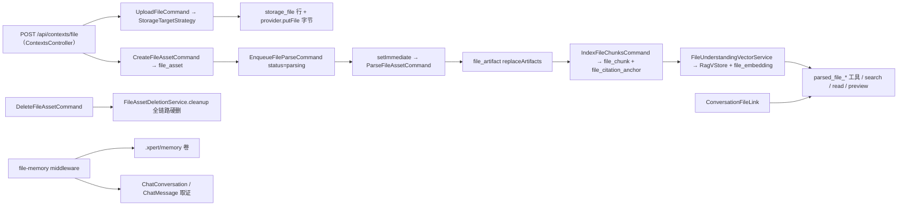
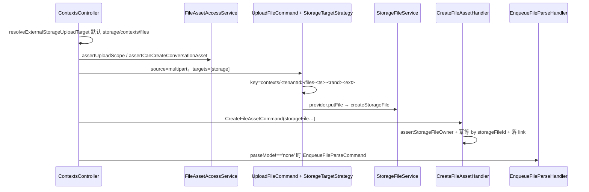
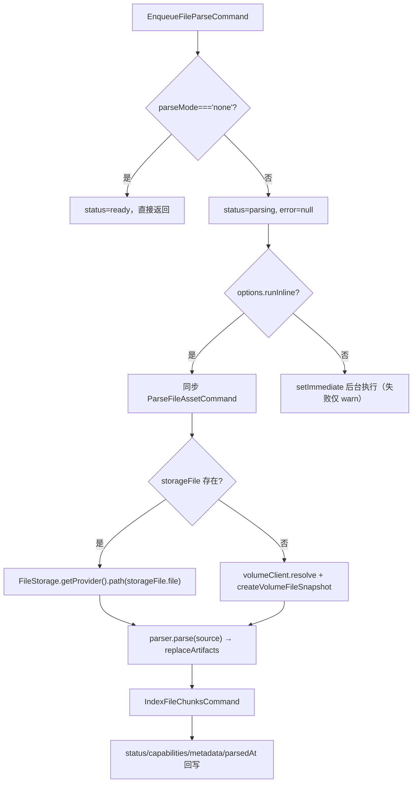
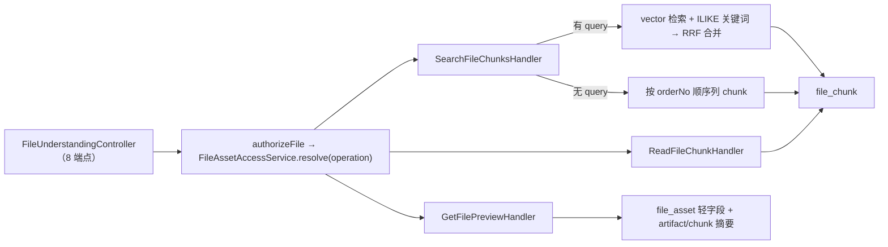
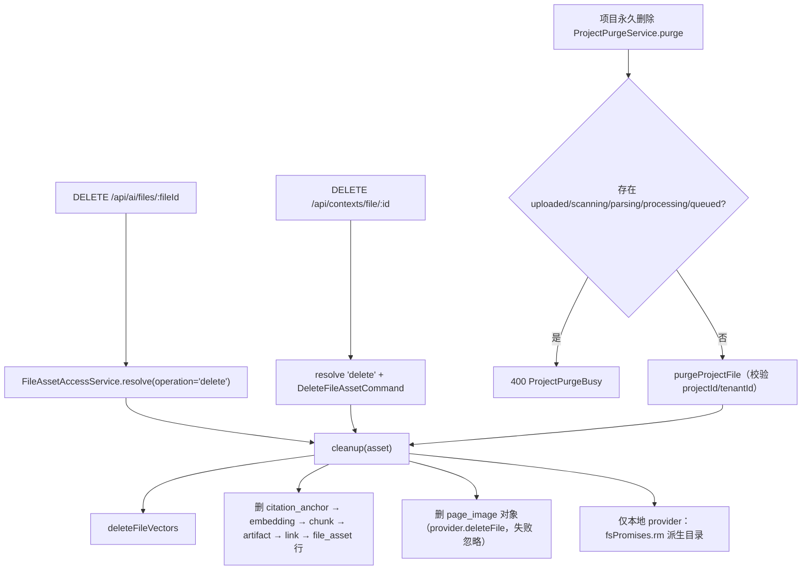
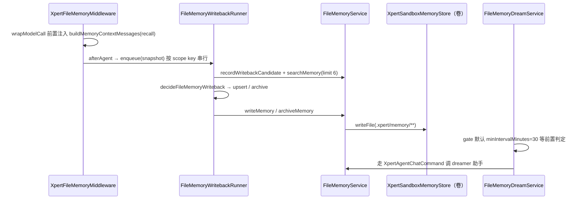
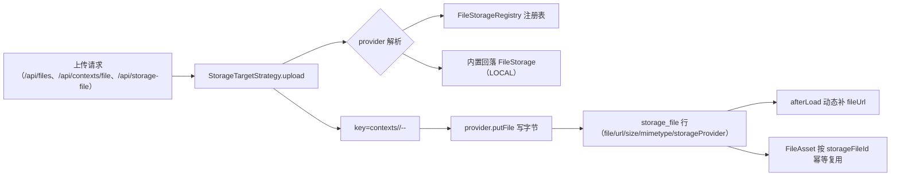

# 文件理解与记忆域 · 数据流转

> 只读梳理（commit `80f5676fd`）。范围：`packages/server-ai/src/file-understanding`（88 非 spec / 29 spec）、`packages/server-ai/src/file-memory`（24 / 8）、`packages/server/src/storage-file`（21 / 1）；表口径实测 **11 张 = 7 + 3 + 1**。HTTP 前缀 `/api/ai`、`/api/contexts`、`/api/storage-file`（全局前缀 `api`）。引用为仓库根相对路径；未能证实处标「未确认」。

**本文引用的文件**

- [file-understanding.module.ts](file://packages/server-ai/src/file-understanding/file-understanding.module.ts)
- [file-understanding.controller.ts](file://packages/server-ai/src/file-understanding/file-understanding.controller.ts)
- [file-asset-access.service.ts](file://packages/server-ai/src/file-understanding/file-asset-access.service.ts)
- [file-asset-deletion.service.ts](file://packages/server-ai/src/file-understanding/file-asset-deletion.service.ts)
- [file-workspace-projection.service.ts](file://packages/server-ai/src/file-understanding/file-workspace-projection.service.ts)
- [file-understanding-vector.service.ts](file://packages/server-ai/src/file-understanding/file-understanding-vector.service.ts)
- [create-file-asset.handler.ts](file://packages/server-ai/src/file-understanding/commands/handlers/create-file-asset.handler.ts)
- [create-workspace-file-asset.handler.ts](file://packages/server-ai/src/file-understanding/commands/handlers/create-workspace-file-asset.handler.ts)
- [enqueue-file-parse.handler.ts](file://packages/server-ai/src/file-understanding/commands/handlers/enqueue-file-parse.handler.ts)
- [parse-file-asset.handler.ts](file://packages/server-ai/src/file-understanding/commands/handlers/parse-file-asset.handler.ts)
- [index-file-chunks.handler.ts](file://packages/server-ai/src/file-understanding/commands/handlers/index-file-chunks.handler.ts)
- [attach-file-to-conversation.handler.ts](file://packages/server-ai/src/file-understanding/commands/handlers/attach-file-to-conversation.handler.ts)
- [retry-file-parse.handler.ts](file://packages/server-ai/src/file-understanding/commands/handlers/retry-file-parse.handler.ts)
- [delete-file-asset.handler.ts](file://packages/server-ai/src/file-understanding/commands/handlers/delete-file-asset.handler.ts)
- [search-file-chunks.handler.ts](file://packages/server-ai/src/file-understanding/queries/handlers/search-file-chunks.handler.ts)
- [read-file-chunk.handler.ts](file://packages/server-ai/src/file-understanding/queries/handlers/read-file-chunk.handler.ts)
- [get-file-preview.handler.ts](file://packages/server-ai/src/file-understanding/queries/handlers/get-file-preview.handler.ts)
- [get-file-understanding-status.handler.ts](file://packages/server-ai/src/file-understanding/queries/handlers/get-file-understanding-status.handler.ts)
- [domain/types.ts](file://packages/server-ai/src/file-understanding/domain/types.ts)
- [ai/context.controller.ts](file://packages/server-ai/src/ai/context.controller.ts)
- [xpert/commands/handlers/chat-file-assets.ts](file://packages/server-ai/src/xpert/commands/handlers/chat-file-assets.ts)
- [shared/agent/message.ts](file://packages/server-ai/src/shared/agent/message.ts)
- [workspace-files-runtime-capability.service.ts](file://packages/server-ai/src/shared/runtime/workspace-files-runtime-capability.service.ts)
- [shared/commands/handlers/load-file.handler.ts](file://packages/server-ai/src/shared/commands/handlers/load-file.handler.ts)
- [knowledge-document/document.service.ts](file://packages/server-ai/src/knowledge-document/document.service.ts)
- [conversation-project.service.ts](file://packages/server-ai/src/xpert-project/services/conversation-project.service.ts)
- [project-purge.service.ts](file://packages/server-ai/src/xpert-project/services/project-purge.service.ts)
- [storage-file.service.ts](file://packages/server/src/storage-file/storage-file.service.ts)
- [storage-file.subscriber.ts](file://packages/server/src/storage-file/storage-file.subscriber.ts)
- [storage-target.strategy.ts](file://packages/server/src/file/file-upload/strategies/storage-target.strategy.ts)
- [file-memory/file-memory.middleware.ts](file://packages/server-ai/src/file-memory/file-memory.middleware.ts)
- [file-memory.writeback-runner.ts](file://packages/server-ai/src/file-memory/file-memory.writeback-runner.ts)
- [file-memory/dream.service.ts](file://packages/server-ai/src/file-memory/dream.service.ts)
- [file-memory/paths.ts](file://packages/server-ai/src/file-memory/paths.ts)
- [file-memory/sandbox-memory.store.ts](file://packages/server-ai/src/file-memory/sandbox-memory.store.ts)

## 目录

- [总览与读写面](#总览与读写面)
- [链路一 上传落地链](#链路一-上传落地链)
- [链路二 理解解析链](#链路二-理解解析链)
- [链路三 重试与失败链](#链路三-重试与失败链)
- [链路四 读取与检索链](#链路四-读取与检索链)
- [链路五 删除与回收链](#链路五-删除与回收链)
- [链路六 文件记忆链](#链路六-文件记忆链)
- [链路七 存储与去重链](#链路七-存储与去重链)
- [链路八 事件入边链10-入](#链路八-事件入边链10-入)
- [链路九 跨域消费链](#链路九-跨域消费链)
- [状态机汇总](#状态机汇总)
- [本域写-vs-跨域写](#本域写-vs-跨域写)
- [已知风险](#已知风险)

## 总览与读写面

三类持久面并存：① `file-understanding` 6 张自有表（`file_asset` 为句柄，`file_artifact`/`file_chunk` 为理解结果，`file_embedding`/`file_citation_anchor` 为索引账本，`conversation_file_link` 为授权边界）＋ 1 张只读项目维表 `xpert_project`；② `file-memory` 自身**不落库**（记忆是卷上的 markdown/JSON），只读 3 张外部表 `chat_conversation`/`chat_message`/`xpert`；③ `storage-file` 1 张 `storage_file` 作为对象存储索引。解析是**进程内后台**（无 Bull/Redis/`@Processor`），重试只有显式命令。

图表来源：[ai/context.controller.ts](file://packages/server-ai/src/ai/context.controller.ts)、[enqueue-file-parse.handler.ts](file://packages/server-ai/src/file-understanding/commands/handlers/enqueue-file-parse.handler.ts)、[file-asset-deletion.service.ts](file://packages/server-ai/src/file-understanding/file-asset-deletion.service.ts)

章节来源：[file-understanding.module.ts](file://packages/server-ai/src/file-understanding/file-understanding.module.ts)（关键符号：FileUnderstandingModule / RouterModule path '/ai' / TypeOrmModule.forFeature）、[file-memory/file-memory.module.ts](file://packages/server-ai/src/file-memory/file-memory.module.ts)（关键符号：FileMemoryModule / ChatConversation / ChatMessage / Xpert）

## 链路一 上传落地链

图表来源：[ai/context.controller.ts](file://packages/server-ai/src/ai/context.controller.ts)、[storage-target.strategy.ts](file://packages/server/src/file/file-upload/strategies/storage-target.strategy.ts)

- 入口：`@Post('file')`（multipart，`FileInterceptor('file')`）返回 `AgentFile | IFileAssetDestination`；`workspacePath` 被**强制置空**，会话/线程引用不一致直接 400。
- 授权前置：无会话时 `assertUploadScope({projectId,xpertId})`；有会话时 `assertCanCreateConversationAsset(conversation,'upload')`；`@Public()` 场景限制 `target.kind==='storage'` 且禁止 projectId。
- 存储落地：key 必须落在 `contexts/<tenantId>/` 内（`assertContainedInTenantDirectory` 拒绝越界），`StorageFileService.createStorageFile` 写 `file`/`url`/`originalName`/`size`/`mimetype`/`storageProvider`（大写）与 `recordedAt`。
- 句柄落地：`CreateFileAssetHandler` 校验 `storageFileId` 必填、`assertStorageFileOwner`，**按 `storageFileId` + tenantId 幂等复用**同一 `file_asset` 行（`status` 沿用旧值），并在有会话时 upsert `conversation_file_link`。
- 兼容入口：`xpert/commands/handlers/chat-file-assets.ts` 把 data URL/老式 StorageFile id/workspacePath 三种输入统一归一为 FileAsset（`MAX_INLINE_PARSE_BYTES = 2_000_000`、`MAX_DATA_URL_BYTES = 25 * 1024 * 1024`）。

章节来源：[ai/context.controller.ts](file://packages/server-ai/src/ai/context.controller.ts)（关键符号：ContextsController.create / resolveConversationReferences / shouldRunParseInline）、[create-file-asset.handler.ts](file://packages/server-ai/src/file-understanding/commands/handlers/create-file-asset.handler.ts)（关键符号：CreateFileAssetHandler.execute / buildStorageFileMetadata）

## 链路二 理解解析链

图表来源：[enqueue-file-parse.handler.ts](file://packages/server-ai/src/file-understanding/commands/handlers/enqueue-file-parse.handler.ts)、[parse-file-asset.handler.ts](file://packages/server-ai/src/file-understanding/commands/handlers/parse-file-asset.handler.ts)

- 入队即改状态：`status = parseMode==='none' ? 'ready' : 'parsing'`、`error=null`；`none` 直接 return，**不解析**。
- 解析器选择：`FileParserRegistry.getParser(source)` 顺序 pdf → spreadsheet → office → image → archive → text，不匹配抛 `UnsupportedFileContentError`；`ImageFileParser` 返回 `status:'partial'`。
- 源解析分支：无 storageFile 时走卷快照，两者皆无抛 `File asset "…" does not have a readable storage or workspace source`；派生输出目录为 `contexts/<tenantId>/file-understanding/<assetId>/<parseRunId>`（每轮 `randomUUID()`）。
- 结果回写：`status = parsed.status ?? 'ready'`，`capabilities ∪ ['preview','read', ...parsed.capabilities]`，`metadata ∪ {parser, chunkCount}`，`parsedAt`，`failedAt/error` 清空；**无 progress 列**，进度只能经 status 与派生 `vectorIndexStatus` 观察。
- 重放幂等：`replaceArtifacts` 先 `delete({fileAssetId})` 再 `save`；`finally` 中 dispose 卷快照；成功后再清理上一轮的 page_image 与其 run 目录。
- 索引链：先 `deleteFileVectors` + 删 anchor/embedding/chunk，再对 8 类 `CHUNKABLE_ARTIFACT_KINDS`（text/page_text/sheet/slide/table/code_tree/file_manifest/ocr_text）按 3600/240 切块，`anchor.chunk` 记顺序号，重建 `FileCitationAnchor`（`page:1:chunk:0` / `sheet:…` / `slide:…` / `path:…`（无锚点时 `chunk:<n>`）），最后 `indexChunks(asset, chunks)`。

章节来源：[parse-file-asset.handler.ts](file://packages/server-ai/src/file-understanding/commands/handlers/parse-file-asset.handler.ts)（关键符号：ParseFileAssetHandler.execute / resolveDerivedStorageDirectory / replaceArtifacts）、[index-file-chunks.handler.ts](file://packages/server-ai/src/file-understanding/commands/handlers/index-file-chunks.handler.ts)（关键符号：IndexFileChunksHandler.execute / CHUNKABLE_ARTIFACT_KINDS / createAnchorKey）

## 链路三 重试与失败链

- 失败终态：`catch` 内写 `status='failed'`、`error=message`、`failedAt=new Date()`，并把 `metadata.understandingErrorCode` 置为三选一：`file_understanding_embedding_unavailable`、`file_understanding_vector_index_failed`、`file_understanding_parse_failed`；**失败不再重试**（无队列/无退避）。
- HTTP 重试：`POST /api/ai/files/:fileId/parse/retry` → `authorizeFile(fileId,'parse')` → `RetryFileParseCommand` → 直接 `ParseFileAssetCommand`（绕过 Enqueue，因此不重置 `status`，也不读 `runInline`）。
- 运行时重试闸门：`retryUnderstanding` 先取 `GetFileUnderstandingStatusQuery`，仅当 `status==='failed'` 或 `vectorIndexStatus∈{failed,unavailable}` 才允许，否则 `BadRequestException('Only failed or unavailable file understanding can be retried')`；通过后 `assertUnderstandingAssetVisible('parse')` 再 `EnqueueFileParseCommand`。
- `vectorIndexStatus` 是**派生值**（`resolveVectorStatus`）：`failed` 状态 → `failed`；`uploaded|scanning|parsing` → `pending`；`chunkCount>0 && indexedChunkCount>=chunkCount` → `ready`；否则 `unavailable`（`indexedChunkCount` = `file_embedding` 计数）。
- 状态回写无回调：`setImmediate` 分支失败只 `logger.warn`，进程崩溃即丢任务。

章节来源：[retry-file-parse.handler.ts](file://packages/server-ai/src/file-understanding/commands/handlers/retry-file-parse.handler.ts)（关键符号：RetryFileParseHandler.execute）、[workspace-files-runtime-capability.service.ts](file://packages/server-ai/src/shared/runtime/workspace-files-runtime-capability.service.ts)（关键符号：retryUnderstanding / getUnderstandingStatus）、[get-file-understanding-status.handler.ts](file://packages/server-ai/src/file-understanding/queries/handlers/get-file-understanding-status.handler.ts)（关键符号：resolveVectorStatus / scopedFileWhere）

## 链路四 读取与检索链

图表来源：[file-understanding.controller.ts](file://packages/server-ai/src/file-understanding/file-understanding.controller.ts)、[search-file-chunks.handler.ts](file://packages/server-ai/src/file-understanding/queries/handlers/search-file-chunks.handler.ts)

- 端点：`GET /api/ai/files/:fileId`、`/status`、`/preview`，`POST /files/:fileId/{search,read,parse/retry}`，`DELETE /files/:fileId`，`GET /api/ai/conversations/:conversationId/files`（共 8 个），统一 `@Public()` + `ApiKeyOrClientSecretAuthGuard`。
- 授权：全部先 `resolve({locator,authority:{kind:'current-owner'},operation})`；查询**强制带 `tenantId`**，再判 `organizationId` 可见性；`@Public()` 会话场景额外要求 `fileAsset.userId === scope.createdById` 并校验 xpert 会话。
- 会话维度读取（工具侧）：`ConversationFileLink` 是读权限边界——工具只列出/检索当前会话已 attach 的文件；link 由 `AttachFileToConversationHandler` 幂等 upsert（唯一索引兜底），并 best-effort 触发 `projectFileAsset` 投影。
- search：`limit = min(max(limit ?? 8, 1), search ? 30 : 101)`；有 query 时向量召回 + 关键词 `ILIKE`（最多 6 个 token）经倒数排名融合（`1/(60+rank)`）；无 query 时纯顺序列举。
- read：按 `chunkId` 或 `orderNo`（默认 0）取 chunk，`fileAssetId` 作为作用域绑定；preview 只 select 轻字段（summary 截 900 字、artifact ≤12、chunk ≤8），`page_image` 转成可预览 file。
- 工具面：8 个 `parsed_file_*`（`file-understanding.tools.ts`）经 middleware 挂载，`parsed_file_read` 明示「缺 chunk 是终态 not-found，禁止靠枚举 orderNo 扫描」。

章节来源：[file-understanding.controller.ts](file://packages/server-ai/src/file-understanding/file-understanding.controller.ts)（关键符号：authorizeFile / retryParse / listConversationFiles）、[attach-file-to-conversation.handler.ts](file://packages/server-ai/src/file-understanding/commands/handlers/attach-file-to-conversation.handler.ts)（关键符号：AttachFileToConversationHandler.execute / 投影 best-effort）

## 链路五 删除与回收链

图表来源：[file-asset-deletion.service.ts](file://packages/server-ai/src/file-understanding/file-asset-deletion.service.ts)、[project-purge.service.ts](file://packages/server-ai/src/xpert-project/services/project-purge.service.ts)

- **无软删**：`file-understanding` 全域检索 `softRemove|softDelete|@DeleteDateColumn|@VersionColumn|select: false` **0 命中**；`cleanup` 全为硬删（`repository.delete`），顺序固定为向量 → 锚点 → 向量账本 → chunk → artifact → 会话链接 → `file_asset` 行 → 对象字节。
- 回收边界：`deletePageImageStorageKeys` 与 `deleteDerivedRootIfLocal` 都需 `provider.path()` 返回**绝对路径**才执行（远端对象存储只会删 DB 行，派生对象成孤儿）；页图/目录删除失败一律 `catch(() => undefined)`，静默。
- 项目入口：`purgeProjectFile` 注释「Dedicated project lifecycle entry; never trusts the supplied project ID as authority.」——先 `assertCanPurge`，再比对 `asset.projectId/tenantId`；`XpertProjectPurgeService` 先做「处理中不许删」的忙判，逐资产清理后删项目卷根目录。
- `storage_file` 侧：`repository.remove` 硬删（注释说明为触发 Subscriber 的 `afterRemove` 实体参数）→ `StorageFileSubscriber.afterRemove` 删 `file` 与 `thumb` 物理对象；实体虽带 `deletedAt` 列，**删除路径不走软删**。
- 授权：`deleteStorageFile` 仅 owner 或 `SUPER_ADMIN/ADMIN`；跨域删除走 `deleteAuthorizedStorageFile`，比对调用方传入的 `tenantId`/`organizationId`。

章节来源：[file-asset-deletion.service.ts](file://packages/server-ai/src/file-understanding/file-asset-deletion.service.ts)（关键符号：FileAssetDeletionService.delete / purgeProjectFile / cleanup）、[storage-file.service.ts](file://packages/server/src/storage-file/storage-file.service.ts)（关键符号：deleteStorageFile / deleteAuthorizedStorageFile）、[storage-file.subscriber.ts](file://packages/server/src/storage-file/storage-file.subscriber.ts)（关键符号：StorageFileSubscriber.afterRemove）

## 链路六 文件记忆链

图表来源：[file-memory.middleware.ts](file://packages/server-ai/src/file-memory/file-memory.middleware.ts)、[file-memory.writeback-runner.ts](file://packages/server-ai/src/file-memory/file-memory.writeback-runner.ts)、[file-memory/dream.service.ts](file://packages/server-ai/src/file-memory/dream.service.ts)

- 记忆介质：卷上的 markdown/JSON（`.xpert/memory`、索引 `MEMORY.md`、`.dream`），**不是向量库、不落本域表**；与 `file-understanding` 无代码依赖，只共享卷基础设施与对话/助手表。
- 落盘路径：项目卷为 `.xpert/memory/xperts/<xpertId>`（共享卷需按 xpert 隔离），否则助手卷直接用 `.xpert/memory`；`normalizeFileMemoryRelativePath` 拒绝 `..` 与绝对路径。
- 写入时机：`afterAgent` 入队 → `FileMemoryWritebackRunner` 按 `createFileMemoryScopeKey` 串行化（后到覆盖 `pending`，`softDrain` 超时返回 false）；先记候选（`sourceRef = conversation:<id>`），再取模型决策 upsert/archive，模型缺失时只留候选并 warn。
- 消费时机：`wrapModelCall` 把 recall 索引/digest/详情块**前置**为消息（`messages: [...buildMemoryContextMessages(recall), ...request.messages]`）；工具 `memory_search`/`memory_get`/`memory_write` 由 middleware 暴露，系统策略明文「不猜测 memoryId」。
- Dream 取证：`XpertConversationHistoryReader` 读 `chat_conversation`（select `id/threadId/title/xpertId/tenantId` + 作用域过滤）与 `chat_message`（`orderBy createdAt DESC`，单条内容截断 2000、总字节封顶），`XpertFileMemoryScopeResolver` 经 `XpertService` 解析 tenantId/workspaceDataScope。
- Dream 闸门：默认 `{enabled:true, minIntervalMinutes:30, minNewOrUpdatedMemories:1, minConversationCount:1}`，env `FILE_MEMORY_DREAMER_XPERT_ID` / `FILE_MEMORY_DREAMER_AGENT_KEY`（默认 `FileMemoryDreamer`）；**未见 `@Cron/@Interval/@Processor`**，自动触发时机未确认。

章节来源：[file-memory.writeback-runner.ts](file://packages/server-ai/src/file-memory/file-memory.writeback-runner.ts)（关键符号：FileMemoryWritebackRunner.enqueue / softDrain / processSnapshot）、[file-memory/paths.ts](file://packages/server-ai/src/file-memory/paths.ts)（关键符号：getXpertFileMemoryWorkspacePath / normalizeFileMemoryRelativePath）、[file-memory/sandbox-memory.store.ts](file://packages/server-ai/src/file-memory/sandbox-memory.store.ts)（关键符号：XpertSandboxMemoryStore.writeFile / assertFileMemorySandboxFeatureEnabled）

## 链路七 存储与去重链

图表来源：[storage-target.strategy.ts](file://packages/server/src/file/file-upload/strategies/storage-target.strategy.ts)、[storage-file.subscriber.ts](file://packages/server/src/storage-file/storage-file.subscriber.ts)

- 抽象链：`FileStorage.getProvider()` 先查 `FileStorageRegistryBridge` 注册表，失败回落内置 provider（注释「Fall back to built-in providers so bootstrap/tests without Nest context keep working.」）；provider 名来自租户设置 `fileStorageProvider` 或 `environment.fileSystem.name`；仓库内只有 LOCAL 实现，S3/对象存储为外部插件注册（**未在仓库中找到实现**）。
- 写入点唯一：`@FileUploadTargetStrategy('storage')` 的 `StorageTargetStrategy.upload` 是 `storage_file` 唯一创建点（`provider.putFile` → `createStorageFile`，返回值 `referenceId` 即 storageFile.id）。
- 路径约束：key 只能落在 `contexts/<tenantId>/` 之下（`assertContainedInTenantDirectory`），目录/文件名分别做 `normalizePathSegment`/`normalizeRelativePath` 归一与拒绝 `..`。
- 读取侧：`StorageFileSubscriber.afterLoad` 动态补 `fileUrl`（`thumbUrl` 已被注释停用），`storageProvider` 列 `@Exclude({toPlainOnly:true})` 不对外序列化。
- 去重：**仅按 `storageFileId` 幂等**（同 storageFileId 复用 `file_asset` 行并覆盖解析态）；`sha256` 只在 `create-file-asset.handler` 拿到 `uploadedFile.buffer` 时写入（内容级 hash），无唯一约束也无查重查询 → 同内容重复上传会产生多条资产（去重「误判」风险见文末）。
- 派生对象：PDF 页图写入 `contexts/<tenantId>/file-understanding/<assetId>/<parseRunId>`；解析侧只清理旧 run，不校验新 run 是否写在同一租户目录（目录由 asset.tenantId 拼接）。

章节来源：[storage-target.strategy.ts](file://packages/server/src/file/file-upload/strategies/storage-target.strategy.ts)（关键符号：StorageTargetStrategy.upload / assertContainedInTenantDirectory）、[create-file-asset.handler.ts](file://packages/server-ai/src/file-understanding/commands/handlers/create-file-asset.handler.ts)（关键符号：CreateFileAssetHandler.execute / createHash('sha256') / 幂等注释）

## 链路八 事件入边链（10 入）

本域接收入边共 **10 组**（按发起方归类；「本域动作」指在 `file-understanding` 内实际执行的操作）：

| # | 发起方（跨域） | 命令 / 查询 | 本域动作 |
|---|---|---|---|
| 1 | AIModule（`ai/context.controller.ts`） | `CreateFileAssetCommand`、`EnqueueFileParseCommand`、`GetFileAssetByStorageFileQuery`、`DeleteFileAssetCommand` | 上传落地句柄、启动解析、按 storageFile 反查、删除资产 |
| 2 | XpertModule（`chat-file-assets.ts`） | `AssertFileUploadScopeQuery`、`GetOwnedStorageFileQuery`、`GetFileAssetByStorageFileQuery`、`ResolveAuthorizedFileAssetQuery`、`CreateFileAssetCommand`、`CreateWorkspaceFileAssetCommand`、`EnqueueFileParseCommand`、`AttachFileToConversationCommand` | 对话输入文件归一（storageFileId / workspacePath / data URL 三形态）、attach 授权与投影 |
| 3 | ChatConversationModule（`conversation.service.ts`） | `GetFileAssetByStorageFileQuery`、`GetOwnedStorageFileQuery`、`ResolveAuthorizedFileAssetQuery` | 会话附件解析与工作区相对路径 |
| 4 | ChatMessageModule（`chat-message.service.ts`） | `GetOwnedStorageFileQuery`、`ResolveAuthorizedFileAssetQuery` | 历史消息附件回读（重试重建输入） |
| 5 | ChatModule（`chat/commands/handlers/chat-common.handler.ts`） | `GetOwnedStorageFileQuery` | 执行期附件句柄校验 |
| 6 | XpertProjectModule（`project.service.ts`、`conversation-project.service.ts`） | `GetOwnedStorageFileQuery`、`AttachFileToConversationCommand` | 项目附件拥有权校验、会话附件挂到项目 |
| 7 | XpertProjectAccessModule | 经 `FileAssetAccessService` 注入 `XpertProjectAccessService`（`assertCanEdit`/`assertCanPurge`） | Project attach/purge 的写边界判定 |
| 8 | FileRuntimeModule（本域子模块 `runtime/file-runtime.service.ts`） | `ResolveAuthorizedFileAssetQuery`、`GetOwnedStorageFileQuery` | Agent 运行时解析文件句柄（`AgentMiddlewareFileApi.resolveFile`） |
| 9 | shared/runtime（`workspace-files-runtime-capability.service.ts`） | `CreateWorkspaceFileAssetCommand`、`GetFileUnderstandingStatusQuery`、`EnqueueFileParseCommand`、`SearchFileChunksQuery`、`ValidateFileUnderstandingReferencesQuery`、`ResolveAuthorizedFileAssetQuery` | 工作区文件能力面（状态 / 重试 / 检索 / 引用校验） |
| 10 | shared/agent + shared/commands（`message.ts`、`load-file.handler.ts`、`load-storage-file.handler.ts`、`load-storage-sheet.handler.ts`） | `ResolveAuthorizedFileAssetQuery`、`ReadFileAssetSourceQuery`、`GetFilePreviewQuery`、`SearchFileChunksQuery`、`GetOwnedStorageFileQuery` | 消息组装与文件加载（预览 / 正文 / 检索） |

- 本域**发出 0 条**命令/事件（`file-understanding` 无 `.publish(` / `@EventsHandler`）；`file-memory` 出站 1 条：`XpertAgentChatCommand` → XpertAgentModule（dreamer 调用）。
- 跨域只读依赖方向清晰：`knowledge-document/document.service.ts` 三处、`storage` 加载类 handler 两处都只用 `GetOwnedStorageFileQuery` 取句柄，不反向持有本域实体。

章节来源：[chat-file-assets.ts](file://packages/server-ai/src/xpert/commands/handlers/chat-file-assets.ts)（关键符号：normalizeChatRequestFile / resolveOrCreateFileAssetForStorageFile / attachChatFileAssetsToConversation）、[workspace-files-runtime-capability.service.ts](file://packages/server-ai/src/shared/runtime/workspace-files-runtime-capability.service.ts)（关键符号：retryUnderstanding / searchUnderstandingChunks / validateUnderstandingReferences）

## 链路九 跨域消费链

- **对话附件预览**：`shared/agent/message.ts` 用 `ResolveAuthorizedFileAssetQuery`（read）→ 需要字节时 `ReadFileAssetSourceQuery`，需要摘要时 `GetFilePreviewQuery`，并保留老客户端的 StorageFile 兜底（`GetOwnedStorageFileQuery`）。
- **知识库摄取源文件**：`knowledge-document/document.service.ts` 仅用 `GetOwnedStorageFileQuery(document.storageFileId)` 取源文件句柄（依赖面窄，无反向依赖）。
- **项目卷文件**：`xpert-project` 的 `project.service.ts` 用 `GetOwnedStorageFileQuery` 校验附件拥有权；`conversation-project.service.ts` 用 `AttachFileToConversationCommand` 把会话附件挂到项目；项目表 `project-file.entity.ts` 已标注弃用（改走 FileAsset workspace projection）。
- **Agent 运行时**：契约 `plugin-sdk` 的 `AgentMiddlewareFileApi.resolveFile` + `FileRuntimeCapability('platform.file')`，由 `FileRuntimeService.createScopedApi(scope)` 注入；注释要求「Never persist a conversation identity on the shared provider instance.」。
- **ChatKit 客户端**：`ai/dto/conversation.dto.ts` 暴露 `fileAssets`（Parsed file-understanding attachments）；`domain/types.ts` 的 `AgentFile` 规定 `id == fileId == FileAsset.id`，`storageFileId` 仅作兼容桥。
- **文件记忆 → 对话/助手**：只读取 `chat_conversation`/`chat_message`（历史取证）与 `xpert`（作用域与 dreamer 助手解析），不写入这三张表。

章节来源：[shared/agent/message.ts](file://packages/server-ai/src/shared/agent/message.ts)（关键符号：ResolveAuthorizedFileAssetQuery / ReadFileAssetSourceQuery / GetFilePreviewQuery）、[load-file.handler.ts](file://packages/server-ai/src/shared/commands/handlers/load-file.handler.ts)（关键符号：LoadFileHandler / SearchFileChunksQuery）

## 状态机汇总

- **文件资产**：`FileAssetStatus = uploaded|scanning|parsing|ready|partial|failed`，默认 `uploaded`；合法迁移证据：`uploaded|failed → parsing`（enqueue 直写 `parsing`）、`parsing → ready`（`parsed.status ?? 'ready'`）、`parsing → partial`（image parser）、`parsing → failed`（catch）、`* → ready`（`parseMode==='none'`）。`scanning` 无写入点，**未确认**是否为预留值。
- **解析模式**：`FileParseMode = auto|fast|deep|none`；`none` 是「不解析」短路开关；`deep` 在 embedding 不可用时抛 `FileUnderstandingVectorUnavailableError`（code `file_understanding_embedding_unavailable`），索引异常抛 `file_understanding_vector_index_failed`。
- **用途与能力**：`FileAssetPurpose = chat_attachment|workspace|knowledge`（默认 `chat_attachment`）；`FileCapability` 8 值（解析成功至少并入 `preview`/`read`，图片另有 `vision`/`ocr`，表格有 `table_query`，页图有 `page_images`）。
- **产物与分块**：`FileArtifactKind` 11 值（`summary|text|page_text|page_image|table|sheet|slide|image_metadata|ocr_text|code_tree|file_manifest`）；`FileAnchor{page,sheet,slide,path,rowStart,rowEnd,chunk,label}` 为引用锚点。
- **检索索引（派生）**：`vectorIndexStatus = pending|ready|failed|unavailable`（由 chunk/embedding 计数派生，非表列）；`file_embedding` 无向量列，仅记 `vectorId + collectionName/fingerprint/dimensions` 账本指向 RagVStore。
- **存储**：`storage_file` 无状态列；`deletedAt` 列存在但删除走硬删 + `afterRemove` 删对象（软删语义未启用）。
- **记忆**：`FileMemoryStatus = active|archived|conflict`、`FileMemoryType = user|feedback|project|reference`（`file-memory/types.ts`）；Dream run 状态 `queued→running→succeeded|partial|failed|cancelled|skipped`；记忆本身是文件，状态写在 frontmatter，无 DB 状态机。

章节来源：[domain/types.ts](file://packages/server-ai/src/file-understanding/domain/types.ts)（关键符号：FileAssetStatus / FileParseMode / FileArtifactKind / FileAnchor / AgentFile）、[file-memory/types.ts](file://packages/server-ai/src/file-memory/types.ts)（关键符号：FileMemoryStatus / FileMemoryDreamRunStatus）

## 本域写 vs 跨域写

| 列 / 事实 | 写入方 | 说明 |
|---|---|---|
| `file_asset` 全部列（含 `status`/`capabilities`/`metadata`） | 本域（CreateFileAssetHandler / ParseFileAssetHandler / Enqueue） | 多次覆盖保存，幂等键为 `storageFileId` |
| `file_artifact` / `file_chunk` / `file_citation_anchor` | 本域（Parse / Index handler） | 重放先删后写；`replaceArtifacts` 覆盖 orderNo=数组下标 |
| `file_embedding` 与向量库集合 | 本域（FileUnderstandingVectorService） | `addDocuments({ids: chunk.id})`；集合名含 scope 与 fingerprint |
| `conversation_file_link` | 本域（CreateFileAssetHandler / AttachFileToConversationHandler） | 唯一索引 `(conversationId,fileAssetId)`，upsert 语义 |
| `storage_file` 行与物理对象 | 跨域（`storage-file` 模块，经 `StorageTargetStrategy` 写入） | 本域只读句柄（`GetOwnedStorageFileQuery`）；删除经 `deleteAuthorizedStorageFile` |
| `xpert_project` | **跨域**（`xpert-project`） | 本域 `forFeature` 只读，用于项目维度文件列举与 purge 校验 |
| `chat_conversation` / `chat_message` / `xpert` | 跨域（chat-conversation / chat-message / xpert） | `file-memory` 只读取证与作用域解析 |
| 卷（workspace/项目卷、`.xpert/memory`、派生目录） | 本域经 `shared/volume` 与 `FileStorage` 写入 | 项目卷删除由 `XpertProjectPurgeService` 负责（跨域调用本域 `purgeProjectFile`） |
| 向量集合（RagVStore） | 本域发起，账本归 rag-vstore | 本域只保存 `vectorId` 与元数据 |

章节来源：[file-understanding.module.ts](file://packages/server-ai/src/file-understanding/file-understanding.module.ts)（关键符号：TypeOrmModule.forFeature / exports）、[file-asset-access.service.ts](file://packages/server-ai/src/file-understanding/file-asset-access.service.ts)（关键符号：FileAssetAccessService.resolve / assertStorageFileOwner）

## 已知风险

1. **孤儿字节**：删除时仅当 `provider.path()` 返回绝对路径才清理页图与派生目录（`deleteDerivedRootIfLocal`），远端对象存储只剩 DB 删除 → `contexts/<tenantId>/file-understanding/<assetId>/**` 长期残留；`deletePageImageStorageKeys` 与目录 rm 全部吞异常。
2. **回收失败不可观测**：向量删除、页图删除、投影失败都只 `logger.warn`/`catch(()=>undefined)`，无 metrics/补偿队列（检索 `@Processor/@Cron/@Interval` 在本域 0 命中）。
3. **去重误判**：去重键是 `storageFileId` 而非内容；`sha256` 仅在 buffer 可用时写入且无唯一约束/无查询，同内容重复上传会生成多条 `file_asset` 与多份向量，配额与引用口径都会漂移。
4. **跨租户越权面**：`file_asset` 的 5 个 `@Index` 均非唯一且不含 `tenantId` 组合（项目维度索引除外）；`file_chunk`/`file_artifact`/`file_embedding`/`file_citation_anchor` 只按 `fileAssetId`/`artifactId` 过滤，**行级租户隔离完全依赖上游 `FileAssetAccessService` 与调用方自律**。
5. **无队列的解析**：`setImmediate` 后台执行 + 失败仅 warn，进程重启即丢任务；重试需人工触发（HTTP `parse/retry` 或 runtime `retryUnderstanding`），且 HTTP 重试**不重置 status**，失败面语义不一致。
6. **`file_citation_anchor` 疑似只写不读**：全仓检索仅见实体定义、Index/Parse 写入、删除路径与 spec，未见生产读取点（是否死表**未确认**）。
7. **`file_asset` 表无 DDL**：本域无 `migrations/`、无 `.sql`，运行时 `synchronize:false`；唯一建表证据是测试桩里的最小 `CREATE TABLE "file_asset"` → 生产结构来源在仓库外（**未确认**）。
8. **记忆侧无调度与限量证据**：`file-memory` 无 `@Cron/@Interval/@Processor`，Dream 何时触发未确认；记忆条目增长、单文件大小与总量限制在仓库内未见强制实现（`index-validator.ts` 只做索引格式校验）。

章节来源：[file-asset-deletion.service.ts](file://packages/server-ai/src/file-understanding/file-asset-deletion.service.ts)（关键符号：deleteDerivedRootIfLocal / deletePageImageStorageKeys）、[enqueue-file-parse.handler.ts](file://packages/server-ai/src/file-understanding/commands/handlers/enqueue-file-parse.handler.ts)（关键符号：setImmediate / logger.warn）
