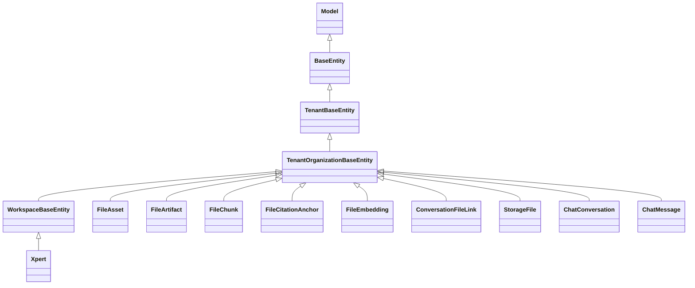

# 文件理解与记忆域 · 数据模型

> 只读梳理（commit `80f5676fd`）。共 **10 张表**（自建 6 + 跨域只读 3 + `storage_file` 1）：子域① 文件理解 **7 张**（`file_asset`、`file_artifact`、`file_chunk`、`file_citation_anchor`、`file_embedding`、`conversation_file_link` + 只读 `xpert_project`）；子域② 文件记忆与存储 **4 张**（`chat_conversation`、`chat_message`、`xpert` 只读 + `storage_file`）。引用为仓库根相对路径；列极多者只列关键列。未能证实处标「未确认」。

**本文引用的文件**

- [file-asset.entity.ts](file://packages/server-ai/src/file-understanding/entities/file-asset.entity.ts)
- [file-artifact.entity.ts](file://packages/server-ai/src/file-understanding/entities/file-artifact.entity.ts)
- [file-chunk.entity.ts](file://packages/server-ai/src/file-understanding/entities/file-chunk.entity.ts)
- [file-citation-anchor.entity.ts](file://packages/server-ai/src/file-understanding/entities/file-citation-anchor.entity.ts)
- [file-embedding.entity.ts](file://packages/server-ai/src/file-understanding/entities/file-embedding.entity.ts)
- [conversation-file-link.entity.ts](file://packages/server-ai/src/file-understanding/entities/conversation-file-link.entity.ts)
- [file-understanding.module.ts](file://packages/server-ai/src/file-understanding/file-understanding.module.ts)
- [file-memory.module.ts](file://packages/server-ai/src/file-memory/file-memory.module.ts)
- [storage-file.entity.ts](file://packages/server/src/storage-file/storage-file.entity.ts)
- [storage-file.service.ts](file://packages/server/src/storage-file/storage-file.service.ts)
- [tenant-organization-base.entity.ts](file://packages/server/src/core/entities/tenant-organization-base.entity.ts)
- [base.entity.ts（server-core）](file://packages/server/src/core/entities/base.entity.ts)
- [base.entity.ts（server-ai）](file://packages/server-ai/src/core/entities/base.entity.ts)
- [xpert-project/entities/project.entity.ts](file://packages/server-ai/src/xpert-project/entities/project.entity.ts)
- [chat-conversation/conversation.entity.ts](file://packages/server-ai/src/chat-conversation/conversation.entity.ts)
- [chat-message/chat-message.entity.ts](file://packages/server-ai/src/chat-message/chat-message.entity.ts)
- [xpert/xpert.entity.ts](file://packages/server-ai/src/xpert/xpert.entity.ts)
- [file-understanding/domain/types.ts](file://packages/server-ai/src/file-understanding/domain/types.ts)
- [file-memory/types.ts](file://packages/server-ai/src/file-memory/types.ts)
- [file-memory/paths.ts](file://packages/server-ai/src/file-memory/paths.ts)
- [create-file-asset.handler.ts](file://packages/server-ai/src/file-understanding/commands/handlers/create-file-asset.handler.ts)
- [index-file-chunks.handler.ts](file://packages/server-ai/src/file-understanding/commands/handlers/index-file-chunks.handler.ts)
- [file-asset-deletion.service.ts](file://packages/server-ai/src/file-understanding/file-asset-deletion.service.ts)
- [file-understanding-vector.service.ts](file://packages/server-ai/src/file-understanding/file-understanding-vector.service.ts)

## 目录

- [模型总览与继承分层](#模型总览与继承分层)
- [子域① 资产与产物表](#子域-资产与产物表)
- [子域① 索引与授权表](#子域-索引与授权表)
- [子域① 只读项目维表](#子域-只读项目维表)
- [子域② 记忆侧只读外部表](#子域-记忆侧只读外部表)
- [子域② 存储索引表](#子域-存储索引表)
- [建模边界](#建模边界)
- [校验规则](#校验规则)
- [未确认项](#未确认项)

## 模型总览与继承分层

图表来源：[base.entity.ts（server-core）](file://packages/server/src/core/entities/base.entity.ts)、[tenant-organization-base.entity.ts](file://packages/server/src/core/entities/tenant-organization-base.entity.ts)、[base.entity.ts（server-ai）](file://packages/server-ai/src/core/entities/base.entity.ts)

- 基类共性：`BaseEntity` 给 `id`（uuid 主键）、`createdById`/`createdBy`、`updatedById`/`updatedBy`、`createdAt`/`updatedAt`；`TenantBaseEntity` 加 `tenant`（FK `onDelete: 'CASCADE'`）与 `tenantId`（`@Index()`）；`TenantOrganizationBaseEntity` 加 `organization`（`onUpdate/onDelete: 'CASCADE'`）与 `organizationId`（`@Index()`）。
- `WorkspaceBaseEntity`（仅 server-ai 侧）再加 `workspace`（FK `onDelete: 'CASCADE'`）、`workspaceId`、`publishAt`、`deletedAt`（`@DeleteDateColumn`）——本域仅 `Xpert` 走这一支。
- 本域 7 张自有表**全部** `extends TenantOrganizationBaseEntity`：租户/组织隔离列来自基类，实体文件内不重复声明。
- 全域检索结果：**无 `@Tree`、无 `@VersionColumn`、无 `select: false`**（`file-understanding` 目录 0 命中）；所有 `json` 列均为 TypeORM `json`（非 `jsonb`）。

章节来源：[base.entity.ts（server-core）](file://packages/server/src/core/entities/base.entity.ts)（关键符号：BaseEntity / TenantBaseEntity）、[tenant-organization-base.entity.ts](file://packages/server/src/core/entities/tenant-organization-base.entity.ts)（关键符号：TenantOrganizationBaseEntity.organizationId）

## 子域① 资产与产物表

| 表 | 实体类 | 关键列（含索引） | 生产方 | 主要消费方 | 用途一句话 |
|---|---|---|---|---|---|
| `file_asset` | `FileAsset` | `storageFileId`(uuid)、`conversationId`、`threadId`、`projectId`、`xpertId`、`userId`、`originalName`、`fileName`、`mimeType`、`size`(bigint+transformer，默认 0)、`sha256`、`purpose`(默认 `chat_attachment`)、`parseMode`(默认 `auto`)、`status`(默认 `uploaded`)、`capabilities`(json)、`workspacePath`、`metadata`(json)、`summary`(text)、`error`(text)、`parsedAt`/`failedAt`(timestamptz)；索引 `@Index(['storageFileId'])`、`['conversationId']`、`['tenantId','organizationId','projectId']`、`['threadId']`、`['sha256']`（**5 个均非 unique**） | `CreateFileAssetHandler`、`CreateWorkspaceFileAssetHandler`、`ParseFileAssetHandler`（状态回写）、`EnqueueFileParseHandler` | `FileAssetAccessService`、8 个 `parsed_file_*` 工具、preview/search/read handler、`XpertProjectPurgeService`、runtime capability | 平台级文件**句柄**：拥有解析状态、能力、上下文链接与工作区投影元数据 |
| `file_artifact` | `FileArtifact` | `fileAssetId`(uuid NOT NULL)、`kind`(varchar，11 类)、`orderNo`(默认 0，= 数组下标)、`mimeType`、`content`(text)、`anchor`(json)、`metadata`(json)；索引 `@Index(['fileAssetId','kind'])` | `ParseFileAssetHandler.replaceArtifacts`、`CreateFileArtifactsHandler` | `IndexFileChunksHandler`（切块源）、`GetFilePreviewHandler`、`FileAssetDeletionService`（page_image 键） | 解析产物（页文本 / 表格 / 幻灯片 / OCR / 页图 / 摘要），按自然文档粒度落库 |
| `file_chunk` | `FileChunk` | `fileAssetId`(uuid NOT NULL)、`artifactId`(uuid 可空)、`orderNo`(默认 0)、`content`(text NOT NULL)、`tokenCount`(默认 0)、`anchor`(json，含 `chunk` 序号)、`metadata`(json，含 `artifactKind`)；索引 `@Index(['fileAssetId'])`、`['artifactId']` | `IndexFileChunksHandler`（3600/240 切块，先删后写） | `SearchFileChunksHandler`、`ReadFileChunkHandler`、`GetFilePreviewHandler`、`FileUnderstandingVectorService`（向量 id = chunk.id） | 检索与读取单元，带稳定锚点供引用 |
| `file_embedding` | `FileEmbedding` | `fileAssetId`(uuid)、`chunkId`(uuid)、`provider`、`model`、`vectorId`、`metadata`(json，含 collectionName/fingerprint/dimensions)；索引 `@Index(['fileAssetId'])`、`['chunkId']`；**无向量列** | `FileUnderstandingVectorService.indexChunks` | `GetFileUnderstandingStatusHandler`（计 `indexedChunkCount`）、`searchChunkIds` 交叉过滤、删除链 | 向量**账本**：记录向量写去了哪个 RagVStore 集合，不存向量本体 |

- 三张表均**未声明任何 `@ManyToOne` 关系**（`fileAssetId` 等为普通 uuid 列）→ **没有数据库级 `onDelete` 级联**；级联完全由应用层删除顺序模拟（`cleanup` 固定顺序见文末）。
- `file_asset.metadata` 会被 `CreateFileAssetHandler` 注入 `storageFile` 快照（id/file/url/fileUrl/thumb/thumbUrl/originalName/size/mimetype/storageProvider），供预览 UI 免二次查 `storage_file`。

章节来源：[file-asset.entity.ts](file://packages/server-ai/src/file-understanding/entities/file-asset.entity.ts)（关键符号：FileAsset / 5 个 @Index / bigintNumberTransformer）、[file-chunk.entity.ts](file://packages/server-ai/src/file-understanding/entities/file-chunk.entity.ts)（关键符号：FileChunk.fileAssetId / anchor）

## 子域① 索引与授权表

| 表 | 实体类 | 关键列（含唯一索引） | 生产方 | 主要消费方 | 用途一句话 |
|---|---|---|---|---|---|
| `file_citation_anchor` | `FileCitationAnchor` | `fileAssetId`(uuid)、`artifactId`(uuid 可空)、`chunkId`(uuid 可空)、`anchorKey`(varchar NOT NULL)、`label`、`locator`(json=FileAnchor)、`metadata`(json)；索引 `@Index(['fileAssetId'])`、`['anchorKey']`（**非 unique**） | `IndexFileChunksHandler.rebuildCitationAnchors`、`CreateFileArtifactsHandler` | 仅删除链（`file_citation_anchor` 读取代**未找到**） | 引用锚点目录：`anchorKey` 形如 `page:1:chunk:0` / `sheet:…` / `slide:…` / `path:…` |
| `conversation_file_link` | `ConversationFileLink` | `conversationId`(非空)、`fileAssetId`(uuid 非空)、`storageFileId`(uuid 可空)、`threadId`、`metadata`(json)；**唯一索引** `@Index(['conversationId','fileAssetId'],{unique:true})`，另有 `@Index(['storageFileId'])` | `CreateFileAssetHandler`、`AttachFileToConversationHandler`（findOne→save upsert） | `FileAssetAccessService`（读权限边界）、`ListConversationFilesQuery`、删除链 | 会话附件**授权边界**：link 存在即代表该会话可读/可检索此文件 |

- 全库唯一索引只有这一处（`conversation_file_link`）；竞态下靠它兜底，upsert 之前会先 `findOne`（含 `organizationId` 空值用 `IsNull()` 匹配）。
- `file_citation_anchor.anchorKey` 未加唯一约束：重放安全靠「先删后建」（`IndexFileChunksHandler` 开头 `delete({fileAssetId})`）。

章节来源：[conversation-file-link.entity.ts](file://packages/server-ai/src/file-understanding/entities/conversation-file-link.entity.ts)（关键符号：ConversationFileLink / unique @Index）、[index-file-chunks.handler.ts](file://packages/server-ai/src/file-understanding/commands/handlers/index-file-chunks.handler.ts)（关键符号：rebuildCitationAnchors / createAnchorKey）

## 子域① 只读项目维表

| 表 | 实体类 | 关键列 | 生产方 | 本域消费 | 用途一句话 |
|---|---|---|---|---|---|
| `xpert_project` | `XpertProject` | 项目本体列与索引归 `xpert-project` 域（本域未逐列核实）；本域 `TypeOrmModule.forFeature` 注册 **仅用于只读** | 跨域（`XpertProjectService`） | `FileAsset.projectId` 的取值源、`purgeProjectFile` 一致性校验、项目维度文件列举（`@Index(['tenantId','organizationId','projectId'])` 就是为这个查询建的） | 项目维表，让文件资产能按项目列举与随项目生命周期回收 |

- 本域对它的写操作为 0：`file_asset.projectId` 只从会话/请求上下文继承，项目行本身不由此域修改。
- 同域内 `project-file.entity.ts` 已标注弃用（「Use project file volume / FileAsset workspace projection instead.」），即项目文件事实以 `file_asset` 投影为准。

章节来源：[file-understanding.module.ts](file://packages/server-ai/src/file-understanding/file-understanding.module.ts)（关键符号：TypeOrmModule.forFeature 含 XpertProject）、[project-purge.service.ts](file://packages/server-ai/src/xpert-project/services/project-purge.service.ts)（关键符号：XpertProjectPurgeService.purge / FileAsset where tenantId+projectId）

## 子域② 记忆侧只读外部表

| 表 | 实体类 | 关键列（含索引） | 生产方 | 本域消费 | 用途一句话 |
|---|---|---|---|---|---|
| `chat_conversation` | `ChatConversation` | `threadId`(默认 `gen_random_uuid()`)、`title`、`status`、`purpose`(默认 `private`)、`revision`、`lastMessageSequence`、`branchSource`(jsonb)、`options`/`sourceAudit`/`operation`(json)、`from`、`xpertId`、`projectId`、`taskId`；索引 `@Index(['tenantId','organizationId','id'])`、`IDX_chat_conversation_profile_activity(tenantId,organizationId,xpertId,createdAt)`；`xpert`/`project` FK `onDelete: 'CASCADE'`，`task` FK `onDelete: 'SET NULL'`；还有已弃用的 `chat_conversation_attachment` M2M 联接表 | 跨域（chat-conversation） | `XpertConversationHistoryReader`（`select id/threadId/title/xpertId/tenantId` + 作用域过滤） | 记忆取证的**会话容器**与作用域边界（user scope 需 `createdById` 匹配） |
| `chat_message` | `ChatMessage` | `conversationId`、`createdInThreadId`、`sequence`、`groupPublicationId`、`parentId`(`@JoinColumn`)、`content`、`role`、`executionId`、`inputCheckpoint`/`outputCheckpoint`(jsonb，后者 `@Exclude({toPlainOnly:true})`)；`@Tree('closure-table')`；索引 `@Index(['conversationId'])`、`['createdInThreadId']`、**唯一** `['conversationId','sequence']`、**唯一** `['conversationId','groupPublicationId']`；与 `FileAsset` 有 `fileAssets` 关联（DB 侧另有联接表） | 跨域（chat-message） | `XpertConversationHistoryReader`（按 conversationId+tenantId 取最近 N 条，`reverse()` 后截断 2000 字/条） | 记忆取证的**消息流**（也是附件重试重建输入的来源） |
| `xpert` | `Xpert` | `slug`(100)、`name`(100)、`type`(10)、`title`、`workspaceDataScope`(`shared|user`，默认 shared，**`update: false`**)、`active`、`options`/`agentConfig`/`avatar`/`starters`(json)；`WorkspaceBaseEntity` 提供 `workspaceId`/`publishAt`/`deletedAt`；唯一索引 `['tenantId','organizationId','type','slug','version','latest']` | 跨域（xpert） | `XpertFileMemoryScopeResolver`（取 tenantId + workspaceDataScope）、dreamer 助手解析 | 记忆**作用域与容量语义**（个人级卷 / 项目共享卷）的来源 |

- 本域对三张表**零写入**：`file-memory.module.ts` 仅 `TypeOrmModule.forFeature([ChatConversation, ChatMessage, Xpert])` 并注入两个 Repository；记忆本体写在卷上（`.xpert/memory`）。
- `chat_message` 的 `@Tree('closure-table')` 与两个唯一索引是**跨域表自带**结构，本域只读时需注意闭包表副作用（读不会触发，写不由本域发起）。

章节来源：[file-memory.module.ts](file://packages/server-ai/src/file-memory/file-memory.module.ts)（关键符号：TypeOrmModule.forFeature([ChatConversation, ChatMessage, Xpert])）、[chat-conversation/conversation.entity.ts](file://packages/server-ai/src/chat-conversation/conversation.entity.ts)（关键符号：ChatConversation / IDX_chat_conversation_profile_activity / 弃用 attachments 注释）、[xpert-conversation-history-reader.ts](file://packages/server-ai/src/file-memory/adapters/xpert-conversation-history-reader.ts)（关键符号：XpertConversationHistoryReader.readSnippets）

## 子域② 存储索引表

| 表 | 实体类 | 关键列（含索引） | 生产方 | 主要消费方 | 用途一句话 |
|---|---|---|---|---|---|
| `storage_file` | `StorageFile`（`extends TenantOrganizationBaseEntity`，`implements IStorageFile`） | `file`(非空，对象存储 key)、`url`、`thumb`、`originalName`、`encoding`、`recordedAt`(timestamptz)、`deletedAt`(timestamptz，**未被删除路径使用**)、`size`(默认 0)、`mimetype`、`storageProvider`(varchar，`@Exclude({toPlainOnly:true})`)；**无自定义索引**（继承基类的 `tenantId`/`organizationId` 索引与 FK `onDelete:'CASCADE'`）；非持久字段 `fileUrl`/`thumbUrl` | `StorageFileService.createStorageFile`（唯一入口经 `StorageTargetStrategy.upload`）、`UpdateStorageFileHandler` | `FileAssetAccessService`（句柄解析）、`ParseFileAssetHandler`（`provider.path(file)` 取源）、加载类 handler（`GetOwnedStorageFileQuery`）、`StorageFileSubscriber`（afterLoad/afterRemove） | 对象存储**索引行**：把字节 key 映射为可访问 url，并作为 file-understanding 的字节来源 |

- 校验装饰器密度最高的一张表：`@IsString`/`@IsNumber`/`@IsDateString`/`@IsOptional`；`recordedAt` 偏偏用 `@IsNumber` 校验（与 `timestamptz` 列不一致，属易踩点）。
- 生命周期：创建即写行 + `provider.putFile`；删除走 `repository.remove`（硬删）→ subscriber `afterRemove` 删 `file`/`thumb` 物理对象；`deletedAt` 列保留但无软删写入点。

章节来源：[storage-file.entity.ts](file://packages/server/src/storage-file/storage-file.entity.ts)（关键符号：StorageFile / storageProvider / deletedAt）、[storage-file.service.ts](file://packages/server/src/storage-file/storage-file.service.ts)（关键符号：createStorageFile / normalizeStorageProvider）、[storage-file.subscriber.ts](file://packages/server/src/storage-file/storage-file.subscriber.ts)（关键符号：afterLoad fileUrl / afterRemove）

## 建模边界

- **字节元数据**（`storage_file`）：key/url/size/mimetype/provider，代表「对象存储里有什么」。字节本体不在库内，物理清理由 subscriber 承担。
- **字节句柄 + 理解状态**（`file_asset`）：把 storageFileId、会话/线程/项目/助手归属、`status`/`parseMode`/`capabilities`/`summary`/`error`/时间戳与 `metadata` 聚合成一个可授权、可检索的句柄；`metadata` 同时是兼容层（`storageFile` 快照、`parser`、`chunkCount`、`understandingErrorCode`、`pdfPageImages`）。
- **理解结果**（`file_artifact` + `file_chunk` + `file_citation_anchor`）：artifact 是「解析器输出的自然粒度」，chunk 是「模型可读的窗口」，anchor 是「引用可比对的坐标」；三者靠先删后写实现幂等重放。
- **向量账本**（`file_embedding`）：只存 `vectorId` 与集合元数据，向量本体在 RagVStore；因此删向量必须「先删库、再删账本」，`file_asset` 删除链正是这个顺序。
- **授权**（`conversation_file_link`）：唯一带唯一约束的表，语义是「哪条会话能读哪个资产」，而不是「谁上传的」。
- **记忆**（无表）：`.xpert/memory/**` 的 markdown/JSON（frontmatter 承载 usage/confidence/source），3 张只读表只提供取证与作用域；记忆的读/写路径都不经 DB 事务。
- **存储索引**（`storage_file` 与 `file_asset` 的职责切分）：注释逐字「StorageFile owns object storage; FileAsset owns parser status, capabilities, context links, and workspace projection metadata.」——按此边界，任何「文件内容问题」改 `file_asset`，「字节问题」改 `storage_file`。

章节来源：[file-asset.entity.ts](file://packages/server-ai/src/file-understanding/entities/file-asset.entity.ts)（关键符号：FileAsset 类注释 / metadata）、[create-file-asset.handler.ts](file://packages/server-ai/src/file-understanding/commands/handlers/create-file-asset.handler.ts)（关键符号：buildStorageFileMetadata / 「StorageFile remains the storage-layer record」注释）

## 校验规则

- **唯一性**：跨 10 张表（自建 6 + 跨域只读 3 + `storage_file` 1）只有 4 个 DB 唯一约束与 1 个唯一 `@Index`——`conversation_file_link(conversationId,fileAssetId)`（唯一 @Index）、`chat_message(conversationId,sequence)`、`chat_message(conversationId,groupPublicationId)`、`xpert(tenantId,organizationId,type,slug,version,latest)`；**file-understanding 其余 6 张表全部无唯一约束**，重复写入靠应用层「先删后写」与幂等键（`storageFileId`）。
- **枚举**：`purpose`/`parseMode`/`status`/`kind` 均为 `varchar` 列 + TS 类型约束（`domain/types.ts`），**DB 层无 CHECK/枚举**；写入面枚举校验只在入口散点做（`readParseMode` 白名单、`resolveParseMode`、`IsIn(['shared','user'])` 等），实体本身不校验。
- **hash 长度**：`sha256` 无 `length` 约束，值为 `createHash('sha256').update(buffer).digest('hex')`（64 字符），**且仅在 `uploadedFile.buffer` 存在时写入**，否则沿用旧值或留空。
- **路径约束**：存储 key 必须落在 `contexts/<tenantId>/` 内；派生目录统一经 `normalizeRelativePath('contexts', tenantId, 'file-understanding', assetId[, parseRunId])`；页图/工作区路径对外一律 POSIX 相对路径；`file-memory` 侧 `normalizeFileMemoryRelativePath` 拒绝 `..`、绝对路径与空路径，单段（xpertId/文件名）拒绝含 `/`。
- **长度/配额（应用层常量）**：inline 解析 2 MB、data URL 25 MB、chunk 3600/overlap 240、预览 summary 900 字/artifact 12/chunk 8、search limit `≤30`（有 query）或 `≤101`（顺序列举）、检索选取上限 `DEFAULT_RECALL_MAX_SELECTED`、单条记忆取证内容截断 2000 字、总字节封顶 `maxBytes`。
- **数值/类型**：`file_asset.size` 用 `bigint` + `bigintNumberTransformer`（DB 返回字符串转 number），写入面须保证有限值；service 层另有尺寸/枚举兜底（`readNumber` 仅接受有限 number）。

章节来源：[file-asset.entity.ts](file://packages/server-ai/src/file-understanding/entities/file-asset.entity.ts)（关键符号：size bigint / bigintNumberTransformer / sha256）、[file-memory/paths.ts](file://packages/server-ai/src/file-memory/paths.ts)（关键符号：normalizeFileMemoryRelativePath / getXpertFileMemoryWorkspacePath）

## 未确认项

1. **孤儿清理任务**：`file-understanding` 与 `file-memory` 目录检索 `orphan|@Cron|@Interval|@Processor` 均 0 命中 → 是否存在仓库外的孤儿对象/孤儿行清理任务**未确认**（删除失败仅 `catch(()=>undefined)`）。
2. **记忆表增长与限量**：记忆不落库（`.xpert/memory` 文件），未见条目数/总字节/保留期限制的强制实现；Dream 的 gate 只限「多久跑一次、至少多少条变化」，不构成容量上限 → 是否有外部配额**未确认**。
3. **`file_citation_anchor` 是否有读者**：仅见实体、写入（Index/Parse）与删除路径，生产读取点**未找到**；是否死表**未确认**。
4. **`storage_file.deletedAt` 语义**：列存在但删除路径全为硬删；是否存在仓库外软删/归档流程**未确认**。
5. **`scanning` 状态写入点**：`FileAssetStatus` 含 `scanning`，检索未见任何写入该值的代码 → 预留值**未确认**。
6. **DDL 与迁移**：本域无 `migrations/`、无 `.sql`，运行时数据源 `synchronize:false`；生产建表来源在仓库外，唯一证据是测试桩里的最小 `CREATE TABLE "file_asset"` → 索引/列级 DDL 细节**未确认**。
7. **非 LOCAL 存储实现**：仓库内只有 LOCAL provider；S3/对象存储经 `@FileStorageProvider` 外部插件注册，其 `path()` 是否会返回绝对路径（决定删除链能否清派生对象）**未确认**。
8. **`xpert_project` 逐列结构**：本域只做只读注册与一致性校验，列/索引未在本域核实，详见项目与任务协作域文档。
9. **Dream 触发与并发**：`file-memory` 无调度装饰器，Dream 何时被谁触发、是否加锁**未确认**。
10. **`chat_message` 与 `file_asset` 的联接表**：消息侧 `fileAssets` 关系对应的物理联接表名与级联行为**未逐列核实**。

章节来源：[file-asset-deletion.service.ts](file://packages/server-ai/src/file-understanding/file-asset-deletion.service.ts)（关键符号：deletePageImageStorageKeys 吞异常）、[file-memory/dream.service.ts](file://packages/server-ai/src/file-memory/dream.service.ts)（关键符号：DEFAULT_DREAM_GATE_CONFIG / getEnvDreamGateConfig）
