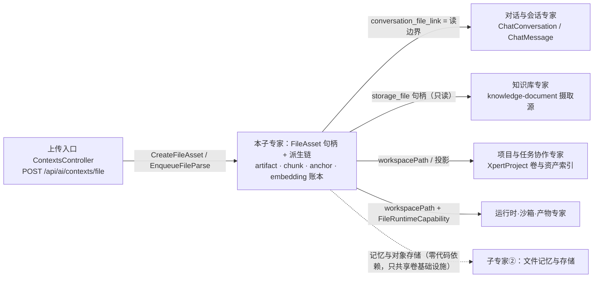

# 文件理解子专家 —— C0 使用总览

> **资产基线**：`2026-10-16 · commit 80f5676fd`（批次 5 第 13 专家），继承父域 [C0-使用总览.md](file://.module-experts/后端专题/文件理解与记忆专家/C0-使用总览.md)。**范围**：`packages/server-ai/src/file-understanding/**`（**88 非 spec / 29 spec / 7 张表**）＋ 上传入口 `packages/server-ai/src/ai/context.controller.ts`；HTTP 前缀 `/api/ai/*`（本控制器 8 端点）。记忆本体与对象存储索引归 [子专家②](file://.module-experts/后端专题/文件理解与记忆专家/sub-experts/文件记忆与存储子专家/C0-使用总览.md)。未证实处标 `[推测]`。

**本文引用的文件**（相对仓库根，链接均为 `file://`）

- [packages/server-ai/src/file-understanding/file-understanding.controller.ts](file://packages/server-ai/src/file-understanding/file-understanding.controller.ts)
- [packages/server-ai/src/file-understanding/file-understanding.module.ts](file://packages/server-ai/src/file-understanding/file-understanding.module.ts)
- [packages/server-ai/src/file-understanding/file-asset-access.service.ts](file://packages/server-ai/src/file-understanding/file-asset-access.service.ts)
- [packages/server-ai/src/file-understanding/file-asset-deletion.service.ts](file://packages/server-ai/src/file-understanding/file-asset-deletion.service.ts)
- [packages/server-ai/src/file-understanding/file-understanding-vector.service.ts](file://packages/server-ai/src/file-understanding/file-understanding-vector.service.ts)
- [packages/server-ai/src/file-understanding/file-workspace-projection.service.ts](file://packages/server-ai/src/file-understanding/file-workspace-projection.service.ts)
- [packages/server-ai/src/file-understanding/parsers/file-parser.registry.ts](file://packages/server-ai/src/file-understanding/parsers/file-parser.registry.ts)
- [packages/server-ai/src/file-understanding/commands/handlers/create-file-asset.handler.ts](file://packages/server-ai/src/file-understanding/commands/handlers/create-file-asset.handler.ts)
- [packages/server-ai/src/file-understanding/commands/handlers/enqueue-file-parse.handler.ts](file://packages/server-ai/src/file-understanding/commands/handlers/enqueue-file-parse.handler.ts)
- [packages/server-ai/src/file-understanding/commands/handlers/parse-file-asset.handler.ts](file://packages/server-ai/src/file-understanding/commands/handlers/parse-file-asset.handler.ts)
- [packages/server-ai/src/file-understanding/tools/file-understanding.tools.ts](file://packages/server-ai/src/file-understanding/tools/file-understanding.tools.ts)
- [packages/server-ai/src/file-understanding/middlewares/file-understanding.middleware.ts](file://packages/server-ai/src/file-understanding/middlewares/file-understanding.middleware.ts)
- [packages/server-ai/src/file-understanding/runtime/file-runtime.service.ts](file://packages/server-ai/src/file-understanding/runtime/file-runtime.service.ts)
- [packages/server-ai/src/ai/context.controller.ts](file://packages/server-ai/src/ai/context.controller.ts)
- [packages/server-ai/src/ai/ai-v1.controller.ts](file://packages/server-ai/src/ai/ai-v1.controller.ts)

## 目录

1. [定位](#定位)
2. [何时找这个子专家](#何时找这个子专家)
3. [能力清单表](#能力清单表)
4. [边界](#边界)
5. [已知问题与常见坑](#已知问题与常见坑)
6. [延伸阅读](#延伸阅读)

## 定位

本子专家负责把「一段字节」变成**平台可授权、可解析、可引用、可检索**的 `FileAsset` 句柄，并维护其整条派生链：写链 `CreateFileAsset`（按 `storageFileId` 复用）→ `EnqueueFileParse`（状态先落 `parsing`）→（内联或 `setImmediate` 后台）`ParseFileAsset` → 六族解析器 → `IndexFileChunks`（3600/240 切块 + 锚点 + 向量账本）；读面 8 个 `/api/ai/*` 端点、8 个 `parsed_file_*` Agent 工具、`FileRuntimeCapability` 运行时能力；回收面 `FileAssetDeletionService` 的分步硬删。

**一句话口径**：`FileAsset`（6 张自有表 + 1 张只读 `XpertProject`）是唯一跨域句柄，访存**统一收敛到 `FileAssetAccessService.resolve({locator, authority, operation})`**；派生层（chunk / anchor / embedding）可全量重建（先删后建），因此 chunkId 不是稳定身份。

章节来源：[file-asset-access.service.ts](file://packages/server-ai/src/file-understanding/file-asset-access.service.ts)（关键符号：FileAssetAccessService.resolve / accessDenied）、[create-file-asset.handler.ts](file://packages/server-ai/src/file-understanding/commands/handlers/create-file-asset.handler.ts)（关键符号：CreateFileAssetHandler.execute）、[file-understanding.controller.ts](file://packages/server-ai/src/file-understanding/file-understanding.controller.ts)（关键符号：FileUnderstandingController）

## 何时找这个子专家

- 要**改上传与落地**：`POST /api/ai/contexts/file` 的 multipart 流程、`resolveExternalStorageUploadTarget` 目标解析、`workspacePath` 被显式置空、会话字段覆盖 `projectId/xpertId`、`shouldRunParseInline`（fast→内联；deep→后台；其余按 ≤2MB 判定）。
- 要**改解析链与解析器**：`FileParserRegistry.getParser` 的命中顺序 pdf→spreadsheet→office→image→archive→text；新增类型必须同时进 `FileParsers` provider 数组；`replaceArtifacts` 先删后写、`orderNo` 按数组下标。
- 要**改分块与向量**：`IndexFileChunksHandler` 的全量重建（`DEFAULT_CHUNK_SIZE=3600` / `DEFAULT_CHUNK_OVERLAP=240`、8 种可切 kind）、`FileUnderstandingVectorService` 的 `file_embedding` 账本 + RagVStore 两跳检索。
- 要**改读取 / 预览 / 搜索**：8 端点返回形态；`preview` 裁剪（summary ≤900 字、artifact ≤12、chunk ≤8）；`search` 的「向量 + 关键词 RRF」与无 query 的顺序列举两分支；`read` 的 `chunkId|orderNo` 语义。
- 要**改软删与回收**：`cleanup` 的固定删除顺序、页图对象与派生目录的清理条件（仅本地 provider）、项目永久删除专用入口 `purgeProjectFile`。
- 要**改工作区投影**：`projectFileAsset` 的 `metadata.workspace{catalog, scopeId}` 事实来源；`projects` 卷拒写项目治理内容路径与 `nlink !== 1` 的文件。
- 要**改事件入边消费**：10 组进程内 CQRS 命令/查询入边的签名与语义（本域出边 0 条）。
- 要**排查解析卡住 / 预览 404**：`status` 长期 `parsing`（`setImmediate` 丢任务）、三态 `understandingErrorCode`、`preview` 资产缺失返回 `null`（HTTP 200）而 `/status` 授权后才 404。
- 要**排查跨域 403**：`resolve` 统一用 403 `FileAssetAccessDenied` 表达「不存在或无权限」（防枚举）；跨 Project 复用同一资产抛 409。
- 要**排查向量不一致**：`vectorIndexStatus` 按 `file_embedding` 行数近似派生；非 deep 模式索引失败静默降级为 `[]`，调用方无法区分「无匹配」与「无索引」。

章节来源：[context.controller.ts](file://packages/server-ai/src/ai/context.controller.ts)（关键符号：ContextsController.create / shouldRunParseInline）、[parse-file-asset.handler.ts](file://packages/server-ai/src/file-understanding/commands/handlers/parse-file-asset.handler.ts)（关键符号：ParseFileAssetHandler.execute / replaceArtifacts）、[file-understanding.controller.ts](file://packages/server-ai/src/file-understanding/file-understanding.controller.ts)（关键符号：authorizeFile / getPreview）

## 能力清单表

| 能力 | 入口（HTTP 或服务方法） | 一句话 |
|---|---|---|
| 上传落地（跨域入口） | `POST /api/ai/contexts/file`；`StorageTargetStrategy.upload` | 唯一会「建 `FileAsset` 并启动解析」的入口；key 必须落在 `contexts/<tenantId>/` 内 |
| 文件句柄与解析状态 | `GET /api/ai/files/:fileId`、`/status`；`GetFileParseStatusQuery` | 句柄含 `status/capabilities/parseMode/metadata`；状态机 `uploaded→parsing→ready|partial|failed` |
| 解析与产物 | `ParseFileAssetHandler`；`FileParserRegistry.getParser` | 六解析器命中即用；全不匹配抛 `UnsupportedFileContentError`，在 handler 内落 `failed` |
| 分块 · 锚点 · 向量账本 | `IndexFileChunksHandler`；`FileUnderstandingVectorService.indexChunks` | 全量重建 chunk/anchor/embedding；向量本体在 RagVStore，账本只存 `vectorId` |
| 读取 · 检索 · 预览 | `POST /files/:id/search`、`/read`；`GET /files/:id/preview` | 有 query 走混合检索（向量 + ILIKE + RRF），无 query 顺序列举；preview 只回安全裁剪字段 |
| 会话附件授权边界 | `ConversationFileLink`（唯一索引）；`GET /api/ai/conversations/:id/files` | link 存在即代表该会话可读；工具面只列当前可见文件 |
| 工作区投影 | `FileWorkspaceProjectionService.projectFileAsset` | 把对象存储字节与 PDF 页图投影进卷并回写 `workspacePath`；best-effort |
| 运行时能力面 | `FileRuntimeCapability`；`FileRuntimeService.resolveFile/createScopedApi` | 平台调用用当前 owner；Agent 调用一次性绑定会话（不在共享实例上持久化会话身份） |
| Agent 工具面 | `createFileUnderstandingTools`；`FileUnderstandingMiddleware`（`builtin:true`） | 8 个 `parsed_file_*`：search/read/preview/page_images/table_query/list/read_by_path/search_all |
| 删除与项目回收 | `DELETE /api/ai/files/:fileId`；`FileAssetDeletionService.delete/purgeProjectFile` | 硬删链 + 页图对象 + 派生目录；项目回收校验 `asset.projectId/tenantId` 全等 |
| 重试解析 | `POST /api/ai/files/:fileId/parse/retry`；`RetryFileParseHandler` | 直接重放 `ParseFileAssetCommand`，**无状态门禁**（门禁在平台侧 `retryUnderstanding`） |
| 工作区文件转资产 | `CreateWorkspaceFileAssetCommand`；`CreateWorkspaceFileAssetHandler` | 卷内既有文件 → 资产；校验 actor 的 tenant/user 一致，否则 403 |
| 文件向量状态派生 | `GetFileUnderstandingStatusQuery`；`GetFileUnderstandingStatusHandler` | `ready` 的条件是 `indexedChunkCount >= chunkCount`；重试门禁只认 `failed`/`unavailable` |
| 外部 artifact 注入（旁路） | `CreateFileArtifactsCommand`；`CreateFileArtifactsHandler` | 已注册但无生产调用方；同样先清向量/锚点/账本/chunk/artifact |

章节来源：[file-understanding.module.ts](file://packages/server-ai/src/file-understanding/file-understanding.module.ts)（关键符号：CommandHandlers / QueryHandlers / FileParsers）、[file-understanding.tools.ts](file://packages/server-ai/src/file-understanding/tools/file-understanding.tools.ts)（关键符号：createFileUnderstandingTools / parsed_file_search 等 8 工具）、[file-asset-deletion.service.ts](file://packages/server-ai/src/file-understanding/file-asset-deletion.service.ts)（关键符号：delete / purgeProjectFile / cleanup）

## 边界

**做什么**：平台级文件句柄与解析状态、解析产物与分块/锚点、向量账本与文件级检索、会话附件可见性边界、工作区投影、全链路硬删与项目回收、重试解析、Agent 工具面与运行时能力面。

图表来源：[file-understanding.module.ts](file://packages/server-ai/src/file-understanding/file-understanding.module.ts)（关键符号：imports 中的 StorageFileModule / XpertProjectAccessModule / VolumeModule / RagVStoreModule）、[file-asset-access.service.ts](file://packages/server-ai/src/file-understanding/file-asset-access.service.ts)（关键符号：assertCanLinkToConversation）

**不做什么**：

- **记忆与对象存储索引归子专家②**：`file-memory` 以卷上 markdown 为介质，与理解链**零代码依赖**（不读 `FileAsset`/`file_chunk`）；`storage_file` 行与字节读写归 `storage-file`。
- **multipart 上传入口不在本控制器**：`ContextsController` 注册在挂 `/ai` 的 `AIModule` 内，真实路径 `POST /api/ai/contexts/file`；本域控制器只有 8 条无 multipart 的端点。
- **对话 / 项目 / 助手授权本体不在本域**：一律**委托断言**（`ChatConversationService.assertAccess`、`XpertProjectAccessService.assertCan*`、`PublishedXpertAccessService.*`），不自判成员关系。
- **向量库本体不在本域**：`RagVStoreModule` 持有 `VectorStore`，本域只写账本与发检索请求。
- **沙箱与卷实现不在本域**：`VolumeClient` / `VolumeHandle` / `XpertWorkAreaResolver` 来自 `shared/volume`，本域只消费。
- **不含 ChatKit 上传归一化**：`xpert/commands/handlers/chat-file-assets.ts` 是调用方（入边 8），不是本域实现。

章节来源：[file-understanding.module.ts](file://packages/server-ai/src/file-understanding/file-understanding.module.ts)（关键符号：exports 仅 4 项：TypeOrmModule / FileUnderstandingVectorService / FileWorkspaceProjectionService / FileAssetAccessService）、[file-memory.module.ts](file://packages/server-ai/src/file-memory/file-memory.module.ts)（关键符号：FileMemoryModule.imports 无本域依赖）、[context.controller.ts](file://packages/server-ai/src/ai/context.controller.ts)（关键符号：ContextsController）

## 已知问题与常见坑

1. **上传入口不在本控制器，且旧入口已弃用**：真正的 multipart 上传与「启动理解」在 `ContextsController`（`POST /api/ai/contexts/file`）；旧入口 `POST /api/ai/v1/file` 源码逐字标注 `@deprecated`，**只落 storage 目标、不建 `FileAsset`、不触发解析**。
   - 契约来源：[context.controller.ts](file://packages/server-ai/src/ai/context.controller.ts)、[ai-v1.controller.ts](file://packages/server-ai/src/ai/ai-v1.controller.ts)。
2. **类级三件套 + 每方法授权**：控制器类级为 `@Public()` + `@AllowClientSecretBindings(SecretTokenBindingType.ENTERPRISE_XPERT)` + `@UseGuards(ApiKeyOrClientSecretAuthGuard)` + `@UseInterceptors(TransformInterceptor)`（**并非无守卫**）；每个方法先 `authorizeFile(fileId, operation)` → `FileAssetAccessService.resolve` + 公共 Xpert 会话 scope 校验（命中时要求 `fileAsset.userId === scope.createdById` 并追加 `assertPublicXpertSessionConversationAccess`）；唯一例外是 `GET conversations/:conversationId/files`。
   - 契约来源：[file-understanding.controller.ts](file://packages/server-ai/src/file-understanding/file-understanding.controller.ts)、[file-asset-access.service.ts](file://packages/server-ai/src/file-understanding/file-asset-access.service.ts)。
3. **幂等 / 去重键是 `storageFileId`（+ `tenantId`），不是 hash**：`CreateFileAssetHandler` 先 `findOne({storageFileId, tenantId})`，命中则**原地 spread 更新**（保留 userId/conversationId/threadId/projectId/xpertId/status/capabilities/workspacePath）。`sha256` 由 `uploadedFile.buffer` 计算并落列（`createHash('sha256')`），但**`@Index(['sha256'])` 非唯一、无查重逻辑**。全子域唯一唯一约束是 `ConversationFileLink` 的 `@Index(['conversationId','fileAssetId'], {unique:true})`，其余 5 张表均只有普通索引。
   - 契约来源：[create-file-asset.handler.ts](file://packages/server-ai/src/file-understanding/commands/handlers/create-file-asset.handler.ts)、[file-asset.entity.ts](file://packages/server-ai/src/file-understanding/entities/file-asset.entity.ts)、[conversation-file-link.entity.ts](file://packages/server-ai/src/file-understanding/entities/conversation-file-link.entity.ts)。
4. **解析启动只由上传路径显式触发**：`EnqueueFileParseCommand` 由调用方（`context.controller.ts`、`chat-file-assets.ts`、运行时能力面）显式投递；**存储层不隐式触发解析**——只写 `storage_file` 不会产生 `FileAsset`，也不会解析。
   - 契约来源：[context.controller.ts](file://packages/server-ai/src/ai/context.controller.ts)、[enqueue-file-parse.handler.ts](file://packages/server-ai/src/file-understanding/commands/handlers/enqueue-file-parse.handler.ts)。
5. **无队列：`setImmediate` 后台解析**：`runInline` 为假时 `setImmediate(() => commandBus.execute(new ParseFileAssetCommand(id)).catch(warn))`，失败仅 `logger.warn`；进程重启即丢任务、无重试与并发上限，状态会永久停在 `parsing`，只能靠 `parse/retry` 补偿。`[推测]` 大租户批量上传吞吐受单进程事件循环限制。
   - 契约来源：[enqueue-file-parse.handler.ts](file://packages/server-ai/src/file-understanding/commands/handlers/enqueue-file-parse.handler.ts)。
6. **无迁移 DDL**：本域目录无 `migrations/`、无 `.sql`，而运行时 `synchronize:false`，7 张表的建表来源在仓库外——改列/索引必须走外部迁移流程，仓库内改实体**可能**被启动 schema sync 自动对齐（反向风险；外部托管模式下才不生效）。
   - 契约来源：[application-data-source.ts](file://packages/server/src/database/application-data-source.ts)、[file-understanding.module.ts](file://packages/server-ai/src/file-understanding/file-understanding.module.ts)。
7. **中间件仅 `tools` 钩子**：`FileUnderstandingMiddleware`（`@AgentMiddlewareStrategy('FileUnderstandingMiddleware')`）`meta` 为 `{builtin:true, configSchema:{type:'object',properties:{}}}`，`createMiddleware` **只返回 `{name, tools}`，无任何 hook**（`beforeAgent`/`wrapModelCall`/`afterAgent` 均不存在），全目录检索 `explicit_write` **0 命中**（该信号属子专家② `file-memory.middleware`）。工具面经 `subgraph.handler.ts` 按名取策略后 `toolMap.set` 注入。
   - 契约来源：[file-understanding.middleware.ts](file://packages/server-ai/src/file-understanding/middlewares/file-understanding.middleware.ts)、[subgraph.handler.ts](file://packages/server-ai/src/xpert-agent/commands/handlers/subgraph.handler.ts)。
8. **事件入边 10 条，全是 CQRS 注入（本域发出 0 条）**：`AIModule` / `ChatConversationModule` / `EnterpriseChatkitModule` / `FileRuntimeModule` / `RuntimeCapabilityModule` / `SuperAdminOrganizationScopeModule` / `WorkspaceFilesRuntimeModule` / `XpertModule` / `XpertProjectAccessModule` / `XpertProjectModule`；漏注册 handler 会在启动期 DI 报错，漏处理则功能静默缺失。
   - 契约来源：[commands/handlers/index.ts](file://packages/server-ai/src/file-understanding/commands/handlers/index.ts)、[queries/handlers/index.ts](file://packages/server-ai/src/file-understanding/queries/handlers/index.ts)。
9. **工具面 8 个 `parsed_file_*` 名称是稳定契约**：旧名 `file_*` / `workspace_*` 已废弃并被 spec 显式断言不存在；上限 `SEARCH_RESULT_LIMIT=8`、片段 800 字、正文 4000 字；`resolveFileIds` 对不可见 id 抛 403，`parsed_file_read` 缺失 chunk 是**终态 not-found**（禁止靠递增 `orderNo` 反枚举）。
   - 契约来源：[file-understanding.tools.ts](file://packages/server-ai/src/file-understanding/tools/file-understanding.tools.ts)。
10. **取消标签与错误语义容易误读**：授权失败统一 403 `FileAssetAccessDenied`（**不区分不存在与无权限**，防枚举）；跨 Project 复用同一资产 → 409 `This file is already shared with another Project`；`preview` 资产不存在返回 `null`（HTTP 200），只有 `/status` 在授权通过后才会 404。
    - 契约来源：[file-asset-access.service.ts](file://packages/server-ai/src/file-understanding/file-asset-access.service.ts)、[get-file-preview.handler.ts](file://packages/server-ai/src/file-understanding/queries/handlers/get-file-preview.handler.ts)。
11. **回收是硬删、无事务、失败静默**：6 张表均无软删列；`cleanup` 顺序固定为「向量 → `file_citation_anchor` → `file_embedding` → `file_chunk` → `file_artifact` → `conversation_file_link` → `file_asset` 行 → 页图对象 → 派生目录」；派生目录 `fsPromises.rm` **仅当 `provider.path()` 返回绝对路径（本地 provider）**，远端对象存储只删 DB 行，页图与目录删除全部 `catch(() => undefined)`。
    - 契约来源：[file-asset-deletion.service.ts](file://packages/server-ai/src/file-understanding/file-asset-deletion.service.ts)。
12. **派生层不保证稳定身份**：chunk / anchor / embedding 走「删净重算」，重复索引结果等价但 **chunkId 会变化**，外部不应长期缓存 chunkId；`assertCanLinkToConversation` 的 409 是「已发生后」的检查，并发跨 Project attach 仍可能双写。`[推测]`
    - 契约来源：[index-file-chunks.handler.ts](file://packages/server-ai/src/file-understanding/commands/handlers/index-file-chunks.handler.ts)、[file-asset-access.service.ts](file://packages/server-ai/src/file-understanding/file-asset-access.service.ts)。

章节来源：[file-asset-deletion.service.ts](file://packages/server-ai/src/file-understanding/file-asset-deletion.service.ts)（关键符号：cleanup / deleteDerivedRootIfLocal / deletePageImageStorageKeys）、[create-file-asset.handler.ts](file://packages/server-ai/src/file-understanding/commands/handlers/create-file-asset.handler.ts)（关键符号：sha256 / existing）、[file-understanding.controller.ts](file://packages/server-ai/src/file-understanding/file-understanding.controller.ts)（关键符号：authorizeFile 的 8 个调用点）

## 延伸阅读

- 端点全集、鉴权矩阵与错误语义：[C1-能力契约.md](file://.module-experts/后端专题/文件理解与记忆专家/sub-experts/文件理解子专家/C1-能力契约.md)
- 端到端数据流（上传、解析、分块、检索、删除、投影）：[implementation/03-数据流转.md](file://.module-experts/后端专题/文件理解与记忆专家/sub-experts/文件理解子专家/implementation/03-数据流转.md)
- 装配与依赖（模块 imports/exports、10 组入边、25 个 handler）：[implementation/01-架构.md](file://.module-experts/后端专题/文件理解与记忆专家/sub-experts/文件理解子专家/implementation/01-架构.md)
- 逐链路实现细节与解析器矩阵：[implementation/02-实现.md](file://.module-experts/后端专题/文件理解与记忆专家/sub-experts/文件理解子专家/implementation/02-实现.md)
- 测试状态与未复跑说明：[implementation/06-测试.md](file://.module-experts/后端专题/文件理解与记忆专家/sub-experts/文件理解子专家/implementation/06-测试.md)
- 父域契约与全局口径：[父域 C0](file://.module-experts/后端专题/文件理解与记忆专家/C0-使用总览.md) · [父域 C1](file://.module-experts/后端专题/文件理解与记忆专家/C1-能力契约.md)

章节来源：[file-understanding.module.ts](file://packages/server-ai/src/file-understanding/file-understanding.module.ts)（关键符号：FileUnderstandingModule）、[agent.md](file://.module-experts/后端专题/文件理解与记忆专家/sub-experts/文件理解子专家/agent.md)（关键符号：覆盖目录 / 测试状态）
