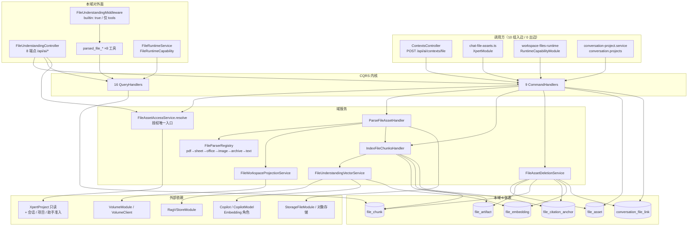

# 文件理解子专家 · 架构

**本文引用的文件**
- [packages/server-ai/src/file-understanding/file-understanding.module.ts](file://packages/server-ai/src/file-understanding/file-understanding.module.ts)
- [packages/server-ai/src/file-understanding/file-understanding.controller.ts](file://packages/server-ai/src/file-understanding/file-understanding.controller.ts)
- [packages/server-ai/src/file-understanding/file-asset-access.service.ts](file://packages/server-ai/src/file-understanding/file-asset-access.service.ts)
- [packages/server-ai/src/file-understanding/file-asset-deletion.service.ts](file://packages/server-ai/src/file-understanding/file-asset-deletion.service.ts)
- [packages/server-ai/src/file-understanding/file-understanding-vector.service.ts](file://packages/server-ai/src/file-understanding/file-understanding-vector.service.ts)
- [packages/server-ai/src/file-understanding/file-workspace-projection.service.ts](file://packages/server-ai/src/file-understanding/file-workspace-projection.service.ts)
- [packages/server-ai/src/file-understanding/parsers/file-parser.registry.ts](file://packages/server-ai/src/file-understanding/parsers/file-parser.registry.ts)
- [packages/server-ai/src/file-understanding/parsers/file-parser.ts](file://packages/server-ai/src/file-understanding/parsers/file-parser.ts)
- [packages/server-ai/src/file-understanding/middlewares/file-understanding.middleware.ts](file://packages/server-ai/src/file-understanding/middlewares/file-understanding.middleware.ts)
- [packages/server-ai/src/file-understanding/tools/file-understanding.tools.ts](file://packages/server-ai/src/file-understanding/tools/file-understanding.tools.ts)
- [packages/server-ai/src/file-understanding/runtime/file-runtime.service.ts](file://packages/server-ai/src/file-understanding/runtime/file-runtime.service.ts)
- [packages/server-ai/src/file-understanding/runtime/file-runtime.module.ts](file://packages/server-ai/src/file-understanding/runtime/file-runtime.module.ts)
- [packages/server-ai/src/file-understanding/domain/types.ts](file://packages/server-ai/src/file-understanding/domain/types.ts)
- [packages/server-ai/src/file-understanding/domain/workspace-file.ts](file://packages/server-ai/src/file-understanding/domain/workspace-file.ts)
- [packages/server-ai/src/file-understanding/domain/page-image-artifact.ts](file://packages/server-ai/src/file-understanding/domain/page-image-artifact.ts)
- [packages/server-ai/src/file-understanding/entities/file-asset.entity.ts](file://packages/server-ai/src/file-understanding/entities/file-asset.entity.ts)
- [packages/server-ai/src/file-understanding/entities/file-chunk.entity.ts](file://packages/server-ai/src/file-understanding/entities/file-chunk.entity.ts)
- [packages/server-ai/src/file-understanding/entities/file-artifact.entity.ts](file://packages/server-ai/src/file-understanding/entities/file-artifact.entity.ts)
- [packages/server-ai/src/file-understanding/entities/conversation-file-link.entity.ts](file://packages/server-ai/src/file-understanding/entities/conversation-file-link.entity.ts)
- [packages/server-ai/src/file-understanding/entities/file-citation-anchor.entity.ts](file://packages/server-ai/src/file-understanding/entities/file-citation-anchor.entity.ts)
- [packages/server-ai/src/file-understanding/entities/file-embedding.entity.ts](file://packages/server-ai/src/file-understanding/entities/file-embedding.entity.ts)
- [packages/server-ai/src/file-understanding/commands/handlers/index.ts](file://packages/server-ai/src/file-understanding/commands/handlers/index.ts)
- [packages/server-ai/src/file-understanding/queries/handlers/index.ts](file://packages/server-ai/src/file-understanding/queries/handlers/index.ts)
- [packages/server-ai/src/ai/context.controller.ts](file://packages/server-ai/src/ai/context.controller.ts)
- [packages/server-ai/src/ai/ai.module.ts](file://packages/server-ai/src/ai/ai.module.ts)
- [packages/server-ai/src/chat-conversation/conversation-branch/conversation-branch.module.ts](file://packages/server-ai/src/chat-conversation/conversation-branch/conversation-branch.module.ts)
- [.module-experts/后端专题/文件理解与记忆专家/C1-能力契约.md](file://.module-experts/后端专题/文件理解与记忆专家/C1-能力契约.md)
- [.module-experts/后端专题/文件理解与记忆专家/C5-关键决策.md](file://.module-experts/后端专题/文件理解与记忆专家/C5-关键决策.md)

## 目录

- [1. 子域职责与边界](#1-子域职责与边界)
- [2. 目录结构与分层](#2-目录结构与分层)
- [3. 依赖关系](#3-依赖关系)
- [4. 关键不变量](#4-关键不变量)
- [5. 架构总览](#5-架构总览)
- [6. 结论](#6-结论)

## 1. 子域职责与边界

**做什么**：把「一段字节」变成**平台可授权、可解析、可引用、可检索**的 `FileAsset` 句柄，并维护它的整条派生链。① 句柄与去重登记（`file_asset`，按 `storageFileId` 复用）；② 解析编排（`EnqueueFileParseCommand` → `ParseFileAssetCommand` → 六族解析器 → `file_artifact`）；③ 分块与引用锚点（`IndexFileChunksCommand` → `file_chunk` + `file_citation_anchor`）；④ 向量索引与账本（`FileUnderstandingVectorService` → RagVStore 集合 + `file_embedding`）；⑤ 工作区投影（`FileWorkspaceProjectionService` 把对象存储字节与 PDF 页图写进卷）；⑥ 会话可见性边界（`conversation_file_link`）；⑦ 8 个句柄/检索/删除端点（`/api/ai/*`）；⑧ Agent 工具面（`parsed_file_*` 8 工具，经内置中间件挂载）；⑨ 平台运行时能力面（`FileRuntimeService`，`FileRuntimeCapability`）；⑩ 分步硬删回收（`FileAssetDeletionService`）。

**不做什么（边界）**：
- **文件记忆（②子专家）**：`file-memory` 以卷上 markdown 为介质，与理解链**无代码依赖**，两条链只共享卷基础设施与 `chat_conversation`/`chat_message`/`xpert` 只读表；中间件也是两个独立 `@AgentMiddlewareStrategy`。
- **对象存储本体（②子专家）**：`storage_file` 行与字节读写归 `packages/server`；本域只持 `storageFileId` 与 `storageProvider`，删除时通过 `FileStorage().getProvider()` 操作对象。
- **multipart 上传入口不在本域控制器**：`ContextsController`（`@Controller('contexts')`）注册在挂 `/ai` 的 `AIModule` 中，**真实路径 `POST /api/ai/contexts/file`**；本域控制器只有 8 条无 multipart 的端点。
- **对话 / 项目 / 助手授权本体不在本域**：本域一律**委托断言**（`ChatConversationService.assertAccess`、`XpertProjectAccessService.assertCan*`、`PublishedXpertAccessService.*`），不自己判断成员关系。
- **沙箱与卷实现不在本域**：`VolumeClient` / `VolumeHandle` / `XpertWorkAreaResolver` 来自 `shared/volume`，本域只消费。
- **知识库摄取不共享实体**：`knowledge-document`、`xpert-project`、`chat-message` 等跨域只经 `GetOwnedStorageFileQuery` / `ResolveAuthorizedFileAssetQuery` 取句柄，不反向持有本域表。
- **不含 ChatKit 侧的上传归一化**：`chat-file-assets.ts`（`XpertModule`）是**调用方**，不是本域实现。

章节来源：[file-understanding.module.ts](file://packages/server-ai/src/file-understanding/file-understanding.module.ts)（关键符号：FileUnderstandingModule / RouterModule.register）；[file-understanding.controller.ts](file://packages/server-ai/src/file-understanding/file-understanding.controller.ts)（关键符号：FileUnderstandingController.authorizeFile）；[context.controller.ts](file://packages/server-ai/src/ai/context.controller.ts)（关键符号：ContextsController.create / withFileUnderstanding）；[C5-关键决策.md](file://.module-experts/后端专题/文件理解与记忆专家/C5-关键决策.md)（关键符号：D2 资产 → 解析 → 记忆三层解耦 / D6 命令查询入边驱动，本域零出边）

## 2. 目录结构与分层

**控制器层**：`file-understanding.controller.ts`（`@Controller()` 空段 + `RouterModule path:'/ai'` → `/api/ai/*`；类级 `@Public()`、`@AllowClientSecretBindings(SecretTokenBindingType.ENTERPRISE_XPERT)`、`@UseGuards(ApiKeyOrClientSecretAuthGuard)`、`@UseInterceptors(TransformInterceptor)`；8 方法均先 `authorizeFile(fileId, operation)` 再投递 CQRS）。

**命令层（9 handler）**：`CreateFileAssetHandler`、`CreateWorkspaceFileAssetHandler`、`EnqueueFileParseHandler`、`ParseFileAssetHandler`、`RetryFileParseHandler`、`IndexFileChunksHandler`、`CreateFileArtifactsHandler`、`AttachFileToConversationHandler`、`DeleteFileAssetHandler`，由 `commands/handlers/index.ts` 汇总为 `CommandHandlers`。

**查询层（16 handler）**：`GetFilePreviewHandler`、`GetFileParseStatusHandler`、`GetFileUnderstandingStatusHandler`、`SearchFileChunksHandler`、`ReadFileChunkHandler`、`ListConversationFilesHandler`、`ListProjectFilesHandler`、`ListFilePageImagesHandler`、`ReadFileAssetSourceHandler`、`GetFileWorkspacePathHandler`、`GetFileAssetHandler`、`GetFileAssetByStorageFileHandler`、`GetOwnedStorageFileHandler`、`ResolveAuthorizedFileAssetHandler`、`AssertFileUploadScopeHandler`、`ValidateFileUnderstandingReferencesHandler`，汇总为 `QueryHandlers`。

**解析器注册表层**：`parsers/` —— `FileParser` 接口（`name` / `supports` / `parse`）+ 六个实现 + `FileParserRegistry`，`FileParsers` 静态数组同时承担 **provider 注册表**与**优先级顺序**（registry 内部顺序 pdf → spreadsheet → office → image → archive → text）。

**运行时层**：`runtime/file-runtime.module.ts` + `runtime/file-runtime.service.ts`（`@RuntimeCapabilityProvider(FileRuntimeCapability)`，实现 `AgentMiddlewareFileApi`），独立子模块、只依赖 `CqrsModule` + `RuntimeCapabilityModule`，并被主模块 import。

**中间件 / 工具层**：`middlewares/file-understanding.middleware.ts`（`@AgentMiddlewareStrategy('FileUnderstandingMiddleware')`，`builtin: true`，`createMiddleware` 返回 `{ name, tools }`）+ `tools/file-understanding.tools.ts`（闭包工厂 `createFileUnderstandingTools(queryBus, options)` 产出 8 个 LangChain `tool`）。

**服务层**：`FileAssetAccessService`（授权唯一入口）· `FileUnderstandingVectorService`（向量 + 账本）· `FileWorkspaceProjectionService`（卷投影）· `FileAssetDeletionService`（回收）。

**实体层（7 张表注册）**：`TypeOrmModule.forFeature([FileAsset, FileArtifact, FileChunk, FileCitationAnchor, FileEmbedding, ConversationFileLink, XpertProject])` —— 前 6 张是本域自有表，`XpertProject` 为读跨域实体。

**纯函数域层**：`domain/types.ts`（状态/能力/artifact 种类/锚点）· `domain/workspace-file.ts`（卷作用域与相对路径解析）· `domain/page-image-artifact.ts`（页图元数据读取与路径校验）。

章节来源：[file-understanding.module.ts](file://packages/server-ai/src/file-understanding/file-understanding.module.ts)（关键符号：FileUnderstandingModule.providers / TypeOrmModule.forFeature / exports）；[commands/handlers/index.ts](file://packages/server-ai/src/file-understanding/commands/handlers/index.ts)（关键符号：CommandHandlers）；[queries/handlers/index.ts](file://packages/server-ai/src/file-understanding/queries/handlers/index.ts)（关键符号：QueryHandlers）；[file-parser.registry.ts](file://packages/server-ai/src/file-understanding/parsers/file-parser.registry.ts)（关键符号：FileParserRegistry.getParser / FileParsers）

## 3. 依赖关系

**出向（`imports`，9 项）**：`FileRuntimeModule`（本域子模块）· `TenantModule` · `UserModule` · `StorageFileModule`（`StorageFileService.findOneInOrganizationOrTenant` / `deleteAuthorizedStorageFile`）· `forwardRef(() => ChatConversationModule)`（会话授权与会话反查）· `XpertProjectAccessModule`（`assertCanRead` / `assertCanEdit` / `assertCanUse` / `assertCanPurge` / `assertCanUseXpert`）· `forwardRef(() => XpertModule)`（`PublishedXpertAccessService`）· `RagVStoreModule`（`RagCreateVStoreCommand` → `VectorStore`）· `VolumeModule`（`VOLUME_CLIENT`）。代码级另有 `CopilotModule` / `CopilotModelModule` 的查询（`CopilotOneByRoleQuery`、`CopilotModelGetEmbeddingsQuery`，用于 embedding 目标解析）与 `shared/volume`、`shared/file-upload-targets/utils`。

**入向（3 个 Nest 模块持有本模块）**：`AIModule`（`forwardRef(() => FileUnderstandingModule)`，控制器实际路由宿主，`/ai` 前缀）· `ConversationBranchModule`（`chat-conversation/conversation-branch`，直接 import）· `ServerAIModule`（`app.module.ts` 根模块 `imports` 内注册 `FileUnderstandingModule`）。

**入向 CQRS 边（10 组）**：见 02-实现.md §8 与 C1 §3 —— `AIModule`/`ChatConversationModule`/`EnterpriseChatkitModule`/`FileRuntimeModule`/`RuntimeCapabilityModule`/`SuperAdminOrganizationScopeModule`/`WorkspaceFilesRuntimeModule`/`XpertModule`/`XpertProjectAccessModule`/`XpertProjectModule`。本域**零出向事件**（无 `EventBus`、无 `@EventsHandler`、无 `@SqsConsumer`）。

**跨域只读消费方（非 Nest import，仅查/服务）**：`knowledge-document/document.service.ts`、`xpert-project/project.service.ts`、`chat-message/chat-message.service.ts`、`chat-conversation/conversation.service.ts`（`ResolveAuthorizedFileAssetQuery`）、`artifacts/artifacts.service.ts` 与 `workspace-file-access/workspace-file-access.service.ts`（`resolveWorkspaceVolumeScope`）、`shared/agent/middleware-runtime.service.ts`（`FileRuntimeService`）、`xpert-agent/commands/handlers/subgraph.handler.ts`（按名字取中间件策略）、`xpert-project/services/project-purge.service.ts`（`FileAssetDeletionService.purgeProjectFile`）。

**exports 面**：`TypeOrmModule`、`FileUnderstandingVectorService`、`FileWorkspaceProjectionService`、`FileAssetAccessService` 四者显式导出，其余靠 CQRS 总线解耦。

章节来源：[file-understanding.module.ts](file://packages/server-ai/src/file-understanding/file-understanding.module.ts)（关键符号：FileUnderstandingModule.imports / forwardRef / exports）；[ai.module.ts](file://packages/server-ai/src/ai/ai.module.ts)（关键符号：AIModule.forwardRef(FileUnderstandingModule) / RouterModule path '/ai'）；[C1-能力契约.md](file://.module-experts/后端专题/文件理解与记忆专家/C1-能力契约.md)（关键符号：§3 事件/命令消费契约 10 组入边）

## 4. 关键不变量

**① 授权唯一入口 `FileAssetAccessService.resolve`**：文件侧任何读/写/解析/删除都必须先过 `resolve({ locator, authority, operation })`；`operation ∈ read|attach|parse|write|delete`、`authority ∈ current-owner|conversation`、`locator ∈ fileAssetId|storageFileId`。控制器、命令 handler、投影服务、删除服务、运行时服务**五类调用点全部走同一条路径**；拒绝统一为 `ForbiddenException(t('server-ai:Error.FileAssetAccessDenied'))`。附带断言：`assertStorageFileOwner`（严格 owner）、`assertConversationAccess`、`assertConversationInputScope`、`assertCanCreateConversationAsset`、`assertUploadScope`、`assertUnderstandingScope`。

**② 幂等 / 去重键（逐个核实）**：`FileAsset` 以 **`(storageFileId, tenantId)`** 为复用键——`CreateFileAssetHandler` 先 `findOne({ storageFileId, tenantId })` 命中则**原地 spread 更新**（保留 `userId`/`conversationId`/`threadId`/`projectId`/`xpertId`/`status`/`capabilities`/`workspacePath`），不新建行。`sha256` 由 `uploadedFile.buffer` 计算并落列，**但它只是指纹、不参与去重**（`sha256: sha256 ?? existing?.sha256`）。`ConversationFileLink` 的唯一键是 `@Index(['conversationId','fileAssetId'], { unique: true })`，两条写路径（create-file-asset / attach）都先 `findOne` 再 `save` 以复用行。

**③ `file-chunk` 的索引与幂等**：`IndexFileChunksHandler` 采用**全量重建**——先 `deleteFileVectors` → 删 `file_citation_anchor` → 删 `file_embedding` → 删 `file_chunk`，再按 artifact `orderNo ASC` 重切：切块参数 `DEFAULT_CHUNK_SIZE=3600` / `DEFAULT_CHUNK_OVERLAP=240`，仅 `text|page_text|sheet|slide|table|code_tree|file_manifest|ocr_text` 八种 kind 可切；`orderNo` 跨 artifact 连续递增，`anchor = {...artifact.anchor, chunk: orderNo}`，`tokenCount = ceil(len/4)`。幂等语义是「同一资产重复索引 ⇒ 结果等价」，**不是 upsert**。

**④ 向量写入与重建**：集合名 `file-understanding:<xpert|project|tenant>:<id>:<fingerprint>`，fingerprint 来自 `createEmbeddingFingerprint(provider/model/dimensions/options/providerConfig)`；`file_embedding` 是**账本**（`vectorId = chunk.id`，metadata 记 `collectionName`/`collectionScope`/`fingerprint`/`dimensions`/`embeddedAt`），向量本体在 RagVStore。重建靠「删账本 + 删向量 + 重写」，清除时按账本里的 collectionName 分组删除。`parseMode === 'deep'` 时目标解析失败抛 `FileUnderstandingVectorUnavailableError`、索引异常抛 `FileUnderstandingVectorIndexError`；非 deep 一律吞成 `[]`。

**⑤ 工作区投影语义（`file-workspace-projection`）**：投影是**一个 FileAsset 一份**，落点 `<sessionPath>/files/<assetId>/<fileName>`，并把 `catalog + scopeId` 写入 `metadata.workspace` 作为「这份投影属于哪个卷」的事实来源；再次调用时只在 `catalog/scopeId` 匹配且文件真实存在时才复用相对路径，否则重写字节。因此**跨 Project 复用同一资产被硬拦**：`assertCanLinkToConversation` 发现已有指向**另一个 Project** 的链接即抛 `ConflictException('This file is already shared with another Project')`；投影整体是 best-effort（失败只 warn 并返回原 asset）。写盘时对 `projects` 卷额外禁止写「项目治理内容路径」与 `nlink !== 1` 的文件。

**⑥ 软删与回收的连带面**：`FileAsset`/`FileChunk`/`FileArtifact`/`FileEmbedding`/`FileCitationAnchor`/`ConversationFileLink` **均无软删列**，删除是硬删；`FileAssetDeletionService.cleanup` 顺序固定：向量 → `file_citation_anchor` → `file_embedding` → `file_chunk` → `file_artifact` → `conversation_file_link` → `file_asset` 行 → 页图对象 → 派生目录（`contexts/<tenantId>/file-understanding/<assetId>`，仅当 `provider.path()` 返回绝对路径即本地 provider 时执行）。项目回收是**独立入口** `purgeProjectFile(fileAssetId, projectId)`：先 `assertCanPurge(projectId)`，再比对 `asset.projectId === project.id && asset.tenantId === project.tenantId`，不符抛 `Error.ProjectPurgeFileMismatch`。

**⑦ 中间件钩子与 `explicit_write` 跳过条件【口径修正】**：本域 `middlewares/file-understanding.middleware.ts` 的实现体**只有 `tools`，没有任何 hook**（无 `beforeAgent`/`wrapModelCall`/`afterAgent`），全目录检索 `explicit_write` **0 命中**。`skipped reason=explicit_write` 属于 `file-memory` 的 `XpertFileMemoryMiddleware.afterAgent`（②子专家的域）。本域中间件的真实契约是：声明 `meta{builtin:true, configSchema:{}, 空 properties}` + `createMiddleware(options, context)` 返回 `{name, tools}`，作用域取值 `options?.conversationId ?? context.conversationId`、`options?.projectId ?? context.projectId`，由 `subgraph.handler.ts` 经 `agentMiddlewareRegistry.get(FILE_UNDERSTANDING_MIDDLEWARE_NAME)` 注入 `toolMap`。

**⑧ 控制器鉴权三件套 + 方法内授权【口径修正】**：类级装饰器为 `@Public()` + `@AllowClientSecretBindings(SecretTokenBindingType.ENTERPRISE_XPERT)` + `@UseGuards(ApiKeyOrClientSecretAuthGuard)` + `@UseInterceptors(TransformInterceptor)`——**并非「无 `@UseGuards`」**；真正的双重保险是「类级 API key / client-secret 守卫（认证）」+「每个方法内 `authorizeFile(fileId, operation)`（授权）」，且当 `getPublicXpertSessionConversationScope()` 命中时，额外要求 `fileAsset.userId === scope.createdById` 并追加 `assertPublicXpertSessionConversationAccess`。8 条端点里唯一不走 `authorizeFile` 的是 `GET conversations/:conversationId/files`，它改走 `assertConversationAccess({kind:'conversation', conversationId}, 'read')` + 同一公共会话校验。

章节来源：[file-asset-access.service.ts](file://packages/server-ai/src/file-understanding/file-asset-access.service.ts)（关键符号：resolve / FileAssetOperation / assertCanLinkToConversation / assertUploadScope / accessDenied）；[create-file-asset.handler.ts](file://packages/server-ai/src/file-understanding/commands/handlers/create-file-asset.handler.ts)（关键符号：CreateFileAssetHandler.execute / buildFileAssetMetadata）；[index-file-chunks.handler.ts](file://packages/server-ai/src/file-understanding/commands/handlers/index-file-chunks.handler.ts)（关键符号：IndexFileChunksHandler.chunkText / rebuildCitationAnchors / CHUNKABLE_ARTIFACT_KINDS）；[file-understanding-vector.service.ts](file://packages/server-ai/src/file-understanding/file-understanding-vector.service.ts)（关键符号：indexChunks / searchChunkIds / deleteFileVectors / createFileVectorCollectionName）；[file-workspace-projection.service.ts](file://packages/server-ai/src/file-understanding/file-workspace-projection.service.ts)（关键符号：projectFileAsset / resolveProjectionScope / writeProjectedVolumeFile）；[file-asset-deletion.service.ts](file://packages/server-ai/src/file-understanding/file-asset-deletion.service.ts)（关键符号：delete / purgeProjectFile / cleanup）；[file-understanding.middleware.ts](file://packages/server-ai/src/file-understanding/middlewares/file-understanding.middleware.ts)（关键符号：FileUnderstandingMiddleware.createMiddleware / FILE_UNDERSTANDING_MIDDLEWARE_NAME）；[file-understanding.controller.ts](file://packages/server-ai/src/file-understanding/file-understanding.controller.ts)（关键符号：FileUnderstandingController.authorizeFile）

## 5. 架构总览

图表来源：[file-understanding.module.ts](file://packages/server-ai/src/file-understanding/file-understanding.module.ts)（关键符号：FileUnderstandingModule.imports / controllers / providers）；[file-understanding.controller.ts](file://packages/server-ai/src/file-understanding/file-understanding.controller.ts)（关键符号：FileUnderstandingController 的 8 个路由方法）；[context.controller.ts](file://packages/server-ai/src/ai/context.controller.ts)（关键符号：ContextsController.create）；[file-parser.registry.ts](file://packages/server-ai/src/file-understanding/parsers/file-parser.registry.ts)（关键符号：FileParserRegistry.getParser 顺序）

章节来源：[file-understanding.module.ts](file://packages/server-ai/src/file-understanding/file-understanding.module.ts)（关键符号：FileUnderstandingModule / TypeOrmModule.forFeature 7 实体）；[file-understanding.controller.ts](file://packages/server-ai/src/file-understanding/file-understanding.controller.ts)（关键符号：FileUnderstandingController.@Controller / 8 路由）；[C1-能力契约.md](file://.module-experts/后端专题/文件理解与记忆专家/C1-能力契约.md)（关键符号：§3 十组入边表）

## 6. 结论

- **一句话定位**：本子域是「**文件句柄 + 解析派生链 + 授权收口**」的数据面，用 6 张自有表把字节的语义化产物（artifact / chunk / anchor / embedding 账本）托管起来，并把可见性收敛到 `conversation_file_link` 与 `FileAssetAccessService.resolve` 两处。
- **三条正交不变量支撑可演进性**：授权单一入口（①）、幂等键单一（②）、派生全量重建（③④）。任一派生层（chunk / 向量 / 投影）都可以安全重算，不会与句柄层互相污染。
- **零出边是刻意的**：本域不发事件、不订阅事件，全部耦合都是进程内 CQRS 注入；代价是 10 组入边与 25 个 handler 的装配面（漏注册即启动期 DI 报错）。
- **口径修正三处**（已在 §4 标注）：控制器有类级 `@UseGuards`；本域中间件仅 `tools` 无三钩子且与 `explicit_write` 无关；控制器只有 `POST /files/:fileId/parse/retry` 一条 parse 路由。
- **最大结构性风险**：解析任务用 `setImmediate` 而非持久队列（见 02-实现.md §12 技术债），进程重启即丢任务且无重试语义。

章节来源：[file-asset-access.service.ts](file://packages/server-ai/src/file-understanding/file-asset-access.service.ts)（关键符号：FileAssetAccessService.resolve / accessDenied）；[enqueue-file-parse.handler.ts](file://packages/server-ai/src/file-understanding/commands/handlers/enqueue-file-parse.handler.ts)（关键符号：EnqueueFileParseHandler.execute / setImmediate）；[C5-关键决策.md](file://.module-experts/后端专题/文件理解与记忆专家/C5-关键决策.md)（关键符号：D8 访问授权放在 service 断言 / D6 命令查询入边驱动，本域零出边）
