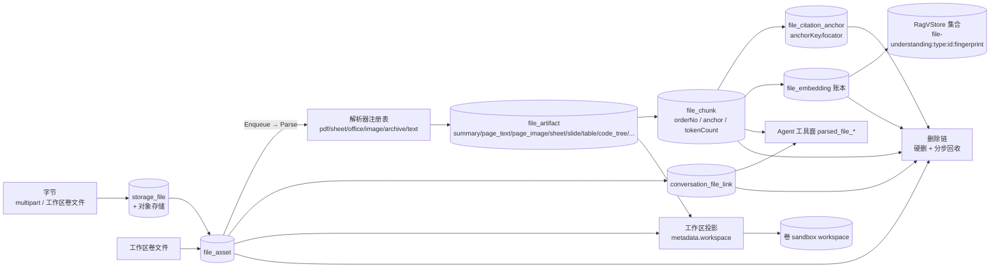
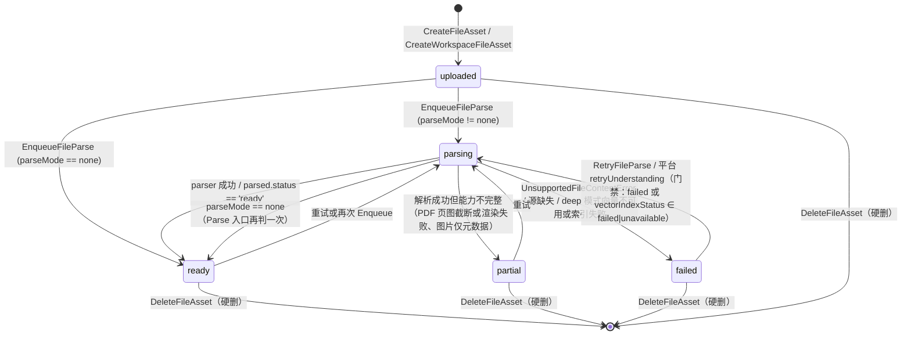

# 文件理解子专家 · 数据流转

**本文引用的文件**
- [packages/server-ai/src/ai/context.controller.ts](file://packages/server-ai/src/ai/context.controller.ts)
- [packages/server-ai/src/file-understanding/file-understanding.controller.ts](file://packages/server-ai/src/file-understanding/file-understanding.controller.ts)
- [packages/server-ai/src/file-understanding/file-asset-access.service.ts](file://packages/server-ai/src/file-understanding/file-asset-access.service.ts)
- [packages/server-ai/src/file-understanding/file-asset-deletion.service.ts](file://packages/server-ai/src/file-understanding/file-asset-deletion.service.ts)
- [packages/server-ai/src/file-understanding/file-understanding-vector.service.ts](file://packages/server-ai/src/file-understanding/file-understanding-vector.service.ts)
- [packages/server-ai/src/file-understanding/file-workspace-projection.service.ts](file://packages/server-ai/src/file-understanding/file-workspace-projection.service.ts)
- [packages/server-ai/src/file-understanding/commands/handlers/create-file-asset.handler.ts](file://packages/server-ai/src/file-understanding/commands/handlers/create-file-asset.handler.ts)
- [packages/server-ai/src/file-understanding/commands/handlers/enqueue-file-parse.handler.ts](file://packages/server-ai/src/file-understanding/commands/handlers/enqueue-file-parse.handler.ts)
- [packages/server-ai/src/file-understanding/commands/handlers/parse-file-asset.handler.ts](file://packages/server-ai/src/file-understanding/commands/handlers/parse-file-asset.handler.ts)
- [packages/server-ai/src/file-understanding/commands/handlers/index-file-chunks.handler.ts](file://packages/server-ai/src/file-understanding/commands/handlers/index-file-chunks.handler.ts)
- [packages/server-ai/src/file-understanding/commands/handlers/attach-file-to-conversation.handler.ts](file://packages/server-ai/src/file-understanding/commands/handlers/attach-file-to-conversation.handler.ts)
- [packages/server-ai/src/file-understanding/parsers/pdf.parser.ts](file://packages/server-ai/src/file-understanding/parsers/pdf.parser.ts)
- [packages/server-ai/src/file-understanding/parsers/file-parser.registry.ts](file://packages/server-ai/src/file-understanding/parsers/file-parser.registry.ts)
- [packages/server-ai/src/file-understanding/queries/handlers/search-file-chunks.handler.ts](file://packages/server-ai/src/file-understanding/queries/handlers/search-file-chunks.handler.ts)
- [packages/server-ai/src/file-understanding/queries/handlers/get-file-preview.handler.ts](file://packages/server-ai/src/file-understanding/queries/handlers/get-file-preview.handler.ts)
- [packages/server-ai/src/file-understanding/queries/handlers/list-project-files.handler.ts](file://packages/server-ai/src/file-understanding/queries/handlers/list-project-files.handler.ts)
- [packages/server-ai/src/file-understanding/queries/handlers/read-file-asset-source.handler.ts](file://packages/server-ai/src/file-understanding/queries/handlers/read-file-asset-source.handler.ts)
- [packages/server-ai/src/file-understanding/queries/handlers/get-file-understanding-status.handler.ts](file://packages/server-ai/src/file-understanding/queries/handlers/get-file-understanding-status.handler.ts)
- [packages/server-ai/src/file-understanding/domain/types.ts](file://packages/server-ai/src/file-understanding/domain/types.ts)
- [packages/server-ai/src/file-understanding/domain/workspace-file.ts](file://packages/server-ai/src/file-understanding/domain/workspace-file.ts)
- [packages/server-ai/src/file-understanding/entities/file-asset.entity.ts](file://packages/server-ai/src/file-understanding/entities/file-asset.entity.ts)
- [packages/server-ai/src/file-understanding/entities/file-chunk.entity.ts](file://packages/server-ai/src/file-understanding/entities/file-chunk.entity.ts)
- [.module-experts/后端专题/文件理解与记忆专家/C2-使用流程.md](file://.module-experts/后端专题/文件理解与记忆专家/C2-使用流程.md)
- [.module-experts/后端专题/文件理解与记忆专家/C4-数据流向与消费.md](file://.module-experts/后端专题/文件理解与记忆专家/C4-数据流向与消费.md)

## 目录

- [1. 总览](#1-总览)
- [2. 链路一：上传落句柄](#2-链路一上传落句柄)
- [3. 链路二：解析](#3-链路二解析)
- [4. 链路三：分块与引用锚点](#4-链路三分块与引用锚点)
- [5. 链路四：向量索引](#5-链路四向量索引)
- [6. 链路五：工作区投影](#6-链路五工作区投影)
- [7. 链路六：删除与回收](#7-链路六删除与回收)
- [8. 链路七：事件入边](#8-链路七事件入边)
- [9. 链路八：预览与读取](#9-链路八预览与读取)
- [10. 状态机](#10-状态机)
- [11. 已知风险](#11-已知风险)
- [12. 结论](#12-结论)

## 1. 总览

图表来源：[file-understanding.module.ts](file://packages/server-ai/src/file-understanding/file-understanding.module.ts)（关键符号：TypeOrmModule.forFeature 六张本域表）；[parse-file-asset.handler.ts](file://packages/server-ai/src/file-understanding/commands/handlers/parse-file-asset.handler.ts)（关键符号：ParseFileAssetHandler.execute 的阶段顺序）；[index-file-chunks.handler.ts](file://packages/server-ai/src/file-understanding/commands/handlers/index-file-chunks.handler.ts)（关键符号：execute 的清理与写序）

章节来源：[file-understanding.module.ts](file://packages/server-ai/src/file-understanding/file-understanding.module.ts)（关键符号：FileUnderstandingModule / 7 实体注册）；[C4-数据流向与消费.md](file://.module-experts/后端专题/文件理解与记忆专家/C4-数据流向与消费.md)（关键符号：资产 → 解析 → 消费三段流）

## 2. 链路一：上传落句柄

`POST /api/ai/contexts/file`（multipart）→ `resolveExternalStorageUploadTarget`（默认 `{kind:'storage', directory:'contexts', prefix:'files'}`）→ `workspacePath` 强制置空、会话字段覆盖 `projectId/xpertId/threadId` → 作用域断言 → `UploadFileCommand`（`StorageTargetStrategy.upload` 写字节 + `createStorageFile` 落 `storage_file`）→ `CreateFileAssetCommand`。

`CreateFileAssetHandler` 落库细节：① `assertStorageFileOwner(storageFileId)`（严格 owner）；② `findOne({storageFileId, tenantId})` **命中即复用**，否则新建；③ 复用分支再 `resolve(..., operation:'write')` 并 `assertCanLinkToConversation`；④ `sha256 = createHash('sha256').update(uploadedFile.buffer)` 落列（指纹，不参与去重）；⑤ `status` 保持 `uploaded`（复用时不回退）、`capabilities` 至少 `['preview']`、`purpose` 默认 `chat_attachment`、`parseMode` 默认 `auto`；⑥ `metadata` 三次合并（existing → input → `storageFile` 快照：id/file/url/fileUrl/thumb/thumbUrl/originalName/size/mimetype/storageProvider）；⑦ 有会话时 upsert `conversation_file_link`（唯一键 `conversationId + fileAssetId`）。

**产物表**：`storage_file`（跨域）+ `file_asset` + 可选 `conversation_file_link`；随后 `EnqueueFileParseCommand` 把 `file_asset.status` 推到 `parsing`（或 `none` 时 `ready`）。

章节来源：[context.controller.ts](file://packages/server-ai/src/ai/context.controller.ts)（关键符号：ContextsController.create / resolveConversationReferences / withFileUnderstanding）；[create-file-asset.handler.ts](file://packages/server-ai/src/file-understanding/commands/handlers/create-file-asset.handler.ts)（关键符号：execute / buildStorageFileMetadata / buildFileAssetMetadata）；[file-asset.entity.ts](file://packages/server-ai/src/file-understanding/entities/file-asset.entity.ts)（关键符号：@Index(['storageFileId']) / sha256 / status / parseMode）

## 3. 链路二：解析

`EnqueueFileParseCommand` → 状态置 `parsing`（`error=null`）→ 内联或 `setImmediate` 后台 → `ParseFileAssetCommand` → `ParseFileAssetHandler.execute`：授权 `parse` → `FileParserRegistry.getParser(source)`（顺序 pdf → spreadsheet → office → image → archive → text）→ `parser.parse(source)` → `replaceArtifacts`（**先删尽再按下标写 orderNo**）→ `IndexFileChunksCommand` → 回写 `status/summary/capabilities/metadata(parser, chunkCount)/parsedAt`。

**源与派生目录**：源优先 `storageFile`（`FileStorage().getProvider(provider).path(file)`），无 storageFile 时用 `createVolumeFileSnapshot` 从卷取快照；派生目录恒为 `contexts/<tenantId>/file-understanding/<assetId>/<parseRunId>`（`parseRunId = randomUUID()`），PDF 页图写在其中 `pages/page-0001.png`。

**产物表**：`file_artifact`（`summary` 永远第一项，随后按文档自然粒度）+ 对象存储派生目录 + `file_asset` 状态列。

章节来源：[parse-file-asset.handler.ts](file://packages/server-ai/src/file-understanding/commands/handlers/parse-file-asset.handler.ts)（关键符号：execute / createWorkspaceSource / resolveDerivedStorageDirectory / replaceArtifacts / deleteStalePageImages）；[pdf.parser.ts](file://packages/server-ai/src/file-understanding/parsers/pdf.parser.ts)（关键符号：renderPageImages / page_image metadata / interleavePageArtifacts）；[file-parser.registry.ts](file://packages/server-ai/src/file-understanding/parsers/file-parser.registry.ts)（关键符号：getParser 优先级）

## 4. 链路三：分块与引用锚点

`IndexFileChunksCommand` → `IndexFileChunksHandler.execute`：读 `file_asset` → **清场**（向量 → `file_citation_anchor` → `file_embedding` → `file_chunk`）→ 按 `orderNo ASC` 读 `file_artifact` → 过滤 `CHUNKABLE_ARTIFACT_KINDS` 与空内容 → `chunkText`（3600 / 240）→ 逐块建 `file_chunk`（`orderNo` 全局连续、`anchor = {...artifact.anchor, chunk: orderNo}`、`tokenCount = ceil(len/4)`、`metadata.artifactKind`）→ `rebuildCitationAnchors` → `fileVectorService.indexChunks`。

**锚点语义**：`file_citation_anchor.anchorKey` 形如 `page:7:chunk:3` / `sheet:Sheet1:chunk:0` / `slide:2:chunk:1` / `path:src/index.ts:chunk:4` / 兜底 `chunk:9`，`label` 为「Page 7 / Sheet Sheet1 / Slide 2 / 路径 / Chunk 9」，`locator` 存整个 anchor——这是「模型引用可回溯到文档位置」的持久化载体。

章节来源：[index-file-chunks.handler.ts](file://packages/server-ai/src/file-understanding/commands/handlers/index-file-chunks.handler.ts)（关键符号：execute / chunkText / rebuildCitationAnchors / createAnchorKey / createAnchorLabel）；[file-chunk.entity.ts](file://packages/server-ai/src/file-understanding/entities/file-chunk.entity.ts)（关键符号：orderNo / content / tokenCount / anchor / artifactId）

## 5. 链路四：向量索引

`indexChunks(asset, chunks)`：无 chunk 直接 `[]` → `resolveVectorTarget(asset)`（tenant/organization 上取 `AiProviderRole.Embedding` 的 copilot ⇒ embeddings ⇒ 维度探测 ⇒ fingerprint ⇒ collection scope）→ 目标为空时按 `parseMode==='deep'` 抛 `FileUnderstandingVectorUnavailableError`，否则 `[]` → `RagCreateVStoreCommand(embeddings, {collectionName})` → `addDocuments(docs, {ids: chunk.id})`，元数据 `{tenantId, organizationId, fileAssetId, xpertId, projectId, artifactId, chunkId, orderNo, anchor, enabled:true}` → 写 `file_embedding` 账本。

**检索（`searchChunkIds`）**：解析目标 → 读账本得到**同 collectionName** 的 chunkId 集合 → 集合为空时按 deep 抛错/否则 `[]` → `similaritySearchWithScore(query, limit, {tenantId, organizationId, fileAssetId, enabled:true})` → 用集合交叉过滤 → 返回有序 chunkId。**删除（`deleteFileVectors`）**：按账本 collectionName 分组 `vectorStore.delete({ids})`，无账本直接返回。

**闭环**：`SearchFileChunksHandler` 用 `searchChunkIds` 的 id 顺序去 `file_chunk` 补水实体，再与关键词路线 RRR 融合——向量只提供「哪些块」，正文永远以 DB 为准。

章节来源：[file-understanding-vector.service.ts](file://packages/server-ai/src/file-understanding/file-understanding-vector.service.ts)（关键符号：indexChunks / searchChunkIds / deleteFileVectors / resolveVectorTarget / resolveCollectionScope）；[search-file-chunks.handler.ts](file://packages/server-ai/src/file-understanding/queries/handlers/search-file-chunks.handler.ts)（关键符号：searchVectorChunks / searchTextChunks / reciprocalRankMerge）

## 6. 链路五：工作区投影

两条触发：**Attach**（`AttachFileToConversationHandler` → `projectFileAsset`，operation `attach`，默认写原始字节）与 **Parse 后**（`ParseFileAssetHandler.projectParsedPageImages`，operation `parse`，只补页图）。

数据流：`resolve` 授权 → `XpertWorkAreaResolver.resolve` 求 `workArea{volume, workspaceRoot, sessionPath}` → 相对路径 `<sessionPath ?? sessions/<conversationId>>/files/<assetId>/<fileName>` → 字节来源优先级 `input.buffer` > 对象存储 `getFile(storageFile.file)` > 既有工作区文件（`VolumeSubtreeClient.readBuffer`）→ `VolumeHandle.writeFile(..., {boundaryRoot, assertCanWrite})` → 回写 `file_asset.workspacePath` + `capabilities += workspace` + `metadata.workspace{relativePath, workspacePath, catalog, scopeId, provider, projectedAt}` → 页图再复制到 `<assetFolder>/pages/<page-0001.png>` 并给 `file_artifact.metadata` 补 `workspacePath/projectedAt`。

**幂等判据**：`metadata.workspace.catalog/scopeId` 与当前投影作用域一致 **且** 该相对路径在卷上真实存在（`VolumeHandle.openExistingFile` + `isFile()`）才复用；否则重写。

章节来源：[file-workspace-projection.service.ts](file://packages/server-ai/src/file-understanding/file-workspace-projection.service.ts)（关键符号：projectFileAsset / resolveProjectionScope / volumeFileExists / writeProjectedVolumeFile / projectPageImageArtifacts）；[attach-file-to-conversation.handler.ts](file://packages/server-ai/src/file-understanding/commands/handlers/attach-file-to-conversation.handler.ts)（关键符号：execute 的投影调用与 catch-warn）；[workspace-file.ts](file://packages/server-ai/src/file-understanding/domain/workspace-file.ts)（关键符号：resolveFileAssetWorkspaceRelativePath / resolveFileAssetWorkspaceVolumeScope）

## 7. 链路六：删除与回收

`DELETE /api/ai/files/:fileId`（或 `DELETE /api/ai/contexts/file/:id`，后者 `:id` 是 storageFileId）→ `DeleteFileAssetCommand` → `FileAssetDeletionService.delete`（先 `resolve(..., 'delete')`）→ `cleanup`。

**删除顺序（固定、无事务）**：`deleteFileVectors`（读账本 → 分 collection 删向量）→ `file_citation_anchor` → `file_embedding` → `file_chunk` → `file_artifact` → `conversation_file_link` → `file_asset` 行 → 页图对象（逐个 `provider.deleteFile`）→ 本地 provider 下 `rm -rf contexts/<tenantId>/file-understanding/<assetId>`。

**项目回收旁路**：`purgeProjectFile(fileAssetId, projectId)` = `assertCanPurge(projectId)` + 归属双向比对（`asset.projectId === project.id` 且 `asset.tenantId === project.tenantId`）后复用同一 `cleanup`，由 `ProjectPurgeService` 逐资产调用。

章节来源：[file-asset-deletion.service.ts](file://packages/server-ai/src/file-understanding/file-asset-deletion.service.ts)（关键符号：delete / purgeProjectFile / cleanup / deletePageImageStorageKeys / deleteDerivedRootIfLocal）；[file-understanding.controller.ts](file://packages/server-ai/src/file-understanding/file-understanding.controller.ts)（关键符号：deleteFile → authorizeFile(...,'delete')）；[C2-使用流程.md](file://.module-experts/后端专题/文件理解与记忆专家/C2-使用流程.md)（关键符号：R5 删除与回收）

## 8. 链路七：事件入边

**方向：10 组入、0 出**。三条代表性数据流：

- **聊天附件**（`XpertModule`/`chat-file-assets.ts`）：`normalizeChatRequestFile` 判三形态 → ① 已有 `fileAssetId`：`ResolveAuthorizedFileAssetQuery`（有会话用 `attach` 授权，否则 `read`）并把 `id/fileId/fileAssetId` 归一为同一个资产 id；② 仅 `storageFileId`：`resolveOrCreateFileAssetForStorageFile` 桥接（`CreateFileAssetCommand` + 可能的 `EnqueueFileParseCommand`）；③ `workspacePath` 形态：按 `projectId ? 'projects' : (workspaceDataScope==='user' ? 'user-xperts' : 'xperts')` 选卷后 `CreateWorkspaceFileAssetCommand`；随后 `attachChatFileAssetsToConversation` 逐资产 `AttachFileToConversationCommand`（**先 attach 再调 Agent**，确保工具面与投影都拿到最终运行上下文）。
- **运行时能力面**（`WorkspaceFilesRuntimeModule`/`RuntimeCapabilityModule`）：`understandFile` → `CreateWorkspaceFileAssetCommand`（用卷内已存在的文件建资产）→ handler 内部再 `EnqueueFileParseCommand`；`retryUnderstanding` 先 `getUnderstandingStatus` 门禁（仅 `failed` 或 `vectorIndexStatus ∈ {failed, unavailable}`）再 `EnqueueFileParseCommand`。
- **项目绑定**（`XpertProjectModule`/`conversation-project.service.ts`）：确认项目后遍历该会话既有 `conversation_file_link`，逐条 `AttachFileToConversationCommand`（带上 `prepared.projectId` 与助手 sandbox provider）把附件搬进项目卷。

章节来源：[C1-能力契约.md](file://.module-experts/后端专题/文件理解与记忆专家/C1-能力契约.md)（关键符号：§3 十组入边表 / 漏订阅表现）；[chat-file-assets.ts](file://packages/server-ai/src/xpert/commands/handlers/chat-file-assets.ts)（关键符号：normalizeChatRequestFile / attachChatFileAssetsToConversation）；[workspace-files-runtime-capability.service.ts](file://packages/server-ai/src/shared/runtime/workspace-files-runtime-capability.service.ts)（关键符号：understandFile / retryUnderstanding）；[conversation-project.service.ts](file://packages/server-ai/src/xpert-project/services/conversation-project.service.ts)（关键符号：confirm 中的 AttachFileToConversationCommand 循环）

## 9. 链路八：预览与读取

- **预览**：`GET /api/ai/files/:fileId/preview` → `authorizeFile(read)` → `GetFilePreviewQuery` → 只 select 安全列 + artifact ≤12（剔 `summary`）+ chunk 头 ≤8 → **不返回任何正文**；`page_image` 附 `{workspacePath,url,fileName,width,height,size}` 供前端直接渲染。资产不存在 → `null`（HTTP 200）。
- **读取**：`POST /api/ai/files/:fileId/read` → `authorizeFile(read)` → `ReadFileChunkQuery` → `chunkId`（`where {id, fileAssetId}`）或 `orderNo`（默认 0）单块；工具面在未命中时抛终态 `PARSED_FILE_CHUNK_NOT_FOUND` 阻止模型枚举顺序号。
- **检索**：`POST /api/ai/files/:fileId/search` → `SearchFileChunksQuery` → 无 query 是分页列块（≤101），有 query 是向量+关键词混合（≤30）。
- **原文/源字节**：`ReadFileAssetSourceQuery`（`ReadFileAssetSourceHandler`）按 `resolve(read)` 后的会话/资产卷作用域，经 `VolumeSubtreeClient.readBuffer('', relativePath)` 读**工作区里的源文件字节**；`FileRuntimeService.resolveFile` 则把平台文件引用解析成可预览 URL（storageFile 的 `fileUrl/url`，或 `provider.url(file)`）。
- **列表与状态**：`ListConversationFilesQuery`（link → 资产 → 逐条 `resolve`，403 的静默剔除）、`ListProjectFilesQuery`（项目全量 + 会话附件去重并集，读权不足返回 `[]` 隐藏存在性）、`GetFileUnderstandingStatusQuery`（`{status, parseMode, capabilities, chunkCount, indexedChunkCount, vectorIndexStatus, errorCode, parsedAt}`）。

章节来源：[get-file-preview.handler.ts](file://packages/server-ai/src/file-understanding/queries/handlers/get-file-preview.handler.ts)（关键符号：execute / compactMetadata）；[read-file-asset-source.handler.ts](file://packages/server-ai/src/file-understanding/queries/handlers/read-file-asset-source.handler.ts)（关键符号：execute / resolveConversationWorkspaceVolumeScope）；[list-project-files.handler.ts](file://packages/server-ai/src/file-understanding/queries/handlers/list-project-files.handler.ts)（关键符号：execute / authorizeFiles）；[get-file-understanding-status.handler.ts](file://packages/server-ai/src/file-understanding/queries/handlers/get-file-understanding-status.handler.ts)（关键符号：scopedFileWhere / resolveVectorStatus）；[file-runtime.service.ts](file://packages/server-ai/src/file-understanding/runtime/file-runtime.service.ts)（关键符号：resolveFileWithScope / resolveStorageFileUrl）

## 10. 状态机

**资产状态机（`FileAssetStatus` = `uploaded | scanning | parsing | ready | partial | failed`）**：

图表来源：[get-file-preview.handler.ts](file://packages/server-ai/src/file-understanding/queries/handlers/get-file-preview.handler.ts)

**解析任务状态（无独立队列表，用 `file_asset.status` 承载）**：`parsing` 是唯一「在途」标记，且**没有超时回收**——进程在解析中崩溃会留下永久 `parsing` 的行。

**chunk / 向量状态（派生自 `GetFileUnderstandingStatusQuery.resolveVectorStatus`）**：`pending`（资产 `uploaded|scanning|parsing`）/ `failed`（资产 `failed`）/ `ready`（`chunkCount > 0 && indexedChunkCount >= chunkCount`）/ `unavailable`（其余，含 `chunkCount === 0`）。注意 `ready` 判据是**账本行数**而非向量真实存在性。

**工作区投影状态（`file_asset.metadata.workspace`）**：存在且 `catalog/scopeId` 匹配 + 卷上文件存在 = 有效投影；任一不成立即视为无投影（下次投影会重写）。无独立状态列、不参与状态机。

图表来源：[domain/types.ts](file://packages/server-ai/src/file-understanding/domain/types.ts)（关键符号：FileAssetStatus / FileParseMode / FileCapability / FileArtifactKind）；[enqueue-file-parse.handler.ts](file://packages/server-ai/src/file-understanding/commands/handlers/enqueue-file-parse.handler.ts)（关键符号：status 赋值二分）；[parse-file-asset.handler.ts](file://packages/server-ai/src/file-understanding/commands/handlers/parse-file-asset.handler.ts)（关键符号：status = parsed.status ?? 'ready' / failed 分支）

章节来源：[domain/types.ts](file://packages/server-ai/src/file-understanding/domain/types.ts)（关键符号：FileAssetStatus / FileParseDerivedOutput / ParsedFileResult.status）；[get-file-understanding-status.handler.ts](file://packages/server-ai/src/file-understanding/queries/handlers/get-file-understanding-status.handler.ts)（关键符号：resolveVectorStatus / readErrorCode）；[retry-file-parse.handler.ts](file://packages/server-ai/src/file-understanding/commands/handlers/retry-file-parse.handler.ts)（关键符号：RetryFileParseHandler.execute）

## 11. 已知风险

1. **在途状态无回收**：`parsing` 无租约/超时，崩溃后需人工重试（`parse/retry` 无门禁，可安全重放）。
2. **重启丢任务**：后台解析是 `setImmediate`，不进队列，重启即丢且**状态会停在 `parsing`**（比丢任务更糟：看起来在跑）。
3. **一致性窗口**：`IndexFileChunksHandler` 先删后建，重解析期间检索返回空集；`ready` 的资产在重建瞬间会短暂 `unavailable`。
4. **chunkId 不稳定**：全量重建导致 id 漂移，任何跨轮缓存 chunkId 的调用方（如 Agent 会话上下文、外部工具）会拿到 `PARSED_FILE_CHUNK_NOT_FOUND`。
5. **向量孤儿**：换 embedding 模型 ⇒ 换 collection 名，旧集合不会被删除。`[推测]` 长期积累死集合与存储成本。
6. **对象存储孤儿**：远端 provider 下派生目录与非页图对象不会被 `cleanup` 清除。
7. **授权按 N 次放大**：`ListProjectFilesHandler` / `ListConversationFilesHandler` 对每个资产调一次 `resolve`（含 storageFile 查询），大项目下是 O(N) 次授权与 O(N) 次存储查询。`[推测]`
8. **跨 Project 双写窗口**：`assertCanLinkToConversation` 与 link 写入之间无锁，并发 attach 仍可能落到两个项目。

章节来源：[enqueue-file-parse.handler.ts](file://packages/server-ai/src/file-understanding/commands/handlers/enqueue-file-parse.handler.ts)（关键符号：setImmediate）；[index-file-chunks.handler.ts](file://packages/server-ai/src/file-understanding/commands/handlers/index-file-chunks.handler.ts)（关键符号：execute 的删-建窗口）；[file-asset-access.service.ts](file://packages/server-ai/src/file-understanding/file-asset-access.service.ts)（关键符号：assertCanLinkToConversation / isUserIsolatedXpertAsset）；[file-asset-deletion.service.ts](file://packages/server-ai/src/file-understanding/file-asset-deletion.service.ts)（关键符号：cleanup / deleteDerivedRootIfLocal）

## 12. 结论

- 本域的流转是**三段幂等重算**：句柄（按 `storageFileId` 复用）→ 产物（按 `fileAssetId` 删净重建）→ 派生（chunk / anchor / 向量三者同批重建），任何一段都可以安全重跑，是一致性的主要保障。
- 唯一的对外「可见性」信号是 `conversation_file_link` + `metadata.workspace`：前者决定**能不能看到**，后者决定**沙箱里能不能按路径读到**。
- 状态机只有一条主线（`uploaded → parsing → ready|partial|failed`），代价是**没有超时与租约**——运维上必须把「长期 `parsing`」当作故障信号而非中间态。
- 10 组入边全部是进程内命令注入，**没有任何回滚/补偿机制**：入边失败一律直接抛给调用方（403/400/409），不会在域内留补偿标记。

章节来源：[file-asset-access.service.ts](file://packages/server-ai/src/file-understanding/file-asset-access.service.ts)（关键符号：resolve 的完整分支）；[file-workspace-projection.service.ts](file://packages/server-ai/src/file-understanding/file-workspace-projection.service.ts)（关键符号：projectFileAsset）；[C1-能力契约.md](file://.module-experts/后端专题/文件理解与记忆专家/C1-能力契约.md)（关键符号：§3 入边失败语义）
