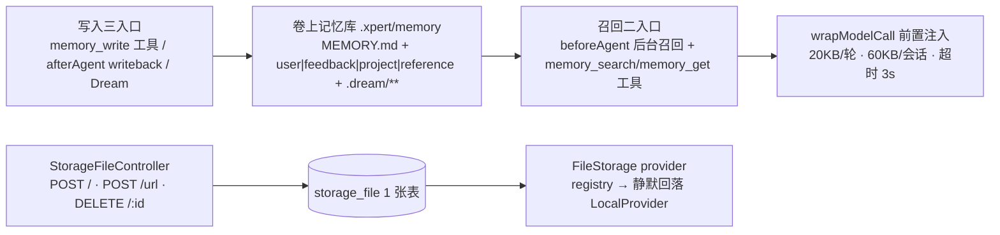

# 文件记忆与存储子专家 —— C0 使用总览

> **资产基线**：`2026-10-16 · commit 80f5676fd`（批次 5 首专家），继承父域 [C0-使用总览.md](file://.module-experts/后端专题/文件理解与记忆专家/C0-使用总览.md)。**范围**：`packages/server-ai/src/file-memory/**`（**24 非 spec / 8 spec**；目录内**无自有实体**，`forFeature` 注册 3 张只读表）＋ `packages/server/src/storage-file/**`（**21 非 spec / 1 spec / 1 张表**）；HTTP 前缀 `/api/xpert/:id/memory`（6 端点）与 `/api/storage-file`（3 端点）。文件解析与句柄归 [子专家①](file://.module-experts/后端专题/文件理解与记忆专家/sub-experts/文件理解子专家/C0-使用总览.md)。未证实处标 `[推测]`。

**本文引用的文件**（相对仓库根，链接均为 `file://`）

- [packages/server-ai/src/file-memory/file-memory.controller.ts](file://packages/server-ai/src/file-memory/file-memory.controller.ts)
- [packages/server-ai/src/file-memory/file-memory.service.ts](file://packages/server-ai/src/file-memory/file-memory.service.ts)
- [packages/server-ai/src/file-memory/file-memory.middleware.ts](file://packages/server-ai/src/file-memory/file-memory.middleware.ts)
- [packages/server-ai/src/file-memory/file-memory.writeback-runner.ts](file://packages/server-ai/src/file-memory/file-memory.writeback-runner.ts)
- [packages/server-ai/src/file-memory/dream.service.ts](file://packages/server-ai/src/file-memory/dream.service.ts)
- [packages/server-ai/src/file-memory/recall-planner.ts](file://packages/server-ai/src/file-memory/recall-planner.ts)
- [packages/server-ai/src/file-memory/paths.ts](file://packages/server-ai/src/file-memory/paths.ts)
- [packages/server-ai/src/file-memory/types.ts](file://packages/server-ai/src/file-memory/types.ts)
- [packages/server-ai/src/file-memory/signals.ts](file://packages/server-ai/src/file-memory/signals.ts)
- [packages/server-ai/src/file-memory/ports.ts](file://packages/server-ai/src/file-memory/ports.ts)
- [packages/server-ai/src/xpert/guards/xpert.guard.ts](file://packages/server-ai/src/xpert/guards/xpert.guard.ts)
- [packages/server/src/storage-file/storage-file.controller.ts](file://packages/server/src/storage-file/storage-file.controller.ts)
- [packages/server/src/storage-file/storage-file.service.ts](file://packages/server/src/storage-file/storage-file.service.ts)
- [packages/server/src/file/file-storage/file-storage.ts](file://packages/server/src/file/file-storage/file-storage.ts)

## 目录

1. [定位](#定位)
2. [何时找这个子专家](#何时找这个子专家)
3. [能力清单表](#能力清单表)
4. [边界](#边界)
5. [已知问题与常见坑](#已知问题与常见坑)
6. [延伸阅读](#延伸阅读)

## 定位

本子专家由两条**互不调用**的支柱组成：**支柱 A 文件记忆（`file-memory`）**＝从文件与对话沉淀的可复用知识，本体**不是 DB 行而是卷上的 markdown/JSON**（`.xpert/memory` + `MEMORY.md` 索引 + 四类目录 + `.dream/**` 运行证据），提供写入（显式 `memory_write` / 隐式 writeback / 离线 Dream）、召回（索引 digest + `memory_search`/`memory_get` + 模型筛选）、治理（状态/有用度/记分卡/索引校验）与 Dream 运行编排；**支柱 B 文件存储索引（`storage-file`）**＝字节的落地与取用抽象，`storage_file` 一行 + provider 抽象（`FileStorage`）+ subscriber 收尾。

**一句话口径**：记忆的**唯一事实源是卷上文件**（3 张 DB 表只读：`chat_conversation` / `chat_message` / `xpert`）；字节的唯一登记点是 `storage_file`（1 张表），provider 在写行时固化、读取时按行解析，注册表失配则**静默回落内置 LOCAL**。

图表来源：[file-memory.middleware.ts](file://packages/server-ai/src/file-memory/file-memory.middleware.ts)（关键符号：beforeAgent / wrapModelCall / afterAgent / memory_search / memory_get / memory_write）、[file-storage.ts](file://packages/server/src/file/file-storage/file-storage.ts)（关键符号：getProviderInstance / FALLBACK_PROVIDER_TYPES）

章节来源：[file-memory.service.ts](file://packages/server-ai/src/file-memory/file-memory.service.ts)（关键符号：writeMemory / searchMemory / getMemory）、[file-memory.module.ts](file://packages/server-ai/src/file-memory/file-memory.module.ts)（关键符号：TypeOrmModule.forFeature([ChatConversation, ChatMessage, Xpert]) 全只读）、[storage-file.service.ts](file://packages/server/src/storage-file/storage-file.service.ts)（关键符号：createStorageFile / deleteStorageFile）

## 何时找这个子专家

- 要**改记忆写入**：三个触发点——`memory_write` 工具（`source:'explicit'`）、`afterAgent` writeback（`source:'writeback'`，`enqueue` → 模型裁决 `noop|upsert|archive`）、Dream 离线整理（dreamer 直接改卷上文件）。
- 要**改召回与注入预算**：`beforeAgent` 起后台召回 → `selectSummaryDigestHeaders`（启发式 6 条）→ 可选模型筛选 `selectRecallHeaders`（默认 1500ms 超时、短名单 20）→ `wrapModelCall` 经 `buildMemoryContextMessages` 前置注入；预算 `MAX_DETAIL_BYTES_PER_TURN=20KB` / `MAX_DETAIL_BYTES_PER_SESSION=60KB`。
- 要**改记忆文件布局与索引**：`.xpert/memory`（`FILE_MEMORY_WORKSPACE_PATH`）、`MEMORY.md`（`FILE_MEMORY_INDEX_FILENAME`）、四类目录 `user|feedback|project|reference`、状态 `active|archived|conflict`、`.dream/**`；项目模式下记忆根切到 `.xpert/memory/xperts/<xpertId>`。
- 要**改存储抽象与 provider 回落**：`FileStorage.setProvider/getProvider/getProviderInstance` 的注册表查找与静默回落、`StorageTargetStrategy.upload` 的落库、`StorageFileSubscriber.afterLoad/afterRemove` 的副作用。
- 要**改上传 / 下载 / 删除**：`/api/storage-file` 3 端点的 multipart、URL 拉取、按 owner 删除，以及 `deleteAuthorizedStorageFile` 旁路。
- 要**改记忆治理与记分卡**：`status` 流转、`usefulnessScore`（由 signals 全量重算）、`scorecards/index.json`、`validateFileMemoryIndex` 的 6 类索引问题。
- 要**改 Dream 运行编排**：gate 配置（默认 30 分钟 + ≥1 条新/更新记忆 + ≥1 会话）、lock、备份、证据、报告与 cancel 语义。
- 要**排查记忆不生成**：`afterAgent skipped reason=explicit_write`（本轮已显式写）、`reason=empty_summary`、writeback 无模型时只记候选、Dream gate 未过落 `status='skipped'`、`coalesced:true` 合并、dreamer 配置缺失。
- 要**排查召回不生效**：`recallStrategy=fallback|disabled`、召回超时、会话预算已耗尽、mtime 缓存未失效、记忆根目录选错（项目卷 vs 用户隔离卷）。
- 要**排查存储不可用**：provider 名把「未注册」与「registry 未就绪」混同（静默回落 LOCAL）、`deleteStorageFile` 把找不到与越权统一转 403、subscriber 吞异常导致孤儿物理对象。

章节来源：[file-memory.middleware.ts](file://packages/server-ai/src/file-memory/file-memory.middleware.ts)（关键符号：MAX_DETAIL_BYTES_PER_TURN / MAX_DETAIL_BYTES_PER_SESSION / afterAgent skipped 分支）、[paths.ts](file://packages/server-ai/src/file-memory/paths.ts)（关键符号：getXpertFileMemoryWorkspacePath / normalizeFileMemoryRelativePath）、[types.ts](file://packages/server-ai/src/file-memory/types.ts)（关键符号：FILE_MEMORY_TYPES / FILE_MEMORY_STATUSES）

## 能力清单表

| 能力 | 入口（HTTP 或服务方法） | 一句话 |
|---|---|---|
| 显式写一条记忆 | `memory_write` 工具；`FileMemoryService.writeMemory` | 生成 `mem_<uuid>`，落 `<type>/<slug>-<id8>.md`；命中既有 `memoryId` 则复用路径与 `createdAt`（archived 会复活为 active） |
| 轮次结束写回 | `afterAgent` → `FileMemoryWritebackRunner.enqueue/softDrain` | 摘要非空且本轮无显式写入才触发；`searchMemory(limit 6)` 取候选后由模型裁决 upsert/archive |
| 离线整理（Dream） | `POST /api/xpert/:id/memory/dream` 等 6 端点；`FileMemoryDreamService` | gate 未过落 `skipped`；同 scope 已有 queued run 返回 `coalesced:true`；经 dreamer 助手异步执行 |
| 召回注入 | `beforeAgent` → `recall-planner` → `wrapModelCall` | digest 6 条 + 模型筛选（默认超时 1500ms）；注入预算 20KB/轮、60KB/会话、召回超时 3s |
| 记忆检索与读取 | `memory_search` / `memory_get` 工具；`FileMemoryService.searchMemory/getMemory` | 纯关键词打分（无向量）；`getMemory` 追加 `detail_read` 信号并更新 usage（**读也是写**） |
| 记忆索引与导航 | `MEMORY.md`；`FileMemoryService.refreshManagedIndex` / `validateFileMemoryIndex` | `MEMORY.md` 只作导航索引，条目由服务托管维护；校验覆盖 6 类问题 |
| 记忆治理与有用度 | `archiveMemory`；`calculateUsageFromSignals`；`scorecards/index.json` | 归档只改 `status` 并从索引移除（文件保留）；`usefulnessScore` 由 signals 全量重算 |
| 信号与记分卡 | `.dream/signals/YYYY-MM-DD.jsonl`；`FILE_MEMORY_SIGNAL_WEIGHTS` | 6 类信号：`explicit_write`(1) / `user_correction`(0.95) / `detail_read`(0.7) / `writeback_candidate`(0.55) / `recall_hit`(0.35) / `index_issue`(0.3) |
| 记忆文件 CRUD（HTTP） | `xpert.controller.ts` 的 `:id/memory/file[s]` 系列；`FileMemoryFacade` | 全部挂 `XpertGuard`；facade 与 `XpertService` **双实现**（后者硬编码 `.xpert/memory`） |
| 存储文件登记（上传） | `POST /api/storage-file`；`StorageTargetStrategy.upload` → `createStorageFile` | controller 无显式断言；key 必须形如 `<directory>/<tenantId>/<fileName>` |
| URL 拉取落库 | `POST /api/storage-file/url`；`provider.putFile(url)` | 服务端拉取外链后登记；失败统一 400 `Failed to download and store file from URL: <msg>`；无用户边界 |
| 存储文件删除 | `DELETE /api/storage-file/:id`；`deleteStorageFile` / `deleteAuthorizedStorageFile` | **鉴权在 service**（owner 或 SUPER_ADMIN/ADMIN，任意异常一律 403）；`findOne` → `repository.remove` 触发 `afterRemove` |
| provider 解析与回落 | `FileStorage.getProvider(name)` / `getProviderInstance()` | 先查插件注册表，失败**静默回落内置 LOCAL**（`FALLBACK_PROVIDER_TYPES = [LocalProvider]`） |
| 文件 URL 补全与物理清理 | `StorageFileSubscriber.afterLoad/afterRemove` | 加载时按行上 provider 补 `fileUrl`；删除时删 `file`/`thumb` 物理对象（异常 `console.log` 吞掉） |

章节来源：[file-memory.service.ts](file://packages/server-ai/src/file-memory/file-memory.service.ts)（关键符号：writeMemory / searchMemory / archiveMemory / calculateUsageFromSignals）、[signals.ts](file://packages/server-ai/src/file-memory/signals.ts)（关键符号：FILE_MEMORY_SIGNAL_WEIGHTS）、[storage-file.controller.ts](file://packages/server/src/storage-file/storage-file.controller.ts)（关键符号：create / createUrl / delete）

## 边界

**做什么**：卷上文件记忆的全生命周期（写入 / 召回 / 治理 / Dream）、记忆文件 HTTP 面、以及 `storage_file` 对象存储索引的登记、provider 解析与物理对象生命周期。

**不做什么**：

- **解析、分块、向量归子专家①**：`file-memory` 对 `file_asset`/`file_chunk`/向量集合**零代码依赖**（目录内检索 `embedding|vector|VStore|CopilotModel` 0 命中），只共享卷基础设施与 `chat_conversation`/`chat_message`/`xpert` 三张只读表。
- **不做知识库摄取**：知识库域自建向量链；本域只提供 `storage_file` 句柄。
- **沙箱与卷实现不在本域**：`VolumeClient`/`VolumeSubtreeClient` 来自 `shared/volume`，`resolveSandboxBackend` 来自 `plugin-sdk`；本域只消费。
- **不做模型推理运行时**：召回筛选与写回决策用对话模型 `BaseChatModel`，但模型生命周期与 Agent 运行时归对话/Agent 域；本域只按名挂中间件（`@AgentMiddlewareStrategy`）。
- **无自有表**：`file-memory` 不落任何自有实体（注册的 3 张表全部只读）；`storage_file` 是唯一可写表且 `deletedAt` 无写入点。

章节来源：[file-memory.module.ts](file://packages/server-ai/src/file-memory/file-memory.module.ts)（关键符号：FileMemoryModule.imports）、[file-memory.facade.ts](file://packages/server-ai/src/file-memory/file-memory.facade.ts)（关键符号：FileMemoryFacade 12 方法）、[storage-file.entity.ts](file://packages/server/src/storage-file/storage-file.entity.ts)（关键符号：StorageFile.storageProvider / deletedAt）

## 已知问题与常见坑

1. **记忆是卷上文件，不是表**：布局 `.xpert/memory`（`FILE_MEMORY_WORKSPACE_PATH`）+ `MEMORY.md` 导航索引 + 四类目录 `user|feedback|project|reference`（`FILE_MEMORY_TYPES`）+ 状态 `active|archived|conflict`（`FILE_MEMORY_STATUSES`）+ 6 类信号（`FILE_MEMORY_SIGNAL_WEIGHTS`）。任何「查库改记忆」的思路都会失败；项目模式下根切到 `.xpert/memory/xperts/<xpertId>`。
   - 契约来源：[types.ts](file://packages/server-ai/src/file-memory/types.ts)、[signals.ts](file://packages/server-ai/src/file-memory/signals.ts)、[paths.ts](file://packages/server-ai/src/file-memory/paths.ts)。
2. **writeback 串行键与 `softDrain`**：`FileMemoryWritebackRunner.enqueue(snapshot)` 按 `createFileMemoryScopeKey`（项目：`<tenant>:project:<projectId>:xpert:<id>`；用户隔离追加 `:<userId>`，缺失时字面量 `missing-user`）**串行**；`softDrain(key, timeoutMs)` 限时等待（`Promise.race`）。内存 `slots` 只在单进程有效，多副本部署下同 scope 可并发。
   - 契约来源：[ports.ts](file://packages/server-ai/src/file-memory/ports.ts)、[file-memory.writeback-runner.ts](file://packages/server-ai/src/file-memory/file-memory.writeback-runner.ts)。
3. **writeback 的跳过与降级条件**：本轮已发生显式写入 → `skipped reason=explicit_write`；摘要为空 → `skipped reason=empty_summary`；**模型不可用时只记 `writeback_candidate` 候选、不落盘**；`upsert` 缺 `type/title/summary/content` 任一项即回落 `noop`（`Incomplete upsert payload.`）。
   - 契约来源：[file-memory.middleware.ts](file://packages/server-ai/src/file-memory/file-memory.middleware.ts)、[file-memory.writeback.ts](file://packages/server-ai/src/file-memory/file-memory.writeback.ts)。
4. **dream gate 与出站命令**：默认 gate `{enabled:true, minIntervalMinutes:30, minNewOrUpdatedMemories:1, minConversationCount:1}`；未过**不报错**，落 `status='skipped'` 并写 `output/gate.json`；同 scope 已有 pending 直接返回 `coalesced:true`；另一 run 持锁则 `partial`。Dream 是本域**唯一出站**：`XpertDreamerInvoker` 以 `XpertAgentChatCommand` 调 dreamer 助手（超时 10 分钟）；缺 `dreamerXpertId`/`dreamerAgentKey` 不可运行。
   - 契约来源：[dream.service.ts](file://packages/server-ai/src/file-memory/dream.service.ts)、[xpert-dreamer-invoker.ts](file://packages/server-ai/src/file-memory/adapters/xpert-dreamer-invoker.ts)。
5. **召回预算与注入点**：`wrapModelCall` 里经 `buildMemoryContextMessages(recall)` 前置注入 `[indexBlock, digestBlock, detailBlock]`；预算常量 `MAX_DETAIL_BYTES_PER_TURN = 20 * 1024`、`MAX_DETAIL_BYTES_PER_SESSION = 60 * 1024`，可用 `options.recall.maxDetailBytesPerTurn/PerSession` 覆盖；日志字段 `detailBytes` / `surfacedSessionBytes` 是对账入口。
   - 契约来源：[file-memory.middleware.ts](file://packages/server-ai/src/file-memory/file-memory.middleware.ts)。
6. **`explicit_write` 信号属本子域**：该信号由 `FileMemoryService` 在写入后 `appendSignal('explicit_write')` 记录（`FILE_MEMORY_SIGNAL_WEIGHTS` 权重 1），跳过逻辑在 `file-memory.middleware.ts` 的 `afterAgent`；子专家①的中间件全目录检索 `explicit_write` **0 命中**，两域不可混谈。
   - 契约来源：[signals.ts](file://packages/server-ai/src/file-memory/signals.ts)、[file-memory.middleware.ts](file://packages/server-ai/src/file-memory/file-memory.middleware.ts)。
7. **`XpertGuard` 的 5 分钟缓存**：6 个 Dream 端点由类级 `@UseGuards(XpertGuard)` 保护；逻辑为 `xpert.createdById === user.id` 或 `workspaceService.canAccess(xpert.workspaceId, user.id)`，否则 403 `Access denied`；命中后写缓存键 `userXperts:<tenantId>:<userId>_<xpertId>`，TTL `5 * 60 * 1000`。**guard 只判 Xpert 归属，不判记忆文件路径级权限**。
   - 契约来源：[xpert.guard.ts](file://packages/server-ai/src/xpert/guards/xpert.guard.ts)、[file-memory.controller.ts](file://packages/server-ai/src/file-memory/file-memory.controller.ts)。
8. **provider 回落语义（逐字）**：`FileStorage.getProviderInstance()` 先 `registry.get(name)`，catch 内注释逐字为 `// Fall back to built-in providers so bootstrap/tests without Nest context keep working.`，然后返回 `this.providers[name]`；内置集合 `FALLBACK_PROVIDER_TYPES = [LocalProvider]`。排障时**不能据返回值判断真实后端**——「插件 registry 未就绪」与「provider 真不存在」不可区分。
   - 契约来源：[file-storage.ts](file://packages/server/src/file/file-storage/file-storage.ts)、[file-storage-registry.bridge.ts](file://packages/server/src/file/file-storage/file-storage-registry.bridge.ts)。
9. **`storage_file` 1 张表与 service 层断言**：控制器 3 端点**均无控制器守卫**；`POST /` 依赖上传策略与 Crud 基类上下文，`POST /url` **不设用户边界**（服务端主动拉外链，存在 SSRF 面），`DELETE /:id` 的 owner/admin 判定在 service，且 `catch` 把任何异常（含找不到行）一律转 403——**调用方无法区分 404 与越权**。
   - 契约来源：[storage-file.controller.ts](file://packages/server/src/storage-file/storage-file.controller.ts)、[storage-file.service.ts](file://packages/server/src/storage-file/storage-file.service.ts)。
10. **删除是硬删 + subscriber 副作用**：`storage_file` 虽有 `deletedAt` 列但**无写入点**；删除必须 `findOne` → `repository.remove`（源码注释说明：为正确触发 `StorageFileSubscriber.afterRemove` 拿到 entity）；`afterRemove` 删 `file`/`thumb` 物理对象，两个钩子都在 `try/catch` 里 `console.log` 吞错——DB 已删而对象残留即孤儿。
    - 契约来源：[storage-file.service.ts](file://packages/server/src/storage-file/storage-file.service.ts)、[storage-file.subscriber.ts](file://packages/server/src/storage-file/storage-file.subscriber.ts)。
11. **记忆域与理解域无代码依赖**：`file-memory` 只共享**卷基础设施**与 `chat_conversation`/`chat_message`/`xpert` 三张外部只读表；需要文件字节句柄时走子专家①的 `GetOwnedStorageFileQuery`，不反向持有 `FileAsset`。改动时不要在两域间「顺手」加依赖。
    - 契约来源：[file-memory.module.ts](file://packages/server-ai/src/file-memory/file-memory.module.ts)、[implementation/01-架构.md](file://.module-experts/后端专题/文件理解与记忆专家/sub-experts/文件记忆与存储子专家/implementation/01-架构.md)。
12. **记忆文件 CRUD 双实现与 Dream 无调度**：`FileMemoryFacade` 与 `XpertService` 各维护一份 `getMemoryFiles/getMemoryFile/saveMemoryFile/uploadMemoryFile/deleteMemoryFile`，仓库内 controller 只接后者（硬编码 `.xpert/memory`，**不随项目卷切换**）`[推测]` 项目内 xpert 记忆在文件面板可能看不到；目录内无 `@Cron/@Interval`，`reason:'scheduled'` 由谁触发**未在仓库内确认**。
    - 契约来源：[file-memory.facade.ts](file://packages/server-ai/src/file-memory/file-memory.facade.ts)、[xpert.service.ts](file://packages/server-ai/src/xpert/xpert.service.ts)、[dream.service.ts](file://packages/server-ai/src/file-memory/dream.service.ts)。

章节来源：[file-memory.service.ts](file://packages/server-ai/src/file-memory/file-memory.service.ts)（关键符号：writeMemory / archiveMemory / resolveAbsolutePath）、[storage-file.service.ts](file://packages/server/src/storage-file/storage-file.service.ts)（关键符号：deleteStorageFile / deleteAuthorizedStorageFile）、[file-storage.ts](file://packages/server/src/file/file-storage/file-storage.ts)（关键符号：getProviderInstance 回落注释）

## 延伸阅读

- 入口全集、服务契约、记忆读写与召回契约：[C1-能力契约.md](file://.module-experts/后端专题/文件理解与记忆专家/sub-experts/文件记忆与存储子专家/C1-能力契约.md)
- 两条支柱的装配、依赖与不变量：[implementation/01-架构.md](file://.module-experts/后端专题/文件理解与记忆专家/sub-experts/文件记忆与存储子专家/implementation/01-架构.md)
- 记忆抽取/写入、召回消费、存储抽象的逐链路实现：[implementation/02-实现.md](file://.module-experts/后端专题/文件理解与记忆专家/sub-experts/文件记忆与存储子专家/implementation/02-实现.md)
- 记忆 frontmatter/信号/记分卡的字段口径：[implementation/04-模型.md](file://.module-experts/后端专题/文件理解与记忆专家/sub-experts/文件记忆与存储子专家/implementation/04-模型.md)
- 测试状态与未复跑说明：[implementation/06-测试.md](file://.module-experts/后端专题/文件理解与记忆专家/sub-experts/文件记忆与存储子专家/implementation/06-测试.md)
- 父域契约与全局口径：[父域 C0](file://.module-experts/后端专题/文件理解与记忆专家/C0-使用总览.md) · [父域 C1](file://.module-experts/后端专题/文件理解与记忆专家/C1-能力契约.md)

章节来源：[agent.md](file://.module-experts/后端专题/文件理解与记忆专家/sub-experts/文件记忆与存储子专家/agent.md)（关键符号：覆盖目录 / 测试状态）、[implementation/01-架构.md](file://.module-experts/后端专题/文件理解与记忆专家/sub-experts/文件记忆与存储子专家/implementation/01-架构.md)（关键符号：§4 关键不变量）
