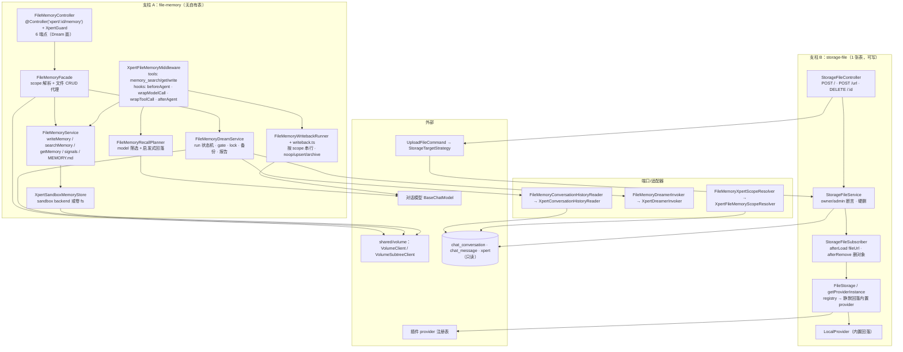

# 文件记忆与存储子专家 · 架构

> 只读梳理。引用均为仓库根相对路径（`file://` 形式）。**覆盖范围**：`packages/server-ai/src/file-memory/**`（**24 个非 spec 文件 / 8 个 spec**；目录内无自有实体，`TypeOrmModule.forFeature` 注册 **3 张只读表**）+ `packages/server/src/storage-file/**`（**21 / 1**；自有 1 张表 `storage_file`）。**不含** `file-understanding`（归属子专家①）。

**本文引用的文件**

- [file-memory/file-memory.module.ts](file://packages/server-ai/src/file-memory/file-memory.module.ts)
- [file-memory/file-memory.controller.ts](file://packages/server-ai/src/file-memory/file-memory.controller.ts)
- [file-memory/file-memory.facade.ts](file://packages/server-ai/src/file-memory/file-memory.facade.ts)
- [file-memory/file-memory.service.ts](file://packages/server-ai/src/file-memory/file-memory.service.ts)
- [file-memory/file-memory.middleware.ts](file://packages/server-ai/src/file-memory/file-memory.middleware.ts)
- [file-memory/file-memory.writeback.ts](file://packages/server-ai/src/file-memory/file-memory.writeback.ts)
- [file-memory/file-memory.writeback-runner.ts](file://packages/server-ai/src/file-memory/file-memory.writeback-runner.ts)
- [file-memory/dream.service.ts](file://packages/server-ai/src/file-memory/dream.service.ts)
- [file-memory/dream-prompt.ts](file://packages/server-ai/src/file-memory/dream-prompt.ts)
- [file-memory/recall-planner.ts](file://packages/server-ai/src/file-memory/recall-planner.ts)
- [file-memory/sandbox-memory.store.ts](file://packages/server-ai/src/file-memory/sandbox-memory.store.ts)
- [file-memory/paths.ts](file://packages/server-ai/src/file-memory/paths.ts)
- [file-memory/types.ts](file://packages/server-ai/src/file-memory/types.ts)
- [file-memory/ports.ts](file://packages/server-ai/src/file-memory/ports.ts)
- [file-memory/index-validator.ts](file://packages/server-ai/src/file-memory/index-validator.ts)
- [file-memory/frontmatter.ts](file://packages/server-ai/src/file-memory/frontmatter.ts)
- [file-memory/signals.ts](file://packages/server-ai/src/file-memory/signals.ts)
- [file-memory/usage.ts](file://packages/server-ai/src/file-memory/usage.ts)
- [file-memory/scoring.ts](file://packages/server-ai/src/file-memory/scoring.ts)
- [file-memory/taxonomy.ts](file://packages/server-ai/src/file-memory/taxonomy.ts)
- [file-memory/adapters/xpert-conversation-history-reader.ts](file://packages/server-ai/src/file-memory/adapters/xpert-conversation-history-reader.ts)
- [file-memory/adapters/xpert-dreamer-invoker.ts](file://packages/server-ai/src/file-memory/adapters/xpert-dreamer-invoker.ts)
- [file-memory/adapters/xpert-scope-resolver.ts](file://packages/server-ai/src/file-memory/adapters/xpert-scope-resolver.ts)
- [xpert/guards/xpert.guard.ts](file://packages/server-ai/src/xpert/guards/xpert.guard.ts)
- [xpert/xpert.controller.ts](file://packages/server-ai/src/xpert/xpert.controller.ts)
- [xpert/xpert.service.ts](file://packages/server-ai/src/xpert/xpert.service.ts)
- [storage-file/storage-file.module.ts](file://packages/server/src/storage-file/storage-file.module.ts)
- [storage-file/storage-file.controller.ts](file://packages/server/src/storage-file/storage-file.controller.ts)
- [storage-file/storage-file.service.ts](file://packages/server/src/storage-file/storage-file.service.ts)
- [storage-file/storage-file.entity.ts](file://packages/server/src/storage-file/storage-file.entity.ts)
- [storage-file/storage-file.subscriber.ts](file://packages/server/src/storage-file/storage-file.subscriber.ts)
- [file/file-storage/file-storage.ts](file://packages/server/src/file/file-storage/file-storage.ts)
- [file/file-storage/file-storage-registry.bridge.ts](file://packages/server/src/file/file-storage/file-storage-registry.bridge.ts)
- [file/file-storage/providers/local.provider.ts](file://packages/server/src/file/file-storage/providers/local.provider.ts)
- [file/file-upload/strategies/storage-target.strategy.ts](file://packages/server/src/file/file-upload/strategies/storage-target.strategy.ts)
- [shared/volume/volume.ts](file://packages/server-ai/src/shared/volume/volume.ts)
- [shared/volume/volume-subtree.ts](file://packages/server-ai/src/shared/volume/volume-subtree.ts)

## 目录

- [1. 职责与边界](#1-职责与边界)
- [2. 目录结构与分层](#2-目录结构与分层)
- [3. 依赖关系](#3-依赖关系)
- [4. 关键不变量](#4-关键不变量)
- [5. 架构总览](#5-架构总览)
- [6. 结论](#6-结论)

## 1. 职责与边界

本子域由两条**互不调用**的支柱组成，共同点是「都不处理文件内容理解」：

**支柱 A：文件记忆（`file-memory`）= 从文件/对话沉淀的可复用知识**。记忆的本体不是 DB 行，而是卷上的 markdown/JSON：`MEMORY.md` 导航索引 + `user|feedback|project|reference` 四类主题文件 + `.dream/**` 运行证据与信号。职责为：① 写入（显式 `memory_write`、隐式 writeback、离线 Dream 三种入口）；② 召回（索引 digest + `memory_search`/`memory_get` 工具 + 模型筛选）；③ 治理（`status: active|archived`、`usefulnessScore`、scorecard、冲突与索引校验）；④ 运行编排（Dream run 的 gate/lock/备份/证据/报告）。

**支柱 B：文件存储索引（`storage-file`）= 字节的落地与取用抽象**。职责为：① `storage_file` 行（key/url/size/mimetype/provider）的 CRUD 与 owner 鉴权；② 通过 `StorageTargetStrategy` 把上传落点统一到对象存储；③ 经 provider 抽象（`FileStorage` / `getProviderInstance`）提供 `url()` / `path()` / `putFile` / `deleteFile`；④ 加载时动态补 `fileUrl`、删除后清理物理对象（subscriber）。

**与子专家①的分工**：①负责「理解与分块」（解析、artifact/chunk、向量账本、file_asset 授权），②负责「记忆与字节」。本子域对 `file_asset`、`file_chunk`、向量集合**零代码依赖**——`file-memory` 目录全文检索 `embedding|vector|VStore|Knowledgebase|CopilotModel` **0 命中**；反过来 ① 若需要字节句柄，走 `GetOwnedStorageFileQuery` 取 `storage_file`（查询定义在 ① 侧），两侧共享的只是 `storage_file` 这一行数据，不共享解析结果。

**不做什么**：
- 不做文档解析/切块/向量（①）。
- 不做知识库摄取（知识库域自建向量链，本域只提供句柄）。
- `file-memory` 不落任何自有表：`file-memory.module.ts` 的 `imports` 为 `CqrsModule`、`TypeOrmModule.forFeature([ChatConversation, ChatMessage, Xpert])`、`XpertModule`、`XpertWorkspaceModule`，即注册的 3 张表全部**只读**。

章节来源：[file-memory/file-memory.module.ts](file://packages/server-ai/src/file-memory/file-memory.module.ts)（关键符号：FileMemoryModule.imports / TypeOrmModule.forFeature）、[file-memory/paths.ts](file://packages/server-ai/src/file-memory/paths.ts)（关键符号：getXpertFileMemoryWorkspacePath）、[storage-file/storage-file.subscriber.ts](file://packages/server/src/storage-file/storage-file.subscriber.ts)（关键符号：StorageFileSubscriber.afterLoad / afterRemove）

## 2. 目录结构与分层

**`packages/server-ai/src/file-memory/`（24 非 spec）**

- 入口层：`file-memory.module.ts`（装配 + 端口绑定 + exports）、`index.ts`（桶导出）、`file-memory.controller.ts`（`@UseGuards(XpertGuard)` + `@Controller('xpert/:id/memory')`，**6 端点，全部是 Dream 面**）。
- 门面层：`file-memory.facade.ts`（12 个方法；把 `xpertId` 解析成 `FileMemoryXpertScope` 后分流到 `FileMemoryService` / `FileMemoryDreamService`，并为记忆文件 CRUD 构造 `VolumeSubtreeClient`）。
- 记忆核心层：`file-memory.service.ts`（读/写/搜索/信号/索引/迁移 + 两级 mtime 缓存）、`frontmatter.ts`（frontmatter 解析渲染）、`paths.ts`（卷作用域与路径归一化）、`taxonomy.ts`（4 类型白名单与目录映射）、`types.ts`（全部对外类型与常量）、`usage.ts`（用量与有用度）、`signals.ts`（信号与查询 hash）、`scoring.ts`（Dream 候选打分分级）、`index-validator.ts`（`MEMORY.md` 索引校验）。
- 消费侧（Agent 中间件）：`file-memory.middleware.ts`（`@AgentMiddlewareStrategy(XPERT_FILE_MEMORY_MIDDLEWARE_NAME)`；提供 3 个工具 + 4 个钩子）、`recall-planner.ts`（模型筛选 + 启发式回落）、`file-memory.writeback.ts`（写入决策提示与 schema）、`file-memory.writeback-runner.ts`（按作用域串行的后台写入队列）。
- 运行编排层：`dream.service.ts`（Dream run 状态机 + gate + lock + 备份 + 证据 + 校验 + 报告）、`dream-prompt.ts`（阶段与系统提示）。
- 沙箱运行时层：`sandbox-memory.store.ts`（`XpertSandboxMemoryStore`，经 `resolveSandboxBackend` 把记忆读写映射到沙箱后端）。
- 端口/适配器层：`ports.ts`（3 个抽象类 + `createFileMemoryScopeKey`）与 `adapters/` 三个实现。

**`packages/server/src/storage-file/`（21 非 spec）**：`storage-file.module.ts`（`RouterModule.register([{ path: '/storage-file', module }])` + `TypeOrmModule.forFeature([StorageFile])`）、`storage-file.controller.ts`（`@Controller()` 空段，**3 端点**）、`storage-file.service.ts`（`extends TenantOrganizationAwareCrudService<StorageFile>`）、`storage-file.entity.ts`、`storage-file.subscriber.ts`、`commands/`（5 个文件 + 4 个 handler）、`queries/`（1 个 query + 1 handler）、`dto/storage-file-public.dto.ts`。

章节来源：[file-memory/file-memory.facade.ts](file://packages/server-ai/src/file-memory/file-memory.facade.ts)（关键符号：FileMemoryFacade 12 方法）、[file-memory/file-memory.middleware.ts](file://packages/server-ai/src/file-memory/file-memory.middleware.ts)（关键符号：XPERT_FILE_MEMORY_MIDDLEWARE_NAME / createMiddleware）、[storage-file/storage-file.module.ts](file://packages/server/src/storage-file/storage-file.module.ts)（关键符号：RouterModule.register / CommandHandlers / QueryHandlers）

## 3. 依赖关系

**出向（本子域 → 外部）**

- **卷（`shared/volume`）**：`VOLUME_CLIENT`（`Symbol`）注入；`VolumeClient.resolve(scope)` 得到 `VolumeHandle`（含 `serverRoot`），`VolumeSubtreeClient` 负责子树上/读/删/传并做边界校验（`{ allowRootWorkspace: true }`）。卷作用域由 `resolveXpertDataVolumeScope`（`xperts` / `user-xperts` 两个 catalog）或项目 catalog 决定。
- **沙箱后端（`plugin-sdk`）**：`resolveSandboxBackend(sandbox)` → `SandboxBackendProtocol`（`globInfo` / `downloadFiles` / `uploadFiles` / `lsInfo` / `execute`）。
- **模型（对话模型，非嵌入模型）**：`createRecallModel` / `createWritebackModel` 取 `BaseChatModel`，用 `withStructuredOutput` 做两大判定（召回筛选、写入决策）；Dream 经 `XpertAgentChatCommand` 调另一个 Xpert 的 agent。**记忆不做 embedding**：目录内无向量/嵌入依赖。
- **DB（只读）**：`ChatConversation` / `ChatMessage` / `Xpert` 三个 Repository（取证、作用域、dreamer 解析）。
- **对象存储 SDK + 注册表（`storage-file` 侧）**：`FileStorage` 经 `FileStorageRegistryBridge.getRegistry()` 取 `FileStorageProviderRegistry`；内置回落 provider 为 `LocalProvider`（`FALLBACK_PROVIDER_TYPES = [LocalProvider]`）；provider 名解析链为「请求 `tenantSettings['fileStorageProvider']` → `environment.fileSystem.name` → `LOCAL`」。
- **上传管线（同一 package）**：controller → `UploadFileCommand`（`targets: [{ kind:'storage', directory:'files', prefix:'files' }]`）→ `StorageTargetStrategy.upload` → `StorageFileService.createStorageFile`。
- 运行期配置：`environment.baseUrl` / `environment.fileSystem.name`、`@xpert-ai/server-config`。

**入向（外部 → 本子域）**

- Agent 运行时按名加载 `XpertFileMemoryMiddleware`（`@AgentMiddlewareStrategy`），因此 `file-memory` 的**主要消费面是 Agent 中间件钩子**，而非 HTTP。
- `xpert.controller.ts` 暴露 5 个记忆文件端点（`GET/PUT :id/memory/file`、`POST :id/memory/file/upload`、`GET :id/memory/files`、`DELETE` 侧 `deleteMemoryFile`），且**所有相关路由都挂 `@UseGuards(XpertGuard)`**；它们直接调用 `XpertService` 中同形的 5 个方法（与 `FileMemoryFacade` 重复实现，各自 new 一个 `VolumeSubtreeClient`）。
- `storage-file` 的行被 ① 侧 `GetOwnedStorageFileQuery`、`ParseFileAssetHandler`（`provider.path(file)`）等消费；`StorageFilePublicDTO` 是唯一对外投影（`@Exclude()` + 4 个 `@Expose()`）。

章节来源：[file-memory/file-memory.middleware.ts](file://packages/server-ai/src/file-memory/file-memory.middleware.ts)（关键符号：createRecallModel / createWritebackModel / @AgentMiddlewareStrategy）、[file-memory/dream.service.ts](file://packages/server-ai/src/file-memory/dream.service.ts)（关键符号：runDreamer / FileMemoryDreamerInvoker）、[shared/volume/volume.ts](file://packages/server-ai/src/shared/volume/volume.ts)（关键符号：VOLUME_CLIENT / resolveXpertDataVolumeScope / VolumeHandle）、[storage-file/storage-file.service.ts](file://packages/server/src/storage-file/storage-file.service.ts)（关键符号：createStorageFile / normalizeStorageProvider）

## 4. 关键不变量

1. **记忆写入门槛**：写入只有三个来源——显式工具 `memory_write`（frontmatter `source:'explicit'`）、轮次结束的 writeback（先 `recordWritebackCandidate` 再让模型在 `noop|upsert|archive` 中裁决，`source:'writeback'`）、Dream（dreamer 直接改文件）。系统提示与工具描述都明写「不要保存临时闲聊、猜测或原始转录」；writeback 的 upsert 缺少 `type/title/summary/content` 任一项即回落 `noop`（`reason: 'Incomplete upsert payload.'`）。
2. **记忆去重/覆盖语义以「memoryId → 文件」为主键**：`writeMemory` 若带 `memoryId` 且能 `findTopicRecordByMemoryId` 命中，则复用原 `relativePath` 与 `createdAt`，只更新内容与 `updatedAt`；否则分配新路径 `<slug>-<memoryId 前 8 位>.md`（`allocateTopicPath`）。`writeback` 走的是「先 `searchMemory(limit 6)` 拿候选、再让模型决定复用哪个 `memoryId`」的软去重——**无 DB 唯一约束兜底**，并发写同一 scope 靠 `FileMemoryWritebackRunner` 的 slot 串行与 `FileMemoryDreamService` 的 lock 抑制。
3. **记忆读取授权 = `XpertGuard` + 归属校验**：6 个 Dream 端点由类级 `@UseGuards(XpertGuard)` 保护；guard 逻辑为「`xpert.createdById === user.id` 或 `workspaceService.canAccess(xpert.workspaceId, user.id)`」，否则 403 `Access denied`，并带 5 分钟缓存键 `userXperts:<tenantId>:<userId>_<xpertId>`。**注意**：该 guard 只判 Xpert 归属，不判记忆文件路径级权限——路径越界防护由 `normalizeFileMemoryRelativePath` + `VolumeSubtreeClient` 边界承担（见不变量 4）。
4. **卷/路径约束与越界防护（四层）**：① `normalizeFileMemoryRelativePath` 归一化 `\`→`/`、剥前导 `/`，空串或 `.` 返回 `''`，**`..` 前缀或绝对路径直接抛 `Invalid file memory path`**；② 单段名校验（`getLegacyXpertFileMemoryWorkspacePath` 对含 `/` 的 `xpertId` 抛 `Invalid xpert file memory scope`）；③ `FileMemoryService.resolveAbsolutePath` 要求路径首段属于 4 类目录、或为 `MEMORY.md`、或位于 `.dream/` 下，否则抛 `Invalid file memory path`；④ 卷侧 `listVolumeFiles(..., { boundaryRoot: this.volume.serverRoot })` 与 `VolumeSubtreeClient({ allowRootWorkspace: true })`。
5. **存储抽象的 provider 选择与回落语义**：provider 名在**写行时固化**（`normalizeStorageProvider` 统一大写），读取时按**行上的 provider** 解析；`FileStorage.getProviderInstance()` 先查插件注册表，失败静默回落内置 provider，注释逐字为：`// Fall back to built-in providers so bootstrap/tests without Nest context keep working.`。
6. **软删与回收是两套语义**：记忆侧无软删，`archiveMemory` 只改 `status: 'archived'`（并从 `MEMORY.md` 索引中移除），文件仍在卷上；`storage_file` 侧有 `deletedAt` 列但**删除路径全部走 `repository.remove`（硬删）**，行删掉后由 `StorageFileSubscriber.afterRemove` 再删 `file`/`thumb` 物理对象（`afterRemove` 读的是 `event.entity`，故 service 注释说明「为了正确触发 StorageFileSubscriber 的 afterRemove 事件参数中的 entity」必须先 `findOne`）。
7. **3 张表只读 / 1 张表可写**：`file-memory` 对 `ChatConversation`（`find` + `select`）、`ChatMessage`（`createQueryBuilder` 只读查询）、`Xpert`（`findOne`）零写入；`storage_file` 由 `StorageFileService`（`create` / `update` / `remove`）写入，`deletedAt` 列无写入点。

章节来源：[file-memory/file-memory.service.ts](file://packages/server-ai/src/file-memory/file-memory.service.ts)（关键符号：writeMemory / allocateTopicPath / archiveMemory / resolveAbsolutePath）、[file-memory/file-memory.writeback.ts](file://packages/server-ai/src/file-memory/file-memory.writeback.ts)（关键符号：decideFileMemoryWriteback / normalizeDecision）、[xpert/guards/xpert.guard.ts](file://packages/server-ai/src/xpert/guards/xpert.guard.ts)（关键符号：XpertGuard.canActivate / cacheKey）、[file/file-storage/file-storage.ts](file://packages/server/src/file/file-storage/file-storage.ts)（关键符号：getProviderInstance / FALLBACK_PROVIDER_TYPES / normalizeConfiguredProvider）

## 5. 架构总览

图表来源：[file-memory/file-memory.controller.ts](file://packages/server-ai/src/file-memory/file-memory.controller.ts)（关键符号：FileMemoryController 6 端点 / @UseGuards(XpertGuard)）、[file-memory/file-memory.middleware.ts](file://packages/server-ai/src/file-memory/file-memory.middleware.ts)（关键符号：createMiddleware / tools / beforeAgent / wrapModelCall / wrapToolCall / afterAgent）、[file-memory/dream.service.ts](file://packages/server-ai/src/file-memory/dream.service.ts)（关键符号：triggerDream / runDream / acquireLock）、[storage-file/storage-file.controller.ts](file://packages/server/src/storage-file/storage-file.controller.ts)（关键符号：create / createUrl / delete）、[file/file-storage/file-storage.ts](file://packages/server/src/file/file-storage/file-storage.ts)（关键符号：getProviderInstance）

## 6. 结论

本子域架构主线是「**两条同包不同介质的支柱**」：支柱 A 把「记忆」完全外置到卷上（`.xpert/memory/**`，项目共享卷下为 `.xpert/memory/xperts/<xpertId>`），DB 只承担取证（会话/消息）与作用域（Xpert 策略）三张**只读表**；支柱 B 把「字节」收敛成 `storage_file` 一行 + provider 抽象，删除时以硬删 + subscriber 删物理对象收尾。

主要张力有三处：① **记忆的可审计性靠文件而非事务**——`usefulnessScore` 由 signals jsonl 重新计算（`calculateUsageFromSignals` 全量重建而非增量），意味着信号文件成为事实源，写入与召回都在无事务的 fs 层完成；② **判定依赖 LLM 但必须有启发式兜底**——召回筛选 `strategy: 'model'|'fallback'|'disabled'` 明确暴露降级路径（默认 1500ms 超时、候选短名单 20、`fallbackOnFailure: false` 时直接返回空）；③ **provider 回落是静默的**——`getProviderInstance` 的 catch 空实现让「插件 registry 未就绪」与「provider 真不存在」不可区分，排障时不能据返回值判断真实后端。

此外，记忆文件的 HTTP 文件面存在**双实现**：`FileMemoryFacade` 与 `XpertService` 各自维护一份 `getMemoryFiles/getMemoryFile/saveMemoryFile/uploadMemoryFile/deleteMemoryFile`（后者硬编码 `'.xpert/memory'`，不随项目卷切换），仓库内 controller 只接后者——这是本子域最明显的结构债，`[推测]` 与历史迁移（legacy root 拷贝）有关。

章节来源：[file-memory/file-memory.service.ts](file://packages/server-ai/src/file-memory/file-memory.service.ts)（关键符号：calculateUsageFromSignals / readSignals / migrateLegacyMemoryRoot）、[file-memory/recall-planner.ts](file://packages/server-ai/src/file-memory/recall-planner.ts)（关键符号：selectRecallHeaders.strategy）、[xpert/xpert.service.ts](file://packages/server-ai/src/xpert/xpert.service.ts)（关键符号：XPERT_MEMORY_WORKSPACE_PATH / createWorkspaceVolumeClient）、[file/file-storage/file-storage.ts](file://packages/server/src/file/file-storage/file-storage.ts)（关键符号：getProviderInstance 回落注释）
