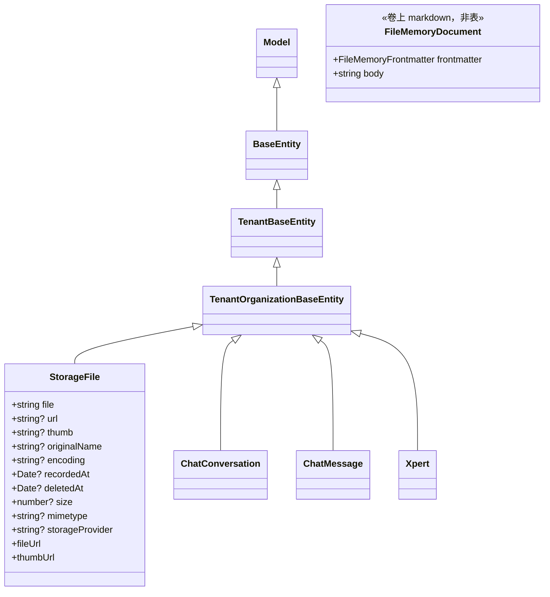

# 文件记忆与存储子专家 · 数据模型

> 只读梳理。本子域共 **4 张表**：`file-memory` 侧 **3 张只读表**（`chat_conversation`、`chat_message`、`xpert`，来自 `TypeOrmModule.forFeature([ChatConversation, ChatMessage, Xpert])`）+ `storage-file` 侧 **1 张可写表**（`storage_file`）。记忆本体**不落库**（卷上 markdown/JSON）。引用为仓库根相对路径（`file://`）；未能证实处标「未确认」。

**本文引用的文件**

- [file-memory/file-memory.module.ts](file://packages/server-ai/src/file-memory/file-memory.module.ts)
- [file-memory/file-memory.service.ts](file://packages/server-ai/src/file-memory/file-memory.service.ts)
- [file-memory/types.ts](file://packages/server-ai/src/file-memory/types.ts)
- [file-memory/paths.ts](file://packages/server-ai/src/file-memory/paths.ts)
- [file-memory/index-validator.ts](file://packages/server-ai/src/file-memory/index-validator.ts)
- [file-memory/frontmatter.ts](file://packages/server-ai/src/file-memory/frontmatter.ts)
- [file-memory/signals.ts](file://packages/server-ai/src/file-memory/signals.ts)
- [file-memory/usage.ts](file://packages/server-ai/src/file-memory/usage.ts)
- [file-memory/adapters/xpert-conversation-history-reader.ts](file://packages/server-ai/src/file-memory/adapters/xpert-conversation-history-reader.ts)
- [file-memory/adapters/xpert-dreamer-invoker.ts](file://packages/server-ai/src/file-memory/adapters/xpert-dreamer-invoker.ts)
- [file-memory/adapters/xpert-scope-resolver.ts](file://packages/server-ai/src/file-memory/adapters/xpert-scope-resolver.ts)
- [file-memory/ports.ts](file://packages/server-ai/src/file-memory/ports.ts)
- [chat-conversation/conversation.entity.ts](file://packages/server-ai/src/chat-conversation/conversation.entity.ts)
- [chat-message/chat-message.entity.ts](file://packages/server-ai/src/chat-message/chat-message.entity.ts)
- [xpert/xpert.entity.ts](file://packages/server-ai/src/xpert/xpert.entity.ts)
- [storage-file/storage-file.entity.ts](file://packages/server/src/storage-file/storage-file.entity.ts)
- [storage-file/storage-file.service.ts](file://packages/server/src/storage-file/storage-file.service.ts)
- [storage-file/storage-file.subscriber.ts](file://packages/server/src/storage-file/storage-file.subscriber.ts)
- [storage-file/storage-file.controller.ts](file://packages/server/src/storage-file/storage-file.controller.ts)
- [storage-file/dto/storage-file-public.dto.ts](file://packages/server/src/storage-file/dto/storage-file-public.dto.ts)
- [core/entities/tenant-organization-base.entity.ts](file://packages/server/src/core/entities/tenant-organization-base.entity.ts)
- [core/entities/base.entity.ts（server）](file://packages/server/src/core/entities/base.entity.ts)

## 目录

- [1. 模型总览与继承分层](#1-模型总览与继承分层)
- [2. 记忆侧只读表（3 张）](#2-记忆侧只读表3-张)
- [3. 存储索引表（1 张，可写）](#3-存储索引表1-张可写)
- [4. 建模边界](#4-建模边界)
- [5. 校验规则](#5-校验规则)
- [6. 未确认项](#6-未确认项)
- [7. 结论](#7-结论)

## 1. 模型总览与继承分层

图表来源：[storage-file/storage-file.entity.ts](file://packages/server/src/storage-file/storage-file.entity.ts)（关键符号：StorageFile / @Entity('storage_file')）、[core/entities/tenant-organization-base.entity.ts](file://packages/server/src/core/entities/tenant-organization-base.entity.ts)（关键符号：TenantOrganizationBaseEntity）、[file-memory/types.ts](file://packages/server-ai/src/file-memory/types.ts)（关键符号：FileMemoryDocument / FileMemoryFrontmatter）

- **4 张表中只有 1 张属于本子域的自有实体**（`StorageFile`，`@Entity('storage_file')`）；其余 3 张的实体定义在别的域（chat-conversation / chat-message / xpert），本子域只注册 Repository 做**只读**消费。
- 4 张表**全部** `extends TenantOrganizationBaseEntity` → 租户/组织隔离列（`tenantId` / `organizationId` 索引与 `tenant`/`organization` 外键）来自基类，实体文件内不重复声明。
- `BaseEntity` 提供 `id`（uuid 主键）、`createdById`/`createdBy`、`updatedById`/`updatedBy`、`createdAt`/`updatedAt`——本子域唯一的鉴权断言就落在 `createdById` 上。
- 本子域自有实体**无 `@ManyToOne` 关系声明**：`storage-file.entity.ts` 末尾只留下 `@ManyToOne` 的分节注释，`file`（key）与所属实体之间**没有数据库级外键**，也就没有 DB 级联删除。

章节来源：[storage-file/storage-file.entity.ts](file://packages/server/src/storage-file/storage-file.entity.ts)（关键符号：StorageFile.@Entity / file / storageProvider / fileUrl）、[core/entities/base.entity.ts（server）](file://packages/server/src/core/entities/base.entity.ts)（关键符号：BaseEntity.createdById）

## 2. 记忆侧只读表（3 张）

| 表 / 实体 | 关键列（含索引、外键） | 生产方 | 本子域消费点 | 用途一句话 |
|---|---|---|---|---|
| `chat_conversation` / `ChatConversation` | `threadId`、`title`、`status`、`purpose`、`revision`、`lastMessageSequence`、`xpertId`、`projectId`、`taskId`；`xpert`/`project` FK `onDelete: 'CASCADE'`、`task` FK `onDelete: 'SET NULL'` | 跨域（chat-conversation） | `XpertConversationHistoryReader.readSnippets`：`find({ where: [...], select: ['id','threadId','title','xpertId','tenantId'] })`，并用 `createdById`（user 隔离）或 `projectId`（项目）做过滤 | 记忆取证的**会话容器**与作用域边界 |
| `chat_message` / `ChatMessage` | `conversationId`、`createdInThreadId`、`sequence`、`groupPublicationId`、`parentId`、`content`、`role`、`executionId`、`inputCheckpoint`/`outputCheckpoint`；`@Tree('closure-table')`；索引 `@Index(['conversationId'])`、`@Index(['createdInThreadId'])`，**唯一** `['conversationId','sequence']`、**唯一** `['conversationId','groupPublicationId']` | 跨域（chat-message） | `createQueryBuilder('message')`：`conversationId IN (…)` + `tenantId = …`，`orderBy createdAt DESC` + `take(maxMessages)`，再 `reverse()`，每条截断 2000 字并按 `maxBytes` 总体裁剪 | 记忆取证的**消息流**（Dream 的证据素材） |
| `xpert` / `Xpert` | `slug`、`name`、`type`、`title`、`workspaceDataScope`（`shared\|user`，`update: false`）、`active`、`options`/`agentConfig`/`avatar`/`starters`(json)；唯一索引 `['tenantId','organizationId','type','slug','version','latest']` | 跨域（xpert） | `XpertFileMemoryScopeResolver.resolve`（取 `tenantId` + `workspaceDataScope`，无 `tenantId` 抛错）；`XpertDreamerInvoker.run`（`findOne({ where: { id, tenantId }, relations: ['agent'] })`） | 记忆**作用域与卷语义**的来源（个人卷 / 项目共享卷）+ dreamer 助手解析 |

**读写面核实（关键）**：
- 三张表的写操作在本子域**为 0**：目录内检索 `Repository` 使用点只有两处 `find`/`findOne` 与一处 `createQueryBuilder`（全部读）；`file-memory.module.ts` 只做 `TypeOrmModule.forFeature` 注册，没有 `save/update/delete/insert` 调用。父级 C2 称「3 张只读表」与代码一致。
- **读路径的过滤是硬约束而非可选**：user 隔离且 `projectId` 为空时，`readSnippets` 若拿不到 `userId` 会**直接返回空数组**（fail closed）；项目模式下即使 Xpert 是 user 隔离，也改用 `projectId` 过滤（`createdById` 不再参与）。
- `select` 白名单确保不把 `chat_message.content` 之外的大列（checkpoint jsonb）带回内存；`Xpert` 的查询带 `relations: ['agent']`（跨域关系，本子域只读使用）。

章节来源：[file-memory/adapters/xpert-conversation-history-reader.ts](file://packages/server-ai/src/file-memory/adapters/xpert-conversation-history-reader.ts)（关键符号：readSnippets / select / createQueryBuilder / truncateText）、[file-memory/adapters/xpert-dreamer-invoker.ts](file://packages/server-ai/src/file-memory/adapters/xpert-dreamer-invoker.ts)（关键符号：xpertRepository.findOne relations: ['agent']）、[file-memory/adapters/xpert-scope-resolver.ts](file://packages/server-ai/src/file-memory/adapters/xpert-scope-resolver.ts)（关键符号：XpertFileMemoryScopeResolver.resolve）、[file-memory/file-memory.module.ts](file://packages/server-ai/src/file-memory/file-memory.module.ts)（关键符号：TypeOrmModule.forFeature）

## 3. 存储索引表（1 张，可写）

| 表 / 实体 | 关键列（含唯一索引、外键、`select:false`） | 生产方 | 主要消费方 | 用途一句话 |
|---|---|---|---|---|
| `storage_file` / `StorageFile`（`implements IStorageFile`） | `file`（`@Column()` 非空，对象存储 key）、`url`（可空）、`thumb`（可空）、`originalName`（可空）、`encoding`（可空）、`recordedAt`（timestamptz 可空，**校验用 `@IsNumber`**）、`deletedAt`（timestamptz 可空，**无写入点**）、`size`（默认 0）、`mimetype`（可空）、`storageProvider`（varchar 可空，`@Exclude({ toPlainOnly: true })`）；非持久字段 `fileUrl` / `thumbUrl`；**无自定义索引**（只有基类的 `tenantId`/`organizationId` 索引与 FK），**无 `select: false` 列** | `StorageFileService.createStorageFile`（经 `StorageTargetStrategy.upload`，或 `StorageFileCreateHandler`）、`StorageFileService.create`（`POST /api/storage-file/url`） | `StorageFileSubscriber`（`afterLoad` 补 `fileUrl`、`afterRemove` 删物理对象）、`GetStorageFileHandler`（按 `In(ids)` 批量查）、① 侧 `GetOwnedStorageFileQuery` 与 `ParseFileAssetHandler`（`provider.path(file)` 取字节）、`StorageFilePublicDTO`（对外投影 id/url/originalName/mimetype） | 对象存储**索引行**：把字节 key 映射为可访问 URL，并作为跨域字节句柄 |

- **`@Exclude` ≠ `select: false`**：`storageProvider` 只在**序列化**时被排除（`toPlainOnly`），DB 查询仍会带回；因此「列级隐藏」在本子域**不存在**，`select: false` 全域 0 命中。
- **鉴权字段依赖基类**：删除断言读 `entity.createdById` 与 `RequestContext.hasRoles([SUPER_ADMIN, ADMIN])`；`organizationId` 参与 `deleteAuthorizedStorageFile` 的一致性比对（空值归一到 `null`）。
- **唯一索引**：本子域 4 张表中唯一的唯一约束都来自**跨域表自带**（`chat_message(conversationId, sequence)`、`chat_message(conversationId, groupPublicationId)`、`xpert(tenantId, organizationId, type, slug, version, latest)`）；`storage_file` **无任何唯一约束**，重复上传同一文件会产生多行。
- **物理删除与行的关系**：`repository.remove(entity)` 硬删行 → `StorageFileSubscriber.afterRemove` 用**行上的** `storageProvider` 解析实例后删 `file` 与 `thumb`；删除失败只在 subscriber 内 `console.log`，行已消失 → **可能产生孤儿对象**。

章节来源：[storage-file/storage-file.entity.ts](file://packages/server/src/storage-file/storage-file.entity.ts)（关键符号：StorageFile.file / recordedAt / deletedAt / storageProvider @Exclude）、[storage-file/storage-file.service.ts](file://packages/server/src/storage-file/storage-file.service.ts)（关键符号：createStorageFile / deleteStorageFile / deleteAuthorizedStorageFile）、[storage-file/storage-file.subscriber.ts](file://packages/server/src/storage-file/storage-file.subscriber.ts)（关键符号：afterLoad / afterRemove）、[storage-file/dto/storage-file-public.dto.ts](file://packages/server/src/storage-file/dto/storage-file-public.dto.ts)（关键符号：StorageFilePublicDTO）

## 4. 建模边界

- **记忆（无表）⇄ 文件资产（① 的 `file_asset`）⇄ 存储对象（`storage_file`）**：三者的分界线是「知识 / 句柄 / 字节」。记忆是**跨会话可复用的知识**，载体是 `.xpert/memory/**`（frontmatter 承载 `id`/`type`/`status`/`usage`/`source`），既不做授权行列也不做引用计数；`file_asset` 是**平台级文件句柄**（解析状态、能力、上下文链接），归①；`storage_file` 是**字节索引行**（key/url/size/mimetype/provider），只回答「字节在哪、怎么访问」。
- **`storage_file` 的行就是 provider 的绑定证书**：`storageProvider` 在落库瞬间固化（统一大写），读取侧永远按行解析，因此**同一租户的文件可以分属不同后端**；「改租户默认 provider」只影响新行。
- **记忆的「类型」是目录而不是列**：`FILE_MEMORY_TYPES = ['user','feedback','project','reference']` 同时是 frontmatter 字段与目录名（`directoryForFileMemoryType` 直返 `type`），因此新增类型会同时改变路径布局与索引分区——这是记忆域**唯一的结构化枚举**。
- **记忆的「状态」是三元而非删除**：`active | archived | conflict`；`conflict` 会被 `refreshManagedIndex` 标注为 ` [conflict]`，`archived` 从索引中消失但文件保留；本子域**没有记忆删除操作**，回收只能靠卷级/文件面板操作。
- **用量是派生数据而非事实**：`usage` 写在 frontmatter 里，但权威来源是 `.dream/signals/*.jsonl`；`updateTopicUsage` 在有信号时用 `calculateUsageFromSignals` **全量重算**覆盖 frontmatter——即 frontmatter 的 `usage` 是可重建缓存。
- **存储与记忆不共享任何表或外键**：两条支柱在数据模型上完全解耦，`storage_file` 不记录任何记忆 id，记忆文件也不记录 storage key。

章节来源：[file-memory/types.ts](file://packages/server-ai/src/file-memory/types.ts)（关键符号：FILE_MEMORY_TYPES / FILE_MEMORY_STATUSES / FileMemoryFrontmatter.usage）、[file-memory/taxonomy.ts](file://packages/server-ai/src/file-memory/taxonomy.ts)（关键符号：directoryForFileMemoryType / describeFileMemoryType）、[file-memory/file-memory.service.ts](file://packages/server-ai/src/file-memory/file-memory.service.ts)（关键符号：writeScorecardIndex / updateTopicUsage / refreshManagedIndex）

## 5. 校验规则

- **DB 层**：`storage_file` 的校验装饰器密度最高——`@IsString`（`file`/`url`/`thumb`/`originalName`/`encoding`/`mimetype`/`storageProvider`）、`@IsNumber`（`recordedAt`/`size`）、`@IsDateString`（`deletedAt`）、`@IsOptional`；**注意 `recordedAt` 是 timestamptz 列却用 `@IsNumber`**（类型声明亦为 `Date`），属易踩点。`file` 列非空但**无长度约束**。
- **应用层（存储）**：`normalizeStorageProvider` 统一大写；`createStorageFile` 的 provider 决策链 = 入参 → `new FileStorage().getProvider()?.name` → `LOCAL`；`deleteStorageFile` 的断言 = 「有 currentUserId 且（是创建者或持有 SUPER_ADMIN/ADMIN）」，任何异常统一 403。
- **应用层（记忆路径）**：`normalizeFileMemoryRelativePath`（反斜杠归一、剥前导 `/`、拒绝 `..` 与绝对路径、空路径归一为 `''`）；`normalizeTopicFileName`（取 basename、拒绝 `.`/`..`、自动补 `.md`）；`getLegacyXpertFileMemoryWorkspacePath`（`xpertId` 含 `/` 即抛）；`FileMemoryService.resolveAbsolutePath`（首段必须是 4 类目录之一、或 `MEMORY.md`、或以 `.dream/` 开头）。
- **应用层（记忆索引）**：`validateFileMemoryIndex` 六类问题——`overlong-entry`（单行 > 220 字符）、`body-like-entry`（形如 `## why/how/原因/背景/步骤/内容/证据/更新历史` 的行）、`invalid-target`（非 markdown 相对路径、或未指向 4 类目录）、`duplicate-target`、`missing-target`、`archived-target`；`ok = issues.length === 0`。
- **应用层（记忆内容/用量）**：`writeMemory` 对 `title`/`summary`/`content` 一律 `trim()`；`confidence` 新建默认 0.9；`usage` 计数经 `normalizeCount`（非有限正数归 0）与 `roundScore`（`[0,1]` 四位小数）夹取；`usefulnessScore = 0.3·log(recall,20) + 0.24·log(detailRead,10) + 0.18·recurrence + 0.14·recency(半衰期30天) + 0.1·sourceQuality − 0.12·min(1, corrections/5)`。
- **应用层（信号/预算）**：`parseFileMemorySignal` 校验 `type ∈ FILE_MEMORY_SIGNAL_WEIGHTS`（6 类权重：`explicit_write 1` / `user_correction 0.95` / `detail_read 0.7` / `writeback_candidate 0.55` / `recall_hit 0.35` / `index_issue 0.3`）；`hashFileMemoryQuery` = sha256 前 16 位；消息截断 2000 字/条、召回单轮 20KB、单会话 60KB、writeback 18 条/12k 字符、Dream 证据 500 信号 / 20 会话 / 500 消息 / 200KB。
- **枚举落库形态**：本子域**没有任何 DB 级 CHECK/枚举**——`type`/`status`/`source`/provider 名全部是字符串（provider 为 varchar），白名单校验只在 TS 层（`isFileMemoryType` / `assertFileMemoryType` / `isFileMemorySignalType`）。

章节来源：[storage-file/storage-file.entity.ts](file://packages/server/src/storage-file/storage-file.entity.ts)（关键符号：@IsString/@IsNumber/@IsDateString/recordedAt）、[file-memory/index-validator.ts](file://packages/server-ai/src/file-memory/index-validator.ts)（关键符号：validateFileMemoryIndex / MAX_INDEX_LINE_LENGTH / BODY_LIKE_LINE_PATTERN）、[file-memory/paths.ts](file://packages/server-ai/src/file-memory/paths.ts)（关键符号：normalizeFileMemoryRelativePath / normalizeTopicFileName）、[file-memory/usage.ts](file://packages/server-ai/src/file-memory/usage.ts)（关键符号：calculateFileMemoryUsefulnessScore）、[file-memory/signals.ts](file://packages/server-ai/src/file-memory/signals.ts)（关键符号：FILE_MEMORY_SIGNAL_WEIGHTS / hashFileMemoryQuery）

## 6. 未确认项

1. **记忆容量配额**：未见条目数/总字节/信号文件保留期的强制上限；`MAX_SIGNAL_COUNT=500` 只用于 Dream 证据采样 → 是否存在外部配额**未确认**。
2. **`storage_file.deletedAt` 语义**：列存在但删除全为硬删，是否为预留软删/归档位**未确认**。
3. **`storage_file` 的索引策略**：实体无自定义 `@Index`，`GetOwnedStorageFileQuery` 按 id 查、`In(ids)` 批量查是否需要额外索引**未确认**（DDL 在仓库外）。
4. **非 LOCAL provider 的 `path()` 契约**：仓库内只有 `LocalProvider`；远端 provider 的 `path()` 是否返回绝对路径**未确认**（影响派生目录/物理文件清理）。
5. **`file`（key）的长度/字符约束**：列无 `length`，是否在上传策略侧限制**未确认**。
6. **记忆 `type` 扩展的兼容性**：`taxonomy.ts` 的 4 类白名单与目录一一对应，若新增类型，历史 `MEMORY.md` 与 signals 的迁移策略**未确认**。
7. **`conflict` 状态的写入点**：`FILE_MEMORY_STATUSES` 含 `conflict` 且索引会标注，但检索到的写入路径只有 Dream 的 `status.json`/报告与 `archiveMemory`；`conflict` 由谁写入 frontmatter **未确认**。
8. **`scopeType`/`scopeId` 的用途**：frontmatter 固定写 `scopeType: 'xpert'` 与 `scopeId: xpert.id`，是否有跨 scope 读取逻辑**未确认**。
9. **`storage_file` 与记忆/资产的级联**：行被删后引用它的跨域数据（如 `file_asset`）如何处理**不在本子域**，本子域无外键可依赖。
10. **`recordedAt` 与 `createdAt` 的关系**：两者都由写入侧设置，是否语义重复**未确认**。

章节来源：[file-memory/types.ts](file://packages/server-ai/src/file-memory/types.ts)（关键符号：FILE_MEMORY_STATUSES / FileMemoryFrontmatter.scopeType）、[file-memory/dream.service.ts](file://packages/server-ai/src/file-memory/dream.service.ts)（关键符号：MAX_SIGNAL_COUNT / DEFAULT_DREAM_GATE_CONFIG）、[storage-file/storage-file.entity.ts](file://packages/server/src/storage-file/storage-file.entity.ts)（关键符号：deletedAt / recordedAt / 无自定义 @Index）

## 7. 结论

本子域的数据模型是「**1 张自有表 + 3 张借来的只读表 + 一整棵卷上文件树**」。唯一可写表 `storage_file` 的设计极简（key/url/size/mimetype/provider + 隐式删），把复杂度推给 provider 抽象与 subscriber；记忆则完全不落库，用 frontmatter 承载元数据、用 signals jsonl 承载事实、用 `MEMORY.md` 承载导航，因此**没有外键、没有唯一约束、没有事务**这三样常见护栏。

这带来两个直接后果：① 一致性只能靠应用层（先删后写、作用域串行、Dream 锁）与文件写入的原子性；② 模型变更的「迁移」是文件迁移（`migrateLegacyMemoryRoot`）而非 schema 迁移。也正因如此，跨域的 3 张只读表承担了本子域全部「不可自证的边界」——会话归属、消息作用域、Xpert 卷策略都只能从这三张表读，而不能由记忆域自建。

章节来源：[storage-file/storage-file.entity.ts](file://packages/server/src/storage-file/storage-file.entity.ts)（关键符号：StorageFile）、[file-memory/file-memory.service.ts](file://packages/server-ai/src/file-memory/file-memory.service.ts)（关键符号：migrateLegacyMemoryRoot / writeScorecardIndex）、[file-memory/file-memory.module.ts](file://packages/server-ai/src/file-memory/file-memory.module.ts)（关键符号：TypeOrmModule.forFeature([ChatConversation, ChatMessage, Xpert])）
