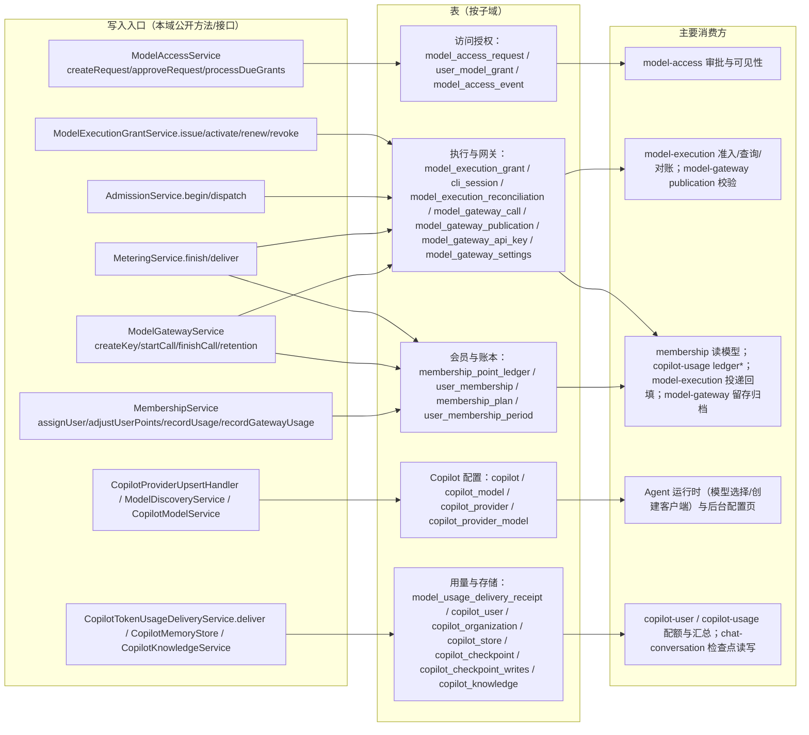

# C4 数据流向与消费（模型访问与计费专家）

> 按子域列出本域数据实体：实体类型 / 结构（表名 + 关键列）/ 生产方（公开方法或接口）/ 主要消费方（模块级，来自 [tables.md](file://.fe-index/xpert-server/tables.md) 反查，未逐一进入消费方代码验证）/ 业务用途。**只记录用途与写入方，不展开消费方处理逻辑**；详细流向见本文件各子域小节。
>
> 命名后缀「外部域」表示实体定义与写入方不在本域目录内，本域仅引用。

## 总览

图表来源：[model-access.service.ts](file://packages/server-ai/src/model-access/model-access.service.ts)、[execution-grant.service.ts](file://packages/server-ai/src/model-execution/execution-grant.service.ts)、[execution-admission.service.ts](file://packages/server-ai/src/model-execution/execution-admission.service.ts)、[execution-metering.service.ts](file://packages/server-ai/src/model-execution/execution-metering.service.ts)、[model-gateway.service.ts](file://packages/server-ai/src/model-gateway/model-gateway.service.ts)、[membership.service.ts](file://packages/server-ai/src/membership/membership.service.ts)

## 一、访问授权子域

| 实体 | 类型 | 结构（表 + 关键列） | 生产方 | 主要消费方 | 业务用途 | 详细流向 |
| --- | --- | --- | --- | --- | --- | --- |
| `model_access_request` | 业务事务表（`ModelAccessRequest`） | `channel`、`requesterId`、`copilotId`、`copilotModelId`、`modelType`、`status`、`reason`、`decidedById/At`、`modelSnapshot` | `ModelAccessService.createRequest` / `withdrawRequest` / `rejectRequest` / `approveRequest` / `closeRequestForSystem` | `model-access`（16 次引用）`[基于引用扫描，未深入验证]` | 个人模型访问申请的单一真源 | 本文件 §一 |
| `user_model_grant` | 授权台账表（`UserModelGrant`） | `userId`、`requestId`、`copilotId`、`copilotModelId`、`status`、`validUntil`、`approvedAt`、`revokedAt/Reason`、`modelSnapshot` | `approveRequest` 写入；`extendGrant` / `revokeGrant` / `processDueGrants` / `reconcileGrantAvailability` 更新 | `model-access`（19 次引用）`[基于引用扫描，未深入验证]` | 「谁能用哪个模型」的可审计授权凭证 | 本文件 §一 |
| `model_access_event` | 事件留痕表（`ModelAccessEvent`） | `channel`、`requestId`/`grantId`、`eventType`、`actorType/Scope`、`fromStatus`/`toStatus`、`idempotencyKey`、`modelSnapshot` | `ModelAccessService.writeEvent`（贯穿申请/审批/到期/撤销） | `model-access`（8 次引用）`[基于引用扫描，未深入验证]` | 每次状态迁移的幂等审计流水（`IDX_model_access_event_idempotency` 唯一） | 本文件 §一 |

流向补充：读路径 `resolveModelAccess` / `getCatalog` 以 grant 与 membership 求交，服务 `model-execution` 的 `issue` 与 `copilot-user` 的 `CopilotCheckLimitCommand`；本域不提供批量改库入口，状态迁移只由接口 + 每分钟生命周期协调任务推进。

## 二、执行与网关子域

| 实体 | 类型 | 结构（表 + 关键列） | 生产方 | 主要消费方 | 业务用途 | 详细流向 |
| --- | --- | --- | --- | --- | --- | --- |
| `model_execution_grant` | 一次性凭据表 | `ownerId`、`credentialHash`（`select:false` + UNIQUE）、`status`（`pending/active/revoked`）、`context`、`models`、`defaultModelId`、`limits`、`expiresAt` / `absoluteExpiresAt` | `ModelExecutionGrantService.issue` 写入；`activate` / `renew` / `revoke` 更新 | `model-execution`（11 次引用）`[基于引用扫描，未深入验证]` | 绑定「一次执行」的短时模型访问凭据与授权快照 | 本文件 §二 |
| `cli_session` | 会话回执表 | `ownerId`、`conversationId`、`xpertId`、`grantId`、`tool`、`workingDirectory`、`status`（`starting/running/stopping/exited/unknown`）、`runner` | 本仓库内未见写入方（宿主会话回执推进）`[基于引用扫描，未深入验证]` | `model-execution`（3 次引用，`ModelExecutionSourceService` 只读校验）`[基于引用扫描，未深入验证]` | CLI 会话生命周期记录，用于 grant 的 source 校验 | 本文件 §二 |
| `model_execution_reconciliation` | 审计表 | `callId`、`reviewerId`、`evidence`、`appliedAt`、`id`=调用方 `operationId`；UNIQUE `(tenantId, callId)` | `ModelExecutionReconciliationService.reconcile` 追加；`apply` 回写 `appliedAt` | `model-execution`（5 次引用）`[基于引用扫描，未深入验证]` | 未知消费的人工核对证据与不可覆盖的审计 | 本文件 §二 |
| `model_gateway_call` | 尝试/用量事实表 | `source`（`external_api` / `execution_grant`，CHECK 互斥）、`requestId`（UNIQUE）、`grantId`/`apiKeyId`/`publicationId`、`status`、`reservedTokens`、`dispatchedAt`、`usageFact`（`select:false`）、`usageDeliveredAt`、`chargedPoints`/`excessPoints`、`settlementContext`（`select:false`） | `ModelExecutionAdmissionService.begin`（`execution_grant`）、`ModelGatewayService.startCall`（`external_api`）；`dispatch`/`finish`/`finishCall`/`recordSettlementFailure`/`recoverAbandonedExecutionCalls` 更新；`purgeModelGatewayCallBatch` 归档后删除 | `model-execution`（10 次）、`model-gateway`（5 次）`[基于引用扫描，未深入验证]` | 一次上游尝试的准入预占、不可变用量事实与结算快照 | 本文件 §二 |
| `model_gateway_publication` | 映射表 | `copilotId`、`copilotModelId`、`provider`、`modelType`、`model`、`externalModelId`、`capabilities`；UQ `(tenantId, externalModelId)` 与 `(tenantId, copilotId, modelType, copilotModelId)` | `ModelAccessService.ensureAutomaticPublications`（审批 ExternalApi 渠道时自动建） | `model-access`（4 次）、`model-gateway`（3 次）`[基于引用扫描，未深入验证]` | 把内部模型 ID 映射为对外可调用的 external model id | 本文件 §二 |
| `model_gateway_api_key` | 凭据表 | `userId`、`name`、`prefix`、`tokenHash`（`select:false` + UNIQUE）、`encryptedSecret`（`select:false`）、`status`、`validUntil`、`lastUsedAt`、`revokedAt/Reason` | `ModelGatewayService.createKey` 写入；`revokeKey` / `expireDueApiKeys` / `authenticate` 更新 | `model-gateway`（3 次引用）`[基于引用扫描，未深入验证]` | 外部集成的凭据主体，明文字面仅签发时出现一次 | 本文件 §二 |
| `model_gateway_settings` | 配置表（tenantId 唯一） | `storeBodies`（默认 false）、`bodyRetentionDays`（默认 7） | `getOrCreateSettings`（读路径惰性建行）、`updateSettings` | `model-gateway`（3 次引用）`[基于引用扫描，未深入验证]` | 调用体留存开关与留存天数 | 本文件 §二 |
| `shell_process_execution` / `shell_cli_execution` | **外部域**（实体位于 `shell-execution/`，本域只读） | `parentExecutionId`、`toolCallId`、`generation`、`runner`、`status`、`grantId`；UNIQUE `(tenantId, parentExecutionId, toolCallId)` | 执行宿主 launcher 回执（本域无写入方） | `model-execution`（各 3 次）、`server-ai`（各 2 次）`[基于引用扫描，未深入验证]` | Shell 父子执行回执，供 `shell_execution` source 校验与预算聚合 | 本文件 §二 |

流向补充：`begin` 的预占只能由权威用量事实或管理员核对释放；`dispatchedAt` 之后的崩溃保留预占；网关留存清理在同一语句内「先归档用量进账本、再删调用行」。

## 三、会员与账本子域

| 实体 | 类型 | 结构（表 + 关键列） | 生产方 | 主要消费方 | 业务用途 | 详细流向 |
| --- | --- | --- | --- | --- | --- | --- |
| `membership_point_ledger` | 账本（事实行 + 扣减行共表） | `source`、`pointsDelta numeric(28,10)`、`tokenUsed`、`sourceReference`（UNIQUE 索引）、`requestId`+`revision`+`metricKey`（UNIQUE 索引）、`gatewayRequestId`、`chargedPoints`/`excessPoints`、`pricingStatus`、`settlementAmount/Currency`、`executionContext` | `ModelUsageLedgerService.recordTokenUsage`/`recordUsage`、`MembershipService.recordUsage`/`recordGatewayUsage`/`createLedger`/`adjustUserPoints`/`adjustPersonalPoints`；`purgeModelGatewayCallBatch` 归档插入；`deliver` 回填 `usageChannel`/`executionContext`/`actorId` | `membership`（11 次）、`copilot-usage`（7 次）、`model-execution`（3 次）、`model-gateway`（2 次）`[基于引用扫描，未深入验证]` | 全平台唯一的消费扣减与调整账本 | 本文件 §三 |
| `user_membership` | 会员主表 | `userId`、`planId`、`status`、`source`、`renewalMode`、`currentPeriodStart/End`、`pointsGranted`、`pointsUsed`、`pointsTotalUsed`、`planSnapshot` | `assignUser` / `ensureTenantDefaultMembership` / `renewMembership` / `pauseUser` / `resumeUser` / `revokeUser` / `activateScheduledPeriod` / `processDueMembershipPeriods` | `membership`（30 次引用）`[基于引用扫描，未深入验证]` | 用户当前会员额度与周期的权威投影 | 本文件 §三 |
| `membership_plan` | 套餐定义表 | `code`、`level`、`period`、`includedPoints`、`isDefault`、`allowedModels`、`modelMultipliers`、`rateLimits` | `/api/membership/plans` 写接口（`MembershipService` 套餐 CRUD / `archivePlan`） | `membership`（19 次引用）`[基于引用扫描，未深入验证]` | 额度、模型白名单、倍率与限流策略的来源 | 本文件 §三 |
| `user_membership_period` | 期次表 | `membershipId`、`userId`、`planId`、`status`（`scheduled/active/completed/refund_pending/cancelled`）、`periodStart/End`、`pointsGranted`、`sourceReference`+`sourceSequence`（UNIQUE）、`planSnapshot` | `appendMembershipPeriods` / `activateScheduledPeriod` / `reserveFutureMembershipPeriodsForRefund` / `finalizeFutureMembershipPeriodsRefund` / `cancelScheduledMembershipPeriod` | `membership`（17 次引用）`[基于引用扫描，未深入验证]` | 周期结算与退款预留的排期载体 | 本文件 §三 |

流向补充：`membership_point_ledger` 被本域、`copilot-usage`、`model-execution`、`model-gateway` 四方共同写入/读取，任何列语义变更都会同时影响四方口径。

## 四、Copilot 配置子域

| 实体 | 类型 | 结构（表 + 关键列） | 生产方 | 主要消费方 | 业务用途 | 详细流向 |
| --- | --- | --- | --- | --- | --- | --- |
| `copilot` | 配置主表 | `name`、`enabled`、`role`、`options`、`tokenBalance`、`copilotModelId`（`OneToOne`，eager） | `CopilotService` / `CopilotController.create`、`update`、`enable/:role`、`disable/:role` | `copilot`、`membership`、`model-access`、`model-execution` 四模块注册（跨子专家①③）`[基于引用扫描，未深入验证]` | 角色化模型选择的配置真源 | 本文件 §四 |
| `copilot_model` | 模型选择表 | `modelType`、`model`、`options`、`copilotId`、`referencedId`（自引用） | `CopilotModelService`（Crud）+ `CopilotModelSubscriber.beforeInsert` 回填 tenant/org | `copilot-model`（3 次引用）`[基于引用扫描，未深入验证]` | Copilot 实际选用的模型 | 本文件 §四 |
| `copilot_provider` | Provider 连接表 | `providerName`、`providerType`、`credentials`（json 明文列）、`isValid`、`options`、`copilotId`、`models`（`OneToMany`） | `CopilotProviderUpsertHandler`（`POST/PUT /api/copilot-provider`，凭据先过插件 schema 校验） | `copilot-provider`（3 次引用）`[基于引用扫描，未深入验证]` | Provider 连接与凭据，支持组织级覆盖租户级 | 本文件 §四 |
| `copilot_provider_model` | 自定义模型表 | `providerName`、`modelName`、`modelType`、`modelProperties`、`isValid`、`providerId` | `CopilotProviderModelService.upsertModel`、`ModelDiscoveryService.importModels` | `copilot-provider`（4 次）、`model-access`（3 次）`[基于引用扫描，未深入验证]` | 自定义/发现导入的模型清单与参数 | 本文件 §四 |

流向补充：配置与授权联动——模型改名或换类型会调 `ModelAccessService.handleConfiguredModelDeleted` 关闭历史授权；Copilot 启停会触发 `handleCopilotStateChanged` 重跑授权协调。

## 五、用量与存储子域

| 实体 | 类型 | 结构（表 + 关键列） | 生产方 | 主要消费方 | 业务用途 | 详细流向 |
| --- | --- | --- | --- | --- | --- | --- |
| `model_usage_delivery_receipt` | 投递回执表 | `providerScopeId`、`requestId`、`payloadFingerprint`、`status`、`userRollupDeliveredAt`、`organizationRollupDeliveredAt`、`completedAt`；UNIQUE `(tenantId, providerScopeId, requestId)` | `CopilotTokenUsageDeliveryService.deliver`（`orIgnore` 插入 + 悲观锁读回 + 回写） | `copilot-user`（2 次）、`copilot-usage`（1 次）`[基于引用扫描，未深入验证]` | 用量投递幂等与「事实 vs 已入账」分界的唯一凭据 | 本文件 §五 |
| `copilot_user` | 用量聚合表 | `userId`、`provider`、`model`、`usageHour`、`tokenUsed`/`tokenTotalUsed`、`priceUsed`/`priceTotalUsed`、`orgId`/`xpertId`/`threadId` | `CopilotUserService.upsert`（由投递服务调用） | `copilot-user`（7 次）、`copilot-usage`（3 次）`[基于引用扫描，未深入验证]` | 个人 token/金额限额与汇总 | 本文件 §五 |
| `copilot_organization` | 用量聚合表 | 聚合键 `(tenantId, organizationId, provider, model)`；`tokenLimit`、`priceLimit`、`tokenUsed`/`tokenTotalUsed`、`priceUsed`/`priceTotalUsed`、`currency` | `CopilotOrganizationService.upsert`；`repair-organization-usage` 可重建 | `copilot-organization`（6 次）、`copilot-usage`（3 次）`[基于引用扫描，未深入验证]` | 组织级 token/金额限额与汇总 | 本文件 §五 |
| `copilot_store` | 键值存储表 | `prefix`、`key`、`value` jsonb、`createdBy`；UNIQUE `(organizationId, prefix, key)` | `CopilotMemoryStore`（`batchPutOps` / `ensureTableInDatabase`） | `copilot-store`（3 次引用）`[基于引用扫描，未深入验证]` | LangGraph BaseStore 的 PG 落点（含 `copilot_store_vectors` 向量表） | 本文件 §五 |
| `copilot_checkpoint` | 检查点表 | `thread_id`、`checkpoint_ns`、`checkpoint_id`、`parent_id`、`type`、`checkpoint`/`metadata`（bytea） | `CopilotCheckpointController.create`（`POST /api/copilot-checkpoint`） | `chat-conversation`（7 次）、`copilot-checkpoint`（7 次）、`conversation-branch`（1 次）`[基于引用扫描，未深入验证]` | 会话图状态快照 | 本文件 §五 |
| `copilot_checkpoint_writes` | 检查点写入表 | `thread_id`、`task_id`、`idx`、`channel`、`value`（bytea） | `CopilotCheckpointController.createWrites`（`POST /api/copilot-checkpoint/writes`） | `copilot-checkpoint`（5 次）、`chat-conversation`（3 次）`[基于引用扫描，未深入验证]` | 待应用的图写入（pending writes） | 本文件 §五 |
| `copilot_knowledge` | few-shot 知识表 | `provider`、`role`、`command`、`input`/`output`、`vector`、`xpertId` | `CopilotKnowledgeService.create` / `update` / `createBulk`（同步 PGVectorStore 并回写 `provider`、`vector`） | `copilot-knowledge`（3 次引用）`[基于引用扫描，未深入验证]` | few-shot 示例与向量检索语料 | 本文件 §五 |

流向补充：投递侧「回执 → 两个聚合 upsert」在同一事务内完成；聚合表的读-改-写无行锁与唯一索引兜底，`copilot_user` 的唯一性目前仅存在于注释中。

## 口径提示

- 账本在投递完成前处于「部分字段」状态：`usageChannel` / `executionContext` / `actorId` 缺失不代表未扣费（§五）。
- 指标与 `reserved_tokens` 是进程本地量，多副本不可相加；预占不等于实际 Token 或金额（§二）。
- `select:false` 列（`usageFact`、`settlementContext`、`tokenHash`、`encryptedSecret`、`credentialHash`、`encryptedRequest/Response`）默认不参与查询，消费方处理逻辑不在本文展开。
