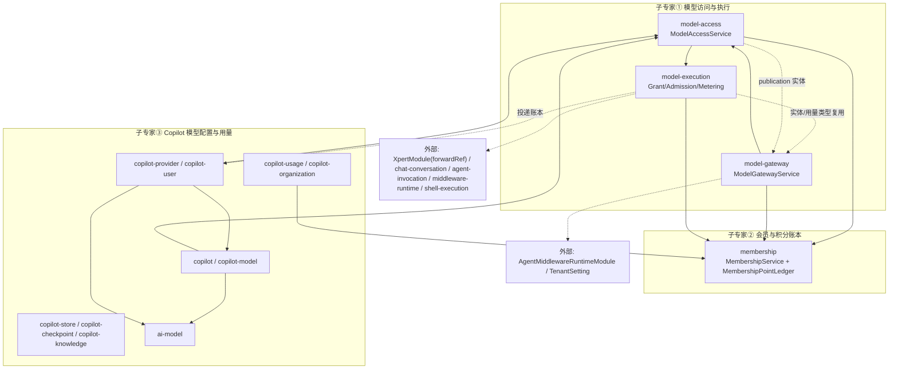

# 模型访问与计费专家 —— 01 架构

**本文引用的文件**（相对仓库根，链接均为 `file://`）

- [docs/model-execution.md](file://docs/model-execution.md)
- [docs/operations/model-execution-runbook.md](file://docs/operations/model-execution-runbook.md)
- [docs/operations/model-execution-alerts.yml](file://docs/operations/model-execution-alerts.yml)
- [packages/server-ai/src/app.module.ts](file://packages/server-ai/src/app.module.ts)
- [packages/server-ai/src/model-access/model-access.module.ts](file://packages/server-ai/src/model-access/model-access.module.ts)
- [packages/server-ai/src/model-access/model-access.service.ts](file://packages/server-ai/src/model-access/model-access.service.ts)
- [packages/server-ai/src/model-access/model-access.controller.ts](file://packages/server-ai/src/model-access/model-access.controller.ts)
- [packages/server-ai/src/model-access/model-access-scheduler.service.ts](file://packages/server-ai/src/model-access/model-access-scheduler.service.ts)
- [packages/server-ai/src/model-execution/model-execution.module.ts](file://packages/server-ai/src/model-execution/model-execution.module.ts)
- [packages/server-ai/src/model-execution/execution-grant.service.ts](file://packages/server-ai/src/model-execution/execution-grant.service.ts)
- [packages/server-ai/src/model-execution/execution-admission.service.ts](file://packages/server-ai/src/model-execution/execution-admission.service.ts)
- [packages/server-ai/src/model-execution/execution-metering.service.ts](file://packages/server-ai/src/model-execution/execution-metering.service.ts)
- [packages/server-ai/src/model-execution/execution.entity.ts](file://packages/server-ai/src/model-execution/execution.entity.ts)
- [packages/server-ai/src/model-gateway/model-gateway.module.ts](file://packages/server-ai/src/model-gateway/model-gateway.module.ts)
- [packages/server-ai/src/model-gateway/model-gateway.service.ts](file://packages/server-ai/src/model-gateway/model-gateway.service.ts)
- [packages/server-ai/src/model-gateway/openai.controller.ts](file://packages/server-ai/src/model-gateway/openai.controller.ts)
- [packages/server-ai/src/model-gateway/gateway-admission-policy.ts](file://packages/server-ai/src/model-gateway/gateway-admission-policy.ts)
- [packages/server-ai/src/model-gateway/model-gateway-api-key.entity.ts](file://packages/server-ai/src/model-gateway/model-gateway-api-key.entity.ts)
- [packages/server-ai/src/membership/membership.module.ts](file://packages/server-ai/src/membership/membership.module.ts)
- [packages/server-ai/src/membership/membership.service.ts](file://packages/server-ai/src/membership/membership.service.ts)
- [packages/server-ai/src/membership/membership-point-ledger.entity.ts](file://packages/server-ai/src/membership/membership-point-ledger.entity.ts)
- [packages/server-ai/src/membership/membership-period-scheduler.service.ts](file://packages/server-ai/src/membership/membership-period-scheduler.service.ts)
- [packages/server-ai/src/membership/membership-backfill.processor.ts](file://packages/server-ai/src/membership/membership-backfill.processor.ts)
- [packages/server-ai/src/copilot/copilot.service.ts](file://packages/server-ai/src/copilot/copilot.service.ts)
- [packages/server-ai/src/copilot-usage/model-usage/model-usage-ledger.service.ts](file://packages/server-ai/src/copilot-usage/model-usage/model-usage-ledger.service.ts)
- [packages/server-ai/src/copilot-user/commands/token-record.command.ts](file://packages/server-ai/src/copilot-user/commands/token-record.command.ts)
- [packages/server-ai/src/copilot-checkpoint/retention.service.ts](file://packages/server-ai/src/copilot-checkpoint/retention.service.ts)
- [packages/server-ai/src/ai-model/ai-model.service.ts](file://packages/server-ai/src/ai-model/ai-model.service.ts)

## 目录

- [目录](#目录)
- [专家域职责边界](#专家域职责边界)
- [子专家划分说明](#子专家划分说明)
- [子模块清单](#子模块清单)
- [分层结构](#分层结构)
- [依赖关系](#依赖关系)
- [关键设计约束与不变量](#关键设计约束与不变量)
- [架构总览](#架构总览)
- [组件详细分析](#组件详细分析)

章节来源：[packages/server-ai/src/app.module.ts](file://packages/server-ai/src/app.module.ts)（关键符号：ServerAIModule）

## 专家域职责边界

**做什么**

- 模型可见性与授权台账：`ModelAccessService` 提供 `getCatalog` / `resolveModelAccess` / `canUseCatalogModel(s)` / `assertCanUseModel`，并管理申请 `createRequest`、审批 `approveRequest`/`rejectRequest`、授权 `extendGrant`/`revokeGrant` 与生命周期协调 `processDueGrants`/`reconcileLifecycleBatch`/`handleCopilotStateChanged`。
- 执行凭据与准入：`ModelExecutionGrantService.issue` 签发只服务一次执行的短时凭据（仅存 hash），`ModelExecutionAdmissionService.begin|dispatch` 在 DB 级做租户+付款人串行化与 token 预占。
- 计量与结算投递：`ModelExecutionMeteringService.finish` 先落 usage fact，再经既有 `CopilotTokenRecordCommand` 投递账本，按 `attemptId` 幂等。
- 对外兼容入口：`/api/model-execution/openai/v1`、`/api/model-execution/anthropic/v1/messages`（grant 语义）与 `/api/openai/v1`（API key + publication 语义）。
- 积分账本与配额：`MembershipService.recordUsage`/`recordGatewayUsage`/`assertCanUse`/`hasConsumableBalance`/`assertRateLimits` 与周期结算。

**不做什么**

- 不执行 Agent/CLI 进程本身：任务调度、桌面控制、沙箱进程属于 xpert-pro 与执行宿主；本域只做授权、准入、记账与协议适配。
- 不做供应商协议实现与价格来源：Provider 客户端、目录、定价能力来自模型 Provider 插件（`NativeModelClient`/`AIModelProviderStrategy`）。
- 不从请求头或请求体推断租户/组织/付款人；scope 只从平台身份与自有会话解析。
- 不把估算当消费：无权威用量事实时不生成扣费证据，未知结果保留预占，等人工对账。
- 不提供平台登录态与 ChatKit 业务 API：客户端密钥与登录身份不得复用到执行端点。

章节来源：[packages/server-ai/src/model-access/model-access.service.ts](file://packages/server-ai/src/model-access/model-access.service.ts)（关键符号：ModelAccessService.getCatalog）

## 子专家划分说明

- **① 模型访问与执行**：覆盖 `model-access`(10 源文件) + `model-execution`(32) + `model-gateway`(20)。一句话职责：把「谁能用哪个模型」变成可签发、可准入、可结算的凭据与调用链。
- **② 会员与积分账本**：覆盖 `membership`(14)。一句话职责：以唯一索引为幂等底线的积分账本、配额校验与周期结算，是模型调用产生的唯一扣费出口。
- **③ Copilot 模型配置与用量**：覆盖 `copilot` 系 10 个目录（copilot / copilot-model / copilot-provider / copilot-organization / copilot-user / copilot-usage / copilot-store / copilot-checkpoint / copilot-knowledge）+ `ai-model`。一句话职责：Provider 与 Copilot 模型配置、可用 Copilot 解析、用量视图与检查点/知识库存储。
- **划分理由**：①按「授权→凭据→执行→协议」的调用链聚合，共享 `IModelAccessResolution` 与 grant 快照；②是横切所有计费路径的账本与配额内核，被 ①②③ 共同依赖；③是配置面与查询面，服务于 Agent 运行时与后台页面，不参与执行期准入。

章节来源：[packages/server-ai/src/model-execution/model-execution.module.ts](file://packages/server-ai/src/model-execution/model-execution.module.ts)（关键符号：ModelExecutionModule）

## 子模块清单

| 子专家 | 目录（源文件数） | 关键服务/类 | 路由前缀 |
| --- | --- | --- | --- |
| ① | `model-access`(10) | `ModelAccessService` | `/api/model-access` |
| ① | `model-execution`(32) | `ModelExecutionGrantService` / `ModelExecutionAdmissionService` / `ModelExecutionMeteringService` / `ModelExecutionChatService` | `/api/model-execution`（+ `/admin`、`/openai/v1`、`/anthropic/v1`） |
| ① | `model-gateway`(20) | `ModelGatewayService` / `GatewayAdmissionPolicy` | `/api/model-gateway` + `/api/openai/v1` |
| ② | `membership`(14) | `MembershipService` / `MembershipPeriodSchedulerService` / `MembershipBackfillProcessor` | `/api/membership` |
| ③ | `copilot`(32) | `CopilotService` | `/api/copilot` |
| ③ | `copilot-model`(19) | `CopilotModelService` | `/api/copilot-model` |
| ③ | `copilot-provider`(24) | `CopilotProviderService` / `ModelDiscoveryService` | `/api/copilot-provider` |
| ③ | `copilot-user`(19) | `CopilotUserService` / `CopilotTokenUsageDeliveryService` | `/api/copilot-user` |
| ③ | `copilot-usage`(12) | `CopilotUsageService` / `ModelUsageLedgerService` | `/api/copilot-usage` |
| ③ | `copilot-organization`(9) | `CopilotOrganizationService` | `/api/copilot-organization` |
| ③ | `copilot-store`(19) | `CopilotStoreService` | `/api/copilot-store` |
| ③ | `copilot-checkpoint` | `CopilotCheckpointService` / `CopilotCheckpointRetentionService` | `/api/copilot-checkpoint` |
| ③ | `copilot-knowledge` | `CopilotKnowledgeService` | `/api/copilot-knowledge` |
| ③ | `ai-model` | `AIProvidersService` | `/api/ai-model` |

章节来源：[packages/server-ai/src/ai-model/ai-model.module.ts](file://packages/server-ai/src/ai-model/ai-model.module.ts)（关键符号：AIModelModule）

## 分层结构

- **controller**：两套入口并存——平台身份入口（`ModelAccessController`、`ModelGatewayController`、`MembershipController`，含 `@Permissions`）与 `@Public()` 凭据入口（`ModelExecutionOpenAIController`/`ModelExecutionNativeController`/`ModelGatewayOpenAIController`）。
- **service**：`ModelAccessService`、`ModelExecution*Service`（grant/admission/metering/chat/policy/source/reconciliation）、`ModelGatewayService`、`MembershipService`、`ModelUsageLedgerService`。
- **CQRS handler**：`copilot`/`copilot-model`/`copilot-provider`/`copilot-user`/`copilot-checkpoint`/`copilot-store`/`ai-model` 各自 `queries/handlers`、`commands/handlers`（如 `CreateModelClientHandler`、`CopilotTokenRecordCommand` 处理器）。
- **scheduler**：`ModelAccessSchedulerService`（`@Cron('0 * * * * *')` + cursor `model-access:lifecycle-cursor:v1`）、`MembershipPeriodSchedulerService`（`@Cron('0 * * * * *')` + Redis 锁）、model-gateway 5 个 `@Interval`、model-execution `@Interval(30_000)` 补投递与对账重试、`CopilotCheckpointRetentionService`（`@Cron('0 0 3 * * *')`）。
- **subscriber / queue**：`MembershipBackfillProcessor` 订阅 `EVENT_FEATURE_ORGANIZATION_UPDATED` 并消费 `MEMBERSHIP_MAINTENANCE_QUEUE`；model-access / model-execution / model-gateway 无事件订阅层——该模块无此项。
- **entity**：`ModelAccessRequest`/`UserModelGrant`/`ModelAccessEvent`、`ModelExecutionGrant`/`CliSession`/`ModelExecutionReconciliation`、`ModelGatewayApiKey`/`ModelGatewayCall`/`ModelGatewayPublication`/`ModelGatewaySettings`、`MembershipPlan`/`UserMembership`/`MembershipPointLedger`/`MembershipPeriod`。

章节来源：[packages/server-ai/src/model-execution/execution-query.controller.ts](file://packages/server-ai/src/model-execution/execution-query.controller.ts)（关键符号：ModelExecutionQueryController.list）

## 依赖关系

**出向（本域依赖外部）**

- `model-access` → `AIModelModule`、`MembershipModule`、`RedisModule`、`CqrsModule`；并注册 `User`/`Organization`/`FeatureOrganization`/`Copilot`/`CopilotProviderModel`/`ModelGatewayPublication` 实体。
- `model-execution` → `ModelAccessModule`、`forwardRef(XpertModule)`、`AgentMiddlewareRuntimeModule`、`CqrsModule`；注册 `ChatConversation`、`AgentInvocationEntity`、`ShellCliExecution`/`ShellProcessExecution`、`MembershipPointLedger`、`ModelGatewayCall` 等实体。
- `model-gateway` → `ModelAccessModule`、`MembershipModule`、`AgentMiddlewareRuntimeModule`、`CqrsModule`。
- `membership` → `TenantModule`、`RedisModule`、`BullModule`（`MEMBERSHIP_MAINTENANCE_QUEUE`）、`CqrsModule`。
- `copilot` 系与 `ai-model` → `AIModelModule`、`CopilotProviderModule`、`MembershipModule`、`ModelAccessModule`、`CopilotUsageModule`、`TenantModule`/`UserModule`；`ai-model` 只依赖 plugin-sdk 的 `AIModelProviderRegistry`。

**入向（谁引用本域）**

- `ServerAIModule` 汇总导入全部本域模块；`initialization` 同时导入 `MembershipModule`、`ModelAccessModule`、`ModelGatewayModule`。
- `xpert`、`chat`、`knowledgebase`、`knowledge-document`、`plugin-resource`、`xpert-toolset`、`copilot-knowledge`、`middleware-runtime`、`ai`、`xpert-agent-execution`、`copilot-usage` 分别导入 `CopilotModule`/`CopilotModelModule`/`CopilotUsageModule`/`CopilotUserModule`/`MembershipModule`。
- 执行侧反向依赖集中：`model-execution` 被 `ServerAIModule` 引用，同时对 `XpertModule` 使用 `forwardRef` 形成双向链。

章节来源：[packages/server-ai/src/model-gateway/model-gateway.module.ts](file://packages/server-ai/src/model-gateway/model-gateway.module.ts)（关键符号：ModelGatewayModule）

## 关键设计约束与不变量

- **凭据只存 hash**：`ModelExecutionGrant.credentialHash`（`select: false`，唯一索引）、`ModelGatewayApiKey.tokenHash`/`encryptedSecret`（`select: false` + `@Exclude`）——明文仅在签发瞬间返回。
- **快照只会更严**：grant 在签发时快照 Copilot/Provider/模型/协议/预算，后续 `revalidate` 与 `tightenExecutionLimits` 只允许收紧；放宽策略不会给已签发 grant 增加模型、协议或预算。
- **账本唯一索引是幂等底线**：`IDX_membership_ledger_source_reference (tenantId, sourceReference)` 唯一 + `UQ_membership_ledger_model_usage_request_metric_revision`，配合 `pointsDelta numeric(28,10)`，重复投递无法二次扣费。
- **客户端 scope header 不选租户/组织**：`openai.controller.ts` 开头 Invariants 明确 API key scope 只解析访问、执行发生在 publication scope；`execution-grant.service.ts` 同样声明 scope 来自自有会话而非 bearer header。
- **`select: false` 敏感列**：`tokenHash`、`encryptedSecret`、`credentialHash` 等默认不参与查询，读取需显式 `addSelect`，降低泄漏面。
- **未知即保留**：未派发的尝试可释放预占，已派发但无权威用量的尝试保留预占并进入 `settlement_pending`，禁止用估算补单。

章节来源：[packages/server-ai/src/membership/membership-point-ledger.entity.ts](file://packages/server-ai/src/membership/membership-point-ledger.entity.ts)（关键符号：MembershipPointLedger）

## 架构总览

图表来源：[packages/server-ai/src/model-execution/model-execution.module.ts](file://packages/server-ai/src/model-execution/model-execution.module.ts)（关键符号：ModelExecutionModule）

章节来源：[packages/server-ai/src/app.module.ts](file://packages/server-ai/src/app.module.ts)（关键符号：ServerAIModule）

## 组件详细分析

### 授权与审批

`ModelAccessService` 以 `getCatalog` 汇总可达模型，`resolveModelAccess` 把「用户 × Copilot × 组织 × 会员」求交为用户可用集合；申请侧 `createRequest` 通过 `assertRequesterIsNotManager` 阻断管理员给自己提权的路径，审批侧 `approveRequest` 写入 `UserModelGrant` 与 `ModelAccessEvent`（`writeEvent` 贯穿每次状态迁移），`processDueGrants`/`reconcileLifecycleBatch` 处理到期、撤销与 Copilot 上下线联动。

章节来源：[packages/server-ai/src/model-access/model-access.service.ts](file://packages/server-ai/src/model-access/model-access.service.ts)（关键符号：ModelAccessService.approveRequest）

### grant 与执行准入

`ModelExecutionGrantService.issue` 校验 policy 中的工具与精确版本、解析会话与运行时模型来源后签发凭据；`pending → active` 两阶段用于 CLI 启动前的私有配置准备。`ModelExecutionAdmissionService.begin` 使用 `pg_advisory_xact_lock('model-execution:{tenantId}:{ownerId}')` 再做 `pessimistic_write` 锁 grant，按 grant 级与付款人级双预算、并发与速率判定后落 `ModelGatewayCall` 预占；`dispatch` 写入一次性派发标记，`dispatch` 之后的崩溃保留预占。

章节来源：[packages/server-ai/src/model-execution/execution-grant.service.ts](file://packages/server-ai/src/model-execution/execution-grant.service.ts)（关键符号：ModelExecutionGrantService.issue）

### 网关与 publication

`ModelGatewayService.authenticate` 解析 API key 身份，`requireCallablePublication` 把 external model id 映射到 publication；`startCall` 在事务内以 `lockedUser` 悲观锁串行化同一用户，并按 `GatewayAdmissionPolicy.getAdmissionLimits(tenantId)` 读取 `TenantSetting` 的 `MODEL_GATEWAY_REQUESTS_PER_MINUTE_SETTING` / `MODEL_GATEWAY_MAX_CONCURRENT_REQUESTS_SETTING`，超限抛 `ModelGatewayRequestLimitException`（OpenAI 侧映射 429 + `rate_limit_error` + `Retry-After`）。`finishCall` 折算 CNY 结算金额后调用 `MembershipService.recordGatewayUsage` 记账。

章节来源：[packages/server-ai/src/model-gateway/model-gateway.service.ts](file://packages/server-ai/src/model-gateway/model-gateway.service.ts)（关键符号：ModelGatewayService.startCall）

### 账本与配额

`MembershipService.recordUsage`/`recordGatewayUsage` 均在 `dataSource.transaction` 内先取分布式锁（`acquireUsageSourceLock`/`acquireGatewayRequestLock`）再查重，命中已有账本直接返回既有结果；`hasConsumableBalance`、`assertCanUse`、`assertRateLimits` 构成配额校验面；`processDueMembershipPeriods` 由 `@Cron('0 * * * * *')` + Redis 锁驱动周期结算（`settleDueMembershipPeriods`），后台回填走 Bull 队列。

章节来源：[packages/server-ai/src/membership/membership.service.ts](file://packages/server-ai/src/membership/membership.service.ts)（关键符号：MembershipService.recordGatewayUsage）

### 计量与投递

`ModelExecutionMeteringService.finish` 在单事务内以悲观锁读回 `ModelGatewayCall`，对已有 usage fact 做 `isDeepStrictEqual` 一致性校验（不一致直接判非法），再落不可变 fact；`deliver` 通过 `CopilotTokenRecordCommand` 投递并依赖 `ModelUsageDeliveryReceipt` 记录投递回执，`@Interval(30_000)` 后台补投递。

章节来源：[packages/server-ai/src/model-execution/execution-metering.service.ts](file://packages/server-ai/src/model-execution/execution-metering.service.ts)（关键符号：ModelExecutionMeteringService.finish）

章节来源：[packages/server-ai/src/model-execution/execution-admission.service.ts](file://packages/server-ai/src/model-execution/execution-admission.service.ts)（关键符号：ModelExecutionAdmissionService.begin）

## 结论

本域以「授权快照 + 一次性凭据 + 账本唯一索引」三件套构成模型访问与计费的可审计闭环：`model-access` 负责授权与审批，`model-execution` 负责凭据、准入、协议与用量事实，`model-gateway` 负责对外 API key 面，`membership` 负责积分账本与周期结算，`copilot` 系与 `ai-model` 负责配置与用量视图。三份运行期证据（[docs/model-execution.md](file://docs/model-execution.md)、[docs/operations/model-execution-runbook.md](file://docs/operations/model-execution-runbook.md)、[docs/operations/model-execution-alerts.yml](file://docs/operations/model-execution-alerts.yml)）与本域不变量一致：无隐式预算、估算不产生消费、未知结果只保留不动。

章节来源：[packages/server-ai/src/model-gateway/openai.controller.ts](file://packages/server-ai/src/model-gateway/openai.controller.ts)（关键符号：ModelGatewayOpenAIController.chat）
