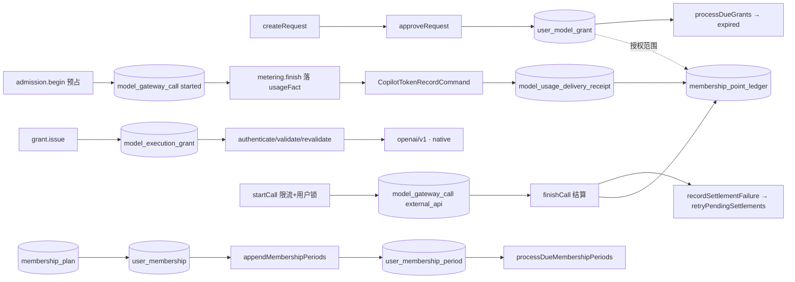

# 模型访问与计费：数据流转

> 范围 `packages/server-ai/src/`：`model-access`、`model-execution`、`model-gateway`、`membership`、9 个 `copilot*` 目录与 `ai-model`。只记录源码可验证的流向、锁、幂等键与失败语义，不写代码中不存在的调度。

**本文引用的文件**

- [model-access.service.ts](file://packages/server-ai/src/model-access/model-access.service.ts)（关键符号：`ModelAccessService.createRequest` / `approveRequest` / `processDueGrants`）
- [model-access-scheduler.service.ts](file://packages/server-ai/src/model-access/model-access-scheduler.service.ts)（关键符号：`ModelAccessSchedulerService.expireDueGrants`）
- [user-model-grant.entity.ts](file://packages/server-ai/src/model-access/user-model-grant.entity.ts) / [model-access-event.entity.ts](file://packages/server-ai/src/model-access/model-access-event.entity.ts)（关键表：`user_model_grant` / `model_access_event`）
- [execution-grant.service.ts](file://packages/server-ai/src/model-execution/execution-grant.service.ts)（关键符号：`ModelExecutionGrantService.issue` / `validate` / `activate` / `renew`）
- [execution.entity.ts](file://packages/server-ai/src/model-execution/execution.entity.ts)（关键符号/表：`ExecutionUsageFact`、`model_execution_grant`、`cli_session`）
- [execution-admission.service.ts](file://packages/server-ai/src/model-execution/execution-admission.service.ts)（关键符号：`ModelExecutionAdmissionService.begin` / `dispatch` / `lockGrant`）
- [execution-metering.service.ts](file://packages/server-ai/src/model-execution/execution-metering.service.ts)（关键符号：`finish` / `deliver` / `retry`）
- [execution-recovery.ts](file://packages/server-ai/src/model-execution/execution-recovery.ts)（关键符号：`recoverAbandonedExecutionCalls`）
- [model-gateway.service.ts](file://packages/server-ai/src/model-gateway/model-gateway.service.ts)（关键符号：`startCall` / `finishCall` / `recordSettlementFailure` / `retryPendingSettlements`）
- [model-gateway-call.entity.ts](file://packages/server-ai/src/model-gateway/model-gateway-call.entity.ts) / [model-gateway-call-retention.ts](file://packages/server-ai/src/model-gateway/model-gateway-call-retention.ts)（关键表：`model_gateway_call`）
- [membership.service.ts](file://packages/server-ai/src/membership/membership.service.ts)（关键符号：`recordUsage` / `recordGatewayUsage` / `appendMembershipPeriods` / `processDueMembershipPeriods`）
- [model-billing.ts](file://packages/server-ai/src/membership/model-billing.ts)（关键符号：`settleChargeToCny` / `pointsFromCny`）、[membership-period-scheduler.service.ts](file://packages/server-ai/src/membership/membership-period-scheduler.service.ts)（关键符号：`settleDueMembershipPeriods`）

## 目录

- [1. 全景：五条链与共享落点](#1-全景五条链与共享落点)
- [2. 模型访问审批链](#2-模型访问审批链)
- [3. 执行授权链](#3-执行授权链)
- [4. 执行记账链](#4-执行记账链)
- [5. 网关调用链](#5-网关调用链)
- [6. 会员周期链](#6-会员周期链)
- [7. 状态机](#7-状态机)
- [8. 异步流与外部依赖](#8-异步流与外部依赖)
- [9. 数据变换关键节点](#9-数据变换关键节点)
- [10. 已知风险](#10-已知风险)

## 1. 全景：五条链与共享落点

五条链在数据层汇聚到三张共享表：`model_gateway_call`（一次上游尝试的预占与用量事实）、`membership_point_ledger`（计费账本，被 copilot-usage / model-execution / model-gateway 三方写入）、`model_usage_delivery_receipt`（账本投递回执）。授权侧的读路径与账本侧的写路径彼此独立：任何一次模型调用只有在拿到「供应商用量事实」后才可能产生消费。

图表来源：[execution-metering.service.ts](file://packages/server-ai/src/model-execution/execution-metering.service.ts)（关键符号：`deliver` / `CopilotTokenRecordCommand`）、[model-gateway.service.ts](file://packages/server-ai/src/model-gateway/model-gateway.service.ts)（关键符号：`startCall` / `finishCall`）

章节来源：[execution-admission.service.ts](file://packages/server-ai/src/model-execution/execution-admission.service.ts)（关键符号：`ModelExecutionAdmissionService`）、[membership-point-ledger.entity.ts](file://packages/server-ai/src/membership/membership-point-ledger.entity.ts)（关键表：`membership_point_ledger`）

## 2. 模型访问审批链

入口是 `ModelAccessController`（`POST /api/model-access/requests`、`requests/:id/withdraw`、`admin/requests/:id/{approve,reject}`、`admin/grants/:id/{extend,revoke}`），写操作全部落到 `ModelAccessService`。

- `createRequest` 先 `requireNormalUser`，再 `requireVisibleEnabledTarget` 校验目标模型可见且启用，最后 `assertRequesterIsNotManager`：调用者若能管理该范围（`canManageTargetScope`），直接抛 `Forbidden`，**自审在入口被阻断**；理由缺失抛 `ModelAccessRequestReasonRequired`。
- `approveRequest` 单事务内 `findRequestForAdminUpdate` → 写 `user_model_grant`（`approvedAt`、`approvedById/Name`、`ownershipScope`、可选 `validUntil`、`modelSnapshot`）→ `writeEvent` 写 `model_access_event`（`fromStatus` / `toStatus` / `actorType` / `idempotencyKey`）。`rejectRequest` 必须给理由，只推进请求状态并留痕。
- `extendGrant` 只允许延长（否则 `ModelAccessGrantCannotShorten`）；`revokeGrant` 先跑一次 `processDueGrants`，再置 `revoked` 并写 `revokedAt/ById/Name/revokeReason`。
- 到期：`processDueGrants` 在事务内 `pessimistic_write` 锁住 `validUntil < now` 的 active 授权（`take(500)`），逐条转 `expired` 并写 `GrantExpired` 事件，`idempotencyKey = grant:{id}:expired`；`processAllDueGrants` 按租户分发。
- 补偿：`reconcileLifecycleBatch` 用 `requestAfterId` / `grantAfterId` 游标调用 `reconcilePendingRequest` 与 `reconcileGrantAvailability`；调度器每分钟 `@Cron('0 * * * * *')` 在 Redis 锁 `scheduler:model-access-lifecycle`（TTL 5 分钟）内执行，批量 200，游标存 CACHE_MANAGER（TTL 24 小时）。

幂等主线是两条部分唯一索引：请求侧 `requested` 状态下同范围仅一条，授权侧 `active` 状态下同范围仅一条；事件侧由 `IDX_model_access_event_idempotency` 兜底。

章节来源：[model-access.service.ts](file://packages/server-ai/src/model-access/model-access.service.ts)（关键符号：`createRequest` / `assertRequesterIsNotManager` / `processDueGrants` / `reconcileLifecycleBatch`）、[user-model-grant.entity.ts](file://packages/server-ai/src/model-access/user-model-grant.entity.ts)（关键表：`user_model_grant`）、[model-access-event.entity.ts](file://packages/server-ai/src/model-access/model-access-event.entity.ts)（关键表：`model_access_event`）

## 3. 执行授权链

`ModelExecutionGrantService.issue` 先 `policy.require(tenantId)` 校验工具白名单（`tool.id + tool.version` 必须命中策略），解析会话与助手选择，`executionToolModels` 求交集，然后固定上下文快照：`tenantId / runtimeOrganizationId / actorUserId / billableUserId / xpertId / assistantVersion / conversationId / threadId / source / environment / tool`。随后 `sources.assertCurrent` 与 `ModelExecutionEnvironmentCapability.assertCurrent` 双重校验，生成 `xpert-exec-<32B base64url>` 明文 secret，库里只存 `hashExecutionCredential(secret)`（sha256，`credentialHash` 列 `select:false` + 唯一）。`status`：`prepare=true`（仅 shell）为 `pending`，否则 `active`；`expiresAt = min(deadline, now + leaseSeconds)`，`absoluteExpiresAt = deadline`（策略 `maxDurationSeconds` 封顶）。

客户端持 credential 访问 `/api/model-execution/openai/v1/*` 与 native 端点，`authenticate` 用正则 `/^Bearer (xpert-exec-[A-Za-z0-9_-]{43})$/` 取出 secret，按 `credentialHash` 反查后进入 `validate`。`validate` 逐项比对上下文与行内列（任一不等即 `Denied`）、`assertActive`、工具仍在策略中、`tightenExecutionLimits`（策略只能收紧既有快照）、`sources.assertCurrent` 与环境能力校验，最后把已存 `models` 与「当前权限可见模型」按 `id/copilotId/model/provider/providerScopeId/providerOrganizationId` 求交，并裁剪 `capabilities` / `protocols`；默认模型被移除即抛 `Model`。

生命周期：`activate` 只接受 `pending` + `shell_execution`，单条 UPDATE 带 `clock_timestamp()` 谓词，**不重置准备租约**；`renew` 在事务内先 `pessimistic_write` 锁行、再以 `clock_timestamp()` 与 `createdAt + maxDurationSeconds` 三重谓词续租；`revoke` 直接置 `revoked`；`watch` 每 5 秒 `revalidate`，失败即 `abort.abort()` 取消上游。

章节来源：[execution-grant.service.ts](file://packages/server-ai/src/model-execution/execution-grant.service.ts)（关键符号：`issue` / `authenticate` / `validate` / `activate` / `renew` / `watch` / `hashExecutionCredential`）、[execution.entity.ts](file://packages/server-ai/src/model-execution/execution.entity.ts)（关键表：`model_execution_grant`）

## 4. 执行记账链

`ModelExecutionAdmissionService.begin` 在一个事务里：`lockGrant` 先取 `pg_advisory_xact_lock('model-execution:<tenantId>:<ownerId>')` 串行化同一付款人，再对 `status='active'` 的授权行 `pessimistic_write`，并 `tightenExecutionLimits`；随后以 `estimatedInputTokens + outputLimit` 作为预占，按 `grantId` 维度与「付款人维度（`grantId IS NULL`）」各查一次聚合（`used` 取 24 小时内 `totalTokens`、`reserved` 取 `reservedTokens` 之和、`concurrent`、`recent`），`shell_execution` 还要比对同父执行的全部 CLI 子执行并取最小已签发预算；`assertExecutionAdmission` 校验预算与并发/速率；最后插入 `model_gateway_call`（`source='execution_grant'`、`reservedTokens`、`status='started'`、新 `requestId`/`callId`）。`dispatch` 单独落 `dispatchedAt` 作为一次性派发栅栏——**崩溃发生在此之后，预占不释放**。

上游返回后 `ModelExecutionMeteringService.finish`：只有 `usage.source === provider && totalTokens > 0` 才算实际事实，构造 `ExecutionUsageFact`（含 `grantId/callId/attemptId/providerRequestId`）。事务内 `pessimistic_write` 读取当前行：事实已存在且 deep-equal 不符即 `Invalid`；`errorCode='reconciled_no_usage'` 拒写；已有事实或已投递则直接返回；否则置 `settlement_pending`，估计值只写 `estimatedUsage`，有事实则 `reservedTokens=0`，无事实且未派发则转 `failed` + `execution_preflight_failed`。随后同步 `deliver(call.id)`。

`deliver` 以 `addSelect` 取出 `usageFact` 与 `settlementContext`，派发 `CopilotTokenRecordCommand`（`requestId`、`billableUserId`、`xpertId`、`threadId`、`copilotId`、`model`、`modelAccess`、token 三元组、价格与 `pricingStatus`、`execution`、`executionModel`、`tokenDetails`）；处理器再经 `CopilotUsageService.recordTokenUsage` 与投递服务落到 `membership_point_ledger`（`MembershipService.recordUsage` 按 `sourceReference` 加锁去重，先扣会员积分、再扣个人积分并写 `:personal` 后缀行）。投递成功后再 UPDATE 账本行补齐 `usageChannel/executionContext/actorId`，落 `usageDeliveredAt` 与终态。失败语义：捕获 `ExceedingLimitException` 时必须查到 `model_usage_delivery_receipt.status='completed'` 才算已投递，否则记 `delivery_retry` 指标并保持 pending；`@Interval(30_000) retry` 先跑 `recoverAbandonedExecutionCalls`（`startedAt` 超 15 分钟且授权不再 active/有效：未派发 → `failed` 并释放预占，已派发 → `settlement_pending` 保留预占，`errorCode='worker_lost'`），再重投最旧 100 条事实，并刷新待结算积压指标。管理员可经 `admin/calls/:id/retry-delivery`（幂等重投）与 `admin/calls/:id/reconcile`（写 `model_execution_reconciliation`，`no_usage` → `reconciled_no_usage` 并释放预占）介入。

章节来源：[execution-admission.service.ts](file://packages/server-ai/src/model-execution/execution-admission.service.ts)（关键符号：`begin` / `dispatch` / `lockGrant` / `assertExecutionAdmission`）、[execution-metering.service.ts](file://packages/server-ai/src/model-execution/execution-metering.service.ts)（关键符号：`finish` / `deliver` / `retry`）、[execution-recovery.ts](file://packages/server-ai/src/model-execution/execution-recovery.ts)（关键符号：`recoverAbandonedExecutionCalls`）

## 5. 网关调用链

`startCall` 先取/建 `model_gateway_settings`，再由 `GatewayAdmissionPolicy.getAdmissionLimits` 从 `tenant_setting` 读限流（`requestsPerMinute`、`maxConcurrentRequests`，越界取默认）；事务内对 API Key 属主 `User` 行 `pessimistic_write` 加锁，统计窗口内 `source='external_api'` 调用数与 `started` 并发数，超限抛 `ModelGatewayRequestLimitException`；最后插入 `model_gateway_call`（`source='external_api'`，必带 `apiKeyId` + `publicationId`，`settlementContext` 存访问解析结果；仅当 `storeBodies` 为真才写 `encryptedRequest` 并算 `bodyExpiresAt`）。上游经 `createChatModel` 与 openai 适配器调用。

`finishCall` 只接受 `started` 或 `settlement_pending`；先用 `settleChargeToCny` 把价格折算为 CNY（`unpriced → null`、`free → 0`、`CNY/RMB → 汇率 1`、`USD → 需环境汇率`），再调 `recordGatewayUsage`（`sourceReference = model-gateway:<requestId>`，按 `gatewayRequestId` 去重），回写 `chargedPoints` / `excessPoints` / token 三元组、清空 `settlementContext`、按需加密响应体。结算抛错时 `recordSettlementFailure` 把行置 `settlement_pending` 并保留 token 与价格快照；`@Interval(GATEWAY_MAINTENANCE_INTERVAL_MS) retryPendingSettlements` 每次扫描最旧 100 条重放 `finishCall`（`settlementContext` 缺失时重新解析访问）。留存策略由 `purgeModelGatewayCallBatch` 执行：仅 `succeeded` / `failed` 且超过租户配置天数（受 `MAX_MODEL_GATEWAY_CALL_RETENTION_DAYS` 封顶）的行，先把用量归档进账本（`INSERT ... WHERE` 未记录才写），同一语句内删除调用行，`FOR UPDATE OF c SKIP LOCKED` 保证多副本安全。

章节来源：[model-gateway.service.ts](file://packages/server-ai/src/model-gateway/model-gateway.service.ts)（关键符号：`startCall` / `finishCall` / `recordSettlementFailure` / `retryPendingSettlements`）、[gateway-admission-policy.ts](file://packages/server-ai/src/model-gateway/gateway-admission-policy.ts)（关键符号：`GatewayAdmissionPolicy.getAdmissionLimits`）、[model-gateway-call-retention.ts](file://packages/server-ai/src/model-gateway/model-gateway-call-retention.ts)（关键符号：`purgeModelGatewayCallBatch`）

## 6. 会员周期链

套餐（`membership_plan`：`includedPoints` / `period` / `allowedModels` / `modelMultipliers` / `rateLimits` / `isDefault`）经管理接口分配给用户，生成 `user_membership`（`currentPeriodStart/End`、`pointsGranted`、`pointsUsed`、`pointsTotalUsed`、`planSnapshot`）。`appendMembershipPeriods` 批量追加 `user_membership_period`，幂等键为 `(tenantId, sourceReference, sourceSequence)` 唯一索引；同一 `sourceReference` 支持「续排/退款预留」两种语义，`sourceSequence` 递增。`MembershipPeriodSchedulerService` 每分钟 `@Cron('0 * * * * *')` 在 Redis 锁 `scheduler:membership-period-settlement`（TTL 5 分钟）内调 `processDueMembershipPeriods(limit = 100)`，输出 `scanned / settled / skipped / failed` 并写日志；结算后 `synchronizeCurrentPeriodProjection` 把当前期投影同步回会员行，保证两处口径一致。

退款：`reserveFutureMembershipPeriodsForRefund` 要求 `sourceReference`，先锁会员分配键，只取 `scheduled` 且 `periodStart > now` 的期次，并校验必须是同一 membership 下「连续尾段」，否则抛 `MembershipRefundTailRequired`；已存在 `refund_pending` 时直接返回。`finalizeFutureMembershipPeriodsRefund` 完成终态化。默认会员补齐走 Bull 队列 `membership-maintenance`（三种 job：租户默认 / 租户-组织默认 / 组织默认，批量 100，`attempts: 5`、`backoff: 10_000`、`removeOnComplete`）。

章节来源：[membership.service.ts](file://packages/server-ai/src/membership/membership.service.ts)（关键符号：`appendMembershipPeriods` / `processDueMembershipPeriods` / `reserveFutureMembershipPeriodsForRefund`）、[membership-period-scheduler.service.ts](file://packages/server-ai/src/membership/membership-period-scheduler.service.ts)（关键符号：`MembershipPeriodSchedulerService.settleDueMembershipPeriods`）、[membership-backfill.queue.ts](file://packages/server-ai/src/membership/membership-backfill.queue.ts)（关键符号：`MembershipBackfillQueueService`）

## 7. 状态机

| 承载表 / 字段 | 取值与迁移 | 驱动 |
| --- | --- | --- |
| `model_execution_grant.status` | `pending` → `active` → `revoked`（迁移 CHECK 三值） | `issue(prepare)` / `activate` / `revoke` |
| `user_model_grant.status` | `active` → `expired` / `revoked` | `processDueGrants` / `revokeGrant` |
| `model_access_request.status` | 从 `requested` 进入终态，`assertRequestStatus` 校验前置态 | `approveRequest` / `rejectRequest` / `withdrawRequest` |
| `model_gateway_call.status` | `started` → `succeeded` / `failed` / `settlement_pending`；错误码 `worker_lost`、`reconciled_no_usage`、`execution_preflight_failed`、`execution_interrupted` | `finishCall` / `recordSettlementFailure` / `recoverAbandonedExecutionCalls` |
| `model_usage_delivery_receipt.status` | `pending` → `completed` | `CopilotTokenUsageDeliveryService` 投递 |
| `cli_session.status` | `starting` / `running` / `stopping` / `exited` / `unknown`（迁移 CHECK） | 会话控制器与回执 |
| `shell_process_execution` / `shell_cli_execution.status` | `preparing` / `prepared` / `starting` / `running` / `exited` / `failed` / `stopped` / `unknown`（迁移 CHECK） | 宿主 launcher 回执 |

状态推进的共同约束：只允许「更严格」的方向（`tightenExecutionLimits` 只收紧、`renew` 不复活已过期授权、审批终态不可回退）。

章节来源：[execution.entity.ts](file://packages/server-ai/src/model-execution/execution.entity.ts)（关键符号：`ModelExecutionGrant.status` / `CliSession.status`）、[model-gateway-call.entity.ts](file://packages/server-ai/src/model-gateway/model-gateway-call.entity.ts)（关键表：`model_gateway_call`）、[20261003-shell-launcher.sql](file://packages/server-ai/src/model-execution/migrations/20261003-shell-launcher.sql)

## 8. 异步流与外部依赖

| 触发 | 实现 | 失败语义 |
| --- | --- | --- |
| `@Cron('0 * * * * *')` 模型访问生命周期 | `ModelAccessSchedulerService.expireDueGrants`，Redis 锁 + 游标 | 捕获异常仅 `logger.error`，不重抛 |
| `@Cron('0 * * * * *')` 会员结算 | `MembershipPeriodSchedulerService.settleDueMembershipPeriods`，Redis 锁 | 同上；失败计数进 `failed` |
| `@Interval(30_000)` 执行记账 | `ModelExecutionMeteringService.retry`（恢复 + 重投 + 指标） | 单条失败只记 `delivery_retry`，保持 pending |
| `@Interval(...)` 网关结算 | `ModelGatewayService.retryPendingSettlements`（每次 100 条） | 单条异常记日志，行仍为 `settlement_pending` |
| Bull 队列 `membership-maintenance` | 默认会员补齐 3 类 job | `attempts: 5` + 10s 退避 |
| PostgreSQL 锁 | `pg_advisory_xact_lock`（付款人串行）、`pessimistic_write`（授权/尝试/期次/用户行）、`FOR UPDATE ... SKIP LOCKED`（留存清理） | 锁冲突表现为 `Denied` / 直接重试 |
| Redis | `RedisLockService` 两个调度锁（各 TTL 5 分钟）、CACHE_MANAGER 存生命周期游标（24 小时） | 锁失败仅日志，本轮跳过 |

口径提示：指标为进程本地量，多副本不可相加；`reserved_tokens` 只是未知消费占用，不等于实际 token 或金额。

章节来源：[model-gateway.service.ts](file://packages/server-ai/src/model-gateway/model-gateway.service.ts)（关键符号：`retryPendingSettlements`）、[metrics/application-metrics.ts](file://packages/server-ai/src/metrics/application-metrics.ts)（关键符号：`applicationMetrics`）、[model-execution-runbook.md](file://docs/operations/model-execution-runbook.md)

## 9. 数据变换关键节点

- 事实校验：`executionUsageFactSchema` 要求 `totalTokens = promptTokens + completionTokens`、`cacheRead + cacheWrite ≤ promptTokens`、`reasoning ≤ completionTokens`、`actorUserId === billableUserId`，且 `entry` 必须与 `source.type` 映射一致（`cli_session → cli`、`agent_invocation → agent_runtime`、`shell_execution → shell`）。
- 事实与估算物理隔离：`executionUsageEstimateSchema` 只进 `estimatedUsage`，永远不被事实 schema 接受，因此估算不可能变成一笔消费。
- 计价折算：`settleChargeToCny` 把 `priced/free/unpriced` 三态映射为 CNY 金额、0 或 `null`；`pointsFromCny` 按租户 `cnyPerPoint` 折积分，`applySettlementMultiplier` 应用套餐倍率。
- 定价与结算列分离：`priceAmount/priceCurrency`（原币）与 `settlementAmount/settlementCurrency/exchangeRate`（CNY）在账本与调用行各存一份。

章节来源：[execution-usage-schema.ts](file://packages/server-ai/src/model-execution/execution-usage-schema.ts)（关键符号：`executionUsageFactSchema` / `executionUsageEstimateSchema`）、[model-billing.ts](file://packages/server-ai/src/membership/model-billing.ts)（关键符号：`settleChargeToCny` / `pointsFromCny`）

## 10. 已知风险

- **索引口径**：`model-execution` 目录实测只有 3 个 `@Entity`（`ModelExecutionGrant`、`CliSession`、`ModelExecutionReconciliation`）与 3 个 `.sql`，共建/改 5 张表（另两张 `shell_process_execution`、`shell_cli_execution` 的实体在 `shell-execution` 目录），并顺带为 `model_gateway_call`、`membership_point_ledger` 加列；「14 表」的说法与源码不符。
- `membership_point_ledger` 被三方共用，任何列语义变更都会同时影响 copilot-usage、model-execution 与 model-gateway；个人积分行靠 `sourceReference + ':personal'` 约定区分。
- `ModelExecutionMeteringService.deliver` 依赖 `addSelect` 取 `select:false` 列（`usageFact` / `settlementContext`），漏写会静默拿到 `undefined` 并跳过投递。
- 预算不存在隐式默认：`tokenBudget` / `userTokenBudget` 未配置时不参与准入，未知消费必须与免费调用保持区分；预占只能由权威事实或管理员对账释放，禁止直接改库或手减。
- 静默不记账路径：`recordUsage` 在 `accessSource === Direct` 或该范围未启用会员时直接返回 `null`，只留日志，不产生账本行。

章节来源：[execution-metering.service.ts](file://packages/server-ai/src/model-execution/execution-metering.service.ts)（关键符号：`deliver`）、[membership.service.ts](file://packages/server-ai/src/membership/membership.service.ts)（关键符号：`MembershipService.recordUsage`）、[docs/model-execution.md](file://docs/model-execution.md)
