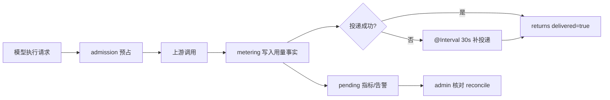

# 模型访问与计费运维

**本文引用的文件**
- [packages/server-ai/src/model-gateway/model-gateway.service.ts](file://packages/server-ai/src/model-gateway/model-gateway.service.ts)
- [packages/server-ai/src/model-gateway/model-gateway.support.ts](file://packages/server-ai/src/model-gateway/model-gateway.support.ts)
- [packages/server-ai/src/model-gateway/gateway-admission-policy.ts](file://packages/server-ai/src/model-gateway/gateway-admission-policy.ts)
- [packages/server-ai/src/model-gateway/model-gateway-call-retention.ts](file://packages/server-ai/src/model-gateway/model-gateway-call-retention.ts)
- [packages/server-ai/src/model-gateway/model-gateway-settings.entity.ts](file://packages/server-ai/src/model-gateway/model-gateway-settings.entity.ts)
- [packages/server-ai/src/model-gateway/model-gateway-call.entity.ts](file://packages/server-ai/src/model-gateway/model-gateway-call.entity.ts)
- [packages/server-ai/src/model-gateway/model-gateway-api-key.entity.ts](file://packages/server-ai/src/model-gateway/model-gateway-api-key.entity.ts)
- [packages/server-ai/src/model-execution/execution-metering.service.ts](file://packages/server-ai/src/model-execution/execution-metering.service.ts)
- [packages/server-ai/src/model-execution/execution-reconciliation.service.ts](file://packages/server-ai/src/model-execution/execution-reconciliation.service.ts)
- [packages/server-ai/src/model-execution/execution-grant.service.ts](file://packages/server-ai/src/model-execution/execution-grant.service.ts)
- [packages/server-ai/src/model-execution/execution-policy.ts](file://packages/server-ai/src/model-execution/execution-policy.ts)
- [packages/server-ai/src/model-execution/execution-policy.defaults.ts](file://packages/server-ai/src/model-execution/execution-policy.defaults.ts)
- [packages/server-ai/src/model-access/model-access-scheduler.service.ts](file://packages/server-ai/src/model-access/model-access-scheduler.service.ts)
- [packages/server-ai/src/membership/membership-period-scheduler.service.ts](file://packages/server-ai/src/membership/membership-period-scheduler.service.ts)
- [packages/server-ai/src/membership/membership-backfill.queue.ts](file://packages/server-ai/src/membership/membership-backfill.queue.ts)
- [packages/server-ai/src/copilot-checkpoint/retention.service.ts](file://packages/server-ai/src/copilot-checkpoint/retention.service.ts)
- [packages/server-ai/src/metrics/application-metrics.ts](file://packages/server-ai/src/metrics/application-metrics.ts)
- [packages/server-ai/src/metrics/metrics.controller.ts](file://packages/server-ai/src/metrics/metrics.controller.ts)
- [packages/contracts/src/ai/model-gateway.model.ts](file://packages/contracts/src/ai/model-gateway.model.ts)
- [packages/contracts/src/ai/model-execution.model.ts](file://packages/contracts/src/ai/model-execution.model.ts)
- [packages/contracts/src/ai/membership.model.ts](file://packages/contracts/src/ai/membership.model.ts)
- [packages/contracts/src/ai/copilot-checkpoint.model.ts](file://packages/contracts/src/ai/copilot-checkpoint.model.ts)
- [packages/config/src/environments/environment.ts](file://packages/config/src/environments/environment.ts)
- [docs/operations/model-execution-runbook.md](file://docs/operations/model-execution-runbook.md)
- [docs/operations/model-execution-alerts.yml](file://docs/operations/model-execution-alerts.yml)

## 目录

- [环境变量与配置项](#环境变量与配置项)
- [定时任务与队列](#定时任务与队列)
- [启动与探活](#启动与探活)
- [日志与指标](#日志与指标)
- [对账与应急](#对账与应急)
- [安全运维](#安全运维)

章节来源：[packages/config/src/environments/environment.ts](file://packages/config/src/environments/environment.ts)（关键符号：environment.secretsEncryptionKey）

## 环境变量与配置项

| 变量名 | 用途 | 默认值 | 来源文件 |
| --- | --- | --- | --- |
| `SECRETS_ENCRYPTION_KEY` | 网关 API Key 明文（`encryptedSecret`）与调用留存的请求/响应体加解密 | `default_secrets_encryption_key`（生产必须覆盖） | `packages/config/src/environments/environment.ts` |
| `API_BASE_URL` | 执行策略默认 `gatewayBaseUrl`：localhost/127.0.0.1/[::1] 会被改写成 `host.docker.internal`，路径末尾自动补 `/api/model-execution/openai/v1` | `http://localhost:3000` | `execution-policy.defaults.ts` |
| `XPERT_EXECUTION_TEST_DATABASE_URL` | 执行域 PG 集成测试；库路径必须以 `/xpert_execution_test_` 开头 | 未设置则 `describe.skip` | `execution-admission.integration.spec.ts` |
| `XPERT_USAGE_READ_TEST_DATABASE_URL` | 会员积分投影只读测试连接 | 未设置则跳过 | `membership-usage-points.spec.ts` |
| `MODEL_USAGE_TEST_DATABASE_URL` | 网关用量台账集成测试连接 | 未设置则跳过 | `model-usage-gateway.integration.spec.ts` |

租户级设置（`tenant_setting.name`）：

| 设置键 | 用途 | 默认值 / 取值范围 |
| --- | --- | --- |
| `modelExecutionPolicy` | 执行策略 JSON：`nativeProtocols`、`chatBridgeProtocols`、`gatewayBaseUrl`、`limits`、`cliPermissions`、`tools` | 策略 schema 默认值：`chatBridgeProtocols` 双协议、`tools` 取内置 CLI 工具 |
| `modelGatewayRequestsPerMinute` | 网关每分钟请求上限（限流窗口 60 秒） | `60`（1–10000） |
| `modelGatewayMaxConcurrentRequests` | 网关并发上限 | `5`（1–100） |
| `modelGatewayCallRetentionEnabled` / `modelGatewayCallRetentionDays` | 调用记录留存开关与天数 | 天数默认 `60`（1–3650） |
| `membershipCnyPerPoint` | 消费积分换算率 | `0.1`（非法或缺失时回退） |
| `copilotCheckpointRetentionEnabled` / `copilotCheckpointRetentionDays` | 检查点留存开关与天数 | 天数默认 `60`（1–3650） |

表级配置与令牌 TTL：

- `model_gateway_settings`：`storeBodies`（默认 `false`）、`bodyRetentionDays`（默认 `7`，接口限制 1–3650）。
- 网关 API Key：形如 `sk-xpert-<10 位前缀>-<随机>`，数据库只存 sha256 `tokenHash` 与可解密的 `encryptedSecret`；有效期枚举 `Days30`/`Days90`/`Days180`/`Permanent`，默认 `Days90`，`Permanent` 对应 `validUntil = null`。
- 执行凭据：`xpert-exec-<43 位 base64url>`，仅存 sha256 `credentialHash`；`expiresAt = min(签发截止, now + leaseSeconds)`（`leaseSeconds` 默认 120），`absoluteExpiresAt = now + maxDurationSeconds`（默认 3600）；默认 `limits`：`maxConcurrentRequests` 4、`requestsPerMinute` 60、`requestIdleSeconds` 600。

章节来源：[packages/server-ai/src/model-gateway/gateway-admission-policy.ts](file://packages/server-ai/src/model-gateway/gateway-admission-policy.ts)（关键符号：GatewayAdmissionPolicy.getAdmissionLimits）、[packages/server-ai/src/model-execution/execution-grant.service.ts](file://packages/server-ai/src/model-execution/execution-grant.service.ts)（关键符号：ModelExecutionGrantService.issue）、[packages/server-ai/src/model-gateway/model-gateway.support.ts](file://packages/server-ai/src/model-gateway/model-gateway.support.ts)（关键符号：resolveKeyExpiration）

## 定时任务与队列

| 位置 | 频率 | 作用 | 多副本语义 | 失败模式 |
| --- | --- | --- | --- | --- |
| `ModelGatewayService.retryPendingSettlements` | 每 5 分钟 | 重试 `settlement_pending` 且 `source='external_api'` 的调用结算 | 无分布式锁，多副本并行（按幂等重试设计） | 单次失败仅记录，下轮再试 |
| `ModelGatewayService.purgeExpiredBodies` | 每小时 | 清空 `bodyExpiresAt <= now` 的加密请求/响应体 | 无锁，幂等 UPDATE | 失败留下过期 body，下轮重试 |
| `ModelGatewayService.purgeExpiredCalls` | 每小时 | 按租户 `modelGatewayCallRetention*` 分批删除调用（批 1000、最多 20 批） | 无锁；`batchLimitReached` 表示需要下轮继续 | 受留存设置约束，异常时不删除 |
| `ModelGatewayService.expireDueApiKeys` | 每 5 分钟 | 到期 API Key 置为过期状态（可传 `tenantId` 定向执行） | 无锁，幂等 UPDATE | 未执行则 Key 依赖鉴权时兜底校验 |
| `ModelGatewayService.failStaleCalls` | 每 5 分钟 | 超过 30 分钟未完成的调用标记 `failed`（`ModelGatewayCallInterrupted`） | 无锁；`MODEL_GATEWAY_UPSTREAM_TIMEOUT_MS` 为该阈值减 60 秒 | 误判风险由调用自身超时中断兜底 |
| `ModelExecutionMeteringService.retry` | 每 30 秒 | 恢复被遗弃的执行调用并补投递用量事实 | 无锁，同一 attempt 投递幂等 | 投递失败计入 `delivery_retry` 事件 |
| `ModelExecutionReconciliationService.retry` | 每 30 秒 | 重放 `appliedAt` 为空的核对审计 | 无锁，按审计记录推进 | 失败保留未应用状态 |
| `MembershipPeriodSchedulerService.settleDueMembershipPeriods` | 每分钟（`0 * * * * *`） | `processDueMembershipPeriods`：结算到期会员周期 | Redis 锁 `scheduler:membership-period-settlement`（TTL 5 分钟），同 tick 仅一个副本执行 | 异常仅 `logger.error`，下分钟重试 |
| `MembershipBackfillQueueService`（Bull 队列 `membership-maintenance`） | 按需入队 | 租户/组织/租户-组织默认会员回填，批 100 | 队列消费，attempts 5、backoff 10 秒、完成后移除 | 重试耗尽后需人工排查队列 |
| `ModelAccessSchedulerService.expireDueGrants` | 每分钟（`0 * * * * *`） | 到期授权失效 + 生命周期批量协调（批 200） | Redis 锁 `scheduler:model-access-lifecycle`（TTL 5 分钟）；游标 `model-access:lifecycle-cursor:v1`（TTL 24 小时） | 锁或游标读写失败降级为告警日志，游标丢失则从头扫描 |
| `CopilotCheckpointRetentionService.runScheduledCleanup` | 每天 03:00（`0 0 3 * * *`） | 按租户留存设置删除检查点与 writes（批 1000、最多 20 批） | PG 会话级 `pg_try_advisory_lock(840139001)`，未拿到锁直接跳过 | 锁不可用跳过本轮；事务内先删 writes 再删 checkpoints |

图表来源：[packages/server-ai/src/model-execution/execution-metering.service.ts](file://packages/server-ai/src/model-execution/execution-metering.service.ts)（关键符号：ModelExecutionMeteringService.retry）、[docs/operations/model-execution-runbook.md](file://docs/operations/model-execution-runbook.md)（关键符号：待核对消费）

章节来源：[packages/server-ai/src/model-gateway/model-gateway.service.ts](file://packages/server-ai/src/model-gateway/model-gateway.service.ts)（关键符号：ModelGatewayService.retryPendingSettlements）、[packages/server-ai/src/membership/membership-backfill.queue.ts](file://packages/server-ai/src/membership/membership-backfill.queue.ts)（关键符号：MEMBERSHIP_MAINTENANCE_QUEUE）、[packages/server-ai/src/copilot-checkpoint/retention.service.ts](file://packages/server-ai/src/copilot-checkpoint/retention.service.ts)（关键符号：RETENTION_CRON_LOCK_KEY）

## 启动与探活

- 本域各模块**无** `onApplicationBootstrap` / `onModuleInit` / `onModuleDestroy` 副作用（grep 未命中）；运行时副作用全部来自 `@nestjs/schedule` 装饰器注册的 `@Cron`/`@Interval` 与 Bull 处理器，随应用启动自动生效。`ModelGatewayService` 的定时方法依赖租户表，首次执行前会 `getOrCreateSettings` 惰性建行。
- 探活/抓取端点：`GET /api/metrics`（`@Public()`，`Content-Type: text/plain; version=0.0.4`），由 `MetricsService.render` 输出全部指标。
- 告警启用：把 `docs/operations/model-execution-alerts.yml` 加入 Prometheus `rule_files`，抓取 `/api/metrics`，在 Alertmanager 按 `severity=warning/critical` 路由；校验命令 `promtool check rules` 与 `promtool test rules docs/operations/model-execution-alerts.test.yml`（仓库根目录执行）。
- 指标由后台扫描刷新：「没有序列」不能解释为积压为零，需另配抓取失败与 worker 存活检查。

章节来源：[packages/server-ai/src/metrics/metrics.controller.ts](file://packages/server-ai/src/metrics/metrics.controller.ts)（关键符号：MetricsController.metrics）、[docs/operations/model-execution-runbook.md](file://docs/operations/model-execution-runbook.md)（关键符号：启用告警）

## 日志与指标

- 指标名：`xpert_model_execution_events_total{event=...}`（事件值取自 `executionError` 的 code，另有 `usage_pending`、`delivery_retry` 等）、`xpert_model_execution_pending{kind="attempts"|"reserved_tokens"|"oldest_seconds"}`；告警还引用 `xpert_agent_invocation_wait{kind="oldest_error_seconds"}`。计费相关通用指标为 `xpert_llm_tokens_total`、`xpert_llm_cost_total`、`xpert_llm_response_latency_seconds`。
- 告警规则与阈值：`XpertExecutionSettlementStalled`（`oldest_seconds > 900` 持续 5 分钟）、`XpertExecutionSettlementBacklog`（`attempts > 20` 持续 10 分钟）、`XpertExecutionDeliveryFailures`（10 分钟内 `delivery_retry` 增量 > 5 持续 5 分钟）、`XpertInvocationContinuationStalled`（`oldest_error_seconds > 600` 持续 5 分钟）。
- 关键日志行：`membership period settlement: scanned=…, settled=…, skipped=…, failed=…`、`model access lifecycle: expired=…, requests=…, grants=…`、`checkpoint retention execute: checkpoints=…, writes=…, batches=…, elapsedMs=…`；失败路径分别用 `logger.error`/`logger.warn`。
- 说明：`oldest_seconds` 从 `startedAt` 起算（不是进入 pending 后的时长）；`reserved_tokens` 表示未知消费占用，不等于实际 Token 或费用；指标不携带用户、会话、密钥或提示词。
- **多副本语义**：同一数据库的多个 API 副本会重复暴露积压快照，指标**不可相加**；仪表盘应按实例展示或在同一部署内取 max，投递事件计数为进程本地计数，按实例分别 `increase`。

章节来源：[packages/server-ai/src/metrics/application-metrics.ts](file://packages/server-ai/src/metrics/application-metrics.ts)（关键符号：ApplicationMetricsRegistry.setModelExecutionPending）、[docs/operations/model-execution-alerts.yml](file://docs/operations/model-execution-alerts.yml)（关键符号：XpertExecutionSettlementBacklog）

## 对账与应急

- 使用具备 `MODEL_GATEWAY_MANAGE` 权限的**已登录管理员**在 tenant 范围操作；CLI 执行凭证与 ChatKit client secret 不能替代管理员身份。个人用量查询仍限制为当前 tenant、organization 与本人。
- 标准四步：① `GET /api/model-execution/admin/pending?take=50&skip=0` 记录 `items[].id`（数据库 UUID，后续 `:id` 用它，而非 `callId`/`attemptId`）；② 已有用量事实但未投递时 `POST /api/model-execution/admin/calls/:id/retry-delivery` 并检查 `delivered`；③ 无事实时从供应商账单/请求回执取得权威证据（接口只接收编号、`evidenceSha256` 与结构化数据，不上传提示词、密钥或完整响应）；④ `POST /api/model-execution/admin/calls/:id/reconcile`，Token 为非负安全整数且 `totalTokens = inputTokens + outputTokens`，`provider_usage` 要求总量大于零，`no_usage` 要求全零并填币种。
- **禁忌**（runbook 明确）：不得以估算补单、不得直接改库、不得手动减去预占；`reconcile` 返回 `status:"applied"` 只证明审计已应用，不等于账本投递完成，正用量仍需检查 `delivered`。
- 每次独立核对使用新的 `operationId`，同一次操作重试必须保持请求体不变；同一调用只能提交一致证据。
- 部署与回退：先应用 `model-execution/migrations/20260930-model-execution.sql`、`20261001-execution-operations.sql`（基础 Agent Invocation / ModelExecution 表存在后），再启动新版 API/worker；回退先停止新任务派发并撤销执行授权，保留账本投递与证据应用 worker 处理完遗留消费。

章节来源：[docs/operations/model-execution-runbook.md](file://docs/operations/model-execution-runbook.md)（关键符号：待核对消费）、[packages/server-ai/src/model-execution/execution-policy.ts](file://packages/server-ai/src/model-execution/execution-policy.ts)（关键符号：ModelExecutionPolicyService.set）

## 安全运维

- **密钥轮换**：`SECRETS_ENCRYPTION_KEY` 同时保护 `model_gateway_api_key.encryptedSecret` 与 `model_gateway_call.encryptedRequest/encryptedResponse`。轮换前必须确认既有密文仍可解密（`decryptSecret` 依赖同一环境变量），否则个人 Key 列表回显与 `admin/calls/:id/body` 取证会失败；`tokenHash`/`credentialHash` 为 sha256，不受该密钥影响。
- **`select:false` 列的读取方式**：`model_gateway_api_key.tokenHash`、`encryptedSecret`，`model_gateway_call.encryptedRequest`、`encryptedResponse`、`settlementContext`、`usageFact` 默认不返回，必须在查询中显式 `addSelect` 才能读取（鉴权加 `tokenHash`、个人列表加 `encryptedSecret`、管理取证加 `encryptedRequest`+`encryptedResponse`、结算重试加 `settlementContext`、执行用量查询加 `usageFact`）。`encryptedSecret`/`tokenHash` 标有 `@Exclude({toPlainOnly:true})`，且 `toPublicApiKey` 只在个人 Key 列表回传 `secret`。
- **凭据最小暴露**：执行凭据与 API Key 仅存哈希/密文，明文只在签发响应中出现一次；执行侧 `watch` 每 5 秒 `revalidate`，撤销/过期/策略收紧会在数秒内中断在途请求。
- **身份隔离**：`/api/model-execution` 的查询、会话与管理端点显式拒绝 API principal；网关与执行的两套 OpenAI 兼容入口为 `@Public()`，安全性完全依赖凭据认证与 scope 校验，切勿依赖登录态或客户端 scope 头（客户端 scope 头不参与租户/组织选择）。
- **留存与合规**：调用体留存默认关闭（`storeBodies=false`），开启后按 `bodyRetentionDays` 自动清理；检查点由 `copilotCheckpointRetentionDays` 控制并在每日 03:00 清理，删除顺序为 writes 先于 checkpoints。

章节来源：[packages/server-ai/src/model-gateway/model-gateway-api-key.entity.ts](file://packages/server-ai/src/model-gateway/model-gateway-api-key.entity.ts)（关键符号：ModelGatewayApiKey.tokenHash）、[packages/server-ai/src/model-gateway/model-gateway-call.entity.ts](file://packages/server-ai/src/model-gateway/model-gateway-call.entity.ts)（关键符号：ModelGatewayCall.encryptedRequest）、[packages/server-ai/src/model-gateway/model-gateway-settings.entity.ts](file://packages/server-ai/src/model-gateway/model-gateway-settings.entity.ts)（关键符号：ModelGatewaySettings.storeBodies）
