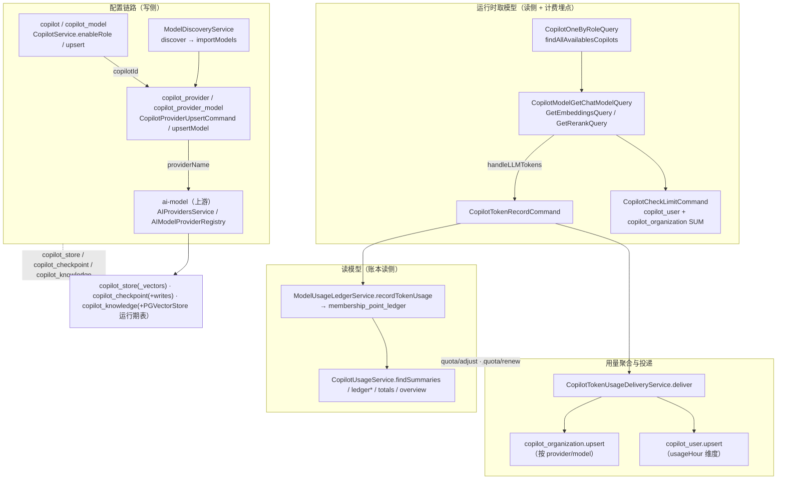

# Copilot 模型配置与用量子专家 —— 01 架构

**本文引用的文件**（相对仓库根，链接均为 `file://`）

- [packages/server-ai/src/app.module.ts](file://packages/server-ai/src/app.module.ts)
- [packages/server-ai/src/copilot/copilot.module.ts](file://packages/server-ai/src/copilot/copilot.module.ts)
- [packages/server-ai/src/copilot/copilot.entity.ts](file://packages/server-ai/src/copilot/copilot.entity.ts)
- [packages/server-ai/src/copilot/copilot.service.ts](file://packages/server-ai/src/copilot/copilot.service.ts)
- [packages/server-ai/src/copilot/copilot.controller.ts](file://packages/server-ai/src/copilot/copilot.controller.ts)
- [packages/server-ai/src/copilot/copilot-model-find.query.ts](file://packages/server-ai/src/copilot/queries/copilot-model-find.query.ts)
- [packages/server-ai/src/copilot/queries/handlers/get-one-by-role.handler.ts](file://packages/server-ai/src/copilot/queries/handlers/get-one-by-role.handler.ts)
- [packages/server-ai/src/copilot-provider/copilot-provider.module.ts](file://packages/server-ai/src/copilot-provider/copilot-provider.module.ts)
- [packages/server-ai/src/copilot-provider/copilot-provider.service.ts](file://packages/server-ai/src/copilot-provider/copilot-provider.service.ts)
- [packages/server-ai/src/copilot-provider/copilot-provider.controller.ts](file://packages/server-ai/src/copilot-provider/copilot-provider.controller.ts)
- [packages/server-ai/src/copilot-provider/models/copilot-provider-model.service.ts](file://packages/server-ai/src/copilot-provider/models/copilot-provider-model.service.ts)
- [packages/server-ai/src/copilot-provider/model-discovery/model-discovery.service.ts](file://packages/server-ai/src/copilot-provider/model-discovery/model-discovery.service.ts)
- [packages/server-ai/src/copilot-model/copilot-model.module.ts](file://packages/server-ai/src/copilot-model/copilot-model.module.ts)
- [packages/server-ai/src/copilot-model/copilot-model.subscriber.ts](file://packages/server-ai/src/copilot-model/copilot-model.subscriber.ts)
- [packages/server-ai/src/copilot-model/queries/handlers/get-chat-model.handler.ts](file://packages/server-ai/src/copilot-model/queries/handlers/get-chat-model.handler.ts)
- [packages/server-ai/src/copilot-model/queries/handlers/get-embeddings.handler.ts](file://packages/server-ai/src/copilot-model/queries/handlers/get-embeddings.handler.ts)
- [packages/server-ai/src/copilot-model/queries/handlers/get-rerank.handler.ts](file://packages/server-ai/src/copilot-model/queries/handlers/get-rerank.handler.ts)
- [packages/server-ai/src/copilot-organization/copilot-organization.service.ts](file://packages/server-ai/src/copilot-organization/copilot-organization.service.ts)
- [packages/server-ai/src/copilot-organization/copilot-organization.entity.ts](file://packages/server-ai/src/copilot-organization/copilot-organization.entity.ts)
- [packages/server-ai/src/copilot-user/copilot-user.service.ts](file://packages/server-ai/src/copilot-user/copilot-user.service.ts)
- [packages/server-ai/src/copilot-user/copilot-token-usage-delivery.service.ts](file://packages/server-ai/src/copilot-user/copilot-token-usage-delivery.service.ts)
- [packages/server-ai/src/copilot-user/commands/handlers/check-limit.handler.ts](file://packages/server-ai/src/copilot-user/commands/handlers/check-limit.handler.ts)
- [packages/server-ai/src/copilot-usage/copilot-usage.module.ts](file://packages/server-ai/src/copilot-usage/copilot-usage.module.ts)
- [packages/server-ai/src/copilot-usage/model-usage/model-usage-ledger.service.ts](file://packages/server-ai/src/copilot-usage/model-usage/model-usage-ledger.service.ts)
- [packages/server-ai/src/copilot-store/copilot-store.entity.ts](file://packages/server-ai/src/copilot-store/copilot-store.entity.ts)
- [packages/server-ai/src/copilot-store/store.ts](file://packages/server-ai/src/copilot-store/store.ts)
- [packages/server-ai/src/copilot-store/vectors/vectors.entity.ts](file://packages/server-ai/src/copilot-store/vectors/vectors.entity.ts)
- [packages/server-ai/src/copilot-checkpoint/copilot-checkpoint.module.ts](file://packages/server-ai/src/copilot-checkpoint/copilot-checkpoint.module.ts)
- [packages/server-ai/src/copilot-checkpoint/retention.service.ts](file://packages/server-ai/src/copilot-checkpoint/retention.service.ts)
- [packages/server-ai/src/copilot-knowledge/copilot-knowledge.service.ts](file://packages/server-ai/src/copilot-knowledge/copilot-knowledge.service.ts)
- [packages/server-ai/src/ai-model/ai-model.module.ts](file://packages/server-ai/src/ai-model/ai-model.module.ts)
- [packages/server-ai/src/ai-model/ai-model.service.ts](file://packages/server-ai/src/ai-model/ai-model.service.ts)
- [packages/server-ai/src/ai-model/ai-model.controller.ts](file://packages/server-ai/src/ai-model/ai-model.controller.ts)

## 目录

- [1. 子域职责边界](#1-子域职责边界)
- [2. 子模块清单](#2-子模块清单)
- [3. 分层结构](#3-分层结构)
- [4. 依赖关系](#4-依赖关系)
- [5. 关键不变量](#5-关键不变量)
- [6. 架构总览](#6-架构总览)
- [7. 结论](#7-结论)

章节来源：[packages/server-ai/src/app.module.ts](file://packages/server-ai/src/app.module.ts)（关键符号：ServerAIModule）

## 1. 子域职责边界

**做什么**

- 模型/provider 配置面：`Copilot`（角色与启用态）、`CopilotProvider`（凭据 + 选项）、`CopilotProviderModel`（自定义模型）、`CopilotModel`（被选中的模型定义）四张配置表及其实体 CRUD 入口。
- 可用 Copilot 解析：`CopilotService.findAllAvailablesCopilots` 综合 membership 计划与 model-access 判定，产出「当前用户此刻能用哪些 Copilot」；`findAvailables` 再为租户级 Copilot 补 `copilot_organization` 用量。
- 运行时取模型入口：`CopilotModelGetChatModelQuery` / `CopilotModelGetEmbeddingsQuery` / `CopilotModelGetRerankQuery` 三个查询处理器真正调用 provider 策略 `getModelInstance` 创建 LangChain 客户端，并把 `CopilotCheckLimitCommand` 的额度判定与 token 记账埋在同一处。
- 用量读侧与配额投递：`CopilotTokenUsageDeliveryService.deliver` 写 `copilot_user` / `copilot_organization` 两个聚合行；`CopilotUsageService` / `ModelUsageLedgerService` 提供 `ledger*` / `summary` / `totals` / `overview` / `details` / `quota/*` / `repair-organization-usage` 读模型。
- 存储与检索面：`copilot_store`（LangGraph BaseStore）、`copilot_checkpoint` / `copilot_checkpoint_writes`（LangGraph checkpointer）、`copilot_knowledge`（few-shot 相似检索）与其向量表维护。

**不做什么**

- 不签发授权、不审批申请：`user_model_grant` / `model_access_request` 属于 `model-access`；本子域只调用 `ModelAccessService.assertCanUseModel` 与 `hasConfiguredOrganizationModels` 等只读判定面。
- 不写积分账本：`membership_point_ledger` 的写入在 `MembershipService.recordUsage`；`ModelUsageLedgerService` 只做 `MembershipPointLedger` 的 `insert().orIgnore()` 落事实行（`pointsDelta: 0`），再委托 `membership.recordUsage` 扣分。
- 不做执行期准入与预占：`model-execution` 的 grant/admission 属于父域另一子专家；本子域不读取 `model_execution_grant`。
- 不实现供应商协议：模型客户端、参数规则、定价快照全部来自 `@xpert-ai/plugin-sdk` 的 `IAIModelProviderStrategy`（由 `AIProvidersService` 从 `AIModelProviderRegistry` 解析）。
- 不做 HTTP 模型兼容层：`/api/openai/v1` 与 `/api/model-execution/*` 不属于本子域。

章节来源：[packages/server-ai/src/copilot/copilot.service.ts](file://packages/server-ai/src/copilot/copilot.service.ts)（关键符号：CopilotService.findAllAvailablesCopilots / CopilotService.findAvailables）

## 2. 子模块清单

实测 `packages/server-ai/src/` 下 `copilot*` 顶层目录为 **9 个**（并非 10 个），加上 `ai-model` 共 **10 个归属目录**。逐目录一句话职责：

| 目录 | 一句话职责 | 关键类 | 路由前缀 |
| --- | --- | --- | --- |
| `copilot` | 角色化模型入口与可用性判定，写 `copilot` + 级联的 `copilot_model` | `CopilotService` / `CopilotController` / `PrimaryModelSmokeService` | `/api/copilot` |
| `copilot-model` | 被选中模型的定义载体与「创建 LangChain 客户端」的三个查询处理器 | `CopilotModelService` / `CopilotModelSubscriber` / `CopilotModelGetChatModelHandler` | `/api/copilot-model` |
| `copilot-provider` | provider 凭据与自定义模型的配置面，含模型发现/导入 | `CopilotProviderService` / `CopilotProviderModelService` / `ModelDiscoveryService` | `/api/copilot-provider` |
| `copilot-organization` | 组织级 token/价格聚合与限额重置 | `CopilotOrganizationService` | `/api/copilot-organization` |
| `copilot-user` | 用户级用量聚合、限额校验命令与用量投递事务 | `CopilotUserService` / `CopilotTokenUsageDeliveryService` | `/api/copilot-user` |
| `copilot-usage` | 用量/账本读模型与配额调整，直查 `membership_point_ledger` | `CopilotUsageService` / `ModelUsageLedgerService` | `/api/copilot-usage` |
| `copilot-store` | LangGraph BaseStore 的 PG 实现与向量检索（表 `copilot_store` + 运行期 `copilot_store_vectors`） | `CopilotMemoryStore` / `CopilotStoreService` | `/api/copilot-store` |
| `copilot-checkpoint` | LangGraph checkpointer 存取、writes 与按租户留存的定时清理 | `CopilotCheckpointService` / `CopilotCheckpointRetentionService` | `/api/copilot-checkpoint` |
| `copilot-knowledge` | few-shot 示例的向量化与相似检索（PGVectorStore） | `CopilotKnowledgeService` | `/api/copilot-knowledge` |
| `ai-model` | provider/model 元数据与插件策略注册表，本子域的上游 | `AIProvidersService` / `AIModelController` | `/api/ai-model` |

章节来源：[packages/server-ai/src/copilot-checkpoint/copilot-checkpoint.module.ts](file://packages/server-ai/src/copilot-checkpoint/copilot-checkpoint.module.ts)（关键符号：CopilotCheckpointModule）、[packages/server-ai/src/ai-model/ai-model.module.ts](file://packages/server-ai/src/ai-model/ai-model.module.ts)（关键符号：AIModelModule）

## 3. 分层结构

- **controller**：声明式 CRUD + 少量自定义端点。`CopilotController`、`CopilotProviderController`、`CopilotUserController` 继承 `CrudController` 并覆写方法；`CopilotModelController`、`CopilotStoreController` 直接继承；`CopilotUsageController` 是纯读/配额控制器；`CopilotCheckpointController` 三个端点先做会话访问断言；`AIModelController` 只有一个 `@Public()` 图标端点。
- **service**：`CopilotService`（可见性与角色）、`CopilotProviderService`（可见凭据）、`CopilotProviderModelService`（自定义模型 + 关闭历史授权）、`ModelDiscoveryService`（远程发现/导入）、`CopilotUserService` / `CopilotOrganizationService`（聚合 upsert）、`CopilotUsageService` / `ModelUsageLedgerService`（读模型与事实落库）、`CopilotCheckpointService` / `CopilotCheckpointRetentionService`、`CopilotKnowledgeService`。
- **CQRS handler**：`copilot`（`CopilotOneByRoleQuery`、`FindCopilotModelsQuery`、`CopilotGetOneQuery`、`GeneratePromptCommand`）、`copilot-model`（`CopilotModelGetChatModelQuery` / `GetEmbeddingsQuery` / `GetRerankQuery`、`CreateModelClientCommand`）、`copilot-provider`（`CopilotProviderUpsertCommand`、`GetCopilotProviderModelQuery`、`CopilotProviderModelParameterRulesQuery`）、`copilot-user`（`CopilotCheckLimitCommand`、`CopilotTokenRecordCommand`、`CopilotModelUsageRecordCommand`）、`ai-model`（`AIModelGetProviderQuery`、`ListModelProvidersQuery`、`AIModelGetIconQuery`）。
- **subscriber**：`CopilotModelSubscriber` 是本子域唯一的 TypeORM 订阅者，只处理 `CopilotModel` 的 `beforeInsert`（回填 tenant/org）。其余模块该层无此项。
- **scheduler / 后台**：`CopilotCheckpointRetentionService.runScheduledCleanup`（`@Cron('0 0 3 * * *')` + `pg_try_advisory_lock`）。本子域没有 `@Interval` 与 Bull 队列消费者。
- **entity**：`Copilot`、`CopilotModel`、`CopilotProvider`、`CopilotProviderModel`、`CopilotOrganization`、`CopilotUser`、`CopilotStore`、`CopilotCheckpoint`、`CopilotCheckpointWrites`、`CopilotKnowledge`、`ModelUsageDeliveryReceipt`。

章节来源：[packages/server-ai/src/copilot-model/copilot-model.subscriber.ts](file://packages/server-ai/src/copilot-model/copilot-model.subscriber.ts)（关键符号：CopilotModelSubscriber.beforeInsert）

## 4. 依赖关系

**出向（本子域依赖外部）**

- `copilot` → `AIModelModule`、`CopilotProviderModule`、`MembershipModule`、`ModelAccessModule`、`TenantModule`、`UserModule`、`CqrsModule`。
- `copilot-provider` → `AIModelModule`、`ModelAccessModule`（`handleConfiguredModelDeleted`）、`forwardRef(UserModule)`、`TenantModule`。
- `copilot-model` → `forwardRef(AgentMiddlewareRuntimeModule)`、`TenantModule`、`UserModule`（`CreateModelClientHandler` 委托 `AgentMiddlewareRuntimeService.createModelClient`）。
- `copilot-user` → `CopilotOrganizationModule`、`ModelAccessModule`、`CopilotUsageModule`、`forwardRef(UserModule)`，并注册 `ModelUsageDeliveryReceipt`。
- `copilot-usage` → `MembershipModule`、`TenantModule`，注册 `CopilotUser`、`CopilotOrganization`、`MembershipPointLedger`、`ModelUsageDeliveryReceipt`。
- `copilot-knowledge` → `CopilotModule`、`DatabaseModule`（`DATABASE_POOL_TOKEN` 的 pg Pool）、`TenantModule`、`UserModule`。
- `ai-model` 只依赖 `DiscoveryModule` + `AIModelProviderRegistry`（plugin-sdk），是**上游**：`copilot` / `copilot-provider` / `copilot-model` / `copilot-user`（经 provider 策略）都经 `AIModelGetProviderQuery` 或 `AIProvidersService.getProvider` 反查策略。

**入向（谁引用本子域）**

- `ServerAIModule` 汇总导入 `CopilotModule`、`CopilotModelModule`、`CopilotProviderModule`、`CopilotUserModule`、`CopilotOrganizationModule`、`CopilotUsageModule`、`CopilotStoreModule`、`CopilotCheckpointModule`、`CopilotKnowledgeModule`。
- 这些 Copilot 模块类名还出现在 `chat`、`ai`、`xpert`、`xpert-agent`、`xpert-agent-execution`、`knowledgebase`、`knowledge-document`、`plugin-resource`、`xpert-toolset`、`middleware-runtime`、`conversation-branch` 等模块文件中（导入或再导出）。

章节来源：[packages/server-ai/src/copilot-provider/copilot-provider.module.ts](file://packages/server-ai/src/copilot-provider/copilot-provider.module.ts)（关键符号：CopilotProviderModule）、[packages/server-ai/src/copilot-usage/copilot-usage.module.ts](file://packages/server-ai/src/copilot-usage/copilot-usage.module.ts)（关键符号：CopilotUsageModule）

## 5. 关键不变量

- **组织级凭据覆盖租户级**：`CopilotProviderService.findVisibleByCopilotIds` 同时查 `organizationId = :organizationId` 与 `organizationId IS NULL` 两支，命中同 `copilotId` 时以「有 organizationId 的那条」替换（`!existing.organizationId && item.organizationId` 才覆盖），因此组织级 provider 永远胜过租户级。
- **凭据在源码中是明文 JSON，不是加密列**：`CopilotProvider.credentials` 声明为 `@Column({ type: 'json', nullable: true })`，无 transformer；消费方 `ModelDiscoveryService.resolve` 直接把它交给 `strategy.discoverModels(provider.credentials ?? {})`。唯一的遮蔽是 `CopilotProviderPublicDto` 上的 `@Exclude() credentials`（组织内读租户级 provider 时用）。
- **`copilot_store_vectors` 未注册为实体**：`copilot-store/vectors/vectors.entity.ts` 整个 `@Entity` 块被注释，表由 `CopilotMemoryStore.CREATE_VECTOR_TABLE` 在 `ensureTableInDatabase` 时以原生 SQL 创建（`PK(prefix, key, field_name)` + 外键到 `copilot_store(prefix, key) ON DELETE CASCADE`）。
- **会员与模型授权双重门控**：`findAllAvailablesCopilots` 先算 `membershipAllowedScopes`，再对不在集合内的 Copilot 追加判定——只有非 `MEMBERSHIP_EDIT` 用户、且 provider 为组织级凭据或该模型凭据可用（`usesOrganizationCredentials` / `hasOrganizationModelCredentials`）时才保留。
- **投递幂等靠回执唯一索引**：`CopilotTokenUsageDeliveryService.deliver` 以 `UQ_model_usage_delivery_receipt_request(tenantId, providerScopeId, requestId)` 做 `orIgnore` 插入，再 `pessimistic_write` 读回；`payloadFingerprint` 不一致直接判非法，`status = 'completed'` 直接短路返回。
- **账本行与扣分分离**：`ModelUsageLedgerService` 先以 `source = model_usage` 落 `pointsDelta: 0` 的事实行，再对 `settlementAmount > 0` 的行调 `membership.recordUsage({ sourceReference: 'model-usage-charge:<ledgerId>' })`。
- **GET 副作用的口径**：本子域内 `CopilotController.findAllCopilots` / `getOne`、`CopilotProviderController` 的模型读取端点、`CopilotUsageController` 的读端点都不写库；「GET 写默认 settings」的隐式行为属于 `model-gateway` 的 `ModelGatewayService.getSettings`，不在本子域。本子域对应的副作用在写路径上：`CopilotService.enableRole(Primary)` 会进一步调用 `MembershipService.ensureScopeInitialized` 写组织默认会员。
- **无 `@Permissions` 的读入口**：`CopilotController.findAllCopilots` / `getOne` / `availables*` / `providers` / `models` / `model-select-options` / `generate-prompt`，以及 `CopilotProviderController` 的 `:providerId/model`、`:providerId/model/:id`、`model-parameter-rules`，均只依赖登录态。

章节来源：[packages/server-ai/src/copilot-provider/copilot-provider.service.ts](file://packages/server-ai/src/copilot-provider/copilot-provider.service.ts)（关键符号：CopilotProviderService.findVisibleByCopilotIds）、[packages/server-ai/src/copilot-user/copilot-token-usage-delivery.service.ts](file://packages/server-ai/src/copilot-user/copilot-token-usage-delivery.service.ts)（关键符号：CopilotTokenUsageDeliveryService.deliver）

## 6. 架构总览

图表来源：[packages/server-ai/src/copilot-model/queries/handlers/get-chat-model.handler.ts](file://packages/server-ai/src/copilot-model/queries/handlers/get-chat-model.handler.ts)（关键符号：CopilotModelGetChatModelHandler.execute）

章节来源：[packages/server-ai/src/copilot/copilot.service.ts](file://packages/server-ai/src/copilot/copilot.service.ts)（关键符号：CopilotService.findAllAvailablesCopilots）、[packages/server-ai/src/copilot-usage/model-usage/model-usage-ledger.service.ts](file://packages/server-ai/src/copilot-usage/model-usage/model-usage-ledger.service.ts)（关键符号：ModelUsageLedgerService.recordTokenUsage）

## 7. 结论

本子域是「配置面 + 用量读侧」的聚合边界：`copilot` / `copilot-provider` / `copilot-model` 决定「用哪个 provider 的哪个模型」，`copilot-model` 的三个查询处理器是全局唯一的 LangChain 客户端创建入口，`copilot-user` / `copilot-organization` 承担聚合写，`copilot-usage` 承担账本读，存储三件套（store / checkpoint / knowledge）服务于 Agent 运行时的记忆与恢复。所有扣费动作最终都交给 `membership`，本子域不持有账本写权限。三处需要在实现文档中展开的风险：provider 凭据明文落库（与「加密列」预期不符）、`copilot_store_vectors` 未注册导致 ORM 与 DDL 漂移、聚合列的读-改-写 upsert 无行锁。

章节来源：[packages/server-ai/src/copilot-provider/model-discovery/model-discovery.service.ts](file://packages/server-ai/src/copilot-provider/model-discovery/model-discovery.service.ts)（关键符号：ModelDiscoveryService.resolve）、[packages/server-ai/src/copilot-store/store.ts](file://packages/server-ai/src/copilot-store/store.ts)（关键符号：CopilotMemoryStore.CREATE_VECTOR_TABLE）
