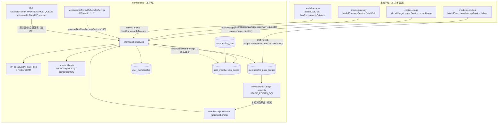

# 模型访问与计费 · 会员与积分账本子专家 —— 01 架构

> 范围 `packages/server-ai/src/membership/`（14 个文件）。本子域只拥有积分账本、会员资格与周期；模型调用、网关协议、用量事实与定价来自上游子域。

**本文引用的文件**（相对仓库根，链接均为 `file://`）

- [membership.service.ts](file://packages/server-ai/src/membership/membership.service.ts)
- [membership-period-scheduler.service.ts](file://packages/server-ai/src/membership/membership-period-scheduler.service.ts)
- [membership-backfill.queue.ts](file://packages/server-ai/src/membership/membership-backfill.queue.ts)
- [membership-backfill.processor.ts](file://packages/server-ai/src/membership/membership-backfill.processor.ts)
- [membership.module.ts](file://packages/server-ai/src/membership/membership.module.ts)
- [membership.controller.ts](file://packages/server-ai/src/membership/membership.controller.ts)
- [dto/membership.dto.ts](file://packages/server-ai/src/membership/dto/membership.dto.ts)
- [membership-plan.entity.ts](file://packages/server-ai/src/membership/membership-plan.entity.ts)
- [user-membership.entity.ts](file://packages/server-ai/src/membership/user-membership.entity.ts)
- [membership-period.entity.ts](file://packages/server-ai/src/membership/membership-period.entity.ts)
- [membership-point-ledger.entity.ts](file://packages/server-ai/src/membership/membership-point-ledger.entity.ts)
- [model-billing.ts](file://packages/server-ai/src/membership/model-billing.ts)
- [membership-usage-points.ts](file://packages/server-ai/src/membership/membership-usage-points.ts)
- [packages/contracts/src/ai/membership.model.ts](file://packages/contracts/src/ai/membership.model.ts)
- [model-usage-ledger.service.ts](file://packages/server-ai/src/copilot-usage/model-usage/model-usage-ledger.service.ts)
- [model-gateway.service.ts](file://packages/server-ai/src/model-gateway/model-gateway.service.ts)
- [model-access.service.ts](file://packages/server-ai/src/model-access/model-access.service.ts)
- [execution-metering.service.ts](file://packages/server-ai/src/model-execution/execution-metering.service.ts)
- [docs/model-execution.md](file://docs/model-execution.md)
- [docs/operations/model-execution-runbook.md](file://docs/operations/model-execution-runbook.md)

## 目录

- [目录](#目录)
- [子域职责边界](#子域职责边界)
- [内部分层](#内部分层)
- [依赖关系](#依赖关系)
- [关键不变量](#关键不变量)
- [核心表与索引](#核心表与索引)
- [架构总览](#架构总览)

章节来源：[membership.module.ts](file://packages/server-ai/src/membership/membership.module.ts)（关键符号：MembershipModule）

## 子域职责边界

**做什么**

- 会员开关：`isMembershipPlanEnabled` / `isMembershipPlanEnabledForScope` / `isMembershipAccessEnabled` / `hasActiveMembershipPlan`，判据是 `FeatureOrganization` 上 `AiFeatureEnum.FEATURE_MEMBERSHIP_PLAN` 的启停，组织级开关命中即优先，未命中回落租户级。
- 资格与额度：`findModelAccess` / `findModelAccessWithOrganizationSelfHeal` / `findPersonalPointsAccess` / `hasConsumableBalance` / `assertCanUse` / `assertRateLimits` / `isModelAllowed` / `resolveModelMultiplierForPlan`。
- 扣费出口：`recordUsage(RecordUsageInput)` 与 `recordGatewayUsage(RecordGatewayUsageInput)`，二者是写入 `membership_point_ledger` 扣减行的唯一通道。
- 人工与系统调整：`adjustUserPoints` / `adjustPersonalPoints` / `applyPersonalPointsAdjustment` / `createLedger` / `createMembershipStatusLedger` / `synchronizeAssignedPlanPoints`。
- 周期与退款：`processDueMembershipPeriods` / `appendMembershipPeriods(InTransaction)` / `renewMembership` / `upgradeCurrentMembershipPeriod` / `reserveFutureMembershipPeriodsForRefund` / `finalizeFutureMembershipPeriodsRefund` / `cancelScheduledMembershipPeriod(s)`。
- 默认会员补齐：Bull 队列 `MEMBERSHIP_MAINTENANCE_QUEUE` 的三类回填 job，以及 `EVENT_FEATURE_ORGANIZATION_UPDATED` 事件订阅。

**不做什么**

- 不调用模型、不做协议转换、不产生用量事实：`model_gateway_call` 与 `source='model_usage'` 事实行分别由 model-execution / model-gateway / copilot-usage 负责。
- 不生成定价：本域只消费调用方传入的 `settlementAmount` / `settlementCurrency` / `pricingStatus` / `exchangeRate`；`settleChargeToCny` 仅做币种归一。
- 不管理授权凭据：`user_model_grant` / `model_execution_grant` / `model_gateway_api_key` 属于 model-access 与 model-gateway。
- 不为未知消费编造扣费：`unpriced`、缺失金额、非 CNY/USD 币种、缺汇率一律折算为 `null`，不会退化成 0。

章节来源：[membership.service.ts](file://packages/server-ai/src/membership/membership.service.ts)（关键符号：MembershipService.isMembershipAccessEnabled / MembershipService.recordUsage）

## 内部分层

| 层 | 文件 | 职责 |
| --- | --- | --- |
| controller | membership.controller.ts + dto/membership.dto.ts | `/api/membership` 的本人查询、套餐管理、管理员用户三类路由，权限面 `MEMBERSHIP_USE` / `MEMBERSHIP_EDIT` |
| service | membership.service.ts | 全部业务规则、事务边界、8 个 advisory 锁、读模型组装 |
| scheduler | membership-period-scheduler.service.ts | `@Cron('0 * * * * *')` + Redis 锁驱动 `processDueMembershipPeriods` |
| queue / processor | membership-backfill.queue.ts / membership-backfill.processor.ts | Bull 队列定义、三类回填 job、事件订阅入口 |
| billing helper | model-billing.ts | `settleChargeToCny` / `pointsFromCny` 纯函数折算 |
| read helper | membership-usage-points.ts | `USAGE_POINTS_SQL` / `USAGE_POINTS_PREDICATE` 与 `readPeriodConsumedPoints` 消费投影 |
| entity | 4 个 `*.entity.ts` | `membership_plan` / `user_membership` / `user_membership_period` / `membership_point_ledger` |

章节来源：[membership.controller.ts](file://packages/server-ai/src/membership/membership.controller.ts)（关键符号：MembershipController.assignUser）

## 依赖关系

**出向（imports）**

- `TypeOrmModule.forFeature([MembershipPlan, UserMembership, MembershipPointLedger, MembershipPeriod, Xpert, User, UserOrganization, Copilot, FeatureOrganization, TenantSetting, Organization])`。
- `TenantModule`（当前 scope 与租户设置）、`RedisModule`（`RedisLockService` 调度锁）、`BullModule.registerQueue({ name: MEMBERSHIP_MAINTENANCE_QUEUE })`、`CqrsModule`、`RouterModule.register([{ path: '/membership', module: MembershipModule }])`。

**入向（被谁消费）**

- model-access 调 `hasConsumableBalance` / `assertCanUse`；model-gateway 调 `recordGatewayUsage`；copilot-usage 经 `ModelUsageLedgerService.recordUsage` 调 `recordUsage`；model-execution 的投递路径经 `CopilotTokenRecordCommand` 汇入同一入口。
- 只有 `MembershipService` 被 `exports`，其余 schema、scheduler、queue 均模块内私有。

**契约要点**

- 记账入参自带金额与定价态，本域不回查定价源；付款人由调用方通过 `modelAccess.billableUserId` 传入并覆盖 `userId`，因此"调用者"与"被扣费者"可以不同。
- 本域输出给读侧的接口是 `membership_point_ledger` 表本身（`membership-usage-points.ts` 的 SQL 以 `source='model_usage'` 事实行为锚点，反查 `model-usage-charge:<id>` 扣减行）。

章节来源：[membership.module.ts](file://packages/server-ai/src/membership/membership.module.ts)（关键符号：MembershipModule）

## 关键不变量

- **幂等键**：`IDX_membership_ledger_source_reference (tenantId, sourceReference)` 唯一；`UQ_membership_ledger_model_usage_request_metric_revision (tenantId, providerScopeId, requestId, metricKey, revision)` 唯一；周期表 `IDX_membership_period_source_reference (tenantId, sourceReference, sourceSequence)` 唯一。
- **锁清单（8 个，全部为 `pg_advisory_xact_lock(hashtext($1), hashtext($2))`）**：`acquireTenantDefaultPlanInitializationLock`、`acquireOrganizationDefaultPlanInitializationLock`、`acquireTenantDefaultMembershipLock`、`acquireMembershipAssignmentLock`、`acquirePersonalPointsLock`、`acquirePersonalPointsSourceLock`、`acquireUsageSourceLock`、`acquireGatewayRequestLock`；连接类型不是 postgres 时直接返回（不加锁）。
- **不可能二次扣费**：`recordUsage` 命中已有 `sourceReference` 即返回既有行；`recordGatewayUsage` 命中已有 `gatewayRequestId` 时聚合 `chargedPoints` / `excessPoints` 并返回首行，不写新行。
- **个人积分是独立账本切片**：超额部分以 `source='personal_usage'` 且 `sourceReference='<ref>:personal'` 再落一行，`membershipId` / `planId` 为空。
- **未知费用 ≠ 免费**：`settleChargeToCny` 仅对 `pricingStatus='free'` 返回 0；`unpriced`、金额非法、币种非 CNY/RMB/USD、USD 缺汇率都返回 `null`。
- **快照冻结**：`planSnapshot` 同时写入 `user_membership` 与 `user_membership_period`；周期激活用 `planFromSnapshot` 还原套餐，套餐后续改动不回溯已签发周期。
- **无限额度语义**：`pointsGranted === null` 时 `pointsRemaining` 返回 `null`（不算额度），`adjustUserPoints` 对无限会员直接拒绝调整。

章节来源：[membership-point-ledger.entity.ts](file://packages/server-ai/src/membership/membership-point-ledger.entity.ts)（关键表：membership_point_ledger）、[membership.service.ts](file://packages/server-ai/src/membership/membership.service.ts)（关键符号：MembershipService.acquireUsageSourceLock / MembershipService.pointsRemaining）

## 核心表与索引

| 表 | 关键列 | 关键索引 |
| --- | --- | --- |
| `membership_point_ledger` | `source`、`pointsDelta numeric(28,10)`、`chargedPoints` / `excessPoints`、`sourceReference(191)`、`gatewayRequestId(191)`、`requestId`+`revision`、`metricKey`、定价列 `pricingStatus` / `priceAmount` / `priceCurrency` / `settlementCurrency` / `settlementAmount` / `exchangeRate` / `pricingBreakdown`、`tokenDetails` jsonb、`executionContext` jsonb | 9 个：7 普通（tenant+source/hour、tenant+user/hour、tenant+provider+model/hour、tenant+membership、model_grant、gateway_request、model_usage_scope_recorded）+ 2 唯一（`source_reference`、`model_usage_request_metric_revision`） |
| `user_membership` | `status`、`source`、`renewalMode`、`currentPeriodStart/End`、`pointsGranted bigint`、`pointsUsed numeric(28,10)`、`pointsTotalUsed`、`planSnapshot` json | `IDX_user_membership_scope_user_status`、`IDX_user_membership_scope_plan` |
| `user_membership_period` | `status`、`periodStart/End`、`pointsGranted`、`pointsUsed`、`source`、`renewalMode`、`sourceReference(191)`、`sourceSequence`、`planSnapshot json NOT NULL` | `IDX_membership_period_source_reference` UNIQUE、`..._membership_status_start`、`..._scope_user_start` |
| `membership_plan` | `code`、`level`、`catalogSourcePlanId`、`status`、`isDefault`、`period`、`includedPoints bigint default 1000`、`allowedModels` / `modelMultipliers` / `rateLimits` json | `IDX_membership_plan_scope_code` UNIQUE、`..._scope_default`、`..._scope_catalog_source`（部分唯一） |

章节来源：[membership-point-ledger.entity.ts](file://packages/server-ai/src/membership/membership-point-ledger.entity.ts)（关键表：membership_point_ledger）、[user-membership.entity.ts](file://packages/server-ai/src/membership/user-membership.entity.ts)（关键表：user_membership）、[membership-period.entity.ts](file://packages/server-ai/src/membership/membership-period.entity.ts)（关键表：user_membership_period）、[membership-plan.entity.ts](file://packages/server-ai/src/membership/membership-plan.entity.ts)（关键表：membership_plan）

## 架构总览

图表来源：[membership.service.ts](file://packages/server-ai/src/membership/membership.service.ts)（关键符号：MembershipService.findUsableMembership / MembershipService.activateScheduledPeriod）、[membership-period-scheduler.service.ts](file://packages/server-ai/src/membership/membership-period-scheduler.service.ts)（关键符号：MembershipPeriodSchedulerService.settleDueMembershipPeriods）

章节来源：[membership-usage-points.ts](file://packages/server-ai/src/membership/membership-usage-points.ts)（关键符号：USAGE_POINTS_SQL / readPeriodConsumedPoints）

## 结论

子域边界可以一句话概括：**上游决定"这笔消费是多少"，本域决定"这笔消费记在谁头上、以什么额度扣、什么时候换期"**。内部由 `MembershipService` 单核承担全部事务与锁，`model-billing.ts` 与 `membership-usage-points.ts` 分别把"折算"和"读投影"抽成无状态函数，scheduler / queue 只负责触发。三条不变量构成安全底线：唯一索引保证重复投递不双扣，8 个 advisory 锁保证同一付款人/同一来源的并发串行，`null`（未知）与 `0`（免费）严格分离。代价集中在 `membership.service.ts` 的体量（约 218 KB）与读路径上的隐式自愈写入，见后续实现与数据流转文档。

章节来源：[docs/model-execution.md](file://docs/model-execution.md)（关键符号：Budget Admission and Metering）、[docs/operations/model-execution-runbook.md](file://docs/operations/model-execution-runbook.md)（关键符号：待核对消费）
