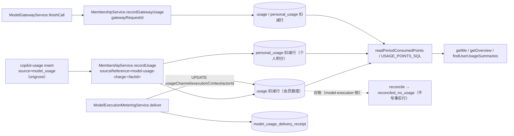

# 模型访问与计费 · 会员与积分账本子专家 —— 03 数据流转

> 只记录源码可验证的流向、状态机、失败语义与变换节点；未在代码中出现的调度与字段一律不写。

**本文引用的文件**（相对仓库根，链接均为 `file://`）

- [membership.service.ts](file://packages/server-ai/src/membership/membership.service.ts)
- [membership-period-scheduler.service.ts](file://packages/server-ai/src/membership/membership-period-scheduler.service.ts)
- [membership-backfill.queue.ts](file://packages/server-ai/src/membership/membership-backfill.queue.ts)
- [membership-backfill.processor.ts](file://packages/server-ai/src/membership/membership-backfill.processor.ts)
- [model-billing.ts](file://packages/server-ai/src/membership/model-billing.ts)
- [membership-usage-points.ts](file://packages/server-ai/src/membership/membership-usage-points.ts)
- [membership-point-ledger.entity.ts](file://packages/server-ai/src/membership/membership-point-ledger.entity.ts)
- [user-membership.entity.ts](file://packages/server-ai/src/membership/user-membership.entity.ts)
- [membership-period.entity.ts](file://packages/server-ai/src/membership/membership-period.entity.ts)
- [membership-plan.entity.ts](file://packages/server-ai/src/membership/membership-plan.entity.ts)
- [packages/contracts/src/ai/membership.model.ts](file://packages/contracts/src/ai/membership.model.ts)
- [model-usage-ledger.service.ts](file://packages/server-ai/src/copilot-usage/model-usage/model-usage-ledger.service.ts)
- [model-gateway.service.ts](file://packages/server-ai/src/model-gateway/model-gateway.service.ts)
- [execution-metering.service.ts](file://packages/server-ai/src/model-execution/execution-metering.service.ts)
- [docs/model-execution.md](file://docs/model-execution.md)
- [docs/operations/model-execution-runbook.md](file://docs/operations/model-execution-runbook.md)

## 目录

- [目录](#目录)
- [账本生命周期](#账本生命周期)
- [状态流转](#状态流转)
- [异步流与失败语义](#异步流与失败语义)
- [数据变换关键节点](#数据变换关键节点)
- [已知风险](#已知风险)

章节来源：[membership.service.ts](file://packages/server-ai/src/membership/membership.service.ts)（关键符号：MembershipService）

## 账本生命周期

**① 写（事实行 + 扣减行共表）**

- 事实行：`ModelUsageLedgerService.recordUsage` / `recordModelUsage` 以 `insert().orIgnore()` 写 `source='model_usage'` 的行（含 `providerScopeId` / `requestId` / `revision` / `metricKey` / `pricingStatus` / `pricingRule` / `pricingBreakdown` / `settlementAmount`），去重靠 `UQ_membership_ledger_model_usage_request_metric_revision`。
- 扣减行：同一方法随后对每条事实调 `MembershipService.recordUsage({ sourceReference: 'model-usage-charge:<factId>' })`，由 `IDX_membership_ledger_source_reference` 唯一约束兜底；个人积分部分追加 `'<ref>:personal'` 行。
- 网关路径：`ModelGatewayService.finishCall` 折算 CNY 后调 `recordGatewayUsage`，`sourceReference = 'model-gateway:<requestId>'`，并通过 `gatewayRequestId` / `gatewayApiKeyId` / `usageChannel=external_api` 标记来源。
- 非消费行：`assignment` / `grant` / `renew` / `upgrade` / `adjustment` / `status_change` / `personal_adjustment` 由 `createLedger` / `createMembershipStatusLedger` / `adjustUserPoints` / `adjustPersonalPoints` / `applyPersonalPointsAdjustment` 写入，`pointsDelta` 可正可负。

**② 投递回执**

- 执行侧事实落库后由 `ModelExecutionMeteringService.deliver` 投递，回执落在 `model_usage_delivery_receipt`；交付成功后用一条 UPDATE 把扣减行补齐：`SET "usageChannel"=fact."usageChannel", "executionContext"=fact."executionContext", "actorId"=fact."actorId"`，条件为 `charge."sourceReference" IN ('model-usage-charge:'||fact.id, 'model-usage-charge:'||fact.id||':personal')`，随后写 `usageDeliveredAt` 与终态。
- 因此账本行在投递完成前是"部分字段"状态：`usageChannel` / `executionContext` / `actorId` 缺失不代表没扣费。

**③ 读模型**

- `readPeriodConsumedPoints` 以 `USAGE_POINTS_SQL` 把 `source='model_usage'` 的事实行换算为本期消费：`free → 0`；`priced → 优先取关联扣减行（含 excessPoints），否则取同 `gatewayRequestId` 的扣减行，再退化为 `settlementAmount / cnyPerPoint`；其余状态 → `NULL`。非 `model_usage` 行直接取 `ABS(pointsDelta) + excessPoints`。
- `USAGE_POINTS_PREDICATE` 用作用域化的反连接集合，过滤掉"已被事实行覆盖的扣减行"，避免双重计数（注释明确：相关子查询会让年度概览不可用）。
- 汇率参数来自 `resolveMembershipPointRate`（`TenantSetting.membershipCnyPerPoint`，非法或缺失回落 `DEFAULT_MEMBERSHIP_CNY_PER_POINT = 0.1`）。

**④ 结算与对账**

- 结算金额由上游定价与 `settleChargeToCny` 决定，本域只做额度分配；`recordUsage` 内的两段扣减即"结算落账"。
- 对账属 model-execution 侧：`reconcile` 写审计（`model_execution_reconciliation`），`no_usage` 走 `errorCode='reconciled_no_usage'` 并释放预占；运行手册明确**不得以估算补单、不得直接改库、不得手动减去预占**，且 `reconcile` 返回 `applied` 不代表账本已投递。

图表来源：[model-usage-ledger.service.ts](file://packages/server-ai/src/copilot-usage/model-usage/model-usage-ledger.service.ts)（关键符号：ModelUsageLedgerService.recordUsage）、[execution-metering.service.ts](file://packages/server-ai/src/model-execution/execution-metering.service.ts)（关键符号：ModelExecutionMeteringService.deliver）

章节来源：[membership-usage-points.ts](file://packages/server-ai/src/membership/membership-usage-points.ts)（关键符号：USAGE_POINTS_SQL / USAGE_POINTS_PREDICATE）、[membership-point-ledger.entity.ts](file://packages/server-ai/src/membership/membership-point-ledger.entity.ts)（关键表：membership_point_ledger）

## 状态流转

| 承载 | 取值与迁移 | 驱动 |
| --- | --- | --- |
| `user_membership.status` | `active` ⇄ `paused`；`active → expired`（Manual 到期未续） | `pauseUser` / `resumeUser` / `findUsableMembership` + `renewMembership` |
| `user_membership.source` | `tenant_default` / `organization` / `admin` / `external`（激活期次时被期次的 `source` 覆盖） | `assignUser` / `ensureTenantDefaultMembership` / `activateScheduledPeriod` |
| `user_membership.renewalMode` | `auto`（无可用期次时自动续费）/ `manual`（置 Expired） | `renewMembership` / `assignUser` |
| `user_membership_period.status` | `scheduled → active → completed`；`scheduled → refund_pending → cancelled`；`scheduled → cancelled` | `activateScheduledPeriod` / `reserveFutureMembershipPeriodsForRefund` / `finalizeFutureMembershipPeriodsRefund` / `cancelScheduledMembershipPeriod` |
| `membership_plan.status` | `active` / `archived`（archived 不可为默认套餐、不可续费） | `archivePlan` / `updatePlan` / `assertDefaultPlanIsActive` |
| 账本 `pricingStatus` | `priced` / `free` / `unpriced`（上游写入）；读模型额外出现未解析的 `NULL`（`pending` 语义） | `ModelUsageLedgerService.recordUsage` 写入，`USAGE_POINTS_SQL` 读取 |
| 账本 `source` | 消费类 `model_usage` / `usage` / `personal_usage`；调整类 `assignment` / `grant` / `renew` / `upgrade` / `adjustment` / `status_change` / `personal_adjustment` | 各写入口 |

口径提示：`pointsUsed` 只在扣减成功时增加；`pointsTotalUsed` 仅在换期/续费时结转；`excessPoints > 0` 表示"已知但未扣满"，与 `pricingStatus='unpriced'`（未知）不是同一件事。

章节来源：[packages/contracts/src/ai/membership.model.ts](file://packages/contracts/src/ai/membership.model.ts)（关键符号：MembershipStatusEnum / MembershipPeriodStatusEnum / MembershipLedgerSourceEnum）、[membership.service.ts](file://packages/server-ai/src/membership/membership.service.ts)（关键符号：MembershipService.findUsableMembership / MembershipService.activateScheduledPeriod）

## 异步流与失败语义

| 触发 | 实现 | 失败语义 |
| --- | --- | --- |
| `@Cron('0 * * * * *')` 周期结算 | `MembershipPeriodSchedulerService.settleDueMembershipPeriods` → `processDueMembershipPeriods(limit=100)` | 未拿到 Redis 锁（`scheduler:membership-period-settlement`，TTL 5 分钟）则整轮跳过；单条会员结算失败只累加 `failed`；`runWithLock` 抛错时仅 `logger.error` |
| Bull `MEMBERSHIP_MAINTENANCE_QUEUE` | 三类 job：`tenant-default-membership-backfill` / `tenant-organization-default-membership-backfill` / `organization-default-membership-backfill`，`concurrency: 2`、批 100 | `attempts: 5` + `backoff: 10_000` + `removeOnComplete: true`；耗尽后需人工查队列 |
| `EVENT_FEATURE_ORGANIZATION_UPDATED` | `MembershipBackfillProcessor.enqueueBackfillWhenFeatureEnabled` | 仅当 `featureCode = FEATURE_MEMBERSHIP_PLAN` 且 `false → true` 才入队；组织初始化还需触发者具备编辑权限 |
| Redis 锁 | `RedisLockService.runWithLock`（调度） | 锁失败/异常只降级为日志，本轮不执行 |
| PG advisory 锁 | 8 个 `acquire*Lock` | 阻塞等待，事务结束释放；连接类型非 postgres 时静默跳过加锁 |
| 队列游标推进 | job 返回 `nextCursor` 时入队下一批 | `nextCursor` 为 null 即停止，无隐含轮询 |

章节来源：[membership-period-scheduler.service.ts](file://packages/server-ai/src/membership/membership-period-scheduler.service.ts)（关键符号：MembershipPeriodSchedulerService.settleDueMembershipPeriods）、[membership-backfill.queue.ts](file://packages/server-ai/src/membership/membership-backfill.queue.ts)（关键符号：MEMBERSHIP_MAINTENANCE_QUEUE）、[membership-backfill.processor.ts](file://packages/server-ai/src/membership/membership-backfill.processor.ts)（关键符号：MembershipBackfillProcessor.enqueueBackfillWhenFeatureEnabled）

## 数据变换关键节点

- **币种折算**：`settleChargeToCny(charge, usdToCnyRate)` —— `unpriced → null`；`free → { amount: 0, currency: 'CNY', exchangeRate: null }`；`CNY|RMB → 原值 + 汇率 1`；`USD → amount × rate`（汇率缺失/非法返回 `null`）；其它币种返回 `null`。汇率来源为环境变量 `MODEL_BILLING_USD_TO_CNY_RATE`。
- **积分换算**：`pointsFromCny(amount, cnyPerPoint = 0.1)` = `amount / cnyPerPoint`，四舍五入到 10 位小数；反向 `cnyFromPoints(points, cnyPerPoint)` 写回账本的 `settlementAmount`。
- **倍率**：`resolveModelMultiplier(plan, provider, model)` 取首个匹配规则（缺 provider/model 视作通配，`'*'` 亦通配），默认 1 且下限 0；`applySettlementMultiplier` 乘在 **CNY 结算金额**上，再换算积分——因此倍率影响扣减积分而非原始价格。
- **额度分配**：`pointsRemaining = max(0, pointsGranted - pointsUsed)`，`pointsGranted === null` 时视为无限；会员额度扣完后剩余积分走个人积分余额，仍不足部分记 `excessPoints`。
- **周期**：`periodEndFor(start, period)` 与 `addMonths` 计算期次结束（月末日期做夹取）；`usageHour` 由 `formatInUTC0(new Date(), USAGE_HOUR_FORMAT)` 生成，未传时由服务端补。
- **快照**：`createPlanSnapshot`（写期次/会员）→ `copyPlanSnapshot`（外部履约传入的快照改写 `planId`）→ `planFromSnapshot`（激活期次时还原 `plan` 对象）→ `hydrateMembershipPlanSnapshot`（读取时以快照覆盖 `plan`）。

章节来源：[model-billing.ts](file://packages/server-ai/src/membership/model-billing.ts)（关键符号：settleChargeToCny / pointsFromCny / MODEL_BILLING_USD_TO_CNY_RATE）、[membership.service.ts](file://packages/server-ai/src/membership/membership.service.ts)（关键符号：MembershipService.createPlanSnapshot / MembershipService.planFromSnapshot / MembershipService.pointsRemaining）

## 已知风险

- **`model_usage` 与扣减行共表**：同一张 `membership_point_ledger` 同时承载"事实"与"扣减"，任何列语义变更会同时影响 copilot-usage、model-execution、model-gateway 与读模型；`source` 取值是唯一区分依据。
- **硬编码前缀**：`'model-usage-charge:'` 与 `':personal'` 出现在 `model-usage-ledger.service.ts`、`membership-usage-points.ts`、`execution-metering.service.ts` 三处，改一处即造成统计口径分裂。
- **读模型返回 `NULL` 的三种含义**：`unpriced`、缺金额、缺汇率都映射为 `NULL`，前端若不区分会把"未知"渲染成"0 消费"。
- **自愈写入**：读路径可能开户/换期/把 Manual 会员改 `Expired`，同一请求不同时点的返回可能不一致。
- **`recordUsage` 的静默 `null` 返回**：金额为 0、`Direct` 访问、开关关闭三种情况都不落账本，调用方忽略返回值即出现"无消费证据"。
- **多副本**：`@Cron` 依赖 Redis 锁、Bull 无 jobId 去重；账本类指标属进程本地量，跨副本不可相加（与 [docs/operations/model-execution-runbook.md](file://docs/operations/model-execution-runbook.md) 的口径一致）。
- **预占与账本解耦**：账本只反映"已知消费"，未派发/未知结果仍占用 `model_gateway_call.reservedTokens`，账本余额正常并不代表系统无待对账预占。

章节来源：[docs/operations/model-execution-runbook.md](file://docs/operations/model-execution-runbook.md)（关键符号：待核对消费 / 禁忌）、[membership-usage-points.ts](file://packages/server-ai/src/membership/membership-usage-points.ts)（关键符号：USAGE_POINTS_SQL）

## 结论

账本的数据流可以概括为一条"事实先行、扣减幂等、读侧反连接、状态靠期次"的链路：上游先写 `model_usage` 事实，再以事实 id 为来源键写入扣减行，个人积分缺口另开 `:personal` 行；交付后回填执行上下文；读模型以事实行为锚点做去重聚合；会员状态由 `user_membership_period` 的期次推进驱动，`planSnapshot` 保证历史期次口径不被套餐改动污染。风险集中在单表多义、硬编码前缀与读路径副作用三处，属于"口径问题"而非"扣费正确性"问题——后者由唯一索引与 advisory 锁守住。

章节来源：[membership.service.ts](file://packages/server-ai/src/membership/membership.service.ts)（关键符号：MembershipService.recordUsage / MembershipService.recordGatewayUsage）、[membership-period.entity.ts](file://packages/server-ai/src/membership/membership-period.entity.ts)（关键表：user_membership_period）
