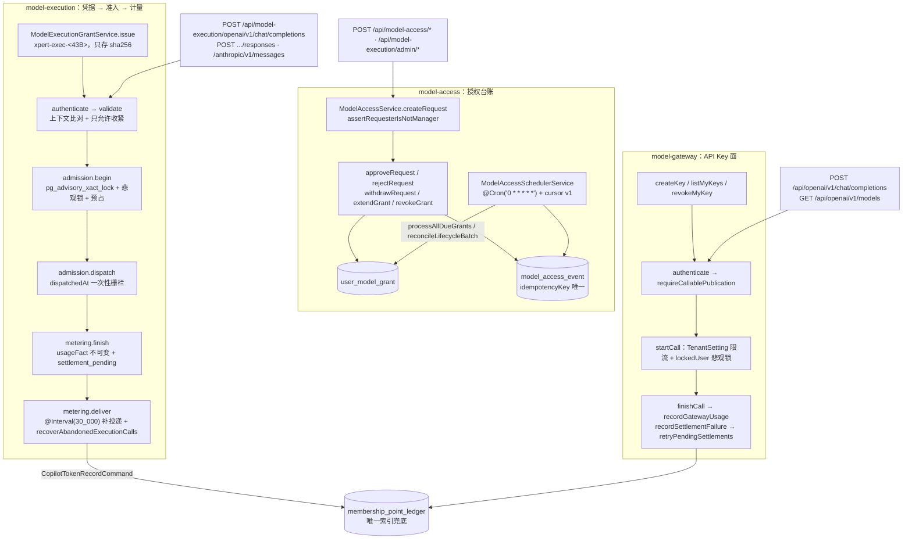

# 模型访问与执行子专家 —— 01 架构

> 子域范围：`packages/server-ai/src/model-access`（10 个源文件 + 5 spec）、`model-execution`（32 个 `.ts` 源文件 + 3 个 SQL 迁移 + 24 spec）、`model-gateway`（20 个源文件 + 5 spec）。只写这三个目录内可验证的事实；积分账本本体与 Copilot 配置仅作为依赖边界出现。

**本文引用的文件**（相对仓库根，链接均为 `file://`）

- [docs/model-execution.md](file://docs/model-execution.md)
- [docs/operations/model-execution-runbook.md](file://docs/operations/model-execution-runbook.md)
- [packages/server-ai/src/app.module.ts](file://packages/server-ai/src/app.module.ts)
- [packages/server-ai/src/model-access/model-access.module.ts](file://packages/server-ai/src/model-access/model-access.module.ts)
- [packages/server-ai/src/model-access/model-access.controller.ts](file://packages/server-ai/src/model-access/model-access.controller.ts)
- [packages/server-ai/src/model-access/model-access.service.ts](file://packages/server-ai/src/model-access/model-access.service.ts)
- [packages/server-ai/src/model-access/model-access-scheduler.service.ts](file://packages/server-ai/src/model-access/model-access-scheduler.service.ts)
- [packages/server-ai/src/model-execution/model-execution.module.ts](file://packages/server-ai/src/model-execution/model-execution.module.ts)
- [packages/server-ai/src/model-execution/execution-grant.service.ts](file://packages/server-ai/src/model-execution/execution-grant.service.ts)
- [packages/server-ai/src/model-execution/execution-admission.service.ts](file://packages/server-ai/src/model-execution/execution-admission.service.ts)
- [packages/server-ai/src/model-execution/execution-metering.service.ts](file://packages/server-ai/src/model-execution/execution-metering.service.ts)
- [packages/server-ai/src/model-execution/execution-recovery.ts](file://packages/server-ai/src/model-execution/execution-recovery.ts)
- [packages/server-ai/src/model-execution/execution.entity.ts](file://packages/server-ai/src/model-execution/execution.entity.ts)
- [packages/server-ai/src/model-gateway/model-gateway.module.ts](file://packages/server-ai/src/model-gateway/model-gateway.module.ts)
- [packages/server-ai/src/model-gateway/model-gateway.service.ts](file://packages/server-ai/src/model-gateway/model-gateway.service.ts)
- [packages/server-ai/src/model-gateway/gateway-admission-policy.ts](file://packages/server-ai/src/model-gateway/gateway-admission-policy.ts)
- [packages/server-ai/src/model-gateway/openai.controller.ts](file://packages/server-ai/src/model-gateway/openai.controller.ts)
- [packages/server-ai/src/model-gateway/model-gateway-call.entity.ts](file://packages/server-ai/src/model-gateway/model-gateway-call.entity.ts)
- [packages/server-ai/src/copilot-user/commands/token-record.command.ts](file://packages/server-ai/src/copilot-user/commands/token-record.command.ts)

## 目录

- [目录](#目录)
- [子域职责边界](#子域职责边界)
- [子模块与分层结构](#子模块与分层结构)
- [依赖关系](#依赖关系)
- [关键不变量](#关键不变量)
- [架构总览](#架构总览)

章节来源：[packages/server-ai/src/model-execution/model-execution.module.ts](file://packages/server-ai/src/model-execution/model-execution.module.ts)（关键符号：ModelExecutionModule）

## 子域职责边界

**做什么**

- `model-access`：把「谁能用哪个模型」变成可审批、可过期、可撤销的台账。`ModelAccessService.getCatalog` / `getExternalCatalog` 产出可见目录，`resolveModelAccess` / `canUseCatalogModels` / `assertCanUseModel` 回答单次可见性，`createRequest` / `approveRequest` / `rejectRequest` / `withdrawRequest` / `extendGrant` / `revokeGrant` 驱动状态迁移，`writeEvent` 写 `ModelAccessEvent` 留痕。
- `model-execution`：把「一次执行」变成一次性凭据与可结算的用量事实。`ModelExecutionGrantService.issue` 签发只存 hash 的凭据，`ModelExecutionAdmissionService.begin` 在 DB 级串行化并预占 token，`ModelExecutionMeteringService.finish` 落不可变 usage fact 后投递账本，`ModelExecutionChatService.execute` 承载 Chat 协议执行。
- `model-gateway`：把「外部 API Key」变成受 publication 约束的调用面。`ModelGatewayService.authenticate` 解析 Key 身份，`requireCallablePublication` 做 external model id → publication 映射与可用性判定，`startCall` / `finishCall` 负责限流预占、执行与结算，`recordSettlementFailure` / `retryPendingSettlements` 负责结算补偿。
- 对外协议适配：`/api/openai/v1`（API key 语义）与 `/api/model-execution/openai/v1`、`/api/model-execution/anthropic/v1/messages`（执行凭据语义）三套入口并存，共用 `executeGatewayChat` 执行器。

**不做什么**

- 不做积分账本本体与周期结算：`MembershipService.recordUsage` / `recordGatewayUsage` 与 `MembershipPointLedger` 的唯一索引属于会员子域；本子域只产出事实与调用 `recordGatewayUsage`（[packages/server-ai/src/membership/membership.service.ts](file://packages/server-ai/src/membership/membership.service.ts)）。
- 不做 Copilot/Provider 配置解析：Provider 凭据、模型目录、native 客户端来自 `CopilotModelService`、`AIProvidersService` 与插件 `NativeModelClient`；本子域只消费已解析结果。
- 不执行 Agent/CLI 进程、不做桌面控制与沙箱：只签发凭据、做准入与计量；`docs/model-execution.md` 明确「Task scheduling and desktop control remain outside its scope」。
- 不从请求头或请求体推断租户/组织/付款人：`execution-grant.service.ts` 开头声明 scope 来自自有会话而非 bearer header；`model-gateway/openai.controller.ts` 开头声明客户端 scope header 不选择租户或组织。
- 不把估算当消费：无权威用量事实时不生成扣费证据，未知结果保留预占等待人工对账。

章节来源：[packages/server-ai/src/model-access/model-access.service.ts](file://packages/server-ai/src/model-access/model-access.service.ts)（关键符号：ModelAccessService.getCatalog）

## 子模块与分层结构

| 层 | `model-access` | `model-execution` | `model-gateway` |
| --- | --- | --- | --- |
| controller | `ModelAccessController`（前缀 `/api/model-access`） | `ModelExecutionOpenAIController` / `ModelExecutionNativeController`（`@Public()`）、`ModelExecutionQueryController` / `ModelExecutionSessionController` / `ModelExecutionAdminController`（登录态） | `ModelGatewayController`（`/api/model-gateway`）、`ModelGatewayOpenAIController`（`/api/openai/v1`，`@Public()`） |
| service | `ModelAccessService` | `ModelExecutionGrantService` / `ModelExecutionAdmissionService` / `ModelExecutionMeteringService` / `ModelExecutionChatService` / `ModelExecutionReconciliationService` / `ModelExecutionPolicyService` / `AssistantExecutionPolicyService` / `ModelExecutionSourceService` / `ModelExecutionNativeProviderService` | `ModelGatewayService` |
| 纯函数/策略 | `modelAccessEndOfDay` | `assertExecutionAdmission`、`hashExecutionCredential`、`recoverAbandonedExecutionCalls`、`tightenExecutionLimits`、`executionToolModels`、`parseNativeRequest`、`settleChargeToCny`（会员侧） | `purgeModelGatewayCallBatch`、`GatewayAdmissionPolicy`、`executeGatewayChat` |
| scheduler | `ModelAccessSchedulerService`（`@Cron('0 * * * * *')`） | `@Interval(30_000)`：metering 补投递、reconciliation 重试 | 5 个 `@Interval`：结算重试（5 分钟）、body 清理（1 小时）、调用留存清理（1 小时）、Key 过期（5 分钟）、stale call 失败化（5 分钟） |
| entity | `ModelAccessRequest` / `UserModelGrant` / `ModelAccessEvent` | `ModelExecutionGrant` / `CliSession` / `ModelExecutionReconciliation` | `ModelGatewayPublication` / `ModelGatewayApiKey` / `ModelGatewaySettings` / `ModelGatewayCall` |
| 事件订阅 / 队列 | 该模块无此项 | 该模块无此项（无 `@Processor`、无 subscriber） | 该模块无此项 |

分层要点：三目录都不含 CQRS handler，配置与解析走别的模块；`model-execution` 通过 `CommandBus` 只做**出向**投递（`CopilotTokenRecordCommand`），不注册命令处理器。

章节来源：[packages/server-ai/src/model-execution/model-execution.module.ts](file://packages/server-ai/src/model-execution/model-execution.module.ts)（关键符号：ModelExecutionModule）

## 依赖关系

**出向**

- `ModelAccessModule` → `AIModelModule`、`MembershipModule`、`RedisModule`、`CqrsModule`，并注册 `ModelAccessRequest` / `UserModelGrant` / `ModelAccessEvent` / `ModelGatewayPublication` / `Copilot` / `CopilotProviderModel` / `User` / `Organization` / `FeatureOrganization`；同时 `RouterModule.register([{ path: '/model-access', module: ModelAccessModule }])` 挂前缀。
- `ModelExecutionModule` → `forwardRef(() => XpertModule)`、`ModelAccessModule`、`AgentMiddlewareRuntimeModule`、`CqrsModule`，注册 `MembershipPointLedger` / `ShellProcessExecution` / `ShellCliExecution` / `AgentInvocationEntity` / `AgentRuntimeBindingEntity` / `ModelExecutionGrant` / `CliSession` / `ModelGatewayCall` / `ModelExecutionReconciliation` / `TenantSetting` / `ChatConversation` / `Copilot` 等实体。
- `ModelGatewayModule` → `ModelAccessModule`、`MembershipModule`、`AgentMiddlewareRuntimeModule`、`CqrsModule`，并直接注册 `TenantSetting` 与 `User`（`startCall` 的悲观锁对象）。
- 关键跨域调用：`ModelAccessService.resolveExternalModelAccess`（网关可用性）、`MembershipService.recordGatewayUsage`、`MembershipService.findModelAccess`、`AgentMiddlewareRuntimeService.createModelClient`、`CopilotTokenRecordCommand` → `CopilotUsageService`/`ModelUsageDeliveryReceipt`。

**入向**

- `ServerAIModule` 同时导入 `ModelAccessModule`、`ModelGatewayModule`、`ModelExecutionModule`。
- 反向依赖集中在执行侧：`ModelExecutionModule` 对 `XpertModule` 使用 `forwardRef`；`ModelExecutionModule` 导出 `AssistantExecutionPolicyService`、`ModelExecutionPolicyService`、`ModelExecutionGrantService`、`ModelExecutionMeteringService` 供宿主（runner/launcher）复用；`ModelGatewayModule` 导出 `ModelGatewayService`。
- 组织/用户生命周期事件会反向驱动本域：`ModelGatewayService.revokeOrganizationKeysForRemovedUser` 与 `ModelAccessService.closeOrganizationAccessForRemovedUser` 由组织成员移除路径调用；`handleCopilotStateChanged` / `handleConfiguredModelDeleted` 由 Copilot 配置变更路径调用。

章节来源：[packages/server-ai/src/model-gateway/model-gateway.module.ts](file://packages/server-ai/src/model-gateway/model-gateway.module.ts)（关键符号：ModelGatewayModule）

## 关键不变量

- **凭据只存 hash**：`ModelExecutionGrant.credentialHash`（`select:false` + 唯一索引，明文仅在 `issue` 返回一次）、`ModelGatewayApiKey.tokenHash`（`select:false` + 唯一）与 `encryptedSecret`（`select:false`，读列表需显式 `addSelect`）。`ModelGatewayService.authenticate` 与 `listMyKeys` 分别显式 `addSelect('apiKey.tokenHash')`、`addSelect('apiKey.encryptedSecret')`。
- **一次执行一份授权**：`docs/model-execution.md` 明确 grant 绑定单个 CLI 会话 / 单次 Agent Invocation / Shell 内单个 CLI 子执行，不能当作用户或容器的通用模型 Key；同一容器内的不同执行各拿各的授权与计量。
- **客户端 scope header 不选择租户/组织**：`model-gateway/openai.controller.ts` 开头 Invariants 写死「client scope headers do not select the gateway's tenant or organization」；`execution-grant.service.ts` 开头声明 scope 只从自有会话解析。
- **快照只会更严**：`ModelExecutionGrantService.validate` 中 `tightenExecutionLimits(grant.limits, policy.limits)` 只收紧既有快照，`validate` 对 `models` 做 `capabilities` / `protocols` 求交裁剪；放宽策略不会给已签发 grant 增加模型、协议或预算。默认模型被移除抛 `Model`。
- **无隐式预算、未知 ≠ 免费**：`docs/model-execution.md` 明写 token budget 无隐式默认，省略 `tokenBudget` / `userTokenBudget` 即回落到普通配额链路；「an unknown charge must remain distinct from a free call」。
- **usage fact 先落再投递**：`execution-metering.service.ts` 开头注释「persist provider facts before delivering them to the existing ledger」，同一 attempt 重试沿用同一 `attemptId`，估算永不变成扣费。
- **丢失 worker 不释放不确定尝试的预占**：`execution-metering.service.ts` 的 `@Interval(30_000) retry` 内注释「A lost worker does not release an uncertain provider attempt's reservation」，与 `recoverAbandonedExecutionCalls` 的 SQL 分支（未派发 `failed` 并清零，已派发保留 `reservedTokens`）一致。
- **DB 约束兜底**：`model_gateway_call` 的 `CHK_model_gateway_call_source` 强制 `external_api ⇒ apiKeyId + publicationId 非空且 grantId 为空`、`execution_grant` 反之；`reservedTokens >= 0`；`model_execution_grant` 迁移含 `expiresAt <= absoluteExpiresAt` 与状态 CHECK（`pending|active|revoked`）。
- **幂等键**：`ModelAccessEvent.idempotencyKey` + `IDX_model_access_event_idempotency` 唯一（`writeEvent` 捕获唯一冲突后按 `(tenantId, idempotencyKey)` 回读），事件键形如 `request:{id}:requested`、`grant:{id}:expired`、`grant:{id}:revoked`；`model_gateway_call.requestId` 唯一；`model_usage_delivery_receipt` 以 `(tenantId, providerScopeId, requestId)` 唯一判定投递是否完成。

章节来源：[packages/server-ai/src/model-execution/execution-metering.service.ts](file://packages/server-ai/src/model-execution/execution-metering.service.ts)（关键符号：ModelExecutionMeteringService.retry）

## 架构总览

图表来源：[packages/server-ai/src/model-execution/execution-admission.service.ts](file://packages/server-ai/src/model-execution/execution-admission.service.ts)（关键符号：ModelExecutionAdmissionService.begin）、[packages/server-ai/src/model-gateway/model-gateway.service.ts](file://packages/server-ai/src/model-gateway/model-gateway.service.ts)（关键符号：ModelGatewayService.startCall）

章节来源：[packages/server-ai/src/model-execution/execution-grant.service.ts](file://packages/server-ai/src/model-execution/execution-grant.service.ts)（关键符号：ModelExecutionGrantService.issue）

## 结论

三目录构成一条「可见性 → 审批台账 → 一次性凭据 → DB 级准入 → 不可变用量事实 → 幂等投递」的链：`model-access` 用部分唯一索引 + 事件幂等键保证授权口径唯一且可追溯，`model-execution` 用 advisory 锁 + 悲观锁 + 一次性派发栅栏保证同一付款人串行、未知消费不释放，`model-gateway` 用 Key 哈希 + publication 可见性 + 租户级限流把外部调用收敛到同一执行器与同一账本出口。四条硬边界（不推断 scope、不隐式预算、不估算扣费、不越界改库）写在 `docs/model-execution.md`、`docs/operations/model-execution-runbook.md` 与源码头部注释中，本子域的实现细节见同目录 `02-实现.md`、`05-接口.md`、`06-测试.md`。

章节来源：[packages/server-ai/src/model-gateway/openai.controller.ts](file://packages/server-ai/src/model-gateway/openai.controller.ts)（关键符号：ModelGatewayOpenAIController.chat）
