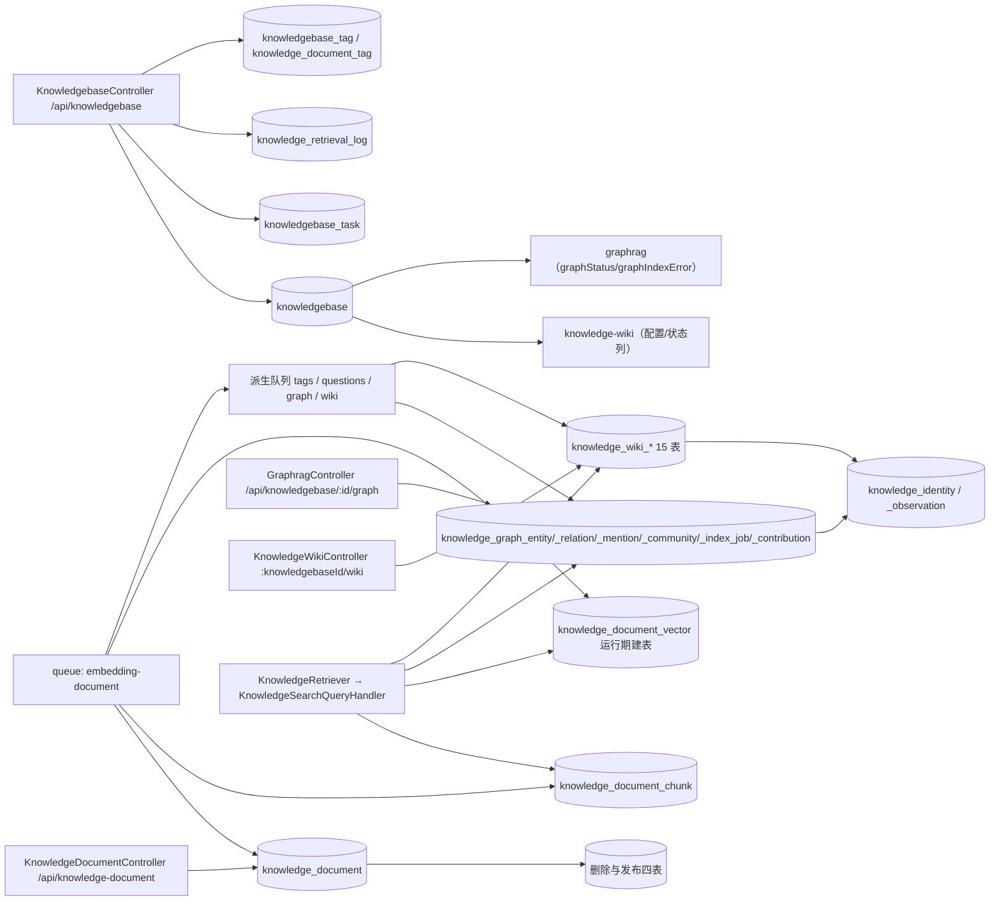

# C4 数据流向与消费（知识库专家）

> 只读梳理。表 → 模块反查取自 [tables.md](file://.fe-index/xpert-server/tables.md)（引用次数 · 来源）。
> **消费方口径**：模块级概括，**>3 个消费者一律归纳为模块族**，并标 `[基于引用扫描，未深入验证]`；单模块消费直接列名。
> 「详细流向」列指向本文末的流向索引（同一文件内锚点），不跨文档。

## 1 总览：写入入口 → 表 → 主要消费方

图表来源：[knowledgebase.entity.ts](file://packages/server-ai/src/knowledgebase/knowledgebase.entity.ts)、[document.entity.ts](file://packages/server-ai/src/knowledge-document/document.entity.ts)、[chunk.entity.ts](file://packages/server-ai/src/knowledge-document/chunk/chunk.entity.ts)、[document.job.ts](file://packages/server-ai/src/knowledge-document/document.job.ts)、[derived-index-publication.service.ts](file://packages/server-ai/src/knowledge-document/derived-index-publication.service.ts)、[create.handler.ts](file://packages/server-ai/src/rag-vstore/commands/handlers/create.handler.ts)

---

## 2 KB 域

| 实体 | 结构（表名 + 关键列 + 唯一索引） | 生产方 | 主要消费方 | 业务用途 |
|---|---|---|---|---|
| `Knowledgebase`（`WorkspaceBaseEntity`） | 表 `knowledgebase`。列：`name`、`permission`(默认 Private)、`vectorStore`、`metadataSchema`(jsonb 默认 `[]`)、`recall`(json 默认 `{topK:10}`)、`copilotModelId`/`rerankModelId`/`visionModelId`/`chatModelId`/`wikiModelId`、`embeddingCollectionName`/`embeddingModelFingerprint`/`rebuildTaskId`、`wikiConfig`/`wikiStatus`/`wikiActiveRevision`/`wikiConfigFingerprint`、`graphRag`/`graphStatus`/`graphIndexError`；`keywordAnalyzer`/`keywordAnalyzerLocked` 均 `update: false`。唯一 `@Index(['tenantId','organizationId','name'])` | `KnowledgebaseController.create` / `createExternal` | `knowledgebase`（19）、`knowledge-wiki`（19）、`graphrag`（9）、`plugin-resource`（3）、`knowledge-processing-lifecycle`（1）、`knowledge-document`（1）、`knowledge-identity`（1） | KB 聚合根：作用域、可见性、模型绑定与所有派生索引的状态列 |
| `KnowledgebaseTask` | 表 `knowledgebase_task`。列：`taskType`(默认 `embedding`)、`status`(`pending\|running\|success\|failed\|cancelled`)、`steps`(jsonb)、`error`、`finishedAt`、`context`、`conversationId`/`executionId`。无额外唯一索引 | `POST :id/task` / `POST :id/task/:taskId/process` | `knowledgebase`（4） | 可观测的 KB 级长任务（含流水线回调汇聚） |
| `KnowledgeRetrievalLog` | 表 `knowledge_retrieval_log`。列：`query`、`source`、`hitCount`、`requestId`、`filterVersion`、`fixed|dynamic|request|effectiveFilter`(jsonb)、`filterHash`、`filterStatus`、`fallbackReason`、`candidateChunkCount`、`vectorLatency`、`diagnostics`。无唯一索引 | 检索链（`KnowledgeSearchQueryHandler` / `KnowledgeDocumentStore` 搜索路径） | `knowledgebase`（3） | 检索可审计性：过滤回退、候选量与时延 |
| `KnowledgebaseTag` | 表 `knowledgebase_tag`。列：`knowledgebaseId`、`tagId`。唯一 `UQ_knowledgebase_tag(knowledgebaseId, tagId)`；`Tag` 侧 `RESTRICT` | `PUT/DELETE :knowledgebaseId/tags/:tagId` | `knowledgebase`（3） | KB 选中标签；标签定义归组织目录（`tag` 表，5 个模块引用） |
| `KnowledgeDocumentTag` | 表 `knowledge_document_tag`。列：`documentId`、`tagId`、`source`(默认 `manual`，含 `automatic`)、`confidence`(float)。唯一 `UQ_knowledge_document_tag(documentId, tagId)` | 手工 `PUT/DELETE documents/:documentId/tags/:tagId`；自动打标消费者 | `knowledgebase`（5） | 文档级标签归属，区分人工/自动来源与置信度 |

`[基于引用扫描，未深入验证]`：`knowledgebase` 的消费方跨 7 个模块，除本域 4 个子模块外，`plugin-resource` 属视图宿主挂载（`KnowledgebaseViewHostDefinition`）。

---

## 3 文档域

| 实体 | 结构 | 生产方 | 主要消费方 | 业务用途 |
|---|---|---|---|---|
| `KnowledgeDocument`（`@Tree('closure-table')`） | 表 `knowledge_document`。列：`sourceType`/`sourceConfig`/`sourceKey`(512)/`sourceHash`(64)/`processingHash`(64)/`contentHash`(64)、`publicationEpoch`(int 默认 0)、`hardDeletePendingAt`、`status`/`progress`/`processMsg`、`version`(`@VersionColumn`)、`tagRevision`/`autoTaggingInputHash`(`select:false`)、`metadata`(jsonb)/`options`(json)。索引 `IDX_knowledge_document_kb_source_hash`、`_kb_source_key`、`_kb_hard_delete_pending` 等 | `POST /api/knowledge-document`（`createDocument`）/ `bulk`（`createBulkWithIncrementalSync`）/ `connect` | `knowledge-document`（11）、`knowledge-processing-lifecycle`（10）、`knowledge-wiki`（10）、`graphrag`（7）、`knowledgebase`（7）、`knowledge-identity`（1） | 文档主行：幂等三元组、发布位点、摄取状态与元数据 |
| `KnowledgeDocumentPage` | 表 `knowledge_document_page`。列：`pageContent`、`metadata`(json)、`status`(`wasted\|validate\|running\|cancel\|finish\|error`)。`knowledgebase`/`document` 均 `CASCADE`。实体注释标 `@deprecated use chunks instead` | 解析阶段 | `knowledge-document`（3）、`knowledge-processing-lifecycle`（2） | 页级文本/资产快照，已被 chunk 取代（保留给预览与资产流） |
| `KnowledgeDocumentChunk`（`@Tree('closure-table')`） | 表 `knowledge_document_chunk`。列：`pageContent`、`contentHash`(64)、`keywordVector`(tsvector, `select:false`)、`metadata`(jsonb)、`version`(`@VersionColumn`)、`status`。索引 `IDX_knowledge_document_chunk_doc_content_hash`、`_kb_document` | 消费者 `syncChunksIncrementally` | `knowledge-document`（9）、`knowledge-processing-lifecycle`（8）、`knowledgebase`（4）、`knowledge-wiki`（3）、`graphrag`（1） | 检索与图谱抽取的最小文本单元；chunk 级幂等键 |

`[基于引用扫描，未深入验证]`：`knowledge_document_chunk` 的 5 个消费方中，`knowledgebase` 走 `getRepository`（检索侧 JOIN），`knowledge-wiki` / `graphrag` 走 `forFeature`。

---

## 4 删除与发布四表

| 实体 | 结构 | 生产方 | 主要消费方 | 业务用途 |
|---|---|---|---|---|
| `KnowledgeDocumentDeletionIntent` | 表 `knowledge_document_deletion_intent`。列：`documentId`(可空 `SET NULL`)、`sourceDocumentIdSnapshot`、`publicationEpoch`、`status`(默认 `prepared`，含 `indeterminate`)、`manifest`(jsonb)、`executionAttempt`、`lockedAt`/`leaseExpiresAt`。**部分唯一** `(knowledgebaseId, sourceDocumentIdSnapshot) WHERE status <> 'completed'` | **无**（仓库内未见编排服务） | `knowledge-document`（1） | 删除意图的持久化 saga 头 |
| `KnowledgeDocumentDeletionCleanupReceipt` | 表 `knowledge_document_deletion_cleanup_receipt`。列：`intentId`、`receiptKey`、`artifactKind`、`artifactKey`、`status`(`pending\|succeeded\|failed\|indeterminate`)、`outcome`(jsonb)、`attempt`。唯一 `(intentId, receiptKey)`，`intent` `CASCADE` | **无** | `knowledge-document`（1） | 逐产物清理回执，收敛「不确定」 |
| `KnowledgeDocumentPublicationAttempt` | 表 `knowledge_document_publication_attempt`。列：`documentIdSnapshot`、`producerKind`(`document\|chunk\|graph\|wiki\|embedding_rebuild`)、`publicationEpoch`、`status`(含 `indeterminate`)、`artifacts`(jsonb，每项带 `idempotencyKey`)、`lockedAt`/`leaseExpiresAt`/`heartbeatAt`。索引 `(knowledgebaseId, documentIdSnapshot, publicationEpoch)` | **无** | `knowledge-document`（1） | 发布级幂等（`idempotencyKey`）与租约 |
| `KnowledgeDocumentPublicationAttemptSource` | 表 `knowledge_document_publication_attempt_source`。列：`attemptId`、`documentIdSnapshot`、`publicationEpoch`、`contentHash`。唯一 `(attemptId, documentIdSnapshot)` | **无** | `knowledge-document`（1） | 每次发布的来源快照集 |

`[基于引用扫描，未深入验证]`：四表均由 `KnowledgeDocumentModule` 的 `TypeOrmModule.forFeature` 注册并经 `core/entities/index.ts` 导出；**当前硬删走「先删外部产物、再删行」的顺序路径，`indeterminate` 尚无生产写入方**。

---

## 5 向量面（**非 TypeORM 实体、运行期建表**）

| 实体 | 结构 | 生产方 | 主要消费方 | 业务用途 |
|---|---|---|---|---|
| `knowledge_document_vector` | **不是 TypeORM 实体**，由 `RagCreateVStoreHandler.createPgVectorStore` 运行期 `ensureTableInDatabase()` 建表；列名映射 `id`/`vector`/`content`/`metadata`，PG 实现另用 `collection_id` 归属。`addVectors` 传 `ids` 时做**幂等 upsert**（不先删旧向量） | `knowledge-document` 消费者、`knowledgebase` 检索侧 `import`、图谱 `syncEntityVectors` | `knowledgebase`（4 `knowledge_document_chunk` 引用方中的检索链）、`knowledge-document`、`graphrag` `[基于引用扫描，未深入验证]` | chunk 与图谱实体向量的物理载体 |
| `knowledge_document_collection` | 同上，`ensureCollectionTableInDatabase()` 建表。collection 名派生：active = `knowledgebase.embeddingCollectionName ?? knowledgebase.id`；图谱 = `` `${activeCollectionName}:graph-entities` ``；重建期 = `pendingEmbeddingCollectionName` | `RagCreateVStoreHandler` / KB 重建链 | 检索与写入两条路径（`getOrCreateCollection()` 在查询路径也会触发 DDL） | 逻辑 collection 隔离，使 active/pending 物理向量 id 不冲突 |

**向量 id 语义**：`createCollectionScopedVectorId(collectionName, chunkId) = uuidv5("${collectionName}:${chunkId}", VECTOR_ID_NAMESPACE)`；未配置 `vectorIdCollectionName` 时退化为 `chunkId`。查询走 `INNER JOIN knowledge_document_chunk`（`COALESCE(c.metadata ->> 'chunkId', c.id::text) = v.metadata ->> 'chunkId'`）并过滤 `knowledgebaseId` / `document.disabled` / `metadata.enabled`。

---

## 6 图谱域

| 实体 | 结构 | 生产方 | 主要消费方 | 业务用途 |
|---|---|---|---|---|
| `KnowledgeGraphEntity` | 表 `knowledge_graph_entity`。列：`identityId`(可空)、`type`(120)、`name`(512)、`normalizedName`(512)、`origin`(默认 `extracted`)、`visibility`(默认 `active`)、`aliases`(jsonb)、`confidence`、`mentionCount`、`revision`。唯一 `(knowledgebaseId, identityId)`；**部分唯一** `IDX_graph_manual_entity_name WHERE identityId IS NULL` | `processIndexJob` / 手工 `POST entities` | `graphrag`（10） | 图谱节点；`identityId` 即身份归一落地点 |
| `KnowledgeGraphRelation` | 表 `knowledge_graph_relation`。列：`sourceEntityId`/`targetEntityId`、`type`(160)、`normalizedType`、`origin`/`visibility`、`confidence`、`weight`、`evidenceCount`、`revision`。唯一 `(knowledgebaseId, sourceEntityId, targetEntityId, type)`；两端 `CASCADE` | 同上 | `graphrag`（8） | 图谱边；软隐藏靠 `visibility` |
| `KnowledgeGraphMention` | 表 `knowledge_graph_mention`。列：`entityId`/`relationId`/`documentId`/`chunkId`、`quote`(text)、`confidence`(float)、`startOffset`/`endOffset`、`revision` | 抽取链 | `graphrag`（5） | 证据锚点：实体/关系在哪个 chunk 的哪段文本被提及 |
| `KnowledgeGraphCommunity` | 表 `knowledge_graph_community`。列：`key`(160)、`title`、`summary`、`entityIds`(jsonb)、`revision`。唯一 `(knowledgebaseId, key)` | 社区聚合 | `graphrag`（3） | 社区摘要，供 `communityTopK` 类召回 |
| `KnowledgeGraphIndexJob` | 表 `knowledge_graph_index_job`。列：`documentId`(`SET NULL`)、`sourceContentHash`(128)、`sourcePublicationEpoch`、`extractionSnapshot`(jsonb, `select:false`)、`dispatchError`、`type`(30)、`status`(30，默认 `QUEUED`)、`stage`、`result`、`revision`、`totalChunks`/`processedChunks`。索引 `(knowledgebaseId, documentId, status)` | `GraphragService.enqueueDocuments` / `dispatchJobs` | `graphrag`（24） | 图谱索引的队列化 job 与进度 |
| `KnowledgeGraphEntityContribution` | 表 `knowledge_graph_entity_contribution`。列：`entityId`、`sourceDocumentIdSnapshot`、`sourceContentHash`(128)、`sourcePublicationEpoch`、`name`(512)、`aliases`、`confidence`、`properties`、`revision`。唯一 `(entityId, sourceDocumentIdSnapshot)` | 结构化写图 | `graphrag`（6） | 按来源文档定格实体属性贡献 |
| `KnowledgeGraphRelationContribution` | 表 `knowledge_graph_relation_contribution`。同构，唯一键含 `sourceDocumentIdSnapshot` | 同上 | `graphrag`（6） | 关系侧的来源贡献 |

---

## 7 Identity 域

| 实体 | 结构 | 生产方 | 主要消费方 | 业务用途 |
|---|---|---|---|---|
| `KnowledgeIdentity` | 表 `knowledge_identity`。列：`knowledgebaseId`(`CASCADE`)、`kind`(32)、`embedding`(jsonb，注释标为可丢弃缓存)、`revision`(默认 1)。索引 `(knowledgebaseId, kind)`（**非唯一**） | `KnowledgeIdentityService.resolve/resolveBatch` | `knowledge-identity`（4）、`graphrag`（1） | 实体/概念的归一身份 |
| `KnowledgeIdentityObservation` | 表 `knowledge_identity_observation`。列：`sourceDocumentIdSnapshot`、`sourceContentHash`(128)、`sourcePublicationEpoch`、`consumer`(`wiki\|graph`)、`extractionId`、`isCurrent`(默认 true)、`candidateKey`(512)、`payload`(jsonb)、`decision`(jsonb)。唯一 `(knowledgebaseId, sourceKey)` | 同上（`lockSource` / `assertSource`） | `knowledge-identity`（4）、`graphrag`（1） | **观察记录跨投影重建存活**，仅 `isCurrent` 提供有效证据 |

---

## 8 Wiki 域（15 张表 / 13 个实体文件）

| 表组 | 结构要点 | 生产方 | 主要消费方 | 业务用途 |
|---|---|---|---|---|
| **关键表** `knowledge_wiki_job` | `jobKey`(768)、`type`、`status`(默认 `queued`)、`isCurrent`(默认 true)、`generationRevision`、`generationAttempt`、`configFingerprint`、`generatorVersion`、`rootJobId`/`parentJobId`、`sourceDocumentIdSnapshot`、`expectedChildren`/`succeededChildren`/`failedChildren`、租约 `lockedAt`/`leaseExpiresAt`/`heartbeatAt`。唯一 `(knowledgebaseId, jobKey)` | `KnowledgeWikiGenerationService.enqueueSource/rebuild/retry` | `knowledge-wiki`（43） | 生成链的 job 台账（唯一单模块高引用表） |
| **关键表** `knowledge_wiki_page` | `pageKey`(768)、`pageType`、`canonicalName`/`normalizedCanonicalName`、`identityId`、`slug`(600)、`status`(默认 `building`)、`projectionStatus`(默认 `pending`)、`activeVersionId`、`publishedAt`。唯一 `(knowledgebaseId, pageKey)`、`(knowledgebaseId, identityId)`、`(knowledgebaseId, slug)` | `KnowledgeWikiProjectionService` | `knowledge-wiki`（24）、`knowledgebase`（3） | Wiki 页面主行 |
| 页面版本/证据/链接/贡献 | `_page_version`（唯一 `(pageId, producerJobId, generationAttempt)`）、`_page_evidence`（`sourceDocumentIdSnapshot`/`sourceChunkIdSnapshot`/`quote`/`ordinal`/`sourceContentHash`）、`_page_link`（唯一 `(sourcePageVersionId, targetPageId, sectionAnchor)`）、`_page_contribution`（唯一 `(pageVersionId, sourceDocumentIdSnapshot)`） | 投影与归并 | `_page_version`（16）、`_page_evidence`（7）、`_page_link`（8）、`_page_contribution`（11），均含 `knowledgebase`（3） | 内容版本化 + 来源定格（快照 id 而非可空 FK） |
| Reduce / 分类输入 | `_page_reduce_input`（唯一 `(stageJobId, generationAttempt)`）、`_page_reduce_input_source`（唯一 `(inputId, sourceDocumentIdSnapshot)`）、`_source_map_result`（唯一 `(sourceJobId, candidateKey)`） | `KnowledgeWikiPageReduceService` | 各 3 / 3 / 9，单模块 `knowledge-wiki` | 多来源归并的可重放输入 |
| 来源状态 / 投影状态 | `_source_state`（`lastEventType ∈ finish\|content_changed\|enabled\|disabled\|soft_deleted\|hard_deleted`、`eligible`/`cleanupPending`/`generationPending`、`desiredRootJobId`；唯一 `(knowledgebaseId, sourceDocumentIdSnapshot)`）、`_projection_state`（唯一 `(knowledgebaseId)`、`(projectionDocumentId)`） | 消费者与对账器 | `_source_state`（14）、`_projection_state`（3），含 `knowledgebase`（3） | 源变更到生成意图的映射；投影文档 `sourceKey = 'system:knowledge-wiki'` |
| 组织 / 税 | `_taxonomy`（`enabled` 默认 false、`revision`；唯一 `(knowledgebaseId)`）、`_folder`（`parentId` 自引用 `RESTRICT`、`name`(120)、`position`）、`_placement`（唯一 `(pageId)`；`folderId` `RESTRICT`） | `KnowledgeWikiOrganizationController` / `KnowledgeWikiTaxonomyService` | `_taxonomy`（2）、`_folder`（11）、`_placement`（8），单模块 `knowledge-wiki` | 目录树与页面归类 |
| 计费 / 恢复 | `_model_invocation`：`requestId`(1024)、`stage`(`map\|dedup\|reduce\|classify\|links`)、`status`(默认 `prepared`)、`reconciliationStatus`（默认 `not_available`，含 `indeterminate`）、`billingStatus`(默认 `pending`)、`tokenUsage`、`reconciliationDeadline`/`reconciliationAttempts`。唯一 `(requestId)`、`(jobId, generationAttempt, stage, callOrdinal, inputFingerprint)` | 生成链调用预算服务 | `knowledge-wiki`（9） | `indeterminate` / `requiresAdditionalChargeConfirmation` 的数据来源 |

`[基于引用扫描，未深入验证]`：Wiki 域除 `knowledge-wiki` 自身外，仅 `knowledgebase`（3 · `forFeature`）引用，且只覆盖 `_page` / `_page_version` / `_source_state` / `_page_evidence` 四张被 tables.md 列出的表——其余 11 张未见第二个模块引用。

---

## 9 流向索引（本文内锚点）

| 流向 | 触发 → 落表 → 出口 | 锚点 |
|---|---|---|
| A 摄取→向量 | `POST bulk?process=true` → `knowledge_document` + `_chunk` → `knowledge_document_vector` → 派生队列 | §3、§5、§1 总览 |
| B 派生索引扇出 | durable FINISH → `publish` → tags（`knowledge_document_tag`）/ questions / graph（§6）/ wiki（§8） | §1、§6、§8 |
| C 身份归一 | graph + wiki 抽取 → `KnowledgeIdentityService` → `knowledge_identity` + `_observation` | §7 |
| D 检索 | 三路候选 → 融合 → rerank → `knowledge_retrieval_log` | §2（`knowledge_retrieval_log`）、§5 |
| E 重建/换模 | `startEmbeddingRebuild` → `pendingEmbeddingCollectionName` → `promoteEmbeddingRebuild` → active collection | §5、§2（`knowledgebase` pending* 列） |
| F 删除 | `DELETE :id` → wiki 撤回 + 向量删 + graph clear → 删行 | §4、§6、§8（`_source_state.hard_deleted`） |
