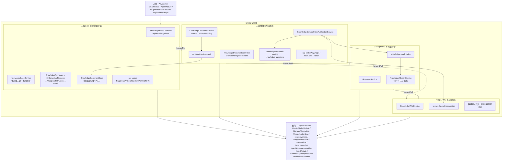

# 知识库专家 · 架构

**本文引用的文件**
- [packages/server-ai/src/knowledgebase/knowledgebase.module.ts](file://packages/server-ai/src/knowledgebase/knowledgebase.module.ts)
- [packages/server-ai/src/knowledgebase/knowledgebase.controller.ts](file://packages/server-ai/src/knowledgebase/knowledgebase.controller.ts)
- [packages/server-ai/src/knowledgebase/knowledgebase.service.ts](file://packages/server-ai/src/knowledgebase/knowledgebase.service.ts)
- [packages/server-ai/src/knowledgebase/knowledgebase.entity.ts](file://packages/server-ai/src/knowledgebase/knowledgebase.entity.ts)
- [packages/server-ai/src/knowledgebase/retriever.ts](file://packages/server-ai/src/knowledgebase/retriever.ts)
- [packages/server-ai/src/knowledgebase/vector-store.ts](file://packages/server-ai/src/knowledgebase/vector-store.ts)
- [packages/server-ai/src/knowledgebase/types.ts](file://packages/server-ai/src/knowledgebase/types.ts)
- [packages/server-ai/src/knowledgebase/knowledgebase-rebuild-embedding.job.ts](file://packages/server-ai/src/knowledgebase/knowledgebase-rebuild-embedding.job.ts)
- [packages/server-ai/src/knowledgebase/task/pipeline-callback.processor.ts](file://packages/server-ai/src/knowledgebase/task/pipeline-callback.processor.ts)
- [packages/server-ai/src/knowledgebase/tags/knowledge-tag.controller.ts](file://packages/server-ai/src/knowledgebase/tags/knowledge-tag.controller.ts)
- [packages/server-ai/src/knowledgebase/faq/faq-semantic-prewarm.ts](file://packages/server-ai/src/knowledgebase/faq/faq-semantic-prewarm.ts)
- [packages/server-ai/src/knowledgebase/retrieval/weighted-rrf.fusion.ts](file://packages/server-ai/src/knowledgebase/retrieval/weighted-rrf.fusion.ts)
- [packages/server-ai/src/knowledgebase/retrieval/vector-knowledge-candidate.retriever.ts](file://packages/server-ai/src/knowledgebase/retrieval/vector-knowledge-candidate.retriever.ts)
- [packages/server-ai/src/knowledgebase/retrieval/keyword-knowledge-candidate.retriever.ts](file://packages/server-ai/src/knowledgebase/retrieval/keyword-knowledge-candidate.retriever.ts)
- [packages/server-ai/src/knowledgebase/retrieval/graph-knowledge-candidate.retriever.ts](file://packages/server-ai/src/knowledgebase/retrieval/graph-knowledge-candidate.retriever.ts)
- [packages/server-ai/src/knowledgebase/identity/knowledge-identity.module.ts](file://packages/server-ai/src/knowledgebase/identity/knowledge-identity.module.ts)
- [packages/server-ai/src/knowledgebase/identity/knowledge-identity.service.ts](file://packages/server-ai/src/knowledgebase/identity/knowledge-identity.service.ts)
- [packages/server-ai/src/knowledgebase/wiki/knowledge-wiki.module.ts](file://packages/server-ai/src/knowledgebase/wiki/knowledge-wiki.module.ts)
- [packages/server-ai/src/knowledgebase/wiki/knowledge-wiki.controller.ts](file://packages/server-ai/src/knowledgebase/wiki/knowledge-wiki.controller.ts)
- [packages/server-ai/src/knowledge-document/document.module.ts](file://packages/server-ai/src/knowledge-document/document.module.ts)
- [packages/server-ai/src/knowledge-document/document.controller.ts](file://packages/server-ai/src/knowledge-document/document.controller.ts)
- [packages/server-ai/src/knowledge-document/document.service.ts](file://packages/server-ai/src/knowledge-document/document.service.ts)
- [packages/server-ai/src/knowledge-document/document.job.ts](file://packages/server-ai/src/knowledge-document/document.job.ts)
- [packages/server-ai/src/knowledge-document/processing-lifecycle.module.ts](file://packages/server-ai/src/knowledge-document/processing-lifecycle.module.ts)
- [packages/server-ai/src/knowledge-document/derived-index-publication.service.ts](file://packages/server-ai/src/knowledge-document/derived-index-publication.service.ts)
- [packages/server-ai/src/knowledge-document/deletion/entities.ts](file://packages/server-ai/src/knowledge-document/deletion/entities.ts)
- [packages/server-ai/src/graphrag/graphrag.module.ts](file://packages/server-ai/src/graphrag/graphrag.module.ts)
- [packages/server-ai/src/graphrag/graphrag.controller.ts](file://packages/server-ai/src/graphrag/graphrag.controller.ts)
- [packages/server-ai/src/graphrag/graphrag.service.ts](file://packages/server-ai/src/graphrag/graphrag.service.ts)
- [packages/server-ai/src/graphrag/graphrag.job.ts](file://packages/server-ai/src/graphrag/graphrag.job.ts)
- [packages/server-ai/src/rag-vstore/vstore.module.ts](file://packages/server-ai/src/rag-vstore/vstore.module.ts)
- [packages/server-ai/src/rag-vstore/commands/handlers/create.handler.ts](file://packages/server-ai/src/rag-vstore/commands/handlers/create.handler.ts)
- [packages/server-ai/src/rag-web/rag-web.module.ts](file://packages/server-ai/src/rag-web/rag-web.module.ts)
- [packages/server-ai/src/rag-web/provider/index.ts](file://packages/server-ai/src/rag-web/provider/index.ts)
- [packages/server-ai/src/rag-web/loader.ts](file://packages/server-ai/src/rag-web/loader.ts)
- [apps/api/src/bootstrap/index.ts](file://apps/api/src/bootstrap/index.ts)

## 目录

- [1. 专家域职责边界](#1-专家域职责边界)
- [2. 子专家划分说明](#2-子专家划分说明)
- [3. 子模块清单与索引校正](#3-子模块清单与索引校正)
- [4. 分层结构](#4-分层结构)
- [5. 依赖关系](#5-依赖关系)
- [6. 关键设计约束与不变量](#6-关键设计约束与不变量)
- [7. 架构总览](#7-架构总览)
- [8. 组件详细分析](#8-组件详细分析)
- [9. 结论](#9-结论)

## 1. 专家域职责边界

**做什么**：知识库资源的全生命周期与 RAG 能力供给面。① 知识库（`Knowledgebase`）本身的作用域 CRUD、个人/公开可见性、模型绑定与结构化过滤元数据；② 文档摄取（上传 / 外部源 / 网页抓取）→ 解析 → 切片 → 向量化 → 落库的异步流水线，以及增量同步、幂等去重、删除回收；③ 面向 Agent 的检索能力（向量 / 关键词 / 图谱三类候选召回 + 融合 + rerank + 结构化过滤）；④ 派生索引：GraphRAG 图谱、知识 Wiki 页面、自动标签、问题生成、FAQ 语义预热；⑤ 向量存储抽象与 PG 实现。

**不做什么（边界）**：
- **模型推理本身**归 `copilot`：本域只通过 `CopilotModule` / `CopilotModelModule` 取 embedding / rerank / chat / vision 模型句柄（`KnowledgebaseService.getRerankModel`、`createRerankModel`、`getVisionModel`、`getEmbeddingModelName`），不实现推理。
- **原文件存储**归 `storage-file` 与 `file-understanding`：本域只持有 `storageFileId` 与通过 `GetOwnedStorageFileQuery` 校验归属（`KnowledgeDocumentService`、`plugins/local-files.strategy.ts`）。
- **工作区落盘 / 上传会话**归 `shared/volume`：通过 `VolumeSubtreeClient`、`KnowledgeWorkAreaResolver`、`VOLUME_CLIENT` 调用（`knowledgebase.service.ts`、`runtime/knowledge-upload-sessions.service.ts`）。
- **工作区与组织维度**归 `xpert-workspace`：`KnowledgebaseService extends XpertWorkspaceBaseService<Knowledgebase>`，作用域三键 `tenantId + organizationId + workspaceId` 由基类提供，本域不重复实现租户隔离。
- **专家/Agent 编排**归 `xpert`：`RetrieverRegistry` 把检索器注册给外部，本域不调度 Agent 运行。

章节来源：[packages/server-ai/src/knowledgebase/knowledgebase.service.ts](file://packages/server-ai/src/knowledgebase/knowledgebase.service.ts)（关键符号：KnowledgebaseService.getRerankModel / createRerankModel / getVisionModel / getEmbeddingModelName）；[packages/server-ai/src/knowledgebase/knowledgebase.module.ts](file://packages/server-ai/src/knowledgebase/knowledgebase.module.ts)（关键符号：KnowledgebaseModule.imports / exports）；[packages/server-ai/src/xpert-workspace/workspace-base.service.ts](file://packages/server-ai/src/xpert-workspace/workspace-base.service.ts)（关键符号：XpertWorkspaceBaseService）

## 2. 子专家划分说明

本域按「数据面 + 处理链」切成 4 个子专家，每个子专家拥有独立入口模块与队列边界，通过 `forwardRef` 与 CQRS 命令解耦。

**① 知识库·检索·向量存储**：`knowledgebase/` 主体 CRUD 与作用域（`KnowledgebaseController` / `KnowledgebaseService`）；检索面 `KnowledgeRetriever` + 三类候选召回（`VectorKnowledgeCandidateRetriever` / `KeywordKnowledgeCandidateRetriever` / `GraphKnowledgeCandidateRetriever`）+ RRF 融合（`WeightedRrfFusion` / `LegacyWeightedFusion`）+ rerank + 结构化过滤（`filter/`）；向量读写唯一入口 `KnowledgeDocumentStore`；存储抽象层 `rag-vstore`。

**② 文档摄取与流水线**：`knowledge-document/` 全链（`document.module.ts` / `document.controller.ts` / `document.service.ts`）+ 就绪门 `processing-lifecycle` + **7 个 MQ 消费者归位** + 删除/发布意图四表；`rag-web` 三种 loader。

**③ GraphRAG 与知识身份**：`graphrag/` 13 表索引链 + `knowledgebase/identity` 的 `KnowledgeIdentityService` 归一与 LLM 裁判。

**④ 知识 Wiki 与知识组织**：`knowledgebase/wiki/` 14~15 表 + 生成/投影/税组织/分类/链接服务族。

归位原则：消费者跟着它写的数据面走（`embedding-document` → ②，`knowledge-graph-index` → ③，`knowledge-wiki-generation` → ④，`rebuild-knowledgebase-embedding` 与 `knowledge-faq-semantic-prewarm` → ①，`knowledge-automatic-tagging` 与 `knowledge-questions` → ②）。

章节来源：[packages/server-ai/src/knowledgebase/knowledgebase.module.ts](file://packages/server-ai/src/knowledgebase/knowledgebase.module.ts)（关键符号：KnowledgebaseModule.providers / BullModule.registerQueue）；[packages/server-ai/src/knowledge-document/document.module.ts](file://packages/server-ai/src/knowledge-document/document.module.ts)（关键符号：KnowledgeDocumentModule.imports / controllers）；[packages/server-ai/src/graphrag/graphrag.module.ts](file://packages/server-ai/src/graphrag/graphrag.module.ts)（关键符号：GraphragModule）；[packages/server-ai/src/knowledgebase/wiki/knowledge-wiki.module.ts](file://packages/server-ai/src/knowledgebase/wiki/knowledge-wiki.module.ts)（关键符号：KnowledgeWikiModule.providers）

## 3. 子模块清单与索引校正

| 子专家 | 目录 | 入口 | Controller（真实前缀） |
|---|---|---|---|
| ① 知识库·检索·向量存储 | `src/knowledgebase/`（含 `analyzer/ catalog/ faq/ filter/ logs/ migration/ plugins/ retrieval/ runtime/ tags/ task/ tenant-library/ commands/ queries/ dto/`） | `knowledgebase.module.ts` | `KnowledgebaseController`（`/api/knowledgebase`）、`KnowledgeFAQController`（`/api/knowledgebase/:knowledgebaseId/faqs`）、`KnowledgeTagController`（`:knowledgebaseId`）、`KnowledgeTagUsageController`（`tag-usage`） |
| ① 向量存储抽象 | `src/rag-vstore/` | `vstore.module.ts` | **无 controller**（纯服务与命令处理器层） |
| ② 文档摄取与流水线 | `src/knowledge-document/` | `document.module.ts`、`processing-lifecycle.module.ts` | `KnowledgeDocumentController`（`/api/knowledge-document`）、`KnowledgeQuestionGenerationController`（同前缀） |
| ② 网页抓取 | `src/rag-web/` | `rag-web.module.ts` | **无 controller**（纯服务与命令处理器层） |
| ③ GraphRAG | `src/graphrag/` | `graphrag.module.ts` | `GraphragController`（`/api/knowledgebase/:id/graph`） |
| ③ 知识身份 | `src/knowledgebase/identity/` | `knowledge-identity.module.ts` | **无 controller** |
| ④ 知识 Wiki | `src/knowledgebase/wiki/` | `knowledge-wiki.module.ts` | `KnowledgeWikiController`（`:knowledgebaseId/wiki`）、`KnowledgeWikiOrganizationController`（同前缀） |

**7 个 Bull 队列与消费者归位**：`embedding-document`→`KnowledgeDocumentConsumer`（②）；`knowledge-automatic-tagging`→`KnowledgeAutoTaggingConsumer`（②）；`knowledge-questions`→`KnowledgeQuestionsConsumer`（②）；`knowledge-graph-index`→`KnowledgeGraphIndexConsumer`（③）；`knowledge-wiki-generation`→`KnowledgeWikiGenerationConsumer`（④）；`rebuild-knowledgebase-embedding`→`KnowledgebaseRebuildEmbeddingConsumer`（①）；`knowledge-faq-semantic-prewarm`→`FAQSemanticPrewarmProcessor`（①）。另有 handoff 处理器 `KnowledgePipelineCallbackProcessor`（常量 `KNOWLEDGE_PIPELINE_CALLBACK = 'knowledge.pipeline_callback.v1'`，非 Bull）。

**索引校正（三处）**：
1. `knowledge-wiki` / `knowledge-identity` / `knowledge-processing-lifecycle` **不是独立顶层目录**，分别是 `knowledgebase/wiki/`、`knowledgebase/identity/`、`knowledge-document/processing-lifecycle.module.ts`。索引按 `@Module` 名切片导致把子模块当独立模块，并把父模块的接口数继承过去。
2. **`/api/:knowledgebaseId` 不准确**：真实形态是固定段 `/api/knowledgebase` + 子控制器路径参数 → `/api/knowledgebase/:knowledgebaseId/{faqs,wiki}`、`/api/knowledgebase/:id/graph`、`/api/knowledgebase/tag-usage`。
3. 索引中 `rag-vstore` / `rag-web` 的接口与表数为 0，二者**无 controller**，"18 接口 / 18 表" 实为 `KnowledgeWikiModule` 行。

章节来源：[packages/server-ai/src/knowledgebase/knowledgebase.module.ts](file://packages/server-ai/src/knowledgebase/knowledgebase.module.ts)（关键符号：KnowledgebaseModule.controllers）；[packages/server-ai/src/knowledgebase/types.ts](file://packages/server-ai/src/knowledgebase/types.ts)（关键符号：JOB_REBUILD_KNOWLEDGEBASE_EMBEDDING / KNOWLEDGE_PIPELINE_CALLBACK）；[packages/server-ai/src/knowledge-document/processing-lifecycle.module.ts](file://packages/server-ai/src/knowledge-document/processing-lifecycle.module.ts)（关键符号：KnowledgeProcessingLifecycleModule / KnowledgeProcessingReadyService）；[packages/server-ai/src/rag-vstore/vstore.module.ts](file://packages/server-ai/src/rag-vstore/vstore.module.ts)（关键符号：RagVStoreModule.controllers）；[packages/server-ai/src/rag-web/rag-web.module.ts](file://packages/server-ai/src/rag-web/rag-web.module.ts)（关键符号：RagWebModule.controllers）

## 4. 分层结构

- **controller 层**：`KnowledgebaseController`（extends `CrudController<Knowledgebase>`，`@Controller()` 空段 + RouterModule `/knowledgebase`）、`KnowledgeFAQController`、`KnowledgeTagController` / `KnowledgeTagUsageController`、`KnowledgeDocumentController`、`KnowledgeQuestionGenerationController`、`GraphragController`、`KnowledgeWikiController` / `KnowledgeWikiOrganizationController`。路由前缀 = 全局 `api` + RouterModule `path` + `@Controller()` 段。
- **service 层**：`KnowledgebaseService`（作用域 + 模型 + 重建 + 向量工厂 + 权限断言）、`KnowledgeDocumentService`（摄取 + 幂等 + 版本 + chunk）、`GraphragService`、`KnowledgeWikiService`、`KnowledgeFAQService`、`KnowledgeIdentityService`。
- **retriever / store 层**：`KnowledgeRetriever`（LangChain `BaseRetriever`）→ 三个 `*KnowledgeCandidateRetriever` → `*Fusion`；`KnowledgeDocumentStore` 是向量读写唯一入口。
- **consumer 层**：7 个 Bull `@Processor` + 1 个 handoff processor。
- **CQRS handler 层**：各子模块 `commands/handlers`、`queries/handlers`；跨子模块联动一律走 `CommandBus`（`KnowledgeDerivedIndexPublicationService` 是集中派发点）。
- **plugin-strategy 层**：`VectorStoreRegistry`、`DocumentSourceRegistry`、`TextSplitterRegistry`、`DocumentTransformerRegistry`、`ImageUnderstandingRegistry`、`KnowledgeStrategyRegistry`、`RetrieverRegistry`、`KeywordAnalyzerRegistry`（均来自 `@xpert-ai/plugin-sdk`）。
- **entity 层**：TypeORM 实体集中在各子模块 `entities/` 或平铺 `.entity.ts`；向量面不是 TypeORM 实体，由 `KnowledgePGVectorStore.ensureTableInDatabase()` 运行期建表。

章节来源：[packages/server-ai/src/knowledgebase/knowledgebase.controller.ts](file://packages/server-ai/src/knowledgebase/knowledgebase.controller.ts)（关键符号：KnowledgebaseController.@Controller / @Get）；[packages/server-ai/src/knowledgebase/vector-store.ts](file://packages/server-ai/src/knowledgebase/vector-store.ts)（关键符号：KnowledgeDocumentStore）；[apps/api/src/bootstrap/index.ts](file://apps/api/src/bootstrap/index.ts)（关键符号：setGlobalPrefix('api') / useGlobalGuards(AuthGuard, PluginScopeGuard)）

## 5. 依赖关系

**出向（本域 → 外部）**：`CopilotModule` 与 `CopilotModelModule`（embedding / rerank / chat / vision 模型）；`StorageFileModule`（原文件）与 `file-understanding` 的 `GetOwnedStorageFileQuery`；`shared/volume` 的 `VolumeSubtreeClient` / `KnowledgeWorkAreaResolver` / `VOLUME_CLIENT`（上传会话与工作区落盘）；`IntegrationModule`（外部知识源 / 向量源）；`UserModule`、`TenantModule`、`DatabaseModule`；`XpertWorkspaceModule`；`XpertModule`；`RuntimeCapabilityModule`；`shared/agent/middleware-runtime`（wiki 生成链使用）。

**入向（外部 → 本域）**：`AIModule`、`ChatModule`、`XpertModule`、`PluginResourceModule`、`ServerAIModule`；`copilot-knowledge`（相似度 / MMR 检索）依赖本域能力；`view-extension` 通过 `KnowledgebaseViewHostDefinition` 挂载视图宿主。

**域内循环依赖**：`KnowledgebaseModule ↔ KnowledgeDocumentModule ↔ GraphragModule ↔ KnowledgeWikiModule ↔ KnowledgeIdentityModule` **全部 `forwardRef`**。具体：`KnowledgebaseModule` forwardRef `CopilotModule` / `XpertWorkspaceModule` / `IntegrationModule` / `KnowledgeDocumentModule` / `XpertModule`；`KnowledgeDocumentModule` forwardRef `CopilotModule` / `KnowledgebaseModule`；`GraphragModule` forwardRef `KnowledgeIdentityModule` / `KnowledgebaseModule` / `KnowledgeDocumentModule`；`KnowledgeWikiModule` forwardRef `KnowledgeIdentityModule` / `KnowledgebaseModule` / `KnowledgeDocumentModule`。

**前缀双挂载**：`GraphragModule` 与 `KnowledgeWikiModule` 各自 `RouterModule.register([{ path: '/knowledgebase', module: ... }])`，与 `KnowledgebaseModule` 相同，靠 `@Controller` 段（`:id/graph` vs `:knowledgebaseId/wiki`）区分，而非 RouterModule 前缀。

章节来源：[packages/server-ai/src/knowledgebase/knowledgebase.module.ts](file://packages/server-ai/src/knowledgebase/knowledgebase.module.ts)（关键符号：KnowledgebaseModule.imports.forwardRef）；[packages/server-ai/src/graphrag/graphrag.module.ts](file://packages/server-ai/src/graphrag/graphrag.module.ts)（关键符号：GraphragModule.imports / RouterModule.register）；[packages/server-ai/src/knowledgebase/wiki/knowledge-wiki.module.ts](file://packages/server-ai/src/knowledgebase/wiki/knowledge-wiki.module.ts)（关键符号：KnowledgeWikiModule.imports）；[packages/server-ai/src/knowledgebase/identity/knowledge-identity.module.ts](file://packages/server-ai/src/knowledgebase/identity/knowledge-identity.module.ts)（关键符号：KnowledgeIdentityModule.imports）

## 6. 关键设计约束与不变量

1. **源文档 durable FINISH 后才派发派生索引**：`KnowledgeDerivedIndexPublicationService.publish` 明写「Dispatches optional derived indexes only after the source document is durably FINISH.」，tags / questions / graph / wiki 逐项 `catch`，任一失败不影响主链。
2. **语义检索有界且从不授权 merge**：`knowledge-identity-policy.ts` 明写「Names retrieve every ambiguous match. Semantic retrieval is bounded and never authorizes a merge.」；域名/范围文本只是语义裁判的证据，不是本地推断的分类法。
3. **rechunk 故意 fail 而非静默转换**：`transform-snapshot.service.ts` 明写「Rechunk intentionally fails on invalid snapshots rather than silently running conversion.」
4. **splitter / image-understanding 设置不进 transform 快照**：`document-hash.ts` 明写「Splitter/image-understanding settings are deliberately excluded because changing them must not invalidate a transform snapshot used for rechunking.」
5. **向量读写只经 `KnowledgeDocumentStore`**：写入 / 查询 / rerank / 过滤属性更新均收敛到该类，其它服务不得直接触碰 vector store。
6. **KB 作用域三键**：`tenantId + organizationId + workspaceId`（`Knowledgebase extends WorkspaceBaseEntity`）；可见性由 `permission` 列（个人 / 公开）与 `createdById` 推导，读取必须过 `assertKnowledgebase{Read,Write}Access` / `assertKnowledgebaseTask{Read,Write}Access` 且过滤 `hardDeletePendingAt`。
7. **队列载荷保持 processing mode durable**：`document.job.ts` 明写「Queue payload keeps processing mode durable across the HTTP/background-worker boundary.」，跨 HTTP / worker 边界不丢模式。
8. **就绪门**：`processing-lifecycle.module.ts` 明写「Bull registers workers in onModuleInit, before CQRS registers its handlers. The explicit CqrsModule dependency orders this gate after CQRS bootstrap.」，`KnowledgeDocumentConsumer` 通过 `lifecycle.waitUntilReady()` 阻塞接活。
9. **幂等三元组**：`sourceKey` + `sourceHash` + `processingHash` 唯一确定「同一文档同一处理配置」，`createBulkIdempotently` / `createBulkWithIncrementalSync` / `createOrReuseSourceDocument` 三处入口共享该判定。

章节来源：[packages/server-ai/src/knowledge-document/derived-index-publication.service.ts](file://packages/server-ai/src/knowledge-document/derived-index-publication.service.ts)（关键符号：KnowledgeDerivedIndexPublicationService.publish）；[packages/server-ai/src/knowledgebase/identity/knowledge-identity-policy.ts](file://packages/server-ai/src/knowledgebase/identity/knowledge-identity-policy.ts)（关键符号：canMatchIdentity / selectIdentityCandidates）；[packages/server-ai/src/knowledge-document/document-hash.ts](file://packages/server-ai/src/knowledge-document/document-hash.ts)（关键符号：computeKnowledgeDocumentProcessingHash / computeKnowledgeDocumentTransformFingerprint）；[packages/server-ai/src/knowledge-document/transform-snapshot.service.ts](file://packages/server-ai/src/knowledge-document/transform-snapshot.service.ts)（关键符号：KnowledgeDocumentTransformSnapshotService）

## 7. 架构总览

图表来源：[packages/server-ai/src/knowledgebase/knowledgebase.module.ts](file://packages/server-ai/src/knowledgebase/knowledgebase.module.ts)（关键符号：KnowledgebaseModule / BullModule.registerQueue）；[packages/server-ai/src/knowledge-document/document.module.ts](file://packages/server-ai/src/knowledge-document/document.module.ts)（关键符号：KnowledgeDocumentModule.providers）；[packages/server-ai/src/graphrag/graphrag.module.ts](file://packages/server-ai/src/graphrag/graphrag.module.ts)（关键符号：GraphragModule）；[packages/server-ai/src/knowledgebase/wiki/knowledge-wiki.module.ts](file://packages/server-ai/src/knowledgebase/wiki/knowledge-wiki.module.ts)（关键符号：KnowledgeWikiModule）；[packages/server-ai/src/knowledge-document/derived-index-publication.service.ts](file://packages/server-ai/src/knowledge-document/derived-index-publication.service.ts)（关键符号：KnowledgeDerivedIndexPublicationService.publish）

## 8. 组件详细分析

### 8.1 知识库与作用域

`KnowledgebaseService extends XpertWorkspaceBaseService<Knowledgebase>`，实体 `Knowledgebase` → 表 `knowledgebase`，唯一键 `(tenantId, organizationId, name)`（冲突由 `getQueryFailedErrorCode` 把 23505 翻译成可读错误）。作用域三键来自基类；可见性由 `permission` 列（`KnowledgebasePermission.Private|...`）与 `createdById` 决定，`findAllByMe` / `findAllByPublic` / `getAllByWorkspace` 分别服务个人、公开、工作区视图。模型绑定集中在 `copilotModelId / rerankModelId / visionModelId / chatModelId / wikiModelId`。注意 `keywordAnalyzer` 与 `keywordAnalyzerLocked` 声明 `update: false`，普通 `save()` 不会更新，必须走条件 SQL。

章节来源：[packages/server-ai/src/knowledgebase/knowledgebase.entity.ts](file://packages/server-ai/src/knowledgebase/knowledgebase.entity.ts)（关键符号：Knowledgebase.permission / keywordAnalyzer / keywordAnalyzerLocked / 表 knowledgebase）；[packages/server-ai/src/knowledgebase/knowledgebase.service.ts](file://packages/server-ai/src/knowledgebase/knowledgebase.service.ts)（关键符号：KnowledgebaseService.create / updateKnowledgebase / getAllByWorkspace / findOneDetail）

### 8.2 检索与融合

`KnowledgeRetriever`（`extends BaseRetriever`）是面向 Agent 的门面，`retrieve` / `retrieveDetailed` 组装 `tenantId / organizationId / knowledgebases / query / k / score / rerankThreshold / filters / retrieval / threadId / xpertId` 后走 QueryBus。候选召回三路：向量（`VectorKnowledgeCandidateRetriever`）、关键词（`KeywordKnowledgeCandidateRetriever`，配 `KnowledgeKeywordIndexService` 与 `KnowledgeKeywordAnalyzerService`）、图谱（`GraphKnowledgeCandidateRetriever`）。融合默认 `WeightedRrfFusion`，可切 `LegacyWeightedFusion`。rerank 落在 `KnowledgeDocumentStore.rerank` + `KnowledgebaseService.getRerankModel/createRerankModel`。结构化过滤由 `filter/knowledge-filter.ts` 与 `KnowledgeGraphFilterScopeService` 提供，工具面 schema 明写「Keep the provider-facing schema deliberately compact.」

章节来源：[packages/server-ai/src/knowledgebase/retriever.ts](file://packages/server-ai/src/knowledgebase/retriever.ts)（关键符号：KnowledgeRetriever.retrieve / retrieveDetailed / toFilterOptionsTool / toGraphExplorerTool / createKnowledgeRetriever）；[packages/server-ai/src/knowledgebase/retrieval/weighted-rrf.fusion.ts](file://packages/server-ai/src/knowledgebase/retrieval/weighted-rrf.fusion.ts)（关键符号：WeightedRrfFusion）；[packages/server-ai/src/knowledgebase/retrieval/vector-knowledge-candidate.retriever.ts](file://packages/server-ai/src/knowledgebase/retrieval/vector-knowledge-candidate.retriever.ts)（关键符号：VectorKnowledgeCandidateRetriever）

### 8.3 摄取流水线与队列

同步侧由 `KnowledgeDocumentService` 负责：`create*` / `createBulkIdempotently` / `createBulkWithIncrementalSync` / `createOrReuseSourceDocument` 落库，`startProcessing(ids, kbId, mode)` 投递 `embedding-document`。异步侧 `KnowledgeDocumentConsumer`（`@Processor({ name: JOB_EMBEDDING_DOCUMENT })`，`@Process({ concurrency: 5 })`）先 `await this.lifecycle.waitUntilReady()` 再执行「解析 → 切片 → embedding → 写向量」。文档落 FINISH 后 `KnowledgeDerivedIndexPublicationService.publish` 逐项派发 tags / questions / graph / wiki 命令。删除与发布走四表：`knowledge_document_deletion_intent`（状态含 `prepared|written|promoted|compensated|indeterminate`）、`knowledge_document_deletion_cleanup_receipt`（`pending|succeeded|failed|indeterminate`）、`knowledge_document_publication_attempt`、`knowledge_document_publication_attempt_source`。

章节来源：[packages/server-ai/src/knowledge-document/document.job.ts](file://packages/server-ai/src/knowledge-document/document.job.ts)（关键符号：KnowledgeDocumentConsumer.@Processor / @Process / JOB_EMBEDDING_DOCUMENT）；[packages/server-ai/src/knowledge-document/document.service.ts](file://packages/server-ai/src/knowledge-document/document.service.ts)（关键符号：KnowledgeDocumentService.startProcessing / createBulkWithIncrementalSync / syncChunksIncrementally）；[packages/server-ai/src/knowledge-document/deletion/entities.ts](file://packages/server-ai/src/knowledge-document/deletion/entities.ts)（关键符号：表 knowledge_document_deletion_intent / knowledge_document_deletion_cleanup_receipt / knowledge_document_publication_attempt）

### 8.4 GraphRAG

`GraphragService` 负责 `enqueueDocuments → dispatchJobs → processIndexJob` 主链，`KnowledgeGraphIndexConsumer` 消费 `knowledge-graph-index` 队列；抽取由 `KnowledgeGraphExtractionService`，外部写图由 `StructuredGraphRuntimeService`，进度由 `GraphDocumentProgressService`。数据面为 `knowledge_graph_entity`（唯一 `['knowledgebaseId','identityId']`）、`_relation`、`_mention`、`_community`、`_index_job`、`_entity_contribution` / `_relation_contribution`。实体向量的读写经 `KnowledgebaseService.getGraphEntityVectorStore` 取独立 vector store。Entity 归一依赖子专家 ③ 的 `KnowledgeIdentityService`。

章节来源：[packages/server-ai/src/graphrag/graphrag.service.ts](file://packages/server-ai/src/graphrag/graphrag.service.ts)（关键符号：GraphragService.enqueueDocuments / dispatchJobs / processIndexJob / rebuildKnowledgebase / getVisualization）；[packages/server-ai/src/graphrag/graphrag.job.ts](file://packages/server-ai/src/graphrag/graphrag.job.ts)（关键符号：KnowledgeGraphIndexConsumer）；[packages/server-ai/src/graphrag/graphrag.controller.ts](file://packages/server-ai/src/graphrag/graphrag.controller.ts)（关键符号：GraphragController.@Controller(':id/graph')）

### 8.5 知识 Wiki

Wiki 是「知识库上的派生索引」，而非独立资源：配置与状态落在 `knowledgebase` 表的 `wikiConfig / wikiStatus / wikiAvailability / wikiActiveRevision / wikiStagedRevision / wikiConfigFingerprint / wikiRebuildRequiredReason`。页面由源文档 chunk 的 evidence 生成（`knowledge_wiki_page_evidence.sourceDocumentIdSnapshot`）。服务族覆盖生成（`KnowledgeWikiGenerationService`）、归并（`KnowledgeWikiPageReduceService`）、投影（`KnowledgeWikiProjectionService`）、对账（`KnowledgeWikiReconcilerService`）、撤回（`KnowledgeWikiRetractionService`）、调度（`KnowledgeWikiPageSchedulerService`）、链接（`KnowledgeWikiLinkService`）、税组织（`KnowledgeWikiTaxonomyService`）、组织（`KnowledgeWikiOrganizationService`）、浏览（`KnowledgeWikiBrowseService`）、分类（`KnowledgeWikiClassificationService`）、身份解析（`KnowledgeWikiIdentityResolverService`）+ 预算/租约/栅栏（`KnowledgeWikiInvocationBudgetService` / `KnowledgeWikiJobLeaseService` / `KnowledgeWikiJobFenceService`）。

章节来源：[packages/server-ai/src/knowledgebase/wiki/knowledge-wiki.module.ts](file://packages/server-ai/src/knowledgebase/wiki/knowledge-wiki.module.ts)（关键符号：KnowledgeWikiModule.providers）；[packages/server-ai/src/knowledgebase/wiki/knowledge-wiki.controller.ts](file://packages/server-ai/src/knowledgebase/wiki/knowledge-wiki.controller.ts)（关键符号：KnowledgeWikiController.@Controller(':knowledgebaseId/wiki')）；[packages/server-ai/src/knowledgebase/knowledgebase.entity.ts](file://packages/server-ai/src/knowledgebase/knowledgebase.entity.ts)（关键符号：Knowledgebase.wikiConfig / wikiStatus / wikiActiveRevision）

## 9. 结论

本域是一个「以知识库为聚合根、以 MQ 为异步骨架、以派生索引为增值面」的读写分离域。四个子专家的边界清晰：① 拥有作用域、检索与向量读写；② 拥有摄取与一致性（幂等、删除回收、就绪门）；③ 拥有图谱与身份归一；④ 拥有 Wiki 与知识组织。跨子专家联动一律走 CQRS 命令 + `forwardRef`，避免了编译期循环。主要架构张力在于「主链 durable 完成」与「派生索引最终一致」之间的窗口——`indeterminate` 状态的引入正是为这个窗口买单。

章节来源：[packages/server-ai/src/knowledgebase/knowledgebase.module.ts](file://packages/server-ai/src/knowledgebase/knowledgebase.module.ts)（关键符号：KnowledgebaseModule）；[packages/server-ai/src/knowledge-document/document.module.ts](file://packages/server-ai/src/knowledge-document/document.module.ts)（关键符号：KnowledgeDocumentModule）
