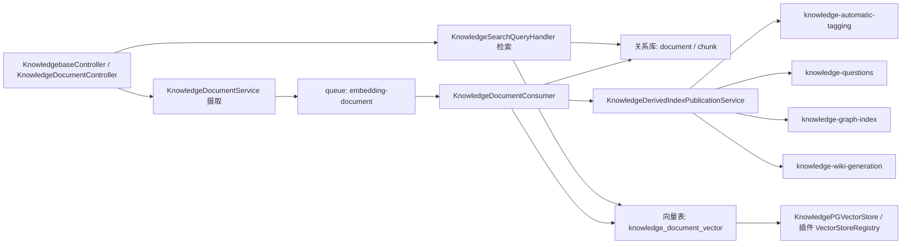
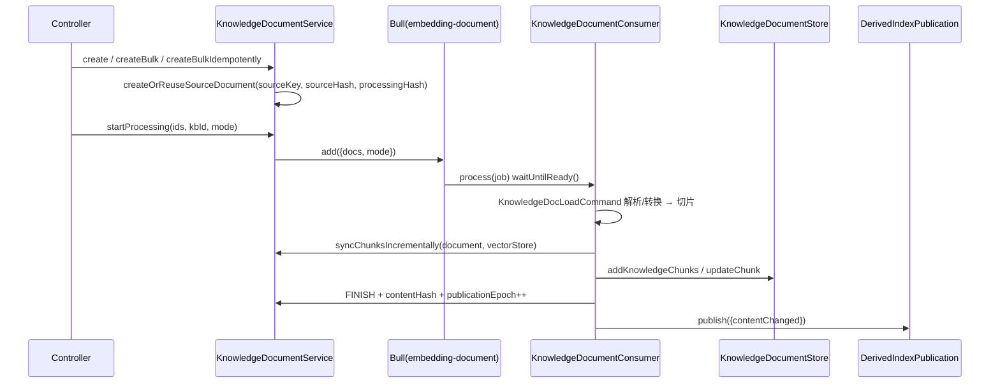
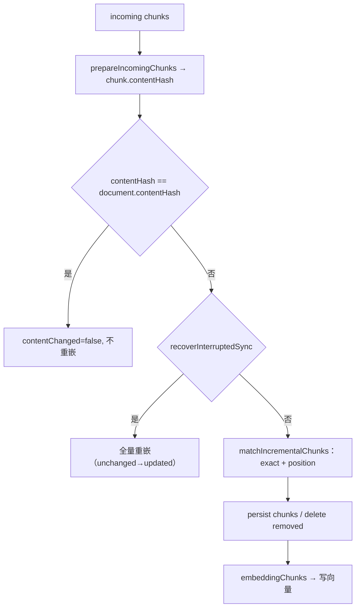
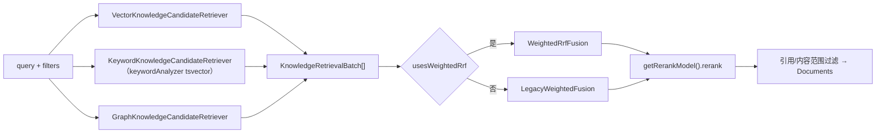
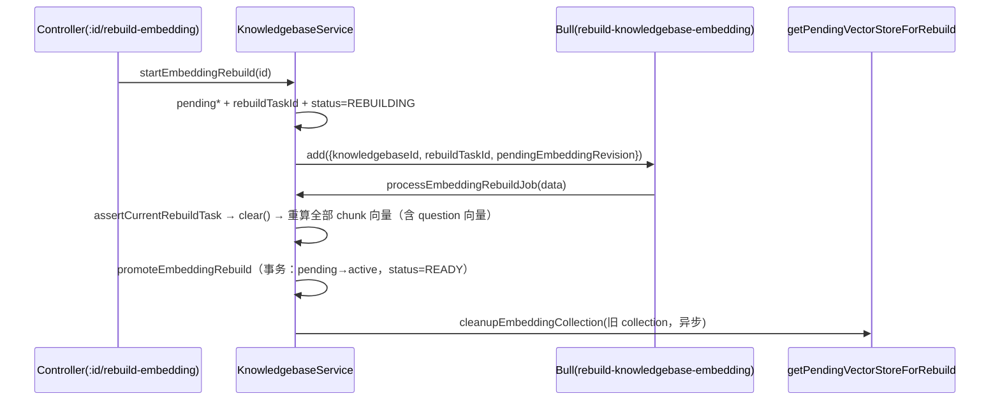
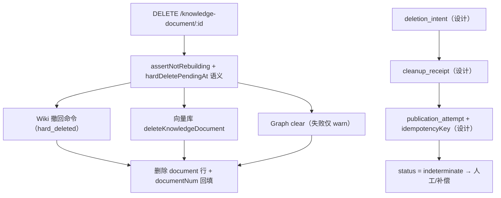
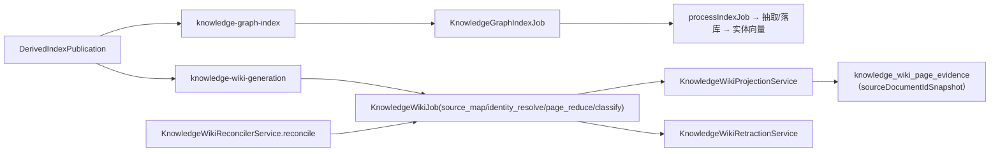

# 知识库与 RAG 域 · 数据流转

> 只读梳理。源码根 `packages/server-ai/src/`（下称 `src/`），引用均为仓库根相对路径。未能从源码证实之处显式标注「未确认」。

**本文引用的文件**

- [knowledge-document/document.job.ts](file://packages/server-ai/src/knowledge-document/document.job.ts)
- [knowledge-document/document.service.ts](file://packages/server-ai/src/knowledge-document/document.service.ts)
- [knowledge-document/document-publication.ts](file://packages/server-ai/src/knowledge-document/document-publication.ts)
- [knowledge-document/document-hash.ts](file://packages/server-ai/src/knowledge-document/document-hash.ts)
- [knowledge-document/derived-index-publication.service.ts](file://packages/server-ai/src/knowledge-document/derived-index-publication.service.ts)
- [knowledge-document/transform-snapshot.service.ts](file://packages/server-ai/src/knowledge-document/transform-snapshot.service.ts)
- [knowledge-document/deletion/entities.ts](file://packages/server-ai/src/knowledge-document/deletion/entities.ts)
- [knowledge-document/processing-lifecycle.module.ts](file://packages/server-ai/src/knowledge-document/processing-lifecycle.module.ts)
- [knowledge-document/document.module.ts](file://packages/server-ai/src/knowledge-document/document.module.ts)
- [knowledgebase/knowledgebase.service.ts](file://packages/server-ai/src/knowledgebase/knowledgebase.service.ts)
- [knowledgebase/knowledgebase.entity.ts](file://packages/server-ai/src/knowledgebase/knowledgebase.entity.ts)
- [knowledgebase/vector-store.ts](file://packages/server-ai/src/knowledgebase/vector-store.ts)
- [knowledgebase/retriever.ts](file://packages/server-ai/src/knowledgebase/retriever.ts)
- [knowledgebase/retrieval/types.ts](file://packages/server-ai/src/knowledgebase/retrieval/types.ts)
- [knowledgebase/retrieval/weighted-rrf.fusion.ts](file://packages/server-ai/src/knowledgebase/retrieval/weighted-rrf.fusion.ts)
- [knowledgebase/retrieval/legacy-weighted.fusion.ts](file://packages/server-ai/src/knowledgebase/retrieval/legacy-weighted.fusion.ts)
- [knowledgebase/queries/handlers/knowledge-search.handler.ts](file://packages/server-ai/src/knowledgebase/queries/handlers/knowledge-search.handler.ts)
- [knowledgebase/analyzer/keyword-analyzer.service.ts](file://packages/server-ai/src/knowledgebase/analyzer/keyword-analyzer.service.ts)
- [knowledgebase/analyzer/keyword-chunk.subscriber.ts](file://packages/server-ai/src/knowledgebase/analyzer/keyword-chunk.subscriber.ts)
- [knowledgebase/knowledgebase-rebuild-embedding.job.ts](file://packages/server-ai/src/knowledgebase/knowledgebase-rebuild-embedding.job.ts)
- [knowledgebase/wiki/knowledge-wiki-generation.service.ts](file://packages/server-ai/src/knowledgebase/wiki/knowledge-wiki-generation.service.ts)
- [knowledgebase/wiki/knowledge-wiki-reconciler.service.ts](file://packages/server-ai/src/knowledgebase/wiki/knowledge-wiki-reconciler.service.ts)
- [knowledgebase/wiki/knowledge-wiki-retraction.service.ts](file://packages/server-ai/src/knowledgebase/wiki/knowledge-wiki-retraction.service.ts)
- [knowledgebase/wiki/knowledge-wiki.service.ts](file://packages/server-ai/src/knowledgebase/wiki/knowledge-wiki.service.ts)
- [graphrag/graphrag.service.ts](file://packages/server-ai/src/graphrag/graphrag.service.ts)
- [graphrag/migrations/20260913-structured-mention-confidence.sql](file://packages/server-ai/src/graphrag/migrations/20260913-structured-mention-confidence.sql)
- [rag-vstore/commands/handlers/create.handler.ts](file://packages/server-ai/src/rag-vstore/commands/handlers/create.handler.ts)
- [rag-vstore/knowledge-pg-vector.store.ts](file://packages/server-ai/src/rag-vstore/knowledge-pg-vector.store.ts)
- [contracts/src/ai/knowledge-doc.model.ts](file://packages/contracts/src/ai/knowledge-doc.model.ts)
- [contracts/src/ai/knowledgebase.model.ts](file://packages/contracts/src/ai/knowledgebase.model.ts)

## 目录

- [总览与读写面](#总览与读写面)
- [链路一 摄取主链](#链路一-摄取主链)
- [链路二 增量同步链](#链路二-增量同步链)
- [链路三 检索链](#链路三-检索链)
- [链路四 embedding 重建链](#链路四-embedding-重建链)
- [链路五 删除与回收链](#链路五-删除与回收链)
- [链路六 GraphRAG 与 Wiki 生成链](#链路六-graphrag-与-wiki-生成链)
- [状态流转](#状态流转)
- [异步流与外部依赖](#异步流与外部依赖)
- [数据变换关键节点](#数据变换关键节点)
- [已知风险](#已知风险)

## 总览与读写面

知识库域同时存在三类持久面：关系库（TypeORM 实体表）、向量库（运行期建表的 `knowledge_document_vector` / `knowledge_document_collection`）、文件/工作区（transform snapshot、原文件）。

图表来源：[document.job.ts](file://packages/server-ai/src/knowledge-document/document.job.ts)、[derived-index-publication.service.ts](file://packages/server-ai/src/knowledge-document/derived-index-publication.service.ts)、[knowledge-search.handler.ts](file://packages/server-ai/src/knowledgebase/queries/handlers/knowledge-search.handler.ts)

章节来源：[create.handler.ts](file://packages/server-ai/src/rag-vstore/commands/handlers/create.handler.ts)（关键符号：RagCreateVStoreHandler / knowledge_document_vector）

## 链路一 摄取主链

图表来源：[document.job.ts](file://packages/server-ai/src/knowledge-document/document.job.ts)、[document-publication.ts](file://packages/server-ai/src/knowledge-document/document-publication.ts)

要点：`createBulkIdempotently(documents, key)` 要求恰好 1 篇文档且 `key` ≤160 字符；消费者用 `@Process({ concurrency: 5 })`，并在进入前 `await this.lifecycle.waitUntilReady()`。跳过条件是 `status === FINISH && processingHash 未变 && 有 contentHash`（此时仍会调用 `publish({contentChanged:false})`，只重投 tags/questions 与 graph 重试分支）。落库通过 `KnowledgeDocumentPublicationWriter`，仅 `contentChanged` 时执行 `COALESCE("publicationEpoch", 0) + 1`。

章节来源：[document.service.ts](file://packages/server-ai/src/knowledge-document/document.service.ts)（关键符号：createBulkIdempotently / createOrReuseSourceDocument / startProcessing）

## 链路二 增量同步链

- 文档级：`sourceKey`（`sourceType:sourceConfigKey:sourceLocator` 派生）+ `sourceHash` + `processingHash` 三元组决定「复用/更新/跳过」，`createBulkWithIncrementalSync` 返回 `processableIds / skippedIds / updatedIds / createdIds`。
- chunk 级：`syncChunksIncrementally` 先算 `contentHash = computeKnowledgeDocumentContentHash(incomingChunks)`（对 `chunks[].contentHash` 求稳定哈希）；若与 `document.contentHash` 相等则 `contentChanged=false` 且 `embeddingChunks=[]`（不重嵌）。
- 中断恢复：`recoverInterruptedSync = 已有 chunk 行 && 现有行重算哈希 !== document.contentHash`——即「chunk 已写、向量未发布」的中断态，此时把 `unchanged` 一律计为 `updated` 并强制重嵌。
- 匹配：`matchIncrementalChunks` 用 exact（内容哈希）与 position（顺序）两级匹配，未命中行按 `removedChunks` 删除。
- 重切/重嵌触发：`processingHash` 变化（`computeKnowledgeDocumentProcessingHash` 覆盖 sourceHash/metadata/sourceKey/sourceType/sourceConfig/parserConfig/options/category/type/文件标识/name）；`rechunk` 模式复用 transform snapshot。

图表来源：[document.service.ts](file://packages/server-ai/src/knowledge-document/document.service.ts)、[document-hash.ts](file://packages/server-ai/src/knowledge-document/document-hash.ts)

章节来源：[document-hash.ts](file://packages/server-ai/src/knowledge-document/document-hash.ts)（关键符号：computeKnowledgeDocumentChunkHash / computeKnowledgeDocumentContentHash / computeKnowledgeDocumentProcessingHash）

## 链路三 检索链

`KnowledgeRetriever extends BaseRetriever` 只做参数封装，真正的分派在 `KnowledgeSearchQueryHandler`：三类候选召回 → 融合 → rerank → 内容范围/过滤。

- 候选召回来源：`KnowledgeRetrieverSource = 'vector' | 'graph' | 'keyword'`，实现分别是 `VectorKnowledgeCandidateRetriever`、`GraphKnowledgeCandidateRetriever`、`KeywordKnowledgeCandidateRetriever`。
- 融合：`WeightedRrfFusion`（默认路径，`fusionMode: 'weighted_rrf'`，权重来自 `TKBFusionConfig` 或 `DEFAULT_KNOWLEDGE_RRF_WEIGHTS`，`rankConstant` 默认 `DEFAULT_KNOWLEDGE_RRF_RANK_CONSTANT`）与 `LegacyWeightedFusion`（vector+graph 加权，`graphWeight` 默认 0.35）。`contentScope === 'wiki'` 或 GraphRAG 未启用时 graph 权重置 0；RRF 要求每条 batch 的权重有限且非负，缺失直接抛错。
- rerank：`KnowledgebaseService.getRerankModel(kbId, modelContext, requestedModel)` 经工作区读权限断言后加载 `rerankModel` 关系；调用 `rerankModel.rerank(docs, query, { topN, scoreThreshold })`；`KnowledgeDocumentStore.rerank` 是同一模型的门面。
- 结构化过滤与日志：`structuredSimilaritySearchWithScore`、`KnowledgeRetrievalLog`（filterVersion / fixed|dynamic|request|effectiveFilter / filterHash / filterStatus / candidateChunkCount / vectorLatency / diagnostics）。

图表来源：[retrieval/types.ts](file://packages/server-ai/src/knowledgebase/retrieval/types.ts)、[weighted-rrf.fusion.ts](file://packages/server-ai/src/knowledgebase/retrieval/weighted-rrf.fusion.ts)、[knowledge-search.handler.ts](file://packages/server-ai/src/knowledgebase/queries/handlers/knowledge-search.handler.ts)

章节来源：[retriever.ts](file://packages/server-ai/src/knowledgebase/retriever.ts)（关键符号：KnowledgeRetriever / BaseRetriever）

## 链路四 embedding 重建链

图表来源：[knowledgebase.service.ts](file://packages/server-ai/src/knowledgebase/knowledgebase.service.ts)、[knowledgebase-rebuild-embedding.job.ts](file://packages/server-ai/src/knowledgebase/knowledgebase-rebuild-embedding.job.ts)

要点：期间 `assertNotRebuilding`（`status === REBUILDING` 抛 `Embedding rebuild is running`）阻断文档删除等入口；`assertCurrentRebuildTask` 用 `rebuildTaskId + pendingEmbeddingRevision` 拒绝陈旧任务；失败写 `embeddingRebuildError` 且 `status = REBUILD_FAILED`（陈旧任务跳过不覆盖）；`cancelPendingEmbeddingModel` 清空 `pending*` 回到 `READY`。新 collection 与 active collection 的向量 id 由 `createCollectionScopedVectorId` 隔离，避免主键冲突。

章节来源：[knowledgebase.service.ts](file://packages/server-ai/src/knowledgebase/knowledgebase.service.ts)（关键符号：startEmbeddingRebuild / processEmbeddingRebuildJob / promoteEmbeddingRebuild / cleanupEmbeddingCollection）

## 链路五 删除与回收链

现状（代码可执行路径）：`softRemove` 直接抛 `ConflictException`（软删未开放）；`delete` / `deleteBulkWithVersion` → `deleteResolvedDocument` → `assertNotRebuilding` → `deleteDocumentArtifacts`（① `KnowledgeWikiRetractSourceCommand`，reason `hard_deleted`；② `vectorStore.deleteKnowledgeDocument`；③ `KnowledgeGraphClearDocumentCommand`，失败仅告警）→ 物理删行 → `updateDocumentNumAfterDelete`。读取侧一律要求 `hardDeletePendingAt IS NULL`（`readableDocumentWhere`）。

设计中的持久化 saga（未接线）：四表 `knowledge_document_deletion_intent` / `_deletion_cleanup_receipt` / `_publication_attempt` / `_publication_attempt_source` 已在 `KnowledgeDocumentModule` 注册、经 `core/entities/index.ts` 导出，但仓库内**未找到**任何写入/消费它们的服务（检索 `KnowledgeDocumentDeletionIntent` 仅命中实体定义、模块注册与 spec）。

图表来源：[deletion/entities.ts](file://packages/server-ai/src/knowledge-document/deletion/entities.ts)、[document.service.ts](file://packages/server-ai/src/knowledge-document/document.service.ts)

Wiki/Graph 侧的恢复入口：`KnowledgeWikiService.getInvocationStatus` 统计 `indeterminateCount` / `billingRecoveryCount`，`toRecoveryAction` 把 `status === 'reconciling'` 或 `reconciliationStatus === 'pending'` 的调用转为恢复动作，并给出 `recommendedAction: 'retry_job' | 'full_rebuild'`。

章节来源：[knowledge-wiki.service.ts](file://packages/server-ai/src/knowledgebase/wiki/knowledge-wiki.service.ts)（关键符号：getInvocationStatus / toRecoveryAction / KnowledgeWikiModelInvocation）

## 链路六 GraphRAG 与 Wiki 生成链

GraphRAG：`GraphragService.enqueueDocuments` 先判 `graphRag.enabled`，为每个文档建 `KnowledgeGraphIndexJob`（`type`、`sourceContentHash`、`sourcePublicationEpoch`），`dispatchJobs` 入队 `knowledge-graph-index`（入队失败写 `dispatchError`），消费者 `KnowledgeGraphIndexConsumer` → `processIndexJob(graphIndexJobId)` → `markJobSuccess`（写 `result`/`completedAt`）或 `markJobFailed`（同时写 KB `graphStatus = FAILED` 与 `graphIndexError`）。实体向量写入 `${activeCollectionName}:graph-entities`。

Wiki：`KnowledgeWikiGenerationService.processJob(jobId)` 按 `job.type` 分派 `classify / source_map / identity_resolve / page_reduce`，先经 `lease.acquire(job)` 拿租约；投影由 `KnowledgeWikiProjectionService` 完成（system-managed 投影文档 `sourceKey = 'system:knowledge-wiki'`）；`KnowledgeWikiReconcilerService.reconcile` 以 `@Interval` 周期执行「退休被取代 job、重新派发、回收过期租约、失败回写 `wikiStatus='failed'` / `wikiAvailability='degraded'` / `wikiBuildError`、版本升级重算」；撤回由 `KnowledgeWikiRetractionService` 承担。

图表来源：[graphrag.service.ts](file://packages/server-ai/src/graphrag/graphrag.service.ts)、[knowledge-wiki-generation.service.ts](file://packages/server-ai/src/knowledgebase/wiki/knowledge-wiki-generation.service.ts)、[knowledge-wiki-reconciler.service.ts](file://packages/server-ai/src/knowledgebase/wiki/knowledge-wiki-reconciler.service.ts)

章节来源：[knowledge-wiki-retraction.service.ts](file://packages/server-ai/src/knowledgebase/wiki/knowledge-wiki-retraction.service.ts)（关键符号：KnowledgeWikiRetractionService / KnowledgeWikiJobDispatcherService）

## 状态流转

- 文档：`KBDocumentStatusEnum = waiting | validate | running | transformed | splitted | understood | embedding | cancel | finish | error`；处理模式 `KnowledgeDocumentProcessingMode = 'full' | 'rechunk'`（`rechunk` 复用快照、不调用转换器）。
- 发布位点：`publicationEpoch`（int，默认 0，仅在内容变化时 +1）与 `hardDeletePendingAt`（timestamptz）构成 fail-closed 资格判断；`deletedAt` 为 `@DeleteDateColumn`。
- 知识库：`KnowledgebaseStatusEnum = ready | rebuild_required | rebuilding | rebuild_failed`；Wiki 侧状态列 `wikiStatus`（默认 `disabled`）、`wikiAvailability`（默认 `unavailable`）、`wikiRevision`、`wikiActiveRevision`、`wikiStagedRevision`、`wikiConfigFingerprint`、`wikiGeneratorVersion`、`wikiRebuildRequiredReason`、`wikiBuildError`。
- GraphRAG：`graphStatus`（默认 `DISABLED`）、`graphRevision`、`graphIndexError`；`KnowledgeGraphIndexJob.status` 默认 `QUEUED`，终态由 `markJobSuccess`（`SUCCESS`）/`markJobFailed`（`FAILED`）写入，另有 `stage`、`result`、`revision`。
- Wiki job：`KnowledgeWikiJob.status` 默认 `queued`，终态判定含 `'succeeded' | 'stale' | 'cancelled'`；`isCurrent` 标记当前代。

章节来源：[knowledge-doc.model.ts](file://packages/contracts/src/ai/knowledge-doc.model.ts)（关键符号：KBDocumentStatusEnum / KnowledgeDocumentProcessingMode）、[knowledgebase.model.ts](file://packages/contracts/src/ai/knowledgebase.model.ts)（关键符号：KnowledgebaseStatusEnum）

## 异步流与外部依赖

| 队列常量（值） | 注册处 | 消费者 | 幂等/失败语义 |
|---|---|---|---|
| `JOB_EMBEDDING_DOCUMENT`（`embedding-document`） | [document.module.ts](file://packages/server-ai/src/knowledge-document/document.module.ts) | `KnowledgeDocumentConsumer`（concurrency 5） | 入队负载携带 `mode`；失败写 `status=ERROR` + `processMsg`，由 Bull 重试 |
| `JOB_KNOWLEDGE_AUTO_TAGGING`（`knowledge-automatic-tagging`） | 同上 | `KnowledgeAutoTaggingConsumer` | 文档 `tagRevision` / `autoTaggingInputHash`（`select:false`）判定陈旧 |
| `JOB_KNOWLEDGE_QUESTIONS`（`knowledge-questions`） | 同上 | `KnowledgeQuestionsConsumer` | 生成 question 向量（`questionGenerationId` 元数据可被检索侧排除） |
| `JOB_KNOWLEDGE_GRAPH_INDEX`（`knowledge-graph-index`） | [graphrag.module.ts](file://packages/server-ai/src/graphrag/graphrag.module.ts) | `KnowledgeGraphIndexConsumer` | job `dispatchError` / `error`；KB `graphIndexError` |
| `JOB_KNOWLEDGE_WIKI_GENERATION`（`knowledge-wiki-generation`） | [knowledge-wiki.module.ts](file://packages/server-ai/src/knowledgebase/wiki/knowledge-wiki.module.ts) | `KnowledgeWikiGenerationConsumer` | job `jobKey` 唯一 + `generationAttempt` + 租约/心跳 |
| `JOB_REBUILD_KNOWLEDGEBASE_EMBEDDING`（`rebuild-knowledgebase-embedding`） | [knowledgebase.module.ts](file://packages/server-ai/src/knowledgebase/knowledgebase.module.ts) | `KnowledgebaseRebuildEmbeddingConsumer` | `rebuildTaskId + pendingEmbeddingRevision` 防陈旧 |
| `JOB_FAQ_SEMANTIC_PREWARM`（`knowledge-faq-semantic-prewarm`） | 同上 | `FAQSemanticPrewarmProcessor` | FAQ 语义缓存预热，按 `faqId` |

另有非 Bull 的 handoff 处理器：`KnowledgePipelineCallbackProcessor` 以 `@HandoffProcessorStrategy(KNOWLEDGE_PIPELINE_CALLBACK = 'knowledge.pipeline_callback.v1', { policy: { lane: 'main' } })` 接收 Agent 回调，`complete` 走 `syncExecutionFailure`，失败走 `failExecution`；流式消息直接 `{ status: 'ok' }` 忽略。就绪门：`KnowledgeProcessingReadyService` 在 `onApplicationBootstrap` 放行 `waitUntilReady()`，注释明写「Bull registers workers in onModuleInit, before CQRS registers its handlers」。

章节来源：[processing-lifecycle.module.ts](file://packages/server-ai/src/knowledge-document/processing-lifecycle.module.ts)（关键符号：KnowledgeProcessingReadyService / waitUntilReady）、[pipeline-callback.processor.ts](file://packages/server-ai/src/knowledgebase/task/pipeline-callback.processor.ts)（关键符号：KnowledgePipelineCallbackProcessor）

## 数据变换关键节点

- 转换快照：`KnowledgeDocumentTransformSnapshotService` 在「切片前」边界持久化 NDJSON + 完整性 manifest；`load` 仅在 `sourceHash` 与转换器 fingerprint 同时匹配时可用，缺失/过期/损坏分别以 `TransformSnapshotUnavailableError` 的 `missing|stale|corrupt` 报错，**绝不回退去调用转换器**；`getReprocessCapabilities` 据此给出 `rechunk.available/reason`。
- fingerprint 取舍：`computeKnowledgeDocumentTransformFingerprint` 刻意排除 splitter 与 image-understanding 设置（注释：改这些不得使 rechunk 快照失效）；`computeKnowledgeDocumentChunkHash` 的哈希元数据排除 `VOLATILE_CHUNK_METADATA_KEYS`（`embeddingModelFingerprint`、`embeddingDimensions`、`embeddingRevision`、`vectorIdCollectionName`、`fullPageContent`、`collection_id` 等）。
- 向量 id：`createCollectionScopedVectorId(collectionName, chunkId) = uuidv5("${collectionName}:${chunkId}", VECTOR_ID_NAMESPACE)`，使逻辑 chunkId 稳定而 active/pending collection 物理 id 互不冲突；未配置 `vectorIdCollectionName` 时退化为 chunkId。
- 向量内容与文本分离：`prepareChunksForEmbedding` 用 `metadata.searchContent` 向量化、把原文放入 `metadata.fullPageContent`，检索时 `restorePageContent` 还原。
- Wiki evidence 投影：`knowledge_wiki_page_evidence` 保存 `sourceDocumentIdSnapshot` / `sourceChunkIdSnapshot` / `quote` / `ordinal` / `sourceContentHash`；`knowledge_wiki_page_contribution` 与 reduce input source 亦以「快照 id + 内容哈希」定格来源版本。
- 关键词面：`keyword-chunk.subscriber` / `keyword-title.subscriber` 先 `UPDATE "knowledgebase" SET "keywordAnalyzerLocked" = true ... WHERE ... = false` 串行化，再由 `KnowledgeKeywordAnalyzerService.vector` 生成 `tsvector`。

章节来源：[transform-snapshot.service.ts](file://packages/server-ai/src/knowledge-document/transform-snapshot.service.ts)（关键符号：KnowledgeDocumentTransformSnapshotService / TransformSnapshotUnavailableError）、[vector-store.ts](file://packages/server-ai/src/knowledgebase/vector-store.ts)（关键符号：createCollectionScopedVectorId / VECTOR_ID_NAMESPACE）

## 已知风险

1. **设计 vs 现状落差（删除四表）**：`deletion_intent` 等四表与 `hardDeletePendingAt`/`publicationEpoch` 语义已建，但编排服务缺失，当前硬删仍是「先删外部产物、再删行」的顺序，跨存储一致性依赖调用顺序与告警日志。
2. **派生索引 fire-and-forget**：`publish` 用 `Promise.allSettled` 逐项 catch 后仅 `logger.warn`；Bull/Redis 不可用时 tags/questions/graph/wiki 会静默滞后（无补偿队列可见）。
3. **双轨存储**：关系库删除与向量表删除是两条独立路径（`deleteDocumentArtifacts` 中 graph 清理失败仅告警），失败后可能出现「向量残留但行已删」。
4. **重建期的全局阻断**：`assertNotRebuilding` 只在部分入口调用（如文档删除），其它写路径未确认是否同样受控。
5. **关键字分析器不可逆**：`keywordAnalyzer` / `keywordAnalyzerLocked` 为 `update:false` 且条件 SQL 要求「无任何 chunk、无 folder 之外文档」才允许改，二次修改只能靠 23505/锁错误暴露。
6. **迁移手工化**：`graphrag/migrations/20260913-*.sql` 等 SQL 在仓库内未发现自动执行器；文档要求部署前按序手工应用，剩余结构靠 ORM 同步（`docs/agent-plugins/VALIDATION.md` 亦记「本地数据库由开发环境同步表结构」）。
7. **rag-web 疑点**：`provider/index.ts` 中 `Notion` 复用了 `./playwright/schema`（是否刻意**未确认**），且 `rag-web/loader.ts` 为空文件。

章节来源：[document.service.ts](file://packages/server-ai/src/knowledge-document/document.service.ts)（关键符号：deleteResolvedDocument / deleteDocumentArtifacts）、[keyword-analyzer.service.ts](file://packages/server-ai/src/knowledgebase/analyzer/keyword-analyzer.service.ts)（关键符号：KnowledgeKeywordAnalyzerService.change）
