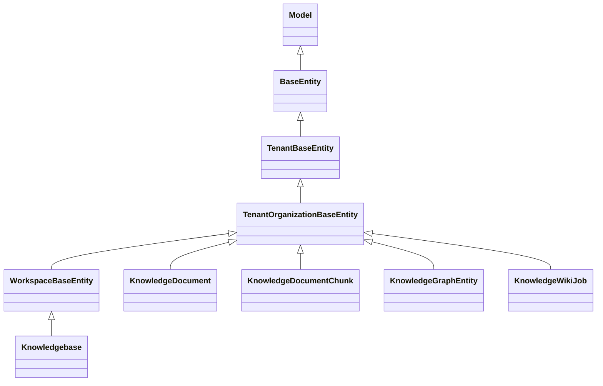

# 知识库与 RAG 域 · 数据模型

> 只读梳理。源码根 `packages/server-ai/src/`（下称 `src/`），引用为仓库根相对路径。列极多者只列关键列并注明「其余见实体」。

**本文引用的文件**

- [core/entities/base.entity.ts](file://packages/server-ai/src/core/entities/base.entity.ts)
- [packages/server/src/core/entities/base.entity.ts](file://packages/server/src/core/entities/base.entity.ts)
- [packages/server/src/core/entities/tenant-base.entity.ts](file://packages/server/src/core/entities/tenant-base.entity.ts)
- [packages/server/src/core/entities/tenant-organization-base.entity.ts](file://packages/server/src/core/entities/tenant-organization-base.entity.ts)
- [knowledgebase/knowledgebase.entity.ts](file://packages/server-ai/src/knowledgebase/knowledgebase.entity.ts)
- [knowledgebase/task/task.entity.ts](file://packages/server-ai/src/knowledgebase/task/task.entity.ts)
- [knowledgebase/logs/log.entity.ts](file://packages/server-ai/src/knowledgebase/logs/log.entity.ts)
- [knowledgebase/tags/knowledgebase-tag.entity.ts](file://packages/server-ai/src/knowledgebase/tags/knowledgebase-tag.entity.ts)
- [knowledgebase/tags/document-tag.entity.ts](file://packages/server-ai/src/knowledgebase/tags/document-tag.entity.ts)
- [knowledge-document/document.entity.ts](file://packages/server-ai/src/knowledge-document/document.entity.ts)
- [knowledge-document/page/document-page.entity.ts](file://packages/server-ai/src/knowledge-document/page/document-page.entity.ts)
- [knowledge-document/chunk/chunk.entity.ts](file://packages/server-ai/src/knowledge-document/chunk/chunk.entity.ts)
- [knowledge-document/deletion/entities.ts](file://packages/server-ai/src/knowledge-document/deletion/entities.ts)
- [knowledge-document/document-hash.ts](file://packages/server-ai/src/knowledge-document/document-hash.ts)
- [knowledge-document/document.module.ts](file://packages/server-ai/src/knowledge-document/document.module.ts)
- [knowledgebase/vector-store.ts](file://packages/server-ai/src/knowledgebase/vector-store.ts)
- [rag-vstore/commands/handlers/create.handler.ts](file://packages/server-ai/src/rag-vstore/commands/handlers/create.handler.ts)
- [rag-vstore/knowledge-pg-vector.store.ts](file://packages/server-ai/src/rag-vstore/knowledge-pg-vector.store.ts)
- [graphrag/entities/knowledge-graph-entity.entity.ts](file://packages/server-ai/src/graphrag/entities/knowledge-graph-entity.entity.ts)
- [graphrag/entities/knowledge-graph-relation.entity.ts](file://packages/server-ai/src/graphrag/entities/knowledge-graph-relation.entity.ts)
- [graphrag/entities/knowledge-graph-mention.entity.ts](file://packages/server-ai/src/graphrag/entities/knowledge-graph-mention.entity.ts)
- [graphrag/entities/knowledge-graph-community.entity.ts](file://packages/server-ai/src/graphrag/entities/knowledge-graph-community.entity.ts)
- [graphrag/entities/knowledge-graph-index-job.entity.ts](file://packages/server-ai/src/graphrag/entities/knowledge-graph-index-job.entity.ts)
- [graphrag/entities/knowledge-graph-entity-contribution.entity.ts](file://packages/server-ai/src/graphrag/entities/knowledge-graph-entity-contribution.entity.ts)
- [knowledgebase/wiki/entities/knowledge-wiki-job.entity.ts](file://packages/server-ai/src/knowledgebase/wiki/entities/knowledge-wiki-job.entity.ts)
- [knowledgebase/wiki/entities/knowledge-wiki-page.entity.ts](file://packages/server-ai/src/knowledgebase/wiki/entities/knowledge-wiki-page.entity.ts)
- [knowledgebase/wiki/entities/knowledge-wiki-page-version.entity.ts](file://packages/server-ai/src/knowledgebase/wiki/entities/knowledge-wiki-page-version.entity.ts)
- [knowledgebase/wiki/entities/knowledge-wiki-page-evidence.entity.ts](file://packages/server-ai/src/knowledgebase/wiki/entities/knowledge-wiki-page-evidence.entity.ts)
- [knowledgebase/wiki/entities/knowledge-wiki-organization.entity.ts](file://packages/server-ai/src/knowledgebase/wiki/entities/knowledge-wiki-organization.entity.ts)
- [knowledgebase/wiki/entities/knowledge-wiki-source-state.entity.ts](file://packages/server-ai/src/knowledgebase/wiki/entities/knowledge-wiki-source-state.entity.ts)
- [knowledgebase/wiki/entities/knowledge-wiki-model-invocation.entity.ts](file://packages/server-ai/src/knowledgebase/wiki/entities/knowledge-wiki-model-invocation.entity.ts)
- [knowledgebase/wiki/entities/knowledge-wiki-page-reduce-input.entity.ts](file://packages/server-ai/src/knowledgebase/wiki/entities/knowledge-wiki-page-reduce-input.entity.ts)
- [knowledgebase/identity/knowledge-identity.entity.ts](file://packages/server-ai/src/knowledgebase/identity/knowledge-identity.entity.ts)
- [knowledgebase/identity/knowledge-identity-observation.entity.ts](file://packages/server-ai/src/knowledgebase/identity/knowledge-identity-observation.entity.ts)
- [knowledgebase/analyzer/keyword-analyzer.service.ts](file://packages/server-ai/src/knowledgebase/analyzer/keyword-analyzer.service.ts)

## 目录

- [实体基类分层](#实体基类分层)
- [KB 域表](#kb-域表)
- [文档域表](#文档域表)
- [删除与发布四表](#删除与发布四表)
- [向量面非实体表](#向量面非实体表)
- [图谱域表](#图谱域表)
- [Wiki 域表](#wiki-域表)
- [Identity 域表](#identity-域表)
- [迁移与 seed 惯例](#迁移与-seed-惯例)
- [校验规则](#校验规则)
- [已知风险与坑](#已知风险与坑)

## 实体基类分层

图表来源：[base.entity.ts](file://packages/server-ai/src/core/entities/base.entity.ts)、[base.entity.ts](file://packages/server/src/core/entities/base.entity.ts)、[tenant-organization-base.entity.ts](file://packages/server/src/core/entities/tenant-organization-base.entity.ts)

- `Model`：仅构造函数批量赋值与已废弃的 `instanceOf`。
- `BaseEntity extends Model`：`id`（uuid 主键）、`createdById`/`createdBy`（`ManyToOne('User')`，`onDelete: 'RESTRICT'`）、`updatedById`/`updatedBy`、`createdAt`/`updatedAt`（`timestamptz`）。
- `TenantBaseEntity`：`tenant`（`ManyToOne('Tenant')`，`onDelete: 'CASCADE'`）、`tenantId`（`@Index()`，可空）。
- `TenantOrganizationBaseEntity`：`organization`（`onUpdate/onDelete: 'CASCADE'`）、`organizationId`（`@Index()`，可空）。
- `WorkspaceBaseEntity`：`workspace`（`ManyToOne(XpertWorkspace)`，`onUpdate/onDelete: 'CASCADE'`）、`workspaceId`（`@Index()`）、`publishAt`（timestamptz）、`deletedAt`（`@DeleteDateColumn`）。注意 `Knowledgebase extends WorkspaceBaseEntity`，而文档/图谱/Wiki 各表继承 `TenantOrganizationBaseEntity`，**不带 workspaceId**（隔离靠 knowledgebaseId 派生）。

章节来源：[base.entity.ts](file://packages/server-ai/src/core/entities/base.entity.ts)（关键符号：WorkspaceBaseEntity）、[knowledgebase.entity.ts](file://packages/server-ai/src/knowledgebase/knowledgebase.entity.ts)（关键符号：Knowledgebase）

## KB 域表

| 表 | 实体 | 关键列 | 索引/唯一约束 | 关系与级联 |
|---|---|---|---|---|
| `knowledgebase` | `Knowledgebase` | `name`；`keywordAnalyzer`(jsonb, `update:false`)、`keywordAnalyzerLocked`(bool, `update:false`)；`vectorStore`(varchar32)、`type`(20)、`structure`、`language`、`permission`(默认 Private)、`metadataSchema`(jsonb 默认 `[]`)、`recall`(json 默认 `{topK:10}`)、`parserConfig`/`parserId`/`automaticTagging`、`apiEnabled`(默认 true)、`incrementalSyncEnabled`(默认 false)、`extKnowledgebaseId`；模型 `copilotModelId`/`chatModelId`/`wikiModelId`/`rerankModelId`/`visionModelId`（`OneToOne CopilotModel, cascade`）与 `pendingCopilotModelId` 等 pending*；embedding 状态 `embeddingCollectionName`/`embeddingModelFingerprint`/`embeddingDimensions`/`embeddingRevision` + `rebuildTaskId`/`embeddingRebuildError`；wiki 状态 `wikiConfig`/`wikiStatus`/`wikiAvailability`/`wikiRevision`/`wikiActiveRevision`/`wikiStagedRevision`/`wikiBuildError`/`wikiRebuildRequiredReason`/`wikiGeneratorVersion`/`wikiConfigFingerprint`；图 `graphRag`/`graphStatus`/`graphRevision`/`graphIndexError`；统计 `documentNum`/`chunkNum`/`tokenNum`(bigint+transformer)；`pipelineId` | `@Index(['tenantId','organizationId','name'], { unique: true })` | `documents`→`KnowledgeDocument`（`cascade: insert/update/remove/soft-remove/recover`）；`pipeline`→`Xpert`（JoinColumn `pipelineId`）；`integration`（`onDelete: 'SET NULL'`）；`xperts` M2M（`onUpdate/onDelete: 'CASCADE'`） |
| `knowledgebase_task` | `KnowledgebaseTask` | `taskType`(默认 `embedding`)、`status`(`pending|running|success|failed|cancelled`)、`steps`(jsonb)、`error`、`finishedAt`、`context`；关联 `conversationId`、`executionId` | 无额外唯一索引 | `knowledgebase`/`conversation`/`execution` 均 `onDelete: 'CASCADE'`；`documents` M2M 走联接表 `knowledgebase_task_document` |
| `knowledge_retrieval_log` | `KnowledgeRetrievalLog` | `query`、`source`、`hitCount`、`requestId`、`filterVersion`、`fixedFilter`/`dynamicFilter`/`requestFilter`/`effectiveFilter`(jsonb)、`filterHash`、`filterStatus`、`fallbackReason`、`errorCode`、`candidateDocumentCount`/`candidateChunkCount`、`vectorBackend`、`filterLatency`/`vectorLatency`、`diagnostics` | 无 | `knowledgebase` `ManyToOne`，`onDelete: 'CASCADE'` |
| `knowledgebase_tag` | `KnowledgebaseTag` | `knowledgebaseId`、`tagId` | `UQ_knowledgebase_tag`(`knowledgebaseId`,`tagId`) 唯一 | KB `CASCADE`；`Tag` `onDelete: 'RESTRICT'`（标签定义归组织目录所有） |
| `knowledge_document_tag` | `KnowledgeDocumentTag` | `documentId`、`tagId`、`source`（默认 `manual`，含 `automatic`）、`confidence`(float) | `UQ_knowledge_document_tag`(`documentId`,`tagId`) 唯一 | 文档 `CASCADE`；`Tag` `RESTRICT` |

章节来源：[knowledgebase.entity.ts](file://packages/server-ai/src/knowledgebase/knowledgebase.entity.ts)（关键符号：Knowledgebase / knowledgebase）、[task.entity.ts](file://packages/server-ai/src/knowledgebase/task/task.entity.ts)（关键符号：KnowledgebaseTask / knowledgebase_task）

## 文档域表

- `knowledge_document`（`KnowledgeDocument<T extends KnowledgeDocumentMetadata>`，`@Tree('closure-table')`，继承 `TenantOrganizationBaseEntity`）：`disabled`、`deletedAt`（`@DeleteDateColumn`）、`hardDeletePendingAt`、`publicationEpoch`(int 默认 0)、`sourceType`/`sourceConfig`(json)/`sourceKey`(512)/`sourceHash`(64)/`processingHash`(64)/`contentHash`(64)、`version`(`@VersionColumn`)、`category`/`type`/`name`/`mimeType`/`size`/`folder`/`filePath`/`fileUrl`/`thumbnail`/`parserId`/`parserConfig`、`keywordTitleVector`(tsvector, `select:false`)、`tokenNum`(bigint)/`chunkNum`、`progress`(float)/`processMsg`/`processBeginAt`/`processDuation`/`processDuration`、`status`/`jobId`、`tagRevision`(int, `select:false`)/`autoTaggingInputHash`(64, `select:false`)、`processingExecutionId`(`select:false`)、`options`(json)/`metadata`(jsonb)/`draft`(json)。索引：`IDX_knowledge_document_kb_source_hash`、`_kb_source_key`、`_kb_disabled`、`_kb_name`、`_kb_folder`、`_kb_type_mime`、`_kb_category_source`、`_kb_hard_delete_pending`，以及 `synchronize: false` 的 `IDX_knowledge_document_name_trgm`、`IDX_knowledge_document_keyword_title_vector`。关系：`knowledgebase`(`CASCADE`)、`storageFile`、`integration`(`SET NULL`)、`pages`/`chunks`(`cascade insert/update/remove`)、`tagAssignments`（`persistence: false`，写入归 `KnowledgeTagService`）、`tasks` M2M。
- `knowledge_document_page`：`pageContent`、`metadata`(json)、`status`(`wasted|validate|running|cancel|finish|error`)；`knowledgebase`/`document` 均 `CASCADE`。实体注释标注该表已被 chunks 取代（`@deprecated use chunks instead`）。
- `knowledge_document_chunk`（`@Tree('closure-table')`）：`pageContent`、`keywordVector`(tsvector, `select:false`)、`metadata`(jsonb)、`contentHash`(64)、`version`(`@VersionColumn`)、`status`；索引 `IDX_knowledge_document_chunk_doc_content_hash`、`_kb_document`，以及 `synchronize: false` 的 `_content_fts`、`_keyword_vector`、`_content_trgm`；`knowledgebase`/`document` 均 `onDelete: 'CASCADE'`。

章节来源：[document.entity.ts](file://packages/server-ai/src/knowledge-document/document.entity.ts)（关键符号：KnowledgeDocument / knowledge_document）、[chunk.entity.ts](file://packages/server-ai/src/knowledge-document/chunk/chunk.entity.ts)（关键符号：KnowledgeDocumentChunk / knowledge_document_chunk）

## 删除与发布四表

| 表 | 实体 | 关键列 | 唯一约束 |
|---|---|---|---|
| `knowledge_document_deletion_intent` | `KnowledgeDocumentDeletionIntent` | `knowledgebaseId`、`documentId`(可空，`SET NULL`)、`sourceDocumentIdSnapshot`、`expectedDocumentVersion`、`sourceLifecycleGeneration`、`publicationEpoch`、`requestedById`/`billingPrincipalId`、`status`(默认 `prepared`)、`manifest`(jsonb)、`failedStage`/`errorCode`/`error`、`executionAttempt`、`acceptedAt`、`lockedAt`/`leaseExpiresAt`/`completedAt`、`version`(`@VersionColumn`) | `(knowledgebaseId, sourceDocumentIdSnapshot)` **部分唯一** `WHERE "status" <> 'completed'`；另有 `(knowledgebaseId, status, acceptedAt)` |
| `knowledge_document_deletion_cleanup_receipt` | `KnowledgeDocumentDeletionCleanupReceipt` | `intentId`、`receiptKey`、`artifactKind`、`artifactKey`、`status`(`pending|succeeded|failed|indeterminate`)、`outcome`(jsonb)、`attempt`、`error`、`completedAt` | `(intentId, receiptKey)` 唯一；`intent` `CASCADE` |
| `knowledge_document_publication_attempt` | `KnowledgeDocumentPublicationAttempt` | `knowledgebaseId`、`documentId`/`documentIdSnapshot`、`producerKind`(`document|chunk|graph|wiki|embedding_rebuild`)、`publicationEpoch`、`status`、`relationPublicationStatus`、`artifacts`(jsonb 默认 `[]`，每项带 `idempotencyKey`)、`lockedAt`/`leaseExpiresAt`/`heartbeatAt`、`errorCode`/`error`、`completedAt` | 见 idx `(knowledgebaseId, documentIdSnapshot, publicationEpoch)`、`(knowledgebaseId, status, leaseExpiresAt)` |
| `knowledge_document_publication_attempt_source` | `KnowledgeDocumentPublicationAttemptSource` | `attemptId`、`knowledgebaseId`、`documentIdSnapshot`、`publicationEpoch`、`contentHash` | `(attemptId, documentIdSnapshot)` 唯一 |

`KnowledgeDocumentPublicationAttemptStatus` 与 artifact 状态均包含 `indeterminate`；`producerKind` 覆盖五类发布者。四表由 `KnowledgeDocumentModule` 的 `TypeOrmModule.forFeature` 注册并经 `core/entities/index.ts` 导出（仓库内暂无编排服务）。

章节来源：[deletion/entities.ts](file://packages/server-ai/src/knowledge-document/deletion/entities.ts)（关键符号：KnowledgeDocumentDeletionIntent / KnowledgeDocumentPublicationAttempt）、[document.module.ts](file://packages/server-ai/src/knowledge-document/document.module.ts)（关键符号：KnowledgeDocumentModule）

## 向量面非实体表

`knowledge_document_vector` 与 `knowledge_document_collection` **不是 TypeORM 实体**，由 `RagCreateVStoreHandler.createPgVectorStore` 在运行期创建：`tableName: 'knowledge_document_vector'`、`collectionTableName: 'knowledge_document_collection'`，列名映射为 `id`/`vector`/`content`/`metadata`，并调用 `pgvstore.ensureTableInDatabase()` 与 `ensureCollectionTableInDatabase()`。PG 实现额外使用 `collection_id` 列做 collection 归属，查询走 `INNER JOIN "knowledge_document_chunk"`（`COALESCE(c."metadata" ->> 'chunkId', c."id"::text) = v."metadata" ->> 'chunkId'`）并过滤 `knowledgebaseId`、`document.disabled`、`metadata.enabled`；`addVectors` 在传入 `ids` 时做**幂等 upsert**（不先删旧向量）。

collection 名派生：active 为 `knowledgebase.embeddingCollectionName ?? knowledgebase.id`；图谱实体向量为 `` `${activeCollectionName}:graph-entities` ``；重建期为 `pendingEmbeddingCollectionName`。向量元数据 `TEmbeddingVectorMetadata`（`provider`/`model`/`embeddingModelFingerprint`/`embeddingDimensions`/`embeddingRevision`/`vectorIdCollectionName`）决定 `createVectorId`。向量表维度由 `KnowledgePGVectorStore` 按 embedding 维度建表（具体 DDL 细节未确认）。

章节来源：[create.handler.ts](file://packages/server-ai/src/rag-vstore/commands/handlers/create.handler.ts)（关键符号：RagCreateVStoreHandler / createPgVectorStore）、[knowledge-pg-vector.store.ts](file://packages/server-ai/src/rag-vstore/knowledge-pg-vector.store.ts)（关键符号：KnowledgePGVectorStore）

## 图谱域表

| 表 | 实体 | 关键列与约束 |
|---|---|---|
| `knowledge_graph_entity` | `KnowledgeGraphEntity` | `identityId`(可空, `NO ACTION`)、`knowledgebaseId`、`type`(120)、`name`(512)、`normalizedName`(512)、`origin`(默认 `extracted`)、`visibility`(默认 `active`)、`aliases`(jsonb 默认 `[]`)、`description`/`summary`、`confidence`(float)、`mentionCount`、`revision`、`sourceFingerprint`(128)、`metadata`。唯一 `(knowledgebaseId, identityId)`；**部分唯一** `IDX_graph_manual_entity_name`（`tenantId,organizationId,knowledgebaseId,normalizedName,type` `WHERE "identityId" IS NULL`）；另有 `(knowledgebaseId, origin)`、`(knowledgebaseId, visibility)` |
| `knowledge_graph_relation` | `KnowledgeGraphRelation` | `sourceEntityId`/`targetEntityId`、`type`(160)、`normalizedType`、`origin`/`visibility`、`description`、`confidence`、`weight`、`evidenceCount`、`revision`、`sourceFingerprint`、`metadata`。唯一 `(knowledgebaseId, sourceEntityId, targetEntityId, type)`；`(knowledgebaseId, origin|visibility)`；`IDX_graph_relation_kb_source_visibility`、`_kb_target_visibility`；两端 `onDelete: 'CASCADE'` |
| `knowledge_graph_mention` | `KnowledgeGraphMention` | `entityId`/`relationId`/`documentId`/`chunkId`、`quote`(text)、`confidence`(float)、`startOffset`/`endOffset`、`revision`、`metadata`；索引 `(knowledgebaseId, documentId)`、`(knowledgebaseId, chunkId)`、`IDX_graph_mention_kb_entity_doc_chunk`、`IDX_graph_mention_kb_relation_doc_chunk` |
| `knowledge_graph_community` | `KnowledgeGraphCommunity` | `key`(160)、`title`、`summary`、`entityIds`(jsonb 默认 `[]`)、`revision`、`metadata`；唯一 `(knowledgebaseId, key)` |
| `knowledge_graph_index_job` | `KnowledgeGraphIndexJob` | `documentId`(`SET NULL`)、`sourceContentHash`(128)、`sourcePublicationEpoch`、`extractionId`、`extractionSnapshot`(jsonb, `select:false`)、`dispatchError`、`type`(30)、`status`(30, 默认 QUEUED)、`stage`(30)、`result`(30)、`revision`、`totalChunks`/`processedChunks`、`error`、`startedAt`/`completedAt`；索引 `(knowledgebaseId, documentId, status)` |
| `knowledge_graph_entity_contribution` | `KnowledgeGraphEntityContribution` | `entityId`、`knowledgebaseId`、`sourceDocumentIdSnapshot`、`sourceContentHash`(128)、`sourcePublicationEpoch`、`name`(512)、`aliases`、`description`、`confidence`、`properties`、`revision`；唯一 `(entityId, sourceDocumentIdSnapshot)` |
| `knowledge_graph_relation_contribution` | `KnowledgeGraphRelationContribution` | 同名结构，唯一键含 `sourceDocumentIdSnapshot`（定义见实体文件） |

章节来源：[knowledge-graph-entity.entity.ts](file://packages/server-ai/src/graphrag/entities/knowledge-graph-entity.entity.ts)（关键符号：KnowledgeGraphEntity / knowledge_graph_entity）、[knowledge-graph-relation.entity.ts](file://packages/server-ai/src/graphrag/entities/knowledge-graph-relation.entity.ts)（关键符号：KnowledgeGraphRelation / knowledge_graph_relation）

## Wiki 域表

Wiki 域共 **15 张表**（13 个实体文件，其中 `knowledge-wiki-organization.entity.ts` 含 3 个实体、reduce input / source 各一）。

- `knowledge_wiki_job`：`jobKey`(768)、`type`、`status`(默认 `queued`)、`isCurrent`(默认 true)、`generationRevision`、`executionAttempt`、`generationAttempt`、`configFingerprint`、`generatorVersion`、`rootJobId`/`parentJobId`、`sourceDocumentIdSnapshot`、`pageKey`、`sourceLifecycleGeneration`/`sourcePublicationEpoch`/`sourceContentHash`、`billingPrincipalId`、`spendEnvelope`、`expectedChildren`/`succeededChildren`/`failedChildren`、`errorCode`/`error`/`dispatchError`/`dispatchAttempts`/`dispatchAfter`、租约 `lockedAt`/`leaseExpiresAt`/`heartbeatAt`/`completedAt`；唯一 `(knowledgebaseId, jobKey)`。
- `knowledge_wiki_page`：`pageKey`(768)、`pageType`、`canonicalName`/`normalizedCanonicalName`、`identityId`(可空)、`slug`(600)、`status`(默认 `building`)、`projectionStatus`(默认 `pending`)、`activeVersionId`、`sourceCount`/`inboundLinkCount`/`outboundLinkCount`、`publishedAt`、`version`；唯一 `(knowledgebaseId, pageKey)`、`(knowledgebaseId, identityId)`、`(knowledgebaseId, slug)`。
- `knowledge_wiki_page_version`：`producerJobId`、`generationAttempt`、`generationRevision`、`generatorVersion`、`configFingerprint`、`expectedPageVersion`、`title`/`summary`/`contentMarkdown`、`aliases`、`contentHash`、`status`、`projectionStatus`、`projectionEmbeddingRevision`/`projectionEmbeddingFingerprint`/`projectionError`、`publishedAt`；唯一 `(pageId, producerJobId, generationAttempt)`。
- `knowledge_wiki_page_evidence`：`pageId`/`pageVersionId`、`sourceDocumentIdSnapshot`、`sourceChunkIdSnapshot`、`quote`(text)、`ordinal`、`sectionAnchor`、`sourceContentHash`(128)。
- `knowledge_wiki_page_link`：`sourcePageId`/`sourcePageVersionId`/`targetPageId`、`sectionAnchor`、`label`；唯一 `(sourcePageVersionId, targetPageId, sectionAnchor)`。
- `knowledge_wiki_page_contribution`：`pageVersionId`、`sourceDocumentIdSnapshot`、`sourceLifecycleGeneration`、`sourceContentHash`、`wikiRevision`、`generatorVersion`、`payload`(jsonb)；唯一 `(pageVersionId, sourceDocumentIdSnapshot)`。
- `knowledge_wiki_page_reduce_input`：`rootJobId`/`stageJobId`、`generationAttempt`/`generationRevision`、`configFingerprint`、`generatorVersion`、`expectedPageVersion`、`inputFingerprint`、`status`(`prepared|running|succeeded|failed|stale`)；唯一 `(stageJobId, generationAttempt)`。
- `knowledge_wiki_page_reduce_input_source`：`inputId`、`sourceDocumentIdSnapshot`、`sourceLifecycleGeneration`/`sourcePublicationEpoch`/`sourceContentHash`、`payload`、`evidence`(jsonb)；唯一 `(inputId, sourceDocumentIdSnapshot)`。
- `knowledge_wiki_source_state`：`sourceDocumentIdSnapshot`、`lifecycleGeneration`、`lastEventType`(`finish|content_changed|enabled|disabled|soft_deleted|hard_deleted`)、`lastContentHash`、`eligible`/`cleanupPending`/`cleanupFailed`/`generationPending`/`generationPendingReason`、`desiredRootJobId`；唯一 `(knowledgebaseId, sourceDocumentIdSnapshot)`。
- `knowledge_wiki_source_map_result`：`sourceJobId`、`generationRevision`、`sourceLifecycleGeneration`、`sourceDocumentIdSnapshot`、`sourceContentHash`、`pageType`、`canonicalName`、`candidateKey`/`normalizedPageKey`、`identity`/`identityEmbedding`/`identityDecision`(jsonb)、`payload`；唯一 `(sourceJobId, candidateKey)`。
- `knowledge_wiki_projection_state`：`projectionDocumentId`、`projectionEpoch`、`status`(默认 `disabled`)、`error`、`version`；唯一 `(knowledgebaseId)`、`(projectionDocumentId)`。
- `knowledge_wiki_taxonomy`：`enabled`(默认 false)、`revision`；唯一 `(knowledgebaseId)`。
- `knowledge_wiki_folder`：`parentId`（自引用 `onDelete: 'RESTRICT'`）、`name`(120)、`description`、`position`、`version`。
- `knowledge_wiki_placement`：`pageId`、`folderId`(`RESTRICT`)、`source`(24)、`version`；唯一 `(pageId)`。
- `knowledge_wiki_model_invocation`：`requestId`(1024)、`stage`(`map|dedup|reduce|classify|links`)、`callOrdinal`、`generationAttempt`、`inputFingerprint`、`status`(默认 `prepared`)、`reconciliationStatus`(默认 `not_available`，含 `indeterminate`)、`providerRequestId`、`modelId`/`modelName`、`billingPrincipalId`、`tokenUsage`、`structuredOutput`、`billingStatus`(默认 `pending`)、`errorCode`/`error`、`reconciliationDeadline`/`reconciliationAttempts`、`completedAt`；唯一 `(requestId)`、`(jobId, generationAttempt, stage, callOrdinal, inputFingerprint)`。

章节来源：[knowledge-wiki-job.entity.ts](file://packages/server-ai/src/knowledgebase/wiki/entities/knowledge-wiki-job.entity.ts)（关键符号：KnowledgeWikiJob / knowledge_wiki_job）、[knowledge-wiki-organization.entity.ts](file://packages/server-ai/src/knowledgebase/wiki/entities/knowledge-wiki-organization.entity.ts)（关键符号：KnowledgeWikiTaxonomy / KnowledgeWikiFolder / KnowledgeWikiPlacement）

## Identity 域表

- `knowledge_identity`：`knowledgebaseId`（`onDelete: 'CASCADE'`）、`kind`(32)、`embedding`(jsonb 可空，注释标注为可丢弃缓存)、`revision`(默认 1)；索引 `(knowledgebaseId, kind)`（**非唯一**）。
- `knowledge_identity_observation`：`sourceDocumentIdSnapshot`（`ManyToOne(KnowledgeDocument)`）、`knowledgebaseId`、`identityId`（`CASCADE`）、`sourceContentHash`(128)、`sourcePublicationEpoch`、`consumer`(`wiki|graph`)、`extractionId`、`isCurrent`(默认 true)、`candidateKey`(512)、`sourceKey`(64)、`payload`(jsonb)、`decision`(jsonb)；唯一 `(knowledgebaseId, sourceKey)`，另有 `(knowledgebaseId, sourceDocumentIdSnapshot)`、`(knowledgebaseId, sourceDocumentIdSnapshot, consumer, extractionId)`。语义：观察记录跨投影重建存活，仅 `isCurrent` 提供有效证据。

章节来源：[knowledge-identity.entity.ts](file://packages/server-ai/src/knowledgebase/identity/knowledge-identity.entity.ts)（关键符号：KnowledgeIdentity / knowledge_identity）、[knowledge-identity-observation.entity.ts](file://packages/server-ai/src/knowledgebase/identity/knowledge-identity-observation.entity.ts)（关键符号：KnowledgeIdentityObservation / knowledge_identity_observation）

## 迁移与 seed 惯例

- 本域真实迁移文件仅两个，位于 `graphrag/migrations/`：`20260913-structured-mention-confidence.sql`（回填 `knowledge_graph_mention.confidence`，条件性写入 NULL，含 `BEGIN; ... COMMIT;`）与 `20260913-structured-properties.sql`（文件较小，内容未逐行核读）。其余域内结构靠 TypeORM `synchronize`（仓库内**未发现**自动执行 `*.sql` 的迁移运行器；跨域文档一致要求「部署前按顺序手工应用 SQL」，例如 `docs/agent-plugins/README.md`、`docs/model-execution.md`、`docs/conversation-branching.md`）。
- 向量表不走迁移，由 `RagCreateVStoreHandler` 运行期 `ensureTableInDatabase` / `ensureCollectionTableInDatabase` 建表；图谱索引的向量写入前会调用 `syncEntityVectors`。
- 无本域专属 seed 文件（`knowledge-*` 相关 seed 未找到）→ 该模块无此项。

章节来源：[20260913-structured-mention-confidence.sql](file://packages/server-ai/src/graphrag/migrations/20260913-structured-mention-confidence.sql)（关键符号：knowledge_graph_mention / knowledge_graph_index_job）、[create.handler.ts](file://packages/server-ai/src/rag-vstore/commands/handlers/create.handler.ts)（关键符号：ensureTableInDatabase / ensureCollectionTableInDatabase）

## 校验规则

- class-validator：实体列普遍带 `@IsString/@IsEnum/@IsJSON/@IsNumber/@IsBoolean/@IsDate/@IsOptional/@IsString({each:true})`（如 `Knowledgebase.permission` 的 `@IsEnum(KnowledgebasePermission)`、`vectorStore` 的 `@IsEnum(VectorTypeEnum)`；`KnowledgeDocument.status` 的 `@IsEnum(KBDocumentStatusEnum)`）。
- DB 层唯一/部分唯一：KB `(tenantId, organizationId, name)`；`knowledgebase_tag`/`knowledge_document_tag` 双列唯一；图谱实体 `(knowledgebaseId, identityId)` 与手工实体部分唯一；relation 四列唯一；Wiki page 三个唯一键 + job `(knowledgebaseId, jobKey)`；删除意图部分唯一 `WHERE "status" <> 'completed'`。
- 服务级：`getQueryFailedErrorCode` 把 PostgreSQL `23505` / MySQL `1062` / `duplicate key` 文案翻译为 `BadRequestException`（i18n `xpert.Error.NameExists`）。
- 关键字分析器：`KnowledgeKeywordAnalyzerService.change` 用条件 SQL `UPDATE ... WHERE keywordAnalyzerLocked = false AND NOT EXISTS(...chunk) AND NOT EXISTS(...非 folder 文档)`，失败抛 `KeywordAnalyzerLocked`；`Knowledgebase.type === External` 直接拒绝。
- 检索侧：`WeightedRrfFusion` 对 `rankConstant`/权重/rank 做数值校验并抛 `RangeError`；`validateRrfWeights` 在检索入口先校验权重。

章节来源：[knowledgebase.entity.ts](file://packages/server-ai/src/knowledgebase/knowledgebase.entity.ts)（关键符号：Knowledgebase / @Index unique）、[keyword-analyzer.service.ts](file://packages/server-ai/src/knowledgebase/analyzer/keyword-analyzer.service.ts)（关键符号：KnowledgeKeywordAnalyzerService.change）

## 已知风险与坑

1. **`update: false` 表意陷阱**：`keywordAnalyzer` / `keywordAnalyzerLocked` 声明 `update:false`，普通 `save()` 不会写这两列；只有 `KnowledgeKeywordAnalyzerService.saveSettings` 的条件 SQL 与 subscriber 的 `UPDATE ... SET keywordAnalyzerLocked = true` 能改。误用普通保存会「改了不生效」。
2. **两张 `@Tree('closure-table')`**：`KnowledgeDocument` 与 `KnowledgeDocumentChunk` 都建闭包表，树层次删除/移动会额外维护闭包行；`KnowledgeDocumentChunk` 同时挂 `@VersionColumn`，并发更新可能抛乐观锁冲突。
3. **双轨：实体表 vs 运行期建表**：向量表不在实体元数据里，`synchronize` 不会管理其结构；切换 embedding 维度/模型后旧表结构可能不匹配，只能靠重建 + 新 collection 规避。
4. **删除四表一致性**：`deletion_intent`（部分唯一 + 租约）、`cleanup_receipt`（receiptKey 唯一）、`publication_attempt`（含 `idempotencyKey` 的 `artifacts`）为三段式 saga 设计，但当前无编排方写入，`indeterminate` 状态只有在设计落地后才有生产路径。
5. **Wiki 表数量口径**：物理 15 张，实体文件 13 个（organization 文件内 3 个实体、reduce input 与 source 分文件），按「文件数」统计会得到 13，容易误报。
6. **快照列语义**：`sourceDocumentIdSnapshot` / `sourceChunkIdSnapshot` / `documentIdSnapshot` 是**不可变来源标识**（配合 `sourceContentHash`/`sourcePublicationEpoch` 定格版本），与可空 FK 的 `documentId` 不同；用 FK 关联做「当前来源」判断会漏掉已删文档的 tombstone 语义。
7. **软删未开放**：`KnowledgeDocumentService.softRemove` 直接抛 `ConflictException`，但实体仍有 `deletedAt`（`@DeleteDateColumn`）与索引 `_kb_disabled`，读路径还要叠加 `hardDeletePendingAt IS NULL`，容易被误当可用能力。
8. **`select: false` 列**：`processingExecutionId`、`tagRevision`、`autoTaggingInputHash`、`extractionSnapshot`、`keywordVector`/`keywordTitleVector` 默认不返回，诊断时需显式 `addSelect`。

章节来源：[document.entity.ts](file://packages/server-ai/src/knowledge-document/document.entity.ts)（关键符号：KnowledgeDocument / processingExecutionId / hardDeletePendingAt）、[deletion/entities.ts](file://packages/server-ai/src/knowledge-document/deletion/entities.ts)（关键符号：KnowledgeDocumentPublicationAttempt / artifacts）
