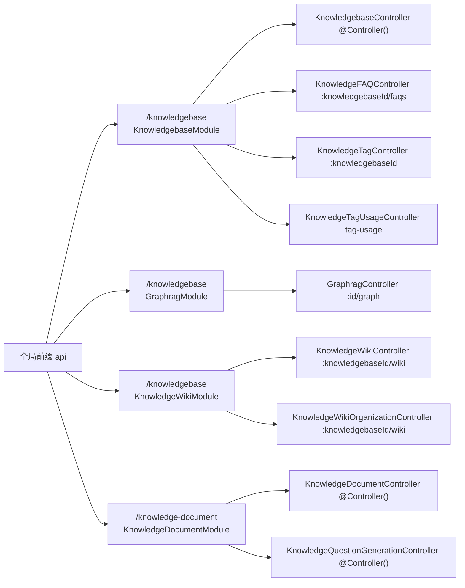

# 知识库专家 · 05 接口文档

本文档按真实路由前缀逐个控制器列出 HTTP 端点、鉴权、用途、关键参数行为与主要错误。**所有路径、守卫、错误码均以源码为准**；与既有扫描报告不一致处已在「路由校正」一节显式更正。

**本文引用的文件**
- [packages/server-ai/src/knowledgebase/knowledgebase.controller.ts](file://packages/server-ai/src/knowledgebase/knowledgebase.controller.ts)
- [packages/server-ai/src/knowledgebase/knowledgebase.module.ts](file://packages/server-ai/src/knowledgebase/knowledgebase.module.ts)
- [packages/server-ai/src/knowledgebase/faq/knowledge-faq.controller.ts](file://packages/server-ai/src/knowledgebase/faq/knowledge-faq.controller.ts)
- [packages/server-ai/src/knowledgebase/tags/knowledge-tag.controller.ts](file://packages/server-ai/src/knowledgebase/tags/knowledge-tag.controller.ts)
- [packages/server-ai/src/knowledge-document/document.controller.ts](file://packages/server-ai/src/knowledge-document/document.controller.ts)
- [packages/server-ai/src/knowledge-document/document.module.ts](file://packages/server-ai/src/knowledge-document/document.module.ts)
- [packages/server-ai/src/knowledge-document/questions/question-generation.controller.ts](file://packages/server-ai/src/knowledge-document/questions/question-generation.controller.ts)
- [packages/server-ai/src/graphrag/graphrag.controller.ts](file://packages/server-ai/src/graphrag/graphrag.controller.ts)
- [packages/server-ai/src/graphrag/graphrag.module.ts](file://packages/server-ai/src/graphrag/graphrag.module.ts)
- [packages/server-ai/src/knowledgebase/wiki/knowledge-wiki.controller.ts](file://packages/server-ai/src/knowledgebase/wiki/knowledge-wiki.controller.ts)
- [packages/server-ai/src/knowledgebase/wiki/knowledge-wiki-organization.controller.ts](file://packages/server-ai/src/knowledgebase/wiki/knowledge-wiki-organization.controller.ts)
- [packages/server-ai/src/knowledgebase/knowledgebase.service.ts](file://packages/server-ai/src/knowledgebase/knowledgebase.service.ts)
- [packages/server-ai/src/knowledge-document/document.service.ts](file://packages/server-ai/src/knowledge-document/document.service.ts)
- [packages/server-ai/src/knowledge-document/document-list-filter.ts](file://packages/server-ai/src/knowledge-document/document-list-filter.ts)
- [packages/server-ai/src/i18n/en.json](file://packages/server-ai/src/i18n/en.json)
- [apps/api/src/bootstrap/index.ts](file://apps/api/src/bootstrap/index.ts)

## 目录

- [路由总览](#路由总览)
- [知识库主控制器（KnowledgebaseController）](#知识库主控制器knowledgebasecontroller)
- [FAQ 与标签控制器（KnowledgeFAQController / KnowledgeTagController）](#faq-与标签控制器knowledgefaqcontroller--knowledgetagcontroller)
- [文档控制器（KnowledgeDocumentController）](#文档控制器knowledgedocumentcontroller)
- [题目生成控制器（KnowledgeQuestionGenerationController）](#题目生成控制器knowledgequestiongenerationcontroller)
- [图谱控制器（GraphragController）](#图谱控制器graphragcontroller)
- [知识 Wiki 控制器（KnowledgeWikiController）](#知识-wiki-控制器knowledgewikicontroller)
- [Wiki 组织控制器（KnowledgeWikiOrganizationController）](#wiki-组织控制器knowledgewikiorganizationcontroller)
- [鉴权实况](#鉴权实况)
- [路由校正](#路由校正)
- [错误码](#错误码)

## 路由总览

全部接口的最终前缀 = 全局前缀 `api`（`app.setGlobalPrefix('api')`，排除 `artifacts/share` 等）+ 所在模块 `RouterModule.register` 的 `path` + `@Controller()` 段。全局守卫 `AuthGuard` + `PluginScopeGuard` 在应用启动时注册，所有路由默认需要已认证用户。

图表来源：[knowledgebase.module.ts](file://packages/server-ai/src/knowledgebase/knowledgebase.module.ts)（关键符号：KnowledgebaseModule）、[graphrag.module.ts](file://packages/server-ai/src/graphrag/graphrag.module.ts)（关键符号：GraphragModule）、[knowledge-wiki.module.ts](file://packages/server-ai/src/knowledgebase/wiki/knowledge-wiki.module.ts)（关键符号：KnowledgeWikiModule）、[document.module.ts](file://packages/server-ai/src/knowledge-document/document.module.ts)（关键符号：KnowledgeDocumentModule）、[apps/api/src/bootstrap/index.ts](file://apps/api/src/bootstrap/index.ts)（关键符号：bootstrap）

章节来源：[apps/api/src/bootstrap/index.ts](file://apps/api/src/bootstrap/index.ts)（关键符号：bootstrap）、[knowledgebase.module.ts](file://packages/server-ai/src/knowledgebase/knowledgebase.module.ts)（关键符号：KnowledgebaseModule）

## 知识库主控制器（KnowledgebaseController）

前缀 `/api/knowledgebase`。`@Controller()` 为空，`@UseInterceptors(TransformInterceptor)`，`extends CrudController<Knowledgebase>`。下表路径相对该前缀；**「EDIT」= `@UseGuards(PermissionGuard)` + `@Permissions(AIPermissionsEnum.KNOWLEDGEBASE_EDIT)`**。

| 方法 | 路径 | 鉴权 | 用途与关键行为 | 主要错误 |
|---|---|---|---|---|
| GET | `keyword-analyzers` | EDIT | 当前组织关键词分析器选项（`KnowledgeKeywordAnalyzerService.options`） | `Error.KeywordAnalyzerExternal` |
| GET | `vector-stores` | EDIT | 向量库类型选项（`VectorStoreSettingsService.options`） | — |
| GET | `` | EDIT | 可访问列表：OR 分支 = `createdById=当前用户` 或 `createdById≠当前用户 且 permission=Organization`；`$relations` 经 `getSafeReadRelations` 白名单 | 401 / 403 |
| GET | `count` | EDIT | 与列表同过滤的 `total`（`take:1, skip:0, withDeleted:false`） | 同列表 |
| GET | `pagination` | EDIT | 与 `findAll` 共用 `findAllAccessible` | 同列表 |
| GET | `by-workspace/:workspaceId` | `WorkspaceAuthoringGuard` | 工作区视图，items 转为 `KnowledgebasePublicDTO`；可带 `published` | 403 |
| POST | `by-workspace/:workspaceId/preview-chunks` | `WorkspaceAuthoringGuard` | 切片预览 `parserSettings.preview(KnowledgeChunkPreviewInput)` | 400 解析器校验 |
| GET | `my` | 无 | 仅 `createdById = 当前用户` | 401 |
| GET | `public` | 无 | `permission in (Organization, Public)` 且 `createdById ≠ 当前用户` | 401 |
| POST | `external` | 无 | 创建外部知识库 `createExternal` | 400 / 23505 唯一键 |
| GET | `detail/:id` | 无 | `KnowledgebaseDetailDTO`（含 `canManage`，由 `createdById/permission` 推导） | 403 |
| GET | `:id` | 无（`UUIDValidationPipe`） | 详情，`$relations`/`$select` 查询参数 | 400 UUID |
| GET | `text-splitter/strategies`、`transformer/strategies`、`understanding/strategies`、`source/strategies` | 无 | 四个策略注册表发现接口 | — |
| POST | `:id/test` | 无 | 检索测试：`query/k`、`score`、`rerankModel`、`rerankThreshold`、`filters`、`variables`、`retrieval`、`contentScope` | `Error.KnowledgeRerankModelUnavailable`、`Error.KnowledgeFAQGraphUnsupported` |
| POST | `:id/pipeline` | 无 | `createPipeline`，异常统一包为 500 | 500 |
| POST | `:id/rebuild-embedding` | 无 | `startEmbeddingRebuild` → 置 `REBUILDING` + 写 `rebuildTaskId`/`pendingEmbeddingRevision` + 入队；异常转 400 | 400「Embedding rebuild is already running」 |
| POST | `:id/cancel-pending-embedding-model` | 无 | 清空 `pendingCopilotModel*`/`rebuildTaskId`/`embeddingRebuildError` | 400「Embedding rebuild is running」 |
| POST | `:id/task` | EDIT | `createTask`；`status='running'` 且知识库处于 `REBUILDING` 时拒绝 | 400、`Error.KnowledgebaseTaskAccessDenied` |
| GET | `:id/task/:taskId` | 无 | 任务详情；`assertKnowledgebaseTaskReadAccess`：无 `workspaceId` + `permission=Private` + 非创建者 → 拒 | 403 |
| POST | `:id/task/:taskId/process` | EDIT | 运行任务，`sources`/`stage('preview'\|'prod')`/`mode`/`options`；`REBUILDING` 时拒绝 | 400 |
| POST | `:id/file` | EDIT + `FileInterceptor('file')` | 上传到知识库 volume：内部再 `assertKnowledgebaseTaskWriteAccess` + `assertNotRebuilding`，经 `UploadFileCommand` 写入 `knowledges` catalog；返回 `url/filePath/fileUrl/mimeType` | 400 文件名缺失 / 重建中；500 上传目标非 success |
| GET | `:id/file/:name/preview` | 无 | 卷内文件预览（`decodeURIComponent(name)`） | 403 / 404 |
| GET | `statistics/knowledgebases` | EDIT | `StatisticsKnowledgebasesQuery(start, end)` | — |
| GET | `:id/logs` | 无 | 先 `findOneByIdString(id)` 做作用域校验，再按 `knowledgebaseId` 查检索日志 | 403 |

`getRerankModel` 是 `KnowledgebaseService` 的**公开服务方法**（供检索链路与 `test` 路由内部使用），**不是 HTTP 端点**；`knowledgebase.rerank.spec.ts` 覆盖的是该方法。

章节来源：[knowledgebase.controller.ts](file://packages/server-ai/src/knowledgebase/knowledgebase.controller.ts)（关键符号：KnowledgebaseController.findAll、KnowledgebaseController.findAllByPublic、KnowledgebaseController.uploadFile、KnowledgebaseController.rebuildEmbedding）、[knowledgebase.service.ts](file://packages/server-ai/src/knowledgebase/knowledgebase.service.ts)（关键符号：KnowledgebaseService.getRerankModel、KnowledgebaseService.assertNotRebuilding）

## FAQ 与标签控制器（KnowledgeFAQController / KnowledgeTagController）

`KnowledgeFAQController` 前缀 `/api/knowledgebase/:knowledgebaseId/faqs`；`KnowledgeTagController` 前缀 `/api/knowledgebase/:knowledgebaseId`；`KnowledgeTagUsageController` 前缀 `/api/knowledgebase/tag-usage`。三者**均无 `@UseGuards`**。

| 控制器 | 方法 | 路径 | 用途与关键行为 | 主要错误 |
|---|---|---|---|---|
| FAQ | GET | `` | `findAll`：`search`（trim 后为空转 undefined）、`enabled`（仅 true/false）、`skip`/`take`（非负整数，`take≠0`） | `Error.KnowledgeFAQEnabledFilterInvalid`、`Error.KnowledgeFAQPaginationInvalid` |
| FAQ | GET | `export` | 导出，`format` 仅 `csv`(默认)/`json`，`ids` 逗号分隔且必须是合法 UUID；`Content-Disposition: attachment` + `StreamableFile` | `Error.KnowledgeFAQExportFormatInvalid`、`Error.KnowledgeFAQExportIdsInvalid` |
| FAQ | GET | `import-template` | 下载导入模板 | — |
| FAQ | GET | `:faqId` | 单条查询（两个 ID 都过 `UUIDValidationPipe`） | 400 / 404 |
| FAQ | POST | `` | 创建（`CreateKnowledgeFAQDTO`） | 400/409 |
| FAQ | POST | `import` | `FileInterceptor('file', { limits: { fileSize: 10 * 1024 * 1024 } })` + `mode` 仅 `append`(默认)/`replace` | `Error.KnowledgeFAQImportModeInvalid`、`Error.KnowledgeFAQImportFileRequired` |
| FAQ | POST | `import/preview` | 同上限的预检导入，不落库 | `Error.KnowledgeFAQImportFileRequired` |
| FAQ | PUT | `:faqId` | 更新（`UpdateKnowledgeFAQDTO`） | 400/404 |
| FAQ | DELETE | `:faqId` | 删除，`version` 必填（正整数）；成功返回 `{ success: true }` | `Error.KnowledgeFAQVersionRequired` |
| Tag | GET | `tags` | 知识库标签列表 | 400 |
| Tag | PUT | `tags/:tagId` | 选中标签 `select()` | 403/404 |
| Tag | DELETE | `tags/:tagId` | 取消选中（内部 `select(id, tagId, true)`） | 403/404 |
| Tag | GET | `documents/:documentId/tags` | 文档标签 | 403/404 |
| Tag | PUT | `documents/:documentId/tags/:tagId` | 手工加标 `setManual()` | 403/404 |
| Tag | DELETE | `documents/:documentId/tags/:tagId` | 手工去标（`setManual(..., true)`） | 403/404 |
| TagUsage | GET | `:tagId` | 标签引用分页，`skip` 经 `DefaultValuePipe(0)` + `ParseIntPipe` | 400 |

章节来源：[knowledge-faq.controller.ts](file://packages/server-ai/src/knowledgebase/faq/knowledge-faq.controller.ts)（关键符号：KnowledgeFAQController.importFile、KnowledgeFAQController.exportFile、KnowledgeFAQController.previewImportFile）、[knowledge-tag.controller.ts](file://packages/server-ai/src/knowledgebase/tags/knowledge-tag.controller.ts)（关键符号：KnowledgeTagController.select、KnowledgeTagController.setManual、KnowledgeTagUsageController.usage）

## 文档控制器（KnowledgeDocumentController）

前缀 `/api/knowledge-document`（`@Controller()` 为空 + `@UseInterceptors(TransformInterceptor)`）。**该控制器没有任何 `@UseGuards`**：授权全部走 service 断言，且列表类接口强制要求请求里带 `knowledgebaseId`。

| 方法 | 路径 | 用途与关键行为 | 主要错误 |
|---|---|---|---|
| GET | `` | `findAll`：`requireKnowledgebaseId(where)` → `assertKnowledgebaseReadAccess` → `userDocumentListWhere` 过滤系统托管文档；`$relations` 仅允许 `parent/storageFile/tagAssignments/tagAssignments.tag/knowledgebase/knowledgebase.pipeline` | `Error.KnowledgebaseAccessDenied` |
| GET | `count` / `pagination` / `my` | 与 `findAll` 共用 `findAllAccessible`（`my` 亦非「仅我创建」，语义同列表） | 同上 |
| GET | `status` | `?ids=` 逗号分隔 → `assertDocumentsReadAccess` → 只回 `id/status/progress/processMsg` | 403 |
| GET | `:id` | `assertDocumentReadAccess` + 安全 relations 白名单 | 403 |
| POST | `` | 创建：KB 写权限 + `assertOwnedStorageFiles` + `prepareExternalDocumentInputs` | 403 |
| POST | `bulk` | 批量创建，`?process=true` 时 `startProcessing`；带 `tagIds` 走 `documentImport.create`，否则 `createBulkWithIncrementalSync`；状态预置 `WAITING/0/null` | `Error.InvalidDocumentImportTags` |
| PUT | `bulk` | 批量更新 + 版本校验；`?process=true` 重新入队 | 403 / 409 版本冲突 |
| DELETE | `bulk` | 按 `documents[{id,version}]` 批量删除 | 403 / 409 |
| POST | `folder-child-counts` | 目录子项计数；缺 `knowledgebaseId` → 400 | 400 |
| POST | `:id/move` | 移动文档：文档写权限 + 目标 KB 写权限 + `parseExpectedVersion(version)` | 400「knowledgebaseId is required」 |
| PUT | `:id` | 更新（`IKnowledgeDocumentUpdateInput`，`version` 必填） | 400「version is required」 |
| DELETE | `:id` | 删除，`version` 必填 | 400 |
| DELETE | `:id/soft` / PUT `:id/recover` | 软删 / 恢复（恢复用 `withDeleted`） | 403 |
| POST | `process` | 重新摄取，`ids[]` + `mode` 仅 `full`(默认)/`rechunk` | `Error.InvalidDocumentProcessingMode` |
| GET | `:id/reprocess-capabilities` | 转换器快照可比对性检查（`transformSnapshotService.inspect`） | 403 |
| POST | `connect` | 外部文档源连接测试（`type` + `config`） | — |
| POST | `estimate` | 切片预估：持久化文档优先走 `rechunk`（快照不可用才 `full`），返回 `buildChunkTree` | 400 `getErrorMessage(err)` |
| POST | `estimate-table` | 表结构预估（仅原生 CSV/XLS/XLSX），返回 `tables` + `chunks` | `invalidKnowledgeParserConfig` → 400 |
| GET | `web/:type/options` | RAG-Web 抓取选项（`GetRagWebOptionsQuery`） | — |
| POST | `web/:type/load` | 网页加载（`RagWebLoadCommand`）；缺 `integration.id` → 400；集成不存在或非本组织且非本人创建 → 403 | 400 / 403 / 500 |
| GET | `preview-file/:id` | 返回 LangChain `Document[]` 解析预览 | 403 |
| GET | `:id/analysis-preview` | 分析快照预览 | 403 |
| GET | `:id/analysis-preview/pages/:page`、`.../pages/:page/raw`、`.../assets/:assetId` | 页文本 / 原始页 / 资产流；资产带 `Cache-Control: private, no-store`、`X-Content-Type-Options: nosniff` | 403 / 404 |
| GET | `:id/original-file/download` | 原文件整体下载（`attachment`，全量缓冲） | 403 / 404 |
| POST | `original-files/download` | 多文档原文件 zip（`archiver`，`application/zip`）；无文件 → 400 | 400 |
| GET / HEAD | `:id/original-file/preview` | 单 Range 流式预览（PDF.js 语义）：`206 + Content-Range`，越界 `416`，HEAD 只回头部 | 403 / 404 / 416 |
| DELETE | `:id/job` | 停止任务：`job.discard()` + `moveToFailed('Job stopped by user')`，随后置 `CANCEL`；Bull 异常被吞 | 403 |
| DELETE | `:id/page/:pageId` | 删除文档页（失败转 500） | 500 |
| GET | `:id/chunk` | 切片分页（`DocumentChunkDTO` 序列化） | 500 |
| POST | `:id/chunk` | 新建切片 | 500 |
| PUT | `:docId/chunk/:id` / DELETE `:docId/chunk/:id` | 更新 / 删除切片（DELETE 的 `version` 必填） | 400 / 409 |

章节来源：[document.controller.ts](file://packages/server-ai/src/knowledge-document/document.controller.ts)（关键符号：KnowledgeDocumentController.findAllAccessible、KnowledgeDocumentController.streamOriginalFilePreview、KnowledgeDocumentController.start、KnowledgeDocumentController.downloadOriginalFiles）、[document.service.ts](file://packages/server-ai/src/knowledge-document/document.service.ts)（关键符号：KnowledgeDocumentService.assertKnowledgebaseReadAccess、KnowledgeDocumentService.assertDocumentWriteAccess）、[document-list-filter.ts](file://packages/server-ai/src/knowledge-document/document-list-filter.ts)（关键符号：userDocumentListWhere）

## 题目生成控制器（KnowledgeQuestionGenerationController）

与文档控制器同前缀 `/api/knowledge-document`（`document.module.ts` 的 `controllers` 同时注册两者），`@Controller()` 为空且**无守卫**，受保护对象为 `documentId + chunkId`。

| 方法 | 路径 | 用途与关键行为 | 主要错误 |
|---|---|---|---|
| GET | `:documentId/chunk/:chunkId/questions` | 读取已生成问题 | 403 |
| POST | `:documentId/chunk/:chunkId/questions/regenerate` | `assertCanRegenerate` 后投递 `KnowledgeQuestionsEnqueueCommand`（`force: true`），返回 `{ queued: true }` | 403 / 400 |
| DELETE | `:documentId/chunk/:chunkId/questions/:questionId` | 删除单题 | 403 / 404 |

章节来源：[question-generation.controller.ts](file://packages/server-ai/src/knowledge-document/questions/question-generation.controller.ts)（关键符号：KnowledgeQuestionGenerationController.regenerate、KnowledgeQuestionGenerationController.read）、[document.module.ts](file://packages/server-ai/src/knowledge-document/document.module.ts)（关键符号：KnowledgeDocumentModule）

## 图谱控制器（GraphragController）

前缀 `/api/knowledgebase/:id/graph`（`GraphragModule` 同样挂在 `path: '/knowledgebase'`，靠 `@Controller(':id/graph')` 区分）。**无 `@UseGuards`**；写操作在方法内调 `assertKnowledgebaseWriteAccess`。

| 方法 | 路径（相对 `/api/knowledgebase/:id/graph`） | 用途与关键行为 |
|---|---|---|
| GET | `documents/:documentId/status` | 单文档图谱进度（`GraphDocumentProgressService.getProgress`） |
| POST | `documents/status` | 批量进度，`documentIds` 由 `getBatchProgress` 校验数量上限 |
| POST | `documents/:documentId/retry` | 先 `assertKnowledgebaseWriteAccess(id)`，再发 `KnowledgeGraphRetryDocumentCommand`，返回最新进度 |
| POST | `rebuild` | 全库重建（`rebuildKnowledgebase`） |
| GET | `status` | 图谱状态（含 `graphStatus`、`error: graphIndexError ?? null`） |
| GET | `entities` | 实体分页（`PaginationParams<KnowledgeGraphEntity>`） |
| POST | `entities` | 新建实体 |
| PATCH | `entities/:entityId` | 更新实体 |
| DELETE | `entities/:entityId` | **软隐藏**（`hideEntity`，非物理删除） |
| GET | `entities/:entityId/neighborhood` | 邻域展开 |
| GET | `entities/:entityId/chunks` | 实体关联切片（`KnowledgeGraphEntityChunksQuery`） |
| GET | `catalog` | 图目录（`KnowledgeGraphVisualizationQuery`） |
| GET | `visualization` | 可视化数据 |
| GET | `relations` | 关系列表 |
| POST | `relations` | 新建关系 |
| PATCH | `relations/:relationId` | 更新关系 |
| DELETE | `relations/:relationId` | 软隐藏（`hideRelation`） |
| GET | `mentions` | 提及列表（`KnowledgeGraphMentionListQuery`） |

错误：`Error.KnowledgeGraphDocumentStatusBatchInvalid`（批量文档 UUID 数量越界）。

章节来源：[graphrag.controller.ts](file://packages/server-ai/src/graphrag/graphrag.controller.ts)（关键符号：GraphragController.documentStatuses、GraphragController.retryDocument、GraphragController.deleteEntity）、[graphrag.service.ts](file://packages/server-ai/src/graphrag/graphrag.service.ts)（关键符号：GraphragService.hideEntity、GraphragService.getStatus）

## 知识 Wiki 控制器（KnowledgeWikiController）

前缀 `/api/knowledgebase/:knowledgebaseId/wiki`，**无 `@UseGuards`**；`pages` 读接口按 `status` 分流到 `KnowledgeWikiBrowseService`，`getPage` 额外拼 `placement`。查询 DTO 经 `ValidationPipe({ transform: true, whitelist: true })`。

| 方法 | 路径 | 用途 |
|---|---|---|
| GET | `status` | Wiki 状态（含 `indeterminateInvocationCount`、`recoveryActions`、`canManage`） |
| PUT | `config` | 更新配置（`UpdateKnowledgeWikiConfigDTO`） |
| GET | `documents/status` | 按 `documentIds` 查批处理状态（`KnowledgeWikiDocumentStatusQueryDTO`） |
| POST | `rebuild` | 重建（`RebuildKnowledgeWikiDTO`）；非空 Wiki 需确认计费 → `Error.KnowledgebaseWikiRebuildChargeConfirmationRequired` |
| POST | `jobs/:jobId/retry` | 仅失败任务可重试（`RetryKnowledgeWikiJobDTO`） → `Error.KnowledgebaseWikiJobRetryInvalid`、`Error.KnowledgebaseWikiRetryChargeConfirmationRequired` |
| GET | `pages` | `status` 缺省或 `ready` 走 browse，其余走 `listPages` |
| GET | `pages/:pageId` | 页面详情 + placement → `Error.KnowledgebaseWikiPageNotFound` |

其它相关错误键：`Error.KnowledgebaseWikiDisabled`、`Error.KnowledgebaseWikiBudgetExceeded`、`Error.KnowledgebaseWikiStateReadOnly`、`Error.KnowledgebaseWikiPaginationInvalid`、`Error.KnowledgebaseWikiSearchTooLong`。

章节来源：[knowledge-wiki.controller.ts](file://packages/server-ai/src/knowledgebase/wiki/knowledge-wiki.controller.ts)（关键符号：KnowledgeWikiController.listPages、KnowledgeWikiController.getPage、KnowledgeWikiController.retry）

## Wiki 组织控制器（KnowledgeWikiOrganizationController）

同前缀 `/api/knowledgebase/:knowledgebaseId/wiki`，控制器级 `@UsePipes(new ValidationPipe({ transform: true, whitelist: true, forbidNonWhitelisted: true }))`；未知字段直接 400。

| 方法 | 路径 | 用途 | 主要错误 |
|---|---|---|---|
| GET | `folders` | 目录树（`browse.taxonomy`，`WikiTaxonomyQueryDTO`） | — |
| PATCH | `taxonomy` | 启停分类（`WikiTaxonomyConfigDTO.enabled/revision`） | `Error.KnowledgebaseWikiOrganizationInvalid` |
| POST | `folders` | 新建目录（`WikiFolderDTO`） | 同上 |
| PATCH | `folders/:folderId` | 改名（带 `body.version`） | `Error.KnowledgebaseWikiOrganizationConflict` |
| DELETE | `folders/:folderId` | 删除，`@HttpCode(204)`，`version` 走 query | `Error.KnowledgebaseWikiFolderNotEmpty` |
| PATCH | `pages/:pageId/placement` | 页面移动到目标目录（`WikiPlacementDTO`） | `Error.KnowledgebaseWikiOrganizationConflict` |
| GET | `classification-runs/status` | 分类状态（`classification.status`） | — |
| GET | `classification-runs` | 运行记录列表（`WikiClassificationQueryDTO.runId`）；返回项含 `requiresAdditionalChargeConfirmation` | — |
| POST | `classification-runs` | 启动分类（`WikiClassificationRunDTO.unclassifiedOnly`） | — |
| POST | `classification-runs/apply` | 应用结果（`WikiClassificationApplyDTO.jobIds`） | `Error.KnowledgebaseWikiOrganizationConflict` |
| GET | `graph` | 分类图（`WikiGraphQueryDTO`） | — |

章节来源：[knowledge-wiki-organization.controller.ts](file://packages/server-ai/src/knowledgebase/wiki/knowledge-wiki-organization.controller.ts)（关键符号：KnowledgeWikiOrganizationController.configure、KnowledgeWikiOrganizationController.remove、KnowledgeWikiOrganizationController.apply、KnowledgeWikiOrganizationController.classificationStatus）

## 鉴权实况

**结论：并非「绝大多数路由无守卫」，而是「只有 `KnowledgebaseController` 部分路由带守卫，其余控制器完全没有 `@UseGuards`」。** 逐条源码事实：

1. **带 `PermissionGuard` + `@Permissions(AIPermissionsEnum.KNOWLEDGEBASE_EDIT)` 的 9 个路由**（全在 `KnowledgebaseController`）：`GET keyword-analyzers`、`GET vector-stores`、`GET ''`、`GET count`、`GET pagination`、`POST :id/task`、`POST :id/task/:taskId/process`、`POST :id/file`、`GET statistics/knowledgebases`。
2. **带 `WorkspaceAuthoringGuard` 的 2 个路由**：`GET by-workspace/:workspaceId`、`POST by-workspace/:workspaceId/preview-chunks`。
3. **零守卫的控制器**（无任何 `@UseGuards`/`@Permissions`）：`KnowledgeFAQController`、`KnowledgeTagController`、`KnowledgeTagUsageController`、`KnowledgeDocumentController`、`KnowledgeQuestionGenerationController`、`GraphragController`、`KnowledgeWikiController`、`KnowledgeWikiOrganizationController`。注意 `:id/task*`、`:id/file` 之外的所有知识库路由（含 `:id`、`:id/test`、`:id/rebuild-embedding`、`:id/logs`）同样无声明式守卫。
4. **兜底鉴权**：全局 `useGlobalGuards(new AuthGuard(reflector), new PluginScopeGuard(reflector))` 保证「已认证」；`app.setGlobalPrefix('api', { exclude: [...] })` 定义前缀。
5. **service 层断言是真正的授权边界**：`KnowledgebaseService.assertKnowledgebaseReadAccess/WriteAccess/TaskReadAccess(私有)/TaskWriteAccess`（私有 + 无工作区 + 非创建者 → `knowledgebaseTaskAccessDenied()`；写失败 → `knowledgebaseAccessDenied()`，`ForbiddenException`）；`canManageKnowledgebase` 用 try/catch 把 `ForbiddenException` 转成 `false`。文档侧 `KnowledgeDocumentService.assertKnowledgebaseReadAccess/assertDocumentReadAccess/assertDocumentWriteAccess/assertDocumentsReadAccess/assertDocumentsWriteAccess`（后者额外 `assertUserManagedDocument`）。
6. **读过滤**：`readableDocumentWhere(where)` 统一追加 `hardDeletePendingAt: IsNull()`，因此「待硬删」文档对读取接口不可见；列表侧再叠加 `userDocumentListWhere` 屏蔽系统托管文档（`systemManaged` 非 true，`systemManagedType` 例外）。`KnowledgebaseController.findAllAccessible` 对每个客户端 OR 分支**逐个**套上「我的 或 组织共享」条件，防止用 `where` 越权查询。
7. **`/public` 依赖 `permission` 列**：`findAllByPublic` 固定 `permission in (Organization, Public)` 且 `createdById ≠ 当前用户`；`KnowledgebasePermission.Private` 不出现在任何共享列表里。注意 `findAllByMe`/`public`/`external`/`detail/:id`/`:id`/`:id/test` 等**不带 EDIT 权限**，越权仅靠 service 断言拦截。

章节来源：[knowledgebase.controller.ts](file://packages/server-ai/src/knowledgebase/knowledgebase.controller.ts)（关键符号：KnowledgebaseController.findAllAccessible、KnowledgebaseController.findAllByPublic）、[knowledgebase.service.ts](file://packages/server-ai/src/knowledgebase/knowledgebase.service.ts)（关键符号：KnowledgebaseService.assertKnowledgebaseWriteAccess、KnowledgebaseService.assertKnowledgebaseTaskReadAccess、KnowledgebaseService.canManageKnowledgebase）、[document.service.ts](file://packages/server-ai/src/knowledge-document/document.service.ts)（关键符号：KnowledgeDocumentService.readableDocumentWhere）、[apps/api/src/bootstrap/index.ts](file://apps/api/src/bootstrap/index.ts)（关键符号：bootstrap）

## 路由校正

1. **`/api/:knowledgebaseId` 不准确**：`:knowledgebaseId` 从不是顶层段。真实形态是固定段 `/api/knowledgebase` + 子控制器参数，即 `/api/knowledgebase/:knowledgebaseId/faqs|tags|documents/...|wiki`；graphrag 用 `/api/knowledgebase/:id/graph`。
2. **`tag-usage` 的路径与遮蔽风险**：源码是 `@Controller('tag-usage')` + `@Get(':tagId')`，即 **`/api/knowledgebase/tag-usage/:tagId`（两段）**，因此与 `KnowledgebaseController` 的 `@Get(':id')`（一段）**不冲突**。仅当请求 `/api/knowledgebase/tag-usage`（不带 tagId）时才会落进 `:id` 路由并被 `UUIDValidationPipe` 拒为 400 —— 该路径本就不是合法端点。
3. **`GraphragModule` 与 `KnowledgeWikiModule` 双挂载 `path: '/knowledgebase'`**：与前缀同名的 `KnowledgebaseModule` 共三段路径空间，仅靠 `@Controller(':id/graph')` / `@Controller(':knowledgebaseId/wiki')` 区分。新增单段控制器（如 `@Get('foo')`）会与 `:id` 竞争，必须按「具体段先注册」原则排到 `KnowledgebaseController` 之前，或改用具名前缀。
4. **`KnowledgebaseModule.controllers` 注册顺序**为 `[KnowledgebaseController, KnowledgeFAQController, KnowledgeTagController, KnowledgeTagUsageController]`，`KnowledgebaseController` 的 `:id` 通配排在最前，是本控制器内所有单段路由的兜底。
5. **`getRerankModel` 不是端点**：它是 `KnowledgebaseService` 的方法，接口层没有对应路由；查询参数里的 `rerankModel` 只出现在 `POST :id/test` 的 body。
6. **文档控制器没有 `/my` 的特殊语义**：`findMyAll` 直接转发到 `findAllAccessible`，与 `findAll` 等价（仍要求 `knowledgebaseId`）。

章节来源：[knowledge-tag.controller.ts](file://packages/server-ai/src/knowledgebase/tags/knowledge-tag.controller.ts)（关键符号：KnowledgeTagUsageController）、[knowledgebase.module.ts](file://packages/server-ai/src/knowledgebase/knowledgebase.module.ts)（关键符号：KnowledgebaseModule）、[graphrag.module.ts](file://packages/server-ai/src/graphrag/graphrag.module.ts)（关键符号：GraphragModule）、[knowledge-wiki.module.ts](file://packages/server-ai/src/knowledgebase/wiki/knowledge-wiki.module.ts)（关键符号：KnowledgeWikiModule）

## 错误码

优先给出 i18n key（命名空间 `server-ai:Error.*`）与异常类；无 i18n key 的按源码原样给出。

| 场景 | 异常类 / 状态 | i18n key 或原文 |
|---|---|---|
| 知识库读/写越权 | `ForbiddenException` 403 | `Error.KnowledgebaseAccessDenied` |
| 知识库任务越权 | `ForbiddenException` 403 | `Error.KnowledgebaseTaskAccessDenied` |
| 关系白名单之外的 `$relations` | `ForbiddenException` 403 | `Error.KnowledgebaseAccessDenied`（`getSafeKnowledgeDocumentReadRelations`） |
| 非法 UUID 参数 | Nest 400 | `UUIDValidationPipe` |
| embedding 重建进行中 | `BadRequestException` 400 | `Embedding rebuild is running` / `Embedding rebuild is already running` / `Embedding rebuild task is stale` |
| 重建缺少 pending 模型 | `BadRequestException` 400 | `Pending embedding model is required for rebuild` |
| 重建失败落库 | 知识库 `status=REBUILD_FAILED` | 列 `embeddingRebuildError` |
| 图谱索引失败落库 | 知识库列 | 列 `graphIndexError`（`getStatus` 以 `error` 暴露） |
| 图谱批量状态入参非法 | 400 | `Error.KnowledgeGraphDocumentStatusBatchInvalid` |
| 文档处理模式非法 | `BadRequestException` 400 | `Error.InvalidDocumentProcessingMode` |
| 缺 `knowledgebaseId` / `version` | `BadRequestException` 400 | `knowledgebaseId is required` / `version is required` |
| 文档导入标签非法 | 400 | `Error.InvalidDocumentImportTags` |
| 原文件/preview 不存在 | `NotFoundException` 404 | `Original file is not available for this knowledge document` |
| Range 越界 | 416 | `resolveHttpByteRange` → `unsatisfiable` |
| FAQ 导入/导出/分页校验 | `BadRequestException` 400 | `Error.KnowledgeFAQEnabledFilterInvalid`、`Error.KnowledgeFAQPaginationInvalid`、`Error.KnowledgeFAQVersionRequired`、`Error.KnowledgeFAQExportFormatInvalid`、`Error.KnowledgeFAQExportIdsInvalid`、`Error.KnowledgeFAQImportModeInvalid`、`Error.KnowledgeFAQImportFileRequired` |
| rerank 模型不可用 | 400/500 | `Error.KnowledgeRerankModelUnavailable` |
| Wiki 配置/状态/预算 | 400 | `Error.KnowledgebaseWikiConfigInvalid`、`Error.KnowledgebaseWikiStateReadOnly`、`Error.KnowledgebaseWikiBudgetExceeded`、`Error.KnowledgebaseWikiRebuildChargeConfirmationRequired`、`Error.KnowledgebaseWikiRetryChargeConfirmationRequired`、`Error.KnowledgebaseWikiInvocationIndeterminate` |
| Wiki 页面/任务 | 404/400 | `Error.KnowledgebaseWikiPageNotFound`、`Error.KnowledgebaseWikiJobNotFound`、`Error.KnowledgebaseWikiJobRetryInvalid` |
| Wiki 组织/分类 | 400/409 | `Error.KnowledgebaseWikiOrganizationInvalid`、`Error.KnowledgebaseWikiOrganizationConflict`、`Error.KnowledgebaseWikiFolderNotEmpty` |
| 向量与标识数量不一致 | 400/500 | `Error.KnowledgebaseVectorBatchInvalid`、`Error.KnowledgebaseVectorCollectionConflict` |
| 创建/上传 pipeline 失败 | 500 | `InternalServerErrorException(getErrorMessage(err))` |
| 索引策略/类型/向量库不可变 | 400 | `Error.KnowledgebaseIndexStrategyLocked`、`Error.KnowledgebaseTypeImmutable`、`Error.KnowledgeVectorStoreImmutable`、`Error.KnowledgebaseFAQConfigImmutable` |

章节来源：[i18n/en.json](file://packages/server-ai/src/i18n/en.json)（关键符号：Error.KnowledgebaseAccessDenied、Error.KnowledgebaseWikiBudgetExceeded、Error.InvalidDocumentProcessingMode）、[document.controller.ts](file://packages/server-ai/src/knowledge-document/document.controller.ts)（关键符号：KnowledgeDocumentController.parseExpectedVersion、KnowledgeDocumentController.streamOriginalFilePreview）、[knowledge-faq.controller.ts](file://packages/server-ai/src/knowledgebase/faq/knowledge-faq.controller.ts)（关键符号：KnowledgeFAQController.importFile）
