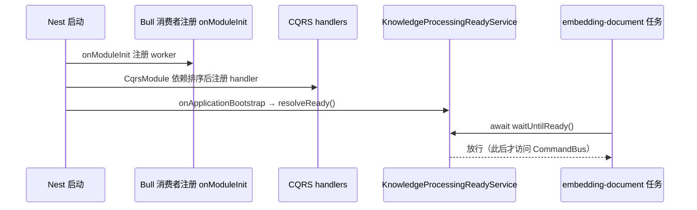

# 知识库专家 · 07 运维文档

本文档面向部署与值班：7 个 Bull 队列、环境变量与开关、启动就绪门、迁移与 schema 策略、日志观测点、多副本注意事项、容量成本与安全运维。

**本文引用的文件**
- [packages/server-ai/src/knowledge-document/document.job.ts](file://packages/server-ai/src/knowledge-document/document.job.ts)
- [packages/server-ai/src/knowledge-document/processing-lifecycle.module.ts](file://packages/server-ai/src/knowledge-document/processing-lifecycle.module.ts)
- [packages/server-ai/src/knowledge-document/derived-index-publication.service.ts](file://packages/server-ai/src/knowledge-document/derived-index-publication.service.ts)
- [packages/server-ai/src/knowledge-document/document.service.ts](file://packages/server-ai/src/knowledge-document/document.service.ts)
- [packages/server-ai/src/knowledgebase/knowledgebase-rebuild-embedding.job.ts](file://packages/server-ai/src/knowledgebase/knowledgebase-rebuild-embedding.job.ts)
- [packages/server-ai/src/knowledgebase/knowledgebase.service.ts](file://packages/server-ai/src/knowledgebase/knowledgebase.service.ts)
- [packages/server-ai/src/knowledgebase/faq/faq-semantic-prewarm.ts](file://packages/server-ai/src/knowledgebase/faq/faq-semantic-prewarm.ts)
- [packages/server-ai/src/knowledgebase/wiki/knowledge-wiki.job.ts](file://packages/server-ai/src/knowledgebase/wiki/knowledge-wiki.job.ts)
- [packages/server-ai/src/knowledgebase/wiki/knowledge-wiki-module.ts](file://packages/server-ai/src/knowledgebase/wiki/knowledge-wiki.module.ts)
- [packages/server-ai/src/graphrag/graphrag.job.ts](file://packages/server-ai/src/graphrag/graphrag.job.ts)
- [packages/server-ai/src/rag-vstore/commands/handlers/create.handler.ts](file://packages/server-ai/src/rag-vstore/commands/handlers/create.handler.ts)
- [packages/server-ai/src/graphrag/migrations/20260913-structured-properties.sql](file://packages/server-ai/src/graphrag/migrations/20260913-structured-properties.sql)
- [packages/plugin-sdk/docs/en/structured-knowledge-graph.md](file://packages/plugin-sdk/docs/en/structured-knowledge-graph.md)
- [apps/api/src/plugin-config.ts](file://apps/api/src/plugin-config.ts)
- [apps/api/src/schema-sync.ts](file://apps/api/src/schema-sync.ts)
- [apps/api/src/bootstrap/schema-sync-bootstrap.ts](file://apps/api/src/bootstrap/schema-sync-bootstrap.ts)
- [packages/server-ai/src/i18n/en.json](file://packages/server-ai/src/i18n/en.json)

## 目录

- [Bull 队列清单](#bull-队列清单)
- [环境变量与开关](#环境变量与开关)
- [启动与就绪](#启动与就绪)
- [迁移与 schema](#迁移与-schema)
- [日志与观测点](#日志与观测点)
- [多副本注意事项](#多副本注意事项)
- [容量与成本](#容量与成本)
- [安全运维](#安全运维)

## Bull 队列清单

| 队列名（常量） | 用途 | 生产者 | 消费者（并发） | 失败语义 | 重试 |
|---|---|---|---|---|---|
| `embedding-document`（`JOB_EMBEDDING_DOCUMENT`） | 主摄取流水线：解析→切片→embedding→写向量，并触发派生索引 | `KnowledgeDocumentService.startProcessing`（`docQueue.add`） | `KnowledgeDocumentConsumer`（`@Process({ concurrency: 5 })`） | 逐文档 `catch` 后写 `status=ERROR` + `processMsg`，并 `logger.warn` 记录文档失败；成功写 `FINISH/progress=100`，取消写 `CANCEL` | **无**：入队未传 `attempts`/`backoff` |
| `rebuild-knowledgebase-embedding`（`JOB_REBUILD_KNOWLEDGEBASE_EMBEDDING`） | 换 embedding 模型后的全库向量重建 | `KnowledgebaseService.startEmbeddingRebuild`（`rebuildQueue.add`） | `KnowledgebaseRebuildEmbeddingConsumer`（`concurrency: 1`） | `catch` → `markEmbeddingRebuildFailed`：`status=REBUILD_FAILED` + `embeddingRebuildError`，随后重新抛出 | **无**显式 opts |
| `knowledge-automatic-tagging`（`JOB_KNOWLEDGE_AUTO_TAGGING`） | 文档自动打标 | `KnowledgeDerivedIndexPublicationService.publish` 发命令 → handler 入队 | `KnowledgeAutoTaggingConsumer`（`concurrency: 2`） | 派生索引失败仅 `logger.warn`（不阻塞主流程） | 未显式声明 |
| `knowledge-questions`（`JOB_KNOWLEDGE_QUESTIONS`） | 切片问题生成 | 同上 + `KnowledgeQuestionGenerationController.regenerate` | `KnowledgeQuestionsConsumer`（`concurrency: 2`） | 同上 | 未显式声明 |
| `knowledge-graph-index`（`JOB_KNOWLEDGE_GRAPH_INDEX`） | GraphRAG 抽取与建图 | `KnowledgeGraphEnqueueCommand` / `KnowledgeGraphRetryDocumentCommand` | `KnowledgeGraphIndexConsumer`（`concurrency: 2`） | `logger.error('Knowledge graph index job failed: …')` 后重抛；知识库列 `graphIndexError` | 未显式声明 |
| `knowledge-wiki-generation`（`JOB_KNOWLEDGE_WIKI_GENERATION`） | Wiki 页面生成/归并 | `KnowledgeWikiEnqueueSourceCommand` 等 | `KnowledgeWikiGenerationConsumer`（`concurrency: 2`） | `logger.error("Knowledge Wiki job '<id>' failed: …")` 后重抛；状态落 `knowledge_wiki_job`/invocation | 未显式声明 |
| `knowledge-faq-semantic-prewarm`（`JOB_FAQ_SEMANTIC_PREWARM`） | FAQ 负向问题语义向量预热 | `FAQSemanticPrewarmDispatcher.enqueue`（`addBulk`，仅 `negativeMatchMode==='semantic'`） | `FAQSemanticPrewarmProcessor`（`concurrency: 2`） | 派发失败仅 warn：`Error.KnowledgeFAQPrewarmFailed`（「FAQ 已保存，预热未能调度，检索时再算」） | **有**：`attempts: 3`、`backoff exponential 2000ms`、`timeout: 45s`、`removeOnComplete`、`removeOnFail: 100`，且用确定性 `jobId` 去重 |

**非 Bull 的第 8 条链路**：`KnowledgePipelineCallbackProcessor` 是 handoff-processor，注册在 `@HandoffProcessorStrategy(KNOWLEDGE_PIPELINE_CALLBACK, { types: [...], policy: { lane: 'main' } })`，消息类型 `knowledge.pipeline_callback.v1`，用于把 xpert 流水线执行结果回写知识库任务。

章节来源：[document.job.ts](file://packages/server-ai/src/knowledge-document/document.job.ts)（关键符号：KnowledgeDocumentConsumer.process）、[knowledgebase-rebuild-embedding.job.ts](file://packages/server-ai/src/knowledgebase/knowledgebase-rebuild-embedding.job.ts)（关键符号：KnowledgebaseRebuildEmbeddingConsumer.processInRequestContext）、[faq-semantic-prewarm.ts](file://packages/server-ai/src/knowledgebase/faq/faq-semantic-prewarm.ts)（关键符号：FAQSemanticPrewarmDispatcher.enqueue、FAQSemanticPrewarmProcessor.process）、[knowledge-wiki.job.ts](file://packages/server-ai/src/knowledgebase/wiki/knowledge-wiki.job.ts)（关键符号：KnowledgeWikiGenerationConsumer.process）、[graphrag.job.ts](file://packages/server-ai/src/graphrag/graphrag.job.ts)（关键符号：KnowledgeGraphIndexConsumer.process）、[pipeline-callback.processor.ts](file://packages/server-ai/src/knowledgebase/task/pipeline-callback.processor.ts)（关键符号：KnowledgePipelineCallbackProcessor）

## 环境变量与开关

| 变量名 | 用途 | 默认值 | 来源文件 |
|---|---|---|---|
| `KNOWLEDGE_FAQ_IMPORT_MAX_BYTES` | **不存在此变量**。FAQ 导入上限是控制器内的模块级常量 `10 * 1024 * 1024`（10 MiB），不可通过环境变量覆盖 | 10 MiB（硬编码） | [knowledge-faq.controller.ts](file://packages/server-ai/src/knowledgebase/faq/knowledge-faq.controller.ts) |
| `KNOWLEDGE_PIPELINE_CALLBACK` | 同名常量 `'knowledge.pipeline_callback.v1'`，是消息类型而非 env；无 `process.env` 读取 | `knowledge.pipeline_callback.v1` | [types.ts](file://packages/server-ai/src/knowledgebase/types.ts) |
| `KNOWLEDGE_WIKI_PG_E2E` | Wiki/文档/向量 PG integration 开关 | 未设置（skip） | [knowledge-wiki-document-status.integration.spec.ts](file://packages/server-ai/src/knowledgebase/wiki/knowledge-wiki-document-status.integration.spec.ts) |
| `KNOWLEDGE_IDENTITY_PG_E2E` | identity PG integration 开关 | 未设置（skip） | [knowledge-identity-postgres.integration.spec.ts](file://packages/server-ai/src/knowledgebase/identity/knowledge-identity-postgres.integration.spec.ts) |
| `KNOWLEDGE_GRAPH_PG_E2E` | graphrag PG integration 开关 | 未设置（skip） | [retry-postgres.integration.spec.ts](file://packages/server-ai/src/graphrag/retry-postgres.integration.spec.ts) |
| `KNOWLEDGE_KEYWORD_PG_E2E` | 关键词检索/分析器 PG integration 开关 | 未设置（skip） | [keyword-analyzer.integration.spec.ts](file://packages/server-ai/src/knowledgebase/analyzer/keyword-analyzer.integration.spec.ts) |
| `KNOWLEDGE_TAGGING_PG_URL` | 标签 PG integration 开关 + 连接串 | 未设置（skip） | [knowledge-tag.integration.spec.ts](file://packages/server-ai/src/knowledgebase/tags/knowledge-tag.integration.spec.ts) |
| `WIKI_V15_PG_URL` | Wiki 组织/分类 PG integration 开关 + 连接串 | 未设置（skip） | [knowledge-wiki-organization.integration.spec.ts](file://packages/server-ai/src/knowledgebase/wiki/knowledge-wiki-organization.integration.spec.ts) |
| `BOM_GRAPH_PG` | 有界图读取套件开关（`=1`） | 未设置（skip） | [bounded-graph-reader.spec.ts](file://packages/server-ai/src/graphrag/bounded-graph-reader.spec.ts) |
| `XPERT_JIEBA_PLUGIN_PATH` | 关键词分析器 jieba 插件路径（integration 用） | 未设置 | [keyword-analyzer.integration.spec.ts](file://packages/server-ai/src/knowledgebase/analyzer/keyword-analyzer.integration.spec.ts) |
| `DB_HOST` / `DB_PORT` / `DB_USER` / `DB_PASS` / `DB_NAME` | 各 PG integration 的连接参数 | `127.0.0.1` / `5432` / `postgres` / `ocap_password` / `ocap` | [document-list.integration.spec.ts](file://packages/server-ai/src/knowledge-document/document-list.integration.spec.ts) |
| `FIRECRAWL_API_KEY` | rag-web Firecrawl provider 测试密钥 | 未设置 | [firecrawl.test.ts](file://packages/server-ai/src/rag-web/provider/firecrawl/firecrawl.test.ts) |
| `NODE_ENV` | 知识工作台视图 provider 判断生产环境 | 未设置 | [knowledge-workbench-view.provider.ts](file://packages/server-ai/src/knowledgebase/plugins/knowledge-workbench/knowledge-workbench-view.provider.ts) |

**注意**：知识库/RAG 域的**运行时**配置（队列名、向量表名、模型 ID、volume 路径）来自 DB 列、`ConfigService.get('pgvector')` 与 plugin-sdk `RequestContext`/`environment`，**不读 `process.env`**；上面除 `FIRECRAWL_API_KEY` / `NODE_ENV` 外全部只影响测试。`XPERT_*`、`AI_SSE_*`、`SANDBOX_VOLUME*` 等变量属于其它域（handoff/stream/volume），本域不直接消费。

章节来源：[knowledge-faq.controller.ts](file://packages/server-ai/src/knowledgebase/faq/knowledge-faq.controller.ts)（关键符号：KNOWLEDGE_FAQ_IMPORT_MAX_BYTES）、[create.handler.ts](file://packages/server-ai/src/rag-vstore/commands/handlers/create.handler.ts)（关键符号：RagCreateVStoreHandler.createPgVectorStore）、[types.ts](file://packages/server-ai/src/knowledgebase/types.ts)（关键符号：KNOWLEDGE_PIPELINE_CALLBACK）

## 启动与就绪

`knowledge-document/processing-lifecycle.module.ts` 是**启动就绪门**，源码注释直接写明原因：

> 「Bull registers workers in onModuleInit, before CQRS registers its handlers. The explicit CqrsModule dependency orders this gate after CQRS bootstrap.」

实现：`KnowledgeProcessingReadyService implements OnApplicationBootstrap` 持有一个 promise，`onApplicationBootstrap()` 时 resolve；消费者在任务体最开始 `await this.lifecycle.waitUntilReady()`。显式等待的就绪方是 `KnowledgeDocumentConsumer`、`KnowledgeAutoTaggingConsumer`、`KnowledgeQuestionsConsumer`；其构造器注入 `KnowledgeProcessingReadyService`。`KnowledgeGraphIndexConsumer`、`KnowledgeWikiGenerationConsumer`、`KnowledgebaseRebuildEmbeddingConsumer`、`FAQSemanticPrewarmProcessor` 的构造器**不含**该服务（未就绪门控）。

图表来源：[processing-lifecycle.module.ts](file://packages/server-ai/src/knowledge-document/processing-lifecycle.module.ts)（关键符号：KnowledgeProcessingReadyService.onApplicationBootstrap、KnowledgeProcessingReadyService.waitUntilReady）

章节来源：[processing-lifecycle.module.ts](file://packages/server-ai/src/knowledge-document/processing-lifecycle.module.ts)（关键符号：KnowledgeProcessingLifecycleModule）、[document.job.ts](file://packages/server-ai/src/knowledge-document/document.job.ts)（关键符号：KnowledgeDocumentConsumer.process）

## 迁移与 schema

- **图结构加了两个加性迁移**：`graphrag/migrations/20260913-structured-properties.sql`（给 `knowledge_graph_entity_contribution` 与 `knowledge_graph_relation_contribution` 加 `properties jsonb`）与 `20260913-structured-mention-confidence.sql`（把结构化快照里缺少显式置信度的 mention 恢复为 `NULL`）。二者都 `BEGIN/COMMIT` + `ADD COLUMN IF NOT EXISTS`，可重复执行。
- **执行方式与顺序**：官方说明是「在**关闭 schema synchronization** 的部署中，启动新版 API 之前先手工应用这两份 SQL」；若结构化投影创建早于 confidence 修复，则第二份也要执行。即：**先 20260913-structured-properties.sql，再 20260913-structured-mention-confidence.sql，最后启动服务**。
- **`synchronize` 的关系**：应用默认 `dbConnectionOptions.synchronize: true`（`apps/api/src/plugin-config.ts` 的 `getDbConfig()`，Postgres 分支同样 `synchronize: true`）。显式同步走 `runSchemaSync()`（强制以 `synchronize: false` 建连后 `dataSource.synchronize()`）；`withSchemaSyncProtection()` 在外部托管场景下临时把 `synchronize` 置 false，避免插件发现阶段触发 DDL。
- **部分索引依赖 `synchronize: false` 声明**，必须由运维侧 SQL 建：`IDX_knowledge_document_name_trgm`、`IDX_knowledge_document_keyword_title_vector`（trigram / 关键词标题向量）。
- **向量表是运行期建表**，不在实体里：`RagCreateVStoreHandler.createPgVectorStore` 每次创建 store 时执行 `ensureTableInDatabase()` + `ensureCollectionTableInDatabase()`，表名硬编码 `knowledge_document_vector` / `knowledge_document_collection`；是否启用 collection 列取决于 `config.collectionName`。

章节来源：[20260913-structured-properties.sql](file://packages/server-ai/src/graphrag/migrations/20260913-structured-properties.sql)（关键符号：knowledge_graph_entity_contribution.properties）、[structured-knowledge-graph.md](file://packages/plugin-sdk/docs/en/structured-knowledge-graph.md)（关键符号：20260913-structured-properties.sql）、[plugin-config.ts](file://apps/api/src/plugin-config.ts)（关键符号：getDbConfig）、[schema-sync.ts](file://apps/api/src/schema-sync.ts)（关键符号：runSchemaSync）、[schema-sync-bootstrap.ts](file://apps/api/src/bootstrap/schema-sync-bootstrap.ts)（关键符号：withSchemaSyncProtection）、[create.handler.ts](file://packages/server-ai/src/rag-vstore/commands/handlers/create.handler.ts)（关键符号：RagCreateVStoreHandler.createPgVectorStore）

## 日志与观测点

| 观测点 | 载体 | 期望/告警建议 |
|---|---|---|
| 摄取失败 | 文档列 `status=ERROR` + `processMsg`；日志 `[Job: entity '<jobId>'] Document '<docId>' failed: …` | 按 `processMsg` 聚合；ERROR 且 `jobId` 非空的文档不可自愈，需人工重跑 `POST process` |
| embedding 重建失败 | 知识库列 `status=REBUILD_FAILED` + `embeddingRebuildError`；日志 `Embedding rebuild failed for knowledgebase '<id>': …` | 出现 `REBUILD_FAILED` 应立即告警（该状态会阻断写操作） |
| 重建任务过期 | `logger.warn('Skip stale embedding rebuild failure for knowledgebase …')` | 说明有并发/重复任务，属预期噪声，可观察频率 |
| 图谱索引失败 | 知识库列 `graphIndexError`（`GET :id/graph/status` 以 `error` 暴露） | 非空即建议告警；成功路径会清空该列 |
| Wiki 生成失败 | 日志 `Knowledge Wiki job '<jobId>' failed: …`；`getStatus` 的 `recoveryActions[].failureReason`（`request_rejected`/`preparation_failed`） | 关注 `indeterminateInvocationCount > 0`：供应商结果不确定，需人工确认后重试 |
| Wiki 重建必要原因 | 知识库列 `wikiRebuildRequiredReason`（如 `generator_upgrade`） | 出现即需排期重建 |
| 派生索引静默滞后 | 日志 `Tags/Questions/GraphRAG/Wiki publication failed for document '<id>': …`（`Promise.allSettled` 吞掉异常） | **Bull/Redis 不可用不会让主摄取失败**；必须对这几条 warn 设告警，否则标签/题目/图谱/Wiki 会静默落后 |
| FAQ 预热未调度 | 日志 `Error.KnowledgeFAQPrewarmFailed` | 降级可接受（检索时补算），但持续出现说明队列不可用 |
| `indeterminate` 状态 | `knowledge_wiki_model_invocation.status='indeterminate'`；删除侧 `deletion_intent.status` / `cleanup_receipt.status` 也含 `indeterminate` | 属**需人工/补偿**的中间态，非自动重试；建议单独看板统计 |

章节来源：[document.job.ts](file://packages/server-ai/src/knowledge-document/document.job.ts)（关键符号：KnowledgeDocumentConsumer.process）、[knowledgebase.service.ts](file://packages/server-ai/src/knowledgebase/knowledgebase.service.ts)（关键符号：KnowledgebaseService.markEmbeddingRebuildFailed、KnowledgebaseService.assertNotRebuilding）、[derived-index-publication.service.ts](file://packages/server-ai/src/knowledge-document/derived-index-publication.service.ts)（关键符号：KnowledgeDerivedIndexPublicationService.publish）、[knowledge-wiki.service.ts](file://packages/server-ai/src/knowledgebase/wiki/knowledge-wiki.service.ts)（关键符号：KnowledgeWikiService.getStatus、KnowledgeWikiService.getRecoveryActions）、[knowledgebase.entity.ts](file://packages/server-ai/src/knowledgebase/knowledgebase.entity.ts)（关键符号：Knowledgebase.wikiRebuildRequiredReason、Knowledgebase.embeddingRebuildError、Knowledgebase.graphIndexError）

## 多副本注意事项

1. **消费者并发按副本相乘**：`embedding-document` 单进程并发 5，N 副本即 5N；rebuild 为 1（但仍然每副本 1 个 worker）。扩容前先确认模型配额与 DB 连接池，否则会把限流压力转成失败率。
2. **向量表 DDL 竞争**：`ensureTableInDatabase()` / `ensureCollectionTableInDatabase()` 在**每次创建 store** 时执行，而 `getOrCreateCollection()` 在查询路径也会触发。多副本并发首次建表/建 collection 时应依赖 `IF NOT EXISTS` 语义；若出现 DDL 死锁或权限错误，需在部署前预建表。
3. **`assertNotRebuilding` 的跨副本语义**：它读的是 DB 列 `knowledgebase.status`，因此**跨副本可见**；但它是「先查后写」的检查，检查与写入之间没有锁。真正的幂等靠 `rebuildTaskId` + `pendingEmbeddingRevision`：`assertCurrentRebuildTask` 不匹配即抛「Embedding rebuild task is stale」，过期 worker 在失败路径也只记 warn 不覆盖状态。切勿用本地内存缓存替代该判断。
4. **队列任务去重**：FAQ 预热用确定性 `jobId`（`faq-semantic-${contentHash}`），多副本重复投递会自然合并；其余队列未使用确定性 jobId，重放可能重复执行。
5. **Wiki 并发保护已内建**：`KnowledgeWikiJobLeaseService`、`KnowledgeWikiJobFenceService`、`KnowledgeWikiRebuildCoordinatorService` 与 `knowledge-wiki-publication-lock.integration.spec.ts` 覆盖租约/栅栏/发布互斥；滚动升级时仍应先确认旧副本已停止消费，避免新旧栅栏语义混跑。
6. **滚动顺序**：迁移为加性且可重复，可先迁移后升级；但消费者先于生产者升级更安全（避免新版消息类型被旧 worker 丢弃）。

章节来源：[knowledgebase.service.ts](file://packages/server-ai/src/knowledgebase/knowledgebase.service.ts)（关键符号：KnowledgebaseService.assertNotRebuilding、KnowledgebaseService.assertCurrentRebuildTask）、[create.handler.ts](file://packages/server-ai/src/rag-vstore/commands/handlers/create.handler.ts)（关键符号：RagCreateVStoreHandler.createPgVectorStore）、[faq-semantic-prewarm.ts](file://packages/server-ai/src/knowledgebase/faq/faq-semantic-prewarm.ts)（关键符号：FAQSemanticPrewarmDispatcher.enqueue）

## 容量与成本

- **向量库体积**：单库向量体积随 `embeddingDimensions × chunk 数` 线性增长；collection 名由 `collectionName` / `vectorIdCollectionName` 派生，`metadata` 为 jsonb + tsvector 关键词列会额外占用空间。
- **重建期间双 collection**：换模型重建时旧 collection 仍在线、新 collection 同步写入（`pendingEmbeddingCollectionName` / `pendingEmbeddingRevision` / `pendingEmbeddingModelFingerprint`），**高峰存储≈2×**；只有 `promoteEmbeddingRebuild` 之后才清理旧 collection（`cleanupEmbeddingCollection`）。规划容量时按 2× 预留，并注意重建期间写操作被 `assertNotRebuilding` 阻断的业务影响窗口。
- **重建是长任务**：全库重新 embedding + 写向量，token 成本与耗时正比于 `chunkNum`/`tokenNum`；建议放在低峰，并监控 `knowledgebase.chunkNum`、`tokenNum`、`documentNum` 三个计数列。
- **Wiki 预算**：`KnowledgeWikiInvocationBudgetService` + `KnowledgebaseWikiBudgetExceeded` 控制模型预算；重建非空 Wiki 需显式确认计费（`KnowledgebaseWikiRebuildChargeConfirmationRequired`），重试不确定调用也需确认（`KnowledgebaseWikiRetryChargeConfirmationRequired`，字段 `requiresAdditionalChargeConfirmation`）。
- **摄取成本**：`POST estimate` / `estimate-table` 只做预估不落库，可用于上线前配额测算；切片优先复用不可变快照（`rechunk`），避免重复调用解析/视觉模型。

章节来源：[knowledgebase.service.ts](file://packages/server-ai/src/knowledgebase/knowledgebase.service.ts)（关键符号：KnowledgebaseService.startEmbeddingRebuild、KnowledgebaseService.promoteEmbeddingRebuild、KnowledgebaseService.cleanupEmbeddingCollection）、[knowledgebase.entity.ts](file://packages/server-ai/src/knowledgebase/knowledgebase.entity.ts)（关键符号：Knowledgebase.pendingEmbeddingCollectionName、Knowledgebase.chunkNum、Knowledgebase.tokenNum）、[document.controller.ts](file://packages/server-ai/src/knowledge-document/document.controller.ts)（关键符号：KnowledgeDocumentController.estimate、KnowledgeDocumentController.estimateTable）、[i18n/en.json](file://packages/server-ai/src/i18n/en.json)（关键符号：Error.KnowledgebaseWikiBudgetExceeded、Error.KnowledgebaseWikiRebuildChargeConfirmationRequired）

## 安全运维

- **跨租户/跨组织边界**：知识库实体继承 `WorkspaceBaseEntity`，作用域为 `tenantId + organizationId + workspaceId`；`AuthGuard` + `PluginScopeGuard` 只保证认证与插件作用域。真正的越权防线是 service 断言（`assertKnowledgebaseReadAccess/WriteAccess/TaskReadAccess/TaskWriteAccess`）与 `ForbiddenException`（`Error.KnowledgebaseAccessDenied`、`Error.KnowledgebaseTaskAccessDenied`）。值班排查越权时，应先确认目标路由是否有声明式守卫，**没有守卫不代表没有鉴权**。
- **`permission` 列的公开可见性**：`KnowledgebasePermission.Private | Organization | Public` 决定列表可见性。`GET /public` 与 `GET ''`（共享分支）都会带上非本人创建的知识库；把 `permission` 改为 `Public` 前须确认其中文档、FAQ、Wiki、图谱都会随之对全组织（乃至公开范围）可见——`permission` 是**整个知识库的开关，不是单文档的**。私有库的判定还要求 `workspaceId` 为空，因此挂到工作区会改变可见性语义。
- **待硬删文档不可见**：读取路径统一追加 `hardDeletePendingAt IS NULL`（`readableDocumentWhere`），避免硬删期间读到残片；排查「文档消失」时先查该列，而非直接怀疑权限。
- **系统托管文档过滤**：普通列表经 `userDocumentListWhere` 排除 `metadata.systemManaged=true`（`systemManagedType` 例外），Agent 写入的文档不会出现在用户列表——这是预期行为。
- **原文件下载的三条路径，权限与副作用不同**：`GET :id/original-file/download` 全量缓冲后 `res.send`（大文件谨慎）；`GET/HEAD :id/original-file/preview` 走单 Range 流，带 `Accept-Ranges`、`Cache-Control: private, no-store`、`X-Content-Type-Options: nosniff`，越界返回 416（适合 PDF 预览与反代/浏览器缓存中间件）；`POST original-files/download` 用 `archiver` 打包 zip（`application/zip`），无可用原文件时 400。三者都先 `assertDocumentReadAccess`。分析快照资产同样带 `private, no-store` + `nosniff`。
- **上传落盘位置**：`:id/file` 经 `UploadFileCommand` 写入 volume 的 `knowledges` catalog，目标目录由 `KnowledgeWorkAreaResolver` 按 `tenantId/userId/knowledgebaseId` 解析；文件名做 `normalizeUploadedFileName` 清洗并追加时间戳+随机数，避免路径穿越与覆盖。
- **Web 抓取的集成授权**：`POST web/:type/load` 要求 `integration.id`，且集成必须属于本组织或由本人创建，否则返回 `Error.KnowledgebaseAccessDenied`——抓取凭证不会被跨组织复用。

章节来源：[document.service.ts](file://packages/server-ai/src/knowledge-document/document.service.ts)（关键符号：KnowledgeDocumentService.readableDocumentWhere、KnowledgeDocumentService.assertDocumentReadAccess）、[document-list-filter.ts](file://packages/server-ai/src/knowledge-document/document-list-filter.ts)（关键符号：userDocumentListWhere、visibleDocumentSql）、[knowledgebase.controller.ts](file://packages/server-ai/src/knowledgebase/knowledgebase.controller.ts)（关键符号：KnowledgebaseController.findAllByPublic、KnowledgebaseController.uploadFile）、[document.controller.ts](file://packages/server-ai/src/knowledge-document/document.controller.ts)（关键符号：KnowledgeDocumentController.streamOriginalFilePreview、KnowledgeDocumentController.downloadOriginalFiles、KnowledgeDocumentController.loadRagWeb）、[knowledgebase.service.ts](file://packages/server-ai/src/knowledgebase/knowledgebase.service.ts)（关键符号：KnowledgebaseService.assertKnowledgebaseTaskReadAccess）
