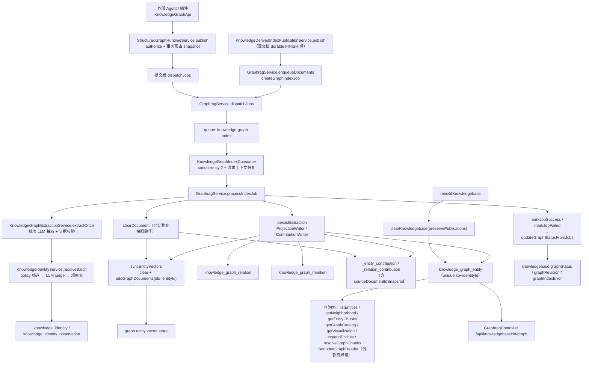

# GraphRAG 与知识身份子专家 · 架构

> 只读梳理。源码根 `packages/server-ai/src/`（下称 `src/`），引用为仓库根相对路径。本子域对应父级「知识库专家」的子专家 ③，覆盖面 = `src/graphrag/` + `src/knowledgebase/identity/`。

**本文引用的文件**
- [packages/server-ai/src/graphrag/graphrag.module.ts](file://packages/server-ai/src/graphrag/graphrag.module.ts)
- [packages/server-ai/src/graphrag/graphrag.service.ts](file://packages/server-ai/src/graphrag/graphrag.service.ts)
- [packages/server-ai/src/graphrag/graphrag.controller.ts](file://packages/server-ai/src/graphrag/graphrag.controller.ts)
- [packages/server-ai/src/graphrag/graphrag.job.ts](file://packages/server-ai/src/graphrag/graphrag.job.ts)
- [packages/server-ai/src/graphrag/types.ts](file://packages/server-ai/src/graphrag/types.ts)
- [packages/server-ai/src/graphrag/graph-extraction.service.ts](file://packages/server-ai/src/graphrag/graph-extraction.service.ts)
- [packages/server-ai/src/graphrag/graph-extraction-batches.ts](file://packages/server-ai/src/graphrag/graph-extraction-batches.ts)
- [packages/server-ai/src/graphrag/graph-extraction-model.ts](file://packages/server-ai/src/graphrag/graph-extraction-model.ts)
- [packages/server-ai/src/graphrag/structured-graph-runtime.service.ts](file://packages/server-ai/src/graphrag/structured-graph-runtime.service.ts)
- [packages/server-ai/src/graphrag/structured-graph-writer.ts](file://packages/server-ai/src/graphrag/structured-graph-writer.ts)
- [packages/server-ai/src/graphrag/graph-projection-writer.ts](file://packages/server-ai/src/graphrag/graph-projection-writer.ts)
- [packages/server-ai/src/graphrag/graph-contribution-writer.ts](file://packages/server-ai/src/graphrag/graph-contribution-writer.ts)
- [packages/server-ai/src/graphrag/graph-index-job.ts](file://packages/server-ai/src/graphrag/graph-index-job.ts)
- [packages/server-ai/src/graphrag/structured-graph-source.ts](file://packages/server-ai/src/graphrag/structured-graph-source.ts)
- [packages/server-ai/src/graphrag/graph-explorer.ts](file://packages/server-ai/src/graphrag/graph-explorer.ts)
- [packages/server-ai/src/graphrag/graph-explorer-model.ts](file://packages/server-ai/src/graphrag/graph-explorer-model.ts)
- [packages/server-ai/src/graphrag/bounded-graph-reader.ts](file://packages/server-ai/src/graphrag/bounded-graph-reader.ts)
- [packages/server-ai/src/graphrag/document-progress.service.ts](file://packages/server-ai/src/graphrag/document-progress.service.ts)
- [packages/server-ai/src/graphrag/document-progress.ts](file://packages/server-ai/src/graphrag/document-progress.ts)
- [packages/server-ai/src/graphrag/entities/knowledge-graph-entity.entity.ts](file://packages/server-ai/src/graphrag/entities/knowledge-graph-entity.entity.ts)
- [packages/server-ai/src/graphrag/entities/knowledge-graph-relation.entity.ts](file://packages/server-ai/src/graphrag/entities/knowledge-graph-relation.entity.ts)
- [packages/server-ai/src/graphrag/entities/knowledge-graph-index-job.entity.ts](file://packages/server-ai/src/graphrag/entities/knowledge-graph-index-job.entity.ts)
- [packages/server-ai/src/graphrag/entities/knowledge-graph-entity-contribution.entity.ts](file://packages/server-ai/src/graphrag/entities/knowledge-graph-entity-contribution.entity.ts)
- [packages/server-ai/src/graphrag/migrations/20260913-structured-properties.sql](file://packages/server-ai/src/graphrag/migrations/20260913-structured-properties.sql)
- [packages/server-ai/src/graphrag/migrations/20260913-structured-mention-confidence.sql](file://packages/server-ai/src/graphrag/migrations/20260913-structured-mention-confidence.sql)
- [packages/server-ai/src/knowledgebase/identity/knowledge-identity.module.ts](file://packages/server-ai/src/knowledgebase/identity/knowledge-identity.module.ts)
- [packages/server-ai/src/knowledgebase/identity/knowledge-identity.service.ts](file://packages/server-ai/src/knowledgebase/identity/knowledge-identity.service.ts)
- [packages/server-ai/src/knowledgebase/identity/knowledge-identity-policy.ts](file://packages/server-ai/src/knowledgebase/identity/knowledge-identity-policy.ts)
- [packages/server-ai/src/knowledgebase/identity/knowledge-identity-model.ts](file://packages/server-ai/src/knowledgebase/identity/knowledge-identity-model.ts)
- [packages/server-ai/src/knowledgebase/identity/knowledge-identity-catalogue.ts](file://packages/server-ai/src/knowledgebase/identity/knowledge-identity-catalogue.ts)
- [packages/server-ai/src/knowledgebase/identity/knowledge-identity-observation.entity.ts](file://packages/server-ai/src/knowledgebase/identity/knowledge-identity-observation.entity.ts)
- [packages/server-ai/src/knowledgebase/identity/knowledge-identity.entity.ts](file://packages/server-ai/src/knowledgebase/identity/knowledge-identity.entity.ts)
- [packages/server-ai/src/knowledge-document/derived-index-publication.service.ts](file://packages/server-ai/src/knowledge-document/derived-index-publication.service.ts)
- [packages/server-ai/src/knowledgebase/knowledgebase.service.ts](file://packages/server-ai/src/knowledgebase/knowledgebase.service.ts)

## 目录

- [1. 子域职责边界](#1-子域职责边界)
- [2. 内部分层](#2-内部分层)
- [3. 依赖关系](#3-依赖关系)
- [4. 关键不变量](#4-关键不变量)
- [5. 架构总览](#5-架构总览)
- [6. 结论](#6-结论)

## 1. 子域职责边界

**做什么**：① 图派生索引链——`enqueueDocuments → dispatchJobs → processIndexJob` 三段式，由 `KnowledgeGraphIndexConsumer` 消费 `knowledge-graph-index`（常量 `JOB_KNOWLEDGE_GRAPH_INDEX`）；② 图谱抽取——`KnowledgeGraphExtractionService.extractOnce / extract` 走 LLM 结构化输出，批次由 `planGraphExtractionBatches` 切分、`validateKnowledgeGraphExtractionEvidence` 做证据校验；③ 外部写图——插件/Agent 经 `KnowledgeGraphApi` 发布（`StructuredGraphRuntimeService.publish / status / retract`）与有界读（`BoundedGraphReader.query / neighborhood`）；④ 图查询与手工修正面——`listEntities / listRelations / listMentions / getNeighborhood / getEntityChunks / getGraphCatalog / getVisualization` + `createEntity / updateEntity / hideEntity / createRelation / updateRelation / hideRelation`；⑤ 知识身份归一——`KnowledgeIdentityService.resolve / resolveBatch`、候选筛选 `selectIdentityCandidates`、LLM 裁判 schema `knowledgeIdentityDedupOutputSchema`。

**不做什么（边界）**：不解析文档、不切片、不写正文向量（归父级子专家 ②，本域只读 `knowledge_document_chunk`）；不做三路召回融合与 rerank（归 ①，图候选召回由 `GraphKnowledgeCandidateRetriever` 调本域查询面）；不建 HTTP 之外的授权模型（`GraphragController` 无 `@UseGuards`，写操作在方法内 `assertKnowledgebaseWriteAccess`）；identity 无 controller；identity 自身不选模型、不计费——裁判模型由调用方经 `KnowledgeIdentityRuntime.judge` 注入。

**为何图谱与身份同域**：归一结果直接落在图实体上，且是图实体的**幂等键**——`KnowledgeGraphEntity` 唯一索引为 `['knowledgebaseId', 'identityId']`，`KnowledgeGraphContributionWriter.upsertEntity` 以 `{tenantId, organizationId, knowledgebaseId, identityId}` 定位实体并用 `uuidv5('knowledge-graph-node:${knowledgebaseId}:${identityId}')` 派生实体 id。也就是说「身份归一 → 实体行」是同一次写入的两半：拆开就会让唯一约束、实体 id 派生与贡献聚合键失去共同锚点。identity 的另一消费者（Wiki）复用同一服务，不改变归属。

**表口径校正**：`graphrag/entities/` 下 7 个实体文件（community / entity / entity-contribution / index-job / mention / relation / relation-contribution）对应 **7 张表**，`knowledgebase/identity/` 下 2 个实体对应 **2 张表**，合计 9 张。父级文档「13 张图表」为扫描口径（含向量面与计数差异），以实体文件为准。

章节来源：[packages/server-ai/src/graphrag/graphrag.module.ts](file://packages/server-ai/src/graphrag/graphrag.module.ts)（关键符号：GraphragModule.providers / TypeOrmModule.forFeature / BullModule.registerQueue）；[packages/server-ai/src/graphrag/graphrag.service.ts](file://packages/server-ai/src/graphrag/graphrag.service.ts)（关键符号：GraphragService.enqueueDocuments / dispatchJobs / processIndexJob / syncEntityVectors）；[packages/server-ai/src/knowledgebase/identity/knowledge-identity.service.ts](file://packages/server-ai/src/knowledgebase/identity/knowledge-identity.service.ts)（关键符号：KnowledgeIdentityService.resolve / resolveBatch / judge）；[packages/server-ai/src/graphrag/entities/knowledge-graph-entity.entity.ts](file://packages/server-ai/src/graphrag/entities/knowledge-graph-entity.entity.ts)（表：knowledge_graph_entity / @Index unique ['knowledgebaseId','identityId']）

## 2. 内部分层

| 层 | 文件 | 职责 |
|---|---|---|
| service | `graphrag.service.ts` | 索引链、查询面、手工 CRUD、重建/清理、向量同步、状态收敛 |
| extraction | `graph-extraction.service.ts` / `graph-extraction-batches.ts` / `graph-extraction-model.ts` | LLM 抽取、快照读写、批次计划、证据校验 |
| runtime（外部写图） | `structured-graph-runtime.service.ts` + `bounded-graph-reader.ts` | 实现 plugin-sdk `KnowledgeGraphApi`：`publish / status / retract / queryEntities / readNeighborhood` |
| progress | `document-progress.service.ts` / `document-progress.ts` | 单文档/批量进度，`projectGraphDocumentProgress` 纯投影 |
| consumer | `graphrag.job.ts` | `KnowledgeGraphIndexConsumer`（`@Processor(JOB_KNOWLEDGE_GRAPH_INDEX)`、`@Process({ concurrency: 2 })`） |
| writer（持久化实现） | `graph-projection-writer.ts` / `graph-contribution-writer.ts` / `structured-graph-writer.ts` / `identity-write.ts` | 实体/关系/mention/贡献落库，`insertGraphIdentity` 做 ON CONFLICT 兜底 |
| explorer（读模型） | `graph-explorer.ts` / `graph-explorer-model.ts` | `readGraphScope / readGraphCatalog / readGraphVisualization` → `buildGraphView` |
| policy / judge（identity） | `knowledge-identity-policy.ts` / `knowledge-identity-model.ts` / `knowledge-identity-catalogue.ts` / `knowledge-identity-embedding.service.ts` | 本地可判定性、LLM 裁判 schema 与提示词、目录装载与指纹、向量缓存 |
| entity | `graphrag/entities/*`（7）+ `knowledgebase/identity/*.entity.ts`（2） | TypeORM 实体 |
| controller / CQRS | `graphrag.controller.ts` / `commands/handlers/*` / `queries/handlers/*` | `/api/knowledgebase/:id/graph` 与命令/查询处理器 |

章节来源：[packages/server-ai/src/graphrag/graphrag.job.ts](file://packages/server-ai/src/graphrag/graphrag.job.ts)（关键符号：KnowledgeGraphIndexConsumer.@Processor / @Process）；[packages/server-ai/src/graphrag/graph-contribution-writer.ts](file://packages/server-ai/src/graphrag/graph-contribution-writer.ts)（关键符号：KnowledgeGraphContributionWriter.upsertEntity / recomputeEntityFromContributions / recomputeRelationFromContributions）；[packages/server-ai/src/graphrag/graph-explorer.ts](file://packages/server-ai/src/graphrag/graph-explorer.ts)（关键符号：readGraphScope / readGraphCatalog / readGraphVisualization）；[packages/server-ai/src/knowledgebase/identity/knowledge-identity-catalogue.ts](file://packages/server-ai/src/knowledgebase/identity/knowledge-identity-catalogue.ts)（关键符号：loadIdentityCatalogue / identityScope / identityFingerprint）

## 3. 依赖关系

**出向**：`KnowledgebaseService`（`findOne` / `assertKnowledgebaseWriteAccess` / `getGraphEntityVectorStore` / `getActiveVectorStore`）；`KnowledgeDocumentService`（`findAll` / `findOne` / `assertDocumentReadAccess`）；`KnowledgeDocumentChunkService`；`CopilotModelGetChatModelQuery`、`CopilotOneByRoleQuery`（抽取与裁判 chat model）；`QueryBus`；`UserService`（消费者恢复用户上下文）；plugin-sdk `KnowledgeGraphRuntimeCapability` / `KnowledgeGraphApi` / `BoundedGraphReader` 输入 schema。

**入向**：父级 ② `KnowledgeDerivedIndexPublicationService` 在源文档 durable FINISH 后派发 `KnowledgeGraphEnqueueCommand` / `KnowledgeGraphRetryDocumentCommand`；文档硬删链发 `KnowledgeGraphClearDocumentCommand`；① 的 `GraphKnowledgeCandidateRetriever` 与 `queries/handlers/*`（search / entity-search / node-detail / view）走本域查询面。

**域内依赖**：`GraphragModule` 对 `KnowledgeIdentityModule` / `KnowledgebaseModule` / `KnowledgeDocumentModule` 全部 `forwardRef`；`KnowledgeIdentityModule` `forwardRef` `KnowledgebaseModule`，且 `KnowledgeIdentity` ↔ `KnowledgeGraphEntity` 之间有**跨模块实体外键**（`@ManyToOne(() => KnowledgeIdentity, { onDelete: 'NO ACTION' })`）——这条 FK 是「身份不可被删、图实体受其约束」的编译期证据。

**队列**：`BullModule.registerQueue({ name: JOB_KNOWLEDGE_GRAPH_INDEX })`，载荷 `TKnowledgeGraphIndexQueueJob = { userId, tenantId, organizationId, knowledgebaseId, graphIndexJobId }`。

章节来源：[packages/server-ai/src/graphrag/graphrag.module.ts](file://packages/server-ai/src/graphrag/graphrag.module.ts)（关键符号：GraphragModule.imports.forwardRef / RouterModule.register / JOB_KNOWLEDGE_GRAPH_INDEX）；[packages/server-ai/src/graphrag/types.ts](file://packages/server-ai/src/graphrag/types.ts)（关键符号：JOB_KNOWLEDGE_GRAPH_INDEX / TKnowledgeGraphIndexQueueJob / TKnowledgeGraphEnqueueInput）；[packages/server-ai/src/knowledgebase/identity/knowledge-identity.module.ts](file://packages/server-ai/src/knowledgebase/identity/knowledge-identity.module.ts)（关键符号：KnowledgeIdentityModule.imports / exports）；[packages/server-ai/src/knowledge-document/derived-index-publication.service.ts](file://packages/server-ai/src/knowledge-document/derived-index-publication.service.ts)（关键符号：KnowledgeDerivedIndexPublicationService.publish）

## 4. 关键不变量

1. **`identityId` 唯一索引是归一底线**：`knowledge_graph_entity` 上 `@Index(['knowledgebaseId','identityId'], { unique: true })` 保证「一个 KB 一个身份一条实体」；手工实体走**部分唯一** `IDX_graph_manual_entity_name`（`WHERE "identityId" IS NULL`），因此「手工实体」与「归一实体」是两条互斥的唯一性通道。
2. **语义检索有界且从不授权 merge**：`selectIdentityCandidates` 明确「Names retrieve every ambiguous match. Semantic retrieval is bounded and never authorizes a merge.」——id 命中/别名命中的候选全保留，仅剩下按 cosine 相似度取前 8，最终判同仍由 LLM 裁判给出；只有「恰好一个 same 且无 uncertain」才被采纳。
3. **域/范围文本只是裁判证据，不是本地推断的分类**：`canMatchIdentity` 对 `kind === 'concept'` 直接 `return true`，并在该行注释说明域/范围文本交给语义裁判，本地不做分类法推断。
4. **hide 而非删除**：实体/关系的 `DELETE` 路由落到 `hideEntity` / `hideRelation`（`visibility = 'hidden'`），行、mention、贡献都保留；`updateEntity` 把实体置 hidden 时**级联**把两端关系一并置 hidden。
5. **`syncEntityVectors` 与向量表的一致性是全量语义**：每次都 `vectorStore.clear()` 后按 `visibility='active' OR IS NULL` 全量重写，并以 `entity.id` 作为向量 id；hidden 实体因此不落向量，实体 id 由 identityId 派生使重建幂等。
6. **只有「每文档最新 job」可推进**：`processIndexJob` 以 `latestJob?.id !== graphJob.id` 或 `result === 'superseded'` 直接返回；KB 级状态由 `updateGraphStatusFromJobs` 聚合（失败只认每文档最新一条 job）。
7. **模型调用不持数据库锁**：`knowledge-identity.service.ts` 首行注释「model calls never hold DB locks. Commit under the KB lock only if source and catalogue still match. Observations, not either projection, own durable identity assignments.」——裁判在事务外执行，回写时用目录指纹比对，不一致返回 `null` 重试。

章节来源：[packages/server-ai/src/knowledgebase/identity/knowledge-identity-policy.ts](file://packages/server-ai/src/knowledgebase/identity/knowledge-identity-policy.ts)（关键符号：canMatchIdentity / selectIdentityCandidates / cosineIdentitySimilarity）；[packages/server-ai/src/knowledgebase/identity/knowledge-identity.service.ts](file://packages/server-ai/src/knowledgebase/identity/knowledge-identity.service.ts)（关键符号：KnowledgeIdentityService.resolveBatch / lockSource / catalogue / readResolved）；[packages/server-ai/src/graphrag/graphrag.service.ts](file://packages/server-ai/src/graphrag/graphrag.service.ts)（关键符号：GraphragService.updateEntity / hideEntity / hideRelation / syncEntityVectors / updateGraphStatusFromJobs）

## 5. 架构总览

图表来源：[packages/server-ai/src/graphrag/graphrag.service.ts](file://packages/server-ai/src/graphrag/graphrag.service.ts)（关键符号：enqueueDocuments / dispatchJobs / processIndexJob / persistExtraction / syncEntityVectors / clearDocument / clearKnowledgebase / rebuildKnowledgebase / markJobSuccess / markJobFailed）；[packages/server-ai/src/graphrag/structured-graph-runtime.service.ts](file://packages/server-ai/src/graphrag/structured-graph-runtime.service.ts)（关键符号：StructuredGraphRuntimeService.publish / authorize）；[packages/server-ai/src/graphrag/graph-extraction.service.ts](file://packages/server-ai/src/graphrag/graph-extraction.service.ts)（关键符号：KnowledgeGraphExtractionService.extractOnce / resolveIdentities）；[packages/server-ai/src/knowledgebase/identity/knowledge-identity.service.ts](file://packages/server-ai/src/knowledgebase/identity/knowledge-identity.service.ts)（关键符号：KnowledgeIdentityService.resolveBatch）

章节来源：[packages/server-ai/src/graphrag/graphrag.service.ts](file://packages/server-ai/src/graphrag/graphrag.service.ts)（关键符号：GraphragService.processIndexJob / updateGraphStatusFromJobs）；[packages/server-ai/src/graphrag/graphrag.job.ts](file://packages/server-ai/src/graphrag/graphrag.job.ts)（关键符号：KnowledgeGraphIndexConsumer.process）

## 6. 结论

本子域是「图索引链 + 身份归一」的合体：索引链负责把文档变成实体/关系/提及/贡献，身份归一负责决定「哪些实体其实是同一个」，而二者的契约就是 `knowledge_graph_entity.identityId` 上的唯一索引与 `uuidv5` 派生的实体 id。分层上，写侧被刻意拆成 service（编排）/ extraction（模型）/ runtime（外部发布）/ writer（持久化）四层，读侧则被拆成 explorer（图视图，无界但只读已鉴权 KB）与 `BoundedGraphReader`（外部 Agent，强制 zod 边界、limit ≤ 100、depth ≤ 2）两条通道。最强的不变量有三个：唯一的 `identityId`、有界且不授权 merge 的语义检索、以及「只保留每文档最新 job」的推进规则；最贵的取舍是 hide 与 delete 双语义、以及每次 indexing 都全量 clear + 重写的实体向量同步。

章节来源：[packages/server-ai/src/graphrag/graphrag.module.ts](file://packages/server-ai/src/graphrag/graphrag.module.ts)（关键符号：GraphragModule）；[packages/server-ai/src/knowledgebase/identity/knowledge-identity.module.ts](file://packages/server-ai/src/knowledgebase/identity/knowledge-identity.module.ts)（关键符号：KnowledgeIdentityModule）
