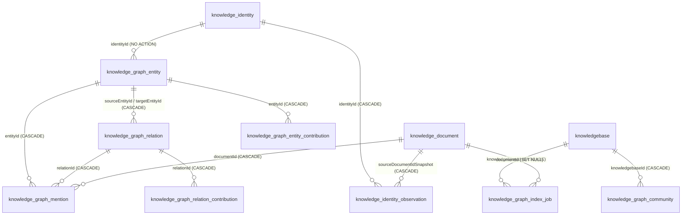

# GraphRAG 与知识身份子专家 · 数据模型

> 只读梳理。源码根 `packages/server-ai/src/`（下称 `src/`），引用为仓库根相对路径。列极多者只列关键列并注明「其余见实体」。

**本文引用的文件**
- [packages/server-ai/src/graphrag/entities/knowledge-graph-entity.entity.ts](file://packages/server-ai/src/graphrag/entities/knowledge-graph-entity.entity.ts)
- [packages/server-ai/src/graphrag/entities/knowledge-graph-relation.entity.ts](file://packages/server-ai/src/graphrag/entities/knowledge-graph-relation.entity.ts)
- [packages/server-ai/src/graphrag/entities/knowledge-graph-mention.entity.ts](file://packages/server-ai/src/graphrag/entities/knowledge-graph-mention.entity.ts)
- [packages/server-ai/src/graphrag/entities/knowledge-graph-community.entity.ts](file://packages/server-ai/src/graphrag/entities/knowledge-graph-community.entity.ts)
- [packages/server-ai/src/graphrag/entities/knowledge-graph-index-job.entity.ts](file://packages/server-ai/src/graphrag/entities/knowledge-graph-index-job.entity.ts)
- [packages/server-ai/src/graphrag/entities/knowledge-graph-entity-contribution.entity.ts](file://packages/server-ai/src/graphrag/entities/knowledge-graph-entity-contribution.entity.ts)
- [packages/server-ai/src/graphrag/entities/knowledge-graph-relation-contribution.entity.ts](file://packages/server-ai/src/graphrag/entities/knowledge-graph-relation-contribution.entity.ts)
- [packages/server-ai/src/graphrag/entities/index.ts](file://packages/server-ai/src/graphrag/entities/index.ts)
- [packages/server-ai/src/knowledgebase/identity/knowledge-identity.entity.ts](file://packages/server-ai/src/knowledgebase/identity/knowledge-identity.entity.ts)
- [packages/server-ai/src/knowledgebase/identity/knowledge-identity-observation.entity.ts](file://packages/server-ai/src/knowledgebase/identity/knowledge-identity-observation.entity.ts)
- [packages/server-ai/src/knowledgebase/identity/knowledge-identity-model.ts](file://packages/server-ai/src/knowledgebase/identity/knowledge-identity-model.ts)
- [packages/server-ai/src/knowledgebase/identity/knowledge-identity-catalogue.ts](file://packages/server-ai/src/knowledgebase/identity/knowledge-identity-catalogue.ts)
- [packages/server-ai/src/graphrag/migrations/20260913-structured-properties.sql](file://packages/server-ai/src/graphrag/migrations/20260913-structured-properties.sql)
- [packages/server-ai/src/graphrag/migrations/20260913-structured-mention-confidence.sql](file://packages/server-ai/src/graphrag/migrations/20260913-structured-mention-confidence.sql)
- [packages/server-ai/src/graphrag/graph-extraction-model.ts](file://packages/server-ai/src/graphrag/graph-extraction-model.ts)
- [packages/server-ai/src/graphrag/graphrag.service.ts](file://packages/server-ai/src/graphrag/graphrag.service.ts)
- [packages/server-ai/src/graphrag/graph-contribution-writer.ts](file://packages/server-ai/src/graphrag/graph-contribution-writer.ts)
- [packages/server-ai/src/graphrag/identity-write.ts](file://packages/server-ai/src/graphrag/identity-write.ts)
- [packages/contracts/src/ai/knowledgebase.model.ts](file://packages/contracts/src/ai/knowledgebase.model.ts)
- [.module-experts/后端专题/知识库专家/implementation/04-模型.md](file://.module-experts/后端专题/知识库专家/implementation/04-模型.md)

## 目录

- [表总览](#表总览)
- [knowledge_graph_entity](#knowledge_graph_entity)
- [knowledge_graph_relation](#knowledge_graph_relation)
- [knowledge_graph_mention](#knowledge_graph_mention)
- [knowledge_graph_community](#knowledge_graph_community)
- [knowledge_graph_index_job](#knowledge_graph_index_job)
- [knowledge_graph_entity_contribution](#knowledge_graph_entity_contribution)
- [knowledge_graph_relation_contribution](#knowledge_graph_relation_contribution)
- [knowledge_identity](#knowledge_identity)
- [knowledge_identity_observation](#knowledge_identity_observation)
- [迁移](#迁移)
- [校验规则](#校验规则)
- [已知风险](#已知风险)
- [结论](#结论)

## 表总览

本子域 **9 张表** = `graphrag/entities/` 7 个实体 + `knowledgebase/identity/` 2 个实体。全部继承 `TenantOrganizationBaseEntity`（`id` uuid 主键、`createdById/updatedById/createdAt/updatedAt`、`tenantId`、`organizationId`），**不带 `workspaceId`**（隔离靠 `knowledgebaseId` 派生）。父级文档的「13 张图表」为扫描口径，请以实体文件为准。

图表来源：[packages/server-ai/src/graphrag/entities/knowledge-graph-entity.entity.ts](file://packages/server-ai/src/graphrag/entities/knowledge-graph-entity.entity.ts)、[packages/server-ai/src/graphrag/entities/knowledge-graph-index-job.entity.ts](file://packages/server-ai/src/graphrag/entities/knowledge-graph-index-job.entity.ts)、[packages/server-ai/src/knowledgebase/identity/knowledge-identity-observation.entity.ts](file://packages/server-ai/src/knowledgebase/identity/knowledge-identity-observation.entity.ts)

章节来源：[packages/server-ai/src/graphrag/entities/index.ts](file://packages/server-ai/src/graphrag/entities/index.ts)（关键符号：KnowledgeGraphEntity / KnowledgeGraphRelation / KnowledgeGraphMention / KnowledgeGraphCommunity / KnowledgeGraphIndexJob / KnowledgeGraphEntityContribution / KnowledgeGraphRelationContribution）；[.module-experts/后端专题/知识库专家/implementation/04-模型.md](file://.module-experts/后端专题/知识库专家/implementation/04-模型.md)（父级表口径）

## knowledge_graph_entity

- **列**：`identityId` uuid 可空（FK → `KnowledgeIdentity`，`onDelete: 'NO ACTION'`）；`knowledgebaseId` 可空（FK → `knowledgebase`，`onDelete: 'CASCADE'`）；`type` varchar(120)；`name` varchar(512)；`normalizedName` varchar(512)；`origin` varchar(32) 默认 `extracted`；`visibility` varchar(32) 默认 `active`；`aliases` jsonb 默认 `[]`；`description` text；`summary` text；`confidence` float；`mentionCount` int 默认 0；`revision` int 默认 0；`sourceFingerprint` varchar(128)；`metadata` jsonb。
- **索引**：唯一 `['knowledgebaseId','identityId']`（归一底线）；部分唯一 `IDX_graph_manual_entity_name`（`['tenantId','organizationId','knowledgebaseId','normalizedName','type']` `WHERE "identityId" IS NULL`）；`['knowledgebaseId','origin']`；`['knowledgebaseId','visibility']`。
- **关系**：`mentions`（OneToMany）、`outgoingRelations`（sourceEntity）、`incomingRelations`（targetEntity）。
- **级联与约束**：`identityId` 用 NO ACTION → 身份行被图实体引用时不可删；`knowledgebaseId` CASCADE → 删库清图。**实体 id 由身份派生**（`uuidv5('knowledge-graph-node:${knowledgebaseId}:${identityId}')`）。
- **业务约束**：手工实体必须 `identityId IS NULL` 才进部分唯一索引，因此「手工同名同类型」只能有一条，而「归一实体」同名可以有多条（不同 identity）。

章节来源：[packages/server-ai/src/graphrag/entities/knowledge-graph-entity.entity.ts](file://packages/server-ai/src/graphrag/entities/knowledge-graph-entity.entity.ts)（表：knowledge_graph_entity / @Index unique ['knowledgebaseId','identityId'] / IDX_graph_manual_entity_name）；[packages/server-ai/src/graphrag/graph-contribution-writer.ts](file://packages/server-ai/src/graphrag/graph-contribution-writer.ts)（关键符号：KnowledgeGraphContributionWriter.upsertEntity / uuidv5）

## knowledge_graph_relation

- **列**：`knowledgebaseId`、`sourceEntityId`、`targetEntityId`（三者均 FK，`onDelete: 'CASCADE'`）；`type` varchar(160)；`normalizedType` varchar(160) 可空；`origin` varchar(32) 默认 `extracted`；`visibility` varchar(32) 默认 `active`；`description` text；`confidence` float；`weight` float；`evidenceCount` int 默认 0；`revision` int 默认 0；`sourceFingerprint` varchar(128)；`metadata` jsonb。
- **索引**：唯一 `['knowledgebaseId','sourceEntityId','targetEntityId','type']`；`['knowledgebaseId','origin']`；`['knowledgebaseId','visibility']`；`IDX_graph_relation_kb_source_visibility`；`IDX_graph_relation_kb_target_visibility`。
- **关系**：`mentions`（OneToMany）。
- **业务约束**：`resolveRelationEndpoints` 禁止自环（source ≠ target）、默认拒绝任一端点 hidden；`normalizedType` 在手工创建时等于 `type`（`normalizeKnowledgeGraphType`）。

章节来源：[packages/server-ai/src/graphrag/entities/knowledge-graph-relation.entity.ts](file://packages/server-ai/src/graphrag/entities/knowledge-graph-relation.entity.ts)（表：knowledge_graph_relation / @Index unique ['knowledgebaseId','sourceEntityId','targetEntityId','type']）；[packages/server-ai/src/graphrag/graphrag.service.ts](file://packages/server-ai/src/graphrag/graphrag.service.ts)（关键符号：GraphragService.resolveRelationEndpoints / assertNoRelationConflict）

## knowledge_graph_mention

- **列**：`knowledgebaseId`、`entityId`、`relationId`（可空）、`documentId`（三者 FK，`onDelete: 'CASCADE'`）；`chunkId` varchar（**裸列，无 FK**）；`quote` text；`confidence` float（**可空**）；`startOffset` / `endOffset` int；`revision` int 默认 0；`metadata` jsonb。
- **索引**：`['knowledgebaseId','documentId']`；`['knowledgebaseId','chunkId']`；`IDX_graph_mention_kb_entity_doc_chunk`；`IDX_graph_mention_kb_relation_doc_chunk`。
- **业务约束**：`chunkId` 故意不建 FK（chunk 可能先于/后于图行变化），因此删除 chunk 不会级联清 mention，需靠 `clearDocument` 按 `documentId` 清；`confidence` 允许 NULL（见迁移一节）。

章节来源：[packages/server-ai/src/graphrag/entities/knowledge-graph-mention.entity.ts](file://packages/server-ai/src/graphrag/entities/knowledge-graph-mention.entity.ts)（表：knowledge_graph_mention / chunkId / confidence）；[packages/server-ai/src/graphrag/graphrag.service.ts](file://packages/server-ai/src/graphrag/graphrag.service.ts)（关键符号：GraphragService.clearDocument / listMentions）

## knowledge_graph_community

- **列**：`key` varchar(160)；`title` varchar(512)；`summary` text；`entityIds` jsonb 默认 `[]`；`revision` int 默认 0；`metadata` jsonb；`knowledgebaseId`（FK，`onDelete: 'CASCADE'`）。
- **索引**：唯一 `['knowledgebaseId','key']`。
- **写入窗口**：全仓仅 `GraphragService.clearKnowledgebase` 调用 `communityRepository.delete`；**未发现任何写入/更新 community 的服务**（社区检测在该模块无此项），`DEFAULT_GRAPH_RAG_CONFIG.communityTopK` 亦无图内消费者。

章节来源：[packages/server-ai/src/graphrag/entities/knowledge-graph-community.entity.ts](file://packages/server-ai/src/graphrag/entities/knowledge-graph-community.entity.ts)（表：knowledge_graph_community / @Index unique ['knowledgebaseId','key']）；[packages/server-ai/src/graphrag/graphrag.service.ts](file://packages/server-ai/src/graphrag/graphrag.service.ts)（关键符号：GraphragService.communityRepository / clearKnowledgebase / DEFAULT_GRAPH_RAG_CONFIG）

## knowledge_graph_index_job

- **列**：`knowledgebaseId`（FK，CASCADE）；`documentId`（FK → `knowledge_document`，`onDelete: 'SET NULL'`）；`sourceContentHash` varchar(128)；`sourcePublicationEpoch` int；`extractionId` uuid；`extractionSnapshot` jsonb **`select: false`**（注释：「Keep model output durable for retries without including it in progress/list responses.」）；`dispatchError` text；`type` varchar(30) 必填（`document` / `rebuild` / structured 发布）；`status` varchar(30) 默认 `QUEUED`；`stage` varchar(30)；`result` varchar(30)；`revision` int 默认 0；`totalChunks` / `processedChunks` int 默认 0；`error` text；`startedAt` / `completedAt` 为 **`timestamp`（非 timestamptz）**。
- **索引**：`['knowledgebaseId','documentId','status']`（**非唯一**）。
- **关系**：`knowledgebase`、`document`。
- **业务约束**：`documentId` 可空 → 文档硬删后 job 行残留，`processIndexJob` 遇到 `!documentId` 直接 `markJobFailed('Graph index job has no documentId')`；`extractionSnapshot` 是结构化发布的唯一权威快照（`clearKnowledgebase(preservePublications=true)` 只保留带 `publication` 的 job）。

章节来源：[packages/server-ai/src/graphrag/entities/knowledge-graph-index-job.entity.ts](file://packages/server-ai/src/graphrag/entities/knowledge-graph-index-job.entity.ts)（表：knowledge_graph_index_job / extractionSnapshot / @Index）；[packages/server-ai/src/graphrag/graphrag.service.ts](file://packages/server-ai/src/graphrag/graphrag.service.ts)（关键符号：GraphragService.processIndexJob / clearKnowledgebase / markJobSuccess / markJobFailed）

## knowledge_graph_entity_contribution

- **列**：`entityId` uuid（FK → `knowledge_graph_entity`，`nullable: false`，CASCADE）；`knowledgebaseId` uuid；`sourceDocumentIdSnapshot` uuid；`sourceContentHash` varchar(128)；`sourcePublicationEpoch` int 默认 0；`name` varchar(512)；`aliases` jsonb 默认 `'[]'::jsonb`；`description` text；`confidence` float；`properties` jsonb（由迁移补列）；`revision` int 默认 0。
- **索引**：唯一 `['entityId','sourceDocumentIdSnapshot']`；`['knowledgebaseId','sourceDocumentIdSnapshot']`。
- **业务约束**：一行 = 「某来源文档对某实体的一次贡献」，`sourceContentHash + sourcePublicationEpoch` 定格来源版本；聚合回写由 `KnowledgeGraphContributionWriter.recomputeEntityFromContributions` 完成（文件头注释：「lock the identity row before changing contributions or reading their aggregate」）。

章节来源：[packages/server-ai/src/graphrag/entities/knowledge-graph-entity-contribution.entity.ts](file://packages/server-ai/src/graphrag/entities/knowledge-graph-entity-contribution.entity.ts)（表：knowledge_graph_entity_contribution / @Index unique ['entityId','sourceDocumentIdSnapshot']）；[packages/server-ai/src/graphrag/graph-contribution-writer.ts](file://packages/server-ai/src/graphrag/graph-contribution-writer.ts)（关键符号：KnowledgeGraphContributionWriter.recomputeEntityFromContributions）

## knowledge_graph_relation_contribution

- **列**：`relationId` uuid（FK → `knowledge_graph_relation`，`nullable: false`，CASCADE）；`knowledgebaseId` uuid；`sourceDocumentIdSnapshot` uuid；`sourceContentHash` varchar(128)；`sourcePublicationEpoch` int 默认 0；`description` text；`confidence` float；`weight` float；`properties` jsonb（迁移补列）；`revision` int 默认 0。
- **索引**：唯一 `['relationId','sourceDocumentIdSnapshot']`；`['knowledgebaseId','sourceDocumentIdSnapshot']`。
- **业务约束**：唯一键包含 `sourceDocumentIdSnapshot`——与实体贡献表同构，两表共同构成「按来源文档可撤销」的溯源面（`clearDocument` 同时删这两张表并重算）。

章节来源：[packages/server-ai/src/graphrag/entities/knowledge-graph-relation-contribution.entity.ts](file://packages/server-ai/src/graphrag/entities/knowledge-graph-relation-contribution.entity.ts)（表：knowledge_graph_relation_contribution / @Index unique ['relationId','sourceDocumentIdSnapshot']）；[packages/server-ai/src/graphrag/graphrag.service.ts](file://packages/server-ai/src/graphrag/graphrag.service.ts)（关键符号：GraphragService.clearDocument / recomputeRelationFromContributions）

## knowledge_identity

- **列**：`knowledgebaseId` uuid（FK → `knowledgebase`，`nullable: false`，CASCADE）；`kind` varchar(32)（`entity` | `concept`，来自 `KnowledgeIdentityDescriptor['kind']`）；`embedding` jsonb 可空（注释：「This cache is disposable; current source observations are the identity evidence authority.」）；`revision` int 默认 1。
- **索引**：`['knowledgebaseId','kind']`（**非唯一**）。
- **业务约束**：行 id 由 `uuidv5('knowledge-identity:${knowledgebaseId}:${sourceKey}')` 生成；`revision` 由 `identities.increment(..., 'revision', 1)` 递增，`embedding` 只在缓存失效时条件更新（`update({ id, revision })`），避免覆盖并发观察。

章节来源：[packages/server-ai/src/knowledgebase/identity/knowledge-identity.entity.ts](file://packages/server-ai/src/knowledgebase/identity/knowledge-identity.entity.ts)（表：knowledge_identity / embedding / @Index ['knowledgebaseId','kind']）；[packages/server-ai/src/knowledgebase/identity/knowledge-identity.service.ts](file://packages/server-ai/src/knowledgebase/identity/knowledge-identity.service.ts)（关键符号：KnowledgeIdentityService.resolveBatch / uuidv5）

## knowledge_identity_observation

- **列**：`sourceDocument`（FK，`@JoinColumn({ name: 'sourceDocumentIdSnapshot' })`，`nullable: false`，**CASCADE**）；`knowledgebaseId` uuid；`identity`（FK，`@JoinColumn({ name: 'identityId' })`，`nullable: false`，CASCADE）；`identityId` uuid；`sourceDocumentIdSnapshot` uuid；`sourceContentHash` varchar(128)；`sourcePublicationEpoch` int；`consumer` varchar(16)（`wiki` | `graph`）；`extractionId` uuid；`isCurrent` boolean 默认 true；`candidateKey` varchar(512)；`sourceKey` varchar(64)；`payload` jsonb；`decision` jsonb。
- **索引**：唯一 `['knowledgebaseId','sourceKey']`；`['knowledgebaseId','sourceDocumentIdSnapshot']`；`['knowledgebaseId','sourceDocumentIdSnapshot','consumer','extractionId']`。
- **业务约束**：注释「observations survive projection rebuilds. Each consumer atomically replaces its document extraction; only current observations supply live identity evidence.」——即 `isCurrent` 是唯一的有效性开关；`sourceKey` 由 10 元组指纹决定，唯一键使重复发布天然幂等；`payload` / `decision` 通过 `parseIdentityObservation` / `parseIdentityDecision` 反序列化。

章节来源：[packages/server-ai/src/knowledgebase/identity/knowledge-identity-observation.entity.ts](file://packages/server-ai/src/knowledgebase/identity/knowledge-identity-observation.entity.ts)（表：knowledge_identity_observation / @Index unique ['knowledgebaseId','sourceKey'] / isCurrent）；[packages/server-ai/src/knowledgebase/identity/knowledge-identity-catalogue.ts](file://packages/server-ai/src/knowledgebase/identity/knowledge-identity-catalogue.ts)（关键符号：loadIdentityCatalogue / identityFingerprint / parseIdentityObservation）

## 迁移

本子域真实 SQL 迁移只有两个文件，均在 `graphrag/migrations/`：

1. `20260913-structured-properties.sql`：`BEGIN; ALTER TABLE knowledge_graph_entity_contribution ADD COLUMN IF NOT EXISTS properties jsonb NULL; ALTER TABLE knowledge_graph_relation_contribution ADD COLUMN IF NOT EXISTS properties jsonb NULL; COMMIT;`——文件头注释「Additive, repeatable migration for source-owned structured graph properties.」，可重复执行。
2. `20260913-structured-mention-confidence.sql`：单条 `UPDATE knowledge_graph_mention AS mention SET confidence = NULL FROM knowledge_document AS document, knowledge_graph_index_job AS job WHERE mention."documentId" = document.id AND mention."knowledgebaseId" = document."knowledgebaseId" AND job.id::text = document.metadata #>> '{graphSource,publicationJobId}' AND job."documentId" = document.id AND job."sourceContentHash" = document."contentHash" AND job."sourcePublicationEpoch" = document."publicationEpoch" AND mention.revision = job.revision AND document.metadata #>> '{graphSource,mode}' = 'structured' AND job."extractionSnapshot" #>> '{publication,mode}' = 'structured' AND NOT jsonb_path_exists(job."extractionSnapshot", '$.**.confidence') AND mention.confidence = 0;`——只修「结构化发布且快照内无显式 confidence」被误写成 0 的历史行。

**执行方式与顺序**：两文件互不依赖（一个加列、一个修数据），可分别执行；仓库内未发现自动执行 `*.sql` 的迁移运行器，需在部署时手工按文件执行（父级文档同样记为「部署前手工应用 SQL」）。其余表结构靠 TypeORM `synchronize`；graph 实体向量表不属于 TypeORM 实体。

章节来源：[packages/server-ai/src/graphrag/migrations/20260913-structured-properties.sql](file://packages/server-ai/src/graphrag/migrations/20260913-structured-properties.sql)（表：knowledge_graph_entity_contribution / knowledge_graph_relation_contribution / properties）；[packages/server-ai/src/graphrag/migrations/20260913-structured-mention-confidence.sql](file://packages/server-ai/src/graphrag/migrations/20260913-structured-mention-confidence.sql)（表：knowledge_graph_mention / knowledge_graph_index_job / document.metadata.graphSource）；[.module-experts/后端专题/知识库专家/implementation/03-数据流转.md](file://.module-experts/后端专题/知识库专家/implementation/03-数据流转.md)（迁移手工化）

## 校验规则

- **class-validator（实体列）**：各表列普遍带 `@IsString/@IsJSON/@IsNumber/@IsDate/@IsOptional/@IsEnum`（如 `KnowledgeGraphIndexJob.status` 的 `@IsEnum(KnowledgeGraphIndexJobStatus)`）。
- **zod（写入入口）**：`graphrag.service.ts` 的 `graphEntityCreateSchema` / `graphEntityUpdateSchema` / `graphRelationCreateSchema` / `graphRelationUpdateSchema` 校验手工 CRUD 请求体；`graphExtractionSchema` / `parseGraphExtractionSnapshot` / `validateKnowledgeGraphExtractionEvidence` 校验模型输出与证据 chunkId 归属。
- **DB 唯一约束**：实体 `(knowledgebaseId, identityId)`；手工实体部分唯一（`identityId IS NULL`）；关系四列唯一；mention 无唯一约束；community `(knowledgebaseId, key)`；job 仅非唯一索引；两张贡献表 `(id, sourceDocumentIdSnapshot)`；identity 观察 `(knowledgebaseId, sourceKey)`。
- **identity 语义校验**：`parseKnowledgeIdentityDescriptor` 禁止同 namespace 冲突的 identifiers；`parseKnowledgeIdentityDedupOutput` 要求 `same ⇒ identityId ∈ candidates`、`非 same ⇒ identityId === null`；`resolveBatch` 要求 `extractionId` 存在、candidateKey 唯一且 ≤512，违规抛 `KnowledgeIdentityError('invalid' | 'stale' | 'busy')`。
- **有界读**：`BoundedGraphReader` 的 zod scope（`sources ≤ 50`、`limit ≤ 100`、`depth ≤ 2`、`relationTypes ≤ 10`、`.strict()`）越界抛 `Error.BoundedGraphQueryInvalid`。
- **归一化**：`normalizeKnowledgeGraphName`（NFKC 在 identity policy 内、`trim + 去多空格 + lowercase`）与 `normalizeKnowledgeGraphType`（`trim + 空格转下划线 + lowercase`）在写前统一。

章节来源：[packages/server-ai/src/graphrag/graphrag.service.ts](file://packages/server-ai/src/graphrag/graphrag.service.ts)（关键符号：graphEntityCreateSchema / graphEntityUpdateSchema / graphRelationCreateSchema / graphRelationUpdateSchema）；[packages/server-ai/src/graphrag/graph-extraction-model.ts](file://packages/server-ai/src/graphrag/graph-extraction-model.ts)（关键符号：graphExtractionSchema / validateKnowledgeGraphExtractionEvidence）；[packages/server-ai/src/knowledgebase/identity/knowledge-identity-model.ts](file://packages/server-ai/src/knowledgebase/identity/knowledge-identity-model.ts)（关键符号：parseKnowledgeIdentityDescriptor / parseKnowledgeIdentityDedupOutput）；[packages/server-ai/src/graphrag/identity-write.ts](file://packages/server-ai/src/graphrag/identity-write.ts)（关键符号：normalizeKnowledgeGraphName / normalizeKnowledgeGraphType）

## 已知风险

1. **`identityId` 唯一约束与合并冲突**：`(knowledgebaseId, identityId)` 唯一意味着「一个身份一条实体」，但身份侧**没有 merge 操作**——后续若两身份被判同，只能靠重建（`rebuildKnowledgebase` 全清）或人工改图；`updateEntity` 不允许改 `identityId`，因此「合并两个实体」在数据模型上不可表达。同时 `identityId` 可空 + 部分唯一索引使手工实体与归一实体走不同唯一性通道，跨通道同名冲突不会被数据库拦截。
2. **快照列的语义**：`sourceDocumentIdSnapshot` 在贡献表里是裸 uuid + `knowledgebaseId`（用于 `clearDocument` 与来源成员资格查询），在 `knowledge_identity_observation` 与 `knowledge_graph_mention.documentId` 上是**真 FK 且 CASCADE**——文档物理删除会连带抹掉这些证据行；因此「同一 id 不同版本」只能靠 `sourceContentHash` + `sourcePublicationEpoch` 区分，`graph_explorer.readGraphScope` 的 `sourceDocumentId` 过滤也因此同时查 contribution 与 mention 两张表。
3. **community 的生成与更新窗口**：表结构完整（`key` 唯一、`entityIds`、`revision`），但**没有写入方**；`clearKnowledgebase` 只删不建，`communityTopK` 配置无图内消费者 → 该能力当前不可用。
4. **索引 job 的并发**：只有非唯一索引 `['knowledgebaseId','documentId','status']`，缺「同文档同源版本唯一」约束；互斥靠 `processIndexJob` 的 `latestJob?.id` 比较（读后写）+ 重试路径的 `pg_advisory_xact_lock(hashtextextended(...))`；`documentId SET NULL` 使文档硬删后 job 残留并只能以 `markJobFailed('Graph index job has no documentId')` 收尾。
5. **`extractionSnapshot` 的 `select: false` 陷阱**：所有读取都要显式 `select`（`extractOnce`、`retry-document.handler`、`structuredGraphRuntime.status` 均如此），漏掉会静默拿到 `undefined` 并触发「重新抽取」或 `invalidGraphPublication`。
6. **`timestamp` 而非 `timestamptz`**：`knowledge_graph_index_job.startedAt / completedAt` 用 `timestamp`，与基类 `createdAt/updatedAt` 的时区语义不一致，跨时区排查进度时需注意。
7. **`properties` 列靠手写迁移**：`properties` 在实体上已声明，但只有执行了 `20260913-structured-properties.sql` 的库才有该列；未执行时结构化发布写入会报列不存在（`synchronize` 在这类部署下的行为需实测确认）。

章节来源：[packages/server-ai/src/graphrag/graphrag.service.ts](file://packages/server-ai/src/graphrag/graphrag.service.ts)（关键符号：GraphragService.updateEntity / clearKnowledgebase / rebuildKnowledgebase / processIndexJob）；[packages/server-ai/src/graphrag/entities/knowledge-graph-index-job.entity.ts](file://packages/server-ai/src/graphrag/entities/knowledge-graph-index-job.entity.ts)（表：knowledge_graph_index_job / documentId SET NULL / startedAt）；[packages/server-ai/src/graphrag/commands/handlers/retry-document.handler.ts](file://packages/server-ai/src/graphrag/commands/handlers/retry-document.handler.ts)（关键符号：KnowledgeGraphRetryDocumentHandler.execute）；[packages/server-ai/src/graphrag/graph-explorer.ts](file://packages/server-ai/src/graphrag/graph-explorer.ts)（关键符号：readGraphScope / readGraphCatalog）

## 结论

数据模型的核心是两条正交的「来源」轴线：一条是**身份**（`knowledge_identity` + `_observation`，用 `isCurrent` + `sourceKey` 指纹保证幂等与可替换），一条是**贡献**（两张 `_contribution`，用 `(id, sourceDocumentIdSnapshot)` 唯一保证「按来源文档可撤销」）。图实体表把身份轴收敛成唯一索引 `(knowledgebaseId, identityId)`，关系表把结构轴收敛成四列唯一索引，job 表则用 `sourceContentHash + sourcePublicationEpoch + revision` 表达「这份抽取属于哪个源版本」。最需要注意的三个坑是：身份**无合并路径**、community 表**无写入方**、以及 `sourceDocumentIdSnapshot` 在部分表里是 CASCADE 真外键（删文档即删证据）。

章节来源：[packages/server-ai/src/knowledgebase/identity/knowledge-identity-observation.entity.ts](file://packages/server-ai/src/knowledgebase/identity/knowledge-identity-observation.entity.ts)（表：knowledge_identity_observation / isCurrent / sourceKey）；[packages/server-ai/src/graphrag/entities/knowledge-graph-entity-contribution.entity.ts](file://packages/server-ai/src/graphrag/entities/knowledge-graph-entity-contribution.entity.ts)（表：knowledge_graph_entity_contribution / sourceDocumentIdSnapshot）；[packages/server-ai/src/graphrag/entities/knowledge-graph-entity.entity.ts](file://packages/server-ai/src/graphrag/entities/knowledge-graph-entity.entity.ts)（表：knowledge_graph_entity / @Index unique ['knowledgebaseId','identityId']）
