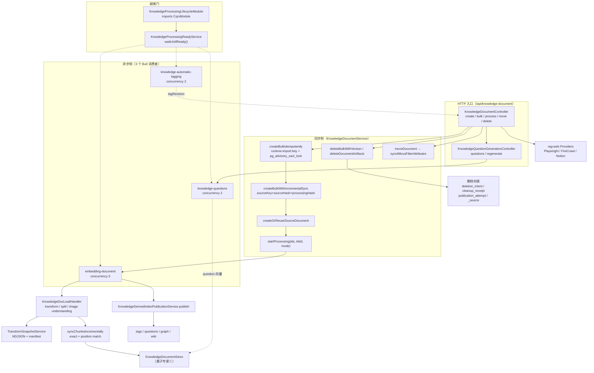

# 文档摄取与流水线子专家 · 架构

**本文引用的文件**
- [packages/server-ai/src/knowledge-document/document.module.ts](file://packages/server-ai/src/knowledge-document/document.module.ts)
- [packages/server-ai/src/knowledge-document/processing-lifecycle.module.ts](file://packages/server-ai/src/knowledge-document/processing-lifecycle.module.ts)
- [packages/server-ai/src/knowledge-document/document.controller.ts](file://packages/server-ai/src/knowledge-document/document.controller.ts)
- [packages/server-ai/src/knowledge-document/document.service.ts](file://packages/server-ai/src/knowledge-document/document.service.ts)
- [packages/server-ai/src/knowledge-document/document.job.ts](file://packages/server-ai/src/knowledge-document/document.job.ts)
- [packages/server-ai/src/knowledge-document/types.ts](file://packages/server-ai/src/knowledge-document/types.ts)
- [packages/server-ai/src/knowledge-document/document-hash.ts](file://packages/server-ai/src/knowledge-document/document-hash.ts)
- [packages/server-ai/src/knowledge-document/document-publication.ts](file://packages/server-ai/src/knowledge-document/document-publication.ts)
- [packages/server-ai/src/knowledge-document/transform-snapshot.service.ts](file://packages/server-ai/src/knowledge-document/transform-snapshot.service.ts)
- [packages/server-ai/src/knowledge-document/derived-index-publication.service.ts](file://packages/server-ai/src/knowledge-document/derived-index-publication.service.ts)
- [packages/server-ai/src/knowledge-document/deletion/entities.ts](file://packages/server-ai/src/knowledge-document/deletion/entities.ts)
- [packages/server-ai/src/knowledge-document/deletion/index.ts](file://packages/server-ai/src/knowledge-document/deletion/index.ts)
- [packages/server-ai/src/knowledge-document/chunk/chunk.service.ts](file://packages/server-ai/src/knowledge-document/chunk/chunk.service.ts)
- [packages/server-ai/src/knowledge-document/commands/handlers/load.handler.ts](file://packages/server-ai/src/knowledge-document/commands/handlers/load.handler.ts)
- [packages/server-ai/src/knowledge-document/questions/question-generation.job.ts](file://packages/server-ai/src/knowledge-document/questions/question-generation.job.ts)
- [packages/server-ai/src/knowledge-document/tags/automatic-tagging.job.ts](file://packages/server-ai/src/knowledge-document/tags/automatic-tagging.job.ts)
- [packages/server-ai/src/rag-web/rag-web.module.ts](file://packages/server-ai/src/rag-web/rag-web.module.ts)
- [packages/server-ai/src/rag-web/provider/index.ts](file://packages/server-ai/src/rag-web/provider/index.ts)
- [packages/server-ai/src/knowledgebase/task/pipeline-callback.processor.ts](file://packages/server-ai/src/knowledgebase/task/pipeline-callback.processor.ts)
- [packages/server-ai/src/knowledgebase/vector-store.ts](file://packages/server-ai/src/knowledgebase/vector-store.ts)
- [packages/contracts/src/ai/knowledge-doc.model.ts](file://packages/contracts/src/ai/knowledge-doc.model.ts)
- [packages/contracts/src/ai/knowledge-deletion.model.ts](file://packages/contracts/src/ai/knowledge-deletion.model.ts)

## 目录

- [1. 子域职责边界](#1-子域职责边界)
- [2. 内部分层](#2-内部分层)
- [3. 依赖关系](#3-依赖关系)
- [4. 关键不变量](#4-关键不变量)
- [5. 架构总览](#5-架构总览)
- [6. 结论](#6-结论)

## 1. 子域职责边界

**做什么**：知识库的「文档数据面 + 摄取流水线 + 一致性收口」。① 文档元数据 CRUD、树形目录（`moveDocument`）、版本乐观锁（`updateWithVersion` / `deleteBulkWithVersion` / `updateChunkWithVersion`）；② 摄取入口的幂等判定与增量判定（`createBulkIdempotently` / `createBulkWithIncrementalSync` / `createOrReuseSourceDocument`）；③ 主流水线异步执行（`startProcessing` → `embedding-document` 消费者 → 解析 / 切片 / embedding / 写向量 → `FINISH`）；④ chunk 级增量同步与中断恢复（`syncChunksIncrementally` / `matchIncrementalChunks` / `recoverInterruptedSync`）；⑤ 派生索引的**派发时点**（`KnowledgeDerivedIndexPublicationService.publish`，源文档 durable `FINISH` 之后）；⑥ 自动标签与切片问题生成两条副流水线；⑦ 删除回收（硬删产物清理 + 发布四表状态机）；⑧ 网页抓取 loader（`rag-web`：Playwright / FireCrawl / Notion）。

**不做什么（边界）**：
- **向量写入实现**归子专家①：本域只调用 `KnowledgeDocumentStore.addKnowledgeDocument` / `deleteChunks` / `partialUpdateFilterAttributes`（属 `knowledgebase/vector-store.ts`），不实现存储。
- **派生索引本体**归子专家③④：GraphRAG 建图与 Wiki 生成由本域发出 CQRS 命令后交由 `knowledge-graph-index` / `knowledge-wiki-generation` 消费者执行，本域不消费这两个队列。
- **embedding 重建**归子专家①：`rebuild-knowledgebase-embedding` 消费者与 `embeddingRebuildError` 写入方均不在本域；本域只通过 `assertNotRebuilding` 被其阻断。
- **检索**与本域无关：本域只负责写入 `knowledge_document_chunk` 与向量，不参与召回与融合。
- **原文件存储**归 `storage-file` / `shared/volume`：本域只持有 `filePath` 与 `VolumeSubtreeClient` / `KnowledgeWorkAreaResolver` 句柄。

章节来源：[packages/server-ai/src/knowledge-document/document.service.ts](file://packages/server-ai/src/knowledge-document/document.service.ts)（关键符号：KnowledgeDocumentService.createBulkIdempotently / createBulkWithIncrementalSync / syncChunksIncrementally / moveDocument）；[packages/server-ai/src/knowledge-document/derived-index-publication.service.ts](file://packages/server-ai/src/knowledge-document/derived-index-publication.service.ts)（关键符号：KnowledgeDerivedIndexPublicationService.publish）

## 2. 内部分层

**controller 层**：`KnowledgeDocumentController`（`@Controller()` 空段 + `RouterModule` `path: '/knowledge-document'` → `/api/knowledge-document`，无任何 `@UseGuards`）与 `KnowledgeQuestionGenerationController`（同前缀、无守卫），二者由 `KnowledgeDocumentModule.controllers` 同时注册。

**service 层**：`KnowledgeDocumentService`（摄取 / 幂等 / chunk / 删除，构造函数注入 `docQueue`（名为 `embedding-document` 的 `Queue`）、`CommandBus`、`QueryBus`、`KnowledgeDerivedIndexPublicationService`、`forwardRef(KnowledgebaseService)`）、`KnowledgeDocumentChunkService`、`KnowledgeDocumentImportService`、`KnowledgeQuestionGenerationService`、`KnowledgeAutomaticTaggingService`、`KnowledgeTableMetadataService`。

**consumer 层**：3 个 Bull `@Processor` 属本域 —— `KnowledgeDocumentConsumer`（`embedding-document`，`@Process({ concurrency: 5 })`）、`KnowledgeAutoTaggingConsumer`（`knowledge-automatic-tagging`，concurrency 2）、`KnowledgeQuestionsConsumer`（`knowledge-questions`，concurrency 2）。三者构造器都注入 `KnowledgeProcessingReadyService` 并在任务体首句 `await this.lifecycle.waitUntilReady()`。

**processor 层（handoff，非 Bull）**：`KnowledgePipelineCallbackProcessor` 以 `@HandoffProcessorStrategy(KNOWLEDGE_PIPELINE_CALLBACK, { types: [KNOWLEDGE_PIPELINE_CALLBACK], policy: { lane: 'main' } })` 接收 `knowledge.pipeline_callback.v1`；`kind === 'stream'` 直接返回 `{ status: 'ok' }`，`complete` 走 `KnowledgebaseTaskService.syncExecutionFailure`，其余走 `failExecution`。

**hash & snapshot 层**：`document-hash.ts`（纯函数：`computeStableHash` / `computeKnowledgeDocumentChunkHash` / `computeKnowledgeDocumentContentHash` / `computeKnowledgeDocumentProcessingHash` / `computeKnowledgeDocumentTransformFingerprint` / `resolveKnowledgeDocumentSourceKey`）、`document-publication.ts`（`writeKnowledgeDocumentPublication` / `writeKnowledgeDocumentProcessingMetadata`）、`transform-snapshot.service.ts`（NDJSON + manifest 快照，`TransformSnapshotUnavailableError` 的 `missing|stale|corrupt`）。

**deletion 状态机层**：`deletion/entities.ts` 四表 + `deletion/index.ts` 只做 `export * from './entities'`。

**plugins 解析器层**：本域**无** `plugins/` 目录；解析器实现位于 `knowledgebase/plugins/`（`source/`、`transformer-common/`、`textsplitter-common/`、`chunker/`、`understanding/`、`processor/`），由 `KnowledgeDocLoadHandler` 经 `TextSplitterRegistry` / `DocumentTransformerRegistry` / `ImageUnderstandingRegistry` 调用。

**rag-web loader 层**：`RagWebModule`（`controllers: []`、`exports: []`）+ `Providers` 注册表 + `RagWebLoadHandler`。

章节来源：[packages/server-ai/src/knowledge-document/document.module.ts](file://packages/server-ai/src/knowledge-document/document.module.ts)（关键符号：KnowledgeDocumentModule.controllers / providers / BullModule.registerQueue）；[packages/server-ai/src/knowledge-document/document.job.ts](file://packages/server-ai/src/knowledge-document/document.job.ts)（关键符号：KnowledgeDocumentConsumer.@Processor / @Process）；[packages/server-ai/src/knowledgebase/task/pipeline-callback.processor.ts](file://packages/server-ai/src/knowledgebase/task/pipeline-callback.processor.ts)（关键符号：KnowledgePipelineCallbackProcessor.process）；[packages/server-ai/src/knowledge-document/deletion/index.ts](file://packages/server-ai/src/knowledge-document/deletion/index.ts)（关键符号：deletion/entities 导出）

## 3. 依赖关系

**出向**：`CopilotModule` / `CopilotModelModule`（`forwardRef`，取 `getActiveVectorStore` 与 vision/chat 模型）、`KnowledgebaseModule`（`forwardRef`，`assertNotRebuilding` / `getActiveVectorStore` / `ensureDocumentChunkStructure`）、`StorageFileModule`、`IntegrationModule`、`UserModule`、`TenantModule`、`RuntimeCapabilityModule`、`DiscoveryModule`、`CqrsModule`、`KnowledgeProcessingLifecycleModule`（内部模块）、`shared/volume`（`KnowledgeWorkAreaResolver` / `VolumeSubtreeClient`）、`shard/agent/middleware-runtime`（`AgentMiddlewareRuntimeService.createModelClient`）、`server-common`（`loadExcel` / `loadTableWorkbook` / `getErrorMessage`）。

**入向 / 跨子域命令**：本域发出的命令有 `KnowledgeWikiRetractSourceCommand`（删除时，reason `hard_deleted`）、`KnowledgeGraphClearDocumentCommand`（删除时，失败仅 warn）、`KnowledgeAutoTaggingEnqueueCommand`、`KnowledgeQuestionsEnqueueCommand`、`KnowledgeGraphEnqueueCommand` / `KnowledgeGraphRetryDocumentCommand`、`KnowledgeWikiEnqueueSourceCommand`（均出自 `publish`）。

**队列边界**：本域只注册 3 个队列（`JOB_EMBEDDING_DOCUMENT` / `JOB_KNOWLEDGE_AUTO_TAGGING` / `JOB_KNOWLEDGE_QUESTIONS`）。`rebuild-knowledgebase-embedding`、`knowledge-graph-index`、`knowledge-wiki-generation`、`knowledge-faq-semantic-prewarm` 由其它子模块 `BullModule.registerQueue` 注册。

**rag-web 的依赖归属**：`RagWebModule` 只 import `TenantModule` + `CqrsModule`；其 `RagWebLoadHandler` 依赖 `CACHE_MANAGER` 与 `SchedulerRegistry`，并被 `KnowledgeDocLoadHandler.loadWeb` 通过 `GetRagWebDocCacheQuery` 反向读取抓取缓存。

章节来源：[packages/server-ai/src/knowledge-document/document.module.ts](file://packages/server-ai/src/knowledge-document/document.module.ts)（关键符号：KnowledgeDocumentModule.imports / forwardRef）；[packages/server-ai/src/knowledge-document/document.service.ts](file://packages/server-ai/src/knowledge-document/document.service.ts)（关键符号：KnowledgeDocumentService.deleteDocumentArtifacts）；[packages/server-ai/src/rag-web/rag-web.module.ts](file://packages/server-ai/src/rag-web/rag-web.module.ts)（关键符号：RagWebModule.imports / providers）；[packages/server-ai/src/knowledge-document/commands/handlers/load.handler.ts](file://packages/server-ai/src/knowledge-document/commands/handlers/load.handler.ts)（关键符号：KnowledgeDocLoadHandler.loadWeb / GetRagWebDocCacheQuery）

## 4. 关键不变量

1. **Bull 注册早于 CQRS，靠显式 `CqrsModule` 依赖做就绪门**：`processing-lifecycle.module.ts` 源码注释明写「Bull registers workers in onModuleInit, before CQRS registers its handlers. The explicit CqrsModule dependency orders this gate after CQRS bootstrap.」`KnowledgeProcessingLifecycleModule` 的 `imports: [CqrsModule]` 是这条不变量的**唯一实现手段**，`KnowledgeProcessingReadyService` 用 `onApplicationBootstrap` resolve 一个 Promise，消费者 `waitUntilReady()` 阻塞接活。
2. **队列 payload 让 processing mode 跨 HTTP/worker 边界持久**：`document.job.ts` 的 `KnowledgeDocumentJobData` 注释明写「Queue payload keeps processing mode durable across the HTTP/background-worker boundary.」`startProcessing` 把 `mode` 放进 `docQueue.add`，消费者用 `job.data.mode ?? 'full'` 传给 `KnowledgeDocLoadCommand`——不落库也能在进程重启后保持。
3. **派生索引只在源文档 durable FINISH 后派发**：`derived-index-publication.service.ts` 明写「Dispatches optional derived indexes only after the source document is durably FINISH.」`publish` 在 `updateDocumentProcessingMetadata(..., status: FINISH)` 之后才被调用，且每项独立 `catch`。
4. **splitter / image-understanding 设置故意不进 transform 快照**：`document-hash.ts` 明写「Splitter/image-understanding settings are deliberately excluded because changing them must not invalidate a transform snapshot used for rechunking.」——改切片参数不应触发重新解析。
5. **rechunk 故意 fail 而非静默转换**：`transform-snapshot.service.ts` 明写「Rechunk intentionally fails on invalid snapshots rather than silently running conversion.」`load.handler.ts` 进一步明写「Rechunk is a strict resume point: loading must succeed without invoking plugin code.」
6. **幂等三元组 + chunk 级 contentHash**：文档级 `sourceKey` + `sourceHash` + `processingHash` 唯一确定「同一文档同一处理配置」；chunk 级 `contentHash`（`computeKnowledgeDocumentChunkHash`）与文档级 `computeKnowledgeDocumentContentHash` 收敛；发布级用 `publication_attempt.artifacts[].idempotencyKey`。
7. **publicationEpoch 只能在同一 SQL 里自增**：`document-publication.ts` 明写「A publication hash can repeat after A -> B -> A. Advance its epoch in the same SQL update.」写入表达式为 `COALESCE("publicationEpoch", 0) + 1`，且仅在 `contentChanged` 时生效，「Progress-only updates and unchanged processing must not invalidate already published derived work.」
8. **待硬删文档 fail-closed 不可见**：读取路径统一追加 `hardDeletePendingAt IS NULL`（`readableDocumentWhere` / `withReadableDocumentOneOptions`），`softRemove` 直接抛 `ConflictException`。

章节来源：[packages/server-ai/src/knowledge-document/processing-lifecycle.module.ts](file://packages/server-ai/src/knowledge-document/processing-lifecycle.module.ts)（关键符号：KnowledgeProcessingReadyService.waitUntilReady / onApplicationBootstrap）；[packages/server-ai/src/knowledge-document/document.job.ts](file://packages/server-ai/src/knowledge-document/document.job.ts)（关键符号：KnowledgeDocumentJobData / KnowledgeDocumentConsumer.process）；[packages/server-ai/src/knowledge-document/document-hash.ts](file://packages/server-ai/src/knowledge-document/document-hash.ts)（关键符号：computeKnowledgeDocumentTransformFingerprint / computeKnowledgeDocumentProcessingHash）；[packages/server-ai/src/knowledge-document/document-publication.ts](file://packages/server-ai/src/knowledge-document/document-publication.ts)（关键符号：writeKnowledgeDocumentPublication / writeKnowledgeDocumentProcessingMetadata）

## 5. 架构总览

图表来源：[packages/server-ai/src/knowledge-document/document.job.ts](file://packages/server-ai/src/knowledge-document/document.job.ts)（关键符号：KnowledgeDocumentConsumer）、[packages/server-ai/src/knowledge-document/document.service.ts](file://packages/server-ai/src/knowledge-document/document.service.ts)（关键符号：KnowledgeDocumentService.startProcessing / syncChunksIncrementally）、[packages/server-ai/src/knowledge-document/processing-lifecycle.module.ts](file://packages/server-ai/src/knowledge-document/processing-lifecycle.module.ts)（关键符号：KnowledgeProcessingReadyService）、[packages/server-ai/src/knowledge-document/derived-index-publication.service.ts](file://packages/server-ai/src/knowledge-document/derived-index-publication.service.ts)（关键符号：KnowledgeDerivedIndexPublicationService.publish）、[packages/server-ai/src/rag-web/provider/index.ts](file://packages/server-ai/src/rag-web/provider/index.ts)（关键符号：Providers）

章节来源：[packages/server-ai/src/knowledge-document/document.module.ts](file://packages/server-ai/src/knowledge-document/document.module.ts)（关键符号：KnowledgeDocumentModule.imports / providers）；[packages/server-ai/src/knowledge-document/document.controller.ts](file://packages/server-ai/src/knowledge-document/document.controller.ts)（关键符号：KnowledgeDocumentController.start / loadRagWeb / stopJob）

## 6. 结论

本子域是知识库专家里唯一承担「写侧一致性」的部分：它把**幂等判定**（三元组 + contentHash）、**异步重活**（3 个 Bull 消费者 + 1 个就绪门）、**显式补偿**（删除/发布四表 + `indeterminate`）三件事收敛在同一个模块内，并通过 `KnowledgeDerivedIndexPublicationService` 向子专家③④单向扇出。架构上最大的取舍是「主链 durable 完成」与「派生索引最终一致」之间的窗口——窗口本身被设计承认（逐项 `catch` + `logger.warn`），而不是被伪装成事务。`processing-mode` 走队列 payload 而不落库，是对「HTTP 与 worker 是两个进程」这一事实的显式建模；就绪门用 `imports: [CqrsModule]` 这一个声明替代了「延迟注册」的复杂性。次要风险集中在两点：`rag-web` 的 loader 实现残缺（FireCrawl 为桩、Notion 硬编码 page id、`loader.ts` 0 字节），以及四表状态机「已建表但无编排方写入」，详见 02/03/07。

章节来源：[packages/server-ai/src/knowledge-document/derived-index-publication.service.ts](file://packages/server-ai/src/knowledge-document/derived-index-publication.service.ts)（关键符号：KnowledgeDerivedIndexPublicationService.publish）；[packages/server-ai/src/knowledge-document/deletion/entities.ts](file://packages/server-ai/src/knowledge-document/deletion/entities.ts)（关键符号：KnowledgeDocumentDeletionIntent / KnowledgeDocumentPublicationAttempt）；[packages/server-ai/src/rag-web/provider/index.ts](file://packages/server-ai/src/rag-web/provider/index.ts)（关键符号：Providers）
