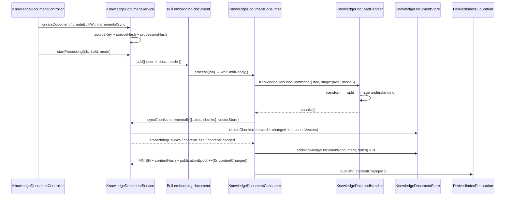
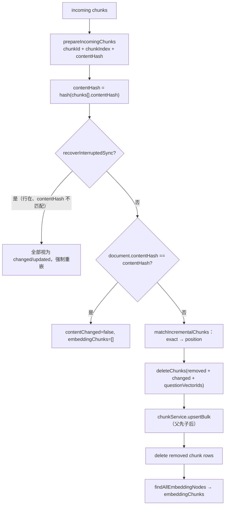
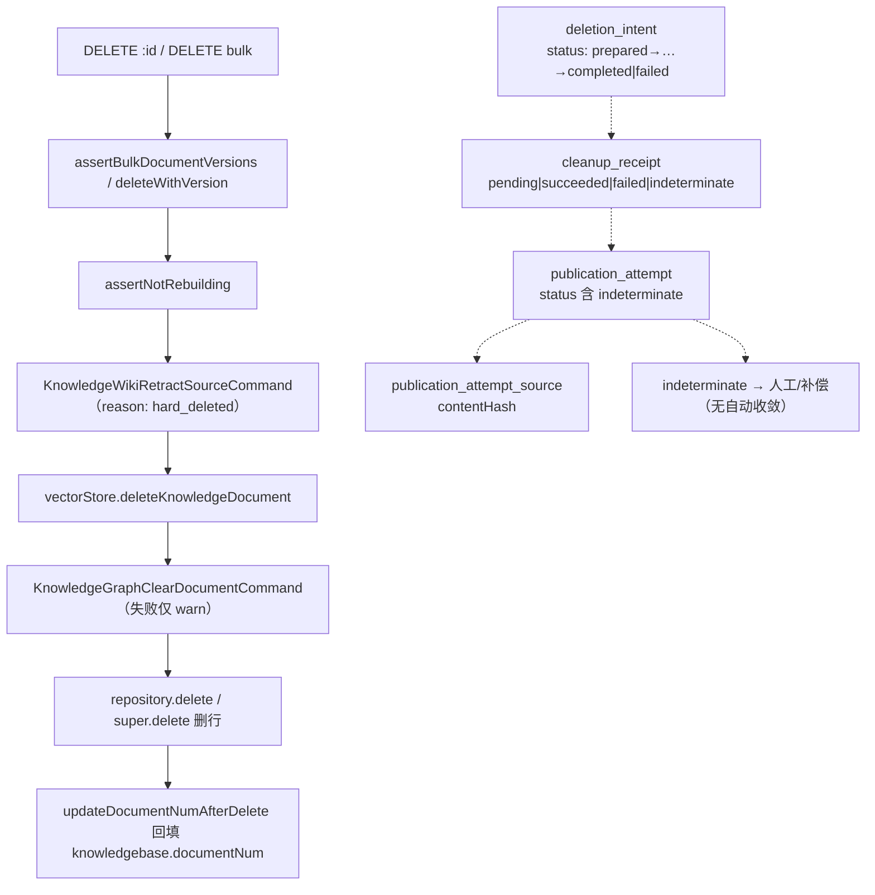
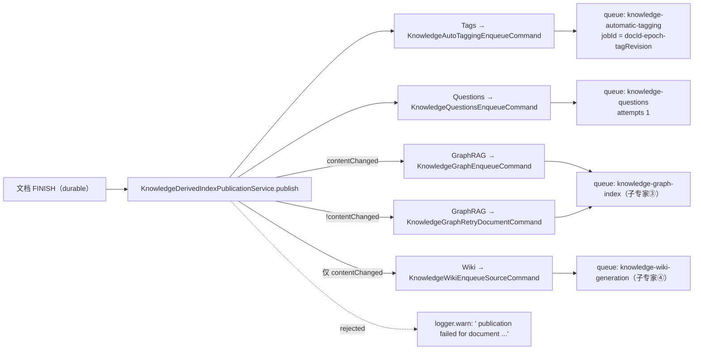

# 文档摄取与流水线子专家 · 数据流转

**本文引用的文件**
- [packages/server-ai/src/knowledge-document/document.service.ts](file://packages/server-ai/src/knowledge-document/document.service.ts)
- [packages/server-ai/src/knowledge-document/document.job.ts](file://packages/server-ai/src/knowledge-document/document.job.ts)
- [packages/server-ai/src/knowledge-document/document-publication.ts](file://packages/server-ai/src/knowledge-document/document-publication.ts)
- [packages/server-ai/src/knowledge-document/document-hash.ts](file://packages/server-ai/src/knowledge-document/document-hash.ts)
- [packages/server-ai/src/knowledge-document/transform-snapshot.service.ts](file://packages/server-ai/src/knowledge-document/transform-snapshot.service.ts)
- [packages/server-ai/src/knowledge-document/derived-index-publication.service.ts](file://packages/server-ai/src/knowledge-document/derived-index-publication.service.ts)
- [packages/server-ai/src/knowledge-document/deletion/entities.ts](file://packages/server-ai/src/knowledge-document/deletion/entities.ts)
- [packages/server-ai/src/knowledge-document/commands/handlers/load.handler.ts](file://packages/server-ai/src/knowledge-document/commands/handlers/load.handler.ts)
- [packages/server-ai/src/knowledge-document/chunk/chunk.service.ts](file://packages/server-ai/src/knowledge-document/chunk/chunk.service.ts)
- [packages/server-ai/src/knowledge-document/document-import.service.ts](file://packages/server-ai/src/knowledge-document/document-import.service.ts)
- [packages/server-ai/src/knowledge-document/processing-lifecycle.module.ts](file://packages/server-ai/src/knowledge-document/processing-lifecycle.module.ts)
- [packages/server-ai/src/knowledge-document/document.module.ts](file://packages/server-ai/src/knowledge-document/document.module.ts)
- [packages/server-ai/src/knowledgebase/vector-store.ts](file://packages/server-ai/src/knowledgebase/vector-store.ts)
- [packages/contracts/src/ai/knowledge-doc.model.ts](file://packages/contracts/src/ai/knowledge-doc.model.ts)
- [packages/contracts/src/ai/knowledge-deletion.model.ts](file://packages/contracts/src/ai/knowledge-deletion.model.ts)

## 目录

- [1. 摄取主链](#1-摄取主链)
- [2. 增量同步链](#2-增量同步链)
- [3. 删除回收链](#3-删除回收链)
- [4. 派生索引派发链](#4-派生索引派发链)
- [5. 状态流转](#5-状态流转)
- [6. 异步流与依赖](#6-异步流与依赖)
- [7. 数据变换关键节点](#7-数据变换关键节点)
- [8. 已知风险](#8-已知风险)

## 1. 摄取主链

HTTP 侧：`POST /api/knowledge-document`（单篇）/ `POST bulk`（批量，`?process=true` 才入队）/ `POST process`（显式重投）。落库侧：单篇走 `createDocument`，批量走 `createBulkWithIncrementalSync`（带 `tagIds` 时改走 `KnowledgeDocumentImportService.create`，标签与文档同事务），幂等导入走 `createBulkIdempotently`。入队侧：`startProcessing` 只投**一个** job，payload 含整个文档数组。

图表来源：[packages/server-ai/src/knowledge-document/document.job.ts](file://packages/server-ai/src/knowledge-document/document.job.ts)（关键符号：KnowledgeDocumentConsumer._processJob）、[packages/server-ai/src/knowledge-document/document.service.ts](file://packages/server-ai/src/knowledge-document/document.service.ts)（关键符号：KnowledgeDocumentService.startProcessing / syncChunksIncrementally）、[packages/server-ai/src/knowledge-document/derived-index-publication.service.ts](file://packages/server-ai/src/knowledge-document/derived-index-publication.service.ts)（关键符号：KnowledgeDerivedIndexPublicationService.publish）

要点：① 短路分支 `status === FINISH && processingHash 未变 && contentHash 存在` 不重嵌，只补 token 计数与 `lastIncrementalSync.mode = 'skipped'`，但仍发 `publish({ contentChanged: false })`；② 每批 embedding 前发 `CopilotTokenRecordCommand`（`requestId = knowledge-document:${job.id}:${document.id}:${count}`），token 归属与向量写在同一循环里；③ `checkIfJobCancelled` 每批回读文档状态，`CANCEL` 即写状态并 `return`，**不抛异常**，因此不会进 Bull 失败计数。

章节来源：[packages/server-ai/src/knowledge-document/document.job.ts](file://packages/server-ai/src/knowledge-document/document.job.ts)（关键符号：KnowledgeDocumentConsumer.process / _processJob / checkIfJobCancelled）；[packages/server-ai/src/knowledge-document/document.controller.ts](file://packages/server-ai/src/knowledge-document/document.controller.ts)（关键符号：KnowledgeDocumentController.createBulk / start / stopJob）

## 2. 增量同步链

两条并行判定：

- **文档级**：`resolveKnowledgeDocumentSourceKey` 优先生效（`sourceKey` 字段或 `metadata.sourceKey`），否则派生 `${sourceType}:${sourceConfigKey}:${sourceLocator}`，`sourceLocator` 依次取 `filePath / fileUrl / storageFileId / metadata.filePath / metadata.fileUrl / options.url`。`computeKnowledgeDocumentProcessingHash` 聚合 `chunkingRevision`（`knowledgeChunkingRevision(textSplitterType)`）+ `sourceKey` + `sourceHash` + `sourceType` + `sourceConfig` + `parserConfig` + `options` + `category` + `type` + `filePath` + `fileUrl` + `storageFileId`。`createBulkWithIncrementalSync` 因此能输出 `createdIds / updatedIds / skippedIds / processableIds` 四组。
- **chunk 级**：见下。

图表来源：[packages/server-ai/src/knowledge-document/document.service.ts](file://packages/server-ai/src/knowledge-document/document.service.ts)（关键符号：KnowledgeDocumentService.syncChunksIncrementally / matchIncrementalChunks / recoverInterruptedSync）、[packages/server-ai/src/knowledge-document/document-hash.ts](file://packages/server-ai/src/knowledge-document/document-hash.ts)（关键符号：computeKnowledgeDocumentChunkHash / computeKnowledgeDocumentContentHash）

`computeKnowledgeDocumentChunkHash` 会剥离 `VOLATILE_CHUNK_METADATA_KEYS`（`questionGeneration` / `questionGenerationId` / `questionSourceChunkId` / `generatedQuestionId` / `chunkId` / `parentId` / `children` / `knowledgeId` / `documentId` / `parentChunkId` / `tokens` / `score` / `relevanceScore` / `isVector` / `model` / `provider` / `embeddingModelFingerprint` / `embeddingDimensions` / `embeddingRevision` / `vectorIdCollectionName` / `fullPageContent` / `collection_id`），并对 `metadata.chunking` 剔除 `inputHash`——注释说明「A document-level diagnostic fingerprint must not invalidate otherwise unchanged chunks.」

章节来源：[packages/server-ai/src/knowledge-document/document-hash.ts](file://packages/server-ai/src/knowledge-document/document-hash.ts)（关键符号：VOLATILE_CHUNK_METADATA_KEYS / computeKnowledgeDocumentChunkHash / computeKnowledgeDocumentProcessingHash / resolveKnowledgeDocumentSourceKey）；[packages/server-ai/src/knowledge-document/chunking-revision.ts](file://packages/server-ai/src/knowledge-document/chunking-revision.ts)（关键符号：knowledgeChunkingRevision）

## 3. 删除回收链

现状是「顺序清理 + 告警」，设计态是「四表 saga」，两条路径目前**不连通**。

图表来源：[packages/server-ai/src/knowledge-document/document.service.ts](file://packages/server-ai/src/knowledge-document/document.service.ts)（关键符号：KnowledgeDocumentService.deleteBulkWithVersion / deleteResolvedDocument / deleteDocumentArtifacts）、[packages/server-ai/src/knowledge-document/deletion/entities.ts](file://packages/server-ai/src/knowledge-document/deletion/entities.ts)（关键符号：KnowledgeDocumentDeletionIntent / KnowledgeDocumentDeletionCleanupReceipt / KnowledgeDocumentPublicationAttempt）

要点：① `deleteBulkWithVersion` 先校验全部版本再逐条删，**没有外层事务**——中途失败会留下「部分已删」；② `deleteDocumentArtifacts` 的 Wiki 撤回与向量删除**没有 try/catch**，只有 Graph 清理被吞；③ `softRemove` 被 override 为抛 `ConflictException`，`@Delete(':id/soft')` 因此恒 409，`@Put(':id/recover')` 的 `withDeleted` 读法保留但当前无用例；④ 读路径一律 `hardDeletePendingAt IS NULL`，因此「文档消失」排查应先查该列。

章节来源：[packages/server-ai/src/knowledge-document/document.service.ts](file://packages/server-ai/src/knowledge-document/document.service.ts)（关键符号：KnowledgeDocumentService.deleteWithVersion / deleteResolvedDocument / softRemove / readableDocumentWhere）；[packages/contracts/src/ai/knowledge-deletion.model.ts](file://packages/contracts/src/ai/knowledge-deletion.model.ts)（关键符号：KnowledgeDeletionStatus / KnowledgeDocumentDeletionReceipt）

## 4. 派生索引派发链

图表来源：[packages/server-ai/src/knowledge-document/derived-index-publication.service.ts](file://packages/server-ai/src/knowledge-document/derived-index-publication.service.ts)（关键符号：KnowledgeDerivedIndexPublicationService.publish / Promise.allSettled）、[packages/server-ai/src/knowledge-document/tags/automatic-tagging.job.ts](file://packages/server-ai/src/knowledge-document/tags/automatic-tagging.job.ts)（关键符号：KnowledgeAutoTaggingEnqueueHandler.execute）、[packages/server-ai/src/knowledge-document/questions/question-generation.job.ts](file://packages/server-ai/src/knowledge-document/questions/question-generation.job.ts)（关键符号：KnowledgeQuestionsEnqueueHandler.execute）

三个额外入口也会触发同一派发：`publishChunkMutation`（手工改 chunk，固定 `contentChanged: true`）、`updateChunk...` 路径与 `KnowledgeDocumentImportService` 之后的正常 `process`。`contentChanged: false` 时仍重投 tags/questions，并把 GraphRAG 换成「重试该文档」而不是「新增索引」。

章节来源：[packages/server-ai/src/knowledge-document/derived-index-publication.service.ts](file://packages/server-ai/src/knowledge-document/derived-index-publication.service.ts)（关键符号：KnowledgeDerivedIndexPublicationService.publish）；[packages/server-ai/src/knowledge-document/document.service.ts](file://packages/server-ai/src/knowledge-document/document.service.ts)（关键符号：KnowledgeDocumentService.publishChunkMutation / writeKnowledgeDocumentPublication）

## 5. 状态流转

**文档状态** `KBDocumentStatusEnum`：`waiting | validate | running | transformed | splitted | understood | embedding | cancel | finish | error`。实际写法与位置：`running / progress 0`（`startProcessing`）→ `transformed`（`KnowledgeDocLoadHandler`，转换完成）→ `splitted`（切片完成）→ `understood`（视觉理解完成）→ `embedding`（`_processJob` 写 `EMBEDDING` 并逐批更新 `progress`）→ `finish`（`progress 100`，写 `contentHash` / `processingHash` / `sourceHash`）/ `cancel`（`checkIfJobCancelled` 命中，或 `@Delete(':id/job')` 的 `moveToFailed` + 置 `CANCEL`）/ `error`（`markQueuedDocsFailed` 或单篇 catch，写 `processMsg`）。`validate` / `waiting` 在实体枚举中存在，本域代码只在批量创建时预置 `WAITING/0/null`，`validate` 未在本子域写入路径中出现。

**处理模式** `KnowledgeDocumentProcessingMode = 'full' | 'rechunk'`：只在队列 payload、`KnowledgeDocLoadCommand` 与 `@Post('process')` 校验（非法值抛 `Error.InvalidDocumentProcessingMode`）中流转，**不落库**。`rechunk` 在 `KnowledgeDocLoadHandler` 内走 `transformSnapshotService.load`，失败即 `TransformSnapshotUnavailableError('missing' | 'stale' | 'corrupt')`，不回退转换器。

**发布位点**：`publicationEpoch`（int，默认 0）只在 `contentChanged` 时通过 `COALESCE("publicationEpoch", 0) + 1` 自增；`contentHash`（文档级）、`processingHash`、`sourceHash` 随 FINISH 写入；`hardDeletePendingAt`（timestamptz）由删除流程之外的入口设置，本子域只做 `IS NULL` 过滤；`version` 为 `@VersionColumn`，`documents/{id}/transforms/{fingerprint}/` 快照目录名也参与「版本定位」。

**四表状态（含 `indeterminate`）**：`deletion_intent.status` 的类型是 `KnowledgeDeletionStatus = prepared | quiescing | retracting | external_cleanup | finalizing | completed | failed`（默认 `prepared`），**不含 `indeterminate`**；`indeterminate` 出现在 `cleanup_receipt.status`（`pending | succeeded | failed | indeterminate`）、`publication_attempt.status`（…`failed | indeterminate`）与 `publication_attempt.artifacts[].status`（`prepared | written | promoted | compensated | indeterminate`）。四表由 `KnowledgeDocumentModule` 注册并经 `core/entities/index.ts` 导出，但**没有任何服务写入**。

章节来源：[packages/contracts/src/ai/knowledge-doc.model.ts](file://packages/contracts/src/ai/knowledge-doc.model.ts)（关键符号：KBDocumentStatusEnum / KnowledgeDocumentProcessingMode）；[packages/contracts/src/ai/knowledge-deletion.model.ts](file://packages/contracts/src/ai/knowledge-deletion.model.ts)（关键符号：KnowledgeDeletionStatus）；[packages/server-ai/src/knowledge-document/deletion/entities.ts](file://packages/server-ai/src/knowledge-document/deletion/entities.ts)（关键符号：KnowledgeDocumentPublicationAttemptStatus / KnowledgeDocumentPublicationArtifact）；[packages/server-ai/src/knowledge-document/document-publication.ts](file://packages/server-ai/src/knowledge-document/document-publication.ts)（关键符号：writeKnowledgeDocumentPublication / publicationEpoch）

## 6. 异步流与依赖

| 队列 / 通道（常量值） | 注册处 | 消费者（并发） | 生产 → 消费的数据 | 失败 / 重试语义 |
|---|---|---|---|---|
| `embedding-document`（`JOB_EMBEDDING_DOCUMENT`） | `knowledge-document/document.module.ts` | `KnowledgeDocumentConsumer`（concurrency 5） | `{ userId, docs, mode }` → 文档行 / chunk 行 / 向量 / FINISH | 无 `attempts`/`backoff`；逐篇 catch 写 `status=ERROR` + `processMsg`，不中断兄弟文档；job 级失败再 `markQueuedDocsFailed` 后重抛 |
| `knowledge-automatic-tagging`（`JOB_KNOWLEDGE_AUTO_TAGGING`） | 同上 | `KnowledgeAutoTaggingConsumer`（concurrency 2） | `{ knowledgebaseId, documentId, userId, tenantId?, organizationId? }` → 文档标签关联 + `tagRevision`/`autoTaggingInputHash` | `attempts: 3` + exponential backoff 2000ms，`removeOnComplete`、`removeOnFail: 100`；`@OnQueueFailed` 仅 warn |
| `knowledge-questions`（`JOB_KNOWLEDGE_QUESTIONS`） | 同上 | `KnowledgeQuestionsConsumer`（concurrency 2） | `{ documentId, userId, chunkId?, force?, tenantId?, organizationId? }` → chunk 的 `metadata.questionGeneration` + 问题向量 | `attempts: 1`（不自动重试，靠 `regenerate` 或重索引复用）；失败写 `status: 'failed'` 并保留 `vectorIds` |
| handoff `knowledge.pipeline_callback.v1`（`KNOWLEDGE_PIPELINE_CALLBACK`，非 Bull） | `knowledgebase/task/pipeline-callback.processor.ts` | `KnowledgePipelineCallbackProcessor`（`policy.lane = 'main'`） | Agent 流水线执行结果 → `KnowledgebaseTaskService.syncExecutionFailure` / `failExecution` | 上下文不合法返回 `{ status: 'dead', reason }`；`kind === 'stream'` 直接 `{ status: 'ok' }` 忽略 |

依赖：三条 Bull 队列都需要 Redis；`embedding-document` 还需要 embedding 模型与关系库；`knowledge-automatic-tagging` 需要 chat 模型（可经 `referencedId` 解析）；`knowledge-questions` 需要 chat 模型 + embedding 模型。三条消费者的构造器都注入 `KnowledgeProcessingReadyService`，在 CQRS handler 注册完成前不接活。

章节来源：[packages/server-ai/src/knowledge-document/document.module.ts](file://packages/server-ai/src/knowledge-document/document.module.ts)（关键符号：BullModule.registerQueue / KnowledgeDocumentModule.providers）；[packages/server-ai/src/knowledge-document/processing-lifecycle.module.ts](file://packages/server-ai/src/knowledge-document/processing-lifecycle.module.ts)（关键符号：KnowledgeProcessingReadyService.waitUntilReady）；[packages/server-ai/src/knowledgebase/task/pipeline-callback.processor.ts](file://packages/server-ai/src/knowledgebase/task/pipeline-callback.processor.ts)（关键符号：KnowledgePipelineCallbackProcessor.process）

## 7. 数据变换关键节点

- **transform 快照（切片前边界）**：`transformSnapshotService.save` 写 `documents.ndjson` + `manifest.json`（`schemaVersion: 1`、`transformFingerprint`、`sha256`、`size`、`itemCount`、`chunkCount`、`items[]`），目录为 `path.posix.join(statePath, 'documents', documentId, 'transforms', transformFingerprint)`；写入先落 `.tmp-{uuid}` 再 `rename`，失败清理临时文件。`load` 逐项校验：`transformFingerprint` 相等 → `assertSnapshotPaths` → 两份文件 sha256 与 size 双向比对 → `manifest.documentId` 与 `itemCount` → `deserializeSnapshot` 再校验全局 `chunkCount` 与每条 `item.chunkCount`。任一不过抛 `TransformSnapshotUnavailableError`，`inspect` 把它转成 `rechunk.available/reason` 供 `GET :id/reprocess-capabilities` 使用。
- **fingerprint 的取舍**：`computeKnowledgeDocumentTransformFingerprint` 只含 `sourceKey / sourceHash / sourceType / sourceConfig / type / category / filePath / fileUrl / storageFileId` + `transformer{provider, integrationId, config}`；splitter 与 image-understanding 设置被**故意排除**。
- **缓存边界**：`KnowledgeDocLoadHandler` 为 transformer / chunker / understanding 分别建 10 分钟缓存，键为 `knowledges:transformer:v2:` / `knowledges:chunker:` / `knowledges:understanding:v4:` + `computeObjectHash(...)`；`cacheConfig` 只放**插件来源**与集成 options 的 **digest**（注释：「A saved connection can change while retaining its ID. Only its digest enters the cache key.」）。
- **module 内容 hash 与向量文本分离**：`chunk.metadata.searchContent` 用于向量化、`pageContent` 用于展示与统计（`updateSourceTokenCounts` 只累加 `pageContent` 的 token，注释：「Sum searchable leaves so parent context is not counted twice.」）；表格文档用 `pick(row, parserConfig.indexedFields)` 生成 `searchContent`。
- **native table 代际**：`KnowledgeTableMetadataService.prepare/project/assertIndexCurrent/markApplied` + `TableMetadataStaleError`，被更新代取代的 job 静默跳过。

章节来源：[packages/server-ai/src/knowledge-document/transform-snapshot.service.ts](file://packages/server-ai/src/knowledge-document/transform-snapshot.service.ts)（关键符号：KnowledgeDocumentTransformSnapshotService.save / load / inspect / snapshotFolderPath / TransformSnapshotUnavailableError）；[packages/server-ai/src/knowledge-document/commands/handlers/load.handler.ts](file://packages/server-ai/src/knowledge-document/commands/handlers/load.handler.ts)（关键符号：KnowledgeDocLoadHandler.execute / cacheKey / reindexChunkSiblings）；[packages/server-ai/src/knowledge-document/document.job.ts](file://packages/server-ai/src/knowledge-document/document.job.ts)（关键符号：KnowledgeDocumentConsumer.updateSourceTokenCounts）

## 8. 已知风险

1. **四表 saga 未接线**：`deletion_intent` / `cleanup_receipt` / `publication_attempt` / `_source` 已建表并注册，但仓库内找不到写入方；当前硬删是「先删外部产物、再删行」的顺序路径，`deleteBulkWithVersion` 无外层事务，中途失败会留下部分删除。
2. **派生索引 fire-and-forget**：`publish` 对每项 `catch` 后仅 `logger.warn`，Bull/Redis 不可用时 tags / questions / graph / wiki 静默滞后，无补偿队列可见。
3. **双轨存储不一致**：关系库删行与向量库删除是两条独立路径，Graph 清理失败仅 warn，可能出现「向量残留但行已删」（或反之）。
4. **中断恢复代际成本**：`recoverInterruptedSync` 一旦命中就全量重嵌该文档，长文档 + 慢 embedding 会让恢复窗口显著长于增量窗口；且 `document.contentHash` 为空的文档（首次摄取未完成）永远走全量。
5. **`indeterminate` 无收敛路径**：属人工/补偿态，本域没有任何服务或定时任务处理它。
6. **`rag-web` loader 残缺导致抓取链不可用**：FireCrawl 返回 `[]`、Notion 硬编码 `"<PAGE_ID>"`、`rag-web/loader.ts` 为 0 字节，`Providers` 的 Notion schema 又复用了 Playwright 的 schema —— 抓取入口存在但结果不可预期。
7. **就绪门只覆盖 3 个消费者**：`KnowledgeDocumentConsumer` / `KnowledgeAutoTaggingConsumer` / `KnowledgeQuestionsConsumer` 有门；其它 4 个队列（含 `rebuild-knowledgebase-embedding`）未注入 `KnowledgeProcessingReadyService`，其启动期语义与本文域不同。
8. **队列 payload 无重试策略**：`embedding-document` 与 `knowledge-questions` 的 `attempts` 分别为默认值与 1，失败即需人工重投 `POST process` / `regenerate`。

章节来源：[packages/server-ai/src/knowledge-document/deletion/entities.ts](file://packages/server-ai/src/knowledge-document/deletion/entities.ts)（关键符号：KnowledgeDocumentDeletionIntent / KnowledgeDocumentPublicationAttempt）；[packages/server-ai/src/knowledge-document/derived-index-publication.service.ts](file://packages/server-ai/src/knowledge-document/derived-index-publication.service.ts)（关键符号：KnowledgeDerivedIndexPublicationService.publish）；[packages/server-ai/src/rag-web/provider/index.ts](file://packages/server-ai/src/rag-web/provider/index.ts)（关键符号：Providers）；[packages/server-ai/src/knowledge-document/document.service.ts](file://packages/server-ai/src/knowledge-document/document.service.ts)（关键符号：KnowledgeDocumentService.deleteBulkWithVersion / recoverInterruptedSync）
