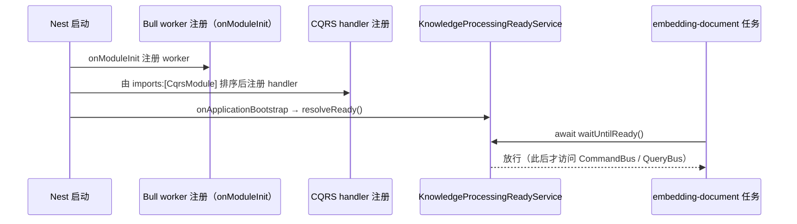

# 文档摄取与流水线子专家 · 运维

**本文引用的文件**
- [packages/server-ai/src/knowledge-document/document.job.ts](file://packages/server-ai/src/knowledge-document/document.job.ts)
- [packages/server-ai/src/knowledge-document/document.module.ts](file://packages/server-ai/src/knowledge-document/document.module.ts)
- [packages/server-ai/src/knowledge-document/document.service.ts](file://packages/server-ai/src/knowledge-document/document.service.ts)
- [packages/server-ai/src/knowledge-document/document.controller.ts](file://packages/server-ai/src/knowledge-document/document.controller.ts)
- [packages/server-ai/src/knowledge-document/document.entity.ts](file://packages/server-ai/src/knowledge-document/document.entity.ts)
- [packages/server-ai/src/knowledge-document/processing-lifecycle.module.ts](file://packages/server-ai/src/knowledge-document/processing-lifecycle.module.ts)
- [packages/server-ai/src/knowledge-document/derived-index-publication.service.ts](file://packages/server-ai/src/knowledge-document/derived-index-publication.service.ts)
- [packages/server-ai/src/knowledge-document/deletion/entities.ts](file://packages/server-ai/src/knowledge-document/deletion/entities.ts)
- [packages/server-ai/src/knowledge-document/transform-snapshot.service.ts](file://packages/server-ai/src/knowledge-document/transform-snapshot.service.ts)
- [packages/server-ai/src/knowledge-document/chunk/chunk.entity.ts](file://packages/server-ai/src/knowledge-document/chunk/chunk.entity.ts)
- [packages/server-ai/src/knowledge-document/types.ts](file://packages/server-ai/src/knowledge-document/types.ts)
- [packages/server-ai/src/knowledge-document/questions/question-generation.job.ts](file://packages/server-ai/src/knowledge-document/questions/question-generation.job.ts)
- [packages/server-ai/src/knowledge-document/tags/automatic-tagging.job.ts](file://packages/server-ai/src/knowledge-document/tags/automatic-tagging.job.ts)
- [packages/server-ai/src/knowledge-document/document-list.integration.spec.ts](file://packages/server-ai/src/knowledge-document/document-list.integration.spec.ts)
- [packages/server-ai/src/knowledge-document/document-publication.integration.spec.ts](file://packages/server-ai/src/knowledge-document/document-publication.integration.spec.ts)
- [packages/server-ai/src/rag-web/provider/firecrawl/firecrawl.test.ts](file://packages/server-ai/src/rag-web/provider/firecrawl/firecrawl.test.ts)
- [packages/server-ai/src/rag-web/commands/handlers/load.handler.ts](file://packages/server-ai/src/rag-web/commands/handlers/load.handler.ts)
- [packages/server-ai/src/knowledgebase/faq/knowledge-faq.controller.ts](file://packages/server-ai/src/knowledgebase/faq/knowledge-faq.controller.ts)
- [packages/server-ai/src/knowledgebase/tags/knowledge-tag.integration.spec.ts](file://packages/server-ai/src/knowledgebase/tags/knowledge-tag.integration.spec.ts)
- [packages/server-ai/src/knowledgebase/knowledgebase.service.ts](file://packages/server-ai/src/knowledgebase/knowledgebase.service.ts)
- [packages/server-ai/src/knowledgebase/knowledgebase.entity.ts](file://packages/server-ai/src/knowledgebase/knowledgebase.entity.ts)
- [packages/server-ai/src/graphrag/graphrag.service.ts](file://packages/server-ai/src/graphrag/graphrag.service.ts)
- [packages/server-ai/src/knowledgebase/task/pipeline-callback.processor.ts](file://packages/server-ai/src/knowledgebase/task/pipeline-callback.processor.ts)
- [packages/contracts/src/ai/knowledge-deletion.model.ts](file://packages/contracts/src/ai/knowledge-deletion.model.ts)

## 目录

- [1. 本子域 3 个队列清单](#1-本子域-3-个队列清单)
- [2. 环境变量与开关](#2-环境变量与开关)
- [3. 就绪门与启动顺序](#3-就绪门与启动顺序)
- [4. 迁移与 schema](#4-迁移与-schema)
- [5. 日志与观测点](#5-日志与观测点)
- [6. 多副本注意事项](#6-多副本注意事项)
- [7. 容量与成本](#7-容量与成本)
- [8. 安全运维](#8-安全运维)

## 1. 本子域 3 个队列清单

| 队列名（常量） | 用途 | 生产者 | 消费者（并发） | 失败语义 / 重试 |
|---|---|---|---|---|
| `embedding-document`（`JOB_EMBEDDING_DOCUMENT`） | 主摄取流水线：解析 → 切片 → 视觉理解 → embedding → 写向量 → FINISH → 派生索引派发 | `KnowledgeDocumentService.startProcessing`（`docQueue.add({ userId, docs, mode })`）；`document.controller.ts` 的 `@Post('process')` 与 `@Post('bulk')?process=true` 间接调用 | `KnowledgeDocumentConsumer`（`@Process({ concurrency: 5 })`） | 逐篇 `catch` 写 `status=ERROR` + `processMsg` 并 warn，兄弟文档继续；`job` 级异常先 `markQueuedDocsFailed` 再重抛。**无 `attempts`/`backoff`**，失败即终态，需人工重投 |
| `knowledge-automatic-tagging`（`JOB_KNOWLEDGE_AUTO_TAGGING`） | 文档自动打标（LLM） | `KnowledgeDerivedIndexPublicationService.publish` → `KnowledgeAutoTaggingEnqueueHandler.execute`（入队前 `tags.context` + `normalizeAutomaticTagging(...).enabled` 判定，未启用直接返回不入队） | `KnowledgeAutoTaggingConsumer`（concurrency 2） | `attempts: 3` + `backoff: { type: 'exponential', delay: 2000 }`；确定性 `jobId = ${document.id}-${document.publicationEpoch}-${document.tagRevision}`；`removeOnComplete: true`、`removeOnFail: 100`；`@OnQueueFailed` 仅 `logger.warn` |
| `knowledge-questions`（`JOB_KNOWLEDGE_QUESTIONS`） | 切片级问题生成 + 问题向量写入 | 同上 + `KnowledgeQuestionGenerationController.regenerate`（`force: true`） | `KnowledgeQuestionsConsumer`（concurrency 2） | `attempts: 1` + `removeOnComplete` + `removeOnFail: 100`；`parserConfig.questionGeneration` 未配置则不入队；失败落 `metadata.questionGeneration.status = 'failed'` 并保留 `vectorIds` |

**非 Bull 的第 4 条链路**：`KnowledgePipelineCallbackProcessor` 是 handoff-processor（`@HandoffProcessorStrategy(KNOWLEDGE_PIPELINE_CALLBACK, { types: [...], policy: { lane: 'main' } })`，消息类型常量 `'knowledge.pipeline_callback.v1'`），把 Agent 流水线结果回写知识库任务；`kind === 'stream'` 直接返回 `{ status: 'ok' }`，上下文不合法返回 `{ status: 'dead' }`。

章节来源：[packages/server-ai/src/knowledge-document/document.job.ts](file://packages/server-ai/src/knowledge-document/document.job.ts)（关键符号：KnowledgeDocumentConsumer.process / _processJob）；[packages/server-ai/src/knowledge-document/tags/automatic-tagging.job.ts](file://packages/server-ai/src/knowledge-document/tags/automatic-tagging.job.ts)（关键符号：KnowledgeAutoTaggingEnqueueHandler.execute / KnowledgeAutoTaggingConsumer.failed）；[packages/server-ai/src/knowledge-document/questions/question-generation.job.ts](file://packages/server-ai/src/knowledge-document/questions/question-generation.job.ts)（关键符号：KnowledgeQuestionsEnqueueHandler.execute / KnowledgeQuestionsConsumer.process）；[packages/server-ai/src/knowledgebase/task/pipeline-callback.processor.ts](file://packages/server-ai/src/knowledgebase/task/pipeline-callback.processor.ts)（关键符号：KnowledgePipelineCallbackProcessor.process）

## 2. 环境变量与开关

| 变量名 | 用途 | 默认值 | 来源文件 | 是否影响运行时 |
|---|---|---|---|---|
| `KNOWLEDGE_FAQ_IMPORT_MAX_BYTES` | **不存在该环境变量**。FAQ 导入/预检上限是模块级常量 `const KNOWLEDGE_FAQ_IMPORT_MAX_BYTES = 10 * 1024 * 1024`，作为 `FileInterceptor('file', { limits: { fileSize: KNOWLEDGE_FAQ_IMPORT_MAX_BYTES } })` 使用，**不可用环境变量覆盖** | 10 MiB（硬编码） | [knowledge-faq.controller.ts](file://packages/server-ai/src/knowledgebase/faq/knowledge-faq.controller.ts) | 否（常量） |
| `KNOWLEDGE_TAGGING_PG_URL` | 标签 PG integration 的开关与连接串；本域 `knowledge-automatic-tagging` 的输出面（`knowledge_document_tag` / `knowledgebase_tag`）与之重叠 | 未设置 → `describe.skip` | [knowledge-tag.integration.spec.ts](file://packages/server-ai/src/knowledgebase/tags/knowledge-tag.integration.spec.ts) | 仅测试 |
| `KNOWLEDGE_WIKI_PG_E2E` | 本域两个 PG integration 的开关（文档列表过滤、发布位点/`publicationEpoch` 行为），值为 `'1'` 时启用 | 未设置 → `describe.skip` | [document-list.integration.spec.ts](file://packages/server-ai/src/knowledge-document/document-list.integration.spec.ts)、[document-publication.integration.spec.ts](file://packages/server-ai/src/knowledge-document/document-publication.integration.spec.ts) | 仅测试 |
| `DB_HOST` / `DB_PORT` / `DB_USER` / `DB_PASS` / `DB_NAME` | 上述两个 integration 的连接参数 | `127.0.0.1` / `5432` / `postgres` / `ocap_password` / `ocap` | [document-list.integration.spec.ts](file://packages/server-ai/src/knowledge-document/document-list.integration.spec.ts) | 仅测试 |
| `FIRECRAWL_API_KEY` | `rag-web` Firecrawl provider 测试密钥（`process.env.FIRECRAWL_API_KEY` 仅出现在该测试） | 未设置 | [firecrawl.test.ts](file://packages/server-ai/src/rag-web/provider/firecrawl/firecrawl.test.ts) | 仅测试 |
| `KNOWLEDGE_PIPELINE_CALLBACK` | **不是 env**：同名常量 `'knowledge.pipeline_callback.v1'` 是 handoff 消息类型 | — | [packages/server-ai/src/knowledgebase/types.ts](file://packages/server-ai/src/knowledgebase/types.ts) | 否（常量） |
| `KNOWLEDGE_IDENTITY_PG_E2E` / `KNOWLEDGE_GRAPH_PG_E2E` / `KNOWLEDGE_KEYWORD_PG_E2E` / `WIKI_V15_PG_URL` / `BOM_GRAPH_PG` / `XPERT_JIEBA_PLUGIN_PATH` | 相邻子专家（①③④）的 PG integration 开关；本域**不消费**，但共用同一 CI 作业时会一起决定回归覆盖率 | 未设置 → skip | 见 07（父级）与各 `*.integration.spec.ts` | 仅测试 |

**核实方式**：在本子域两个目录内检索 `process.env.` —— `knowledge-document/` 只命中 2 个 `*.integration.spec.ts`，`rag-web/` 只命中 `firecrawl.test.ts`。**本子域的运行时配置不读 `process.env`**：队列名是常量、向量表名与 collection 名来自 `KnowledgebaseService` / `environment.vectorStore`、快照目录来自 `KnowledgeWorkAreaResolver` + `RequestContext`、模型句柄来自 `Knowledgebase` 关系列。

章节来源：[packages/server-ai/src/knowledgebase/faq/knowledge-faq.controller.ts](file://packages/server-ai/src/knowledgebase/faq/knowledge-faq.controller.ts)（关键符号：KNOWLEDGE_FAQ_IMPORT_MAX_BYTES / FileInterceptor）；[packages/server-ai/src/knowledge-document/document-list.integration.spec.ts](file://packages/server-ai/src/knowledge-document/document-list.integration.spec.ts)（关键符号：postgresDescribe / KNOWLEDGE_WIKI_PG_E2E / DB_HOST）；[packages/server-ai/src/knowledgebase/tags/knowledge-tag.integration.spec.ts](file://packages/server-ai/src/knowledgebase/tags/knowledge-tag.integration.spec.ts)（关键符号：pgDescribe / KNOWLEDGE_TAGGING_PG_URL）；[packages/server-ai/src/rag-web/provider/firecrawl/firecrawl.test.ts](file://packages/server-ai/src/rag-web/provider/firecrawl/firecrawl.test.ts)（关键符号：FIRECRAWL_API_KEY）

## 3. 就绪门与启动顺序

`KnowledgeProcessingLifecycleModule` 是**启动就绪门**，源码注释给出原因：

> 「Bull registers workers in onModuleInit, before CQRS registers its handlers. The explicit CqrsModule dependency orders this gate after CQRS bootstrap.」

机制：`KnowledgeProcessingReadyService implements OnApplicationBootstrap` 持有一个 `Promise<void>` 与它的 `resolveReady`，`onApplicationBootstrap()` 里 `resolveReady()`；消费者在任务体**第一句** `await this.lifecycle.waitUntilReady()`。显式等待的消费者是 `KnowledgeDocumentConsumer`、`KnowledgeAutoTaggingConsumer`、`KnowledgeQuestionsConsumer`（三者构造器注入该服务）。**未接门**的消费者为 `KnowledgeGraphIndexConsumer`、`KnowledgeWikiGenerationConsumer`、`KnowledgebaseRebuildEmbeddingConsumer`、`FAQSemanticPrewarmProcessor`。

图表来源：[packages/server-ai/src/knowledge-document/processing-lifecycle.module.ts](file://packages/server-ai/src/knowledge-document/processing-lifecycle.module.ts)（关键符号：KnowledgeProcessingLifecycleModule.imports / KnowledgeProcessingReadyService.onApplicationBootstrap / waitUntilReady）、[packages/server-ai/src/knowledge-document/document.module.ts](file://packages/server-ai/src/knowledge-document/document.module.ts)（关键符号：KnowledgeDocumentModule.imports / KnowledgeProcessingLifecycleModule）

**启动顺序建议**：Redis 必须先于 API 可用（3 个 worker 在 `onModuleInit` 注册）；关系库必须早于首次 `startProcessing`；volume/工作区（`KnowledgeWorkAreaResolver`）必须在首次真实文档处理前就绪，否则 `transformSnapshotService.save` 与 `resolveWorkArea` 会失败并把文档置 `ERROR`。

章节来源：[packages/server-ai/src/knowledge-document/processing-lifecycle.module.ts](file://packages/server-ai/src/knowledge-document/processing-lifecycle.module.ts)（关键符号：KnowledgeProcessingReadyService）；[packages/server-ai/src/knowledge-document/document.job.ts](file://packages/server-ai/src/knowledge-document/document.job.ts)（关键符号：KnowledgeDocumentConsumer.process / lifecycle.waitUntilReady）

## 4. 迁移与 schema

- **本域没有专属迁移 SQL 文件**。`knowledge-document/` 目录下检索不到 `migrations/` 或 `*.sql`；本域的实体表结构靠 TypeORM `synchronize` 同步，四张删除/发布表也只通过 `KnowledgeDocumentModule` 的 `TypeOrmModule.forFeature([...])` 注册。
- **依赖 `synchronize: false` 手工建的部分索引与本域相关**：`IDX_knowledge_document_name_trgm`、`IDX_knowledge_document_keyword_title_vector`，以及 chunk 表上的 `_content_fts` / `_keyword_vector` / `_content_trgm` —— 这些是「文档 / chunk 检索面」的索引，缺失不会导致启动失败，只会让关键词检索退化，需运维侧 SQL 建。
- **向量表不是实体**：`knowledge_document_vector` / `knowledge_document_collection` 由 `RagCreateVStoreHandler.createPgVectorStore` 在运行期 `ensureTableInDatabase()` / `ensureCollectionTableInDatabase()` 建表（属子专家①），本域只调用 `KnowledgeDocumentStore`。
- **快照数据不在 DB**：`transformSnapshotService.save` 把 `documents.ndjson` + `manifest.json` 写到工作区 `statePath/documents/{documentId}/transforms/{transformFingerprint}/`，服务内**未见清理/回收逻辑**，换解析器配置会累积新指纹目录。

章节来源：[packages/server-ai/src/knowledge-document/document.module.ts](file://packages/server-ai/src/knowledge-document/document.module.ts)（关键符号：TypeOrmModule.forFeature）；[packages/server-ai/src/knowledge-document/document.entity.ts](file://packages/server-ai/src/knowledge-document/document.entity.ts)（关键符号：KnowledgeDocument / IDX_knowledge_document_name_trgm / IDX_knowledge_document_keyword_title_vector）；[packages/server-ai/src/knowledge-document/transform-snapshot.service.ts](file://packages/server-ai/src/knowledge-document/transform-snapshot.service.ts)（关键符号：KnowledgeDocumentTransformSnapshotService.save / snapshotFolderPath）

## 5. 日志与观测点

| 观测点 | 载体 | 写入方 | 告警建议 |
|---|---|---|---|
| 单篇摄取失败 | 文档列 `status=ERROR` + `processMsg`；日志 `[Job: entity '<jobId>'] Document '<docId>' failed: …` | **本子域**（`KnowledgeDocumentConsumer._processJob`） | 按 `processMsg` 聚合；该队列无重试，失败即需人工重投 `POST process` |
| 队列级失败 | 文档列 `status=ERROR` + `processMsg`（payload 内全部文档） | **本子域**（`KnowledgeDocumentConsumer.markQueuedDocsFailed`） | 出现成批 ERROR 且 jobId 相同时优先查 embedding 模型 / volume |
| 产出规模与进度 | 日志 `Embeddings document '<name>' size: <n>`、`Embeddings document '<name>' progress: 
%` | **本子域** | debug 级；`size` 突增说明切片或 transformer 配置变更 |
| 派生索引静默滞后 | 日志 `Tags/Questions/GraphRAG/Wiki publication failed for document '<id>': …`（`Promise.allSettled` 逐项吞异常） | **本子域**（`KnowledgeDerivedIndexPublicationService`） | **必须设告警**：Bull/Redis 不可用不会让主摄取失败，否则标签/题目/图谱/Wiki 静默落后 |
| 自动标签失败 | 日志 `Automatic tagging failed for document '<docId>': …` | **本子域**（`KnowledgeAutoTaggingConsumer.@OnQueueFailed`） | 连续失败优先查 chat 模型可用性与标签候选（`tags.candidates`） |
| 问题生成失败 | chunk `metadata.questionGeneration.status='failed'` + 日志 `Question generation failed for chunk '<chunkId>': …` | **本子域**（`KnowledgeQuestionGenerationService.generate`） | 该队列 `attempts: 1`，需人工 `regenerate` |
| 表代际被取代 | 日志 `[Job: entity '<jobId>'] Superseded table generation for '<docId>'`（debug） | **本子域** | 属预期噪声，可观察频率 |
| Graph 清理失败 | 日志 `Failed to clear GraphRAG data for document '<docId>': …` | **本子域**（`KnowledgeDocumentService.deleteDocumentArtifacts`） | 非空即可能「行已删、图谱残留」，需人工清图 |
| 文档源连接失败 | 日志 `Failed to connect document source '<type>'` | **本子域**（`KnowledgeDocumentService.connectDocumentSource`） | 与 `Error.InvalidDocumentSource` 类错误一起排 |
| `graphStatus` / `graphIndexError` | `knowledgebase` 列，`GET /api/knowledgebase/:id/graph/status` 以 `error` 暴露 | **不在本子域**：由 `GraphragService`（子专家③，`markJobFailed`）与 `processIndexJob` 写入 | 本域只发 `KnowledgeGraphEnqueueCommand` / `KnowledgeGraphRetryDocumentCommand` / `KnowledgeGraphClearDocumentCommand`；`graphIndexError` 非空即建议告警 |
| `embeddingRebuildError` / `status=REBUILD_FAILED` | `knowledgebase` 列 + 日志 `Embedding rebuild failed for knowledgebase '<id>': …` | **不在本子域**：由 `KnowledgebaseService.markEmbeddingRebuildFailed`（子专家①）写入 | 本域只被 `assertNotRebuilding` 阻断（`startProcessing` / `createBulkWithIncrementalSync` / `moveDocument` / 删除 / 问题重生成会 400） |
| `indeterminate` 状态 | `knowledge_document_deletion_cleanup_receipt.status`、`knowledge_document_publication_attempt.status`、`artifacts[].status`（另有 Wiki 侧 `knowledge_wiki_model_invocation.reconciliationStatus`） | **本子域无写入方** | 建议单独看板统计；属**需人工/补偿**状态，非自动重试 |

章节来源：[packages/server-ai/src/knowledge-document/document.job.ts](file://packages/server-ai/src/knowledge-document/document.job.ts)（关键符号：KnowledgeDocumentConsumer._processJob / markQueuedDocsFailed）；[packages/server-ai/src/knowledge-document/derived-index-publication.service.ts](file://packages/server-ai/src/knowledge-document/derived-index-publication.service.ts)（关键符号：KnowledgeDerivedIndexPublicationService.publish）；[packages/server-ai/src/graphrag/graphrag.service.ts](file://packages/server-ai/src/graphrag/graphrag.service.ts)（关键符号：GraphragService.markJobFailed / graphIndexError）；[packages/server-ai/src/knowledgebase/knowledgebase.service.ts](file://packages/server-ai/src/knowledgebase/knowledgebase.service.ts)（关键符号：KnowledgebaseService.markEmbeddingRebuildFailed / assertNotRebuilding）；[packages/server-ai/src/knowledge-document/deletion/entities.ts](file://packages/server-ai/src/knowledge-document/deletion/entities.ts)（关键符号：KnowledgeDocumentDeletionCleanupReceipt.status / KnowledgeDocumentPublicationArtifact.status）

## 6. 多副本注意事项

1. **消费者并发按副本相乘**：`embedding-document` 单进程 5，N 副本即 5N 个并发长任务；扩容前先确认 embedding 模型配额、PG 连接池与 volume 吞吐，否则限流会直接转成 `status=ERROR`。
2. **`embedding-document` 与 `knowledge-questions` 无确定性 jobId**：`startProcessing` 不传 `jobId`，重放/重投`POST process` 会产生新 job 并重复执行解析（缓存可缓解）与 embedding（`contentHash` 命中时短路）。唯一自带去重的是 `knowledge-automatic-tagging`（`${document.id}-${publicationEpoch}-${document.tagRevision}`）。
3. **文档级幂等靠 DB 锁而非本地状态**：`createBulkIdempotently` 在事务内 `SELECT pg_advisory_xact_lock(hashtextextended($1, 0))`，多副本并发同 key 时天然串行；**不要**用本地缓存替代该判断。
4. **`assertNotRebuilding` 是跨副本可见的 DB 列检查**（`knowledgebase.status === REBUILDING`），但「检查—写入」之间无锁；重建期间的真正防线是子专家① 的 `assertCurrentRebuildTask`（`rebuildTaskId` + `pendingEmbeddingRevision`）。
5. **快照目录会被并发写**：`save` 先写 `.tmp-${randomUUID()}` 再 `rename`，同文档同指纹的并发重切不会互相污染数据文件，但 `rename` 是「后写覆盖前写」语义 —— 同文档并发 `full` 处理本身应由 `startProcessing` 的 `RUNNING` 过滤避免。
6. **滚动升级顺序**：消费者/worker 先于生产者升级更安全（避免新 payload 字段被旧 worker 丢弃）；本域 payload 新增了 `mode` 与 `tenantId/organizationId`，混跑时旧 worker 会忽略 `mode` 而退化为 `full`。
7. **Playwright 自愈安装的全局副作用**：`RagWebLoadHandler` 在捕获安装错误后会 `spawn('npx', ['playwright','install','--only-shell','chromium'])`，并用 `SchedulerRegistry` 注册名为 `install_playwright` 的 timeout；多副本同时触发会产生重复安装进程（缓存键 `rag_web_provider:playwright` 只是标记，不是分布式锁）。

章节来源：[packages/server-ai/src/knowledge-document/document.service.ts](file://packages/server-ai/src/knowledge-document/document.service.ts)（关键符号：KnowledgeDocumentService.createBulkIdempotently / startProcessing）；[packages/server-ai/src/knowledge-document/document.job.ts](file://packages/server-ai/src/knowledge-document/document.job.ts)（关键符号：KnowledgeDocumentConsumer.@Process({ concurrency: 5 })）；[packages/server-ai/src/rag-web/commands/handlers/load.handler.ts](file://packages/server-ai/src/rag-web/commands/handlers/load.handler.ts)（关键符号：RagWebLoadHandler.execute / schedulerRegistry.addTimeout）

## 7. 容量与成本

- **摄取是最贵的一条链**：一次 `full` 会调 transformer（可能含视觉模型）、chunker、image-understanding（视觉模型）与 embedding；token 通过 `CopilotTokenRecordCommand` 按批记账（`requestId = knowledge-document:${job.id}:${document.id}:${count}`），因此**按 job 维度可核对成本**。上线前用 `POST estimate` / `POST estimate-table` 只做预估不落库。
- **token 统计口径**：`chunk.metadata.tokens` 与 `tokenNum` 只统计 `pageContent`（`updateSourceTokenCounts` 用 `findAllEmbeddingNodes` 求叶子节点和，注释「Sum searchable leaves so parent context is not counted twice.」）；embedding 侧按 `searchContent ?? pageContent` 计费——两者不等，容量规划时不要混用。
- **双 collection 期间体积 ≈ 2×**：embedding 重建（子专家①）同时保留 active 与 pending collection，`promoteEmbeddingRebuild` 之后才清理旧 collection；本域在该窗口被 `assertNotRebuilding` 阻断写操作。
- **chunk 表放大因子**：`knowledge_document_chunk` 是 `@Tree('closure-table')`（父子关系额外建闭包行）且带 `@VersionColumn`；父子切片（parent-child splitter）会让行数远超 chunk 数。
- **快照占用**：`documents/{documentId}/transforms/{transformFingerprint}/` 每换一次 transformer 配置（`provider / integrationId / config`）或 sourceHash 就新增一份完整 NDJSON 副本，且服务内无清理逻辑——按「文档体积 × 历史配置数」预算 volume。
- **FAQ 导入体积上限**：单次导入/预检上限 `KNOWLEDGE_FAQ_IMPORT_MAX_BYTES = 10 * 1024 * 1024`（硬编码常量，非 env），大 FAQ 集需分片导入。
- **抓取链的固定成本**：`RagWebLoadHandler` 把抓取结果缓存 5 分钟（键 `rag_web:{scrapeId}`），Playwright 走 headless Chromium，单次 `npx playwright install --only-shell chromium` 会拉取浏览器包，镜像构建阶段预装可省启动期下载。

章节来源：[packages/server-ai/src/knowledge-document/document.job.ts](file://packages/server-ai/src/knowledge-document/document.job.ts)（关键符号：KnowledgeDocumentConsumer.updateSourceTokenCounts / CopilotTokenRecordCommand）；[packages/server-ai/src/knowledge-document/chunk/chunk.entity.ts](file://packages/server-ai/src/knowledge-document/chunk/chunk.entity.ts)（关键符号：KnowledgeDocumentChunk / @Tree('closure-table') / @VersionColumn）；[packages/server-ai/src/knowledge-document/document.controller.ts](file://packages/server-ai/src/knowledge-document/document.controller.ts)（关键符号：KnowledgeDocumentController.estimate / estimateTable）；[packages/server-ai/src/knowledgebase/faq/knowledge-faq.controller.ts](file://packages/server-ai/src/knowledgebase/faq/knowledge-faq.controller.ts)（关键符号：KNOWLEDGE_FAQ_IMPORT_MAX_BYTES）

## 8. 安全运维

- **跨租户 / 跨组织边界**：文档实体继承 `TenantOrganizationBaseEntity`（`tenantId` + `organizationId`），归属由 `knowledgebaseId` 派生；全局 `AuthGuard` + `PluginScopeGuard` 只保证「已认证 + 插件作用域」。真正的授权边界是 service 断言：`assertKnowledgebaseReadAccess` / `assertDocumentReadAccess` / `assertDocumentWriteAccess` / `assertDocumentsReadAccess` / `assertDocumentsWriteAccess`（后者额外 `assertUserManagedDocument`）。`KnowledgeDocumentController` **没有任何 `@UseGuards`**——「没有守卫不等于没有鉴权」。
- **待硬删文档不可见**：`readableDocumentWhere` / `withReadableDocumentOneOptions` 统一追加 `hardDeletePendingAt IS NULL`；排查「文档消失」应先查该列。`softRemove` 恒抛 `Error.KnowledgeDocumentSoftDeleteUnavailable`。
- **系统托管文档过滤**：`userDocumentListWhere` 排除 `metadata.systemManaged === true`（`systemManagedType` 例外），Agent 写入的文档不出现在用户列表 —— 属预期行为，不要当数据丢失。
- **`permission` 是知识库级开关**：`permission = Public` 会让其中文档、FAQ、Wiki、图谱一并对外可见；`findAllByPublic` 固定 `permission in (Organization, Public) 且 createdById ≠ 当前用户`。文档侧不提供单文档可见性开关。
- **原文件下载三条路径，权限与副作用不同**：`GET :id/original-file/download` **全量缓冲后 `res.send`**（大文件慎用）；`GET/HEAD :id/original-file/preview` 走单 Range 流（`206 + Content-Range`，越界 416，带 `Accept-Ranges`、`Cache-Control: private, no-store`、`X-Content-Type-Options: nosniff`）；`POST original-files/download` 用 `archiver` 打包 `application/zip`（无可用原文件 400）。三者都先 `assertDocumentReadAccess`；分析快照资产同样带 `private, no-store` + `nosniff`。
- **web 抓取的集成授权**：`POST web/:type/load` 强制要求 `integration.id`，`findOneInOrganizationOrTenant` 后校验「属本组织或由本人创建」，否则抛 `knowledgeDocumentAccessDenied()`；抓取凭证不会被跨组织复用。缺 `integration.id` 直接 400。
- **上传落盘**：`POST :id/file` 经 `UploadFileCommand` 写入 volume 的 `knowledges` catalog，目录由 `KnowledgeWorkAreaResolver` 按 `tenantId/userId/knowledgebaseId` 解析；快照与临时目录（`workArea.tmpPath.serverPath`）同属该工作区，属**跨租户隔离的物理边界**——运维清盘时必须按工作区维度操作。
- **快照路径不可外泄**：`transformSnapshotService.assertSnapshotPaths` 校验快照路径必须等于 `statePath/documents/{documentId}/transforms/{fingerprint}/{documents.ndjson|manifest.json}`，否则按 `corrupt` 拒绝 —— 这是对「metadata 中存的路径被篡改」的防线。
- **队列可见性**：4 条链都携带 `userId` / `tenantId` / `organizationId`，消费时用 `captureRequestContext` 还原请求上下文再调用模型与 CRUD；排查越权时应同时检查「任务入队时的 userId」是否真实属于该租户。

章节来源：[packages/server-ai/src/knowledge-document/document.service.ts](file://packages/server-ai/src/knowledge-document/document.service.ts)（关键符号：KnowledgeDocumentService.readableDocumentWhere / assertDocumentReadAccess / assertDocumentsWriteAccess / softRemove）；[packages/server-ai/src/knowledge-document/document.controller.ts](file://packages/server-ai/src/knowledge-document/document.controller.ts)（关键符号：KnowledgeDocumentController.loadRagWeb / streamOriginalFilePreview / downloadOriginalFiles）；[packages/server-ai/src/knowledge-document/transform-snapshot.service.ts](file://packages/server-ai/src/knowledge-document/transform-snapshot.service.ts)（关键符号：KnowledgeDocumentTransformSnapshotService.assertSnapshotPaths / resolveWorkArea）；[packages/server-ai/src/knowledge-document/document-list-filter.ts](file://packages/server-ai/src/knowledge-document/document-list-filter.ts)（关键符号：userDocumentListWhere / visibleDocumentSql）
