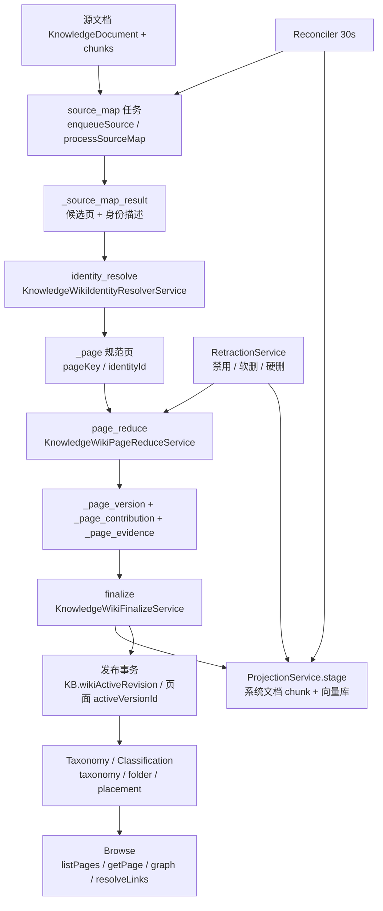

# 知识 Wiki 与知识组织子专家 · 01 架构

**本文引用的文件**
- [knowledge-wiki.module.ts](file://packages/server-ai/src/knowledgebase/wiki/knowledge-wiki.module.ts)（模块装配、依赖与 provider 清单）
- [knowledge-wiki-generation.service.ts](file://packages/server-ai/src/knowledgebase/wiki/knowledge-wiki-generation.service.ts)（source 入队 / rebuild / retry 入口）
- [knowledge-wiki-page-scheduler.service.ts](file://packages/server-ai/src/knowledgebase/wiki/knowledge-wiki-page-scheduler.service.ts)（阶段编排与子任务派发）
- [knowledge-wiki-finalize.service.ts](file://packages/server-ai/src/knowledgebase/wiki/knowledge-wiki-finalize.service.ts)（投影 staging 与发布事务）
- [knowledge-wiki-reconciler.service.ts](file://packages/server-ai/src/knowledgebase/wiki/knowledge-wiki-reconciler.service.ts)（后台自愈）
- [knowledge-wiki-config.ts](file://packages/server-ai/src/knowledgebase/wiki/knowledge-wiki-config.ts)（配置指纹、服务端列白名单）
- [knowledge-wiki-configuration.ts](file://packages/server-ai/src/knowledgebase/wiki/knowledge-wiki-configuration.ts)（配置更新 → KB 状态列写入语义）
- [knowledgebase.entity.ts](file://packages/server-ai/src/knowledgebase/knowledgebase.entity.ts)（wiki 状态列宿主表）
- [entities/knowledge-wiki-organization.entity.ts](file://packages/server-ai/src/knowledgebase/wiki/entities/knowledge-wiki-organization.entity.ts)（组织三表）
- [entities/index.ts](file://packages/server-ai/src/knowledgebase/wiki/entities/index.ts)（实体注册出口）

## 目录
- [1. 子域职责边界](#1-子域职责边界)
- [2. 内部分层](#2-内部分层)
- [3. 依赖关系](#3-依赖关系)
- [4. 关键不变量](#4-关键不变量)
- [5. 架构总览](#5-架构总览)
- [6. 结论](#6-结论)

## 1. 子域职责边界

### 1.1 本子域负责
- 生成链：源文档入队（`enqueueSource`）、重建（`rebuild`）、重试（`retry`）、worker 分段（`processJob` / `processSourceMap` / `processRebuild`）。
- 页面派索引：把 wiki 页面版本投影为 KB 内部系统文档的 chunk（`sourceKey='system:knowledge-wiki'`），使其可被既有检索链路消费。
- 组织与分类：taxonomy 开关、目录树 CRUD、页面 placement、分类 run 的启动 / 查询 / 应用、自动分类任务编排。
- 浏览读模型：页面列表、页面详情（含 evidence 与反链）、链接解析、图谱、目录树计数。
- 运维面：状态读取、状态清理计数、模型调用对账与恢复动作、源文档清理状态。

章节来源：[knowledge-wiki.module.ts](file://packages/server-ai/src/knowledgebase/wiki/knowledge-wiki.module.ts)（关键符号：KnowledgeWikiModule / KnowledgeWikiService.getStatus / KnowledgeWikiGenerationService.enqueueSource）

### 1.2 本子域不负责（但消费其产物）
- KB 本体与检索（子专家①）：`Knowledgebase` 实体本体与通用更新逻辑不归本子域，本子域只写 KB 表上的 wiki 状态列；检索可见性过滤由检索侧引用 `KnowledgeWikiSearchScopeService` 完成。
- 文档摄取（②）：chunk 切分与 `finish` 流程不归本子域，本子域只读取 `KnowledgeDocument` / `KnowledgeDocumentChunk`，并用 `isEligibleKnowledgeWikiSource` 判定可用性。
- 图谱与身份（③）：`KnowledgeIdentity` 本体、身份图与 catalogue 归身份子域，本子域通过 `KnowledgeWikiIdentityResolverService` 作为适配层调用。
- 模型供应商与计费主体：模型解析用 `wikiModel ?? chatModel`，实际计费与对账在模型调用记录与上游计费侧。

章节来源：[knowledge-wiki-config.ts](file://packages/server-ai/src/knowledgebase/wiki/knowledge-wiki-config.ts)（关键符号：resolveKnowledgeWikiModel / KnowledgeWikiSearchScopeService）

## 2. 内部分层

### 2.1 门面服务族
- `KnowledgeWikiService`：`getStatus`、`updateConfiguration`、`listPages`、`getPage`、`getDocumentStatus`、`getInvocationStatus`、`getSourceCleanupStatus`、`rebuild`、`retry`、`getScope`、`resolveLinks`。
- 通用支撑：`KnowledgeWikiJobDispatcherService.dispatch` / `markSucceeded`、`KnowledgeWikiJobFenceService.assert`、`KnowledgeWikiJobLeaseService`、`KnowledgeWikiInvocationBudgetService`。

章节来源：[knowledge-wiki.service.ts](file://packages/server-ai/src/knowledgebase/wiki/knowledge-wiki.service.ts)（关键符号：KnowledgeWikiService.getStatus / KnowledgeWikiService.getInvocationStatus / KnowledgeWikiService.resolveLinks）

### 2.2 生成链
- 编排：`KnowledgeWikiGenerationService`（入队 / 重建 / 重试 / worker 分段）→ `KnowledgeWikiPageSchedulerService`（`completeMap` / `scheduleIdentity` / `schedulePages`）→ `KnowledgeWikiRebuildCoordinatorService.scheduleAfterMap`。
- 执行：`KnowledgeWikiIdentityResolverService.process` → `KnowledgeWikiPageReduceService.process` → `KnowledgeWikiFinalizeService.process`。
- 收尾：`KnowledgeWikiIndexService.prepare`、`KnowledgeWikiLinkService.stageGeneratedLinks` / `refreshCounts`、`KnowledgeWikiProjectionService.stage` / `retireVersions`。
- 治理：`KnowledgeWikiReconcilerService.reconcile`（30s 周期）、`KnowledgeWikiRetractionService.enqueue` / `process`。

章节来源：[knowledge-wiki-page-scheduler.service.ts](file://packages/server-ai/src/knowledgebase/wiki/knowledge-wiki-page-scheduler.service.ts)（关键符号：KnowledgeWikiPageSchedulerService.schedulePages / KnowledgeWikiFinalizeService.process）

### 2.3 组织面
- `KnowledgeWikiTaxonomyService`（分类任务构建与执行）、`KnowledgeWikiOrganizationService`（目录与 placement 写入）、`KnowledgeWikiClassificationService`（run 生命周期）、`KnowledgeWikiBrowseService`（读模型）、`KnowledgeWikiIdentityResolverService`（身份适配）。

章节来源：[knowledge-wiki-organization.service.ts](file://packages/server-ai/src/knowledgebase/wiki/knowledge-wiki-organization.service.ts)（关键符号：KnowledgeWikiOrganizationService.saveFolder / KnowledgeWikiOrganizationService.movePage）

### 2.4 consumer 与 entity
- consumer：`KnowledgeWikiGenerationConsumer`（`@Processor({ name: JOB_KNOWLEDGE_WIKI_GENERATION })`，`@Process({ concurrency: 2 })`），在 Bull 回调中重建请求上下文后调用 `processJob`。
- entity/契约：`entities/`（15 张表）、`types.ts`（队列载荷与模型输出联合类型）、`dto/`、`knowledge-wiki-config.ts`、`knowledge-wiki-configuration.ts`。

章节来源：[knowledge-wiki.job.ts](file://packages/server-ai/src/knowledgebase/wiki/knowledge-wiki.job.ts)（关键符号：KnowledgeWikiGenerationConsumer.process / KnowledgeWikiModelOutput）

## 3. 依赖关系

- Nest 模块依赖：`forwardRef(() => KnowledgeIdentityModule)`、`AgentMiddlewareRuntimeModule`、`forwardRef(() => KnowledgebaseModule)`、`forwardRef(() => KnowledgeDocumentModule)`、`UserModule`、`CqrsModule`；路由前缀 `RouterModule.register([{ path: '/knowledgebase', module: KnowledgeWikiModule }])`。
- TypeORM 注册：组织三表 + `Knowledgebase` + `KnowledgeDocument` + `KnowledgeDocumentChunk` + 12 张 wiki 实体表。
- 队列依赖：`BullModule.registerQueue({ name: JOB_KNOWLEDGE_WIKI_GENERATION })`。
- 模型依赖：`KnowledgeWikiModelInvocationService`（`invokeMapModel` / `invokeReduceModel` / `invokeDedupModel` / `invokeClassificationModel` / `invokeTaxonomyModel` / `settleFailedResponseBilling`）经 copilot 模型身份（`copilotId` / `referencedId` / `modelType` / `model` / `options`）参与指纹。
- 命令入口：`KnowledgeWikiEnqueueSourceCommand` / `KnowledgeWikiRetractSourceCommand` 由 CQRS handler 转发到生成链与撤回链，供文档链路调用。

章节来源：[knowledge-wiki.module.ts](file://packages/server-ai/src/knowledgebase/wiki/knowledge-wiki.module.ts)（关键符号：KnowledgeWikiModule imports / KnowledgeWikiEnqueueSourceHandler.execute）

## 4. 关键不变量

1. **wiki 状态列在 KB 表上**：`wikiConfig` / `wikiStatus` / `wikiAvailability` / `wikiRevision` / `wikiActiveRevision` / `wikiStagedRevision` / `wikiBuildError` / `wikiRebuildRequiredReason` / `wikiGeneratorVersion` / `wikiConfigFingerprint` 由服务端独占写入，客户端提交即 400（`assertNoClientWikiState`）。
2. **页面必须由 source chunk evidence 支撑**：`_page_reduce_input_source.evidence` 记录 `sourceChunkId` 与 `quote`，reduce 阶段无 evidence 的源被直接丢弃；`_page_evidence` 快照 `sourceDocumentIdSnapshot` / `sourceChunkIdSnapshot` / `sourceContentHash`。
3. **revision 语义**：`wikiRevision` 是本次目标版本，`wikiStagedRevision` 在 rebuild 时写入、发布时若与 `job.generationRevision` 相等则清空，`wikiActiveRevision` 只在发布事务中前进。
4. **指纹变化触发重建**：配置或生效模型变化使指纹不一致时写 `wikiStatus='rebuild_required'`；生成器升级由 reconciler 写 `wikiRebuildRequiredReason='generator_upgrade'`；此时源入队只置 `generationPendingReason='full_rebuild_required'` 而不建任务。
5. **`requiresAdditionalChargeConfirmation` 中间态需人工确认**：存在 `indeterminate` 调用时重试必须显式确认，重建非空 KB、变更非空 KB 的 wiki 生成配置同理。
6. **发布是「锁序固定 + 单事务」**：投影 staging 在事务外执行并再次 `jobFence.assert`；发布事务先锁 KB 再按 pageId 排序锁 page，指针推进用 `page.version` 乐观条件，失败走 `recoverConflict`。

章节来源：[knowledge-wiki-config.ts](file://packages/server-ai/src/knowledgebase/wiki/knowledge-wiki-config.ts)（关键符号：assertNoClientWikiState / KNOWLEDGEBASE_WIKI_SERVER_FIELDS）

## 5. 架构总览

图表来源：[knowledge-wiki-finalize.service.ts](file://packages/server-ai/src/knowledgebase/wiki/knowledge-wiki-finalize.service.ts)（关键符号：KnowledgeWikiFinalizeService.process / KnowledgeWikiProjectionService.stage）

## 6. 结论

- 本子域是**知识库上的派生索引**：一切权威状态都落在 KB 表的 wiki 列上，15 张 wiki 表只保存可重算的中间与派生物（页面、版本、证据、队列、组织、调用记录）。
- 生成链是「map-reduce + 投影 + 发布」三段式，强一致只体现在最后一段事务；此前的所有阶段都设计成可重放、可重试、可回收。
- 组织与分类是发布之后的**弱一致副作用**：分类任务在发布事务内入队，实际写入 placement 由后台任务完成，因此浏览面必须容忍「已发布但未分类」的中间态。
- 边界清晰度依赖三处显式契约：KB 表的服务端列白名单、源文档 eligibility、身份解析适配层；破坏任一处都会让生成链与其它子域耦合。

章节来源：[knowledgebase.entity.ts](file://packages/server-ai/src/knowledgebase/knowledgebase.entity.ts)（关键符号：Knowledgebase.wikiActiveRevision / Knowledgebase.wikiConfigFingerprint）
