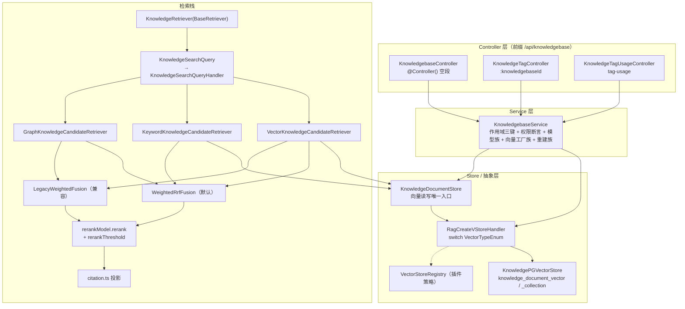

# 知识库·检索·向量存储子专家 · 架构

> 只读梳理。引用均为仓库根相对路径（`file://` 形式）。本子域只覆盖 `packages/server-ai/src/knowledgebase/`（**不含 `wiki/`、`identity/`**）与 `packages/server-ai/src/rag-vstore/`。

**本文引用的文件**

- [knowledgebase/knowledgebase.module.ts](file://packages/server-ai/src/knowledgebase/knowledgebase.module.ts)
- [knowledgebase/knowledgebase.controller.ts](file://packages/server-ai/src/knowledgebase/knowledgebase.controller.ts)
- [knowledgebase/knowledgebase.service.ts](file://packages/server-ai/src/knowledgebase/knowledgebase.service.ts)
- [knowledgebase/knowledgebase.entity.ts](file://packages/server-ai/src/knowledgebase/knowledgebase.entity.ts)
- [knowledgebase/types.ts](file://packages/server-ai/src/knowledgebase/types.ts)
- [knowledgebase/embedding-state.ts](file://packages/server-ai/src/knowledgebase/embedding-state.ts)
- [knowledgebase/vector-store.ts](file://packages/server-ai/src/knowledgebase/vector-store.ts)
- [knowledgebase/retriever.ts](file://packages/server-ai/src/knowledgebase/retriever.ts)
- [knowledgebase/citation.ts](file://packages/server-ai/src/knowledgebase/citation.ts)
- [knowledgebase/knowledgebase-rebuild-embedding.job.ts](file://packages/server-ai/src/knowledgebase/knowledgebase-rebuild-embedding.job.ts)
- [knowledgebase/retrieval/types.ts](file://packages/server-ai/src/knowledgebase/retrieval/types.ts)
- [knowledgebase/retrieval/weighted-rrf.fusion.ts](file://packages/server-ai/src/knowledgebase/retrieval/weighted-rrf.fusion.ts)
- [knowledgebase/retrieval/legacy-weighted.fusion.ts](file://packages/server-ai/src/knowledgebase/retrieval/legacy-weighted.fusion.ts)
- [knowledgebase/retrieval/vector-knowledge-candidate.retriever.ts](file://packages/server-ai/src/knowledgebase/retrieval/vector-knowledge-candidate.retriever.ts)
- [knowledgebase/retrieval/keyword-knowledge-candidate.retriever.ts](file://packages/server-ai/src/knowledgebase/retrieval/keyword-knowledge-candidate.retriever.ts)
- [knowledgebase/retrieval/graph-knowledge-candidate.retriever.ts](file://packages/server-ai/src/knowledgebase/retrieval/graph-knowledge-candidate.retriever.ts)
- [knowledgebase/retrieval/knowledge-keyword-index.service.ts](file://packages/server-ai/src/knowledgebase/retrieval/knowledge-keyword-index.service.ts)
- [knowledgebase/analyzer/keyword-analyzer.service.ts](file://packages/server-ai/src/knowledgebase/analyzer/keyword-analyzer.service.ts)
- [knowledgebase/queries/handlers/knowledge-search.handler.ts](file://packages/server-ai/src/knowledgebase/queries/handlers/knowledge-search.handler.ts)
- [knowledgebase/filter/knowledge-filter.ts](file://packages/server-ai/src/knowledgebase/filter/knowledge-filter.ts)
- [knowledgebase/tenant-library/tenant-library-access.service.ts](file://packages/server-ai/src/knowledgebase/tenant-library/tenant-library-access.service.ts)
- [rag-vstore/vstore.module.ts](file://packages/server-ai/src/rag-vstore/vstore.module.ts)
- [rag-vstore/vector-store-settings.service.ts](file://packages/server-ai/src/rag-vstore/vector-store-settings.service.ts)
- [rag-vstore/commands/handlers/create.handler.ts](file://packages/server-ai/src/rag-vstore/commands/handlers/create.handler.ts)
- [rag-vstore/knowledge-pg-vector.store.ts](file://packages/server-ai/src/rag-vstore/knowledge-pg-vector.store.ts)
- [xpert-workspace/workspace-base.service.ts](file://packages/server-ai/src/xpert-workspace/workspace-base.service.ts)

## 目录

- [1. 子域职责边界](#1-子域职责边界)
- [2. 内部分层](#2-内部分层)
- [3. 依赖关系](#3-依赖关系)
- [4. 关键不变量](#4-关键不变量)
- [5. 架构总览](#5-架构总览)
- [6. 结论](#6-结论)

## 1. 子域职责边界

**做什么**：① 知识库聚合根（`Knowledgebase`）的作用域 CRUD、`permission` 可见性、模型绑定、`metadataSchema` / `recall` / `graphRag` 检索配置；② 检索栈——`KnowledgeRetriever` 门面 + 三类候选召回（向量 / 关键词 / 图谱）+ 双融合策略 + rerank + citation 投影；③ 向量读写唯一入口 `KnowledgeDocumentStore`；④ 向量存储抽象 `rag-vstore`（`RagCreateVStoreHandler` / `VectorStoreRegistry` / `KnowledgePGVectorStore` / `VectorStoreSettingsService`）；⑤ KB 自身的关键词分析器与 FTS/trigram 索引声明；⑥ KB 级 embedding 重建与 collection 切换。

**不做什么**：
- 文档摄取流水线（parse → split → embed → 落库、幂等三元组、删除回收四表）归子专家②，本域只提供 `KnowledgeDocumentStore.addKnowledgeChunks` 与 `assertNotRebuilding` 等被调用面。
- GraphRAG 建图抽取与知识身份归一归子专家③；本域只保留 `GraphKnowledgeCandidateRetriever` 这一召回适配器。
- 知识 Wiki 归子专家④；本域只经由 `@Optional()` 注入的 `KnowledgeWikiSearchScopeService` 做可见性过滤。
- 模型推理本身归 `copilot`：本域只通过 `CopilotModelGetEmbeddingsQuery` / `CopilotModelGetRerankQuery` 取句柄。
- 原文件落盘归 `shared/volume`：经 `KnowledgeWorkAreaResolver`、`VolumeSubtreeClient`、`UploadFileCommand` 调用，不实现存储。

**边界子目录（只列不深挖）**：`tags/`（标签与引用统计）、`faq/`（FAQ 投影与语义预热）、`filter/`（过滤器编译）、`tenant-library/`（跨组织租户库只读边界）、`logs/`（检索日志）、`task/`（KB 任务与 pipeline handoff）、`catalog/`、`runtime/`、`migration/`、`plugins/`、`commands|queries/`、`dto/`。

章节来源：[knowledgebase/knowledgebase.module.ts](file://packages/server-ai/src/knowledgebase/knowledgebase.module.ts)（关键符号：KnowledgebaseModule.providers / controllers）、[knowledgebase/knowledgebase.service.ts](file://packages/server-ai/src/knowledgebase/knowledgebase.service.ts)（关键符号：KnowledgebaseService）、[rag-vstore/vstore.module.ts](file://packages/server-ai/src/rag-vstore/vstore.module.ts)（关键符号：RagVStoreModule.controllers 为空数组）

## 2. 内部分层

- **controller 层**：`KnowledgebaseController`（`@Controller()` 空段 + RouterModule `/knowledgebase`）、`KnowledgeTagController`（`@Controller(':knowledgebaseId')`）、`KnowledgeTagUsageController`（`@Controller('tag-usage')`）、`KnowledgeFAQController`（`@Controller(':knowledgebaseId/faqs')`）。知识库路由前缀 = `api` + `/knowledgebase`。
- **service 层**：`KnowledgebaseService extends XpertWorkspaceBaseService<Knowledgebase>` 是唯一聚合服务，承担作用域 CRUD、权限断言、模型族（`getRerankModel` / `createRerankModel` / `getVisionModel`）、向量工厂族（`getActiveVectorStore` / `getGraphEntityVectorStore` / `getPendingVectorStoreForRebuild` / `createVectorStoreForModel`）、重建族（`startEmbeddingRebuild` / `processEmbeddingRebuildJob` / `promoteEmbeddingRebuild` / `cleanupEmbeddingCollection` / `cancelPendingEmbeddingModel` / `markEmbeddingRebuildFailed`）、结构化过滤候选族（`countStructuredFilterCandidates` / `listStructuredFilterFolderCandidates` / `listStructuredFilterValueCandidates` / `listStructuredGraphEvidence`）。
- **retriever 层**：`KnowledgeRetriever extends BaseRetriever`（Agent 门面，`invoke` / `retrieve` / `retrieveDetailed` / `toTool` / `toFilterOptionsTool` / `toGraphExplorerTool`）→ `KnowledgeSearchQuery` → `KnowledgeSearchQueryHandler` 编排三个 `KnowledgeCandidateRetriever` 实现。
- **fusion 层**：`WeightedRrfFusion`（默认，`fusionMode: 'weighted_rrf'`）与 `LegacyWeightedFusion`（vector+graph 加权），共同实现 `KnowledgeCandidateFusion<TOptions>` 接口。
- **store 层**：`KnowledgeDocumentStore` 是向量读写唯一入口；`KnowledgePGVectorStore extends PGVectorStore` 是其底层 PG 实现。
- **analyzer 层**：`KnowledgeKeywordAnalyzerService`（`options` / `forCreate` / `saveSettings` / `change` / `vector` / `query` / `queryPlan`）+ `KeywordChunkSubscriber` / `KeywordTitleSubscriber` 派生列写入。
- **vector-store 抽象层**：`rag-vstore` 只有服务与 CQRS 处理器，**无 controller**；`RagCreateVStoreHandler` 按 `VectorTypeEnum` 分派。

章节来源：[knowledgebase/retriever.ts](file://packages/server-ai/src/knowledgebase/retriever.ts)（关键符号：KnowledgeRetriever.retrieveDetailed / toTool）、[knowledgebase/queries/handlers/knowledge-search.handler.ts](file://packages/server-ai/src/knowledgebase/queries/handlers/knowledge-search.handler.ts)（关键符号：KnowledgeSearchQueryHandler.searchWithWeightedRrf / finalizeRetrievalResults）、[knowledgebase/vector-store.ts](file://packages/server-ai/src/knowledgebase/vector-store.ts)（关键符号：KnowledgeDocumentStore）

## 3. 依赖关系

**出向（本子域 → 外部）**：
- `copilot`：`CopilotModule`（`forwardRef`）提供 embedding / rerank / chat / vision / wiki 模型解析；本域经 `CopilotModelGetEmbeddingsQuery`、`CopilotModelGetRerankQuery` 取句柄，`getRerankModel` 内显式注释「Resolve the provider server-side; never trust client-supplied copilot credentials or relations.」
- `xpert-workspace`：`XpertWorkspaceBaseService<Knowledgebase>` 提供作用域三键与 `assertWorkspaceWriteAccess`；`XpertWorkspaceModule` 以 `forwardRef` 注入；`WorkspaceAuthoringGuard` 用于工作区只读视图路由。
- `shared/volume`：`KnowledgeWorkAreaResolver` 解析 `tenantId/userId/knowledgebaseId` 工作区，`UploadFileCommand` 写入 `knowledges` catalog，`VolumeSubtreeClient` 读取授权文件。
- `TenantModule`（`TenantLibraryAccessService` 的超管边界）、`UserModule`（重建消费者的 `UserService`）、`IntegrationModule`（外部知识源，`forwardRef`）、`DatabaseModule`（`DataSource`）、`XpertModule`（`forwardRef`，`createPipeline` 建 pipeline）。
- `plugin-sdk`：`VectorStoreRegistry`（插件向量库策略）、`KeywordAnalyzerRegistry`（关键词分析器策略）、`RetrieverRegistry`、`TextSplitterRegistry`、`DocumentTransformerRegistry`、`ImageUnderstandingRegistry`、`DocumentSourceRegistry`、`KnowledgeStrategyRegistry`，以及 `RequestContext`。
- 运行期配置：`@xpert-ai/server-config` 的 `environment.vectorStore`（默认向量库）与 `ConfigService.get<IPGVectorConfig>('pgvector')`、`DATABASE_POOL_TOKEN`。

**入向（外部 → 本子域）**：`copilot-knowledge`、`AIModule`、`XpertModule` 等消费 `KnowledgeRetriever` 与 `KnowledgeSearchQuery`；`view-extension` 经 `KnowledgebaseViewHostDefinition` 挂载视图宿主；`agent-knowledge-writer` / `KnowledgebaseWriterMiddleware` 写 Agent 知识切片。

**队列**：本子域持有 `rebuild-knowledgebase-embedding`（`KnowledgebaseRebuildEmbeddingConsumer`，`@Process({ concurrency: 1 })`）与 `knowledge-faq-semantic-prewarm`（`FAQSemanticPrewarmProcessor`）；`knowledge.pipeline_callback.v1` 走 handoff 处理器 `KnowledgePipelineCallbackProcessor`，非 Bull。

章节来源：[knowledgebase/knowledgebase.module.ts](file://packages/server-ai/src/knowledgebase/knowledgebase.module.ts)（关键符号：KnowledgebaseModule.imports.forwardRef / BullModule.registerQueue）、[knowledgebase/knowledgebase.service.ts](file://packages/server-ai/src/knowledgebase/knowledgebase.service.ts)（关键符号：KnowledgebaseService.createVectorStoreForModel / getRerankModel）、[rag-vstore/commands/handlers/create.handler.ts](file://packages/server-ai/src/rag-vstore/commands/handlers/create.handler.ts)（关键符号：RagCreateVStoreHandler.execute）

## 4. 关键不变量

1. **作用域三键 `tenantId + organizationId + workspaceId`**：`Knowledgebase extends WorkspaceBaseEntity`（基类带 `workspaceId` 索引与 `deletedAt`），唯一约束 `@Index(['tenantId','organizationId','name'], { unique: true })`；租户库是唯一例外——`TenantLibraryAccessService.boundary()` 固定 `{ tenantId, organizationId: IsNull(), workspaceId: IsNull(), permission: Public }`。
2. **`permission` 列管公开可见性**：`Private`（默认）/ `Organization` / `Public`。`findAllAccessible` 把每个客户端 OR 分支展开为「我的 或 组织共享」；`findAllByPublic` 固定 `permission in (Organization, Public)` 且 `createdById ≠ 当前用户`；私有库判定还要求 `workspaceId` 为空。`permission` 是**整库开关**，不是单文档开关。
3. **向量读写只经 `KnowledgeDocumentStore`**：写入（`addKnowledgeDocument` / `addKnowledgeChunks` / `addGraphDocuments` / `updateChunk`）、查询（`similaritySearchWithScore` / `structuredSimilaritySearchWithScore` / `createSearchSession` / `getChunks` / `getChunk`）、删除（`deleteKnowledgeDocument` / `deleteChunk` / `deleteChunks` / `clear`）、rerank（`rerank`）全部收敛于该类。
4. **维度 / 指纹 / collection 三者同源**：`createEmbeddingFingerprint`（provider+model+dimensions+options+providerConfig 的 sha256）→ `createEmbeddingCollectionName(knowledgebaseId, fingerprint)` → `Kb_<id>_<指纹前12位>`；`resolveEmbeddingModelUpdateState` 在已有 collection 且指纹不同时置 `REBUILD_REQUIRED` 并写入 `pending*`。
5. **重建期写阻断**：`assertNotRebuilding` 在 `status === REBUILDING` 时抛 `Embedding rebuild is running`；`assertCurrentRebuildTask(rebuildTaskId, pendingEmbeddingRevision)` 拒绝陈旧任务（`Embedding rebuild task is stale`）。
6. **向量物理 id 与逻辑 chunkId 解耦**：`createCollectionScopedVectorId(collectionName, chunkId) = uuidv5("<collection>:<chunkId>", VECTOR_ID_NAMESPACE)`，保证 active / pending collection 主键不冲突；未配置 `vectorIdCollectionName` 时退化为 chunkId。
7. **`keywordAnalyzer` 由条件 SQL 独占写**：实体列声明 `update: false`（注释「Conditional SQL owns these fields; ORM saves must not restore stale analyzer state.」），只有 `KnowledgeKeywordAnalyzerService.change` 的 `UPDATE ... WHERE keywordAnalyzerLocked = false AND NOT EXISTS(...)` 与 subscriber 的加锁 UPDATE 能写。

章节来源：[knowledgebase/knowledgebase.entity.ts](file://packages/server-ai/src/knowledgebase/knowledgebase.entity.ts)（关键符号：Knowledgebase.@Index unique / permission / keywordAnalyzer / keywordAnalyzerLocked）、[knowledgebase/embedding-state.ts](file://packages/server-ai/src/knowledgebase/embedding-state.ts)（关键符号：createEmbeddingFingerprint / createEmbeddingCollectionName / resolveEmbeddingModelUpdateState）、[knowledgebase/vector-store.ts](file://packages/server-ai/src/knowledgebase/vector-store.ts)（关键符号：createCollectionScopedVectorId / KnowledgeDocumentStore）、[knowledgebase/tenant-library/tenant-library-access.service.ts](file://packages/server-ai/src/knowledgebase/tenant-library/tenant-library-access.service.ts)（关键符号：TenantLibraryAccessService.boundary）

## 5. 架构总览

图表来源：[knowledgebase/knowledgebase.controller.ts](file://packages/server-ai/src/knowledgebase/knowledgebase.controller.ts)（关键符号：KnowledgebaseController）、[knowledgebase/queries/handlers/knowledge-search.handler.ts](file://packages/server-ai/src/knowledgebase/queries/handlers/knowledge-search.handler.ts)（关键符号：KnowledgeSearchQueryHandler.execute / searchWithWeightedRrf / finalizeRetrievalResults）、[knowledgebase/retrieval/weighted-rrf.fusion.ts](file://packages/server-ai/src/knowledgebase/retrieval/weighted-rrf.fusion.ts)（关键符号：WeightedRrfFusion.fuse）、[knowledgebase/retrieval/legacy-weighted.fusion.ts](file://packages/server-ai/src/knowledgebase/retrieval/legacy-weighted.fusion.ts)（关键符号：LegacyWeightedFusion.fuse）、[rag-vstore/commands/handlers/create.handler.ts](file://packages/server-ai/src/rag-vstore/commands/handlers/create.handler.ts)（关键符号：RagCreateVStoreHandler.createPgVectorStore）

章节来源：[knowledgebase/retrieval/types.ts](file://packages/server-ai/src/knowledgebase/retrieval/types.ts)（关键符号：KnowledgeCandidateRetriever / KnowledgeCandidateFusion / KnowledgeRetrieverSource）、[knowledgebase/vector-store.ts](file://packages/server-ai/src/knowledgebase/vector-store.ts)（关键符号：KnowledgeDocumentStore.createSearchSession / structuredSimilaritySearchWithScore）

## 6. 结论

本子域的架构主线是「**一个聚合服务 + 一条可插拔检索链 + 一层向量存储抽象**」。`KnowledgebaseService` 承载了远超典型 CRUD 的职责（作用域、权限、模型、向量工厂、重建、结构化过滤候选），是子域的绝对重心；检索侧用 `KnowledgeCandidateRetriever` / `KnowledgeCandidateFusion` 两个接口把三类召回与两种融合策略解耦，候选批次（`KnowledgeRetrievalBatch`）携带 `failed` / `budgetLimited` / `exhausted` 诊断，使失败语义在融合前就被显式表达；存储侧用 `RagCreateVStoreHandler` 的 `switch` + `VectorStoreRegistry` 兜底，让「内置 PG」与「插件后端」共存。

主要张力有三处：① **抽象可替换 vs 硬编码表名**——`knowledge_document_vector` / `knowledge_document_collection` 写在 handler 内且非 TypeORM 实体，ORM `synchronize` 无法管理其结构；② **默认 RRF vs 遗留加权融合**双轨并存，行为差异只由 `TKBFusionConfig.mode` 控制；③ **重建期的全局写阻断**用先查后写实现，跨副本可见但无锁，幂等最终靠 `rebuildTaskId + pendingEmbeddingRevision`。

章节来源：[knowledgebase/knowledgebase.service.ts](file://packages/server-ai/src/knowledgebase/knowledgebase.service.ts)（关键符号：KnowledgebaseService.assertNotRebuilding / assertCurrentRebuildTask）、[knowledgebase/retrieval/weighted-rrf.fusion.ts](file://packages/server-ai/src/knowledgebase/retrieval/weighted-rrf.fusion.ts)（关键符号：WeightedRrfFusion.fuse）、[knowledgebase/retrieval/legacy-weighted.fusion.ts](file://packages/server-ai/src/knowledgebase/retrieval/legacy-weighted.fusion.ts)（关键符号：LegacyWeightedFusion.fuse）
