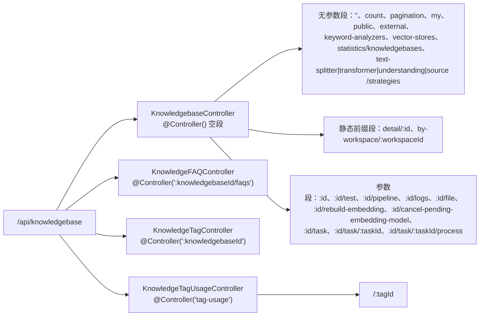

# 知识库·检索·向量存储子专家 · 接口

> 只读梳理。全部路径、守卫与错误文案以源码为准；与既有扫描报告不一致处已在「路由校正」显式更正。

**本文引用的文件**

- [knowledgebase/knowledgebase.controller.ts](file://packages/server-ai/src/knowledgebase/knowledgebase.controller.ts)
- [knowledgebase/knowledgebase.module.ts](file://packages/server-ai/src/knowledgebase/knowledgebase.module.ts)
- [knowledgebase/knowledgebase.service.ts](file://packages/server-ai/src/knowledgebase/knowledgebase.service.ts)
- [knowledgebase/tags/knowledge-tag.controller.ts](file://packages/server-ai/src/knowledgebase/tags/knowledge-tag.controller.ts)
- [knowledgebase/tags/knowledge-tag.service.ts](file://packages/server-ai/src/knowledgebase/tags/knowledge-tag.service.ts)
- [knowledgebase/logs/log.service.ts](file://packages/server-ai/src/knowledgebase/logs/log.service.ts)
- [knowledgebase/logs/log.entity.ts](file://packages/server-ai/src/knowledgebase/logs/log.entity.ts)
- [rag-vstore/vstore.module.ts](file://packages/server-ai/src/rag-vstore/vstore.module.ts)
- [rag-vstore/vector-store-settings.service.ts](file://packages/server-ai/src/rag-vstore/vector-store-settings.service.ts)
- [rag-vstore/commands/handlers/create.handler.ts](file://packages/server-ai/src/rag-vstore/commands/handlers/create.handler.ts)
- [rag-vstore/knowledge-pg-vector.store.ts](file://packages/server-ai/src/rag-vstore/knowledge-pg-vector.store.ts)
- [knowledgebase/queries/handlers/knowledge-search.handler.ts](file://packages/server-ai/src/knowledgebase/queries/handlers/knowledge-search.handler.ts)
- [knowledgebase/retriever.ts](file://packages/server-ai/src/knowledgebase/retriever.ts)
- [knowledgebase/analyzer/keyword-analyzer.service.ts](file://packages/server-ai/src/knowledgebase/analyzer/keyword-analyzer.service.ts)
- [i18n/en.json](file://packages/server-ai/src/i18n/en.json)

## 目录

- [1. 路由总览](#1-路由总览)
- [2. 知识库主控制器端点表](#2-知识库主控制器端点表)
- [3. 标签控制器与 tag-usage](#3-标签控制器与-tag-usage)
- [4. 检索日志端点](#4-检索日志端点)
- [5. rag-vstore：无 controller](#5-rag-vstore无-controller)
- [6. 鉴权实况](#6-鉴权实况)
- [7. 路由校正](#7-路由校正)
- [8. 错误码](#8-错误码)
- [9. 结论](#9-结论)

## 1. 路由总览

最终路径 = 全局前缀 `api` + 模块 `RouterModule.register({ path: '/knowledgebase' })` + `@Controller()` 段。本子域的路由空间如下：

图表来源：[knowledgebase/knowledgebase.controller.ts](file://packages/server-ai/src/knowledgebase/knowledgebase.controller.ts)（关键符号：KnowledgebaseController.@Controller / findAll / findById / uploadFile）、[knowledgebase/knowledgebase.module.ts](file://packages/server-ai/src/knowledgebase/knowledgebase.module.ts)（关键符号：KnowledgebaseModule.controllers / RouterModule.register）

章节来源：[knowledgebase/knowledgebase.module.ts](file://packages/server-ai/src/knowledgebase/knowledgebase.module.ts)（关键符号：KnowledgebaseModule.controllers / RouterModule.register）、[knowledgebase/tags/knowledge-tag.controller.ts](file://packages/server-ai/src/knowledgebase/tags/knowledge-tag.controller.ts)（关键符号：KnowledgeTagUsageController.@Controller('tag-usage')）

## 2. 知识库主控制器端点表

前缀 `/api/knowledgebase`。`KnowledgebaseController extends CrudController<Knowledgebase>`，控制器级 `@UseInterceptors(TransformInterceptor)`。「EDIT」= `@UseGuards(PermissionGuard)` + `@Permissions(AIPermissionsEnum.KNOWLEDGEBASE_EDIT)`。

| 方法 | 路径 | 鉴权 | 用途与关键行为 | 主要错误 |
|---|---|---|---|---|
| GET | `keyword-analyzers` | EDIT | `KnowledgeKeywordAnalyzerService.options(RequestContext.getOrganizationId())` | `Error.KeywordAnalyzerUnavailable` |
| GET | `vector-stores` | EDIT | `VectorStoreSettingsService.options()` | — |
| GET | `` | EDIT | 可访问列表：客户端每个 OR 分支展开为「`createdById=我`」+「`createdById≠我 且 permission=Organization`」；`$relations` 过 `getSafeReadRelations` 白名单 | 403 `Error.KnowledgebaseAccessDenied` |
| GET | `count` | EDIT | 同列表过滤的 `total`（`take:1, skip:0, withDeleted:false`） | 同列表 |
| GET | `pagination` | EDIT | 与 `findAll` 共用 `findAllAccessible` | 同列表 |
| GET | `my` | 无 | 仅 `createdById = 当前用户` | 401 |
| GET | `public` | 无 | `permission in (Organization, Public)` 且 `createdById ≠ 当前用户` | 401 |
| POST | `external` | 无 | `createExternal` 创建外部知识库 | 400 / 唯一键 23505 |
| GET | `detail/:id` | 无 | `KnowledgebaseDetailDTO`（含 `canManage` / `canManageWiki` / `canManageDocumentDeletions`） | 403 |
| GET | `:id` | 无（`UUIDValidationPipe`） | 详情，支持 `$relations` / `$select` | 400 UUID / 403 |
| GET | `text-splitter/strategies`、`transformer/strategies`、`understanding/strategies`、`source/strategies` | 无 | 四个策略注册表发现接口 | — |
| GET | `by-workspace/:workspaceId` | `WorkspaceAuthoringGuard` | 工作区视图，items 转 `KnowledgebasePublicDTO`，可带 `published` | 403 |
| POST | `by-workspace/:workspaceId/preview-chunks` | `WorkspaceAuthoringGuard` | `parserSettings.preview(KnowledgeChunkPreviewInput)` | 400 |
| POST | `:id/test` | 无 | 检索测试：`query` / `k` / `score` / `rerankModel` / `rerankThreshold` / `filters` / `variables` / `retrieval` / `contentScope` | `Error.KnowledgeRerankModelUnavailable` |
| POST | `:id/pipeline` | 无 | `createPipeline`，异常统一包 500 | 500 |
| POST | `:id/rebuild-embedding` | 无 | `startEmbeddingRebuild`，异常统一转 400 | 400 |
| POST | `:id/cancel-pending-embedding-model` | 无 | `cancelPendingEmbeddingModel`，异常统一转 400 | 400 |
| POST | `:id/task` | EDIT | `createTask` | 400 / `Error.KnowledgebaseTaskAccessDenied` |
| GET | `:id/task/:taskId` | 无 | `getTask` | 403 |
| POST | `:id/task/:taskId/process` | EDIT | `processTask`：`sources` / `stage('preview'\|'prod')` / `mode` / `options` | 400 |
| POST | `:id/file` | EDIT + `FileInterceptor('file')` | 内部再 `assertKnowledgebaseTaskWriteAccess` + `assertNotRebuilding`，经 `UploadFileCommand` 写 `knowledges` catalog；返回 `url/filePath/fileUrl/mimeType` | 400 文件名缺失 / 重建中；500 上传非 success |
| GET | `:id/file/:name/preview` | 无 | `previewFile(id, decodeURIComponent(name))` | 403 / 404 |
| GET | `statistics/knowledgebases` | EDIT | `StatisticsKnowledgebasesQuery(start, end)` | — |
| GET | `:id/logs` | 无 | 先 `findOneByIdString(id)` 做作用域校验，再按 `knowledgebaseId` 查检索日志 | 403 |

章节来源：[knowledgebase/knowledgebase.controller.ts](file://packages/server-ai/src/knowledgebase/knowledgebase.controller.ts)（关键符号：KnowledgebaseController.findAllAccessible / findAllByPublic / findAllByMe / rebuildEmbedding / cancelPendingEmbeddingModel / uploadFile / getLogs）、[knowledgebase/knowledgebase.service.ts](file://packages/server-ai/src/knowledgebase/knowledgebase.service.ts)（关键符号：KnowledgebaseService.startEmbeddingRebuild / cancelPendingEmbeddingModel / getSafeReadRelations / findOneByIdString）

## 3. 标签控制器与 tag-usage

| 控制器 | 方法 | 路径 | 鉴权 | 用途 |
|---|---|---|---|---|
| `KnowledgeTagController`（`:knowledgebaseId`） | GET | `/api/knowledgebase/:knowledgebaseId/tags` | 无 | `KnowledgeTagService.list` |
| 同上 | PUT | `/api/knowledgebase/:knowledgebaseId/tags/:tagId` | 无 | `select(knowledgebaseId, tagId)` |
| 同上 | DELETE | `/api/knowledgebase/:knowledgebaseId/tags/:tagId` | 无 | `select(knowledgebaseId, tagId, true)` |
| 同上 | GET | `/api/knowledgebase/:knowledgebaseId/documents/:documentId/tags` | 无 | `documentTags` |
| 同上 | PUT | `/api/knowledgebase/:knowledgebaseId/documents/:documentId/tags/:tagId` | 无 | `setManual(...)` |
| 同上 | DELETE | `/api/knowledgebase/:knowledgebaseId/documents/:documentId/tags/:tagId` | 无 | `setManual(..., true)` |
| `KnowledgeTagUsageController`（`tag-usage`） | GET | `/api/knowledgebase/tag-usage/:tagId?skip=` | 无 | `KnowledgeTagService.usage(tagId, skip)` |

两控制器均为 `@ApiTags('KnowledgeTags')` + `@ApiBearerAuth()`，**无任何 `@UseGuards` / `@Permissions`**；全部参数走 `UUIDValidationPipe`，`skip` 经 `DefaultValuePipe(0)` + `ParseIntPipe`（非整数 → 400）。授权实况取决于 `KnowledgeTagService` 内部断言（本子域只列边界，不展开）。

章节来源：[knowledgebase/tags/knowledge-tag.controller.ts](file://packages/server-ai/src/knowledgebase/tags/knowledge-tag.controller.ts)（关键符号：KnowledgeTagController.list / select / setManual / documentTags、KnowledgeTagUsageController.usage）

## 4. 检索日志端点

本子域**没有独立的检索日志控制器**。日志只有一条 HTTP 出口：`GET /api/knowledgebase/:id/logs`（见 §2），其实现为「先 `this.service.findOneByIdString(id)` 做作用域与可见性校验，再用 `KnowledgeRetrievalLogService.findAll({ where: { knowledgebaseId: id, ... } })` 分页」，`data` 查询参数经 `ParseJsonPipe`，条件经 `transformWhere`。

日志写入侧无 HTTP 面：`KnowledgeSearchQueryHandler.execute` 在每次检索后调 `KnowledgeRetrievalLogService.create({...})` 写 `knowledge_retrieval_log` 表（`KnowledgeRetrievalLog extends TenantOrganizationBaseEntity`），字段含 `filterVersion` / `fixedFilter` / `dynamicFilter` / `requestFilter` / `effectiveFilter` / `filterHash` / `filterStatus` / `fallbackReason` / `errorCode` / `candidateDocumentCount` / `candidateChunkCount` / `vectorBackend` / `filterLatency` / `vectorLatency` / `diagnostics`。检索日志服务本身只有 `create` / `findAll`（继承 `TenantOrganizationAwareCrudService`），无自定义路由。

章节来源：[knowledgebase/knowledgebase.controller.ts](file://packages/server-ai/src/knowledgebase/knowledgebase.controller.ts)（关键符号：KnowledgebaseController.getLogs）、[knowledgebase/logs/log.service.ts](file://packages/server-ai/src/knowledgebase/logs/log.service.ts)（关键符号：KnowledgeRetrievalLogService）、[knowledgebase/logs/log.entity.ts](file://packages/server-ai/src/knowledgebase/logs/log.entity.ts)（关键符号：KnowledgeRetrievalLog / 表 knowledge_retrieval_log）、[knowledgebase/queries/handlers/knowledge-search.handler.ts](file://packages/server-ai/src/knowledgebase/queries/handlers/knowledge-search.handler.ts)（关键符号：KnowledgeSearchQueryHandler.execute）

## 5. rag-vstore：无 controller

`RagVStoreModule` 的 `controllers` 是**空数组**，本子域的向量存储抽象层**没有任何 HTTP 端点**。它的对外面全部是进程内契约：

- **CQRS 命令**：`RagCreateVStoreCommand(embeddings, { collectionName, vectorStore })`（`static type = '[Rag VStore] Create'`）→ `RagCreateVStoreHandler.execute`。
- **服务**：`VectorStoreSettingsService.options()` / `forCreate()` / `assertUnchanged()` —— 唯一的对外服务导出（`RagVStoreModule.exports: [VectorStoreSettingsService]`），被 `KnowledgebaseController.vectorStores()` 与 `KnowledgebaseService.create/updateKnowledgebase` 消费，因此**其能力通过 `/api/knowledgebase/vector-stores` 间接暴露**，而没有自己的前缀。
- **存储实现**：`KnowledgePGVectorStore` 是 `PGVectorStore` 子类，只被 handler 与 `KnowledgebaseService.createVectorStoreForModel` 间接使用。
- **索引导出**：`rag-vstore/index.ts` 仅 `export * from './vstore.module'` 与 `./commands/index`。

表格版（本层端点清单）：

| 层 | 是否有 HTTP 端点 | 说明 |
|---|---|---|
| `RagVStoreModule` | 否 | `controllers: []` |
| `VectorStoreSettingsService` | 否（借 `/api/knowledgebase/vector-stores` 间接暴露） | `GET vector-stores` 由 `KnowledgebaseController` 提供 |
| `RagCreateVStoreHandler` | 否 | 纯 CQRS 命令处理器 |
| `KnowledgePGVectorStore` | 否 | LangChain `VectorStore` 实现 |

章节来源：[rag-vstore/vstore.module.ts](file://packages/server-ai/src/rag-vstore/vstore.module.ts)（关键符号：RagVStoreModule.controllers / exports）、[rag-vstore/vector-store-settings.service.ts](file://packages/server-ai/src/rag-vstore/vector-store-settings.service.ts)（关键符号：VectorStoreSettingsService.options / forCreate / assertUnchanged）、[rag-vstore/commands/handlers/create.handler.ts](file://packages/server-ai/src/rag-vstore/commands/handlers/create.handler.ts)（关键符号：RagCreateVStoreHandler.execute）、[rag-vstore/knowledge-pg-vector.store.ts](file://packages/server-ai/src/rag-vstore/knowledge-pg-vector.store.ts)（关键符号：KnowledgePGVectorStore）

## 6. 鉴权实况

**结论：本子域只有 `KnowledgebaseController` 携带声明式守卫，其余三个控制器（`KnowledgeTagController` / `KnowledgeTagUsageController`）完全无 `@UseGuards`。** 逐条源码事实：

1. **带 `PermissionGuard` + `@Permissions(AIPermissionsEnum.KNOWLEDGEBASE_EDIT)` 的 9 个路由**（全在 `KnowledgebaseController`）：`GET keyword-analyzers`、`GET vector-stores`、`GET ''`、`GET count`、`GET pagination`、`POST :id/task`、`POST :id/task/:taskId/process`、`POST :id/file`、`GET statistics/knowledgebases`。
2. **带 `WorkspaceAuthoringGuard` 的 2 个路由**：`GET by-workspace/:workspaceId`、`POST by-workspace/:workspaceId/preview-chunks`。
3. **零守卫的路由**：`:id`、`detail/:id`、`my`、`public`、`external`、`test`、`:id/pipeline`、`:id/rebuild-embedding`、`:id/cancel-pending-embedding-model`、`:id/task/:taskId`、`:id/file/:name/preview`、`:id/logs`，以及 `tags`/`tag-usage` 全部路由。
4. **兜底鉴权**：全应用 `useGlobalGuards(new AuthGuard(reflector), new PluginScopeGuard(reflector))` 保证「已认证」；`setGlobalPrefix('api')` 定义前缀。因此「无 `@UseGuards`」≠「无鉴权」，只表示**不做声明式权限校验**。
5. **service 层断言是真正的授权边界**：`KnowledgebaseService.assertKnowledgebaseWriteAccess` / `assertKnowledgebaseTaskWriteAccess`（两者共用 `assertKnowledgebaseWriteAccessWithError`，区别只在抛出的 i18n 键是 `Error.KnowledgebaseAccessDenied` 还是 `Error.KnowledgebaseTaskAccessDenied`）、`assertKnowledgebaseTaskReadAccess`（private）、`assertKnowledgebaseCrudReadAccess`（private，由 `findOneByIdString` 调用）、`canManageKnowledgebase`（try/catch 折 `false`）；租户库短路由 `assertTenantLibraryAdministrator`（超管 + 租户 scope，`Error.TenantLibraryAdminRequired` / `Error.TenantLibraryScopeRequired`）。
6. **`$relations` 白名单**：`getSafeReadRelations` 对越界 relation 抛 `knowledgebaseAccessDenied()`；列表接口对客户端 OR 分支逐个套上「我的 或 组织共享」，防止用 `where` 越权查询。
7. **`permission` 是可见性开关**：`/public` 固定 `permission in (Organization, Public)` 且排除自己创建的；`Private` 不出现在任何共享列表里。

章节来源：[knowledgebase/knowledgebase.controller.ts](file://packages/server-ai/src/knowledgebase/knowledgebase.controller.ts)（关键符号：KnowledgebaseController.findAllAccessible / uploadFile / @UseGuards(PermissionGuard)）、[knowledgebase/knowledgebase.service.ts](file://packages/server-ai/src/knowledgebase/knowledgebase.service.ts)（关键符号：KnowledgebaseService.assertKnowledgebaseWriteAccessWithError / assertKnowledgebaseTaskReadAccess / canManageKnowledgebase / getSafeReadRelations）、[knowledgebase/tags/knowledge-tag.controller.ts](file://packages/server-ai/src/knowledgebase/tags/knowledge-tag.controller.ts)（关键符号：KnowledgeTagUsageController）

## 7. 路由校正

1. **`/api/:knowledgebaseId` 不准确**：`:knowledgebaseId` 从不是顶层段。真实形态是固定段 `/api/knowledgebase` + 子控制器参数段，即 `/api/knowledgebase/:knowledgebaseId/tags`、`/api/knowledgebase/:knowledgebaseId/documents/:documentId/tags`。
2. **`tag-usage` 的路径与遮蔽风险**：源码是 `@Controller('tag-usage')` + `@Get(':tagId')`，即 **`/api/knowledgebase/tag-usage/:tagId`（两段）**，与 `KnowledgebaseController` 的 `@Get(':id')`（一段）**不冲突**。风险只存在于**非法的单段路径** `/api/knowledgebase/tag-usage`（不带 tagId）：`KnowledgebaseModule.controllers` 顺序为 `[KnowledgebaseController, KnowledgeFAQController, KnowledgeTagController, KnowledgeTagUsageController]`，`KnowledgebaseController` 的 `:id` 通配先注册，该请求会落进 `:id` 并被 `UUIDValidationPipe` 拒为 400 —— 但该路径本就不是合法端点。
3. **`getRerankModel` 不是端点**：它是 `KnowledgebaseService` 的方法（签名 `getRerankModel(knowledgebaseId, modelContext?, requestedModel?)`）；接口层唯一出现处是 `POST :id/test` 请求体里的 `rerankModel`。
4. **重建相关端点的错误包装**：`:id/rebuild-embedding` 与 `:id/cancel-pending-embedding-model` 都在控制器内 `try/catch` 并统一 `new BadRequestException(getErrorMessage(err))`，因此 service 抛的 `BadRequestException('Embedding rebuild is already running')` 等文案会原样透出为 400。
5. **`statistics/knowledgebases` 是单段静态路由但带 EDIT 守卫**，与同控制器的 `:id` 竞争「单段」位置——它靠注册顺序（在 `:id` 之后定义，但为静态匹配）先命中；新增单段静态路由时应格外注意注册位置。
6. **本子域无其它前缀**：`faq` 与 `wiki` 控制器虽在 `KnowledgebaseModule` 内注册（FAQ）或同前缀挂载（Wiki），但 FAQ/Wiki 归对应子链，本文不展开。

章节来源：[knowledgebase/knowledgebase.module.ts](file://packages/server-ai/src/knowledgebase/knowledgebase.module.ts)（关键符号：KnowledgebaseModule.controllers）、[knowledgebase/tags/knowledge-tag.controller.ts](file://packages/server-ai/src/knowledgebase/tags/knowledge-tag.controller.ts)（关键符号：KnowledgeTagUsageController.@Get(':tagId')）、[knowledgebase/knowledgebase.controller.ts](file://packages/server-ai/src/knowledgebase/knowledgebase.controller.ts)（关键符号：KnowledgebaseController.getStatisticsKnowledgebases / rebuildEmbedding / findById）

## 8. 错误码

优先给 i18n key（命名空间 `server-ai:Error.*`，除注明者外均可在 `i18n/en.json` 命中）与异常类；无 i18n key 的按源码原样给出。

| 场景 | 异常类 / 状态 | i18n key 或原文 |
|---|---|---|
| 知识库读/写越权 | `ForbiddenException` 403 | `Error.KnowledgebaseAccessDenied` |
| 知识库任务越权 | `ForbiddenException` 403 | `Error.KnowledgebaseTaskAccessDenied` |
| 越界 `$relations` | `ForbiddenException` 403 | `Error.KnowledgebaseAccessDenied`（`getSafeReadRelations`） |
| 租户库管理权限不足 | `ForbiddenException` 403 | `Error.TenantLibraryAdminRequired` / `Error.TenantLibraryScopeRequired` |
| 非法 UUID / skip 非整数 | Nest 400 | `UUIDValidationPipe` / `ParseIntPipe` |
| embedding 重建进行中 / 已在跑 / 任务过期 / 状态不允许 / 缺 pending 模型 | `BadRequestException` 400 | `Embedding rebuild is running`、`Embedding rebuild is already running`、`Embedding rebuild task is stale`、`Embedding rebuild cannot start from status '<x>'`、`Pending embedding model is required for rebuild` |
| 换模型缺 copilotModel | `BadRequestException` 400 | `copilotModel is required when changing embedding model` |
| rerank 模型不可用 | `AiModelNotFoundException` | `Error.KnowledgeRerankModelUnavailable` |
| rerank 模型入参非法 | `BadRequestException` 400 | `A rerank model and its copilot are required.` |
| embedding 模型缺失 | `CopilotModelNotFoundException` / `CopilotNotFoundException` / `AiModelNotFoundException` | `rag.Error.KnowledgebaseNoModel`、`Copilot not set for knowledgebase '<name>'`、`Embeddings model '<m>' not found for knowledgebase '<name>'` |
| 向量库不可用 / 创建后不可改 | `BadRequestException` 400 | `Error.KnowledgeVectorStoreUnavailable`、`Error.KnowledgeVectorStoreImmutable` |
| 未安装的向量库类型 | `InternalServerErrorException` 500 | `xpert.Error.UnsupportedVectorStore`（该键在 `i18n/en.json` 中未命中，实际返回键名） |
| 向量与标识数量不一致 / 跨 collection 冲突 | `Error` | `Error.KnowledgebaseVectorBatchInvalid`、`Error.KnowledgebaseVectorCollectionConflict` |
| 结构化过滤后端不支持 | `BadRequestException` / `Error` | `Vector store '<type>' does not support knowledge filter v2.` / `Error.KnowledgeSourceVectorFilterUnsupported` |
| contentScope 后端不支持 | `BadRequestException` 400 | `Error.KnowledgeContentScopeBackendUnsupported` |
| 候选 rank 缺失 | `InternalServerErrorException` 500 | `Error.KnowledgeCandidateRankMissing` |
| RRF 权重/rankConstant/批次异常 | `RangeError` / `Error` / `BadRequestException` | `Error.RrfWeightInvalid`、`Error.RrfPositiveWeightRequired`、`Error.RrfRankConstantInvalid`、`Error.RrfWeightMissing`、`Error.RrfBatchSourceDuplicate`、`Error.RrfBatchFailed`、`Error.RrfCandidateRankInvalid` |
| 关键词检索/索引非 PG | `BadRequestException` 400 | `Error.KeywordRetrievalPostgresRequired`、`Error.KeywordIndexPostgresRequired` |
| 关键词分析器不可用 / 已锁定 / 外部库 / 版本不符 | `BadRequestException` 400 | `Error.KeywordAnalyzerUnavailable`、`Error.KeywordAnalyzerLocked`（`The keyword analyzer cannot be changed after documents have been added.`）、`Error.KeywordAnalyzerExternal`、`Error.KeywordAnalyzerRevisionMismatch`、`Error.KeywordAnalyzerInvalid` |
| 名称唯一冲突 | `BadRequestException` 400 | `xpert.Error.NameExists`（由 23505 / 1062 / `duplicate key` 翻译） |
| pipeline / 上传失败 | `InternalServerErrorException` 500 | `getErrorMessage(err)`、`Failed to upload knowledgebase file`、`File name is required` |
| 检索失败诊断 | 落库而非 HTTP | `KnowledgeRetrievalFailure(source, errorCode, diagnostics, message)`；`resolveRetrievalBatchErrorCode` 产出 `keyword_index_missing` / `keyword_query_failed` / `graph_search_failed` / `unsupported_backend` / `rerank_failed` |

章节来源：[i18n/en.json](file://packages/server-ai/src/i18n/en.json)（关键符号：Error.KnowledgebaseAccessDenied / Error.KnowledgeVectorStoreImmutable / Error.KeywordAnalyzerLocked / Error.RrfPositiveWeightRequired）、[knowledgebase/knowledgebase.service.ts](file://packages/server-ai/src/knowledgebase/knowledgebase.service.ts)（关键符号：KnowledgebaseService.getQueryFailedErrorCode / assertNotRebuilding）、[rag-vstore/commands/handlers/create.handler.ts](file://packages/server-ai/src/rag-vstore/commands/handlers/create.handler.ts)（关键符号：RagCreateVStoreHandler.execute / xpert.Error.UnsupportedVectorStore）、[knowledgebase/queries/handlers/knowledge-search.handler.ts](file://packages/server-ai/src/knowledgebase/queries/handlers/knowledge-search.handler.ts)（关键符号：KnowledgeSearchQueryHandler.resolveRetrievalBatchErrorCode / validateRrfWeights）

## 9. 结论

本子域的接口面高度集中在 `KnowledgebaseController`（24 条路由）与 `KnowledgeTagController` / `KnowledgeTagUsageController`（7 条路由），`rag-vstore` 不暴露任何 HTTP 端点。鉴权形态是「**全局 `AuthGuard` 保证认证 + 9 条 EDIT 路由 + 2 条工作区守卫 + service 断言兜底**」，越权防线实际落在 `KnowledgebaseService` 的断言与 `permission` 列上；`$relations` 白名单与「客户端 OR 分支逐个加约束」是两个容易被忽略但很关键的防越权细节。路由校正如 §7：`tag-usage` 实为两段路径、`/api/:knowledgebaseId` 的写法不成立。

章节来源：[knowledgebase/knowledgebase.controller.ts](file://packages/server-ai/src/knowledgebase/knowledgebase.controller.ts)（关键符号：KnowledgebaseController）、[knowledgebase/knowledgebase.service.ts](file://packages/server-ai/src/knowledgebase/knowledgebase.service.ts)（关键符号：KnowledgebaseService.assertKnowledgebaseWriteAccess / canManageKnowledgebase）、[rag-vstore/vstore.module.ts](file://packages/server-ai/src/rag-vstore/vstore.module.ts)（关键符号：RagVStoreModule.controllers）
