# C4 数据流向与消费：租户与平台设置专家（契约层）

> 只描述数据用途与「谁写、谁读」，不描述消费方的处理逻辑。
> 覆盖清单逐表列出 9 张：`tenant`、`tenant_setting`、`feature`、`feature_organization`、`referral_code`、`referral_relation`、`custom_smtp`、`email_template`、`email_sent`（以 [04-模型.md](file://.module-experts/后端专题/租户与平台设置专家/04-模型.md) 表清单为准）。
> 消费方来自实体名反向扫描；多于 3 个消费方时按模块归纳并标注。

**本文引用的文件**
- [tenant.entity.ts](file://packages/server/src/tenant/tenant.entity.ts)
- [tenant-setting.entity.ts](file://packages/server/src/tenant/tenant-setting/tenant-setting.entity.ts)
- [feature.entity.ts](file://packages/server/src/feature/feature.entity.ts)
- [feature-organization.entity.ts](file://packages/server/src/feature/feature-organization.entity.ts)
- [referral-code.entity.ts](file://packages/server/src/referral/referral-code.entity.ts)
- [referral-relation.entity.ts](file://packages/server/src/referral/referral-relation.entity.ts)
- [custom-smtp.entity.ts](file://packages/server/src/custom-smtp/custom-smtp.entity.ts)
- [email-template.entity.ts](file://packages/server/src/email-template/email-template.entity.ts)
- [email.entity.ts](file://packages/server/src/email/email.entity.ts)
- [04-模型.md](file://.module-experts/后端专题/租户与平台设置专家/04-模型.md)、[03-数据流转.md](file://.module-experts/后端专题/租户与平台设置专家/03-数据流转.md)

## 总览

```mermaid
flowchart LR
  subgraph W[写入入口]
    A1["/api/tenant · /tenant/onboard · tenant CLI/seed"]
    A2["/api/tenant-setting"]
    A3["/api/feature/toggle · /feature/upgrade"]
    A4["/api/referral/me · 注册时 bindRegistration"]
    A5["/api/smtp"]
    A6["/api/email-template · seed · tenant.created"]
    A7["EmailService.send* → createEmailRecord"]
  end
  subgraph T[表]
    T1[tenant / tenant_setting]
    T2[feature / feature_organization]
    T3[referral_code / referral_relation]
    T4[custom_smtp / email_template / email_sent]
  end
  subgraph R[主要消费方]
    R1["auth · user · organization · role · invite · ~21 个模块"]
    R2["TenantSettingsMiddleware（全站请求）· server-ai 侧 membership / model-gateway / model-execution / agent-plugin"]
    R3["user（feature 上下文）· referral · server-ai membership / xpert-project / model-access"]
    R4["referral（校验与关系）· auth（注册绑定）"]
    R5["email（三级 SMTP 回退 + 模板渲染）· email-template"]
  end
  W --> T --> R
```

图表来源：[tenant-settings.middleware.ts](file://packages/server/src/tenant/tenant-setting/tenant-settings.middleware.ts)（关键符号：TenantSettingsMiddleware.use）、[feature-organization.service.ts](file://packages/server/src/feature/feature-organization.service.ts)（关键符号：updateFeatureOrganization）、[email.service.ts](file://packages/server/src/email/email.service.ts)（关键符号：getEmailInstance）

## 逐表数据实体

### 1. `tenant`
- 实体类型：租户主表（`Tenant extends BaseEntity`，`@Entity('tenant')`）。
- 结构：`name`（`@IsNotEmpty` + 单列索引）、`subdomain`（**唯一索引**，可空，由 `normalizeTenantSubdomain` 规范化）；关联 `organizations` / `rolePermissions` / `featureOrganizations` / `settings` / `importRecords` 五组 `cascade: true`。
- 生产方：`TenantService.create` / `onboardTenant`、`TenantController` 的 PUT / DELETE、`tenant.seed`（`createDefaultTenant` / `createRandomTenants`）、租户管理 CLI。
- 主要消费方（约 21 个 Nest 模块）：`user`、`role`、`role-permission`、`organization`、`organization-language`、`auth`、`api-key`、`invite`、`employee`、`contact`、`tags`、`user-organization`、`organization-contact`、`integration`、`storage-file` / `data-source`、`feature`、`tenant-setting`、`file-file-storage`（`forwardRef`）、匿名租户解析中间件，以及 server-ai 侧的持久化用例 [基于引用扫描，未深入验证]。
- 业务用途一句话：多租户隔离与级联删除的锚点，也是子域匿名解析与注册期租户归属的依据。
- 详细流向：本文件 §租户生命周期类；创建链路见 [C2-使用流程.md](file://.module-experts/后端专题/租户与平台设置专家/contracts/C2-使用流程.md) Recipe 1。

### 2. `tenant_setting`
- 实体类型：租户级键值设置（`TenantSetting extends TenantBaseEntity`）。
- 结构：`name`（非空）、`value`（可空）、继承的 `tenantId`（索引，CASCADE）；**无 `(tenantId, name)` 唯一约束**。
- 生产方：`TenantSettingService.saveSettngs`（`POST /tenant-setting`）、`onboardTenant` 写 `fileStorageProvider=LOCAL`、`tenant-setting.seed`。
- 主要消费方（>3，归纳）：① 全站请求路径 `TenantSettingsMiddleware`（`request['tenantSettings']`，如 `FileStorage.setProvider`）；② `plugin/setup` 插件装配；③ server-ai 侧 `membership`（积分/兑换率设置）、`model-gateway`（准入限流与调用保留策略）、`model-execution`（执行策略）、`agent-plugin`（默认插件与更新状态）[基于引用扫描，未深入验证]。
- 业务用途一句话：以 key 为粒度的租户开关式配置；无唯一约束意味着它是「最后写入者胜出 + 可能重复行」的表。
- 详细流向：本文件 §配置类；请求级缓存窗口见 [C2-使用流程.md](file://.module-experts/后端专题/租户与平台设置专家/contracts/C2-使用流程.md) Recipe 2。

### 3. `feature`
- 实体类型：功能开关定义（`Feature extends BaseEntity`）。
- 结构：`name`、`code`（复合唯一索引 `(name, code)`，二者各带单列索引）、`isPaid`（默认 `false`）、`parentId`（自关联，`onDelete: CASCADE`）、`link` / `status` / `icon`。
- 生产方：`FeatureService.seedDB` / `syncFeatureDefinition`、`FeatureBulkCreateCommand`（首租户自举）、`feature.seed`；`purgeRetiredFeatures` 在启动期同一事务内先删 toggle 再删 feature。
- 主要消费方（>3，归纳）：`feature`、`feature-organization`、`user`（用户态 feature 上下文）、`tenant`（onboarding 建 toggle）、seed/CLI，以及 server-ai 侧 `xpert-project`（项目 feature 守卫）与 `model-access` [基于引用扫描，未深入验证]。
- 业务用途一句话：开关的「名词表」，同时承载父子分组（父级只作展示，不建 toggle）。
- 详细流向：本文件 §开关定义类；退役码语义见 [C5-关键决策.md](file://.module-experts/后端专题/租户与平台设置专家/contracts/C5-关键决策.md) D3。

### 4. `feature_organization`
- 实体类型：开关实例（`FeatureOrganization extends TenantOrganizationBaseEntity`）。
- 结构：`isEnabled`（非空，默认 `true`）、`featureId`（非空 + 索引，指向 `feature` CASCADE）、继承的 `tenantId`（索引，可空）与 `organizationId`（索引，可空）；**无 `(tenantId, organizationId, featureId)` 唯一约束**。
- 生产方：`FeatureOrganizationService.updateFeatureOrganization`（单点写入）、`updateTenantFeatureOrganizations`（新租户叶子 toggle 初始化）、`feature.seed`（`createDefaultFeatureToggle`）、`purgeRetiredFeatures`（删除）。
- 主要消费方（>3，归纳）：`user`（用户态 feature 上下文组装）、`referral`（`isFeatureEnabled` 直查租户级行）、server-ai 侧 `membership`（计划开关触发补数）、`xpert-project`（项目 feature 守卫）、`model-access`（模型准入）[基于引用扫描，未深入验证]。
- 业务用途一句话：开关判定结果的唯一数据源，`organizationId IS NULL` 即租户默认值，非空即组织级覆盖。
- 详细流向：本文件 §开关判定类；写入与失效见 [C2-使用流程.md](file://.module-experts/后端专题/租户与平台设置专家/contracts/C2-使用流程.md) Recipe 3。

### 5. `referral_code`
- 实体类型：用户邀请码（`ReferralCode extends TenantBaseEntity`）。
- 结构：`code`（`varchar(10)`，非空）、`userId`（可空，`onDelete: SET NULL`）；唯一索引 `UQ_referral_code_tenant_code (tenantId, code)` 与 `UQ_referral_code_tenant_user (tenantId, userId)`，另有 DB CHECK `CHK_referral_code_uppercase` 与 `CHK_referral_code_format`（`^[23456789ABCDEFGHJKLMNPQRSTUVWXYZ]{10}$`）。
- 生产方：`ReferralCodeSubscriber`（`User.afterInsert` 自动发码）、`ensureReferralCode` / `regenerateReferralCode`（经 `/referral/me` 与 `/referral/me/regenerate`）。
- 主要消费方（3 个模块）：`referral`（公开校验的内联 join、我的码视图）、`auth`（注册请求携带 `referralCode`）、contracts（对外视图模型）。
- 业务用途一句话：一人一码的邀请凭据载体，语义由「租户 + 用户」两条唯一索引与正则 CHECK 共同锁定。
- 详细流向：本文件 §返利类；生成与核对见 [C2-使用流程.md](file://.module-experts/后端专题/租户与平台设置专家/contracts/C2-使用流程.md) Recipe 4。

### 6. `referral_relation`
- 实体类型：返利关系（`ReferralRelation extends TenantBaseEntity`）。
- 结构：`referrerUserId` / `referredUserId`（可空，`onDelete: SET NULL`）、`usedCode`（`varchar(10)`，非空）、`boundAt`；唯一索引 `UQ_referral_relation_tenant_referred_user (tenantId, referredUserId)` + 普通索引 `(tenantId, referrerUserId)`。
- 生产方：`ReferralService.bindRegistration`（在调用方注册事务的 `EntityManager` 上写，幂等：已存在即返回）。
- 主要消费方（2 个模块）：`referral`（关系分页与软删占位视图）、`auth`（注册链的唯一调用点）。
- 业务用途一句话：记录「谁邀请了谁」，被邀请人在租户内只允许一条，是返利结算的事实表。
- 详细流向：本文件 §返利类；绑定语义见 [C5-关键决策.md](file://.module-experts/后端专题/租户与平台设置专家/contracts/C5-关键决策.md) D8。

### 7. `custom_smtp`
- 实体类型：出站邮件配置（`CustomSmtp extends TenantOrganizationBaseEntity`）。
- 结构：`host`、`port`、`secure`、`username` / `password`（均 `@IsNotEmpty` 且 `@Exclude({ toPlainOnly: true })`，出参以打码 `secretKey/secretPassword` 暴露）、`fromAddress`（`@IsEmail`，缺省回落 `service@xpertai.cn`）、`isValidate`（默认 `false`，发送路径不读它）；**无唯一约束**，同作用域多条按 `createdAt DESC` 取最新。
- 生产方：`CustomSmtpController` 的 `POST /smtp` / `PUT /smtp/:id` 对应的 `CustomSmtpCreateCommand` / `CustomSmtpUpdateCommand`，以及继承的 CRUD 入口。
- 主要消费方（2 个模块）：`email`（`getEmailInstance` 三级回退取用）、`custom-smtp`（`GET /smtp/setting`、`POST /smtp/validate`）。
- 业务用途一句话：把「用谁的邮箱发信」表达成可继承的两级配置（组织覆盖 → 租户默认 → 环境默认）。
- 详细流向：本文件 §通知类；回退链见 [C2-使用流程.md](file://.module-experts/后端专题/租户与平台设置专家/contracts/C2-使用流程.md) Recipe 5。

### 8. `email_template`
- 实体类型：邮件模板（`EmailTemplate extends TenantOrganizationBaseEntity`）。
- 结构：`name`（非空，形如 `invite-user/html`）、`languageCode`（非空）、`mjml`（text，可空）、`hbs`（非空，渲染用）；`name` / `languageCode` 各有单列索引，**无唯一约束**；`organizationId IS NULL` 表示租户/平台级模板。
- 生产方：`createDefaultEmailTemplates`（seed 与 `tenant.created` 事件播种）、`EmailTemplateSaveCommand`（`POST /email-template/template/save`）、`EmailTemplateController` 的 PUT / DELETE。
- 主要消费方（2 个模块）：`email`（`render` 四级回退取模板、`createEmailRecord` 反查主题）、`email-template`（查询与预览端点）。
- 业务用途一句话：模板内容的唯一来源，`name + languageCode + scope` 三元组决定一次渲染命中哪一行。
- 详细流向：本文件 §通知类；目录约定与 seed 见 [C5-关键决策.md](file://.module-experts/后端专题/租户与平台设置专家/contracts/C5-关键决策.md) D10。

### 9. `email_sent`
- 实体类型：发送记录（实体类名 `Email`，`@Entity('email_sent')`，`extends TenantOrganizationBaseEntity`）。
- 结构：`name`（非空，取信主题）、`content`（非空）、`email`（非空）、`isArchived`、`userId`（索引）、`emailTemplateId`（**非空外键**，指向 `email_template` CASCADE）；无唯一约束、**无发送状态列**。
- 生产方：`EmailService.createEmailRecord`（所有 `send*` 方法在成功与失败路径都会调用，`sendOptions` 见 `welcomeUser` / `sendVerifyEmailMail` / `requestPassword` / `inviteUser` / `sendAcceptInvitationEmail`）、`email.seed`（演示数据）、`EmailController` 的 `PUT /email/:id` 与继承 CRUD。
- 主要消费方（1 个模块）：`email`（列表 / 详情 / 更新 / 删除端点）。
- 业务用途一句话：发送历史与审计视图；失败记录与成功记录外形一致（失败时内容为空），因此不能作为可靠投递凭据。
- 详细流向：本文件 §通知类；静默失败与错配风险见 [C2-使用流程.md](file://.module-experts/后端专题/租户与平台设置专家/contracts/C2-使用流程.md) Recipe 7。

## 数据类分组小结
- **租户生命周期类**：`tenant` 是入口；`tenant_setting` 为其配置附属表，`created` 即生效（无状态列）。
- **配置类**：`tenant_setting`（键值、纯 TTL 缓存、无唯一约束）与 `custom_smtp` / `email_template`（作用域可继承）共同表达「租户默认 + 组织覆盖」。
- **开关定义与判定类**：`feature`（定义，含墓碑与父子分组）→ `feature_organization`（判定结果，唯一数据源）。
- **返利类**：`referral_code`（一人一码）→ `referral_relation`（一人一条关系）；两者都以租户为边界，用户被物理删除后关系行保留但主体为空。
- **通知类**：`custom_smtp` → `email_template` → `email_sent` 构成「配置 → 模板 → 记录」三段链，读侧均带多级回退。
