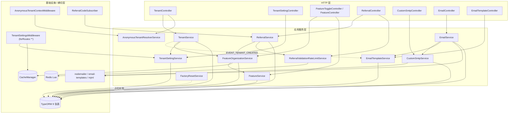

# 租户与平台设置（Tenant & Platform Settings）架构

**本文引用的文件**
- [tenant.controller.ts](file://packages/server/src/tenant/tenant.controller.ts)
- [tenant.service.ts](file://packages/server/src/tenant/tenant.service.ts)
- [tenant.module.ts](file://packages/server/src/tenant/tenant.module.ts)
- [tenant.entity.ts](file://packages/server/src/tenant/tenant.entity.ts)
- [anonymous-tenant-resolver.service.ts](file://packages/server/src/tenant/anonymous-tenant-resolver.service.ts)
- [tenant-setting.service.ts](file://packages/server/src/tenant/tenant-setting/tenant-setting.service.ts)
- [tenant-setting.module.ts](file://packages/server/src/tenant/tenant-setting/tenant-setting.module.ts)
- [tenant-settings.middleware.ts](file://packages/server/src/tenant/tenant-setting/tenant-settings.middleware.ts)
- [get-default.handler.ts](file://packages/server/src/tenant/queries/handlers/get-default.handler.ts)
- [tenant-feature-organization.create.handler.ts](file://packages/server/src/tenant/commands/handlers/tenant-feature-organization.create.handler.ts)
- [feature.service.ts](file://packages/server/src/feature/feature.service.ts)
- [feature-organization.service.ts](file://packages/server/src/feature/feature-organization.service.ts)
- [feature-toggle.controller.ts](file://packages/server/src/feature/feature-toggle.controller.ts)
- [feature.subscriber.ts](file://packages/server/src/feature/feature.subscriber.ts)
- [default-features.ts](file://packages/server/src/feature/default-features.ts)
- [referral.service.ts](file://packages/server/src/referral/referral.service.ts)
- [referral-code.ts](file://packages/server/src/referral/referral-code.ts)
- [referral-validation-rate-limit.service.ts](file://packages/server/src/referral/referral-validation-rate-limit.service.ts)
- [custom-smtp.entity.ts](file://packages/server/src/custom-smtp/custom-smtp.entity.ts)
- [custom-smtp.service.ts](file://packages/server/src/custom-smtp/custom-smtp.service.ts)
- [email.service.ts](file://packages/server/src/email/email.service.ts)
- [email-template.service.ts](file://packages/server/src/email-template/email-template.service.ts)
- [email-template.seed.ts](file://packages/server/src/email-template/email-template.seed.ts)
- [factory-reset.service.ts](file://packages/server/src/user/factory-reset/factory-reset.service.ts)
- [current-user-feature-cache.ts](file://packages/server/src/user/current-user-feature-cache.ts)
- [subscribers.ts](file://packages/server/src/core/entities/subscribers.ts)
- [anonymous-tenant-context.middleware.ts](file://packages/server/src/core/context/anonymous-tenant-context.middleware.ts)
- [file-storage.module.ts](file://packages/server/src/file/file-storage/file-storage.module.ts)
- [PLAN_isolate_tenant_org.md](file://docs/plans/PLAN_isolate_tenant_org.md)

## 目录
- [模块对外职责边界](#模块对外职责边界)
- [子模块划分](#子模块划分)
- [分层结构](#分层结构)
- [依赖关系](#依赖关系)
- [关键设计约束与不变量](#关键设计约束与不变量)
- [架构总览](#架构总览)
- [组件详细分析](#组件详细分析)
- [结论](#结论)

## 模块对外职责边界
**做**：租户生命周期（创建 / onboarding / 子域解析与唯一性、默认租户查询）、租户级键值设置（`tenant_setting`）与请求级读取缓存、功能开关定义与租户/组织级 toggle（`feature` + `feature_organization`）、组织级可继承配置（邮件模板、自定义 SMTP）、出站邮件发送与发送记录、邀请返利码与返利关系、以及一个仅保留签名的账号级“工厂重置”入口。
**不做**：不负责组织自身 CRUD（归 `organization/`）、不负责鉴权与 JWT 签发（归 `auth/`，本模块只消费 `RequestContext`）、不负责用户与角色主体（归 `user/`、`role/`）、不负责底层存储实现（归 `file/`，本模块只通过中间件把 `fileStorageProvider` 暴露到请求上）、不负责 Redis 客户端与缓存实例化（`core/` 提供 `CACHE_MANAGER`、`REDIS_CLIENT`）。邮件能力对外只暴露“发送 + 落库”，模板编译细节（MJML/Handlebars）不越过 `email-template/` 与 `email/`。

章节来源：[tenant.module.ts](file://packages/server/src/tenant/tenant.module.ts)（关键符号：TenantModule），[email.module.ts](file://packages/server/src/email/email.module.ts)（关键符号：EmailModule）

## 子模块划分
| 子目录 | 职责（一句话） |
| --- | --- |
| `tenant/` | 租户实体与生命周期服务、子域规范化/唯一性、匿名租户解析、以及 tenant 维度的 CQRS 命令/事件/查询 |
| `tenant/tenant-setting/` | 租户键值设置实体、读写服务、CQRS 命令与全站设置缓存中间件 |
| `feature/` | 功能开关定义（`DEFAULT_FEATURES`）、种子与退役清理、租户/组织级 toggle 写入与查询 |
| `referral/` | 邀请码生成与重生成、注册时返利关系绑定、公开校验与 Redis 限流 |
| `custom-smtp/` | 租户/组织级 SMTP 配置的读写、连通性校验与密钥打码 |
| `email/` | 出站邮件实例装配（三级回退）、模板渲染、发送记录落库 |
| `email-template/` | 模板目录约定与租户种子、模板多级回退查询、MJML/Handlebars 保存与预览 |
| `user/factory-reset/` | 账号级重置入口（当前为占位实现，见 02 篇技术债） |

章节来源：[email-template.seed.ts](file://packages/server/src/email-template/email-template.seed.ts)（关键符号：createDefaultEmailTemplates），[referral-code.ts](file://packages/server/src/referral/referral-code.ts)（关键符号：ensureReferralCode）

## 分层结构
- **Controller**：8 个（TenantController、TenantSettingController、FeatureController、FeatureToggleController、ReferralController、CustomSmtpController、EmailController、EmailTemplateController），统一承载 Swagger 注解、`TenantPermissionGuard`/`RoleGuard`/`PermissionGuard` 与请求体校验，业务分支一律下沉。
- **Service**：TenantService（继承 `CrudService`）、TenantSettingService / FeatureOrganizationService / CustomSmtpService / EmailService（继承 `TenantAwareCrudService`）、ReferralService、EmailTemplateService、AnonymousTenantResolverService。
- **CQRS handler**：命令侧 `FeatureToggleUpdateHandler`、`FeatureUpgradeHandler`、`FeatureBulkCreateHandler`、`TenantFeatureOrganizationCreateHandler`、`TenantSetting{Get,Save}Handler`、`CustomSmtp{Create,Update}Handler`、`EmailTemplateSaveHandler`；查询侧 `GetDefaultTenantHandler`、`FindEmailTemplateHandler`、`EmailTemplateGeneratePreviewHandler`。
- **Subscriber / 事件**：TypeORM subscriber 三处（`ReferralCodeSubscriber` 已注册，`FeatureSubscriber`、`EmailTemplateSubscriber` 未注册）；`EVENT_TENANT_CREATED` 走 `EventEmitter2` + `@OnEvent`，另有 `EVENT_FEATURE_ORGANIZATION_UPDATED` 与两个 `@EventsHandler`（其中一个标注 `@deprecated`）。
- **Middleware**：`TenantSettingsMiddleware`（由 `FileStorageModule` 注册为 `forRoutes('*')`），不属本模块的 `AnonymousTenantContextMiddleware`、`TenantDomainMiddleware` 反向依赖本模块服务。
- **Util / 纯函数**：`tenant-subdomain.util`、`referral-code`、`email-template/default-email-template-path`、`SMTPUtils`、`current-user-feature-cache`、`default-features`。

章节来源：[tenant.controller.ts](file://packages/server/src/tenant/tenant.controller.ts)（关键符号：TenantController），[feature-toggle.controller.ts](file://packages/server/src/feature/feature-toggle.controller.ts)（关键符号：FeatureToggleController）

## 依赖关系
- **内部入向（被依赖）**：`TenantModule` 被仓库内约 21 个 Nest 模块 import（含 `server.module.ts` 与 `core.module.ts`），典型如 `user`、`role`、`role-permission`、`organization`、`organization-language`、`auth`、`api-key`、`invite`、`integration`、`contact`、`employee`、`tags`、`storage-file`、`data-source(-type)`、`organization-contact`、`user-organization`；`TenantSettingModule` 被 `file/file-storage` 以 `forwardRef` 反向引入。
- **内部出向**：tenant→user / role / role-permission / feature / organization / language；feature→tenant(`forwardRef`) / user 特性缓存 / file；referral→feature / core(Redis) / user；custom-smtp→tenant / email-send / utils；email→email-template / custom-smtp / organization / tenant；email-template→tenant / core-crud。
- **反向依赖（被其它域拉起）**：`auth/auth.service` 在注册事务内调用 `ReferralService.bindRegistration`；`user/user.service` 读取 `feature_organization` 并参与 `user:me:feature-context` 缓存；`user/user.controller` 调用 `FactoryResetService.reset`。
- **外部包**：`@nestjs/{common,cqrs,core,typeorm,event-emitter,cache-manager}`、`typeorm`、`jsonwebtoken`、`email-templates`、`handlebars`、`mjml`、`nodemailer`、`chalk`、`underscore`、`i18next`、`crypto`（Node 内置）。
- **契约层**：`@xpert-ai/contracts`（枚举/输入输出模型）、`@xpert-ai/server-common`（`ISMTPConfig`、`isNotEmpty`、`isEmpty`）、`@xpert-ai/server-config`（`toggleFeatures`、`environment`、`ConfigService`）。

章节来源：[subscribers.ts](file://packages/server/src/core/entities/subscribers.ts)（关键符号：coreSubscribers），[auth.service.ts](file://packages/server/src/auth/auth.service.ts)（关键符号：AuthService.register）

## 关键设计约束与不变量
1. **租户隔离一律经 `RequestContext`**：服务层用 `RequestContext.currentTenantId()/currentUserId()/isTenantScope()` 取上下文，禁止直接信任请求体；`ReferralService.getRelations` 对非 tenant scope 直接抛错。
2. **tenant 级配置用 `organizationId IS NULL` 表示**：`FeatureOrganization`、`CustomSmtp`、`EmailTemplate` 的“租户默认值”都以 `organizationId IS NULL` 落库，读侧再叠加组织级覆盖（与 `PLAN_isolate_tenant_org.md` 中“null 语义只允许存在于 repository/helper 层”的原则一致）。
3. **设置读取走中间件缓存**：`TenantSettingsMiddleware` 解码 JWT 后按 `tenantSettings_<tenantId>` 取缓存（TTL 5 分钟），未命中才查库并挂到 `request['tenantSettings']`；消费方（如 `FileStorage.setProvider`）只读请求对象。
4. **写开关必须 bump 版本号**：`FeatureOrganizationService` 的任何写入都调用 `touchCurrentUserFeatureTenantCacheVersion`，使 `user:me:feature-context` 的版本段失效，而非逐 key 删除。
5. **只有叶子 feature 建 toggle**：`updateTenantFeatureOrganizations` 过滤 `!feature.children?.length`，父级仅作展示分组。
6. **退役 code 是 tombstone，不是删除即忘**：`RETIRED_FEATURE_CODES` 既用于读侧过滤，也用于启动期 `purgeRetiredFeatures` 的物理清理（先删 toggle 再删 feature，同一事务）。
7. **密钥不出库**：`CustomSmtp` 的 `username/password` 标 `@Exclude({ toPlainOnly: true })`，`@AfterLoad` 里写入 `secretKey/secretPassword` 并 `WrapSecrets` 打码。
8. **子域是弱标识**：`subdomain` 可空，创建时由 `name` 规范化兜底，唯一性在 service 层校验 + 实体唯一索引双保险。

章节来源：[feature-organization.service.ts](file://packages/server/src/feature/feature-organization.service.ts)（关键符号：FeatureOrganizationService.updateFeatureOrganization），[tenant-settings.middleware.ts](file://packages/server/src/tenant/tenant-setting/tenant-settings.middleware.ts)（关键符号：TenantSettingsMiddleware.use）

## 架构总览

图表来源：[feature-organization.service.ts](file://packages/server/src/feature/feature-organization.service.ts)（关键符号：FeatureOrganizationService.updateTenantFeatureOrganizations），[file-storage.module.ts](file://packages/server/src/file/file-storage/file-storage.module.ts)（关键符号：FileStorageModule.configure）

## 组件详细分析
### 租户生命周期与 onboarding
`TenantService` 是唯一入口：`prepareTenantCreateInput`/`prepareTenantUpdateInput` 负责子域规范化与唯一性（重复即 400），`onboardTenant` 串起“建租户 → 建角色/权限 → 建 feature toggle → 写默认设置(fileStorageProvider=LOCAL) → 查 SUPER_ADMIN 角色 → 绑定用户 tenant/role → 可选建默认组织 → 发 `EVENT_TENANT_CREATED`”。`TenantController` 提供两条路径：受保护的 `POST /tenant`（要求当前用户尚无 tenantId/roleId）与 `@Public` 的 `POST /tenant/onboard`（首租户自举：先 `LanguageInitCommand`+`FeatureBulkCreateCommand`，再建 superAdmin 用户，然后复用 `onboardTenant`）。匿名场景由 `AnonymousTenantResolverService.resolve` 承担：读中间件写入的 `request['tenant-domain']`，按 subdomain 命中优先，否则回退 `DEFAULT_TENANT` 并标记 `fallbackApplied`。

章节来源：[tenant.service.ts](file://packages/server/src/tenant/tenant.service.ts)（关键符号：TenantService.onboardTenant），[anonymous-tenant-resolver.service.ts](file://packages/server/src/tenant/anonymous-tenant-resolver.service.ts)（关键符号：AnonymousTenantResolverService.resolve）

### 租户设置与缓存
`TenantSettingService.getSettings` 把行式 `tenant_setting` 折成 `{name: value}` 字典（underscore `object/pluck`），`saveSettngs` 按键做 upsert（存在则改 value，否则按 `tenantId` 新建）。读路径有两级：controller 走 `TenantSettingGetCommand` 直读 DB；请求级则由 `TenantSettingsMiddleware` 缓存 5 分钟并挂到 `request['tenantSettings']`，消费方如 `FileStorage.setProvider` 由此决定 `fileStorageProvider`。`GetDefaultTenantHandler` 另有一条独立缓存（`tenant:default`，24 小时）。

章节来源：[tenant-setting.service.ts](file://packages/server/src/tenant/tenant-setting/tenant-setting.service.ts)（关键符号：TenantSettingService.getSettings），[get-default.handler.ts](file://packages/server/src/tenant/queries/handlers/get-default.handler.ts)（关键符号：GetDefaultTenantHandler.execute）

### 功能开关体系
定义在 `default-features.ts`（`DEFAULT_FEATURES` 支持父子层级 + `setDefaultFeatures` 供插件扩展），落库与同步由 `FeatureService.seedDB`/`syncFeatureDefinition` 完成，退役 code 由 `RETIRED_FEATURE_CODES` + `purgeRetiredFeatures` 在 `onApplicationBootstrap` 清理，`getParentFeatures` 读侧再做一次 tombstone 过滤。租户/组织级开关写在 `feature_organization`：`updateFeatureOrganization` 面向“单个 feature × 单个 scope（org 或 tenant）”，并对 membership-purchase 这类只允许 tenant scope 的 feature 抛 400；`updateTenantFeatureOrganizations` 面向“新租户全量初始化”，只给叶子 feature 建 toggle，默认值取自 `DEFAULT_FEATURES`。读侧由 `UserService.findCurrentUserFeatureContext` 组装并缓存到 `user:me:feature-context`。

章节来源：[feature.service.ts](file://packages/server/src/feature/feature.service.ts)（关键符号：FeatureService.seedDB），[default-features.ts](file://packages/server/src/feature/default-features.ts)（关键符号：getFeatureToggleDefinitions）

### 邮件与通知（SMTP + 模板 + 发送）
三层结构：`custom-smtp/` 存配置与连通性校验（`getSmtpSetting` 按 `organizationId IS NULL` 回退、异常时返回禁用 auth 的默认配置；`verifyTransporter` 包 `SMTPUtils`）；`email-template/` 管模板内容（目录约定 `[template-name]/[lang]/[type].mjml|hbs`，MJML 编译为 hbs，`EmailTemplateService.findAll` 同时返回 tenant 专属与全局默认行，租户创建事件触发种子）；`email/` 负责装配与发送（`getEmailInstance` 组织级→租户级→环境默认三级回退，`render` 内部再做组织+语言→组织+英文→租户+语言→租户+英文四级模板回退，随后 `createEmailRecord` 落 `email_sent`）。

章节来源：[email.service.ts](file://packages/server/src/email/email.service.ts)（关键符号：EmailService.getEmailInstance），[email-template.service.ts](file://packages/server/src/email-template/email-template.service.ts)（关键符号：EmailTemplateService.handleTenantCreatedEvent）

### 邀请返利
`ReferralService` 是聚合入口：`isFeatureEnabled` 直接查 `feature_organization` 的 tenant 级 toggle（不看用户缓存，保证公开接口与事务内一致）；`validateCode` 用 QueryBuilder 内联 join 校验“码属于本租户且邀请人未被软删”；`bindRegistration` 在调用方传入的 `EntityManager` 上做幂等绑定（同一被邀请人只绑一次，自邀/无效码抛 400）；`getMyCode`/`regenerateMyCode` 委托 `referral-code.ts` 的纯函数生成/重生成 10 位无歧义码。公开校验接口由 `ReferralValidationRateLimitService` 用一段 Redis Lua（`INCR` + 首次数 `PEXPIRE`）限制 60 秒 30 次；`ReferralCodeSubscriber` 挂在 `User` 的 `afterInsert`，保证新用户自动获得邀请码。

章节来源：[referral.service.ts](file://packages/server/src/referral/referral.service.ts)（关键符号：ReferralService.bindRegistration），[referral-validation-rate-limit.service.ts](file://packages/server/src/referral/referral-validation-rate-limit.service.ts)（关键符号：ReferralValidationRateLimitService.assertAllowed）

## 结论
该模块的架构主轴是“**一条租户生命周期主链 + 两套可继承配置（feature toggle、邮件/SMTP）+ 一条返利旁链**”。控制器薄、服务厚、跨模块协作统一走 CQRS 命令与 `EventEmitter2` 事件，横切能力（设置缓存、匿名租户上下文）放在 Nest 中间件，配置继承统一用 `organizationId IS NULL` 表达 tenant 默认值。主要结构风险集中在三处：`onboardTenant` 无事务、缓存失效策略不统一（TTL-only 与版本号强失效混用）、以及两个 TypeORM subscriber 未纳入注册表；三者都不影响对外职责边界，但决定了运维与排障成本，详见 02 篇。

章节来源：[tenant.module.ts](file://packages/server/src/tenant/tenant.module.ts)（关键符号：TenantModule），[PLAN_isolate_tenant_org.md](file://docs/plans/PLAN_isolate_tenant_org.md)（关键符号：RequestScopeContext）
