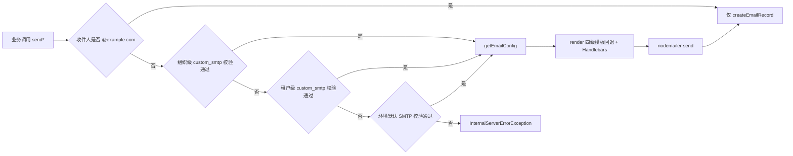

# 租户与平台设置（Tenant & Platform Settings）实现

**本文引用的文件**
- [tenant.service.ts](file://packages/server/src/tenant/tenant.service.ts)
- [tenant.controller.ts](file://packages/server/src/tenant/tenant.controller.ts)
- [tenant-subdomain.util.ts](file://packages/server/src/tenant/tenant-subdomain.util.ts)
- [anonymous-tenant-resolver.service.ts](file://packages/server/src/tenant/anonymous-tenant-resolver.service.ts)
- [tenant-settings.middleware.ts](file://packages/server/src/tenant/tenant-setting/tenant-settings.middleware.ts)
- [tenant-setting.service.ts](file://packages/server/src/tenant/tenant-setting/tenant-setting.service.ts)
- [tenant-setting.save.handler.ts](file://packages/server/src/tenant/tenant-setting/commands/handlers/tenant-setting.save.handler.ts)
- [get-default.handler.ts](file://packages/server/src/tenant/queries/handlers/get-default.handler.ts)
- [tenant-feature-organization.create.handler.ts](file://packages/server/src/tenant/commands/handlers/tenant-feature-organization.create.handler.ts)
- [feature.service.ts](file://packages/server/src/feature/feature.service.ts)
- [feature-organization.service.ts](file://packages/server/src/feature/feature-organization.service.ts)
- [feature-bulk-create.handler.ts](file://packages/server/src/feature/commands/handlers/feature-bulk-create.handler.ts)
- [feature-toggle.update.handler.ts](file://packages/server/src/feature/commands/handlers/feature-toggle.update.handler.ts)
- [feature.subscriber.ts](file://packages/server/src/feature/feature.subscriber.ts)
- [referral.service.ts](file://packages/server/src/referral/referral.service.ts)
- [referral-code.ts](file://packages/server/src/referral/referral-code.ts)
- [referral-code.subscriber.ts](file://packages/server/src/referral/referral-code.subscriber.ts)
- [referral-validation-rate-limit.service.ts](file://packages/server/src/referral/referral-validation-rate-limit.service.ts)
- [custom-smtp.entity.ts](file://packages/server/src/custom-smtp/custom-smtp.entity.ts)
- [custom-smtp.service.ts](file://packages/server/src/custom-smtp/custom-smtp.service.ts)
- [email.service.ts](file://packages/server/src/email/email.service.ts)
- [email-template.service.ts](file://packages/server/src/email-template/email-template.service.ts)
- [email-template.seed.ts](file://packages/server/src/email-template/email-template.seed.ts)
- [email-template.save.handler.ts](file://packages/server/src/email-template/commands/handlers/email-template.save.handler.ts)
- [find.handler.ts](file://packages/server/src/email-template/queries/handlers/email-template.find.handler.ts)
- [utils.ts](file://packages/server/src/email-send/utils.ts)
- [factory-reset.service.ts](file://packages/server/src/user/factory-reset/factory-reset.service.ts)
- [current-user-feature-cache.ts](file://packages/server/src/user/current-user-feature-cache.ts)
- [user.service.ts](file://packages/server/src/user/user.service.ts)
- [subscribers.ts](file://packages/server/src/core/entities/subscribers.ts)

## 目录
- [核心流程实现位置](#核心流程实现位置)
- [设计模式及落点](#设计模式及落点)
- [热点路径](#热点路径)
- [关键类与函数清单](#关键类与函数清单)
- [技术债与 hack 注释](#技术债与-hack-注释)
- [设计维度分析](#设计维度分析)
- [结论](#结论)

## 核心流程实现位置
### 租户 onboarding 五步链路
`TenantController.create` → `TenantService.onboardTenant`，线性步骤为：(1) `prepareTenantCreateInput`（或 `onboardDefault` 预先调用并传 `skipSubdomainPreparation: true`）做子域规范化 + 唯一性；(2) `this.create({...entity, createdBy: user})` 落 `tenant` 行；(3) `TenantRoleBulkCreateCommand` 建角色与权限；(4) `TenantFeatureOrganizationCreateCommand` → `FeatureOrganizationService.updateTenantFeatureOrganizations` 建 toggle；(5) `TenantSettingSaveCommand` 写 `fileStorageProvider: LOCAL`；(6) `roleRepository.findOneBy` 取 `SUPER_ADMIN`，取不到抛 `InternalServerErrorException`；(7) `userService.update` 绑定 tenant + role；(8) 可选 `OrganizationCreateCommand`（`defaultOrganization`）；(9) `eventEmitter.emit(EVENT_TENANT_CREATED, TenantCreatedEvent)` 由 `EmailTemplateService.handleTenantCreatedEvent` 同步播种模板。公开自举路径 `onboardDefault` 额外做 `count()` 与同名校验，并先执行 `LanguageInitCommand`、`FeatureBulkCreateCommand`、`UserCreateCommand`。**整条链路没有事务包裹**。

章节来源：[tenant.service.ts](file://packages/server/src/tenant/tenant.service.ts)（关键符号：TenantService.onboardTenant），[tenant.controller.ts](file://packages/server/src/tenant/tenant.controller.ts)（关键符号：TenantController.onboardDefault）

### feature toggle 判定与缓存版本 bump
写：`FeatureToggleController.enabledDisabledFeature` 把数组拆成多个 `FeatureToggleUpdateCommand`，`FeatureToggleUpdateHandler` 转调 `FeatureOrganizationService.updateFeatureOrganization` —— 先按 `tenantId + featureId + (organizationId | IsNull)` 查现状，取 `previousIsEnabled`，再按需 `save`（无记录则新建 `FeatureOrganization`），随后**无条件** `touchCurrentUserFeatureTenantCacheVersion(cacheManager, tenantId)`，若 `previousIsEnabled !== entity.isEnabled` 再 emit `EVENT_FEATURE_ORGANIZATION_UPDATED`。新租户初始化路径 `updateTenantFeatureOrganizations` 用 `collectDefaultFeatureStates(DEFAULT_FEATURES)` 取默认值，只对叶子 feature 建 toggle，并对每个租户 bump 一次版本。
读：`UserService.findCurrentUserFeatureContext` 组装 `tenantFeatureOrganizations`（`tenantId` + `organizationId IS NULL`）与 `organizationFeatureOrganizations`（当前用户组织集合），缓存键 = `user:me:feature-context:v1:<tenantId>:<userId>:<relationsHash>:<version>`，TTL 180s，`version` 由 `tenant-version` 与 `user-version` 两段拼成。tenant 级 toggle 的权威直查另见 `ReferralService.isFeatureEnabled`。

章节来源：[feature-organization.service.ts](file://packages/server/src/feature/feature-organization.service.ts)（关键符号：FeatureOrganizationService.updateFeatureOrganization），[current-user-feature-cache.ts](file://packages/server/src/user/current-user-feature-cache.ts)（关键符号：touchCurrentUserFeatureTenantCacheVersion）

### 邮件三级回退与模板渲染
`EmailService.getEmailInstance` 是三级回退：组织级 `custom_smtp`（`organizationId = 传入值`）→ 租户级（`organizationId IS NULL`）→ 环境默认（`SMTPUtils.defaultSMTPTransporter()`）；每级都先 `SMTPUtils.convertSmtpToTransporter` + `verifyTransporter`，任一级验证失败就进入下一级（catch 内再 catch），最终构造 `getEmailConfig`（`send: true`、`views.extension = 'hbs'`、`render: this.render`）。`render` 做四级模板回退：组织+目标语言 → 组织+英文 → 租户（`organizationId IS NULL`）+ 目标语言 → 租户+英文，命中后用 `Handlebars.compile(emailTemplate.hbs)` 渲染，全未命中 `resolve('')`（静默空内容）。发送方法（`welcomeUser`/`sendVerifyEmailMail`/`requestPassword`/`inviteUser`/`sendAcceptInvitationEmail`）统一套路：跳过 `@example.com` 收件人 → `email.send(sendOptions)` → `createEmailRecord` 写 `email_sent`。

图表来源：[email.service.ts](file://packages/server/src/email/email.service.ts)（关键符号：EmailService.getEmailInstance）

### 邀请码生成、绑定与限流
生成：`generateReferralCode` 用 `randomBytes(10)` 映射到去混淆字符表 `23456789ABCDEFGHJKLMNPQRSTUVWXYZ`，与实体 CHECK 约束 `^[23456789ABCDEFGHJKLMNPQRSTUVWXYZ]{10}$` 对齐；`ensureReferralCode` 先查后 `insert().orIgnore()`，最多 10 次，保证并发幂等；`regenerateReferralCode` 在事务内 `pessimistic_write` 锁行换码，唯一冲突（`23505`/`SQLITE_CONSTRAINT`）自动重试。自动发码由 `ReferralCodeSubscriber`（挂在 `User.afterInsert`）完成，跳过 `UserType.COMMUNICATION`。
绑定：`ReferralService.bindRegistration(manager, …)` 接收调用方事务的 `EntityManager`（`auth.service.register` 在注册事务内调用），先判 feature 开关与已有关系（幂等），再内联 join 查码（要求邀请人未软删），自邀或码不存在抛 `BadRequestException`，最后写 `referral_relation`（唯一索引 `tenantId + referredUserId`）。
限流：`ReferralValidationRateLimitService.assertAllowed` 执行一段 Lua（`INCR` + 首次 `PEXPIRE 60000`），key = `referral:validation-rate:<tenantId>:<sha256(ip)[:32]>`，超过 30 次抛 429；`eval` 缺失或返回值不可解析时抛 500（fail-closed）。

章节来源：[referral-code.ts](file://packages/server/src/referral/referral-code.ts)（关键符号：ensureReferralCode），[referral.service.ts](file://packages/server/src/referral/referral.service.ts)（关键符号：ReferralService.bindRegistration）

## 设计模式及落点
- **CQRS 命令/查询**：命令 `TenantSettingSaveCommand`、`FeatureToggleUpdateCommand`、`FeatureUpgradeCommand`、`FeatureBulkCreateCommand`、`TenantFeatureOrganizationCreateCommand`、`CustomSmtpCreateCommand`/`CustomSmtpUpdateCommand`、`EmailTemplateSaveCommand`；查询 `GetDefaultTenantQuery`、`FindEmailTemplateQuery`、`EmailTemplateGeneratePreviewQuery`；另有语义上是查询却建模为命令的 `TenantSettingGetCommand`。
- **Nest 中间件**：`TenantSettingsMiddleware`（请求级设置缓存，实际在 `FileStorageModule.configure` 里 `forRoutes('*')` 注册），以及反向依赖本模块的 `AnonymousTenantContextMiddleware` / `TenantDomainMiddleware`。
- **事件驱动（双通道）**：`EventEmitter2` + `@OnEvent(EVENT_TENANT_CREATED)`（`EmailTemplateService`）与 CQRS `@EventsHandler`（`tenant` 与 `email-template` 各一份，后者标注 `@deprecated`）；开关变更广播 `EVENT_FEATURE_ORGANIZATION_UPDATED`。
- **TypeORM Subscriber**：`ReferralCodeSubscriber`（`User.afterInsert` → 发码，已注册）；`FeatureSubscriber.afterLoad`（补 `status`、按 `toggleFeatures` 覆写 `isEnabled`、拼 `imageUrl`）与 `EmailTemplateSubscriber.afterLoad`（由 `name` 派生 `title`）**未注册**。
- **实体装饰器策略（打码）**：`CustomSmtp.afterLoadEntity` 用 `@AfterLoad` 把 `username/password` 复制到 `secretKey/secretPassword` 并 `WrapSecrets`，配合 `@Exclude`/`@Expose` 控制序列化形态。
- **工厂 + 回退链**：`getEmailConfig` 造 `email-templates` 实例；`resolveDefaultEmailTemplateFolder` 在 5 个候选路径中探测模板目录；`CustomSmtpService.getSmtpSetting` 用 catch 兜底返回默认 SMTP 配置。
- **纯函数策略模块**：`referral-code.ts`（生成/幂等保证/重试）与 `current-user-feature-cache.ts`（缓存键与版本号构造）从 service 中剥离，便于单测。
- **静态工具类**：`SMTPUtils`（`defaultSMTPTransporter` / `verifyTransporter` / `convertSmtpToTransporter`）。

章节来源：[feature-toggle.update.handler.ts](file://packages/server/src/feature/commands/handlers/feature-toggle.update.handler.ts)（关键符号：FeatureToggleUpdateHandler.execute），[custom-smtp.entity.ts](file://packages/server/src/custom-smtp/custom-smtp.entity.ts)（关键符号：CustomSmtp.afterLoadEntity）

## 热点路径
1. **每个带 Authorization 的请求**：`TenantSettingsMiddleware.use` 做 `jwt.decode`（不验签）+ `cacheManager.get('tenantSettings_<tenantId>')`；命中为单次缓存读，未命中退回一次 DB `find` 并写 5 分钟 TTL。
2. **发信**：`getEmailInstance` 至少一次 `findOneByOptions` + 一次 `nodemailer.verify()`（真实 SMTP 握手，网络往返）；若组织级失败则最多累计 3 次 verify，且该开销**没有缓存**。
3. **feature 判定**：稳态下命中 `user:me:feature-context` 缓存（TTL 180s，靠 tenant/user 版本号提前失效）；`ReferralService` 走的是 DB 直查，不进该缓存。
4. **公开返利校验**：`ReferralController.validate` 每次都执行 Redis Lua 限流 + 一次带 join 的 `getExists()` 查询。
5. **租户创建**：`onboardTenant` 单次调用会串行触发建角色、建全量叶子 toggle、写设置、改用户、建组织、同步播种模板（文件系统递归读目录 + MJML 编译）。

章节来源：[email.service.ts](file://packages/server/src/email/email.service.ts)（关键符号：EmailService.getEmailInstance），[user.service.ts](file://packages/server/src/user/user.service.ts)（关键符号：UserService.findCurrentUserFeatureContext）

## 关键类与函数清单
| 名称 | 路径 | 职责 |
| --- | --- | --- |
| `TenantService.onboardTenant` | [tenant.service.ts](file://packages/server/src/tenant/tenant.service.ts) | 租户创建全链路编排（无事务） |
| `TenantService.prepareTenantCreateInput` | [tenant.service.ts](file://packages/server/src/tenant/tenant.service.ts) | 子域规范化 + 唯一性校验 |
| `TenantController.onboardDefault` | [tenant.controller.ts](file://packages/server/src/tenant/tenant.controller.ts) | 首租户公开自举入口 |
| `AnonymousTenantResolverService.resolve` | [anonymous-tenant-resolver.service.ts](file://packages/server/src/tenant/anonymous-tenant-resolver.service.ts) | subdomain 优先、`DEFAULT_TENANT` 兜底 |
| `TenantSettingsMiddleware.use` | [tenant-settings.middleware.ts](file://packages/server/src/tenant/tenant-setting/tenant-settings.middleware.ts) | JWT 解码 + 设置缓存挂到 request |
| `TenantSettingService.saveSettngs` | [tenant-setting.service.ts](file://packages/server/src/tenant/tenant-setting/tenant-setting.service.ts) | 按 name 做 upsert，不失效缓存 |
| `GetDefaultTenantHandler.execute` | [get-default.handler.ts](file://packages/server/src/tenant/queries/handlers/get-default.handler.ts) | `tenant:default` 24h 缓存读取 |
| `FeatureService.seedDB` / `purgeRetiredFeatures` | [feature.service.ts](file://packages/server/src/feature/feature.service.ts) | 定义同步与 tombstone 物理清理 |
| `FeatureService.getParentFeatures` | [feature.service.ts](file://packages/server/src/feature/feature.service.ts) | 顶层 feature + 退役过滤 |
| `FeatureOrganizationService.updateFeatureOrganization` | [feature-organization.service.ts](file://packages/server/src/feature/feature-organization.service.ts) | 单点开关写入 + 版本 bump + 事件 |
| `FeatureOrganizationService.updateTenantFeatureOrganizations` | [feature-organization.service.ts](file://packages/server/src/feature/feature-organization.service.ts) | 新租户叶子 toggle 初始化 |
| `FeatureSubscriber.afterLoad` | [feature.subscriber.ts](file://packages/server/src/feature/feature.subscriber.ts) | 运行时覆写 `isEnabled`/`imageUrl`（未注册） |
| `ReferralService.isFeatureEnabled` | [referral.service.ts](file://packages/server/src/referral/referral.service.ts) | tenant 级 toggle 直查 |
| `ReferralService.bindRegistration` | [referral.service.ts](file://packages/server/src/referral/referral.service.ts) | 事务内幂等绑定返利关系 |
| `ensureReferralCode` / `regenerateReferralCode` | [referral-code.ts](file://packages/server/src/referral/referral-code.ts) | 幂等发码与带锁换码 |
| `ReferralValidationRateLimitService.assertAllowed` | [referral-validation-rate-limit.service.ts](file://packages/server/src/referral/referral-validation-rate-limit.service.ts) | Redis Lua 60s/30 次限流 |
| `CustomSmtpService.getSmtpSetting` | [custom-smtp.service.ts](file://packages/server/src/custom-smtp/custom-smtp.service.ts) | 组织/租户 SMTP 取用与默认回退 |
| `EmailService.getEmailInstance` | [email.service.ts](file://packages/server/src/email/email.service.ts) | 三级传输回退 + 每次 verify |
| `EmailService.render` | [email.service.ts](file://packages/server/src/email/email.service.ts) | 四级模板回退 + Handlebars 编译 |
| `EmailService.createEmailRecord` | [email.service.ts](file://packages/server/src/email/email.service.ts) | 写 `email_sent`（模板查询不带 tenantId） |
| `EmailTemplateService.handleTenantCreatedEvent` | [email-template.service.ts](file://packages/server/src/email-template/email-template.service.ts) | 租户创建后播种模板 |
| `createDefaultEmailTemplates` | [email-template.seed.ts](file://packages/server/src/email-template/email-template.seed.ts) | 目录约定解析 + MJML 编译入库 |
| `FactoryResetService.reset` | [factory-reset.service.ts](file://packages/server/src/user/factory-reset/factory-reset.service.ts) | 空实现（全部逻辑被注释） |

章节来源：[feature.service.ts](file://packages/server/src/feature/feature.service.ts)（关键符号：FeatureService.getParentFeatures），[email-template.seed.ts](file://packages/server/src/email-template/email-template.seed.ts)（关键符号：createDefaultEmailTemplates）

## 技术债与 hack 注释
1. **`FeatureSubscriber` 未注册**：`coreSubscribers` 只含 `StorageFileSubscriber`、`TagSubscriber`、`ReferralCodeSubscriber`，`registerAllSubscribers` 也只合并 core + 插件 subscriber，因此 `afterLoad` 的随机 `status`/`toggleFeatures` 覆写/`imageUrl` 派生在运行时不会生效。
2. **`EmailTemplateSubscriber` 同样未注册**：`title`（由 `name` 拆词派生）无处生效。
3. **`FactoryResetService.reset` 空实现**：方法体全部注释；`registerCoreRepositories` 的数组为空（各 repository 全被注释）；但 `UserController` 的 `DELETE /reset/:id` 仍暴露该入口并受 `ACCESS_DELETE_ALL_DATA` 权限保护——调用成功但什么都不做。
4. **租户设置缓存无失效**：`TenantSettingService.saveSettngs` 不触碰 `tenantSettings_<tenantId>`，保存后最长 5 分钟读到旧值。
5. **`GetDefaultTenantHandler` 24h 缓存无失效**：`tenant:default` 只靠 TTL，默认租户改名/换绑后长时间不刷新。
6. **`onboardTenant` 非事务**：任一后续步骤（角色、toggle、设置、SUPER_ADMIN 角色缺失、用户绑定）失败都会留下半初始化租户；源码里注释编号出现两个 “4.”、第 6 步 import record 被整段注释，也说明该链路被反复裁剪。
7. **邮件发送静默失败**：所有 `send*` 方法外层 `try/catch + console.error`，内层再 catch；发送失败仍会 `createEmailRecord` 落一条 `message` 为空串的记录，调用方无法感知。
8. **`createEmailRecord` 查模板不带 tenantId**：只按 `name + mapTranslationLanguage(languageCode)` 命中，跨租户可能取到别人的模板行（`emailTemplateId` 为非空外键）。
9. **重复实现**：`EmailTemplateService.@OnEvent` 与 `email-template/events/handlers/tenant.created.handler.ts`（`@deprecated`）逻辑重复；`FeatureBulkCreateHandler.syncFeatureDefinition` 与 `FeatureService.syncFeatureDefinition` 近乎复制。
10. **异常即回退**：`CustomSmtpService.getSmtpSetting` 用 `catch` 把查询异常等同于“未配置”，返回 `defaultSMTPTransporter(false)`，掩盖真实故障；`EmailService` 构造函数保留大段注释代码与仅测试用的 `nodemailerSendEmail`。

章节来源：[subscribers.ts](file://packages/server/src/core/entities/subscribers.ts)（关键符号：coreSubscribers），[factory-reset.service.ts](file://packages/server/src/user/factory-reset/factory-reset.service.ts)（关键符号：FactoryResetService.reset）

## 设计维度分析
**维度一：一致性策略分层（强一致 / 版本号失效 / 纯 TTL）**。同一模块内并存三档：`bindRegistration` + `updateFeatureOrganization` 依赖调用方事务与行级写入保证强一致；`user:me:feature-context` 走版本号强失效（写时 bump + 180s TTL 兜底）；`tenantSettings_*` 与 `tenant:default` 纯 TTL，写侧完全不失效。差别带来的直接后果是“保存设置后 5 分钟内读旧值”“默认租户改一天不生效”，而 feature 开关是准实时。反过来说，版本号方案把失效成本从“删 N 个用户的 key”降为“写 1 个字节”，是本模块里扩展性最好的一个设计。

**维度二：配置继承的读侧回退 vs 写侧 scope 约束**。feature toggle、SMTP、邮件模板三者都采用 `organizationId IS NULL` 表示租户默认值，读侧都是“组织优先、租户兜底”的回退链（`isFeatureEnabled`、`getEmailInstance`、`render`、`FindEmailTemplateHandler`），但写侧约束强度不一：`updateFeatureOrganization` 显式拒绝 membership-purchase 建组织级 toggle，`custom-smtp` 与 `email-template` 只靠调用方传参/`ForbiddenException` 校验租户归属，缺少统一的 scope-aware 服务基类（`PLAN_isolate_tenant_org.md` 中已提出 `findWithInheritance`/`writeToCurrentScope` 但尚未落地）。结果是“继承语义一致、写入边界不一致”。

**维度三：安全与可观测性的取舍**。安全侧做得较扎实（JWT 上下文、Guard+Pemission 双闸、公开返利接口 fail-closed 限流、SMTP 密钥 `WrapSecrets` 打码、公开码校验内联 join 排除软删用户）；可观测性侧明显薄弱（无结构化日志，`console.log/error` 混杂，`TenantCreatedHandler` 仅打印一行 chalk 文本，send 失败不冒泡、`verifyTransporter` 每次握手都无监控），这也是前文技术债 7、10 的根因。

章节来源：[referral-validation-rate-limit.service.ts](file://packages/server/src/referral/referral-validation-rate-limit.service.ts)（关键符号：ReferralValidationRateLimitService.assertAllowed），[custom-smtp.entity.ts](file://packages/server/src/custom-smtp/custom-smtp.entity.ts)（关键符号：CustomSmtp.afterLoadEntity）

## 结论
实现层是“薄 controller + 厚 service + CQRS/事件解耦 + 中间件承载横切缓存”的典型 Nest 布局，关键流程（onboard、toggle 写入、邮件回退、返利绑定）都集中在少数几个类里，可读性尚可；技术债呈现高度主题化：**事务缺失（onboard）、失效策略割裂（设置/默认租户 vs feature）、注册表遗漏（两个 subscriber）、以及把异常当回退/发送失败不冒泡**。若要排优先级，建议先补 `onboardTenant` 事务边界与设置缓存失效（用户可感知），再处理 subscriber 注册与 `createEmailRecord` 的租户过滤（正确性/隔离性），最后统一错误冒泡与日志（可运维性）。

章节来源：[tenant.service.ts](file://packages/server/src/tenant/tenant.service.ts)（关键符号：TenantService.onboardTenant），[email.service.ts](file://packages/server/src/email/email.service.ts)（关键符号：EmailService.createEmailRecord）
