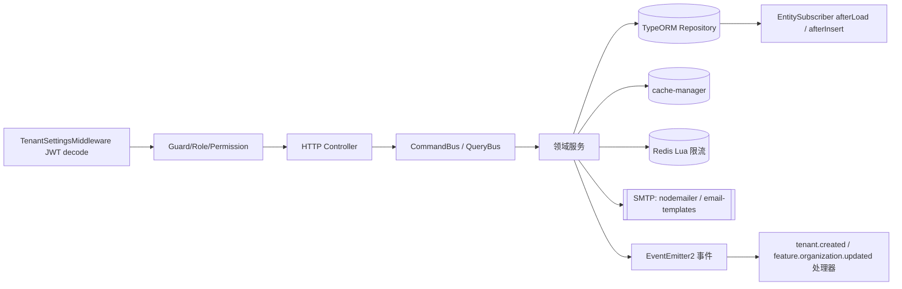
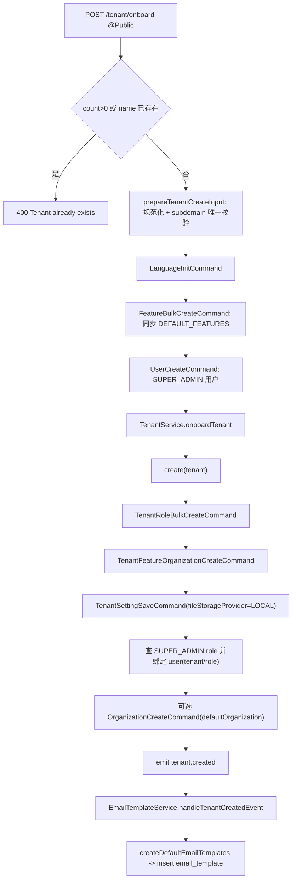
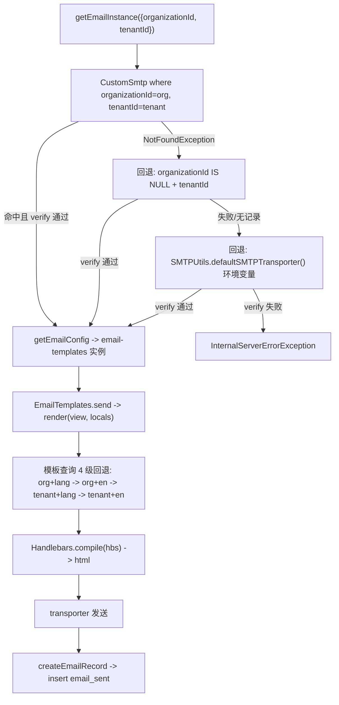
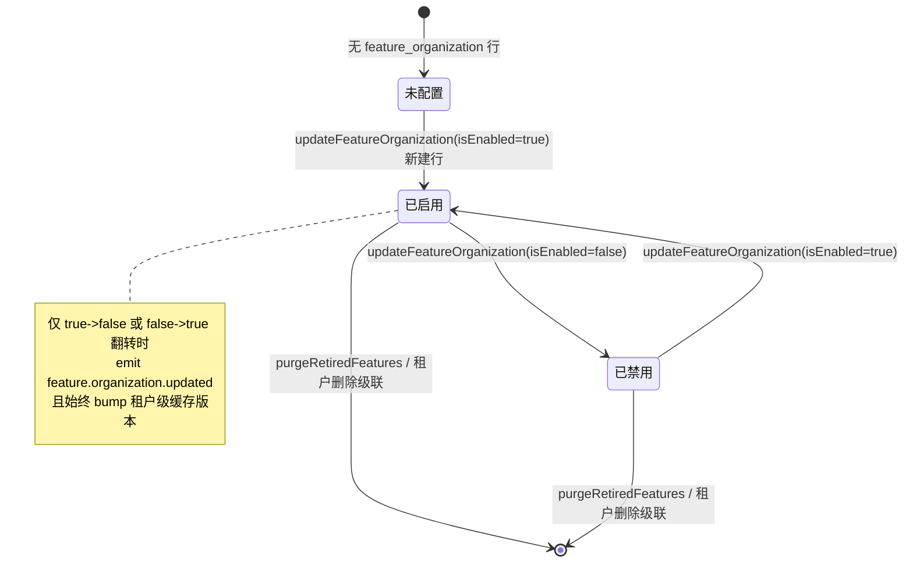

# 03-数据流转

**本文引用的文件**
- [tenant.controller.ts](file://packages/server/src/tenant/tenant.controller.ts)
- [tenant.service.ts](file://packages/server/src/tenant/tenant.service.ts)
- [tenant.entity.ts](file://packages/server/src/tenant/tenant.entity.ts)
- [tenant-subdomain.util.ts](file://packages/server/src/tenant/tenant-subdomain.util.ts)
- [anonymous-tenant-resolver.service.ts](file://packages/server/src/tenant/anonymous-tenant-resolver.service.ts)
- [tenant-settings.middleware.ts](file://packages/server/src/tenant/tenant-setting/tenant-settings.middleware.ts)
- [tenant-setting.service.ts](file://packages/server/src/tenant/tenant-setting/tenant-setting.service.ts)
- [tenant-setting.controller.ts](file://packages/server/src/tenant/tenant-setting/tenant-setting.controller.ts)
- [tenant-setting.save.handler.ts](file://packages/server/src/tenant/tenant-setting/commands/handlers/tenant-setting.save.handler.ts)
- [tenant-setting.get.handler.ts](file://packages/server/src/tenant/tenant-setting/commands/handlers/tenant-setting.get.handler.ts)
- [feature.service.ts](file://packages/server/src/feature/feature.service.ts)
- [feature.subscriber.ts](file://packages/server/src/feature/feature.subscriber.ts)
- [feature-organization.service.ts](file://packages/server/src/feature/feature-organization.service.ts)
- [feature-bulk-create.handler.ts](file://packages/server/src/feature/commands/handlers/feature-bulk-create.handler.ts)
- [feature-toggle.controller.ts](file://packages/server/src/feature/feature-toggle.controller.ts)
- [referral.controller.ts](file://packages/server/src/referral/referral.controller.ts)
- [referral.service.ts](file://packages/server/src/referral/referral.service.ts)
- [referral-code.ts](file://packages/server/src/referral/referral-code.ts)
- [referral-code.subscriber.ts](file://packages/server/src/referral/referral-code.subscriber.ts)
- [referral-validation-rate-limit.service.ts](file://packages/server/src/referral/referral-validation-rate-limit.service.ts)
- [email.service.ts](file://packages/server/src/email/email.service.ts)
- [email.entity.ts](file://packages/server/src/email/email.entity.ts)
- [email-template.service.ts](file://packages/server/src/email-template/email-template.service.ts)
- [email-template.seed.ts](file://packages/server/src/email-template/email-template.seed.ts)
- [tenant.created.handler.ts](file://packages/server/src/email-template/events/handlers/tenant.created.handler.ts)
- [custom-smtp.entity.ts](file://packages/server/src/custom-smtp/custom-smtp.entity.ts)
- [custom-smtp.service.ts](file://packages/server/src/custom-smtp/custom-smtp.service.ts)
- [current-user-feature-cache.ts](file://packages/server/src/user/current-user-feature-cache.ts)
- [user.create.handler.ts](file://packages/server/src/user/commands/handlers/user.create.handler.ts)
- [auth.service.ts](file://packages/server/src/auth/auth.service.ts)
- [file-storage.module.ts](file://packages/server/src/file/file-storage/file-storage.module.ts)

## 目录
- [总览](#总览)
- [链一 租户 Onboarding](#链一-租户-onboarding)
- [链二 租户设置读写](#链二-租户设置读写)
- [链三 功能开关判定与传播](#链三-功能开关判定与传播)
- [链四 邮件发送](#链四-邮件发送)
- [链五 邀请返利](#链五-邀请返利)
- [状态与生命周期](#状态与生命周期)
- [异步流与外部依赖](#异步流与外部依赖)
- [数据变换关键节点](#数据变换关键节点)
- [已知风险与坑](#已知风险与坑)

章节来源：[tenant.controller.ts](file://packages/server/src/tenant/tenant.controller.ts)（关键符号：TenantController）、[referral.controller.ts](file://packages/server/src/referral/referral.controller.ts)（关键符号：ReferralController）

## 总览

本域是「租户生命周期 + 开关 + 通知」三条主干：入口是 HTTP 控制器（`TenantController`、`TenantSettingController`、`FeatureToggleController`、`ReferralController`、`EmailTemplateController`、`CustomSmtpController`、`EmailController`），出口是「数据库表 + 进程内缓存 + Redis + SMTP + 进程内事件」。写入路径统一经 CQRS（`CommandBus`/`QueryBus`）或 `CrudService`/`TenantAwareCrudService`，读取路径多为 `TenantAwareCrudService`（按 `RequestContext` 自动注入 `tenantId` 过滤）。

图表来源：[tenant-settings.middleware.ts](file://packages/server/src/tenant/tenant-setting/tenant-settings.middleware.ts)、[tenant.service.ts](file://packages/server/src/tenant/tenant.service.ts)、[email.service.ts](file://packages/server/src/email/email.service.ts)

章节来源：[tenant-settings.middleware.ts](file://packages/server/src/tenant/tenant-setting/tenant-settings.middleware.ts)（关键符号：TenantSettingsMiddleware.use）、[feature-organization.service.ts](file://packages/server/src/feature/feature-organization.service.ts)（关键符号：FeatureOrganizationService）

## 链一 租户 Onboarding

两条入口：`POST /tenant/onboard`（`@Public`，仅允许首个租户）与 `POST /tenant`（已登录用户，要求 `user.tenantId`/`user.roleId` 均为空，否则 400 `Tenant already exists`）。

`POST /tenant/onboard` 的数据流：`count()>0` 或 `name` 已存在 → 400；`prepareTenantCreateInput` 规范化 `subdomain` 并做唯一性校验；`LanguageInitCommand`；`FeatureBulkCreateCommand`（`= syncFeatureDefinition` 同步 `DEFAULT_FEATURES` 定义并删除同名 code 的陈旧行）；`UserCreateCommand`（建 superAdmin 用户，`emailVerified: true`，bcrypt 哈希）；最后调用 `TenantService.onboardTenant(entity, user, { skipSubdomainPreparation: true })`。

图表来源：[tenant.controller.ts](file://packages/server/src/tenant/tenant.controller.ts)、[tenant.service.ts](file://packages/server/src/tenant/tenant.service.ts)、[feature-bulk-create.handler.ts](file://packages/server/src/feature/commands/handlers/feature-bulk-create.handler.ts)

`onboardTenant` 内部顺序：建 tenant → 默认 role/permission（`TenantRoleBulkCreateCommand`）→ featureOrganization（`TenantFeatureOrganizationCreateCommand` → `updateTenantFeatureOrganizations`，同时 bump 该租户的 feature 缓存版本）→ 默认 setting（`fileStorageProvider=LOCAL`）→ 查 `SUPER_ADMIN` role（查不到抛 500）→ 把 tenant/role 写到 user → 可选默认组织 → `eventEmitter.emit(EVENT_TENANT_CREATED)`。该流程逐步 `await` 但**不在一个事务内**。

`@Public` 的 `GET /tenant/onboard` 走另一条链：`AnonymousTenantResolverService.resolve(request)` 用请求上的 `tenant-domain` 找 `subdomain` 命中租户，未命中回退 `DEFAULT_TENANT`，再按「`isActive!==false` 且 `isDefault`/最早创建」选 organization，并只返回 `settings` 中 `name` 以 `tenant` 开头的项（组织不存在则返回 null）。

章节来源：[tenant.service.ts](file://packages/server/src/tenant/tenant.service.ts)（关键符号：TenantService.onboardTenant）、[anonymous-tenant-resolver.service.ts](file://packages/server/src/tenant/anonymous-tenant-resolver.service.ts)（关键符号：AnonymousTenantResolverService.resolve）

## 链二 租户设置读写

读路径（全局中间件）：`TenantSettingsMiddleware` 对 `forRoutes('*')` 生效（在 `FileStorageModule.configure` 中注册）。它用 `jwt.decode(token)` 取 `tenantId`（只解码，不校验签名），先读缓存键 `tenantSettings_<tenantId>`；未命中则 `TenantSettingService.getSettings({ where: { tenantId } })` 回源，并写入缓存，TTL `5 * 60 * 1000` ms；最终把结果挂到 `req['tenantSettings']`。中间件异常只 `console.error` 后 `next()`，不阻断请求。

写/读 API 路径：`GET /tenant-setting`（`TenantPermissionGuard` + `SUPER_ADMIN`）→ `TenantSettingGetCommand` → 取 `RequestContext.currentTenantId()` → `repository.find` → `object(pluck(name), pluck(value))` 转成 `Record<string, any>`；`POST /tenant-setting` → `TenantSettingSaveCommand(entity)` → `TenantSettingSaveHandler` 用 `RequestContext.currentTenantId() || command.tenantId` 调 `saveSettngs`。

`saveSettngs` 是「按 key upsert」：以 `name In(keys) AND tenantId` 查回现有行并 `indexBy`，命中的改 `value`，未命中的 `new TenantSetting({ name, value, tenantId })`，最后一次性 `save`。**该写路径不清理 `tenantSettings_<tenantId>` 缓存**，因此在 TTL 内（≤5 分钟）读到的是旧值。

章节来源：[tenant-settings.middleware.ts](file://packages/server/src/tenant/tenant-setting/tenant-settings.middleware.ts)（关键符号：TenantSettingsMiddleware.use）、[tenant-setting.service.ts](file://packages/server/src/tenant/tenant-setting/tenant-setting.service.ts)（关键符号：TenantSettingService.saveSettngs）、[tenant-setting.save.handler.ts](file://packages/server/src/tenant/tenant-setting/commands/handlers/tenant-setting.save.handler.ts)（关键符号：TenantSettingSaveHandler.execute）

## 链三 功能开关判定与传播

定义层：`feature` 表 + `DEFAULT_FEATURES`（seed/`FeatureBulkCreateCommand` 同步），读取时用 `RETIRED_FEATURE_CODES`（含 `FEATURE_HOME`、`FEATURE_SETTING`、`FEATURE_COPILOT_CHAT` 等）在 `getParentFeatures` 中递归过滤退役码；启动时 `FeatureService.onApplicationBootstrap()` → `purgeRetiredFeatures()`，在一个事务内先删 `FeatureOrganization` 再删 `Feature`。

判定层：`feature_organization` 行按 `tenantId` + `organizationId(或 IS NULL)` + `featureId` 存开关；`FeatureSubscriber.afterLoad` 为 `Feature` 计算 `isEnabled`（来自 `@xpert-ai/server-config` 的 `toggleFeatures[code]`，缺省 true）与 `imageUrl`（`FileStorage` provider url），`status` 为空时随机取 `FeatureStatusEnum`。

传播层：`POST /feature/toggle`（`ALL_ORG_EDIT`）→ `FeatureToggleUpdateCommand` → `updateFeatureOrganization`：若带 `organizationId` 且 feature code 为 `AiFeatureEnum.FEATURE_MEMBERSHIP_PURCHASE` 直接 400（只允许租户级）；按作用域查 `feature_organization`，无则新建、有则更新；随后 `touchCurrentUserFeatureTenantCacheVersion`（键 `user:me:feature-context:tenant-version:<tenantId>`，TTL 24h）bump 版本；仅当 `previousIsEnabled !== entity.isEnabled` 时 emit `feature.organization.updated`（携带 tenantId/organizationId/userId/featureId/code/前后状态）。

读取层缓存：current-user feature 缓存键形如 `user:me:feature-context:v1:<tenantId>:<userId>:<relationsHash>:<version>`（关系集合 sha1 前 16 位 + 版本），TTL 180s；版本由租户级/用户级两个计数器拼成 `tenantVersion.userVersion`，写开关后租户级版本变化即整体失效。

章节来源：[feature.service.ts](file://packages/server/src/feature/feature.service.ts)（关键符号：FeatureService.getParentFeatures、purgeRetiredFeatures）、[feature-organization.service.ts](file://packages/server/src/feature/feature-organization.service.ts)（关键符号：FeatureOrganizationService.updateFeatureOrganization）、[current-user-feature-cache.ts](file://packages/server/src/user/current-user-feature-cache.ts)（关键符号：touchCurrentUserFeatureTenantCacheVersion）

## 链四 邮件发送

调用方（本域相关）：`auth.service` 的 `welcomeUser` / `requestPassword` / `sendVerifyEmailMail`（注册、找回密码、邮箱验证），`invite.service` 的 `inviteUser` / `sendAcceptInvitationEmail`，`employee` 创建/批量创建的 `welcomeUser`。这些方法都构造 `sendOptions{ template, message.to, locals }`，再走统一的 SMTP 解析与渲染，失败只 `console.error` 后继续写 `email_sent`。

图表来源：[email.service.ts](file://packages/server/src/email/email.service.ts)、[custom-smtp.service.ts](file://packages/server/src/custom-smtp/custom-smtp.service.ts)、[custom-smtp.entity.ts](file://packages/server/src/custom-smtp/custom-smtp.entity.ts)

关键节点：`getEmailInstance` 三级回退（组织级 → 租户级 → 环境默认），**每一级都调用 `SMTPUtils.verifyTransporter` 新建连接做验证**，最坏一次发信触发 3 次校验，全失败才抛 500；`getEmailConfig` 组装 `email-templates` 实例（`from = fromAddress || 'service@xpertai.cn'`、`views.extension='hbs'`、绑定 `this.render`）；`render` 把 `view` 的 `\` 换 `/`，`languageCode = TranslationLanguageMap[locals.locale] ?? locals.locale`，依次按 `organizationId=org` 命中「语言 → en」，再按 `organizationId IS NULL` 命中「语言 → en」，全空则返回空串；收件人命中 `DISALLOW_EMAIL_SERVER_DOMAIN`（`@example.com`）时跳过发送但仍写记录；`createEmailRecord` 按 `name = template + '/html'` 与 `languageCode` 查模板（**查询条件不含 tenantId**），再写 `name/content/email/emailTemplate/tenantId/organizationId/user`。

额外事实：`email-template/events/handlers/tenant.created.handler.ts` 中的 `TenantCreatedHandler` 带 `@deprecated` 注释（注明改用 `@OnEvent('tenant.created')`），实际生效的是 `EmailTemplateService.handleTenantCreatedEvent`（`@OnEvent(EVENT_TENANT_CREATED)`）→ `createDefaultEmailTemplates(connection, tenant)`。

章节来源：[email.service.ts](file://packages/server/src/email/email.service.ts)（关键符号：EmailService.getEmailInstance、render、createEmailRecord）、[email-template.service.ts](file://packages/server/src/email-template/email-template.service.ts)（关键符号：EmailTemplateService.handleTenantCreatedEvent）

## 链五 邀请返利

生成：`ReferralCodeSubscriber.afterInsert(User)` 监听用户插入（要求 `user.id` 与 `tenantId` 存在，`UserType.COMMUNICATION` 跳过）→ `ensureReferralCode(repository, tenantId, userId)`：先 `findOne`，没有就 `insert().orIgnore()` 后回查，最多 10 次；码由 `randomBytes(10)` 对字母表 `23456789ABCDEFGHJKLMNPQRSTUVWXYZ` 取模生成（10 位，无 0/1/I/O）。`regenerateReferralCode` 在事务内加 `pessimistic_write` 行锁后生成不同码，唯一冲突（`23505`/`SQLITE_CONSTRAINT`）时重试。

绑定：`auth.service.register` 在注册事务内调用 `referralService.bindRegistration(manager, { tenantId, referredUserId, referralCode })`，先做 feature 判定（租户级 `FEATURE_REFERRAL` 且 `isEnabled`）→ 已有 `referral_relation` 直接 return（不覆盖）→ 校验码（内联 join user 且 `deletedAt IS NULL`）→ 码不属于任何用户或等于自己时 400 `ReferralInvalidCode` → 写入 `{tenantId, referrerUserId, referredUserId, usedCode}`。

校验/查询：`GET /referral/validate`（`@Public`）先按请求 IP 走 `ReferralValidationRateLimitService.assertAllowed(tenantId, ip)`：Redis `eval` 执行 Lua（`INCR` + 首次 `PEXPIRE 60000`），同 IP+租户 1 分钟内超过 30 次抛 `429`；**Redis 不可用或返回值非法时抛 500（fail-closed）**，随后才 `validatePublicCode`。`GET /referral/availability` 只返回 feature 开关；`GET /referral/me`、`POST /referral/me/regenerate` 需要登录且非通信型用户；`GET /referral/relations` 需要 `SUPER_ADMIN|ADMIN` + `REFERRAL_VIEW`，支持 `search`/分页（`take` 上限 100），`withDeleted()` 查询并对软删用户输出 `deleted: true`。

章节来源：[referral-code.subscriber.ts](file://packages/server/src/referral/referral-code.subscriber.ts)（关键符号：ReferralCodeSubscriber.afterInsert）、[referral-code.ts](file://packages/server/src/referral/referral-code.ts)（关键符号：ensureReferralCode、regenerateReferralCode）、[referral.service.ts](file://packages/server/src/referral/referral.service.ts)（关键符号：ReferralService.bindRegistration、validateCode）、[referral-validation-rate-limit.service.ts](file://packages/server/src/referral/referral-validation-rate-limit.service.ts)（关键符号：ReferralValidationRateLimitService.assertAllowed）

## 状态与生命周期

本域没有集中的状态字段：`tenant` 只有 `name`/`subdomain`，无 status 列，创建即生效；`email_sent` 无发送状态列，发送失败与成功都落库（失败时内容为空）；`custom_smtp.isValidate` 是配置标记位，发送路径不读它，而是每次实时 `verifyTransporter`。

图表来源：[feature-organization.service.ts](file://packages/server/src/feature/feature-organization.service.ts)、[feature.service.ts](file://packages/server/src/feature/feature.service.ts)

租户级流转：创建（onboard）→ 绑定 SUPER_ADMIN 用户 → 发 `tenant.created` → 生成默认邮件模板；删除走 `@Delete(':id')`（要求 `id === RequestContext.currentTenantId()`），子表依赖 `TenantBaseEntity` 的 `onDelete: 'CASCADE'` 与 `Tenant` 上的 `OneToMany cascade: true` 清理。

章节来源：[tenant.controller.ts](file://packages/server/src/tenant/tenant.controller.ts)（关键符号：TenantController.delete）、[feature.subscriber.ts](file://packages/server/src/feature/feature.subscriber.ts)（关键符号：FeatureSubscriber.afterLoad）

## 异步流与外部依赖

| 机制 | 载体 | 触发点 | 失败语义 |
| --- | --- | --- | --- |
| 进程内事件 | `EventEmitter2` + `@OnEvent` | `emit('tenant.created')` → 默认邮件模板；`emit('feature.organization.updated')`（仅翻转） | 无重试；`handleTenantCreatedEvent` 内部对模板 seed 异常自行吞噬 |
| 全局中间件 | `NestMiddleware`（`forRoutes('*')`） | 每个 HTTP 请求读租户设置缓存 | 异常仅 `console.error`，请求继续 |
| 进程内缓存 | `cache-manager`（`CACHE_MANAGER`） | `tenantSettings_<tenantId>` 5min；`tenant:default` 24h；`user:me:feature-context:tenant-version:<tenantId>` 24h | 读失败即回源；写开关 bump；设置写不清缓存 |
| 外部 Redis | `REDIS_CLIENT` + Lua `eval` | `GET /referral/validate` 限流（60s / 30 次） | 不可用即 500（fail-closed） |
| 外部 SMTP | `nodemailer` + `email-templates` + `Handlebars` | 邀请/注册/找回密码/邮箱验证 | 静默 `console.error`，不重试、不入队 |
| 定时任务 / MQ | 该模块无此项 | 未发现 `@Cron`/`@Interval`/`@Timeout` 或 Bull 队列被本域引用（仓库内队列实现位于 `managed-queue/`） | 无 |

章节来源：[tenant-settings.middleware.ts](file://packages/server/src/tenant/tenant-setting/tenant-settings.middleware.ts)（关键符号：TenantSettingsMiddleware）、[referral-validation-rate-limit.service.ts](file://packages/server/src/referral/referral-validation-rate-limit.service.ts)（关键符号：INCREMENT_WITH_EXPIRY_SCRIPT）、[email.service.ts](file://packages/server/src/email/email.service.ts)（关键符号：EmailService.createEmailRecord）

## 数据变换关键节点

| 节点 | 输入 → 输出 | 实现 |
| --- | --- | --- |
| 子域名规范化 | 任意字符串 → `[a-z0-9-]` 拼装、折叠连字符、去首尾 `-` | `normalizeTenantSubdomain`（空串→`null`，非法→400） |
| 默认角色/权限 | tenant → Role/Permission 行 | `TenantRoleBulkCreateCommand` |
| 开关快照 | `DEFAULT_FEATURES` 叶子 feature → `FeatureOrganization{isEnabled}` | `collectDefaultFeatureStates` + `updateTenantFeatureOrganizations` |
| 设置序列化 | `TenantSetting[]` ↔ `Record<string, any>` | underscore `object/pluck/indexBy` |
| 邀请码 | `randomBytes(10)` → 字母表取模 → 10 位大写码 | `generateReferralCode`（DB CHECK 二次约束） |
| 模板入库 | 目录 `[template]/[lang]/[type].mjml|hbs` → `name=[template]/[type]`、`languageCode=[lang]`、`mjml→mjml2html→hbs` | `createDefaultEmailTemplates`/`pathToEmailTemplate` |
| 模板渲染 | name + lang + locals → html | `EmailService.render`（4 级回退 + `Handlebars.compile`） |
| 密钥打码 | `username/password` → `secretKey/secretPassword`（前 6 位 + `*`） | `CustomSmtp.@AfterLoad` + `WrapSecrets` |
| JWT 解析 | token → tenantId（仅 `jwt.decode`，不校验签名） | `TenantSettingsMiddleware.use` |

章节来源：[tenant-subdomain.util.ts](file://packages/server/src/tenant/tenant-subdomain.util.ts)（关键符号：normalizeTenantSubdomain）、[email-template.seed.ts](file://packages/server/src/email-template/email-template.seed.ts)（关键符号：createDefaultEmailTemplates）、[custom-smtp.entity.ts](file://packages/server/src/custom-smtp/custom-smtp.entity.ts)（关键符号：CustomSmtp.afterLoadEntity）

## 已知风险与坑

- **设置写后不清缓存**：`saveSettngs` 不触碰 `tenantSettings_<tenantId>`，写后最长 5 分钟读到旧值（缓存 TTL 决定）。
- **`createEmailRecord` 查模板不带 tenantId**：仅按 `name`（`template + '/html'`）+ `languageCode` 查 `email_template`，可能命中其他租户/平台级模板，进而把错误的模板关联写入 `email_sent`。
- **`getEmailInstance` 每级都 `verifyTransporter`**：回退链上每级都新建 SMTP 连接验证，失败路径的耗时与连接开销成倍增长。
- **`onboardTenant` 非事务**：中途抛错（例如缺少 `SUPER_ADMIN` role 时 500）会留下已创建的 tenant、role、featureOrganization、默认 setting 以及未绑定 tenant/role 的用户。
- **邮件失败静默**：发送异常仅 `console.error`，随后仍尝试写 `email_sent`；失败时 `body.message = ''`，`emailEntity.name = message.subject` 可能为空而命中非空约束，异常同样被外层 `catch` 吞掉，排障只能靠日志。
- **返利限流 fail-closed**：Redis 不可用/客户端无 `eval` 时公开校验接口直接 500，等于校验能力不可用。
- **org 级 `FEATURE_MEMBERSHIP_PURCHASE` 被硬禁止**：只能在租户级配置（`organizationId` 非空即 400）。
- **`POST /tenant/onboard` 判定非原子**：`count()>0` 与 `name` 查重是两次独立查询且无锁，并发下存在双建窗口（`subdomain` 唯一索引仅在值冲突时兜底）。

章节来源：[tenant-setting.service.ts](file://packages/server/src/tenant/tenant-setting/tenant-setting.service.ts)（关键符号：TenantSettingService.saveSettngs）、[email.service.ts](file://packages/server/src/email/email.service.ts)（关键符号：EmailService.createEmailRecord）、[tenant.service.ts](file://packages/server/src/tenant/tenant.service.ts)（关键符号：TenantService.onboardTenant）
