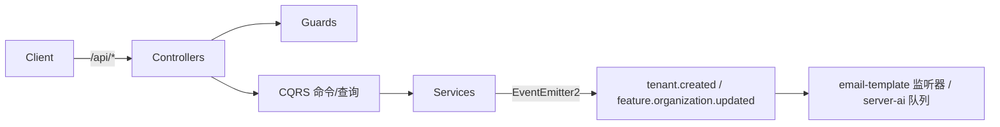
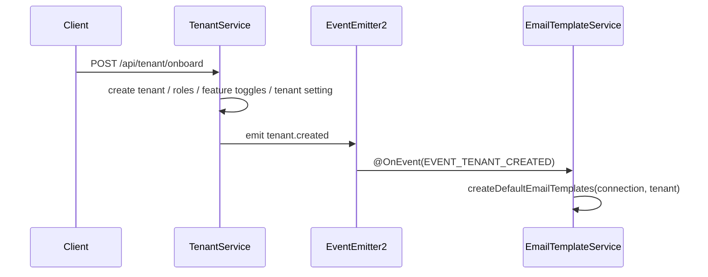

# 租户与平台设置域 · 接口文档

**本文引用的文件**
- [tenant.controller.ts](file://packages/server/src/tenant/tenant.controller.ts)
- [tenant.service.ts](file://packages/server/src/tenant/tenant.service.ts)
- [anonymous-tenant-resolver.service.ts](file://packages/server/src/tenant/anonymous-tenant-resolver.service.ts)
- [tenant.created.event.ts](file://packages/server/src/tenant/events/tenant.created.event.ts)
- [tenant.created.handler.ts](file://packages/server/src/tenant/events/handlers/tenant.created.handler.ts)
- [tenant-setting.controller.ts](file://packages/server/src/tenant/tenant-setting/tenant-setting.controller.ts)
- [tenant-setting.save.handler.ts](file://packages/server/src/tenant/tenant-setting/commands/handlers/tenant-setting.save.handler.ts)
- [tenant-setting.get.handler.ts](file://packages/server/src/tenant/tenant-setting/commands/handlers/tenant-setting.get.handler.ts)
- [feature.controller.ts](file://packages/server/src/feature/feature.controller.ts)
- [feature-toggle.controller.ts](file://packages/server/src/feature/feature-toggle.controller.ts)
- [feature.service.ts](file://packages/server/src/feature/feature.service.ts)
- [feature-organization.service.ts](file://packages/server/src/feature/feature-organization.service.ts)
- [feature-organization.updated.event.ts](file://packages/server/src/feature/events/feature-organization.updated.event.ts)
- [feature-upgrade.handler.ts](file://packages/server/src/feature/commands/handlers/feature-upgrade.handler.ts)
- [create-feature-toggle.dto.ts](file://packages/server/src/feature/dto/create-feature-toggle.dto.ts)
- [feature-organization-query.dto.ts](file://packages/server/src/feature/dto/feature-organization-query.dto.ts)
- [referral.controller.ts](file://packages/server/src/referral/referral.controller.ts)
- [referral.service.ts](file://packages/server/src/referral/referral.service.ts)
- [referral-validation-rate-limit.service.ts](file://packages/server/src/referral/referral-validation-rate-limit.service.ts)
- [custom-smtp.controller.ts](file://packages/server/src/custom-smtp/custom-smtp.controller.ts)
- [custom-smtp.service.ts](file://packages/server/src/custom-smtp/custom-smtp.service.ts)
- [create-custom-smtp.dto.ts](file://packages/server/src/custom-smtp/dto/create-custom-smtp.dto.ts)
- [email.controller.ts](file://packages/server/src/email/email.controller.ts)
- [email-template.controller.ts](file://packages/server/src/email-template/email-template.controller.ts)
- [email-template.service.ts](file://packages/server/src/email-template/email-template.service.ts)
- [email-template.handler.ts](file://packages/server/src/email-template/queries/handlers/email-template.handler.ts)
- [email-template.find.handler.ts](file://packages/server/src/email-template/queries/handlers/email-template.find.handler.ts)
- [crud.controller.ts](file://packages/server/src/core/crud/crud.controller.ts)
- [tenant-permission.guard.ts](file://packages/server/src/shared/guards/tenant-permission.guard.ts)
- [permission.guard.ts](file://packages/server/src/shared/guards/permission.guard.ts)
- [main.ts](file://apps/api/src/main.ts)
- [bootstrap/index.ts](file://apps/api/src/bootstrap/index.ts)
- [tenant-admin-cli.ts](file://apps/api/src/tenant-admin-cli.ts)
- [seed-data.service.ts](file://packages/server/src/core/seeds/seed-data.service.ts)
- [membership-backfill.processor.ts](file://packages/server-ai/src/membership/membership-backfill.processor.ts)

## 目录

- [全局约定](#全局约定)
- [鉴权与限流约定](#鉴权与限流约定)
- [HTTP 端点：TenantController（/tenant）](#http-端点tenantcontrollertenant)
- [HTTP 端点：TenantSettingController（/tenant-setting）](#http-端点tenantsettingcontrollertenant-setting)
- [HTTP 端点：FeatureController（/feature）](#http-端点featurecontrollerfeature)
- [HTTP 端点：FeatureToggleController（/feature/toggle）](#http-端点featuretogglecontrollerfeaturetoggle)
- [HTTP 端点：ReferralController（/referral）](#http-端点referralcontrollerreferral)
- [HTTP 端点：CustomSmtpController（/smtp）](#http-端点customsmtpcontrollersmtp)
- [HTTP 端点：EmailController（/email）](#http-端点emailcontrolleremail)
- [HTTP 端点：EmailTemplateController（/email-template）](#http-端点emailtemplatecontrolleremail-template)
- [事件入口（非 HTTP）](#事件入口非-http)
- [CQRS 命令与查询入口（非 HTTP）](#cqrs-命令与查询入口非-http)
- [CLI 入口](#cli-入口)
- [版本策略](#版本策略)

## 全局约定

- 应用全局前缀为 `api`，Swagger 文档挂在 `swg`，服务端口取 `PORT`（容器样例为 3000）。
- 本域 8 个 controller 的模块前缀：`/tenant`、`/tenant-setting`、`/feature`、`/feature` + `@Controller('toggle')`、`@Controller('referral')`、`/smtp`、`/email`、`/email-template`；实际对外路径需再加 `api` 前缀（如 `GET /api/tenant/onboard`）。
- 请求体校验：类级/方法级 `ValidationPipe({ transform, whitelist })` 或 `UseValidationPipe`；路径参数使用 `UUIDValidationPipe`（非 UUID → 400）；`ParseJsonPipe` 用于 `?data=` JSON 串。
- 错误格式为 Nest 默认 `HttpException` 响应体（`statusCode` / `message` / `error`）；使用 i18next 的错误其 `message` 为完整 key 文本，本域 key 形如 `server-ai:Error.*`（例：`server-ai:Error.ReferralValidationRateLimited`）。
- 契约类型全部来自 `@xpert-ai/contracts`（`ITenantCreateInput`、`ITenantSetting`、`IFeatureOrganizationUpdateInput`、`IEmailTemplateSaveInput` 等），响应包装默认由 Nest 序列化，`CustomSmtpController` 额外显式挂 `TransformInterceptor`。

图表来源：[tenant.service.ts](file://packages/server/src/tenant/tenant.service.ts)（关键符号：TenantService.onboardTenant）、[feature-organization.service.ts](file://packages/server/src/feature/feature-organization.service.ts)（关键符号：FeatureOrganizationService.updateFeatureOrganization）

章节来源：[bootstrap/index.ts](file://apps/api/src/bootstrap/index.ts)（关键符号：bootstrap/globalPrefix）

## 鉴权与限流约定

- `TenantPermissionGuard`（要求登录态携带 tenantId）用于：tenant、tenant-setting 的全部非 `@Public` 端点，CustomSmtp 与 Email / EmailTemplate 的整类，以及 feature toggle 的 `/`、`/organizations`；开启 `ALLOW_SUPER_ADMIN_ROLE` 时 SUPER_ADMIN 直接放行。
- `RoleGuard` + `@Roles(SUPER_ADMIN)` 用于 tenant（GET `/`、GET `/:id`、PUT `/:id`、DELETE `/:id`）、tenant-setting（GET/POST）、feature 的 `POST /upgrade`；referral `GET /relations` 额外要求 `@Roles(SUPER_ADMIN, ADMIN)` + `@Permissions(REFERRAL_VIEW)`。
- feature toggle 的读接口用 `PermissionGuard` + `ALL_ORG_VIEW`，写接口用 `ALL_ORG_EDIT`（权限结果按 `tenantId_roleId_permissions` 缓存 5 分钟）。
- `@Public()` 白名单：`GET /tenant/onboard`、`POST /tenant/onboard`、`GET /feature/toggle/definition`、`GET /referral/availability`、`GET /referral/validate`。
- 手工越权校验（无守卫组合）：`tenant/:id` 三个方法、`email-template` 的 PUT/DELETE 均在服务层比对当前租户，非本租户 → 403。
- 限流：仅 `GET /referral/validate`，Redis 原子计数，键 `referral:validation-rate:<tenantId>:<sha256(ip)[0:32]>`，窗口 60s、上限 30；超限 429，Redis 客户端不可用或计数非数值 500。

章节来源：[tenant-permission.guard.ts](file://packages/server/src/shared/guards/tenant-permission.guard.ts)（关键符号：TenantPermissionGuard）、[referral-validation-rate-limit.service.ts](file://packages/server/src/referral/referral-validation-rate-limit.service.ts)（关键符号：ReferralValidationRateLimitService.assertAllowed）

## HTTP 端点：TenantController（/tenant）

| 方法 | 路径 | 守卫 / @Public | 参数与 DTO | 语义 | 主要错误 |
| --- | --- | --- | --- | --- | --- |
| GET | /tenant/count | 无守卫声明 | — | 显式抛错，禁用基类计数接口 | 405 |
| GET | /tenant/pagination | 无守卫声明 | — | 显式抛错，禁用基类分页接口 | 405 |
| GET | /tenant | RoleGuard + TenantPermissionGuard，`@Roles(SUPER_ADMIN)` | — | 仅返回“当前租户”一条（`where.id = currentTenantId`）的 `IPagination<Tenant>` | 404 |
| GET | /tenant/onboard | `@Public()` | — | 按请求 `tenant-domain` 解析租户，缺失时回退 `DEFAULT_TENANT`；返回租户（settings 仅保留 name 以 `tenant` 开头项），解析不到返回 `null`；HTTP 200 | 该端点自身无显式错误；无租户时返回 null |
| GET | /tenant/:id | RoleGuard + TenantPermissionGuard，`@Roles(SUPER_ADMIN)` | `id`（UUID pipe） | 仅允许查询当前租户 | 403（`id !== currentTenantId`）、400（非 UUID）、404 |
| POST | /tenant | 无守卫声明（仅全局鉴权链） | Body `ITenantCreateInput` | 当前用户已属租户或已有角色 → 拒绝；否则走 `onboardTenant`，201 | 400 `Tenant already exists` |
| POST | /tenant/onboard | `@Public()` | Body `ITenantCreateInput`（含 `superAdmin`、`defaultOrganization`） | 仅允许首租户：已有租户或同名租户 → 拒绝；成功时先执行 `LanguageInitCommand` → `FeatureBulkCreateCommand` → `UserCreateCommand` 再 `onboardTenant(prepared, user, { skipSubdomainPreparation: true })`，201 | 400 `Tenant already exists` |
| PUT | /tenant/:id | RoleGuard + TenantPermissionGuard，`@Roles(SUPER_ADMIN)` | `id` + Body `ITenantCreateInput` | 仅允许改当前租户；更新前规范化/查重子域，成功后回读返回，200 | 403、400（`Tenant subdomain is invalid` / `Tenant subdomain already exists`） |
| DELETE | /tenant/:id | RoleGuard + TenantPermissionGuard，`@Roles(SUPER_ADMIN)` | `id` | 仅允许删当前租户，HTTP 202 | 403 |

补充：`POST /tenant` 未声明 `RoleGuard/TenantPermissionGuard`，越权判断依赖用户自身 `tenantId/roleId` 为空；子域规范化规则见 `normalizeTenantSubdomain`（小写、空白与标点折叠为 `-`，无法产生合法值 → 400 / null）。

章节来源：[tenant.controller.ts](file://packages/server/src/tenant/tenant.controller.ts)（关键符号：TenantController）

## HTTP 端点：TenantSettingController（/tenant-setting）

| 方法 | 路径 | 守卫 / @Public | 参数与 DTO | 语义 | 主要错误 |
| --- | --- | --- | --- | --- | --- |
| GET | /tenant-setting | TenantPermissionGuard + RoleGuard，`@Roles(SUPER_ADMIN)` | — | 通过 `TenantSettingGetCommand` 取当前租户设置并压成 `{name: value}`；注意 `@HttpCode(202)` | Swagger 声明 404；实际以 CQRS 处理器行为为准 |
| POST | /tenant-setting | TenantPermissionGuard + RoleGuard，`@Roles(SUPER_ADMIN)` | Body `ITenantSetting`（任意 name→value 映射） | `TenantSettingSaveCommand`：按 name upsert 当前租户设置，返回保存后的映射，201 | 400 |

章节来源：[tenant-setting.controller.ts](file://packages/server/src/tenant/tenant-setting/tenant-setting.controller.ts)（关键符号：TenantSettingController）

## HTTP 端点：FeatureController（/feature）

| 方法 | 路径 | 守卫 / @Public | 参数与 DTO | 语义 | 主要错误 |
| --- | --- | --- | --- | --- | --- |
| POST | /feature/upgrade | TenantPermissionGuard + RoleGuard，`@Roles(SUPER_ADMIN)` | Body `any`（透传给 `FeatureUpgradeCommand`） | 触发 `FeatureService.seedDB()` 重新同步内置 feature 定义（201） | 400（Swagger 声明） |

章节来源：[feature.controller.ts](file://packages/server/src/feature/feature.controller.ts)（关键符号：FeatureController）

## HTTP 端点：FeatureToggleController（/feature/toggle）

| 方法 | 路径 | 守卫 / @Public | 参数与 DTO | 语义 | 主要错误 |
| --- | --- | --- | --- | --- | --- |
| GET | /feature/toggle/definition | `@Public()` | — | 返回 `toggleFeatures` 开关定义清单（来源 `@xpert-ai/server-config`） | — |
| GET | /feature/toggle/parent | 无域内守卫声明 | Query `RelationsQueryDTO`（`relations`） | 顶层 feature（`parentId IS NULL`，按 createdAt ASC）并过滤 `RETIRED_FEATURE_CODES`，返回 `{items,total}` | 400（内部异常被包成 BadRequest） |
| GET | /feature/toggle/organizations | TenantPermissionGuard + PermissionGuard，`@Permissions(ALL_ORG_VIEW)` | Query `FeatureOrganizationQueryDTO`：`tenantId?`、`organizationId?`、`relations?` | 分页返回组织/租户级 feature 开关 | 400（内部异常被包成 BadRequest） |
| GET | /feature/toggle/ | TenantPermissionGuard + PermissionGuard，`@Permissions(ALL_ORG_VIEW)` | — | 返回全部 feature 分页 | 400 |
| POST | /feature/toggle/ | TenantPermissionGuard + PermissionGuard，`@Permissions(ALL_ORG_EDIT)` | Body `CreateFeatureToggleDTO[]`（`featureId`、`isEnabled`、`organizationId?`） | 批量执行 `FeatureToggleUpdateCommand`，返回 `boolean[]`（并行） | 400；组织级 `FEATURE_MEMBERSHIP_PURCHASE` → `server-ai:Error.MembershipPurchaseFeatureTenantScopeRequired` |

章节来源：[feature-toggle.controller.ts](file://packages/server/src/feature/feature-toggle.controller.ts)（关键符号：FeatureToggleController）

## HTTP 端点：ReferralController（/referral）

| 方法 | 路径 | 守卫 / @Public | 参数与 DTO | 语义 | 主要错误 |
| --- | --- | --- | --- | --- | --- |
| GET | /referral/availability | `@Public()` | — | 无租户上下文 → `false`；否则按租户级 `FEATURE_REFERRAL` 开关返回布尔 | — |
| GET | /referral/validate | `@Public()` | Query `code` | 无租户 → `false`；否则先限流（tenant + 客户端 IP）再校验邀请码是否属于有效用户 | 429 `server-ai:Error.ReferralValidationRateLimited`；500 `server-ai:Error.ReferralValidationRateLimitUnavailable` |
| GET | /referral/me | 无域内守卫声明（需登录 + 租户 scope） | — | 返回 `{ code }`，不存在时按需生成 | 401 `...ReferralAuthenticatedUserRequired`；400 `...ReferralTenantContextRequired`；通信用户或开关关闭 → 404 |
| POST | /referral/me/regenerate | 同上 | — | 事务内（悲观写锁）原子换码，旧码关系不变，201 | 同 `/me`；生成失败 → `server-ai:Error.ReferralCodeGenerationFailed` |
| GET | /referral/relations | TenantPermissionGuard + RoleGuard + PermissionGuard，`@Roles(SUPER_ADMIN, ADMIN)`，`@Permissions(REFERRAL_VIEW)` | Query `IReferralRelationQuery`：`search?`、`skip?`、`take?` | 租户内关系分页（take 夹在 1..100，默认 20，按 boundAt DESC），已删除用户返回占位视图 | 400 `...ReferralTenantScopeRequired`（非租户 scope）；开关关闭 → 404 |

章节来源：[referral.controller.ts](file://packages/server/src/referral/referral.controller.ts)（关键符号：ReferralController）

## HTTP 端点：CustomSmtpController（/smtp）

类级 `@UseGuards(TenantPermissionGuard)` 与 `@UseInterceptors(TransformInterceptor)`。

| 方法 | 路径 | 守卫 / @Public | 参数与 DTO | 语义 | 主要错误 |
| --- | --- | --- | --- | --- | --- |
| GET | /smtp/setting | TenantPermissionGuard | Query `ICustomSmtpFindInput`（`organizationId?`） | 返回租户/组织级自定义 SMTP（`organizationId` 空则按 `IsNull()` 取租户级、createdAt DESC）；查询异常时回退 `SMTPUtils.defaultSMTPTransporter(false)`（`MAIL_*` 环境变量，且不含认证） | Swagger 声明 404；实际以回退配置兜底 |
| POST | /smtp/validate | TenantPermissionGuard；`UseValidationPipe({ whitelist })` | Body `ValidateCustomSmtpDTO` | 用 nodemailer `verify()` 实测配置，返回布尔（异常吞掉 → false） | 400（DTO 校验） |
| POST | /smtp | TenantPermissionGuard；`ValidationPipe({ transform, whitelist })` | Body `CreateCustomSmtpDTO`（`fromAddress/host/port/secure/isValidate/username/password/organizationId?`，port/secure 自动转型） | `CustomSmtpCreateCommand` 新建配置，201 | 400 |
| PUT | /smtp/:id | TenantPermissionGuard；UUID pipe + ValidationPipe | `id` + Body `CreateCustomSmtpDTO` | `CustomSmtpUpdateCommand({ id, ...entity })` 更新 | 400 / 404（Swagger 声明） |

继承自 `CrudController`（同名路由被上述 POST/PUT 覆盖）：`GET /smtp/count`、`GET /smtp/pagination`、`GET /smtp`、`GET /smtp/my`、`GET /smtp/:id`、`DELETE /smtp/:id`（202）、`DELETE /smtp/:id/soft`（202）、`PUT /smtp/:id/recover`（202）。

章节来源：[custom-smtp.controller.ts](file://packages/server/src/custom-smtp/custom-smtp.controller.ts)（关键符号：CustomSmtpController）

## HTTP 端点：EmailController（/email）

类级 `@UseGuards(TenantPermissionGuard)`。

| 方法 | 路径 | 守卫 / @Public | 参数与 DTO | 语义 | 主要错误 |
| --- | --- | --- | --- | --- | --- |
| GET | /email | TenantPermissionGuard | Query `data`（JSON：`{relations, findInput, take}`） | 覆盖基类 findAll：按 `createdAt DESC` 分页列出邮件记录 | — |
| PUT | /email/:id | TenantPermissionGuard；UUID pipe | `id` + Body `IEmailUpdateInput` | 更新邮件记录，HTTP 202 | 400 / 404 |

继承自 `CrudController`：`GET /email/count`、`GET /email/pagination`、`GET /email/my`、`GET /email/:id`、`POST /email`（201）、`DELETE /email/:id`（202）、`DELETE /email/:id/soft`（202）、`PUT /email/:id/recover`（202）。

章节来源：[email.controller.ts](file://packages/server/src/email/email.controller.ts)（关键符号：EmailController）

## HTTP 端点：EmailTemplateController（/email-template）

类级 `@UseGuards(TenantPermissionGuard)`。

| 方法 | 路径 | 守卫 / @Public | 参数与 DTO | 语义 | 主要错误 |
| --- | --- | --- | --- | --- | --- |
| GET | /email-template/count | TenantPermissionGuard；`UseValidationPipe()` | Query `FindOptionsWhere<EmailTemplate>` | 计数，强制叠加 `tenantId = 当前租户` | — |
| GET | /email-template/pagination | TenantPermissionGuard；`ValidationPipe({ transform })` | Query `PaginationParams<EmailTemplate>` | 基类分页 | — |
| GET | /email-template/template | TenantPermissionGuard | Query `data`（`{findInput:{name, organizationId, languageCode}}`）+ `LanguageDecorator` 主题语言 | `FindEmailTemplateQuery`：组织级 → 租户级 → 英文兜底，返回 `{subject, template}` | — |
| POST | /email-template/template/preview | TenantPermissionGuard | Body `data`（mjml/hbs 文本） | `EmailTemplateGeneratePreviewQuery` 转换预览 HTML | — |
| POST | /email-template/template/save | TenantPermissionGuard | Body `data`（`IEmailTemplateSaveInput`） | `EmailTemplateSaveCommand` 保存模板 | — |
| GET | /email-template | TenantPermissionGuard；`UseValidationPipe()` | Query `BaseQueryDTO<EmailTemplate>` | `EmailTemplateQuery` 列出当前租户模板 | — |
| GET | /email-template/:id | TenantPermissionGuard；UUID pipe | `id` | 带 `tenantId` 条件查询（跨租户记录不可见） | 404（不存在） |
| PUT | /email-template/:id | TenantPermissionGuard；UUID pipe | `id` + Body `IEmailTemplateSaveInput` | 先读记录再手工比对 `tenantId`，通过后写入 | 403（跨租户）、404 |
| DELETE | /email-template/:id | TenantPermissionGuard；UUID pipe | `id` | 同上手工比对后删除 | 403（跨租户）、404 |

继承自 `CrudController`：`GET /email-template/my`、`POST /email-template`（201）、`DELETE /email-template/:id/soft`（202）、`PUT /email-template/:id/recover`（202）。

章节来源：[email-template.controller.ts](file://packages/server/src/email-template/email-template.controller.ts)（关键符号：EmailTemplateController）

## 事件入口（非 HTTP）

| 事件名 | 载荷 | 触发点 | 消费者 |
| --- | --- | --- | --- |
| `tenant.created` | `TenantCreatedEvent(tenantId, tenantName)` | `TenantService.onboardTenant` 第 8 步 `eventEmitter.emit`（`POST /tenant`、`POST /tenant/onboard` 都会经过） | ① CQRS `TenantCreatedHandler`（打印 chalk 日志）；② `EmailTemplateService.handleTenantCreatedEvent`（`@OnEvent(EVENT_TENANT_CREATED)`）为租户落默认模板；③ server-ai `BootstrapProcessor` 入队 skill repository bootstrap（jobId `tenant-skill-repository-bootstrap:<tenantId>`，attempts 3） |
| `feature.organization.updated` | `FeatureOrganizationUpdatedEvent(tenantId, organizationId, actorUserId, featureId, featureCode, previousIsEnabled, isEnabled)` | `FeatureOrganizationService.updateFeatureOrganization`：仅当 `previousIsEnabled !== entity.isEnabled` 才 emit；同时 bump `user:me:feature-context:tenant-version:<tenantId>` | server-ai `MembershipBackfillProcessor.enqueueBackfillWhenFeatureEnabled`：仅 `FEATURE_MEMBERSHIP_PLAN` 且由关→开时入队 membership backfill |

数据层钩子（TypeORM Subscriber，非 EventEmitter）：`ReferralCodeSubscriber.listenTo(User).afterInsert` 在用户新增后调用 `ensureReferralCode`（跳过 `UserType.COMMUNICATION`）。

图表来源：[tenant.created.event.ts](file://packages/server/src/tenant/events/tenant.created.event.ts)（关键符号：EVENT_TENANT_CREATED）、[email-template.service.ts](file://packages/server/src/email-template/email-template.service.ts)（关键符号：EmailTemplateService.handleTenantCreatedEvent）

章节来源：[tenant.service.ts](file://packages/server/src/tenant/tenant.service.ts)（关键符号：TenantService.onboardTenant）、[feature-organization.updated.event.ts](file://packages/server/src/feature/events/feature-organization.updated.event.ts)（关键符号：EVENT_FEATURE_ORGANIZATION_UPDATED）

## CQRS 命令与查询入口（非 HTTP）

| 命令 / 查询 | 入口 | 语义 |
| --- | --- | --- |
| `TenantSettingGetCommand` | `GET /tenant-setting` | 取当前租户设置映射 |
| `TenantSettingSaveCommand` | `POST /tenant-setting`；`TenantService.onboardTenant` 第 4 步（写 `fileStorageProvider=LOCAL`） | 按 name upsert 设置 |
| `FeatureUpgradeCommand` | `POST /feature/upgrade` | 调 `FeatureService.seedDB()` 同步内置定义 |
| `FeatureBulkCreateCommand` | `POST /tenant/onboard` | 按 `DEFAULT_FEATURES` 建/修正 feature 行（含 reparent、清理 legacy 重复行） |
| `FeatureToggleUpdateCommand` | `POST /feature/toggle` | 写租户/组织级开关（含 membership-purchase 组织级拒绝） |
| `GetDefaultTenantQuery` | 内部（`TenantModule` 导出查询处理器） | 取 `DEFAULT_TENANT` 租户，结果缓存键 `tenant:default`，TTL 24h |
| `EmailTemplateQuery` | `GET /email-template` | 租户内模板列表 |
| `FindEmailTemplateQuery` | `GET /email-template/template` | 组织级→租户级→英文兜底解析 |
| `EmailTemplateGeneratePreviewQuery` | `POST /email-template/template/preview` | mjml/hbs → html |
| `EmailTemplateSaveCommand` | `POST /email-template/template/save` | 保存模板 |

`onboardTenant` 内部命令链（副作用顺序）：`TenantRoleBulkCreateCommand` → `TenantFeatureOrganizationCreateCommand` → `TenantSettingSaveCommand` → （有 `defaultOrganization` 时）`OrganizationCreateCommand`（带 `onboardingSuperAdminUserId`）→ `EVENT_TENANT_CREATED`；`POST /tenant/onboard` 额外先跑 `LanguageInitCommand`、`FeatureBulkCreateCommand`、`UserCreateCommand`。

章节来源：[tenant-setting.save.handler.ts](file://packages/server/src/tenant/tenant-setting/commands/handlers/tenant-setting.save.handler.ts)（关键符号：TenantSettingSaveHandler）、[feature-upgrade.handler.ts](file://packages/server/src/feature/commands/handlers/feature-upgrade.handler.ts)（关键符号：FeatureUpgradeHandler）

## CLI 入口

- 进程命令分发（`argv.command`）：`seed`（`seedDefault`）、`seedModule`、`tenant`、`schema-sync`、`knowledge-filter-v2`；无命令时进入 HTTP 引导。
- 租户管理 CLI：`--command tenant --action list|get|create|update|delete`，选择器 `--id` / `--name` / `--subdomain`（get 三者只能给一个），`update` 需至少一个字段（`--name`、`--subdomain`、`--clear-subdomain`），`delete` 需 `--confirm <id>`；`create` 走 `seedModule`（`Tenant` 模块 + tenantName）再补子域。
- Seed 侧复用的域内函数：`createDefaultTenant` / `createRandomTenants`、`createFeatures` / `createDefaultFeatureToggle`、`createDefaultTenantSetting`、`createDefaultEmailTemplates`（由 `SeedDataService` 编排）。

章节来源：[main.ts](file://apps/api/src/main.ts)（关键符号：argv.command 分发）、[tenant-admin-cli.ts](file://apps/api/src/tenant-admin-cli.ts)（关键符号：runTenantAdminCli）

## 版本策略

- 无 URI/Header 版本化：未调用 `enableVersioning`，仅统一加 `api` 全局前缀；Swagger 由 `DocumentBuilder().setTitle('Xpert AI').setVersion('1.0')` 生成，文档路径 `swg`。
- 对外契约以 `@xpert-ai/contracts` 中的 `I*` 类型与枚举（`RolesEnum`、`PermissionsEnum`、`FeatureEnum`、`UserType`）为唯一权威；本域 controller 方法签名直接引用这些类型。
- 兼容性标记：`email-template/events/handlers/tenant.created.handler.ts` 标为 `@deprecated`（改用 `@OnEvent('tenant.created')`）；tenant 事件类中的 CQRS 发布路径已注释停用，实际以 EventEmitter2 为准。
- 破坏性变更检测：本域未见显式版本协商代码，该模块无此项（无版本头/版本路由）。

章节来源：[create-feature-toggle.dto.ts](file://packages/server/src/feature/dto/create-feature-toggle.dto.ts)（关键符号：CreateFeatureToggleDTO）、[bootstrap/index.ts](file://apps/api/src/bootstrap/index.ts)（关键符号：SwaggerModule.setup）
