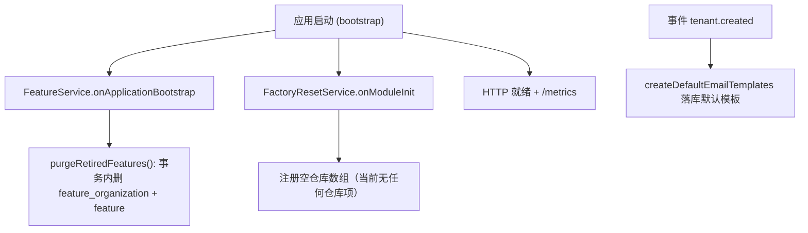

# 租户与平台设置域 · 运维文档

**本文引用的文件**
- [tenant.service.ts](file://packages/server/src/tenant/tenant.service.ts)
- [tenant-settings.middleware.ts](file://packages/server/src/tenant/tenant-setting/tenant-settings.middleware.ts)
- [tenant.permission.guard.ts placeholder](file://packages/server/src/shared/guards/tenant-permission.guard.ts)
- [get-default.handler.ts](file://packages/server/src/tenant/queries/handlers/get-default.handler.ts)
- [feature.service.ts](file://packages/server/src/feature/feature.service.ts)
- [feature.seed.ts](file://packages/server/src/feature/feature.seed.ts)
- [feature-organization.service.ts](file://packages/server/src/feature/feature-organization.service.ts)
- [current-user-feature-cache.ts](file://packages/server/src/user/current-user-feature-cache.ts)
- [referral-validation-rate-limit.service.ts](file://packages/server/src/referral/referral-validation-rate-limit.service.ts)
- [email.service.ts](file://packages/server/src/email/email.service.ts)
- [email-send/utils.ts](file://packages/server/src/email-send/utils.ts)
- [custom-smtp.service.ts](file://packages/server/src/custom-smtp/custom-smtp.service.ts)
- [email-template.seed.ts](file://packages/server/src/email-template/email-template.seed.ts)
- [default-email-template-path.ts](file://packages/server/src/email-template/default-email-template-path.ts)
- [factory-reset.service.ts](file://packages/server/src/user/factory-reset/factory-reset.service.ts)
- [referral-code.subscriber.ts](file://packages/server/src/referral/referral-code.subscriber.ts)
- [referral-code.entity.ts](file://packages/server/src/referral/referral-code.entity.ts)
- [redis.module.ts](file://packages/server/src/core/redis/redis.module.ts)
- [environment.ts](file://packages/config/src/environments/environment.ts)
- [pino-logger.ts](file://packages/server/src/logger/pino-logger.ts)
- [bootstrap/index.ts](file://apps/api/src/bootstrap/index.ts)
- [compose.health.yml](file://.deploy/api/compose.health.yml)
- [seed-data.service.ts](file://packages/server/src/core/seeds/seed-data.service.ts)

## 目录

- [概览](#概览)
- [配置文件组织与环境变量](#配置文件组织与环境变量)
- [部署相关](#部署相关)
- [Feature Flag](#feature-flag)
- [Seed 与启动副作用](#seed-与启动副作用)
- [缓存 TTL 与失效策略](#缓存-ttl-与失效策略)
- [日志框架与关键日志点](#日志框架与关键日志点)
- [监控与指标](#监控与指标)

## 概览

本域源码**不直接读 `process.env`，也不调用 `configService.get`**：所有环境相关行为都经 `@xpert-ai/server-config` 的 `environment` 对象（`env.smtpConfig`、`env.clientBaseUrl`、`env.allowSuperAdminRole`）或硬编码常量进入。运维影响集中在四块：SMTP 回退、Redis 依赖的限流、seed/启动清理副作用、若干带 TTL 的缓存。

图表来源：[feature.service.ts](file://packages/server/src/feature/feature.service.ts)（关键符号：FeatureService.onApplicationBootstrap）、[factory-reset.service.ts](file://packages/server/src/user/factory-reset/factory-reset.service.ts)（关键符号：FactoryResetService.onModuleInit）

章节来源：[tenant.service.ts](file://packages/server/src/tenant/tenant.service.ts)（关键符号：TenantService）、[bootstrap/index.ts](file://apps/api/src/bootstrap/index.ts)（关键符号：bootstrap）

## 配置文件组织与环境变量

本域**没有**自己的配置文件/命名空间，使用的是平台 `packages/config/src/environments/*`（`environment.ts` / `environment.prod.ts` 按 `NODE_ENV` 选择）与 `@nestjs/config`（Redis）。

| 变量名 | 用途 | 默认值 | 来源文件 |
| --- | --- | --- | --- |
| `MAIL_HOST` / `MAIL_PORT` / `MAIL_USERNAME` / `MAIL_PASSWORD` / `MAIL_FROM_ADDRESS` | 拼装 `env.smtpConfig`：无自定义 SMTP 时的回退发送配置（`/smtp/setting` 查询失败即回退，且 `defaultSMTPTransporter(false)` 不含认证） | 无默认（未配置即空/NaN） | [environment.ts](file://packages/config/src/environments/environment.ts)、[email-send/utils.ts](file://packages/server/src/email-send/utils.ts) |
| `SECURE`（由 `MAIL_PORT === '465'` 推导） | 回退 SMTP 是否 TLS | `false`（端口 465 时为 true） | [environment.ts](file://packages/config/src/environments/environment.ts) |
| `CLIENT_BASE_URL` | 邮件模板 `host` 变量（邀请/注册/重置链接基准），本域 email 发送多处在用 | `http://localhost:4200` | [environment.ts](file://packages/config/src/environments/environment.ts)、[email.service.ts](file://packages/server/src/email/email.service.ts) |
| `ALLOW_SUPER_ADMIN_ROLE` | 为 `false` 时 `TenantPermissionGuard` 不再直接放行 SUPER_ADMIN | `true` | [tenant-permission.guard.ts](file://packages/server/src/shared/guards/tenant-permission.guard.ts) |
| `REDIS_HOST` / `REDIS_PORT` / `REDIS_PASSWORD` | `RedisModule` 创建 `REDIS_CLIENT`；referral 校验限流**强依赖**该客户端 | `localhost` / `6379` / `''` | [redis.module.ts](file://packages/server/src/core/redis/redis.module.ts) |
| `REDIS_ENABLED` | 部署 compose 中出现，但 `RedisModule` 未读取（无开关语义） | 部署样例 `true` | [compose.health.yml](file://.deploy/api/compose.health.yml)、[redis.module.ts](file://packages/server/src/core/redis/redis.module.ts) |
| `LOG_LEVEL` / `LOG_FILE_PATH` / `LOG_DIR` / `LOG_FILE_MAX_SIZE` / `LOG_FILE_MAX_FILES` | 平台 pino 日志级别与滚动文件 | `log`（→ info） / `<LOG_DIR>/xpert-server.log` / `./logs` / `10m` / `5` | [pino-logger.ts](file://packages/server/src/logger/pino-logger.ts) |
| `PORT` / `HOST` / `API_BASE_URL` | 服务监听与自引用地址（全局前缀 `api`） | `3000` / `http://localhost` / `http://localhost:3000` | [bootstrap/index.ts](file://apps/api/src/bootstrap/index.ts)、[environment.ts](file://packages/config/src/environments/environment.ts) |

**不是环境变量的“配置项”（硬编码常量，运维无法用环境变量调节）**：

| 名称 | 用途 | 值 / 默认 | 来源文件 |
| --- | --- | --- | --- |
| `DISALLOW_EMAIL_SERVER_DOMAIN` | 命中则跳过真实发信（仅写历史记录） | `['@example.com']`（常量数组，非 env） | [email.service.ts](file://packages/server/src/email/email.service.ts) |
| referral 校验限流窗口 / 上限 | `GET /referral/validate` 限流 | `60_000 ms` / `30 次`（模块级常量） | [referral-validation-rate-limit.service.ts](file://packages/server/src/referral/referral-validation-rate-limit.service.ts) |
| `DEFAULT_TENANT` | 匿名租户解析回退名、seed 默认租户名 | `'Default Tenant'` | [packages/contracts/src/tenant.model.ts](file://packages/contracts/src/tenant.model.ts) |
| `CURRENT_USER_FEATURE_CACHE_TTL_MS` / 版本键 TTL | feature 上下文缓存与版本键 | `180_000 ms` / `24h` | [current-user-feature-cache.ts](file://packages/server/src/user/current-user-feature-cache.ts) |
| `RETIRED_FEATURE_CODES` | 启动/seed 时被清理的历史 feature code 集合 | 硬编码 Set（约 25 个） | [feature.service.ts](file://packages/server/src/feature/feature.service.ts) |
| 默认邮件模板目录 | 新租户默认模板来源 | 依次探测 `dirname/../core/seeds/data/default-email-templates`、`cwd/packages/server/src/...`、`cwd/dist/...`、`cwd/data/default-email-templates`；全部缺失则 warn 并**跳过** seed | [default-email-template-path.ts](file://packages/server/src/email-template/default-email-template-path.ts) |

章节来源：[environment.ts](file://packages/config/src/environments/environment.ts)（关键符号：smtpConfig/clientBaseUrl）、[pino-logger.ts](file://packages/server/src/logger/pino-logger.ts)（关键符号：resolveConfiguredLogLevel）

## 部署相关

- 全局前缀固定 `api`（`setGlobalPrefix('api', { exclude: ['artifacts/share', 'artifacts/share/(.*)', '.well-known/oauth-protected-resource/(.*)'] })`），Swagger 暴露在 `/swg`；本域路径实际为 `/api/tenant`、`/api/feature/toggle`、`/api/smtp` 等。
- 容器样例（`.deploy/api/compose.health.yml`）以 pgvector + redis-stack 为依赖，注入 `DB_*`、`REDIS_*`、`JWT_*`、`SESSION_SECRET`、`SECRETS_ENCRYPTION_KEY`、`DEPLOYMENT_TARGET=local` 等；健康检查 `node healthcheck.cjs`，`/health` 与 `/api/health` 的访问日志被 pino 自动忽略。
- 本域**没有独立迁移文件**：`referral_code` 表的唯一索引与 CHECK 约束由实体装饰器声明，依赖 schema sync/建表流程生效（启动前由 `schema-sync` 守卫流程保护，见 apps/api 的 schema-sync 模块）。
- 运维 CLI（同镜像内执行）：`--command seed`（默认 seed）、`--command seedModule --name Tenant --tenant <name>`、`--command tenant --action list|get|create|update|delete`（`delete` 必须 `--confirm <租户id>`）、`--command schema-sync`。
- 本域无独立部署单元/副本数特化配置，该模块无此项。

章节来源：[bootstrap/index.ts](file://apps/api/src/bootstrap/index.ts)（关键符号：setGlobalPrefix / SwaggerModule.setup）、[compose.health.yml](file://.deploy/api/compose.health.yml)（关键符号：api 环境变量清单）

## Feature Flag

- 运行期开关存储：`feature_organization` 表（`tenantId` 维度，`organizationId` 为空表示租户级），读写入口 `POST /api/feature/toggle`（`ALL_ORG_EDIT`）与 `GET /api/feature/toggle`（`ALL_ORG_VIEW`）。
- 定义清单：`GET /api/feature/toggle/definition`（`@Public`）返回 `@xpert-ai/server-config` 的 `toggleFeatures`；内置默认值在 `feature/default-features.ts` + `feature.seed.ts`（`createFeatures` / `createDefaultFeatureToggle`）。
- 变更传播：`POST /feature/toggle` 在开关真实翻转时 ① bump `user:me:feature-context:tenant-version:<tenantId>`；② emit `feature.organization.updated`，由 server-ai `MembershipBackfillProcessor` 在 `FEATURE_MEMBERSHIP_PLAN` 由关→开时入队补数任务。
- 约束：组织级 `FEATURE_MEMBERSHIP_PURCHASE` 被硬性拒绝（只能租户级配置）；分组类 feature（有 children）不生成租户开关。
- 退役面：`RETIRED_FEATURE_CODES` 在启动与 seed 时物理删除，配置了这些 code 的历史数据不会保留。
- 新租户默认态来自 `DEFAULT_FEATURES` 的 `isEnabled`（`createDefaultFeatureToggle` / `updateTenantFeatureOrganizations`）。

章节来源：[feature-organization.service.ts](file://packages/server/src/feature/feature-organization.service.ts)（关键符号：EVENT_FEATURE_ORGANIZATION_UPDATED 触发条件）、[feature.seed.ts](file://packages/server/src/feature/feature.seed.ts)（关键符号：createFeatures/createDefaultFeatureToggle）

## Seed 与启动副作用

| 时机 | 行为 | 影响 / 注意事项 |
| --- | --- | --- |
| 应用启动（`onApplicationBootstrap`） | `FeatureService.purgeRetiredFeatures()`：查 `RETIRED_FEATURE_CODES` 后在一个事务内 `delete(feature_organization)` → `delete(feature)` | 每次启动都执行；有退役行时**删除关联开关**，属数据面变更 |
| 模块初始化（`onModuleInit`） | `FactoryResetService.registerCoreRepositories()` 把 `repositories` 置为空数组 | 当前 `reset()` 主体被注释、`deleteSpecificTables` 遍历空数组 → 等价 no-op，无破坏性 |
| 事件 `tenant.created` | email-template 监听器读租户并 `createDefaultEmailTemplates(connection, tenant)`（文件遍历 + mjml→hbs 落库） | 模板目录缺失时只 warn 跳过；异常被 catch 并 `console.error`，不阻断创建流程 |
| 用户新增（TypeORM subscriber） | `ReferralCodeSubscriber.afterInsert` → `ensureReferralCode`（插入 `referral_code`，`orIgnore` + 最多 10 次重试） | 每新增一个非 COMMUNICATION 用户产生一行 10 位码；唯一约束冲突会重试 |
| CLI `seed` / `seedModule` | `SeedDataService` 编排 `createFeatures`、`createDefaultFeatureToggle`、`createDefaultTenant`/`createRandomTenants`、`createDefaultTenantSetting`（写 `fileStorageProvider=LOCAL`）、`createDefaultEmailTemplates` | 用于初始化或补租户；`tenant --action create` 会先跑 `seedModule(Tenant)` 再补子域 |
| 租户 onboarding（HTTP） | `onboardTenant` 依次建租户→角色→feature 开关→租户设置→（可选）默认组织→emit `tenant.created` | 任一步失败会中断 onboarding（例如找不到 SUPER_ADMIN 角色会抛 500） |

章节来源：[feature.service.ts](file://packages/server/src/feature/feature.service.ts)（关键符号：purgeRetiredFeatures）、[seed-data.service.ts](file://packages/server/src/core/seeds/seed-data.service.ts)（关键符号：SeedDataService）

## 缓存 TTL 与失效策略

| 缓存键 | TTL | 失效方式 | 备注 |
| --- | --- | --- | --- |
| `tenantSettings_<tenantId>`（`TenantSettingsMiddleware`） | 5 分钟 | **无主动失效**：`POST /tenant-setting` 保存后不清理该键 | 已知缺陷/风险：保存后最多 5 分钟内请求仍读到旧设置（中间件只按 TTL 过期）；空结果 `{}` 也会被缓存（对象恒为真值） |
| `tenant:default`（`GetDefaultTenantHandler`） | 24 小时 | 无失效 | 默认租户改名/删除后最长 24h 仍返回旧对象 |
| `userPermissions:<tenantId>_<roleId>_<perms>`（`PermissionGuard`） | 5 分钟 | 无失效 | 角色权限调整最长 5 分钟延迟 |
| `user:me:feature-context:...:v1:<tenantId>:<userId>:<hash>:<version>` | 180s | 版本键变化即自然 miss | 版本键 `user:me:feature-context:tenant-version:<tenantId>` 由开关写入时 bump，TTL 24h；`@Optional()` 注入，无 cacheManager 时不做任何失效 |
| Redis `referral:validation-rate:<tenantId>:<ipHash>` | 60s（首次 INCR 时 PEXPIRE） | 到期自动清理 | 仅用于限流计数；Redis 不可用直接 500（fail-closed） |

章节来源：[tenant-settings.middleware.ts](file://packages/server/src/tenant/tenant-setting/tenant-settings.middleware.ts)（关键符号：TenantSettingsMiddleware.use）、[current-user-feature-cache.ts](file://packages/server/src/user/current-user-feature-cache.ts)（关键符号：CURRENT_USER_FEATURE_CACHE_TTL_MS）

## 日志框架与关键日志点

- 框架：平台级 `nestjs-pino`（`Logger` from `nestjs-pino`；非生产环境 `pino-pretty` 单行彩色，生产写 stdout + 滚动文件），请求侧带 `x-request-id`（非 UUID 时自动生成）、`service=xpert-server`、`traceparent/tracestate` 透传、HTTP 日志脱敏（`HTTP_LOG_REDACTION`）。级别由 `LOG_LEVEL` 控制（默认 `log`→info）。
- 本域代码**未使用 pino 实例**，只使用 `@nestjs/common` 的 `Logger` 与 `console.*`：

| 位置 | 形式 | 内容 |
| --- | --- | --- |
| `email/email.service.ts` | `new Logger(EmailService.name)` | `logger.debug('try to send email:', body)` 等发送链路调试信息；多处 `console.error(error)` 吞掉发送异常 |
| `tenant/queries/handlers/get-default.handler.ts` | `new Logger(GetDefaultTenantHandler.name)` | 已声明但未打日志（仅占位） |
| `tenant/events/handlers/tenant.created.handler.ts` | `console.log(chalk.magenta(...))` | `Tenant '<name>' Created: <id>` |
| `feature/feature.service.ts` | `console.log(chalk.magenta('Seed Features into DB'))` / `console.error(err)` | seed 与退役清理失败 |
| `email-template/email-template.seed.ts` | `console.warn` / `console.error` / `console.log` | 模板目录缺失、目录读取失败、忽略非 hbs/mjml 文件、`Something went wrong` |
| `email-template/email-template.service.ts` | `console.log(chalk.magenta(...))` | `Seed (n) email templates for Tenant '<name>'` |
| `tenant/tenant-setting/tenant-settings.middleware.ts` | `console.log(...)`（受 `private logging = false` 控制）+ `console.error` | 缓存命中/回源信息；失败时打印 `error.message` 与 `request.path/url` |
| `custom-smtp/custom-smtp.service.ts` | `console.log('Error while verifying nodemailer transport: %s', ...)` | SMTP 验证失败 |
| `shared/guards/tenant-permission.guard.ts` | `console.log('Unauthorized access blocked. TenantId:', ...)` | 租户守卫拒绝时（未走 Logger，排查 401/403 时注意其不经 pino） |

章节来源：[pino-logger.ts](file://packages/server/src/logger/pino-logger.ts)（关键符号：buildPinoLoggerParams）、[email.service.ts](file://packages/server/src/email/email.service.ts)（关键符号：EmailService.logger）

## 监控与指标

- 本域**没有**自定义指标/追踪埋点：无 Counter/Histogram、无 OpenTelemetry span，该模块无此项。
- 平台级可用信号（由 `@xpert-ai/server-ai` 提供、apps/api 装配）：`GET /metrics` 暴露 `MetricsService.render()`（Prometheus 文本），并以中间件记录每次 HTTP 请求（`applicationMetrics.recordHttpRequest`）；健康检查路径 `/health`、`/api/health`。
- 可观测的运维要点（无指标时的替代手段）：启动日志中的 feature 退役清理、`tenant.created` 日志、限流 429/500 响应码、`auth` 侧 `x-request-id` 关联日志。

章节来源：[bootstrap/index.ts](file://apps/api/src/bootstrap/index.ts)（关键符号：createHttpRequestMetricsMiddleware / '/metrics' 路由）
