# C4 数据流向与消费：身份与权限专家（契约层）

> 只描述数据用途与「谁写、谁读」，不描述消费方的处理逻辑。
> 覆盖清单逐表列出（清单标称 14 张，实列 15 项，两张关联表 `user_group_to_user`、`invite_organization_contact` 随所属主表一并说明）。
> 消费方数据来自表级反向索引扫描；多于 3 个消费方时按模块归纳并标注。

**本文引用的文件**
- [tables.md](file://.fe-index/xpert-server/tables.md)
- [user.entity.ts](file://packages/server/src/user/user.entity.ts)
- [user-organization.entity.ts](file://packages/server/src/user-organization/user-organization.entity.ts)
- [role.entity.ts](file://packages/server/src/role/role.entity.ts)
- [invite.entity.ts](file://packages/server/src/invite/invite.entity.ts)
- [api-key.entity.ts](file://packages/server/src/api-key/api-key.entity.ts)
- [secret-token.entity.ts](file://packages/server/src/secret-token/secret-token.entity.ts)
- [password-reset.entity.ts](file://packages/server/src/password-reset/password-reset.entity.ts)
- [03-数据流转.md](file://.module-experts/后端专题/身份与权限专家/implementation/03-数据流转.md)

## 总览

```mermaid
flowchart LR
  subgraph W[写入入口]
    A1["/api/auth/signup · /register · login · refresh"]
    A2["/api/invite/emails · /user · /employee · /contact"]
    A3["/api/user-organization · /user-groups · /roles · /role-permissions"]
    A4["/api/api-key · secret-token 签发 · /api/auth/sso/*"]
  end
  subgraph T[表]
    T1[user / email_verification / password_reset]
    T2[user_organization / organization / organization_contact / organization_language]
    T3[role / role_permission / user_group / user_group_to_user]
    T4[invite / invite_organization_contact / employee]
    T5[api_key / secret_token / external_identity_binding]
  end
  subgraph R[主要消费方]
    R1[auth · user · user-organization · membership]
    R2[role · role-permission · shared guards · invite]
    R3[account-binding · api-key · secret-token · tenant-admin-cli]
    R4[server-ai 侧：xpert-project / mcp-publication / model-access / agent-invocation]
  end
  W --> T --> R
```

图表来源：本文件各节 `章节来源`

## 逐表数据实体

### 1. `user`
- 实体类型：登录主体主表（`User extends TenantBaseEntity`）。
- 结构：`type`（`UserType`，默认 `USER`）、`thirdPartyId`、`email` / `username`（普通索引，**非唯一**）、`hash`（`@Exclude()`）、`refreshToken`（`@Exclude()`）、`emailVerified`、`roleId`、`deletedAt`（软删）；1:1 `employee`；M2M `tag_user`。
- 生产方：`AuthService.register` / `signup` / `createRegisteredUser` / `registerVerifiedExternalIdentity`、`UserService.create` / `updateProfile` / `changePassword`、用户 seed。
- 主要消费方（25 个模块）：`auth`、`account-binding`、`user`、`role`、`user-group`、`user-organization`、`email`、`health`、`tenant-admin-cli`、`factory-reset`、`chat-group`、`tenant`、`chat-conversation`、`handoff-queue`，以及 AI 侧 `xpert-project`、`xpert-project-access`、`mcp-publication`、`agent-invocation`、`model-access`、`copilot-usage`、`membership`、`model-gateway`、`xpert-marketplace`、`xpert-task`、`xpert-workspace` [基于引用扫描，未深入验证]。
- 业务用途一句话：真人用户与 `COMMUNICATION` 技术用户的统一身份行，所有凭据与角色的挂载点。
- 详细流向：本文件 §凭据类数据；schema 细节见 [04-模型.md](file://.module-experts/后端专题/身份与权限专家/sub-experts/组织与成员子专家/implementation/04-模型.md)。

### 2. `email_verification`
- 实体类型：邮箱验证凭据（`EmailVerification extends TenantBaseEntity`，1:1 用户）。
- 结构：`token`（唯一索引）、`validUntil`、`userId`；对 `user` 为 `onDelete: CASCADE`。
- 生产方：`AuthService.signup`（写 token + 2 天有效）、`AuthService.resendVerificationMail`（覆盖 token）。
- 主要消费方（3 个模块）：`user`、`auth`、`tenant-admin-cli`。
- 业务用途一句话：一次性邮箱验证凭据，重发即令旧链接失效。
- 详细流向：本文件 §凭据类数据。

### 3. `user_organization`
- 实体类型：用户 × 组织成员关系（`UserOrganization extends TenantOrganizationBaseEntity`）。
- 结构：`isDefault`、`isActive`、`preferences`（jsonb）、`userId`、`organizationId`；无 `(user,organization)` 唯一索引，唯一性由服务层保证。
- 生产方：`UserOrganizationService.ensureMembership` / `ensureMembershipInTransaction` / `create` / `update`、注册链事务内的成员创建、组织创建时的 onboarding 成员。
- 主要消费方（13 个模块）：`user-organization`、`auth`、`membership`、`xpert-project`、`agent-invocation`、`xpert-project-access`、`user-group`、`xpert-workspace`、`validator`、`factory-reset`、`chat-group`、`organization`、`handoff-queue` [基于引用扫描，未深入验证]。
- 业务用途一句话：用户归属的组织集合，承载「至多一个默认组织、至少一个活跃成员」两条不变量与用户偏好。
- 详细流向：本文件 §组织与成员类数据；不变量见 [03-数据流转.md](file://.module-experts/后端专题/身份与权限专家/implementation/03-数据流转.md)。

### 4. `user_group`（含 `user_group_to_user`）
- 实体类型：组织级用户组（`UserGroup extends TenantOrganizationBaseEntity`）+ 组成员关联表。
- 结构：`name`、`description`、托管三元组 `managedBy` / `managedEntityType` / `managedEntityId`（部分唯一索引 `IDX_user_group_managed_entity_unique`）；成员存于 `user_group_to_user`（M2M → `user`）。
- 生产方：`UserGroupService.create` / `update` / `updateMembers`；托管三元组仅由平台侧写入（HTTP 入口会剥离该元数据）。
- 主要消费方（3 个模块）：`user-group`、`organization`（删除组织前置校验）、`xpert-marketplace`。
- 业务用途一句话：给一组用户批量授权（当前用于把已发布智能体的运行能力桥接给组内成员）。
- 详细流向：本文件 §授权类数据；授权边界见 [C5-关键决策.md](file://.module-experts/后端专题/身份与权限专家/contracts/C5-关键决策.md)。

### 5. `role`
- 实体类型：租户级角色（`Role extends TenantBaseEntity`）。
- 结构：`name`（`RolesEnum`，索引）、`isSystem`（默认 false）、`tenantId`；1:N `rolePermissions`（`cascade: true`）、1:N `users`。
- 生产方：`RoleService.create`（强制 `isSystem: false`）/ `createBulk` / `update`、角色 seed、租户 onboarding 的角色批量创建。
- 主要消费方（9 个模块）：`invite`、`tenant-admin-cli`、`role`、`validator`、`tenant`、`auth`、`seeder`、`role-permission`、`shared`。
- 业务用途一句话：租户内可授予的能力模板，一个用户当前只挂一个角色。
- 详细流向：本文件 §授权类数据；口径依据 [permission.mdx](file://docs/zh-Hans/guides/permission.mdx)。

### 6. `role_permission`
- 实体类型：角色 × 权限点开关（`RolePermission extends TenantBaseEntity`）。
- 结构：`permission`（`PermissionsEnum` 字符串，索引）、`enabled`（默认 false）、`roleId`（`onDelete: CASCADE`）、`tenantId`。
- 生产方：`RolePermissionService.updateRolesAndPermissions`（新租户批量落默认矩阵）、`syncDefaultRolePermissions`（增量对齐）、`updatePermission` / `deletePermission`、权限 seed。
- 主要消费方（1 个模块）：`role-permission`（含判权回源查询）。
- 业务用途一句话：实际授权结果的唯一数据源，判权即「该行存在且 `enabled = true`」。
- 详细流向：本文件 §授权类数据；缓存行为见 [C2-使用流程.md](file://.module-experts/后端专题/身份与权限专家/contracts/C2-使用流程.md) Recipe 5。

### 7. `organization`
- 实体类型：租户下的组织（`Organization extends TenantBaseEntity`，**无 `organizationId` 列**）。
- 结构：`name`、`isDefault`、`isActive`、`inviteExpiryPeriod`、`invitesAllowed`、`currency` / `defaultValueDateType`（非空）、`profile_link`（无唯一索引，公开链接按它查询）、一组 `show_*` 展示开关。
- 生产方：`OrganizationService.create`（组织创建用例、外部联系人邀请接受用例）、组织 seed。
- 主要消费方（11 个模块）：`organization`、`auth`、`invite`、`model-access`、`email`、`user-group`、`user-organization`、`membership`、`xpert-project`、`factory-reset`、`xpert-project-access` [基于引用扫描，未深入验证]。
- 业务用途一句话：用户的工作上下文与数据范围边界，也是默认组织与邀请过期策略的载体。
- 详细流向：本文件 §组织与成员类数据。

### 8. `organization_contact`
- 实体类型：组织联系人（`OrganizationContact extends TenantOrganizationBaseEntity`）。
- 结构：`name`（索引）、`primaryEmail`、`primaryPhone`、`inviteStatus`（`ContactOrganizationInviteStatus`）、`contactType`、`budgetType`；`emailAddresses`/`phones` 只有 API 声明、无列。
- 生产方：组织联系人服务（`organization-contact` 模块）、邀请链在联系人路径上把 `inviteStatus` 置为 `INVITED` / `ACCEPTED`。
- 主要消费方（2 个模块）：`organization-contact`、`invite`。
- 业务用途一句话：外部联系人档案，兼作联系人邀请的状态位。
- 详细流向：本文件 §邀请类数据。

### 9. `organization_language`
- 实体类型：组织语言配置（`OrganizationLanguage extends TenantOrganizationBaseEntity`）。
- 结构：`languageCode`（索引）、`name`、`level`；`language` 外键指向 `Language.code`（`onDelete: CASCADE`）。
- 生产方：`organization-language` 模块接口。
- 主要消费方（1 个模块）：`organization-language`。
- 业务用途一句话：组织层面的语言能力清单，供组织配置与展示使用。
- 详细流向：无此项（无跨模块流向）。

### 10. `employee`
- 实体类型：员工档案（`Employee extends TenantOrganizationBaseEntity`）。
- 结构：`isActive`、`valueDate` / `startedWorkOn` / `endWorkOn` 等日期族、`payPeriod`、`billRateValue`（numeric）、`totalWorkHours`、`userId`（非空，1:1 用户，`onDelete: CASCADE`）。
- 生产方：`EmployeeService.createBulk`（经基类 `create`）、员工 seed（默认员工含明文测试密码）。
- 主要消费方（2 个模块）：`employee`、`shared`（组织权限守卫按 `employee.organization[p]` 旧列判权）。
- 业务用途一句话：用户在某组织下的员工维度档案，也是 `employeeId` 进入 token payload 的来源。
- 详细流向：本文件 §组织与成员类数据；旧列判权问题见 [C5-关键决策.md](file://.module-experts/后端专题/身份与权限专家/contracts/C5-关键决策.md)。

### 11. `invite`（含 `invite_organization_contact`）
- 实体类型：邀请单（`Invite extends TenantOrganizationBaseEntity`）+ 与组织联系人的关联表。
- 结构：`token`（唯一索引）、`email`（**全局唯一索引**）、`status`（`INVITED` / `ACCEPTED`，无 EXPIRED）、`expireDate`（可空）、`invitedById`、`roleId`；联系人关联存于 `invite_organization_contact`。
- 生产方：`InviteService.createBulk` / `createOrganizationContactInvite` / `resendEmail` / `update`。
- 主要消费方（3 个模块）：`invite`、`organization`（删除组织前查待处理邀请）、`role`（删除角色前查被邀请引用的角色）。
- 业务用途一句话：邮箱受邀状态的一次性凭据载体，同时在组织与角色删除时充当阻断条件。
- 详细流向：本文件 §邀请类数据；状态机见 [03-数据流转.md](file://.module-experts/后端专题/身份与权限专家/implementation/03-数据流转.md)。

### 12. `external_identity_binding`
- 实体类型：外部身份绑定（`ExternalIdentityBinding extends TenantBaseEntity`）。
- 结构：`provider`、`subjectId`、`userId`、`profile`（jsonb）；双唯一索引 `(tenantId, provider, subjectId)` 与 `(tenantId, provider, userId)`；`userId` 外键 `onDelete: CASCADE`。
- 生产方：`AccountBindingService.bindUser` / `unbindUser`、SSO 链的严格绑定创建、用户删除事务内的绑定清理。
- 主要消费方（4 个模块）：`account-binding`、`auth`、`tenant-admin-cli`、`user`。
- 业务用途一句话：第三/外部身份与系统用户的一一映射，SSO 与社交登录的身份解析依据。
- 详细流向：本文件 §凭据类数据；冲突语义见 [C5-关键决策.md](file://.module-experts/后端专题/身份与权限专家/contracts/C5-关键决策.md)。

### 13. `api_key`
- 实体类型：长期 API 凭据（`ApiKey extends TenantOrganizationBaseEntity`）。
- 结构：`token`（索引）、`type`（`ApiKeyBindingType`）、`entityId`、`validUntil`（可空）、`lastUsedAt`、`userId`（显式技术主体，优先于 `type`/`entityId`）。
- 生产方：`ApiKeyService.create`（缺 token 时生成 `sk-x-` + nanoid(100)）、API key 控制器 CRUD。
- 主要消费方（1 个模块）：`api-key`（策略校验、principal 解析、用量刷新）。
- 业务用途一句话：第三方/集成/助手类调用的长期凭据，`validUntil` 为空表示永不过期（运维需巡检）。
- 详细流向：本文件 §凭据类数据；运维语义见 [07-运维.md](file://.module-experts/后端专题/身份与权限专家/sub-experts/认证与凭据子专家/implementation/07-运维.md)。

### 14. `secret_token`
- 实体类型：不透明短期委托凭据（`SecretToken extends TenantOrganizationBaseEntity`）。
- 结构：`type`（`SecretTokenBindingType`，索引，默认 `API_KEY`）、`token`（索引；新写入为 `sha256:<hex>`）、`entityId`（多态绑定，只能用 `type` 解释）、`enterpriseH5Scope`（jsonb）、`validUntil`（非空）。
- 生产方：`SecretTokenService.createHashed`（只落摘要，原文仅签发给调用方一次）。
- 主要消费方（1 个模块）：`secret-token`（策略侧按摘要与历史明文双查兑付）。
- 业务用途一句话：把「一次签发的短时授权」绑定到某个实体（apiKey / xpert / conversation）上，供嵌入与委托会话使用。
- 详细流向：本文件 §凭据类数据；`validUntil` 缺值即判过期，与 `api_key` 语义相反。

### 15. `password_reset`
- 实体类型：密码重置凭据（`PasswordReset extends BaseEntity`，**无 tenantId**）。
- 结构：`email`（索引）、`token`（索引）、`createdAt`（过期判定基准）；`expired` 为加载时计算的非持久化字段，窗口固定 10 分钟。
- 生产方：密码重置申请链（`POST /api/auth/request-password` 与单用户变体）写入的记录。
- 主要消费方（1 个模块）：`password-reset`（重置链读取最新记录）。
- 业务用途一句话：一次性密码重置凭据，多租户下同名邮箱只能靠 `token` + 记录时间区分。
- 详细流向：本文件 §凭据类数据；已知限制见 [03-数据流转.md](file://.module-experts/后端专题/身份与权限专家/implementation/03-数据流转.md) 的已知风险。

## 数据类分组小结
- **组织与成员类**：`organization` → `user_organization`（成员）→ `user`；`employee`、`organization_contact`、`organization_language` 为组织附属档案。
- **授权类**：`role` → `role_permission` 是唯一授权数据源；`user_group` / `user_group_to_user` 只做能力桥接，不替代角色。
- **邀请类**：`invite`（+ `invite_organization_contact`）驱动「邮件 → 用户 → 成员关系」的一次性跃迁。
- **凭据类**：`api_key`、`secret_token`、`external_identity_binding`、`password_reset`、`email_verification`，加上不入库的登录 JWT 与出站 actor token。
