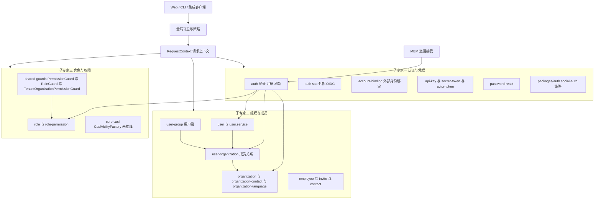

# 01 架构：身份与权限专家域

**本文引用的文件**
- [auth.module.ts](file://packages/server/src/auth/auth.module.ts)
- [auth.service.ts](file://packages/server/src/auth/auth.service.ts)
- [auth.controller.ts](file://packages/server/src/auth/auth.controller.ts)
- [user.entity.ts](file://packages/server/src/user/user.entity.ts)
- [user.service.ts](file://packages/server/src/user/user.service.ts)
- [user-organization.services.ts](file://packages/server/src/user-organization/user-organization.services.ts)
- [user-group.service.ts](file://packages/server/src/user-group/user-group.service.ts)
- [role.service.ts](file://packages/server/src/role/role.service.ts)
- [role-permission.service.ts](file://packages/server/src/role-permission/role-permission.service.ts)
- [organization.service.ts](file://packages/server/src/organization/organization.service.ts)
- [invite.accept-user.handler.ts](file://packages/server/src/invite/commands/handlers/invite.accept-user.handler.ts)
- [invite.accept-employee.handler.ts](file://packages/server/src/invite/commands/handlers/invite.accept-employee.handler.ts)
- [invite.accept-organization-contact.handler.ts](file://packages/server/src/invite/commands/handlers/invite.accept-organization-contact.handler.ts)
- [account-binding.service.ts](file://packages/server/src/account-binding/account-binding.service.ts)
- [secret-token.strategy.ts](file://packages/server/src/secret-token/secret-token.strategy.ts)
- [api-key-principal.ts](file://packages/server/src/api-key/api-key-principal.ts)
- [outbound-actor-token.provider.ts](file://packages/server/src/actor-token/outbound-actor-token.provider.ts)
- [permission.guard.ts](file://packages/server/src/shared/guards/permission.guard.ts)
- [organization-permission.guard.ts](file://packages/server/src/shared/guards/organization-permission.guard.ts)
- [casl-ability.factory.ts](file://packages/server/src/core/casl/casl-ability.factory.ts)
- [social-auth.module.ts](file://packages/auth/src/social-auth.module.ts)

## 目录
- [专家域职责边界](#专家域职责边界)
- [子专家划分说明](#子专家划分说明)
- [子模块清单](#子模块清单)
- [分层结构](#分层结构)
- [依赖关系](#依赖关系)
- [架构总览](#架构总览)
- [关键设计约束与不变量](#关键设计约束与不变量)
- [结论](#结论)

## 专家域职责边界
**做什么**
- 身份的创建与生命周期：注册（`AuthService.register`/`signup`）、登录、令牌签发与刷新（`AuthService.createToken`/`refreshTokens`/`issueTokensForUser`）、密码重置、邮箱验证。
- 身份凭据的签发与校验：登录 JWT/refresh、API key（`x-api-key`）、secret token / client secret（`x-client-secret` 或 Bearer `cs-x-` 前缀）、出站 actor token（无状态 HS256，`typ:'actor'`）。
- 外部身份绑定：`external_identity_binding` + `AccountBindingService.bindUser/getUserBinding/unbindUser/resolveUser`，以及 `auth/sso/` 的 OIDC 绑定编排。
- 组织与成员：组织（`Organization`）、成员关系（`UserOrganization`）、用户组（`UserGroup`）、邀请（`Invite`）、员工（`Employee`）、联系人与组织联系人、默认组织唯一性维护。
- 角色与判权：租户级角色（`Role`）、角色权限（`RolePermission`）与判权链（`PermissionGuard` → `CheckRolePermissionCommand` → `RolePermissionService.checkRolePermission`、`RoleGuard`）。
**不做什么**
- 不做业务域资源（工作台/Xpert/知识库）自身的授权决策：本域只提供 principal、角色、权限位与 guard，资源级 `canRun` 语义由消费方（如 server-ai 的 workspace 访问层）落实。
- 不做租户生命周期本身（`tenant/` 属邻近模块，本域只调用 `TenantService`/`TenantRoleBulkCreateCommand`）。
- 不启用 CASL 作为运行时判权入口：`CaslAbilityFactory.createForUser` 全仓无调用者。
章节来源：[auth.service.ts](file://packages/server/src/auth/auth.service.ts)（关键符号：AuthService.register、AuthService.createToken、AuthService.refreshTokens、AuthService.issueTokensForUser）

## 子专家划分说明
本专家域按「凭据类型 / 数据主体 / 判权算法」三条正交切分线拆为 3 个子专家：

| 子专家 | 覆盖目录 | 一句话职责 | 边界划分理由 |
| --- | --- | --- | --- |
| 认证与凭据子专家 | `auth/`（含 `sso/`）、`account-binding/`、`api-key/`、`secret-token/`、`actor-token/`、`password-reset/`、`packages/auth/`（social-auth：auth0/facebook/github/google/linkedin/twitter/feishu 启用；keycloak/microsoft/dingtalk 被注释禁用） | 「请求是谁」——把 5 种凭据解析为可信 principal 并签发/刷新令牌 | 凭据种类是安全审查与测试的共同失效面；这些模块共享 `RequestContext`、头解析与策略（strategy）机制，与组织数据模型解耦 |
| 组织与成员子专家 | `user/`、`user-organization/`、`user-group/`、`organization/`、`organization-language/`、`organization-contact/`、`employee/`、`invite/`、`contact/` | 「人属于哪个租户/组织、以什么角色入伙」——身份主体与归属关系建模及入伙流程 | 这些模块的写路径均落在 `user`/`user_organization`/`organization` 主体表与邀请状态机上，共享「默认组织唯一性」「最后活跃成员」等成员不变量 |
| 角色与权限子专家 | `role/`、`role-permission/` + 判权链（`shared/guards/` 的 PermissionGuard/RoleGuard/TenantPermissionGuard/OrganizationPermissionGuard/ApiKeyOrClientSecretAuthGuard） | 「能做什么」——角色权限集合维护、缓存判权与 guard 拦截 | 判权是对凭据与归属的下游消费：guard 只读 principal/tenant/roleId（来自子专家一、二），改动频率与数据模型独立 |

依赖方向单向：组织与成员子专家依赖认证与凭据子专家（`AuthService` 被 3 个邀请 handler 复用），角色与权限子专家被前两者的所有 controller 通过 `@Permissions`/`@Roles` 注解消费。
章节来源：[auth.module.ts](file://packages/server/src/auth/auth.module.ts)（关键符号：AuthModule、SocialAuthModule.registerAsync）、[social-auth.module.ts](file://packages/auth/src/social-auth.module.ts)（关键符号：SocialAuthModule、Controllers、Strategies）

## 子模块清单
- 认证与凭据：`auth/`（`AuthController`、`AuthService`、`commands/`、`strategies/`、`sso/`）、`account-binding/`（`AccountBindingService`、`ExternalIdentityBinding`）、`api-key/`（`ApiKeyService`、`ApiKey`、`api-key-principal.ts`）、`secret-token/`（`SecretTokenService`、`SecretTokenStrategy`）、`actor-token/`（`OutboundActorTokenProvider`/`LocalOutboundActorTokenProvider`）、`password-reset/`（`PasswordReset` 实体，无 tenantId）。
- 组织与成员：`user/`（`User`、`UserService`、`user/events`）、`user-organization/`（`UserOrganization`、`UserOrganizationService`、`commands/handlers/`）、`user-group/`（`UserGroup`、`UserGroupService`）、`organization/`（`OrganizationService`、`commands/handlers/organization.create.handler`）、`organization-language/`、`organization-contact/`、`employee/`（含 `employee.subscriber.ts`）、`invite/`（`Invite`、`InviteService`、6 个命令 handler）、`contact/`。
- 角色与权限：`role/`（`Role`、`RoleService`、`TenantRoleBulkCreateHandler`）、`role-permission/`（`RolePermission`、`RolePermissionService`、`default-role-permissions.ts`、`CheckRolePermissionHandler`）、`shared/guards/`（5 个判权相关 guard）。
章节来源：[user-group.service.ts](file://packages/server/src/user-group/user-group.service.ts)（关键符号：UserGroupService.findAllByOrganizationId）、[role-permission.service.ts](file://packages/server/src/role-permission/role-permission.service.ts)（关键符号：RolePermissionService.checkRolePermission）

## 分层结构
- **入口层（controller）**：`AuthController`（signup/create/refresh）、`AuthSsoController`（registerAndCompleteBinding）、`UserController`、`UserOrganizationController`、`UserGroupController`、`OrganizationController`、`InviteController`（`POST invite/user|employee|contact` 均为 `@Public()`）、`AccountBindingController`、`ApiKeyController`、`EmployeeController`。
- **应用服务层（service）**：`AuthService`、`UserService`、`UserOrganizationService`、`UserGroupService`、`RoleService`、`RolePermissionService`、`OrganizationService`、`InviteService`、`AccountBindingService`、`ApiKeyService`、`SecretTokenService`；横切 `RequestContext`（`core/context`）。
- **CQRS handler 层**：`auth/commands/handlers`（AuthLoginHandler、AuthRegisterCommand、AuthTrialCommand）、`invite/commands/handlers`（accept-user/accept-employee/accept-organization-contact/bulk/resend/organization-contact 共 6 个）、`role/commands/handlers`（TenantRoleBulkCreateHandler）、`role-permission/commands/handlers`（CheckRolePermissionHandler）、`organization/commands/handlers`（OrganizationCreateHandler）、`user-organization/commands/handlers`（delete / resolve-access）、`employee/commands/handlers`、`api-key/queries/handlers`（UseApiKeyHandler）。
- **Guard/装饰器层**：`shared/guards/` 的 `PermissionGuard`、`RoleGuard`、`TenantPermissionGuard`（继承 `TenantBaseGuard`）、`OrganizationPermissionGuard`、`ApiKeyOrClientSecretAuthGuard`、`CoreAuthGuard`，配合 `@Permissions`/`@Roles`/`@Public()`/`ALLOWED_CLIENT_SECRET_BINDINGS_METADATA`。
- **策略层（strategy）**：`auth/strategies` 的 `BasicStrategy`/`JwtStrategy`/`RefreshTokenStrategy`/`WsJwtStrategy`、`secret-token/secret-token.strategy.ts`（`client-secret`）、`api-key/api-key.strategy.ts`，以及 `packages/auth/src/*` 的社交登录策略。
- **实体与订阅者层**：14 张表落点见 `## 关键设计约束与不变量`；`employee/employee.subscriber.ts` 为本域订阅者；`referral/` 的 subscriber 属跨域协作方。
章节来源：[auth.module.ts](file://packages/server/src/auth/auth.module.ts)（关键符号：AuthModule.providers、BasicStrategy、JwtStrategy、RefreshTokenStrategy、WsJwtStrategy）

## 依赖关系
**内部出向（本域 → 其他）**
- `AuthModule.imports`：`RouterModule`、`SocialAuthModule.registerAsync({ useExisting: AuthService })`、`TypeOrmModule.forFeature([UserOrganization, Organization])`、`RedisModule`、`EmailModule`、`AccountBindingModule`、`TenantModule`、`RoleModule`、`OrganizationModule`、`UserModule`、`PasswordResetModule`、`CqrsModule`、`DiscoveryModule`、`ReferralModule`。
- `AuthService` 直接依赖：`UserService`、`UserOrganizationService`、`RoleService`、`OrganizationService`、`EmailService`、`ReferralService`、`ExternalIdentityBinding`、`Tenant`、`RequestContext`、`Organization`。
- 邀请 handler 出向：`InviteAcceptEmployeeHandler`/`InviteAcceptUserHandler` → `AuthService.register`；`InviteAcceptOrganizationContactHandler` → `TenantService`、`TenantRoleBulkCreateCommand`、`TenantFeatureOrganizationCreateCommand`、`OrganizationService`、`OrganizationContactService`、`RoleService`。
- 事件出向：`UserOrganizationService` 发 `EVENT_USER_ORGANIZATION_CREATED`/`EVENT_USER_ORGANIZATION_DELETED`（定义于 `user/events`）。
**内部入向（其他 → 本域）**
- `user/` 是本域被引用最广的模块：调研口径被 36 个模块依赖；实测 `UserModule` 出现在 20 个 module 文件中（含 `user.module.ts` 自身与 `server.module.ts`），即 18 个旁路模块显式 import 用户模块。
- 判权链被全体业务 controller 入向消费：`PermissionGuard` ← `CheckRolePermissionCommand` ← `RolePermissionService`；`RoleGuard` ← `RequestContext.hasRoles`。
- 跨域入向：`referral/`（`ReferralService.bindRegistration` 由注册事务内调用）、`feature/`、`tenant/`（`TenantRolePermissionBulkCreateCommand` 由 role-permission 提供）。
章节来源：[auth.module.ts](file://packages/server/src/auth/auth.module.ts)（关键符号：AuthModule.imports、AuthModule.exports）

## 架构总览

图表来源：[auth.module.ts](file://packages/server/src/auth/auth.module.ts)（关键符号：AuthModule）、[permission.guard.ts](file://packages/server/src/shared/guards/permission.guard.ts)（关键符号：PermissionGuard.canActivate）、[invite.accept-organization-contact.handler.ts](file://packages/server/src/invite/commands/handlers/invite.accept-organization-contact.handler.ts)（关键符号：InviteAcceptOrganizationContactHandler.execute）

## 关键设计约束与不变量
- **角色是租户级，不随组织切换**：`Role`/`RolePermission` 由 `TenantAwareCrudService` 按 `tenantId` 限定；JWT payload 只带 `role.name` 与权限位，切换组织不改变角色，判权缓存 key 亦只含 `tenantId_roleId_permissions`。
- **UserGroup 只补 `canRun`，不提升 workspace 能力**：workspace 访问层注释明确「Runtime callers may hold canRun without canRead through a published Xpert UserGroup grant」，即用户组是运行授权的最小增量。
- **guard 无元数据即放行**：`PermissionGuard`（`isEmpty(permissions)` → true）、`RoleGuard`（`isEmpty(roles)` → true）、`OrganizationPermissionGuard`（`!permissions` → true）——安全性依赖逐 controller 注解 `@Permissions`/`@Roles`，遗漏注解即默认放行。
- **token audience 必须复核**：出站 actor token 显式设置 `audience`（`XPERT_OUTBOUND_ACTOR_TOKEN_AUDIENCE`，默认 `xpert`）且 TTL 封顶 900s；API key/integration 绑定只描述技术身份，资源受众必须经 `resourceScope`（`resourceScopeFromApiKey`）表达，禁止回退到 `apiKey.type/entityId`。
- **凭据存储单向化**：secret token 以 `sha256:` 摘要持久化，`findBySecret` 拒绝再次兑付摘要串；refresh token 以 bcrypt 哈希写入 `user.refreshToken`。
- **成员不变量**：每个用户在租户内「至少一个活跃成员关系、至多一个默认组织」（`ensureUniqueDefault`/`ensureActiveMembershipRemains`/`pickNextDefaultMembership`）；`SUPER_ADMIN` 不建成员关系。
- **邀请邮箱全局唯一**：`invite.email` 与 `invite.token` 均为唯一索引，跨租户去重，接受入口全部 `@Public()`。
- **CASL 未接线**：`CaslAbilityFactory.createForUser` 无调用者，运行时判权唯一路径是 `@Permissions` + `PermissionGuard`。
- **password_reset 无 tenantId**：`PasswordReset` 继承 `BaseEntity`，过期硬编码「createdAt 超过 10 分钟」，是跨租户语义的已知缺口。
章节来源：[user-organization.services.ts](file://packages/server/src/user-organization/user-organization.services.ts)（关键符号：UserOrganizationService.ensureUniqueDefault、ensureActiveMembershipRemains、pickNextDefaultMembership）

## 结论
本域是「身份 → 归属 → 权限」的三段式架构：凭据把请求解析成 `RequestContext` 中的 principal，成员关系把 principal 锚定到租户/组织，判权链再以租户级角色计算权限位。三个子专家分别对应这三段的失效面，边界清晰且依赖单向。真正的风险集中在「默认放行」语义（guard 无注解即通过、邀请接受端点公开）与「未接线/被注释」的遗留路径（CASL、TenantPermissionGuard 权限查询、accept-employee 的 employee 创建），因此任何新 controller 都必须显式声明判权注解，凭据相关改动必须同步复核 audience 与摘要化存储。
章节来源：[role-permission.service.ts](file://packages/server/src/role-permission/role-permission.service.ts)（关键符号：RolePermissionService.checkRolePermission）、[casl-ability.factory.ts](file://packages/server/src/core/casl/casl-ability.factory.ts)（关键符号：CaslAbilityFactory.createForUser）
