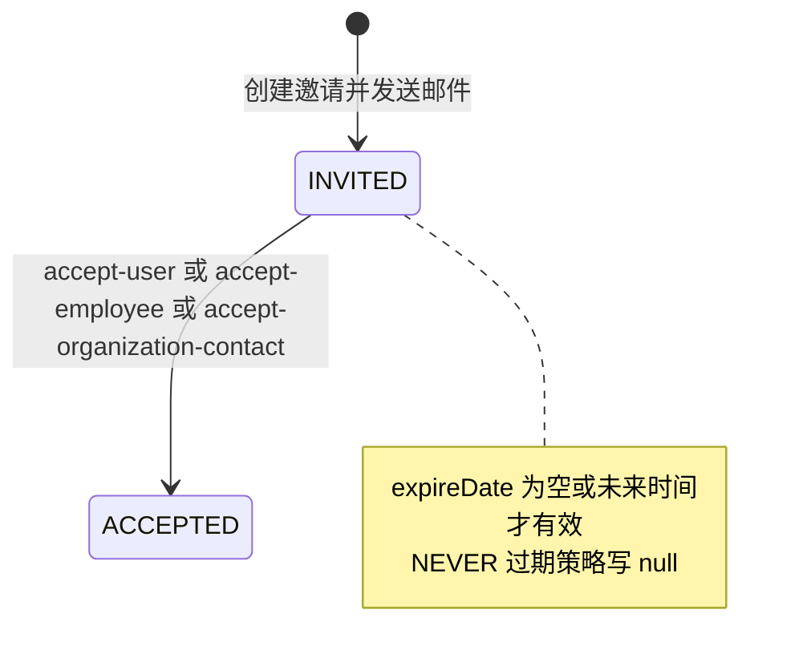

# 03 数据流转：身份与权限专家域

**本文引用的文件**
- [auth.service.ts](file://packages/server/src/auth/auth.service.ts)
- [auth.login.handler.ts](file://packages/server/src/auth/commands/handlers/auth.login.handler.ts)
- [user.entity.ts](file://packages/server/src/user/user.entity.ts)
- [user-organization.services.ts](file://packages/server/src/user-organization/user-organization.services.ts)
- [organization.service.ts](file://packages/server/src/organization/organization.service.ts)
- [organization.create.handler.ts](file://packages/server/src/organization/commands/handlers/organization.create.handler.ts)
- [invite.service.ts](file://packages/server/src/invite/invite.service.ts)
- [invite.entity.ts](file://packages/server/src/invite/invite.entity.ts)
- [invite.controller.ts](file://packages/server/src/invite/invite.controller.ts)
- [invite.accept-user.handler.ts](file://packages/server/src/invite/commands/handlers/invite.accept-user.handler.ts)
- [invite.accept-employee.handler.ts](file://packages/server/src/invite/commands/handlers/invite.accept-employee.handler.ts)
- [invite.accept-organization-contact.handler.ts](file://packages/server/src/invite/commands/handlers/invite.accept-organization-contact.handler.ts)
- [invite.organization-contact.handler.ts](file://packages/server/src/invite/commands/handlers/invite.organization-contact.handler.ts)
- [api-key-principal.ts](file://packages/server/src/api-key/api-key-principal.ts)
- [secret-token.service.ts](file://packages/server/src/secret-token/secret-token.service.ts)
- [secret-token.strategy.ts](file://packages/server/src/secret-token/secret-token.strategy.ts)
- [outbound-actor-token.provider.ts](file://packages/server/src/actor-token/outbound-actor-token.provider.ts)
- [external-identity-binding.entity.ts](file://packages/server/src/account-binding/external-identity-binding.entity.ts)
- [invite.model.ts](file://packages/contracts/src/invite.model.ts)
- [user.model.ts](file://packages/contracts/src/user.model.ts)

## 目录
- [登录与刷新链](#登录与刷新链)
- [注册链](#注册链)
- [邀请链](#邀请链)
- [成员与组织链](#成员与组织链)
- [凭据链](#凭据链)
- [状态机](#状态机)
- [异步流与外部依赖](#异步流与外部依赖)
- [数据变换关键节点](#数据变换关键节点)
- [已知风险](#已知风险)
- [结论](#结论)

## 登录与刷新链
1. 登录请求（`AuthController`）→ `AuthLoginCommand` → `AuthLoginHandler.execute`：`UserService.findOneByOptions` 查用户 → `bcrypt.compare` 校验密码 → 租户校验（`TenantService.findOneOrFailByOptions`）→ `AuthService.createToken(user)`。
2. `createToken` 若 `role`/`employee` 缺失则回查关联；payload = `{ id, tenantId, employeeId, role: role.name, permissions: 启用的 rolePermission.permission[] }`（无角色时 `role/permissions` 为 null）；`sign(payload, JWT_SECRET, { expiresIn: jwtExpiresIn })` 得 access token，`sign(payload, JWT_REFRESH_SECRET, { expiresIn: jwtRefreshExpiresIn })` 得 refresh token。
3. 落库：`AuthService.updateRefreshToken` → `getPasswordHash`（bcrypt）→ 写 `user.refreshToken`（实体列 `@Exclude()`，不返回客户端）。
4. 刷新：客户端携 userId + refresh → `AuthService.refreshTokens`：读用户，`user.refreshToken` 为空即 `ForbiddenException('Access Denied')`；`bcrypt.compare(refreshToken, user.refreshToken)` 失败同样拒绝；成功则重新 `createToken` 并再次 `updateRefreshToken`（refresh token 轮换）。
5. 其它登录形态（OAuth 系列）：`validateOAuthLoginUser`/`validateOAuthLoginEmail`/`validateOAuthLoginMobile` 命中既有用户或经 `AuthTrialCommand`/`AuthRegisterCommand` 建号后同样走 `createToken`；SSO 回调走 `AuthSsoBindingService` + `issueTokensForUser`。
章节来源：[auth.service.ts](file://packages/server/src/auth/auth.service.ts)（关键符号：AuthService.validateUser、createToken、refreshTokens、updateRefreshToken）

## 注册链
1. `AuthController.signup`（`@Public()`，`customer-onprem` 部署直接 403）→ `AuthTrialCommand`；`register`/邀请接受侧直接调 `AuthService.register`。
2. `register`：`input.createdById` 存在时以「创建者所属租户」覆盖 tenant；`referralCode` 在代客创建或导入场景被清空；随后 `createRegisteredUser`。
3. `createRegisteredUser` 事务：
   - `lockTenantRegistrationScope`：对 `Tenant` 行加 `pessimistic_write` 行锁（串行化同租户并发注册）；
   - 查重：`(tenantId,email)`、`(tenantId,username)`；仅「同一 id 的待验证注册」允许幂等更新，否则 `BadRequestException`（账号已存在）；
   - `User` 落库：email/username 小写规范化、`tenantId`，`hash`（bcrypt，来自 `SocialAuthService.getPasswordHash`），`emailVerified` 由调用选项决定（signup 为 false 并写 `email_verification`：token + 2 天有效）；
   - 组织解析：`input.organizationId` 优先，否则租户内 `isDefault=true && isActive=true` 的组织；
   - `ensureMembershipInTransaction`（角色为 `SUPER_ADMIN` 时跳过）→ 返回是否新建成员关系；
   - `ReferralService.bindRegistration(manager, { tenantId, referredUserId, referralCode })`（跨域：推荐注册绑定，同事务）。
4. 事务提交后：`completeMembershipCreation`（刷新当前用户特性缓存版本 + 发 `EVENT_USER_ORGANIZATION_CREATED`）→ `register` 再发欢迎邮件（`EmailService.welcomeUser`，signup 走 `sendVerifyEmailMail`）。
章节来源：[auth.service.ts](file://packages/server/src/auth/auth.service.ts)（关键符号：AuthService.signup、register、createRegisteredUser、lockTenantRegistrationScope）

## 邀请链
1. 创建：`InviteService.createBulk` 规范化邮箱 → 校验邀请人角色越权（授予 `SUPER_ADMIN` 时邀请人必须是 `SUPER_ADMIN`）→ 计算 `expireDate`（`organization.inviteExpiryPeriod` 或 `DEFAULT_INVITE_EXPIRY_PERIOD`；`InvitationExpirationEnum.NEVER` 时为 null）→ 查询「同租户、`status=INVITED`、未过期」的既有邀请与租户已有用户，构成 `blockedEmails` → 仅为未被阻塞的邮箱建 `Invite`（唯一 token）并发邮件；`InviteOrganizationContactHandler` 另走组织联系人路径（`VIEWER` 角色 + 联系人状态 `INVITED`）。
2. 接受入口（均 `@Public()`）：`POST invite/user`、`POST invite/employee`、`POST invite/contact`，由 `InviteController` 分派命令。
3. 状态流转（三路都以 `InviteService.update(inviteId, { status: InviteStatusEnum.ACCEPTED })` 收尾）：
   - user 路：组织（含 tenant）→ `AuthService.register`（建 user + user_organization）→ `ACCEPTED`；
   - employee 路：组织校验 `invitesAllowed` → `AuthService.register` → 直接 `ACCEPTED`（employee 创建被注释）；
   - contact 路：新租户 → 角色/权限 → feature → 组织 → SUPER_ADMIN → `register` → 联系人 `ACCEPTED` → invite `ACCEPTED`。
4. 邀请实体约束：`token` 与 `email` 均唯一索引；`invite_organization_contact` 关联表连接组织联系人；邀请过期不落状态，只体现在 `expireDate` 与查询过滤。
章节来源：[invite.service.ts](file://packages/server/src/invite/invite.service.ts)（关键符号：InviteService.createBulk）、[invite.entity.ts](file://packages/server/src/invite/invite.entity.ts)（关键符号：Invite.token、Invite.email、Invite.organizationContact）

## 成员与组织链
1. 建组织：`OrganizationCreateCommand` → `OrganizationCreateHandler` 创建组织 → `UserOrganizationService.ensureMembership`（不存在则 `create`：`prepareCreateEntity` 判定首条成员 → 默认/活跃缺省值 → 默认唯一化）→ 发 `EVENT_ORGANIZATION_CREATED`。
2. 建成员：`ensureMembership`/`ensureMembershipInTransaction` 均为「先查重（organizationId+tenantId+userId），存在即返回，不存在才建」，避免并发下的重复成员；`create` override 之后刷新用户特性缓存版本。
3. 默认组织唯一性维护：任何置默认可行（`update` 中 `isDefault=true`）都会先 `ensureUniqueDefault` 把同租户其它默认降到 false；`delete` 时若删掉默认或剩余无默认，则 `pickNextDefaultMembership` 选举新默认并回写。
4. 活跃成员不变量：把成员置 `isActive=false` 或删除前都会 `ensureActiveMembershipRemains`，保证至少一条活跃成员；删除最后一条被显式拒绝（除非删除组织时传 `allowDeletingLastMembership`）。
5. 删除组织收敛：`OrganizationService.delete` 先拒绝「存在待处理邀请（`INVITED`）或用户组」的组织，然后 `UserOrganizationService.deleteByOrganizationForOrganizationRemoval` 批量删成员、为受影响用户重指派默认组织、逐条发 `EVENT_USER_ORGANIZATION_DELETED`，最后删除组织本体。
6. 用户组：`UserGroupService` 以组织作用域校验（`requireOrganizationScope`、`assertAccessibleOrganizationId`、`validateMemberIds` 要求成员为同租户活跃成员），成员关系存于 `user_group_to_user`。
章节来源：[user-organization.services.ts](file://packages/server/src/user-organization/user-organization.services.ts)（关键符号：UserOrganizationService.ensureMembership、deleteByOrganizationForOrganizationRemoval）、[organization.service.ts](file://packages/server/src/organization/organization.service.ts)（关键符号：OrganizationService.delete）

## 凭据链
- **API key**：签发后存 `api_key`（`token`、`type: ApiKeyBindingType`、`entityId`、`validUntil`、`userId`）；校验时策略读取 → `UseApiKeyQuery` 记录 `lastUsedAt` → `buildApiKeyPrincipal` 生成 principal，`resourceScopeFromApiKey` 仅把 `ASSISTANT`/`WORKSPACE` 绑定翻译为 `{ kind:'assistant'|'workspace' }`（其余类型不产生 resourceScope）。
- **secret token / client secret**：`SecretTokenService.createHashed` 存 `sha256:<hex>`；`findBySecret` 同时匹配摘要与历史明文（拒绝提交摘要本身），再校验 `validUntil`/`expired`；`SecretTokenStrategy` 依据 `type` 分派（`USER_CONVERSATION` 恢复会话主体并删除 `x-principal-user-id` 伪造头；`USER_XPERT`/`PUBLIC_XPERT`/`ENTERPRISE_XPERT` 解析 acting user 与资源范围；`API_KEY` 默认落到 `ApiKeyService.resolvePrincipal`），最后 `applyRequestedOrganizationScopeHeaders` 决定请求作用域（组织级或租户级）。
- **enterprise scope 复核**：`assertEnterpriseXpertScope` 直查 `xpert` 表，要求已发布、`app.enabled=true`、指定平台渠道启用且 `integrationId` 匹配，任一不满足即 `UnauthorizedException`。
- **actor token（出站）**：`mint` 组装 `typ:'actor'` + 委派身份 + `act` 归因（principal type/API key/secret 绑定/requested_user_id），HS256 签名、`audience` 多值解析、TTL 取 `min(请求值或环境值, 900s)`，返回 `{ token, expiresAt, audience }`。
- **外部身份绑定**：`external_identity_binding` 双唯一索引（tenant+provider+subject、tenant+provider+user）；`bindUser` 冲突时仅允许 `lark` 回收 `UserType.COMMUNICATION` 的旧绑定，其余抛 `ConflictException`。
章节来源：[secret-token.strategy.ts](file://packages/server/src/secret-token/secret-token.strategy.ts)（关键符号：SecretTokenStrategy.validateToken、resolveConversationPrincipal、assertEnterpriseXpertScope）

## 状态机

图表来源：[secret-token.strategy.ts](file://packages/server/src/secret-token/secret-token.strategy.ts)
- `InviteStatusEnum`（contracts）：仅 `INVITED`、`ACCEPTED` 两态，无 EXPIRED 态；过期靠 `expireDate` 过滤与邮件侧兜底。
- `UserType`：`USER`（常驻用户）、`COMMUNICATION`（后台通信/集成账号，默认从用户列表排除，secret 策略要求会话型 token 的 acting user 必须是 `USER`）。
- 成员关系：`isActive`（是否活跃，保证至少一条 true）与 `isDefault`（默认组织，保证至多一条 true）；首条成员强制 active 且默认。
- `ContactOrganizationInviteStatus`：组织联系人由 `INVITED` → `ACCEPTED`（`accept-organization-contact` 第 8 步写入）。
图表来源：[invite.model.ts](file://packages/contracts/src/invite.model.ts)（关键符号：InviteStatusEnum）、[user.model.ts](file://packages/contracts/src/user.model.ts)（关键符号：UserType）、[user-organization.services.ts](file://packages/server/src/user-organization/user-organization.services.ts)（关键符号：UserOrganizationService.ensureUniqueDefault）

## 异步流与外部依赖
- **Redis**：`PendingSsoBindingChallengeService` 用 `setEx` 存储 SSO 绑定挑战（TTL 600s，key 前缀 `auth:sso:bind:challenge:`），`get`/`getDel`/`del` 消费；注册与组织模块经 `RedisModule` 注入。
- **缓存**：判权缓存（`CACHE_MANAGER`，key `userPermissions:{tenantId}_{roleId}_{permissions}`，TTL 5 分钟）；成员关系变更会 `touchCurrentUserFeatureUserCacheVersion` 使特性用户缓存版本前进。
- **事件（EventEmitter2）**：`EVENT_USER_ORGANIZATION_CREATED`/`EVENT_USER_ORGANIZATION_DELETED`（`user/events`）、`EVENT_ORGANIZATION_CREATED`（`organization/events`）。
- **外部 OIDC 回调**：`auth/sso/`（`AuthSsoDiscoveryService` 列出 provider、`AuthSsoBindingService` 完成绑定并签发令牌）与 `packages/auth/src` 的社交策略（auth0/facebook/github/google/linkedin/twitter/feishu 启用；keycloak/microsoft/dingtalk 策略文件存在但被注释禁用）回调到 `SocialAuthService` 子类（`AuthService extends SocialAuthService`）。
- **邮件**：注册欢迎/验证（`welcomeUser`/`sendVerifyEmailMail`）、邀请邮件（`InviteService` 内发信）、密码重置邮件（`requestPassword`/`requestResetPassword` 内拼 `clientBaseUrl` 链接）。
章节来源：[invite.accept-organization-contact.handler.ts](file://packages/server/src/invite/commands/handlers/invite.accept-organization-contact.handler.ts)（关键符号：InviteAcceptOrganizationContactHandler.execute）、[auth-sso-binding.service.ts](file://packages/server/src/auth/sso/auth-sso-binding.service.ts)（关键符号：AuthSsoBindingService.registerAndBind）

## 数据变换关键节点
- **标识规范化**：邮箱/用户名统一 `trim().toLowerCase()`（注册、邀请、`validateUser`），是唯一性与查重的前提。
- **密钥变换**：密码与 refresh token 走 bcrypt（`getPasswordHash`）；secret token 走 `sha256:` 摘要；邀请 token 为随机串且唯一索引。
- **主体变换**：用户 → JWT payload（含启用权限位）→ `RequestContext`；API key/secret → `IApiPrincipal`（含 `resourceScope`、`requestedOrganizationId`）；principal → actor token 的 `act` 归因。
- **作用域变换**：`applyRequestedOrganizationScopeHeaders` 把 `organization-id` + `x-scope-level` 头写成组织级或租户级（无组织即 `applyTenantScopeHeaders` 并删除 `organization-id`）。
- **作用域过滤**：`UserGroupService.scopeOrganizationFilter` 把 tenantId/organizationId 注入查询条件；`RolePermissionService.checkRolePermission` 把权限数组翻译为 `IN (...)` + `enabled=true` 的存在性查询。
章节来源：[api-key-principal.ts](file://packages/server/src/api-key/api-key-principal.ts)（关键符号：applyRequestedOrganizationScopeHeaders、resourceScopeFromApiKey）、[secret-token.service.ts](file://packages/server/src/secret-token/secret-token.service.ts)（关键符号：SecretTokenService.createHashed、findBySecret）

## 已知风险
- 邀请接受三端点 `@Public()`，仅凭 invite token 与邮箱即可完成「建租户/建组织/建用户」，是权限面最大的公开写路径。
- `password_reset` 无 `tenantId` 且过期窗口硬编码 10 分钟（`PasswordReset.afterLoadEntity`），跨租户语义与策略可配性不足。
- `invite.email` 全局唯一导致跨租户同邮箱邀请互相阻塞；`accept-user`/`accept-employee` 均以「注册新用户」为前提，对已存在用户缺少显式分支。
- `USER_XPERT` 等委托型 secret 仍走 `@deprecated` 合成 apiKey，一旦下游回退到 `apiKey.type/entityId` 就会产生越权面（注释要求「资源检查一律用 resourceScope」）。
- 判权缓存 5 分钟无主动失效：角色权限被回收后存在最长 5 分钟的授权残留窗口。
- 组织删除依赖「无待处理邀请、无用户组」前置校验，删除后成员默认组织重指派为「优先 active，其次任意」，结果可能与用户预期默认组织不一致。
章节来源：[invite.controller.ts](file://packages/server/src/invite/invite.controller.ts)（关键符号：InviteController.acceptUserInvite、acceptEmployeeInvite、acceptOrganizationContactInvite）

## 结论
数据面呈现三条主干：注册/登录把「凭据 ↔ user 行」双向绑定（bcrypt 哈希 + refresh 轮换），邀请链把「邮件 token → 用户 → 成员关系/租户」串成一次性状态跃迁，成员链则以「至多一个默认、至少一个活跃」两条不变量维持组织归属的一致性。所有凭据最终被压缩为带 `resourceScope` 与租户/组织作用域的 principal，再交由判权链消费。风险集中在公开的邀请接受入口、无租户维度的 password_reset，以及委托型 secret 的兼容残留。
章节来源：[auth.service.ts](file://packages/server/src/auth/auth.service.ts)（关键符号：AuthService.issueTokensForUser）、[user-organization.services.ts](file://packages/server/src/user-organization/user-organization.services.ts)（关键符号：UserOrganizationService.deleteByOrganizationForOrganizationRemoval）
