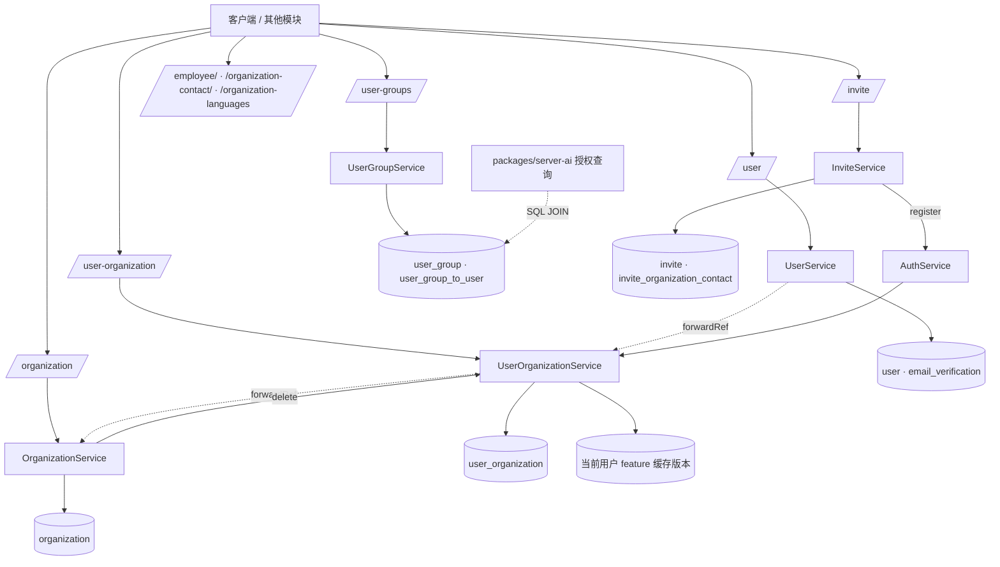

**本文引用的文件**

- [packages/server/src/server.module.ts](file://packages/server/src/server.module.ts)
- [packages/server/src/user/user.module.ts](file://packages/server/src/user/user.module.ts)
- [packages/server/src/user/user.controller.ts](file://packages/server/src/user/user.controller.ts)
- [packages/server/src/user/user.service.ts](file://packages/server/src/user/user.service.ts)
- [packages/server/src/user/user.entity.ts](file://packages/server/src/user/user.entity.ts)
- [packages/server/src/user/user.subscriber.ts](file://packages/server/src/user/user.subscriber.ts)
- [packages/server/src/user/current-user-feature-cache.ts](file://packages/server/src/user/current-user-feature-cache.ts)
- [packages/server/src/user-organization/user-organization.module.ts](file://packages/server/src/user-organization/user-organization.module.ts)
- [packages/server/src/user-organization/user-organization.services.ts](file://packages/server/src/user-organization/user-organization.services.ts)
- [packages/server/src/user-organization/user-organization.entity.ts](file://packages/server/src/user-organization/user-organization.entity.ts)
- [packages/server/src/user-group/user-group.module.ts](file://packages/server/src/user-group/user-group.module.ts)
- [packages/server/src/user-group/user-group.entity.ts](file://packages/server/src/user-group/user-group.entity.ts)
- [packages/server/src/user-group/user-group.service.ts](file://packages/server/src/user-group/user-group.service.ts)
- [packages/server/src/organization/organization.module.ts](file://packages/server/src/organization/organization.module.ts)
- [packages/server/src/organization/organization.entity.ts](file://packages/server/src/organization/organization.entity.ts)
- [packages/server/src/organization/organization.service.ts](file://packages/server/src/organization/organization.service.ts)
- [packages/server/src/organization-language/organization-language.module.ts](file://packages/server/src/organization-language/organization-language.module.ts)
- [packages/server/src/organization-contact/organization-contact.module.ts](file://packages/server/src/organization-contact/organization-contact.module.ts)
- [packages/server/src/organization-contact/organization-contact.entity.ts](file://packages/server/src/organization-contact/organization-contact.entity.ts)
- [packages/server/src/employee/employee.module.ts](file://packages/server/src/employee/employee.module.ts)
- [packages/server/src/employee/employee.entity.ts](file://packages/server/src/employee/employee.entity.ts)
- [packages/server/src/employee/employee.subscriber.ts](file://packages/server/src/employee/employee.subscriber.ts)
- [packages/server/src/invite/invite.module.ts](file://packages/server/src/invite/invite.module.ts)
- [packages/server/src/invite/invite.entity.ts](file://packages/server/src/invite/invite.entity.ts)
- [packages/server/src/contact/contact.module.ts](file://packages/server/src/contact/contact.module.ts)
- [packages/server/src/contact/contact.controller.ts](file://packages/server/src/contact/contact.controller.ts)
- [docs/plans/PLAN_xpert_user_groups_access.md](file://docs/plans/PLAN_xpert_user_groups_access.md)

## 目录

- [1 子专家职责边界](#1-子专家职责边界)
- [2 子模块清单](#2-子模块清单)
- [3 分层结构](#3-分层结构)
- [4 依赖关系](#4-依赖关系)
- [5 关键约束与不变量](#5-关键约束与不变量)
- [6 架构总览](#6-架构总览)
- [7 结论](#7-结论)

## 1 子专家职责边界

**做什么**

- 身份实体与生命周期：`user` 表的字段、软删标记、邮箱校验记录、密码哈希写入。
- 组织侧主数据：`organization`、`organization_language`、`organization_contact`、`employee`、`contact`。
- 成员关系：`user_organization` 的一人一组织一条记录、默认组织唯一性、成员收敛。
- 邀请：`invite` 的创建、校验、重发与三条接受路径。
- 组织内用户组：`user_group` 及其成员集合、托管元数据与访问范围校验。
- 当前用户读取与裁剪、feature context 组装、当前用户缓存版本失效。

**不做什么**

- 不管凭据与登录：token 签发、SSO/第三方登录、API key、账号绑定属于认证与凭据子专家（`auth/`、`api-key/`、`account-binding/`、`secret-token/`）；本子专家只提供 `verifyEmail`、`changePassword`、`resetPassword`、`getPasswordHash` 这类原语。
- 不管角色权限判定：权限矩阵、CASL 规则属于角色与权限子专家（`role/`、`role-permission/`、`core/casl`）；本子专家只读取 `roleId` / `role.name` 做删除与邀请护栏，不定义权限语义。
- 不管多租户基础设施：tenant 解析、tenant 设置属于租户子专家；本子专家仅在 tenant 范围内读写。
- 不决定 Xpert 工作空间的最终运行权：`UserGroup` 只是授权输入，`canRun` 的判定在 AI 侧。

章节来源：[packages/server/src/user/user.service.ts](file://packages/server/src/user/user.service.ts)（关键符号：UserService.verifyEmail、UserService.resetPassword）、[packages/server/src/user/user.module.ts](file://packages/server/src/user/user.module.ts)（关键符号：UserModule）

## 2 子模块清单

| 目录 | 路由前缀 | 一句话职责 |
| --- | --- | --- |
| `user/` | `/user` | 用户实体、当前用户读取链、密码/邮箱操作、搜索、删除护栏；内含 commands、events、email-verification、factory-reset |
| `user-organization/` | `/user-organization` | 成员关系 CRUD、默认组织唯一性、成员偏好（defaultWorkspaceId、entryGuides） |
| `user-group/` | `/user-groups` | 组织内用户组、成员覆盖式更新、托管元数据剥离、组织范围校验 |
| `organization/` | `/organization` | 组织主数据与删除护栏；模块另注册 UserOrganization / Invite / UserGroup 仓储 |
| `organization-language/` | `/organization-languages` | 组织语言配置 |
| `organization-contact/` | `/organization-contact` | 外部联系人及其 `inviteStatus` |
| `employee/` | `/employee` | 员工档案，与 user 为 1:1 |
| `invite/` | `/invite` | 邀请创建、校验、重发与三条接受路径 |
| `contact/` | 无（`@Controller()`） | 遗留只读联系实体；`ContactModule` 未在 `ServerAppModule` 注册 |

章节来源：[packages/server/src/server.module.ts](file://packages/server/src/server.module.ts)（关键符号：ServerAppModule）、[packages/server/src/contact/contact.controller.ts](file://packages/server/src/contact/contact.controller.ts)（关键符号：ContactController.getAllContact）

## 3 分层结构

- **Controller 层**：均继承 `CrudController<T>`；鉴权用 `TenantPermissionGuard` / `PermissionGuard` + `@Permissions(...)`，或 `@Public()` + 专用 guard（`UserController.findMe`）。路由前缀由各模块自己的 `RouterModule.register` 声明，而不是 `ServerAppModule`。
- **Service 层**：以 `TenantAwareCrudService`（tenant 过滤）与 `TenantOrganizationAwareCrudService`（再加 organization 过滤）为基类，重写 `create/update/delete` 埋入不变量（`UserOrganizationService`、`UserGroupService`、`OrganizationService`）。
- **CQRS handler 层**：`organization/commands/handlers`（建组织）、`user-organization/commands/handlers`（建/删成员、解析访问权）、`invite/commands/handlers`（创建/重发/三条接受）、`employee/commands/handlers`、`user/commands/handlers`、`organization-contact/commands/handlers`。
- **Subscriber 层**：`UserSubscriber`（插入前补默认头像、加载后拼 `name` / `employeeId`）、`OrganizationSubscriber`、`EmployeeSubscriber`、`OrganizationContactSubscriber` 监听实体事件。
- **事件与缓存层**：`user/events` 的 `UserOrganizationCreatedEvent` / `UserOrganizationDeletedEvent`、`OrganizationCreatedEvent`，配合 `current-user-feature-cache` 的租户级/用户级版本号做失效。

章节来源：[packages/server/src/user/user.subscriber.ts](file://packages/server/src/user/user.subscriber.ts)（关键符号：UserSubscriber.beforeInsert）、[packages/server/src/user-organization/user-organization.services.ts](file://packages/server/src/user-organization/user-organization.services.ts)（关键符号：UserOrganizationService.update）

## 4 依赖关系

- `UserModule`：全仓 37 个文件引用它（`packages/server/src` 20 个、`packages/server-ai` 17 个），扣除自身定义与两个根模块后，**34 个模块显式 import**。它是本子专家辐射面最大的模块，且被 `auth`、`tenant`、`role`、`role-permission`、`organization`、`tags`、`language`、`integration` 等反向依赖。
- `OrganizationModule`：被 8 个模块 import（`packages/server/src` 的 `auth`、`invite`、`organization-contact`、`user-organization`；`packages/server-ai` 的 `super-admin-organization-scope`、`project`、`mobile`、`initialization`）。`OrganizationService` 还被 `feature`、`tenant`、`employee` 等模块的命令处理器注入。
- `InviteModule`：只在 `ServerAppModule` 注册，没有任何其他模块 import 它；但 `Invite` 实体被 `OrganizationModule`（`TypeOrmModule.forFeature`）与 `OrganizationService`（统计未过期邀请）直接使用，形成"实体共用、服务不共享"的耦合。
- `UserOrganizationModule`：被 `user`、`organization`、`invite`、`employee`、`user-group` 以 `forwardRef` 引入，是 `user ↔ user-organization ↔ organization` 环路的枢纽。
- `UserGroup` 数据面：`packages/server-ai` 侧的已发布智能体授权与工作空间运行权查询直接 JOIN `user_group`、`user_group_to_user`、`xpert_to_user_group` 三张表，不经过本模块的 Service。

章节来源：[packages/server/src/organization/organization.module.ts](file://packages/server/src/organization/organization.module.ts)（关键符号：OrganizationModule）、[packages/server/src/invite/invite.module.ts](file://packages/server/src/invite/invite.module.ts)（关键符号：InviteModule）

## 5 关键约束与不变量

1. **一人一个 roleId，不随组织切换**：`user.role` 是 `ManyToOne`，`UserOrganization` 不存角色；切换组织只换 membership，不换角色。由此"删除最后一个管理员"的判定按 tenant 统计。
2. **UserGroup 只补 `canRun`**：用户组只对**已发布**智能体产生工作空间 `canRun`，绝不提升 `canRead` / `canWrite` / `canManage`；未发布智能体不产生 `canRun`。
3. **唯一默认组织**：同一 `userId + tenantId` 下最多一条 `isDefault = true`；写路径（创建/更新/删除）主动清空或补位。
4. **不可删最后一个活跃成员**：删除成员时若剩余为空需显式 `allowDeletingLastMembership`；若删除后没有活跃成员则直接 400；首条成员必须 `isActive` 且默认 `isDefault = true`。
5. **`invite.email` 全局唯一（含 token 唯一）**：邀请表 `token` 与 `email` 都带唯一索引，因此"按 email 重建邀请"必须先删旧记录或改写同一行（`resendEmail` 走后者）。
6. **`organization` 无 `organizationId`**：它继承 `TenantBaseEntity`，是租户级实体；组织维度的 scoping 由 `user_organization`、`invite`、`user_group`、`employee` 等 `TenantOrganizationBaseEntity` 承载。
7. **组织删除前后置检查**：仍有 `INVITED` 邀请或仍有 user_group 时禁止删除；删除前必须批量收敛成员关系。
8. **托管组元数据不可由业务写入**：`UserGroupService` 在 create/update 时剥离 `managedBy` / `managedEntityType` / `managedEntityId`。

章节来源：[packages/server/src/user/user.entity.ts](file://packages/server/src/user/user.entity.ts)（关键符号：User.roleId）、[packages/server/src/user-group/user-group.entity.ts](file://packages/server/src/user-group/user-group.entity.ts)（关键符号：UserGroup.members）、[docs/plans/PLAN_xpert_user_groups_access.md](file://docs/plans/PLAN_xpert_user_groups_access.md)（关键符号：安全不变量）

## 6 架构总览

图表来源：[packages/server/src/server.module.ts](file://packages/server/src/server.module.ts)（关键符号：ServerAppModule）、[packages/server/src/user-group/user-group.service.ts](file://packages/server/src/user-group/user-group.service.ts)（关键符号：UserGroupService.assertAccessibleOrganizationId）、[docs/plans/PLAN_xpert_user_groups_access.md](file://docs/plans/PLAN_xpert_user_groups_access.md)（关键符号：UserGroup 到运行权限的桥接）

章节来源：[packages/server/src/organization/organization.service.ts](file://packages/server/src/organization/organization.service.ts)（关键符号：OrganizationService.delete）、[packages/server/src/user-organization/user-organization.module.ts](file://packages/server/src/user-organization/user-organization.module.ts)（关键符号：UserOrganizationModule）

## 7 结论

本子专家是"身份/组织/成员/邀请/用户组"五件事的写路径负责人：`user` 提供身份与护栏，`organization` 提供组织与删除收敛，`user_organization` 是唯一的成员真相表，`invite` 是准入流程，`user_group` 是面向 Xpert 的授权载体。它刻意回避凭据、权限矩阵与租户基础设施，只通过少量原语（注册、护栏校验、feature context）与外部交互；因此最大的架构风险不是职责扩散，而是历史遗留分支（`contact/` 未注册模块、被注释的 employee 创建链、重复的 organization 创建调用）与跨包直接 SQL 访问 `user_group` 带来的隐式契约。

章节来源：[packages/server/src/contact/contact.module.ts](file://packages/server/src/contact/contact.module.ts)（关键符号：ContactModule）、[packages/server/src/invite/invite.module.ts](file://packages/server/src/invite/invite.module.ts)（关键符号：InviteModule）
