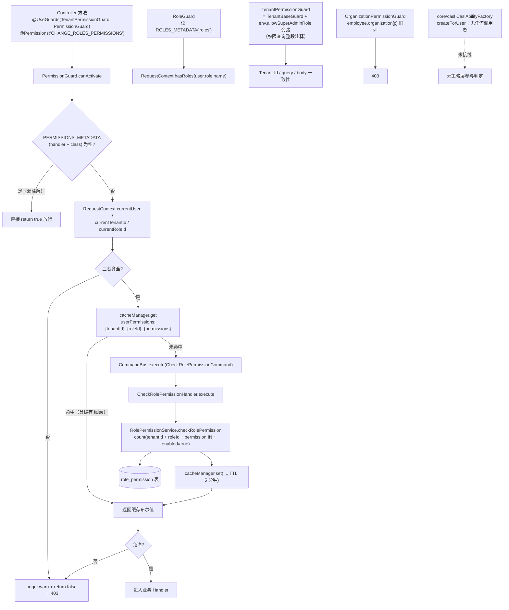

# 01 架构：角色与权限子专家

**本文引用的文件**

- [packages/contracts/src/role.model.ts](file://packages/contracts/src/role.model.ts)
- [packages/contracts/src/role-permission.model.ts](file://packages/contracts/src/role-permission.model.ts)
- [packages/common/src/constants.ts](file://packages/common/src/constants.ts)
- [packages/server/src/role/role.entity.ts](file://packages/server/src/role/role.entity.ts)
- [packages/server/src/role/role.service.ts](file://packages/server/src/role/role.service.ts)
- [packages/server/src/role/role.controller.ts](file://packages/server/src/role/role.controller.ts)
- [packages/server/src/role/role.module.ts](file://packages/server/src/role/role.module.ts)
- [packages/server/src/role/role.seed.ts](file://packages/server/src/role/role.seed.ts)
- [packages/server/src/role/default-role.ts](file://packages/server/src/role/default-role.ts)
- [packages/server/src/role/commands/handlers/tenant-role-bulk-create.handler.ts](file://packages/server/src/role/commands/handlers/tenant-role-bulk-create.handler.ts)
- [packages/server/src/role-permission/role-permission.entity.ts](file://packages/server/src/role-permission/role-permission.entity.ts)
- [packages/server/src/role-permission/role-permission.service.ts](file://packages/server/src/role-permission/role-permission.service.ts)
- [packages/server/src/role-permission/role-permission.controller.ts](file://packages/server/src/role-permission/role-permission.controller.ts)
- [packages/server/src/role-permission/role-permission.module.ts](file://packages/server/src/role-permission/role-permission.module.ts)
- [packages/server/src/role-permission/default-role-permissions.ts](file://packages/server/src/role-permission/default-role-permissions.ts)
- [packages/server/src/role-permission/role-permission.seed.ts](file://packages/server/src/role-permission/role-permission.seed.ts)
- [packages/server/src/role-permission/commands/check-role-permission.command.ts](file://packages/server/src/role-permission/commands/check-role-permission.command.ts)
- [packages/server/src/shared/guards/permission.guard.ts](file://packages/server/src/shared/guards/permission.guard.ts)
- [packages/server/src/shared/guards/role.guard.ts](file://packages/server/src/shared/guards/role.guard.ts)
- [packages/server/src/shared/guards/tenant-base.guard.ts](file://packages/server/src/shared/guards/tenant-base.guard.ts)
- [packages/server/src/shared/guards/tenant-permission.guard.ts](file://packages/server/src/shared/guards/tenant-permission.guard.ts)
- [packages/server/src/shared/guards/organization-permission.guard.ts](file://packages/server/src/shared/guards/organization-permission.guard.ts)
- [packages/server/src/shared/guards/auth.guard.ts](file://packages/server/src/shared/guards/auth.guard.ts)
- [packages/server/src/shared/decorators/permissions.ts](file://packages/server/src/shared/decorators/permissions.ts)
- [packages/server/src/shared/decorators/roles.ts](file://packages/server/src/shared/decorators/roles.ts)
- [packages/server/src/shared/decorators/public.decorator.ts](file://packages/server/src/shared/decorators/public.decorator.ts)
- [packages/server/src/shared/guards/api-key-or-client-secret.guard.ts](file://packages/server/src/shared/guards/api-key-or-client-secret.guard.ts)
- [packages/server/src/core/casl/casl-ability.factory.ts](file://packages/server/src/core/casl/casl-ability.factory.ts)
- [packages/server/src/core/casl/action.ts](file://packages/server/src/core/casl/action.ts)
- [packages/server/src/core/context/request-context.ts](file://packages/server/src/core/context/request-context.ts)
- [packages/server/src/core/crud/tenant-aware-crud.service.ts](file://packages/server/src/core/crud/tenant-aware-crud.service.ts)
- [packages/server/src/bootstrap/index.ts](file://packages/server/src/bootstrap/index.ts)
- [packages/server/src/tenant/tenant.service.ts](file://packages/server/src/tenant/tenant.service.ts)
- [docs/zh-Hans/guides/permission.mdx](file://docs/zh-Hans/guides/permission.mdx)
- [apps/cloud/src/app/@core/services/role-permissions.service.ts](file://apps/cloud/src/app/@core/services/role-permissions.service.ts)

## 目录

- [一、子专家职责边界](#一子专家职责边界)
- [二、子模块清单](#二子模块清单)
- [三、分层结构](#三分层结构)
- [四、依赖与消费关系](#四依赖与消费关系)
- [五、关键约束与不变量](#五关键约束与不变量)
- [六、架构总览](#六架构总览)
- [七、结论](#七结论)

## 一、子专家职责边界

| 维度 | 本子专家负责 | 明确不负责（交接对象） |
| --- | --- | --- |
| 能力判定 | 角色行、`role_permission` 行、判权 Guard 族的读法与失败语义 | 用户能做什么"数据级"过滤（散落在各业务 service） |
| 请求主体 | 只消费 `RequestContext` 中已存在的 `user/tenantId/roleId` | 凭据签发与解析（JWT/API Key/Client Secret 的生成、校验、主体映射）→ 认证与凭据子专家 |
| 身份归属 | 只读 `User.roleId` 以校验角色绑定，删除角色前的引用检查 | 用户、员工、组织、邀请归属关系的维护 → 组织与成员子专家 |
| 入口可见性 | 提供权限点定义与默认矩阵 | `Feature`/`FeatureOrganization` 功能开关、套餐能力 → 功能开关方向；权限通过不等于入口可见 |
| 插件能力 | 与插件共享 `shared/guards` 目录 | 插件 `service-permission-guard` 等声明式能力的实现 |

边界判定口径：若改动会改变「某个角色可见/可操作的接口集合」，属本范围；若改变「请求代表谁」或「用户归属哪个组织」，不属本范围。

章节来源：[packages/server/src/shared/guards/permission.guard.ts](file://packages/server/src/shared/guards/permission.guard.ts)（关键符号：PermissionGuard.canActivate）

## 二、子模块清单

| 子模块 | 关键文件 | 职责 | 关键符号 |
| --- | --- | --- | --- |
| `role/` | role.entity.ts、role.service.ts、role.controller.ts、role.module.ts | 角色行的 CRUD、系统角色保护、租户级批量创建、种子 | `RoleService`、`Role`、`RoleController` |
| `role/commands/` | tenant-role-bulk-create.command.ts、handlers/tenant-role-bulk-create.handler.ts | 租户创建后编排「建角色 → 建权限」 | `TenantRoleBulkCreateHandler.execute` |
| `role-permission/` | role-permission.entity.ts、.service.ts、.controller.ts、.module.ts | 权限点开关读写、SUPER_ADMIN 保护、判权查询 | `RolePermissionService`、`RolePermission` |
| `role-permission/` 配置 | default-role-permissions.ts、role-permission.seed.ts | 预置角色 → 默认权限矩阵（表驱动） | `DEFAULT_ROLE_PERMISSIONS`、`createRolePermissions` |
| `role-permission/commands/` | check-role-permission.command.ts、handlers/check-role-permission.handler.ts | 判权查询的 CQRS 入口 | `CheckRolePermissionCommand`、`CheckRolePermissionHandler` |
| 判权 Guard 族 | shared/guards/permission.guard.ts、role.guard.ts、tenant-base.guard.ts、tenant-permission.guard.ts、organization-permission.guard.ts、auth.guard.ts、api-key-or-client-secret.guard.ts、plugin-scope.guard.ts | 鉴权与判权的执行点 | `PermissionGuard`、`RoleGuard`、`TenantPermissionGuard` |
| 装饰器 | shared/decorators/permissions.ts、roles.ts、public.decorator.ts、allowed-client-secret-bindings.decorator.ts | 写入判权元数据 | `Permissions`、`Roles`、`Public` |
| 元数据常量 | packages/common/src/constants.ts（`@xpert-ai/server-common`） | 元数据键的唯一来源 | `PERMISSIONS_METADATA`、`ROLES_METADATA` |
| 枚举/模型 | packages/contracts/src/role.model.ts、role-permission.model.ts | 角色枚举与权限点枚举 | `RolesEnum`、`PermissionsEnum`、`DEFAULT_SYSTEM_ROLES` |
| CASL 占位 | core/casl/action.ts、casl-ability.factory.ts、casl.module.ts | 未接线的策略层目录 | `Action`、`CaslAbilityFactory`、`CaslModule` |

章节来源：[packages/server/src/role-permission/role-permission.module.ts](file://packages/server/src/role-permission/role-permission.module.ts)（关键符号：RolePermissionModule）

## 三、分层结构

| 层 | 位置 | 职责 | 说明 |
| --- | --- | --- | --- |
| 装饰器层 | shared/decorators/permissions.ts、roles.ts | `SetMetadata` 写入元数据，本身不判权 | `@Permissions` 写 `PERMISSIONS_METADATA`，`@Roles` 写 `roles` |
| Guard 层 | shared/guards/* | 读元数据 + `RequestContext` + 缓存/CQRS | 全局守卫在 bootstrap 以 `useGlobalGuards` 注册；判权守卫由 controller 显式 `@UseGuards` |
| CQRS 层 | role-permission/commands/* | 命令与 handler，judgement 转发 | `CheckRolePermissionHandler.execute` 只调用 service |
| Service 层 | role-permission.service.ts、role.service.ts | 业务不变量与 SQL 查询 | 均 `extends TenantAwareCrudService<T>`，自动按当前用户附加租户过滤 |
| Controller 层 | role.controller.ts、role-permission.controller.ts | 路由与守卫声明 | 均 `extends CrudController<T>` 复用 CRUD 路由 |
| 持久化/缓存 | TypeORM Repository、`CACHE_MANAGER` | 无独立 repository 层 | 缓存由 `@nestjs/cache-manager` 的 `Cache` 抽象提供 |
| 路由前缀 | role.module.ts、role-permission.module.ts、bootstrap/index.ts | `RouterModule.register` + 全局前缀 `api` | `/roles`（带前导斜杠）与 `role-permissions`（无前导斜杠）两种写法并存 |

章节来源：[packages/server/src/bootstrap/index.ts](file://packages/server/src/bootstrap/index.ts)（关键符号：bootstrap）

## 四、依赖与消费关系

- 被消费面极广：`PermissionGuard` 在 `packages/server` 与 `packages/server-ai` 共 60 个文件中被引用（role、role-permission、user、user-group、organization、data-source、invite、feature、tags、xpert、copilot、membership、knowledgebase、agent-evolution 等）；`@Roles` + `RoleGuard` 命中 tenant.controller、tenant-setting.controller、runtime-control.controller、setup-plugins.controller、feature.controller 以及 server-ai 的 plugin-resource/copilot-organization/mcp-publication-management。
- 上游依赖：`@xpert-ai/server-common` 提供 `PERMISSIONS_METADATA`/`ROLES_METADATA` 与 `isEmpty`/`removeDuplicates`；`@xpert-ai/contracts` 提供 `RolesEnum`、`PermissionsEnum`、`IRolePermission*`；`@xpert-ai/server-config` 提供 `environment.allowSuperAdminRole`；`@xpert-ai/plugin-sdk` 提供 `RequestContext` 与插件作用域元数据键。
- 模块内依赖：`RolePermissionModule` 以 `forwardRef(() => RoleModule)` 取用 `RoleService`；`RoleModule` 导出 `TypeOrmModule` 与 `RoleService`；两者都 `imports: [CqrsModule]`。
- 跨模块非 DI 依赖：`PermissionGuard` 直接 import `CheckRolePermissionCommand`，经 `CommandBus` 分发，避免 guard 直接依赖 role-permission service。
- 下游消费方：前端 `apps/cloud` 的 `role-permissions.service.ts` 调用 `/api/role-permissions`、`/api/role-permissions/:id`、`/api/role-permissions/sync-defaults`；`role.service.ts` 调用 `/api/roles`、`/api/roles/find`、`/api/roles/:id`。

章节来源：[packages/server/src/shared/guards/permission.guard.ts](file://packages/server/src/shared/guards/permission.guard.ts)（关键符号：PermissionGuard.constructor）

## 五、关键约束与不变量

1. 角色是**租户级**角色，不是组织级；一个用户只挂一个 `roleId`，不随组织切换（`RequestContext.currentRoleId()` 返回 `user.roleId`）。
2. 权限点是字符串枚举，行级开关是 `role_permission.enabled`（实体上 `permission` 为 `string` + `@IsEnum(PermissionsEnum)`）。
3. 判权只看 `(tenantId, roleId, permission IN, enabled = true)` 的计数，**不看 organization**。
4. **空元数据即放行（fail-open）**：`PermissionGuard` 在 `isEmpty(permissions)` 时 `return true`；`RoleGuard` 在 `isEmpty(roles)` 时 `return true`；`OrganizationPermissionGuard` 在无 `permissions` 元数据时 `return true`。因此逐 controller 注解是唯一护栏。
5. 判权结果缓存 TTL 为 `5 * 60 * 1000`，且 `false` 也会写入缓存（负缓存）→ 撤权/换角色最长 5 分钟窗口；仓内 `cacheManager.del` 仅出现在 view-extension 缓存服务，权限缓存**无失效调用点**。
6. `@Public()` 只被 `AuthGuard`/`WsAuthGuard` 读取（跳过鉴权），`PermissionGuard`/`RoleGuard`/`TenantPermissionGuard` 不读它，因此 `@Public()` 不等于跳过判权。
7. 服务层不变量：系统角色不可重命名、`isSystem` 不可改、系统角色不可删、被用户或待接受邀请引用的角色不可删；`SUPER_ADMIN` 的权限行不可改不可删。
8. 元数据读取顺序为 `getAllAndOverride([handler, class])`：**方法级覆盖类级**。

章节来源：[packages/server/src/role/role.service.ts](file://packages/server/src/role/role.service.ts)（关键符号：RoleService.delete）

## 六、架构总览

图表来源：[packages/server/src/shared/guards/permission.guard.ts](file://packages/server/src/shared/guards/permission.guard.ts)（关键符号：PermissionGuard.canActivate）

## 七、结论

现状是「租户级 RBAC + 注解式 Guard 链 + CQRS 判权查询 + 5 分钟结果缓存」，判权数据源单一（`role_permission` 表），策略层（CASL）存在但完全未接线。安全性由此集中在两点：**每个受保护端点必须显式 `@UseGuards` + `@Permissions`**（否则 fail-open 放行），以及**权限变更的生效延迟由 5 分钟缓存决定**。职责上本子专家只回答「这个角色能做什么」，不回答「调用者是谁」「用户在哪个组织」；后者分别由认证凭据与组织成员两个方向负责。

章节来源：[docs/zh-Hans/guides/permission.mdx](file://docs/zh-Hans/guides/permission.mdx)（关键符号：permission）
