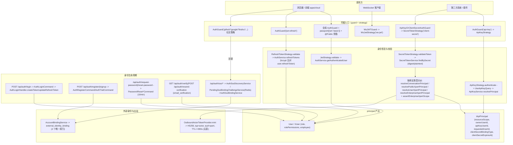

# 认证与凭据子专家 · 架构

**本文引用的文件**

- [packages/server/src/auth/auth.module.ts](file://packages/server/src/auth/auth.module.ts)
- [packages/server/src/auth/auth.controller.ts](file://packages/server/src/auth/auth.controller.ts)
- [packages/server/src/auth/auth.service.ts](file://packages/server/src/auth/auth.service.ts)
- [packages/server/src/auth/strategies/jwt.strategy.ts](file://packages/server/src/auth/strategies/jwt.strategy.ts)
- [packages/server/src/auth/strategies/refresh-token.strategy.ts](file://packages/server/src/auth/strategies/refresh-token.strategy.ts)
- [packages/server/src/auth/strategies/ws-jwt.strategy.ts](file://packages/server/src/auth/strategies/ws-jwt.strategy.ts)
- [packages/server/src/auth/strategies/basic.strategy.ts](file://packages/server/src/auth/strategies/basic.strategy.ts)
- [packages/server/src/auth/sso/auth-sso.controller.ts](file://packages/server/src/auth/sso/auth-sso.controller.ts)
- [packages/server/src/auth/sso/auth-sso-discovery.service.ts](file://packages/server/src/auth/sso/auth-sso-discovery.service.ts)
- [packages/server/src/auth/sso/auth-sso-binding.service.ts](file://packages/server/src/auth/sso/auth-sso-binding.service.ts)
- [packages/server/src/auth/sso/pending-sso-binding-challenge.service.ts](file://packages/server/src/auth/sso/pending-sso-binding-challenge.service.ts)
- [packages/server/src/account-binding/account-binding.service.ts](file://packages/server/src/account-binding/account-binding.service.ts)
- [packages/server/src/account-binding/external-identity-binding.entity.ts](file://packages/server/src/account-binding/external-identity-binding.entity.ts)
- [packages/server/src/api-key/api-key.strategy.ts](file://packages/server/src/api-key/api-key.strategy.ts)
- [packages/server/src/api-key/api-key-principal.ts](file://packages/server/src/api-key/api-key-principal.ts)
- [packages/server/src/api-key/api-key.service.ts](file://packages/server/src/api-key/api-key.service.ts)
- [packages/server/src/secret-token/secret-token.strategy.ts](file://packages/server/src/secret-token/secret-token.strategy.ts)
- [packages/server/src/secret-token/secret-token.service.ts](file://packages/server/src/secret-token/secret-token.service.ts)
- [packages/server/src/actor-token/outbound-actor-token.provider.ts](file://packages/server/src/actor-token/outbound-actor-token.provider.ts)
- [packages/server/src/password-reset/password-reset.entity.ts](file://packages/server/src/password-reset/password-reset.entity.ts)
- [packages/server/src/shared/guards/auth.guard.ts](file://packages/server/src/shared/guards/auth.guard.ts)
- [packages/server/src/shared/guards/api-key-or-client-secret.guard.ts](file://packages/server/src/shared/guards/api-key-or-client-secret.guard.ts)
- [packages/auth/src/internal.ts](file://packages/auth/src/internal.ts)
- [packages/auth/src/social-auth.module.ts](file://packages/auth/src/social-auth.module.ts)
- [packages/auth/src/social-auth.service.ts](file://packages/auth/src/social-auth.service.ts)
- [packages/contracts/src/secret-token.model.ts](file://packages/contracts/src/secret-token.model.ts)
- [packages/contracts/src/api-key.model.ts](file://packages/contracts/src/api-key.model.ts)
- [docs/plans/PLAN_api_principal_identity.md](file://docs/plans/PLAN_api_principal_identity.md)
- [docs/zh-Hans/guides/permission.mdx](file://docs/zh-Hans/guides/permission.mdx)

## 目录

1. [职责边界](#职责边界)
2. [子模块清单](#子模块清单)
3. [分层结构](#分层结构)
4. [依赖关系](#依赖关系)
5. [关键约束与不变量](#关键约束与不变量)
6. [架构总览](#架构总览)
7. [结论](#结论)

## 职责边界

本子专家只负责“**把一次请求/一次出站调用解析成可信身份**”，不负责“这个身份能做什么”。

| 范围内（做什么） | 证据 |
| --- | --- |
| 5 种凭据的校验与身份恢复：登录 JWT/refresh、API key、secret token/client secret、出站 actor token、外部身份绑定 | [auth.service.ts](file://packages/server/src/auth/auth.service.ts)（关键符号：AuthService.createToken）、[api-key.strategy.ts](file://packages/server/src/api-key/api-key.strategy.ts)（关键符号：ApiKeyStrategy.authenticate）、[secret-token.strategy.ts](file://packages/server/src/secret-token/secret-token.strategy.ts)（关键符号：SecretTokenStrategy.authenticate）、[outbound-actor-token.provider.ts](file://packages/server/src/actor-token/outbound-actor-token.provider.ts)（关键符号：LocalOutboundActorTokenProvider.mint） |
| 注册/密码重置/邮箱验证/SSO 绑定等“身份生命周期”流程 | [auth.service.ts](file://packages/server/src/auth/auth.service.ts)（关键符号：AuthService.register、AuthService.resetPassword）、[auth-sso-binding.service.ts](file://packages/server/src/auth/sso/auth-sso-binding.service.ts)（关键符号：AuthSsoBindingService.registerAndBind） |
| 外部身份（provider + subjectId）与 Xpert 用户的绑定关系维护 | [account-binding.service.ts](file://packages/server/src/account-binding/account-binding.service.ts)（关键符号：AccountBindingService.bindUser） |

| 范围外（不做什么） | 归属 |
| --- | --- |
| 角色/权限判定（`role.guard.ts`、`permission.guard.ts`、`@Permissions` 语义） | 角色与权限子专家 |
| 组织成员关系（`UserOrganization` 成员增删、`organization-permission.guard.ts`） | 组织与成员子专家 |
| 租户解析（`TenantService`、`AnonymousTenantResolverService` 的域名/匿名租户判定） | 租户与域名子专家 |
| 具体 SSO/OIDC 插件实现（`SSOProviderRegistry` 中的策略实现） | 插件/集成子专家；本子专家只提供回调落点与 pending challenge |

章节来源：[packages/server/src/auth/auth.module.ts](file://packages/server/src/auth/auth.module.ts)（关键符号：AuthModule）、[packages/server/src/shared/guards/api-key-or-client-secret.guard.ts](file://packages/server/src/shared/guards/api-key-or-client-secret.guard.ts)（关键符号：ApiKeyOrClientSecretAuthGuard.canActivate）

## 子模块清单

| 目录 | 一句话职责 | 关键入口 |
| --- | --- | --- |
| `packages/server/src/auth/` | 账号密码凭据与登录态：登录/注册/刷新/密码重置/邮箱验证 + passport 策略注册 + CQRS 命令 | `AuthController`、`AuthService`、`AuthModule` |
| `packages/server/src/auth/sso/` | OIDC/SSO 落点：provider 发现、pending 绑定挑战（Redis）、完成绑定/注册并绑定 | `AuthSsoController`、`AuthSsoDiscoveryService`、`AuthSsoBindingService`、`PendingSsoBindingChallengeService` |
| `packages/server/src/account-binding/` | `external_identity_binding` 表的唯一写入口：绑定/解绑/查询/解析用户，并同步 lark 的 `User.thirdPartyId` 旧字段 | `AccountBindingService`、`AccountBindingController` |
| `packages/server/src/api-key/` | 长期技术身份凭据：`x-api-key`/Bearer 校验、`ApiKeyStrategy`、principal 归一化（`resourceScope`） | `ApiKeyStrategy`、`ApiKeyService.resolvePrincipal` |
| `packages/server/src/secret-token/` | client secret 凭据：`x-client-secret`/`Bearer cs-x-` 校验，按 5 种绑定类型产出不同 audience 的 principal | `SecretTokenStrategy`、`SecretTokenService.findBySecret` |
| `packages/server/src/actor-token/` | 出站委托凭证：无状态 HS256 签发，仅用于对外调用，无表、无入站校验 | `LocalOutboundActorTokenProvider.mint`、`ActorTokenModule` |
| `packages/server/src/password-reset/` | 密码重置记录与 DTO/命令：`password_reset` 表 10 分钟过期语义 | `PasswordResetService`、`PasswordResetCreateCommand` |
| `packages/auth/src/`（外部包 social-auth） | 第三方社交登录策略与回调控制器；以 `SocialAuthService` 抽象被服务端复用 | `SocialAuthModule`、`SocialAuthService.routeRedirect`、`GithubStrategy` 等 |

章节来源：[packages/server/src/auth/sso/auth-sso-discovery.service.ts](file://packages/server/src/auth/sso/auth-sso-discovery.service.ts)（关键符号：AuthSsoDiscoveryService.discover）、[packages/server/src/secret-token/secret-token.module.ts](file://packages/server/src/secret-token/secret-token.module.ts)（关键符号：SecretTokenModule）、[packages/auth/src/internal.ts](file://packages/auth/src/internal.ts)（关键符号：Strategies、Controllers）

## 分层结构

| 层 | 位置与代表 | 说明 |
| --- | --- | --- |
| Controller | `AuthController`、`AuthSsoController`、`AccountBindingController`、`ApiKeyController`、各社交 provider controller | 只做参数/DTO/装饰器编排；路由前缀由 `RouterModule.register` + 全局 `api` 前缀决定 |
| Service | `AuthService`、`AccountBindingService`、`ApiKeyService`、`SecretTokenService`、`PasswordResetService`、`AuthSso*Service` | 业务编排与事务边界（`dataSource.transaction`） |
| Strategy | `JwtStrategy('jwt')`、`RefreshTokenStrategy('jwt-refresh')`、`WsJwtStrategy('ws-jwt')`、`BasicStrategy('basic')`、`ApiKeyStrategy('api-key')`、`SecretTokenStrategy('client-secret')`、社交策略 | 唯一的“凭据 → principal”转换点 |
| Guard | 全局 `AuthGuard(['jwt','basic'])` + `@Public` 旁路；`ApiKeyAuthGuard`、`ApiKeyOrClientSecretAuthGuard`、`WsJWTGuard` | 决定一次请求走哪种凭据；本子专家只覆盖凭据类 guard |
| CQRS | `AuthLoginCommand/AuthLoginHandler`、`AuthRegisterCommand`、`AuthTrialCommand`、`PasswordReset*Command`、`SecretToken*Command`、`UseApiKeyQuery` | 登录/注册/密码重置/密钥查询的用例切面 |
| Store | `tenant/role/organization/user` 实体 + Redis（`auth:sso:bind:challenge:` 前缀） | 无本子专家专属 gateway；WebSocket 侧由 `WsJWTGuard` 对接 |
| Subscriber/Event | `EVENT_ORGANIZATION_CREATED`、`trial_user.created`（经 `AuthRegisterTrialHandler` 发出） | 本目录不定义 subscriber，只发事件 |

章节来源：[packages/server/src/shared/guards/auth.guard.ts](file://packages/server/src/shared/guards/auth.guard.ts)（关键符号：AuthGuard.canActivate）、[packages/server/src/auth/sso/pending-sso-binding-challenge.service.ts](file://packages/server/src/auth/sso/pending-sso-binding-challenge.service.ts)（关键符号：PendingSsoBindingChallengeService.consume）

## 依赖关系

**出向依赖（本子模块 import 的外部）**

- `../user`、`../tenant`、`../role`、`../organization`、`../user-organization`、`../email`、`../referral`、`../integration`、`../core/context`（[auth.service.ts](file://packages/server/src/auth/auth.service.ts)（关键符号：AuthService 构造函数））
- 契约/配置：`@xpert-ai/contracts`（`IApiPrincipal`、`SecretTokenBindingType`、`ApiKeyBindingType`、`UserType`）、`@xpert-ai/server-config`（`environment`）、`@xpert-ai/plugin-sdk`（`SSOProviderRegistry`、`ActorToken*`）
- 外部包：`@xpert-ai/server-auth`（`SocialAuthService` 被 `AuthService extends` 复用）

**入向依赖（谁依赖本子模块）**

- `packages/server/src/server.module.ts` 注册 `ApiKeyModule`、`SecretTokenModule`、`ActorTokenModule`、`AccountBindingModule`
- `InviteModule` import `AuthModule`；`AuthModule` 导出 `AuthService/UserService/UserOrganizationService/EmailService/PendingSsoBindingChallengeService`
- `packages/server-ai`：`xpert`、`ai`、`xpert-agent`、`enterprise-chatkit`、`xpert-task`、`actor-token-runtime` 依赖 `ApiKeyModule`/`ActorTokenModule`/`OutboundActorTokenProvider`/`SocialAuthService`

**装配上的循环依赖**：`AuthModule` 内 `SocialAuthModule.registerAsync({ imports: [forwardRef(() => AuthModule)], useExisting: AuthService })`，用 `useExisting` 让 `SocialAuthService` 令牌指向同一个 `AuthService` 单例，避免出现两个认证服务实例。

章节来源：[packages/server/src/auth/auth.module.ts](file://packages/server/src/auth/auth.module.ts)（关键符号：AuthModule 的 RouterModule.register 与 SocialAuthModule.registerAsync）、[packages/auth/src/social-auth.module.ts](file://packages/auth/src/social-auth.module.ts)（关键符号：SocialAuthModule.createConnectProviders）

## 关键约束与不变量

1. **凭据 audience 不混用**：`IApiPrincipal.resourceScope` 只由显式持久化绑定产生，请求参数/头部不能放宽；`clientSecretBindingType` 决定是 API_KEY 还是 USER_XPERT / PUBLIC_XPERT / ENTERPRISE_XPERT / USER_CONVERSATION。
2. **actor token 仅出站**：`LocalOutboundActorTokenProvider` 只有 `mint()` 与 `isAvailable()`，仓库内没有 actor token 的入站 passport 策略，也没有对应表。
3. **digest 不能当 bearer 用**：`SecretTokenService.findBySecret` 对以 `sha256:` 开头的输入直接抛 `UnauthorizedException`。
4. **会话恢复 ≠ 授权**：认证只恢复身份与 audience；`USER_XPERT` 委托会话在使用资源时仍需重新检查当前用户授权。
5. **`x-principal-user-id` 覆盖是“同租户业务用户”语义**：只从头部读取并在租户内校验，属高风险开关——当前**无显式开关/白名单**，且 `thirdPartyId` 无租户内唯一约束。
6. **`AccountBindingService` 是外部身份唯一写入口**：唯一索引 `(tenantId, provider, subjectId)` 与 `(tenantId, provider, userId)` 兜底并发；lark 身份允许带条件“回收”。
7. **SSO 绑定挑战一次性**：ticket 存 Redis 且有 10 分钟 TTL，`consume()` 依赖 Redis `getDel` 保证原子消费。

章节来源：[packages/contracts/src/api-key.model.ts](file://packages/contracts/src/api-key.model.ts)（关键符号：API_PRINCIPAL_USER_ID_HEADER、ApiPrincipalResourceScope）、[packages/contracts/src/secret-token.model.ts](file://packages/contracts/src/secret-token.model.ts)（关键符号：ISecretToken.token）、[docs/plans/PLAN_api_principal_identity.md](file://docs/plans/PLAN_api_principal_identity.md)（关键符号：后续建议）、[docs/zh-Hans/guides/permission.mdx](file://docs/zh-Hans/guides/permission.mdx)（关键符号：USER_XPERT 委托会话复核）

## 架构总览

图表来源：[packages/server/src/secret-token/secret-token.strategy.ts](file://packages/server/src/secret-token/secret-token.strategy.ts)（关键符号：SecretTokenStrategy.authenticate、SecretTokenStrategy.assertEnterpriseXpertScope）、[packages/server/src/auth/strategies/jwt.strategy.ts](file://packages/server/src/auth/strategies/jwt.strategy.ts)（关键符号：JwtStrategy 的 ExtractJwt 组合）、[packages/server/src/actor-token/outbound-actor-token.provider.ts](file://packages/server/src/actor-token/outbound-actor-token.provider.ts)（关键符号：readTokenTtlSeconds、buildAct）

## 结论

- 本子专家的核心产出是两类对象：**`User/IUser`**（交互式/委托用户）与 **`IApiPrincipal`**（技术身份 + 资源 audience）；二者都只表达“你是谁”，不表达“你能做什么”。
- 5 种凭据中，只有 3 种有入站策略（`jwt`/`jwt-refresh`/`ws-jwt`、`api-key`、`client-secret`），`actor token` 是有意设计的单向外发形态，`external_identity_binding` 是绑定关系而非凭据。
- 最容易出错的边界是 **audience 泄漏**：`x-principal-user-id`、`organization-id` 等头部都能改变 principal 的解释方式，因此架构上把它们的读取集中在 `api-key-principal.ts` 与各 strategy 内，并禁止用 `apiKey.type/entityId` 做业务授权。
- 装配层面存在 `server` ↔ `server-auth` 的循环引用，靠 `forwardRef` + `useExisting` 收敛为单例；这是“社交登录复用同一 AuthService 逻辑”的代价。

章节来源：[packages/server/src/api-key/api-key-principal.ts](file://packages/server/src/api-key/api-key-principal.ts)（关键符号：buildApiKeyPrincipal、resourceScopeFromApiKey）、[packages/server/src/api-key/api-key-principal.ts](file://packages/server/src/api-key/api-key-principal.ts)（关键符号：applyRequestedOrganizationScopeHeaders）
