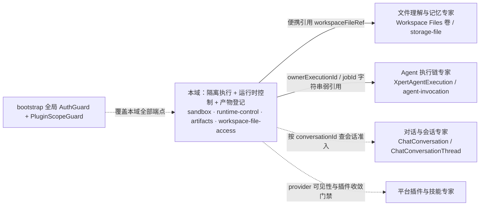

# 运行时·沙箱·产物专家 —— C0 使用总览

> **资产基线**：`2026-10-16 · commit 80f5676fd`（批次 5 第 12 专家）。实测范围：`packages/server-ai/src/sandbox`（74 非 spec / 34 spec / **自建 2 表**）、`packages/server/src/runtime-control`（22 / 10 / 0）、`packages/server-ai/src/artifacts`（10 / 2 / **4 表**）、`packages/server-ai/src/workspace-file-access`（8 / 2 / 0）、`packages/server/src/health`（5 / 0 / 0）＝ **119 非 spec + 48 spec + 自建 6 张表**。索引口径记「9 张」含外部实体 `chat_conversation`/`chat_conversation_thread`/`user`，**以 6 张为准**。HTTP 前缀 `/api/sandbox`、`/api/system/runtime`、`/api/artifacts`、`/api/workspace-files`、`/api/health`，外加 WS 命名空间 `sandbox-terminal`。

**本文引用的文件**（相对仓库根，链接均为 `file://`）

- [packages/server-ai/src/sandbox/sandbox.controller.ts](file://packages/server-ai/src/sandbox/sandbox.controller.ts)
- [packages/server-ai/src/sandbox/sandbox.module.ts](file://packages/server-ai/src/sandbox/sandbox.module.ts)
- [packages/server-ai/src/sandbox/sandbox-terminal.gateway.ts](file://packages/server-ai/src/sandbox/sandbox-terminal.gateway.ts)
- [packages/server-ai/src/sandbox/sandbox-terminal-auth.guard.ts](file://packages/server-ai/src/sandbox/sandbox-terminal-auth.guard.ts)
- [packages/server-ai/src/sandbox/sandbox-preview-auth.guard.ts](file://packages/server-ai/src/sandbox/sandbox-preview-auth.guard.ts)
- [packages/server-ai/src/sandbox/sandbox-preview-session.service.ts](file://packages/server-ai/src/sandbox/sandbox-preview-session.service.ts)
- [packages/server-ai/src/sandbox/sandbox-managed-service.service.ts](file://packages/server-ai/src/sandbox/sandbox-managed-service.service.ts)
- [packages/server-ai/src/sandbox/sandbox-managed-service.entity.ts](file://packages/server-ai/src/sandbox/sandbox-managed-service.entity.ts)
- [packages/server-ai/src/sandbox/sandbox-conversation-context.service.ts](file://packages/server-ai/src/sandbox/sandbox-conversation-context.service.ts)
- [packages/server-ai/src/sandbox/sandbox.service.ts](file://packages/server-ai/src/sandbox/sandbox.service.ts)
- [packages/server-ai/src/sandbox/nsjail/nsjail-sandbox.provider.ts](file://packages/server-ai/src/sandbox/nsjail/nsjail-sandbox.provider.ts)
- [packages/server-ai/src/sandbox/nsjail/nsjail-sandbox.ts](file://packages/server-ai/src/sandbox/nsjail/nsjail-sandbox.ts)
- [packages/server-ai/src/sandbox/nsjail/nsjail-runner.client.ts](file://packages/server-ai/src/sandbox/nsjail/nsjail-runner.client.ts)
- [packages/server-ai/src/sandbox/sandbox-job/sandbox-job-runtime-capability.service.ts](file://packages/server-ai/src/sandbox/sandbox-job/sandbox-job-runtime-capability.service.ts)
- [packages/server-ai/src/sandbox/sandbox-job/sandbox-job-capacity.service.ts](file://packages/server-ai/src/sandbox/sandbox-job/sandbox-job-capacity.service.ts)
- [packages/server-ai/src/sandbox/sandbox-job/sandbox-job.entity.ts](file://packages/server-ai/src/sandbox/sandbox-job/sandbox-job.entity.ts)
- [packages/server-ai/src/sandbox/middlewares/sandbox-shell.middleware.ts](file://packages/server-ai/src/sandbox/middlewares/sandbox-shell.middleware.ts)
- [packages/server-ai/src/sandbox/middlewares/file-activity-storage.service.ts](file://packages/server-ai/src/sandbox/middlewares/file-activity-storage.service.ts)
- [packages/server/src/runtime-control/runtime-control.controller.ts](file://packages/server/src/runtime-control/runtime-control.controller.ts)
- [packages/server/src/runtime-control/runtime-control.service.ts](file://packages/server/src/runtime-control/runtime-control.service.ts)
- [packages/server/src/runtime-control/runtime-lifecycle.service.ts](file://packages/server/src/runtime-control/runtime-lifecycle.service.ts)
- [packages/server/src/runtime-control/runtime-drain.middleware.ts](file://packages/server/src/runtime-control/runtime-drain.middleware.ts)
- [packages/server/src/health/health.controller.ts](file://packages/server/src/health/health.controller.ts)
- [packages/server-ai/src/artifacts/artifacts.controller.ts](file://packages/server-ai/src/artifacts/artifacts.controller.ts)
- [packages/server-ai/src/artifacts/artifacts.service.ts](file://packages/server-ai/src/artifacts/artifacts.service.ts)
- [packages/server-ai/src/artifacts/entities/artifact-version.entity.ts](file://packages/server-ai/src/artifacts/entities/artifact-version.entity.ts)
- [packages/server-ai/src/workspace-file-access/workspace-file-access.service.ts](file://packages/server-ai/src/workspace-file-access/workspace-file-access.service.ts)
- [packages/server-ai/src/workspace-file-access/workspace-file-content.controller.ts](file://packages/server-ai/src/workspace-file-access/workspace-file-content.controller.ts)
- [packages/server-ai/src/workspace-file-access/workspace-file-access.guard.ts](file://packages/server-ai/src/workspace-file-access/workspace-file-access.guard.ts)
- [packages/plugin-sdk/src/lib/runtime/capabilities/sandbox-jobs.ts](file://packages/plugin-sdk/src/lib/runtime/capabilities/sandbox-jobs.ts)
- [packages/contracts/src/ai/sandbox-terminal.model.ts](file://packages/contracts/src/ai/sandbox-terminal.model.ts)
- [.deploy/nsjail-runner/README.md](file://.deploy/nsjail-runner/README.md)
- [packages/nsjail-runner/package.json](file://packages/nsjail-runner/package.json)

## 目录

1. [专家定位](#专家定位)
2. [何时找这个专家](#何时找这个专家)
3. [契约自足声明](#契约自足声明)
4. [能力清单表](#能力清单表)
5. [边界](#边界)
6. [已知问题与常见坑](#已知问题与常见坑)
7. [延伸阅读](#延伸阅读)

## 专家定位

本专家负责 **Agent 的隔离执行环境与运行时可运维面**：把不可信代码放进隔离边界里跑、把跑出来的东西登记成可分享产物、并让 API 进程副本自身可安全重启。三个子域：

1. **沙箱执行**（`packages/server-ai/src/sandbox/**`）：provider 与运行时注册表、会话级沙箱上下文解析、NsJail 运行时创建与命令执行、PTY 终端网关、后台托管服务（dev server）与 HTTP/SSE 预览 proxy、沙箱卷文件投递；核心类 `NsjailSandboxProvider`、`NsjailSandbox`、`NsjailRunnerClient`、`SandboxConversationContextService`、`SandboxTerminalGateway`、`SandboxJobRuntimeCapabilityService`。
2. **运行时控制与健康**（`runtime-control/**` 22/10 ＋ `health/**` 5/0）：API 副本滚动自重启、排水（drain）、队列关停、插件收敛门禁与存活/就绪探针；核心类 `RuntimeControlService`、`RuntimeLifecycleService`、`RuntimeDrainMiddleware`、`HealthController`。
3. **产物与文件访问**（`artifacts/**` 10/2/4 表 ＋ `workspace-file-access/**` 8/2）：Artifact 登记/版本/分享链接/公开访问审计，以及「会话 + 授权（grant）」式的工作区文件投递。

**一句话口径**：本域只负责**隔离执行 + 运行时控制 + 产物登记**；字节在 Workspace Files 卷、执行账本在 Agent 执行链，本域只持有便携引用与字符串弱引用。

章节来源：[nsjail-sandbox.provider.ts](file://packages/server-ai/src/sandbox/nsjail/nsjail-sandbox.provider.ts)（关键符号：NsjailSandboxProvider.create）、[sandbox-terminal.gateway.ts](file://packages/server-ai/src/sandbox/sandbox-terminal.gateway.ts)（关键符号：SandboxTerminalGateway.open）、[runtime-control.service.ts](file://packages/server/src/runtime-control/runtime-control.service.ts)（关键符号：RuntimeControlService.requestRestart）、[artifacts.service.ts](file://packages/server-ai/src/artifacts/artifacts.service.ts)（关键符号：ArtifactsService.createArtifact）

## 何时找这个专家

- 要改**沙箱执行后端**：provider 注册（`@SandboxProviderStrategy('nsjail')`）、`SandboxProviderRegistry`、`NsjailSandboxProvider.create` 的 Runner 健康与协议门槛、`runtimeId` 派生规则。
- 要改**会话级沙箱准入**：`SandboxConversationContextService.authorizeConversation`（会话存在/租户匹配/助手 `features.sandbox.enabled`/provider 非空）与 `resolveConversationSandbox`（会真正申请后端）。
- 要改**隔离边界与配额**：卷映射与越界拒绝、`protectProjectContent`、`/workspace/.apps` 只读掩码、cgroup v2/rlimit/进程数与 `MAX_*` 准入变量。
- 要改**沙箱作业（插件面）**：`platform.sandbox.jobs` 能力的幂等键、容量租约、输入物化（`.platform/inputs`）、输出校验、运行时证据与孤儿清理。
- 要改 **WS 终端**：namespace `sandbox-terminal` 的 4 类客户端消息/5 类服务端事件、逐消息鉴权（`SandboxTerminalAuthGuard`）、pending open 取消语义。
- 要改**预览 proxy**：3 条 `@Public()` 通配路由、`SandboxPreviewAuthGuard` 的 cookie 票面校验、头清洗与 `location` 重写、不支持 WebSocket 升级。
- 要改 **volume 通配投递**：`GET /api/sandbox/volume/*path` 的匿名读面、`isProtectedVolumeSubpath` 黑名单与 `rejectProtectedPaths` 复检。
- 要改**运行时重启与插件收敛**：`/api/system/runtime/*` 6 端点、`assertAuthorizedActor` 三重前置、`allowDowntime`、`plugin-convergence/:generation`。
- 要改**健康探针**：`/api/health` 四项聚合（DB/磁盘/缓存/Redis）与 `/api/health/ready` 的 503 语义。
- 要改**产物登记与分享**：`artifact`/`artifact_version`/`artifact_link`/`artifact_access_log` 四表、`ensureArtifactVersion` 幂等、MIME 策略与 CSP。
- 要改**工作区文件访问授权**：`view-sessions`→`grants`→`content` 两段式、cookie 路径约束、origin 校验。
- 要排查**沙箱起不来/终端连不上/预览 401/产物丢失**：见「已知问题与常见坑」与 [implementation/07-运维.md](file://.module-experts/后端专题/运行时·沙箱·产物专家/implementation/07-运维.md) §十一、§十二。

章节来源：[sandbox-conversation-context.service.ts](file://packages/server-ai/src/sandbox/sandbox-conversation-context.service.ts)（关键符号：SandboxConversationContextService.authorizeConversation）、[sandbox.controller.ts](file://packages/server-ai/src/sandbox/sandbox.controller.ts)（关键符号：SandboxController.getVolumeFile）、[sandbox-job-runtime-capability.service.ts](file://packages/server-ai/src/sandbox/sandbox-job/sandbox-job-runtime-capability.service.ts)（关键符号：SandboxJobRuntimeCapabilityService.run）、[workspace-file-access.service.ts](file://packages/server-ai/src/workspace-file-access/workspace-file-access.service.ts)（关键符号：WorkspaceFileAccessService.createGrant）

## 契约自足声明

本专家的 `C0`（使用总览）+ `C1`（能力契约）构成该子域**完整契约面**：HTTP 与 WS 入口索引、服务方法签名与参数行为语义、返回与异常、隔离与配额契约、代码示例均在本层可查，无需阅读实现层即可完成集成与排障；实现细节（算法、私有方法、表结构逐列）只在需要定位时按 `file://` 链接回源码。**逐端点明细**（完整字段、错误码全集、控制器逐条清单）见 [implementation/05-接口.md](file://.module-experts/后端专题/运行时·沙箱·产物专家/implementation/05-接口.md)，本文不复制。凡未标 `[推测]` 的结论均取自源码或本域实现层文档。

| 项 | 值 |
|---|---|
| 基线时点 / commit | `2026-10-16` · `80f5676fd`（批次 5 第 12 专家） |
| 规模实测 | 119 非 spec（74 + 22 + 10 + 8 + 5）、48 spec（34 + 10 + 2 + 2 + 0）、**自建 6 张表**（sandbox 2 + artifacts 4） |
| 表数口径 | 索引记 9 张含外部实体 `chat_conversation`/`chat_conversation_thread`（`sandbox.module.ts`）与 `user`（`health.module.ts`）——**以 6 张为准** |
| 子域 | ① 沙箱执行 ② 运行时控制与健康 ③ 产物与文件访问 |
| HTTP 面 | 61 条 = sandbox 23 + runtime-control 6 + artifacts 24 + workspace-file-access 6 + health 2；另有 1 个 WS 网关（4 客户端消息 / 5 服务端事件） |
| 执行后端 | NsJail；真实 runner 与 Dockerfile 在 **`/.deploy/nsjail-runner/`**，`packages/nsjail-runner` 仅发布元数据 |
| 契约入口 | 本文件 + [C1-能力契约.md](file://.module-experts/后端专题/运行时·沙箱·产物专家/C1-能力契约.md) |
| 实现层 | [01-架构](file://.module-experts/后端专题/运行时·沙箱·产物专家/implementation/01-架构.md) · [02-实现](file://.module-experts/后端专题/运行时·沙箱·产物专家/implementation/02-实现.md) · [03-数据流转](file://.module-experts/后端专题/运行时·沙箱·产物专家/implementation/03-数据流转.md) · [04-模型](file://.module-experts/后端专题/运行时·沙箱·产物专家/implementation/04-模型.md) · [05-接口](file://.module-experts/后端专题/运行时·沙箱·产物专家/implementation/05-接口.md) · [06-测试](file://.module-experts/后端专题/运行时·沙箱·产物专家/implementation/06-测试.md) · [07-运维](file://.module-experts/后端专题/运行时·沙箱·产物专家/implementation/07-运维.md) |

章节来源：[sandbox.module.ts](file://packages/server-ai/src/sandbox/sandbox.module.ts)（关键符号：SandboxModule 的 forFeature/controllers）、[health.module.ts](file://packages/server/src/health/health.module.ts)（关键符号：TypeOrmModule.forFeature）、[packages/nsjail-runner/package.json](file://packages/nsjail-runner/package.json)（关键符号：private / description）

## 能力清单表

| 能力 | 入口 | 一句话 |
|---|---|---|
| 沙箱生命周期与后端获取 | `SandboxConversationContextService.resolveConversationSandbox`、`NsjailSandboxProvider.create` | 会话准入 → 派发 `SandboxAcquireBackendCommand` → 经 Runner `/health` 与协议 2/3 校验后建档 |
| 命令执行（流式/非流式） | `POST /api/sandbox/terminal`（`@Post` ＋ `@Sse()`）、`sandbox_shell` 工具 | 同一 provider 两条入口：HTTP SSE 与会话进程内工具 |
| WS 终端 | namespace `sandbox-terminal`（4 消息 / 5 事件） | 每条消息重鉴权；`open` 额外查会话；同 `requestId` 重复 open 会取消旧请求 |
| 会话/线程托管服务 | `/conversations/:cid/services*`、`/threads/:tid/services*`（各 7 条） | 台账 `sandbox_managed_service`；状态 `starting\|running\|stopping\|stopped\|failed\|lost` |
| 预览 proxy | 3 条 `@Public()` ＋ `SandboxPreviewAuthGuard` | cookie `xpert_sandbox_preview`（JWT、路径受限、TTL 1 小时）；请求头清洗；**不代理 WS 升级** |
| 卷文件投递 | 4 条 `GET /api/sandbox/volume/*` | 3 条私有（项目/用户隔离，带身份）＋ 1 条匿名通配（仅路径护栏） |
| 文件上传进沙箱 | `POST /api/sandbox/file` | multipart → `UploadFileCommand`（`mounted_workspace`）；项目 `project.md`/`skills` 受治理路径 403 |
| 沙箱作业（插件面） | 能力 `platform.sandbox.jobs`（`SandboxJobsApi`：`run/cancel/getJob/getActionHealth`） | 幂等键 + 容量租约 + 输入物化 + 输出校验 + 孤儿清理，插件只选动作与版本 |
| 容量配额 | `SandboxJobCapacityService.acquire/release`（Redis Lua 三桶） | 默认 20/4/2；任一满即 `SANDBOX_CAPACITY_UNAVAILABLE`（retryable） |
| 运行时绑定与健康 | `SandboxRuntimeBindingSelector`、`SandboxRuntimeHealthService`、`SandboxRuntimeDefinitionRegistry` | 15 秒探测 / 45 秒心跳 TTL；注册表强制 `timeoutMs ≤ hardDeadlineMs` |
| provider 清单与可用性 | `SandboxService` | provider 可见性由 `NSJAIL_RUNNER_URL`/`NSJAIL_RUNNER_TOKEN` 决定；`@Cron` 清理是空壳 |
| API 副本控制 | `/api/system/runtime/*`（6 条） | 自信号滚动重启、排水 503 ＋ `Retry-After: 5`、副本退役需 `expectedBootId` |
| 健康探针 | `GET /api/health`、`GET /api/health/ready` | 四项聚合 vs 生命周期就绪；两条均 `@Public()` |
| 产物登记与版本 | `/api/artifacts` 管理面 19 条、能力 `platform.artifacts` | 四表；版本 `workspaceFileRef` 必填（字节外置）、`idempotencyKey` 幂等、读取时 sha256 复核 |
| 产物分享与公开读取 | `@Public()` 的 3 条 `share/:slug*`、`share-session` | slug 唯一、TTL 上限 365 天、分享会话 cookie 15 分钟、七类访问审计事件 |
| 工作区文件短时授权 | `/api/workspace-files/view-sessions*`、`/content/...` | 会话 + grant 两段式；Cache TTL 1 小时；路径由服务端从便携引用解析 |

章节来源：[sandbox.controller.ts](file://packages/server-ai/src/sandbox/sandbox.controller.ts)（关键符号：getVolumeFile / terminal / createManagedServicePreviewSession）、[sandbox-job-capacity.service.ts](file://packages/server-ai/src/sandbox/sandbox-job/sandbox-job-capacity.service.ts)（关键符号：SandboxJobCapacityService.acquire）、[runtime-control.controller.ts](file://packages/server/src/runtime-control/runtime-control.controller.ts)（关键符号：RuntimeControlController）、[artifacts.controller.ts](file://packages/server-ai/src/artifacts/artifacts.controller.ts)（关键符号：ArtifactsPublicController.sendOrRedirect）

## 边界

**做什么**：隔离执行（provider/运行时/终端/托管服务/预览/卷投递）、API 副本生命周期与健康探针、产物登记与引用式投递、工作区文件短时授权。

**不做什么（与相邻专家分工）**：

1. **文件字节与卷归「文件理解与记忆专家」**：本域不拥有字节。`artifact_version.workspaceFileRef` 只是便携引用（注释逐字「without leaking host filesystem paths」）；沙箱卷文件走 `VolumeClient`/Workspace Files，本域只做路径归一、越界拒绝与投递；`resolveWorkspaceVolumeScope` 是从 `file-understanding` 导入的。
2. **Agent 调用与执行账本归「Agent 执行链专家」**：本域不写执行账本表。唯一挂接点是 `sandbox_managed_service.ownerExecutionId`/`ownerAgentKey`（字符串弱引用，无外键），`xpert-agent-execution` 对 `sandbox` 无源码引用。
3. **平台插件归「平台插件与技能专家」**：插件 bundle、安装台账与插件 DDL 不属本域；本域只在 `runtime-control` 侧消费插件代次与收敛门禁。
4. **会话与消息归「对话与会话专家」**：本域只按 `conversationId` 建外键（`sandbox_managed_service` → `ChatConversation`，CASCADE）与查会话做准入。
5. **项目卷准入归「项目与任务协作专家」**：项目卷路由调用 `XpertProjectAccessService.assertCanRead`，本域不自建项目权限。
6. **本域只负责隔离执行 + 运行时控制 + 产物登记**：不做模型推理、Agent 循环、消息持久化，也不做外部 schema-sync（5 模块无 `migrations/*.sql`）。

图表来源：[sandbox-managed-service.entity.ts](file://packages/server-ai/src/sandbox/sandbox-managed-service.entity.ts)（关键符号：ownerExecutionId / conversationId CASCADE）、[artifact-version.entity.ts](file://packages/server-ai/src/artifacts/entities/artifact-version.entity.ts)（关键符号：workspaceFileRef）、[workspace-file-access.service.ts](file://packages/server-ai/src/workspace-file-access/workspace-file-access.service.ts)（关键符号：resolveWorkspaceVolumeScope 的导入）

章节来源：[artifacts.service.ts](file://packages/server-ai/src/artifacts/artifacts.service.ts)（关键符号：ArtifactsService.resolveForPublicAccess）、[workspace-file-access.service.ts](file://packages/server-ai/src/workspace-file-access/workspace-file-access.service.ts)（关键符号：WorkspaceFileAccessService.resolveAuthorizedFile）、[sandbox-conversation-context.service.ts](file://packages/server-ai/src/sandbox/sandbox-conversation-context.service.ts)（关键符号：SandboxConversationContextService.authorizeConversation）

## 已知问题与常见坑

1. **`@Public()` 的覆盖面必须逐个记住**：3 条预览 proxy（有 `SandboxPreviewAuthGuard`）＋ **`volume/*path` 通配（只跳过 JWT、不补任何身份）**；`@Public()` 只等于「跳过全局 JWT」，不等于放行。
   - 契约来源：[sandbox.controller.ts](file://packages/server-ai/src/sandbox/sandbox.controller.ts)（关键符号：getVolumeFile / proxyManagedServiceRoot）。
2. **volume 通配是本域最大的匿名读面**：`tenant` 可来自 query，无审计、无速率限制、租户参数只用于定位卷根；护栏只有路径层（`normalizeSandboxVolumeRequestSubpath`、两次 `isProtectedVolumeSubpath`、`assertPublicWorkspacePath`、`openFileSnapshot` 后 `rejectProtectedPaths` 复检）。安全性完全依赖「公共前缀不含敏感数据」这一部署假设。
   - 契约来源：[sandbox.controller.ts](file://packages/server-ai/src/sandbox/sandbox.controller.ts)（关键符号：serveVolumeFile / isProtectedVolumeSubpath）。
3. **NsJail 依赖宿主内核能力**：cgroup v2 是硬要求（overlay 把 `/sys/fs/cgroup` 以 `rw` 挂入并 `cgroup: host`），不可写则 Runner **fail fast** 而非降级；dev/宿主模式 `XPERT_NSJAIL_USE_CGROUP_V2=false` 只跑 rlimit 兼容，Docker Desktop 结果不构成 native Linux 证据。
   - 契约来源：[.deploy/nsjail-runner/README.md](file://.deploy/nsjail-runner/README.md)（关键符号：cgroup v2 / fail fast）、[Dockerfile](file://.deploy/nsjail-runner/Dockerfile)。
4. **runner 的真实位置是 `/.deploy/nsjail-runner/`**：`packages/nsjail-runner` 只有发布元数据（`private: true`）；改 runner 行为要改 `.deploy` 侧（`runner.py`、`network.py`、`seccomp.policy`、Dockerfile），API 只经 HTTP 与两个环境变量接触它。
   - 契约来源：[packages/nsjail-runner/package.json](file://packages/nsjail-runner/package.json)、[.deploy/nsjail-runner/README.md](file://.deploy/nsjail-runner/README.md)。
5. **WS 终端的鉴权与超时语义**：每个 handler 挂 `SandboxTerminalAuthGuard`（`cs-x-` 走 client-secret，否则 `WsJWTGuard` ＋ `assertWorkbenchPrincipal`），`open` 还要求 `conversationId` 且会话可读；网关**没有空闲超时**，存活由 Runner 进程边界决定，会话表在进程内存、不跨副本。
   - 契约来源：[sandbox-terminal-auth.guard.ts](file://packages/server-ai/src/sandbox/sandbox-terminal-auth.guard.ts)（关键符号：canActivate）、[sandbox-terminal.gateway.ts](file://packages/server-ai/src/sandbox/sandbox-terminal.gateway.ts)（关键符号：handleDisconnect）。
6. **沙箱实例/任务生命周期与清理是两套机制**：Runner 侧「无 API 活动 2 小时销毁、24 小时硬租约」，API 侧 `cleanupOrphans` 每 60 秒扫 `hardDeadlineAt < now` 与 `cleanupPending`；`cleanupPending` 只留证据，`requirePreviousAttemptCleanup` 会拦住新尝试直到清理成功；`SandboxService.cleanCron` 是空壳。
   - 契约来源：[sandbox-job-runtime-capability.service.ts](file://packages/server-ai/src/sandbox/sandbox-job/sandbox-job-runtime-capability.service.ts)（关键符号：cleanupOrphans / requirePreviousAttemptCleanup）、[sandbox.service.ts](file://packages/server-ai/src/sandbox/sandbox.service.ts)（关键符号：cleanCron）。
7. **`runtime-control` 有 3 个端点无 `RoleGuard`**：`restart-capability`、`restart/:restartId`、`plugin-convergence/:generation` 只挂类级 `TenantPermissionGuard`，但服务层 `assertAuthorizedActor()` 仍做同等（更严：交互式会话 + SUPER_ADMIN + 默认租户）校验；别按装饰器判断读写粒度。
   - 契约来源：[runtime-control.controller.ts](file://packages/server/src/runtime-control/runtime-control.controller.ts)（关键符号：restartCapability / restartStatus / pluginConvergenceStatus）、[runtime-control.service.ts](file://packages/server/src/runtime-control/runtime-control.service.ts)（关键符号：assertAuthorizedActor）。
8. **健康探针的检查项与失败语义不对称**：`/health` 顺序跑 DB（`userRepository.count()`，Terminus ping 默认关）→ 磁盘（阈值 `99.999999%`）→ 缓存 set/get → Redis（仅 `REDIS_ENABLED=true`）；DB 与磁盘异常被吞成 `status: 'down'` 返回体（`[推测]`：不会让 `/health` 非 200），缓存/Redis 抛 `HealthCheckError` 才会聚合失败。
   - 契约来源：[health.controller.ts](file://packages/server/src/health/health.controller.ts)（关键符号：check / checkDbWithTerminus）。
9. **产物登记的唯一性与读取授权在数据库与服务层各一半**：`artifact` 有 4 条部分唯一索引、`artifact_version` 有 `(tenantId,organizationId,artifactId,versionNumber)` 与 `(artifactId,idempotencyKey)`；`ensureArtifactVersion` 强制 `idempotencyKey`；公开读取先授权再 `sha256` 复核，不符记 `denied` 并 409。
   - 契约来源：[artifacts.service.ts](file://packages/server-ai/src/artifacts/artifacts.service.ts)（关键符号：ensureArtifactVersionWithDefaults / resolveForPublicAccess）、[artifact-version.entity.ts](file://packages/server-ai/src/artifacts/entities/artifact-version.entity.ts)。
10. **工作区文件访问的路径约束**：客户端**不能传路径**——路径由服务端从 grant 的 `reference` 解析（`assertPortableReference` → `resolveWorkspaceVolumeScope` → `volumeClient.resolve`），`fileName` 只参与匹配；会话/grant 全在 Cache，进程重启即失效。
    - 契约来源：[workspace-file-access.service.ts](file://packages/server-ai/src/workspace-file-access/workspace-file-access.service.ts)（关键符号：createGrant / resolveAuthorizedFile）、[workspace-file-content.controller.ts](file://packages/server-ai/src/workspace-file-access/workspace-file-content.controller.ts)（关键符号：streamContent）。
11. **外部实体为何出现在本域 `forFeature`**：`sandbox.module.ts` 注册 `ChatConversation`/`ChatConversationThread` 是为了解析 `sandbox_managed_service` 的外键与线程查询，`health.module.ts` 注册 `User` 是为了 `count()` 探活——它们是**外部实体**，不属本域所有；本域对其只有只读/关联权限。
    - 契约来源：[sandbox.module.ts](file://packages/server-ai/src/sandbox/sandbox.module.ts)（关键符号：TypeOrmModule.forFeature）、[health.module.ts](file://packages/server/src/health/health.module.ts)。
12. **多副本下的重启影响面**：协调依赖共享 Redis（活动重启键、代次、目标表）与实例注册表；一次只 drain 一个候选副本，**最后一个健康副本需运维显式 `allowDowntime`**；drain 期间非 `/health` 请求 503 ＋ `Retry-After: 5`；本地 nodemon 的「重启」不等于 drain。
    - 契约来源：[runtime-lifecycle.service.ts](file://packages/server/src/runtime-control/runtime-lifecycle.service.ts)（关键符号：beginDrain / readiness）、[runtime-drain.middleware.ts](file://packages/server/src/runtime-control/runtime-drain.middleware.ts)（关键符号：RUNTIME_DRAINING）。
13. **配额超限的表现形式**：API 侧三桶（global 20 / tenant 4 / user 2）任一满即抛 `SandboxJobRuntimeError('SANDBOX_CAPACITY_UNAVAILABLE', retryable=true)`，且请求会在拿到 lease 前长时间挂住；Runner 侧另有独立准入（`MAX_RUNTIMES` 打满会让新 runtime 创建失败）。
    - 契约来源：[sandbox-job-capacity.service.ts](file://packages/server-ai/src/sandbox/sandbox-job/sandbox-job-capacity.service.ts)（关键符号：ACQUIRE_SCRIPT / acquire）。
14. **API 与 Runner 的属主必须一致**：默认 `1000:1000`，不一致会让 `sandbox_write_file` 产出的文件在终端里不可编辑；Runner 还是唯一特权组件，禁止把 Docker socket、平台配置或任意宿主目录挂进去。
    - 契约来源：[.deploy/nsjail-runner/README.md](file://.deploy/nsjail-runner/README.md)（关键符号：XPERT_NSJAIL_UID / Security and Linux validation）。
15. **预览与分享凭据都靠 `JWT_SECRET`**：缺失时沙箱预览建会话直接 500（不降级放行）；预览 cookie path 必须精确等于 `/api/sandbox/conversations/<cid>/services/<sid>/proxy`，代理链未透传 `x-forwarded-proto` 会让 `secure` cookie 丢失（表现为 401 `Sandbox preview session is required.`）。
    - 契约来源：[sandbox-preview-session.service.ts](file://packages/server-ai/src/sandbox/sandbox-preview-session.service.ts)（关键符号：buildCookiePath / createSession）、[sandbox-preview-auth.guard.ts](file://packages/server-ai/src/sandbox/sandbox-preview-auth.guard.ts)（关键符号：canActivate）。
16. **测试覆盖最薄的地方恰是决定生死的两处**：`health` 模块 0 spec 却决定编排层是否重启 Pod；`SandboxTerminalAuthGuard`、`SandboxPreviewAuthGuard`/`SandboxPreviewSessionService` 与清理路径（`cleanupOrphans`/`cleanupPending`）均无独立 spec。
    - 契约来源：[implementation/06-测试.md](file://.module-experts/后端专题/运行时·沙箱·产物专家/implementation/06-测试.md)（关键符号：缺口一节）。

章节来源：[sandbox.controller.ts](file://packages/server-ai/src/sandbox/sandbox.controller.ts)（关键符号：SandboxController.getVolumeFile）、[sandbox-managed-service.service.ts](file://packages/server-ai/src/sandbox/sandbox-managed-service.service.ts)（关键符号：SandboxManagedServiceService.proxyByConversationId）、[health.controller.ts](file://packages/server/src/health/health.controller.ts)（关键符号：HealthController.check）

## 延伸阅读

- 域内端点全集、鉴权矩阵与错误语义（14 节）：[implementation/05-接口.md](file://.module-experts/后端专题/运行时·沙箱·产物专家/implementation/05-接口.md)
- 端到端数据流（沙箱执行、终端、预览 proxy、volume 通配、重启、健康、产物、文件访问八链）：[implementation/03-数据流转.md](file://.module-experts/后端专题/运行时·沙箱·产物专家/implementation/03-数据流转.md)
- 装配与跨子域共享文件（`SandboxController` 单点承载、`bootstrap` 全局守卫）：[implementation/01-架构.md](file://.module-experts/后端专题/运行时·沙箱·产物专家/implementation/01-架构.md)
- 6 张自建表 + 3 个外部实体的列、唯一索引与弱引用边界：[implementation/04-模型.md](file://.module-experts/后端专题/运行时·沙箱·产物专家/implementation/04-模型.md)
- 运维口径（Runner 部署与升级顺序、cgroup/权限模型、配额变量、探针接入、故障处置）：[implementation/07-运维.md](file://.module-experts/后端专题/运行时·沙箱·产物专家/implementation/07-运维.md)
- 测试与缺口（48 spec 分布、Runner 侧 python 用例、无守卫级 spec）：[implementation/06-测试.md](file://.module-experts/后端专题/运行时·沙箱·产物专家/implementation/06-测试.md)

章节来源：[sandbox.module.ts](file://packages/server-ai/src/sandbox/sandbox.module.ts)（关键符号：SandboxModule）、[.deploy/nsjail-runner/README.md](file://.deploy/nsjail-runner/README.md)（关键符号：Runner 与 API 的职责划分）
